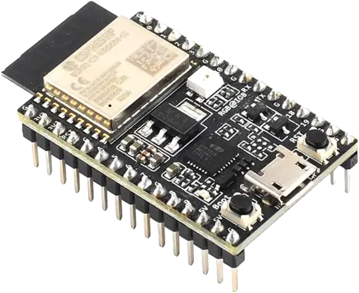

<!-- Copyright 2015-2026 Zephyr Project members and individual contributors. -->
<!-- SPDX-License-Identifier: Apache-2.0 -->
<!-- 中文翻译；编号、导航与译注为本地新增。 -->

<a id="esp32c3_devkitc"></a>

# 第18章\_ESP32-C3-DevKitC

原文：[官方页面](https://docs.zephyrproject.org/latest/boards/espressif/esp32c3_devkitc/doc/index.html)。读取日期：2026-10-16；来源摘要见[来源记录](../SOURCES.md)。

开发板概览（Board Overview）

<a id="id1"></a>

[](images/esp32c3_devkitc.webp)

ESP32-C3-DevKitC

名称（Name）：

`esp32c3_devkitc`

厂商（Vendor）：

[乐鑫信息科技（Espressif Systems）](https://docs.zephyrproject.org/latest/boards/index.html#vendor=espressif)

状态（Status）：

维护中（Maintained）

架构（Architecture）：

[riscv](https://docs.zephyrproject.org/latest/boards/index.html#arch=riscv)

片上系统（SoC）：

[`esp32c3`](https://docs.zephyrproject.org/latest/boards/index.html#soc=esp32c3)

<a id="board-github-link"></a>

[浏览开发板源码（Browse Board Sources）](https://github.com/zephyrproject-rtos/zephyr/blob/main//boards/espressif/esp32c3_devkitc/doc/index.rst/../..)<a id="overview"></a>

## 概述（Overview）

<a id="id13"></a>

[ESP32-C3-DevKitC](https://docs.espressif.com/projects/esp-dev-kits/en/latest/esp32c3/esp32-c3-devkitc-02/index.html)-02是一款入门级开发板，基于带4 MB SPI闪存的通用模块ESP32-C3-WROOM-02，集成完整Wi-Fi及低功耗蓝牙功能。更多信息见ESP32-C3-DevKitC[注6](#id12)。

<a id="hardware"></a>

## 硬件（Hardware）

<a id="esp32-c3-features"></a>

### ESP32-C3 特性（Features）

ESP32-C3 是基于开源 RISC-V 架构的单核微控制器 SoC，支持 Wi-Fi 和蓝牙 5（LE）。它兼顾功耗、I/O 能力和安全性，为联网设备提供具有成本效益的方案。Wi-Fi 与蓝牙 5（LE）连接能力既便于设备配置，也支持利用两种连接方式的多种应用场景。

其特性包括：


- 32 位 RISC-V 微控制器，最高时钟频率 160 MHz。
- 802.11b/g/n/
- 支持蓝牙 5 特性和蓝牙网状网络（Bluetooth Mesh）的 BLE 子系统。
- 384 KB 只读存储器（ROM）。
- 400 KB 静态随机存储器（SRAM），其中 16 KB 用于缓存（Cache）。
- 实时时钟（RTC）域内有 8 KB SRAM。
- 22 个可编程通用输入输出（GPIO）。
- 多种外设（Peripherals）：


  - 全速 USB 串行／JTAG 控制器（Full-Speed USB Serial/JTAG Controller）。
  - 兼容 CAN 2.0 总线的 TWAI 接口。
  - 通用直接存储器访问控制器（General DMA Controller，GDMA）。
  - 两个 12 位逐次逼近型模数转换器（SAR ADC），最多 6 个通道。
  - 3 个 SPI 接口。
  - 2 个 UART 接口。
  - 1 个 I2S 接口。
  - 1 个 I2C 接口。
  - 两个 54 位通用定时器（General-Purpose Timers）。
  - 三个看门狗定时器（Watchdog Timers）。
  - 一个 52 位系统定时器（System Timer）。
  - 远程控制外设（Remote Control Peripheral，RMT）。
  - 最多 6 个通道的 LED 脉宽调制控制器（LEDC）。
  - 温度传感器（Temperature Sensor）。
- 密码学硬件加速（Cryptographic Hardware Acceleration）：RNG、ECC、RSA、SHA-2、AES。

<a id="id3"></a>

<a id="id5"></a>

更多信息见 ESP32-C3 数据手册 [注1](#id2) 或 ESP32-C3 技术参考手册 [注2](#id4)。（[ESP32-C3数据手册（Datasheet）](https://www.espressif.com/sites/default/files/documentation/esp32-c3_datasheet_en.pdf)；[ESP32-C3技术参考手册（Technical Reference Manual）](https://espressif.com/sites/default/files/documentation/esp32-c3_technical_reference_manual_en.pdf)）

<a id="supported-features"></a>

### 支持的功能（Supported Features）

`esp32c3_devkitc`开发板支持下表所列的硬件功能。

片上／板载（On-Chip / On-Board）

功能集成在片上系统（SoC）内／位于开发板上。

2 / 2

分别表示已启用／已禁用的实例数。点击数量标签，可查看开发板或SoC设备树源码（DTS）中该功能的第一个实例。

`vnd,foo`

与此功能匹配的设备树绑定兼容字符串（Compatible String）；点击链接可查看绑定文档。

<a id="esp32c3_devkitc-hw-features"></a>

<a id="esp32c3_devkitc-esp32c3_devkitc/esp32c3-hw-features-section"></a>

#### `esp32c3_devkitc/esp32c3`目标（Target）

<a id="esp32c3_devkitc-esp32c3_devkitc/esp32c3-hw-features-panel"></a>

<a id="esp32c3_devkitc-esp32c3_devkitc/esp32c3-hw-features-memory"></a>

该开发板目标的片上存储容量：384 KiB RAM、4 MiB Flash。

<a id="esp32c3_devkitc-esp32c3_devkitc/esp32c3-hw-features-table"></a>

<table>
<tr>
<th>类型（Type）</th>
<th>位置（Location）</th>
<th>说明（Description）</th>
<th>兼容字符串（Compatible）</th>
</tr>
<tr>
<td rowspan="1">中央处理器（CPU）</td>
<td>片上（On-Chip）</td>
<td>乐鑫（Espressif）RISC-V处理器（CPU）（<a href="https://github.com/zephyrproject-rtos/zephyr/blob/main/dts/riscv/espressif/esp32c3/esp32c3_common.dtsi?plain=1#L34">已启用：1</a>）</td>
<td><a href="../cpu_cortex_xtensa_binding_reference/P024_espressif_riscv.md#std-dtcompatible-espressif-riscv"><code>espressif,riscv</code></a></td>
</tr>
<tr>
<td rowspan="1">模数转换器（ADC）</td>
<td>片上（On-Chip）</td>
<td>ESP32模数转换器（ADC）（<a href="https://github.com/zephyrproject-rtos/zephyr/blob/main/dts/riscv/espressif/esp32c3/esp32c3_common.dtsi?plain=1#L326">已禁用：1</a>）</td>
<td><a href="../hardware/P889_ESP32模数转换器绑定.md#dtbinding-espressif-esp32-adc"><code>espressif,esp32-adc</code></a></td>
</tr>
<tr>
<td rowspan="1">蓝牙（Bluetooth）</td>
<td>片上（On-Chip）</td>
<td>乐鑫（Espressif）ESP32蓝牙主机控制器接口（Bluetooth HCI）（<a href="https://github.com/zephyrproject-rtos/zephyr/blob/main/dts/riscv/espressif/esp32c3/esp32c3_common.dtsi?plain=1#L75">已启用：1</a>）</td>
<td><a href="../bluetooth_vendor_hci_binding_reference/P004_espressif_esp32-bt-hci.md#std-dtcompatible-espressif-esp32-bt-hci"><code>espressif,esp32-bt-hci</code></a></td>
</tr>
<tr>
<td rowspan="1">控制器局域网（CAN）</td>
<td>片上（On-Chip）</td>
<td>ESP32双线汽车接口（TWAI / Two-Wire Automotive Interface）（<a href="https://github.com/zephyrproject-rtos/zephyr/blob/main/dts/riscv/espressif/esp32c3/esp32c3_common.dtsi?plain=1#L282">已禁用：1</a>）</td>
<td><a href="../can_adi_atmel_nxp_binding_reference/P005_espressif_esp32-twai.md#std-dtcompatible-espressif-esp32-twai"><code>espressif,esp32-twai</code></a></td>
</tr>
<tr>
<td rowspan="1">时钟控制（Clock Control）</td>
<td>片上（On-Chip）</td>
<td>ESP32时钟模块（Clock Module，电源与时钟控制器模块 / Power &amp; Clock Controller Module）（<a href="https://github.com/zephyrproject-rtos/zephyr/blob/main/dts/riscv/espressif/esp32c3/esp32c3_common.dtsi?plain=1#L81">已启用：1</a>）</td>
<td><a href="../clock_esp_infineon_microchip_binding_reference/P004_espressif_esp32-clock.md#std-dtcompatible-espressif-esp32-clock"><code>espressif,esp32-clock</code></a></td>
</tr>
<tr>
<td rowspan="3">计数器（Counter）</td>
<td>片上（On-Chip）</td>
<td>基于RTC主定时器（Main Timer）的ESP32计数器驱动（Counter Driver）（<a href="https://github.com/zephyrproject-rtos/zephyr/blob/main/dts/riscv/espressif/esp32c3/esp32c3_common.dtsi?plain=1#L139">已禁用：1</a>）</td>
<td><a href="../counter_binding_reference/P016_espressif_esp32-rtc-timer.md#std-dtcompatible-espressif-esp32-rtc-timer"><code>espressif,esp32-rtc-timer</code></a></td>
</tr>
<tr>
<td>片上（On-Chip）</td>
<td>ESP32通用定时器（General-purpose Timers）（<a href="https://github.com/zephyrproject-rtos/zephyr/blob/main/dts/riscv/espressif/esp32c3/esp32c3_common.dtsi?plain=1#L243">已禁用：2</a>）</td>
<td><a href="../counter_binding_reference/P017_espressif_esp32-timer.md#std-dtcompatible-espressif-esp32-timer"><code>espressif,esp32-timer</code></a></td>
</tr>
<tr>
<td>片上（On-Chip）</td>
<td>ESP32计数器（Counters）（<a href="https://github.com/zephyrproject-rtos/zephyr/blob/main/dts/riscv/espressif/esp32c3/esp32c3_common.dtsi?plain=1#L253">已禁用：2</a>）</td>
<td><a href="../counter_binding_reference/P015_espressif_esp32-counter.md#std-dtcompatible-espressif-esp32-counter"><code>espressif,esp32-counter</code></a></td>
</tr>
<tr>
<td rowspan="2">密码学加速器（Cryptographic Accelerator）</td>
<td>片上（On-Chip）</td>
<td>乐鑫（Espressif）ESP32 SHA硬件加速器（Hardware Accelerator）（<a href="https://github.com/zephyrproject-rtos/zephyr/blob/main/dts/riscv/espressif/esp32c3/esp32c3_common.dtsi?plain=1#L350">已启用：1</a>）</td>
<td><a href="../crypto_aes_sha_ccm_binding_reference/P008_espressif_esp32-sha.md#std-dtcompatible-espressif-esp32-sha"><code>espressif,esp32-sha</code></a></td>
</tr>
<tr>
<td>片上（On-Chip）</td>
<td>乐鑫（Espressif）ESP32系列AES硬件加速器（Hardware Accelerator）（<a href="https://github.com/zephyrproject-rtos/zephyr/blob/main/dts/riscv/espressif/esp32c3/esp32c3_common.dtsi?plain=1#L357">已启用：1</a>）</td>
<td><a href="../crypto_aes_sha_ccm_binding_reference/P007_espressif_esp32-aes.md#std-dtcompatible-espressif-esp32-aes"><code>espressif,esp32-aes</code></a></td>
</tr>
<tr>
<td rowspan="1">直接存储器访问（DMA）</td>
<td>片上（On-Chip）</td>
<td>ESP32通用直接存储器访问（GDMA / General Direct Memory Access）（<a href="https://github.com/zephyrproject-rtos/zephyr/blob/main/dts/riscv/espressif/esp32c3/esp32c3_common.dtsi?plain=1#L336">已禁用：1</a>）</td>
<td><a href="../dma_binding_reference/P015_espressif_esp32-gdma.md#std-dtcompatible-espressif-esp32-gdma"><code>espressif,esp32-gdma</code></a></td>
</tr>
<tr>
<td rowspan="1">闪存控制器（Flash Controller）</td>
<td>片上（On-Chip）</td>
<td>ESP32闪存控制器（Flash Controller）（<a href="https://github.com/zephyrproject-rtos/zephyr/blob/main/dts/riscv/espressif/esp32c3/esp32c3_common.dtsi?plain=1#L148">已启用：1</a>）</td>
<td><a href="../flash_adi_microchip_nordic_binding_reference/P012_espressif_esp32-flash-controller.md#std-dtcompatible-espressif-esp32-flash-controller"><code>espressif,esp32-flash-controller</code></a></td>
</tr>
<tr>
<td rowspan="1">通用输入输出与接插件（GPIO &amp; Headers）</td>
<td>片上（On-Chip）</td>
<td>ESP32通用输入输出控制器（GPIO Controller）（<a href="https://github.com/zephyrproject-rtos/zephyr/blob/main/dts/riscv/espressif/esp32c3/esp32c3_common.dtsi?plain=1#L166">已启用：1</a>）</td>
<td><a href="../gpio_connectors_bflb_esp_binding_reference/P022_espressif_esp32-gpio.md#std-dtcompatible-espressif-esp32-gpio"><code>espressif,esp32-gpio</code></a></td>
</tr>
<tr>
<td rowspan="1">集成电路间总线（I2C）</td>
<td>片上（On-Chip）</td>
<td>ESP32 I2C控制器（<a href="https://github.com/zephyrproject-rtos/zephyr/blob/main/dts/riscv/espressif/esp32c3/esp32c3_common.dtsi?plain=1#L181">已启用：1</a>）</td>
<td><a href="../i2c_adi_atmel_esp_binding_reference/P018_espressif_esp32-i2c.md#std-dtcompatible-espressif-esp32-i2c"><code>espressif,esp32-i2c</code></a></td>
</tr>
<tr>
<td rowspan="1">集成电路间音频总线（I2S）</td>
<td>片上（On-Chip）</td>
<td>ESP32芯片间音频接口（I2S）（<a href="https://github.com/zephyrproject-rtos/zephyr/blob/main/dts/riscv/espressif/esp32c3/esp32c3_common.dtsi?plain=1#L192">已禁用：1</a>）</td>
<td><a href="../i2s_binding_reference/P003_espressif_esp32-i2s.md#std-dtcompatible-espressif-esp32-i2s"><code>espressif,esp32-i2s</code></a></td>
</tr>
<tr>
<td rowspan="1">输入（Input）</td>
<td>板载（On-Board）</td>
<td>一组绑定到 GPIO 的输入按键（GPIO-Bound Input Keys）（<a href="https://github.com/zephyrproject-rtos/zephyr/blob/main/boards/espressif/esp32c3_devkitc/esp32c3_devkitc.dts?plain=1#L33">已启用：1</a>）</td>
<td><a href="../hardware/P563_GPIO按键绑定.md#std-dtcompatible-gpio-keys"><code>gpio-keys</code></a></td>
</tr>
<tr>
<td rowspan="1">中断控制器（Interrupt Controller）</td>
<td>片上（On-Chip）</td>
<td>ESP32中断控制器（Interrupt Controller）（<a href="https://github.com/zephyrproject-rtos/zephyr/blob/main/dts/riscv/espressif/esp32c3/esp32c3_common.dtsi?plain=1#L113">已启用：1</a>）</td>
<td><a href="../soc_interrupt_binding_reference/P005_espressif_esp32-intc.md#std-dtcompatible-espressif-esp32-intc"><code>espressif,esp32-intc</code></a></td>
</tr>
<tr>
<td rowspan="1">存储技术设备（MTD）</td>
<td>片上（On-Chip）</td>
<td>闪存（Flash）节点（<a href="https://github.com/zephyrproject-rtos/zephyr/blob/main/dts/riscv/espressif/esp32c3/esp32c3_common.dtsi?plain=1#L156">已启用：1</a>）</td>
<td><a href="../mtd_nxp_st_ti_partition_binding_reference/P013_soc-nv-flash.md#std-dtcompatible-soc-nv-flash"><code>soc-nv-flash</code></a></td>
</tr>
<tr>
<td rowspan="1">引脚控制（Pin Control）</td>
<td>片上（On-Chip）</td>
<td>ESP32引脚控制器（Pin Controller）（<a href="https://github.com/zephyrproject-rtos/zephyr/blob/main/dts/riscv/espressif/esp32c3/esp32c3_common.dtsi?plain=1#L65">已启用：1</a>）</td>
<td><a href="../pinctrl_adi_ambiq_arm_binding_reference/P022_espressif_esp32-pinctrl.md#std-dtcompatible-espressif-esp32-pinctrl"><code>espressif,esp32-pinctrl</code></a></td>
</tr>
<tr>
<td rowspan="1">脉冲输入输出（Pulse IO）</td>
<td>片上（On-Chip）</td>
<td>乐鑫遥控收发器（RMT / Remote Control Transceiver）pulse_io控制器（<a href="https://github.com/zephyrproject-rtos/zephyr/blob/main/dts/riscv/espressif/esp32c3/esp32c3_common.dtsi?plain=1#L364">已禁用：1</a>）</td>
<td><a href="../platform_rmt_openthread_binding_reference/P008_espressif_esp32-rmt.md#std-dtcompatible-espressif-esp32-rmt"><code>espressif,esp32-rmt</code></a></td>
</tr>
<tr>
<td rowspan="1">脉宽调制（PWM）</td>
<td>片上（On-Chip）</td>
<td>ESP32 LED控制（LEDC / LED Control）（<a href="https://github.com/zephyrproject-rtos/zephyr/blob/main/dts/riscv/espressif/esp32c3/esp32c3_common.dtsi?plain=1#L225">已禁用：1</a>）</td>
<td><a href="../pwm_adi_esp_infineon_binding_reference/P015_espressif_esp32-ledc.md#std-dtcompatible-espressif-esp32-ledc"><code>espressif,esp32-ledc</code></a></td>
</tr>
<tr>
<td rowspan="1">随机数生成器（RNG）</td>
<td>片上（On-Chip）</td>
<td>ESP32真随机数发生器（TRNG / True Random Number Generator）（<a href="https://github.com/zephyrproject-rtos/zephyr/blob/main/dts/riscv/espressif/esp32c3/esp32c3_common.dtsi?plain=1#L275">已启用：1</a>）</td>
<td><a href="../rng_binding_reference/P007_espressif_esp32-trng.md#std-dtcompatible-espressif-esp32-trng"><code>espressif,esp32-trng</code></a></td>
</tr>
<tr>
<td rowspan="1">传感器（Sensors）</td>
<td>片上（On-Chip）</td>
<td>ESP32内部温度传感器（Internal Temperature Sensor）（<a href="https://github.com/zephyrproject-rtos/zephyr/blob/main/dts/riscv/espressif/esp32c3/esp32c3_common.dtsi?plain=1#L319">已禁用：1</a>）</td>
<td><a href="../sensor_espressif_honeywell_invensense_binding_reference/P001_espressif_esp32-temp.md#std-dtcompatible-espressif-esp32-temp"><code>espressif,esp32-temp</code></a></td>
</tr>
<tr>
<td rowspan="2">串行控制器（Serial Controller）</td>
<td>片上（On-Chip）</td>
<td>ESP32通用异步收发器（UART）（<a href="https://github.com/zephyrproject-rtos/zephyr/blob/main/dts/riscv/espressif/esp32c3/esp32c3_common.dtsi?plain=1#L206">已启用：1</a>；<a href="https://github.com/zephyrproject-rtos/zephyr/blob/main/dts/riscv/espressif/esp32c3/esp32c3_common.dtsi?plain=1#L215">已禁用：1</a>）</td>
<td><a href="../uart_espressif_infineon_microchip_binding_reference/P002_espressif_esp32-uart.md#std-dtcompatible-espressif-esp32-uart"><code>espressif,esp32-uart</code></a></td>
</tr>
<tr>
<td>片上（On-Chip）</td>
<td>ESP32通用异步收发器（UART）（<a href="https://github.com/zephyrproject-rtos/zephyr/blob/main/dts/riscv/espressif/esp32c3/esp32c3_common.dtsi?plain=1#L234">已启用：1</a>）</td>
<td><a href="../uart_espressif_infineon_microchip_binding_reference/P003_espressif_esp32-usb-serial.md#std-dtcompatible-espressif-esp32-usb-serial"><code>espressif,esp32-usb-serial</code></a></td>
</tr>
<tr>
<td rowspan="1">串行外设接口（SPI）</td>
<td>片上（On-Chip）</td>
<td>ESP32串行外设接口控制器（SPI Controller）（<a href="https://github.com/zephyrproject-rtos/zephyr/blob/main/dts/riscv/espressif/esp32c3/esp32c3_common.dtsi?plain=1#L291">已启用：1</a>）</td>
<td><a href="../spi_adi_atmel_esp_binding_reference/P014_espressif_esp32-spi.md#std-dtcompatible-espressif-esp32-spi"><code>espressif,esp32-spi</code></a></td>
</tr>
<tr>
<td rowspan="1">定时器（Timer）</td>
<td>片上（On-Chip）</td>
<td>ESP32系统定时器（System Timer）（<a href="https://github.com/zephyrproject-rtos/zephyr/blob/main/dts/riscv/espressif/esp32c3/esp32c3_common.dtsi?plain=1#L122">已启用：1</a>）</td>
<td><a href="../mcu_timer_binding_reference/P004_espressif_esp32-systimer.md#std-dtcompatible-espressif-esp32-systimer"><code>espressif,esp32-systimer</code></a></td>
</tr>
<tr>
<td rowspan="2">看门狗（Watchdog）</td>
<td>片上（On-Chip）</td>
<td>ESP32 XT看门狗定时器（Watchdog Timer）（<a href="https://github.com/zephyrproject-rtos/zephyr/blob/main/dts/riscv/espressif/esp32c3/esp32c3_common.dtsi?plain=1#L130">已禁用：1</a>）</td>
<td><a href="../watchdog_binding_reference/P014_espressif_esp32-xt-wdt.md#std-dtcompatible-espressif-esp32-xt-wdt"><code>espressif,esp32-xt-wdt</code></a></td>
</tr>
<tr>
<td>片上（On-Chip）</td>
<td>ESP32看门狗（Watchdog）（<a href="https://github.com/zephyrproject-rtos/zephyr/blob/main/dts/riscv/espressif/esp32c3/esp32c3_common.dtsi?plain=1#L301">已启用：1</a>；<a href="https://github.com/zephyrproject-rtos/zephyr/blob/main/dts/riscv/espressif/esp32c3/esp32c3_common.dtsi?plain=1#L310">已禁用：1</a>）</td>
<td><a href="../watchdog_binding_reference/P013_espressif_esp32-watchdog.md#std-dtcompatible-espressif-esp32-watchdog"><code>espressif,esp32-watchdog</code></a></td>
</tr>
<tr>
<td rowspan="1">无线局域网（Wi-Fi）</td>
<td>片上（On-Chip）</td>
<td>ESP32片上系统（SoC）Wi-Fi（<a href="https://github.com/zephyrproject-rtos/zephyr/blob/main/dts/riscv/espressif/esp32c3/esp32c3_common.dtsi?plain=1#L70">已启用：1</a>）</td>
<td><a href="../wifi_esp_hosted_airoc_binding_reference/P009_espressif_esp32-wifi.md#std-dtcompatible-espressif-esp32-wifi"><code>espressif,esp32-wifi</code></a></td>
</tr>
</table>

<a id="esp32c3_devkitc-esp32c3_devkitc/esp32c3/qemu-hw-features-section"></a>

#### `esp32c3_devkitc/esp32c3/qemu`目标（Target）

<a id="esp32c3_devkitc-esp32c3_devkitc/esp32c3/qemu-hw-features-panel"></a>

<a id="esp32c3_devkitc-esp32c3_devkitc/esp32c3/qemu-hw-features-memory"></a>

该开发板目标的片上存储容量：384 KiB RAM、4 MiB Flash。

<a id="esp32c3_devkitc-esp32c3_devkitc/esp32c3/qemu-hw-features-table"></a>

<table>
<tr>
<th>类型（Type）</th>
<th>位置（Location）</th>
<th>说明（Description）</th>
<th>兼容字符串（Compatible）</th>
</tr>
<tr>
<td rowspan="1">中央处理器（CPU）</td>
<td>片上（On-Chip）</td>
<td>乐鑫（Espressif）RISC-V处理器（CPU）（<a href="https://github.com/zephyrproject-rtos/zephyr/blob/main/dts/riscv/espressif/esp32c3/esp32c3_common.dtsi?plain=1#L34">已启用：1</a>）</td>
<td><a href="../cpu_cortex_xtensa_binding_reference/P024_espressif_riscv.md#std-dtcompatible-espressif-riscv"><code>espressif,riscv</code></a></td>
</tr>
<tr>
<td rowspan="1">模数转换器（ADC）</td>
<td>片上（On-Chip）</td>
<td>ESP32模数转换器（ADC）（<a href="https://github.com/zephyrproject-rtos/zephyr/blob/main/dts/riscv/espressif/esp32c3/esp32c3_common.dtsi?plain=1#L326">已禁用：1</a>）</td>
<td><a href="../hardware/P889_ESP32模数转换器绑定.md#dtbinding-espressif-esp32-adc"><code>espressif,esp32-adc</code></a></td>
</tr>
<tr>
<td rowspan="1">蓝牙（Bluetooth）</td>
<td>片上（On-Chip）</td>
<td>乐鑫（Espressif）ESP32蓝牙主机控制器接口（Bluetooth HCI）（<a href="https://github.com/zephyrproject-rtos/zephyr/blob/main/dts/riscv/espressif/esp32c3/esp32c3_common.dtsi?plain=1#L75">已禁用：1</a>）</td>
<td><a href="../bluetooth_vendor_hci_binding_reference/P004_espressif_esp32-bt-hci.md#std-dtcompatible-espressif-esp32-bt-hci"><code>espressif,esp32-bt-hci</code></a></td>
</tr>
<tr>
<td rowspan="1">控制器局域网（CAN）</td>
<td>片上（On-Chip）</td>
<td>ESP32双线汽车接口（TWAI / Two-Wire Automotive Interface）（<a href="https://github.com/zephyrproject-rtos/zephyr/blob/main/dts/riscv/espressif/esp32c3/esp32c3_common.dtsi?plain=1#L282">已禁用：1</a>）</td>
<td><a href="../can_adi_atmel_nxp_binding_reference/P005_espressif_esp32-twai.md#std-dtcompatible-espressif-esp32-twai"><code>espressif,esp32-twai</code></a></td>
</tr>
<tr>
<td rowspan="1">时钟控制（Clock Control）</td>
<td>片上（On-Chip）</td>
<td>ESP32时钟模块（Clock Module，电源与时钟控制器模块 / Power &amp; Clock Controller Module）（<a href="https://github.com/zephyrproject-rtos/zephyr/blob/main/dts/riscv/espressif/esp32c3/esp32c3_common.dtsi?plain=1#L81">已启用：1</a>）</td>
<td><a href="../clock_esp_infineon_microchip_binding_reference/P004_espressif_esp32-clock.md#std-dtcompatible-espressif-esp32-clock"><code>espressif,esp32-clock</code></a></td>
</tr>
<tr>
<td rowspan="3">计数器（Counter）</td>
<td>片上（On-Chip）</td>
<td>基于RTC主定时器（Main Timer）的ESP32计数器驱动（Counter Driver）（<a href="https://github.com/zephyrproject-rtos/zephyr/blob/main/dts/riscv/espressif/esp32c3/esp32c3_common.dtsi?plain=1#L139">已禁用：1</a>）</td>
<td><a href="../counter_binding_reference/P016_espressif_esp32-rtc-timer.md#std-dtcompatible-espressif-esp32-rtc-timer"><code>espressif,esp32-rtc-timer</code></a></td>
</tr>
<tr>
<td>片上（On-Chip）</td>
<td>ESP32通用定时器（General-purpose Timers）（<a href="https://github.com/zephyrproject-rtos/zephyr/blob/main/dts/riscv/espressif/esp32c3/esp32c3_common.dtsi?plain=1#L243">已禁用：2</a>）</td>
<td><a href="../counter_binding_reference/P017_espressif_esp32-timer.md#std-dtcompatible-espressif-esp32-timer"><code>espressif,esp32-timer</code></a></td>
</tr>
<tr>
<td>片上（On-Chip）</td>
<td>ESP32计数器（Counters）（<a href="https://github.com/zephyrproject-rtos/zephyr/blob/main/dts/riscv/espressif/esp32c3/esp32c3_common.dtsi?plain=1#L253">已禁用：2</a>）</td>
<td><a href="../counter_binding_reference/P015_espressif_esp32-counter.md#std-dtcompatible-espressif-esp32-counter"><code>espressif,esp32-counter</code></a></td>
</tr>
<tr>
<td rowspan="2">密码学加速器（Cryptographic Accelerator）</td>
<td>片上（On-Chip）</td>
<td>乐鑫（Espressif）ESP32 SHA硬件加速器（Hardware Accelerator）（<a href="https://github.com/zephyrproject-rtos/zephyr/blob/main/dts/riscv/espressif/esp32c3/esp32c3_common.dtsi?plain=1#L350">已启用：1</a>）</td>
<td><a href="../crypto_aes_sha_ccm_binding_reference/P008_espressif_esp32-sha.md#std-dtcompatible-espressif-esp32-sha"><code>espressif,esp32-sha</code></a></td>
</tr>
<tr>
<td>片上（On-Chip）</td>
<td>乐鑫（Espressif）ESP32系列AES硬件加速器（Hardware Accelerator）（<a href="https://github.com/zephyrproject-rtos/zephyr/blob/main/dts/riscv/espressif/esp32c3/esp32c3_common.dtsi?plain=1#L357">已启用：1</a>）</td>
<td><a href="../crypto_aes_sha_ccm_binding_reference/P007_espressif_esp32-aes.md#std-dtcompatible-espressif-esp32-aes"><code>espressif,esp32-aes</code></a></td>
</tr>
<tr>
<td rowspan="1">直接存储器访问（DMA）</td>
<td>片上（On-Chip）</td>
<td>ESP32通用直接存储器访问（GDMA / General Direct Memory Access）（<a href="https://github.com/zephyrproject-rtos/zephyr/blob/main/dts/riscv/espressif/esp32c3/esp32c3_common.dtsi?plain=1#L336">已禁用：1</a>）</td>
<td><a href="../dma_binding_reference/P015_espressif_esp32-gdma.md#std-dtcompatible-espressif-esp32-gdma"><code>espressif,esp32-gdma</code></a></td>
</tr>
<tr>
<td rowspan="1">闪存控制器（Flash Controller）</td>
<td>片上（On-Chip）</td>
<td>ESP32闪存控制器（Flash Controller）（<a href="https://github.com/zephyrproject-rtos/zephyr/blob/main/dts/riscv/espressif/esp32c3/esp32c3_common.dtsi?plain=1#L148">已启用：1</a>）</td>
<td><a href="../flash_adi_microchip_nordic_binding_reference/P012_espressif_esp32-flash-controller.md#std-dtcompatible-espressif-esp32-flash-controller"><code>espressif,esp32-flash-controller</code></a></td>
</tr>
<tr>
<td rowspan="1">通用输入输出与接插件（GPIO &amp; Headers）</td>
<td>片上（On-Chip）</td>
<td>ESP32通用输入输出控制器（GPIO Controller）（<a href="https://github.com/zephyrproject-rtos/zephyr/blob/main/dts/riscv/espressif/esp32c3/esp32c3_common.dtsi?plain=1#L166">已启用：1</a>）</td>
<td><a href="../gpio_connectors_bflb_esp_binding_reference/P022_espressif_esp32-gpio.md#std-dtcompatible-espressif-esp32-gpio"><code>espressif,esp32-gpio</code></a></td>
</tr>
<tr>
<td rowspan="1">集成电路间总线（I2C）</td>
<td>片上（On-Chip）</td>
<td>ESP32 I2C控制器（<a href="https://github.com/zephyrproject-rtos/zephyr/blob/main/dts/riscv/espressif/esp32c3/esp32c3_common.dtsi?plain=1#L181">已禁用：1</a>）</td>
<td><a href="../i2c_adi_atmel_esp_binding_reference/P018_espressif_esp32-i2c.md#std-dtcompatible-espressif-esp32-i2c"><code>espressif,esp32-i2c</code></a></td>
</tr>
<tr>
<td rowspan="1">集成电路间音频总线（I2S）</td>
<td>片上（On-Chip）</td>
<td>ESP32芯片间音频接口（I2S）（<a href="https://github.com/zephyrproject-rtos/zephyr/blob/main/dts/riscv/espressif/esp32c3/esp32c3_common.dtsi?plain=1#L192">已禁用：1</a>）</td>
<td><a href="../i2s_binding_reference/P003_espressif_esp32-i2s.md#std-dtcompatible-espressif-esp32-i2s"><code>espressif,esp32-i2s</code></a></td>
</tr>
<tr>
<td rowspan="1">中断控制器（Interrupt Controller）</td>
<td>片上（On-Chip）</td>
<td>ESP32中断控制器（Interrupt Controller）（<a href="https://github.com/zephyrproject-rtos/zephyr/blob/main/dts/riscv/espressif/esp32c3/esp32c3_common.dtsi?plain=1#L113">已启用：1</a>）</td>
<td><a href="../soc_interrupt_binding_reference/P005_espressif_esp32-intc.md#std-dtcompatible-espressif-esp32-intc"><code>espressif,esp32-intc</code></a></td>
</tr>
<tr>
<td rowspan="1">存储技术设备（MTD）</td>
<td>片上（On-Chip）</td>
<td>闪存（Flash）节点（<a href="https://github.com/zephyrproject-rtos/zephyr/blob/main/dts/riscv/espressif/esp32c3/esp32c3_common.dtsi?plain=1#L156">已启用：1</a>）</td>
<td><a href="../mtd_nxp_st_ti_partition_binding_reference/P013_soc-nv-flash.md#std-dtcompatible-soc-nv-flash"><code>soc-nv-flash</code></a></td>
</tr>
<tr>
<td rowspan="1">引脚控制（Pin Control）</td>
<td>片上（On-Chip）</td>
<td>ESP32引脚控制器（Pin Controller）（<a href="https://github.com/zephyrproject-rtos/zephyr/blob/main/dts/riscv/espressif/esp32c3/esp32c3_common.dtsi?plain=1#L65">已启用：1</a>）</td>
<td><a href="../pinctrl_adi_ambiq_arm_binding_reference/P022_espressif_esp32-pinctrl.md#std-dtcompatible-espressif-esp32-pinctrl"><code>espressif,esp32-pinctrl</code></a></td>
</tr>
<tr>
<td rowspan="1">脉冲输入输出（Pulse IO）</td>
<td>片上（On-Chip）</td>
<td>乐鑫遥控收发器（RMT / Remote Control Transceiver）pulse_io控制器（<a href="https://github.com/zephyrproject-rtos/zephyr/blob/main/dts/riscv/espressif/esp32c3/esp32c3_common.dtsi?plain=1#L364">已禁用：1</a>）</td>
<td><a href="../platform_rmt_openthread_binding_reference/P008_espressif_esp32-rmt.md#std-dtcompatible-espressif-esp32-rmt"><code>espressif,esp32-rmt</code></a></td>
</tr>
<tr>
<td rowspan="1">脉宽调制（PWM）</td>
<td>片上（On-Chip）</td>
<td>ESP32 LED控制（LEDC / LED Control）（<a href="https://github.com/zephyrproject-rtos/zephyr/blob/main/dts/riscv/espressif/esp32c3/esp32c3_common.dtsi?plain=1#L225">已禁用：1</a>）</td>
<td><a href="../pwm_adi_esp_infineon_binding_reference/P015_espressif_esp32-ledc.md#std-dtcompatible-espressif-esp32-ledc"><code>espressif,esp32-ledc</code></a></td>
</tr>
<tr>
<td rowspan="1">随机数生成器（RNG）</td>
<td>片上（On-Chip）</td>
<td>ESP32真随机数发生器（TRNG / True Random Number Generator）（<a href="https://github.com/zephyrproject-rtos/zephyr/blob/main/dts/riscv/espressif/esp32c3/esp32c3_common.dtsi?plain=1#L275">已启用：1</a>）</td>
<td><a href="../rng_binding_reference/P007_espressif_esp32-trng.md#std-dtcompatible-espressif-esp32-trng"><code>espressif,esp32-trng</code></a></td>
</tr>
<tr>
<td rowspan="1">传感器（Sensors）</td>
<td>片上（On-Chip）</td>
<td>ESP32内部温度传感器（Internal Temperature Sensor）（<a href="https://github.com/zephyrproject-rtos/zephyr/blob/main/dts/riscv/espressif/esp32c3/esp32c3_common.dtsi?plain=1#L319">已禁用：1</a>）</td>
<td><a href="../sensor_espressif_honeywell_invensense_binding_reference/P001_espressif_esp32-temp.md#std-dtcompatible-espressif-esp32-temp"><code>espressif,esp32-temp</code></a></td>
</tr>
<tr>
<td rowspan="2">串行控制器（Serial Controller）</td>
<td>片上（On-Chip）</td>
<td>ESP32通用异步收发器（UART）（<a href="https://github.com/zephyrproject-rtos/zephyr/blob/main/dts/riscv/espressif/esp32c3/esp32c3_common.dtsi?plain=1#L206">已启用：1</a>；<a href="https://github.com/zephyrproject-rtos/zephyr/blob/main/dts/riscv/espressif/esp32c3/esp32c3_common.dtsi?plain=1#L215">已禁用：1</a>）</td>
<td><a href="../uart_espressif_infineon_microchip_binding_reference/P002_espressif_esp32-uart.md#std-dtcompatible-espressif-esp32-uart"><code>espressif,esp32-uart</code></a></td>
</tr>
<tr>
<td>片上（On-Chip）</td>
<td>ESP32通用异步收发器（UART）（<a href="https://github.com/zephyrproject-rtos/zephyr/blob/main/dts/riscv/espressif/esp32c3/esp32c3_common.dtsi?plain=1#L234">已禁用：1</a>）</td>
<td><a href="../uart_espressif_infineon_microchip_binding_reference/P003_espressif_esp32-usb-serial.md#std-dtcompatible-espressif-esp32-usb-serial"><code>espressif,esp32-usb-serial</code></a></td>
</tr>
<tr>
<td rowspan="1">串行外设接口（SPI）</td>
<td>片上（On-Chip）</td>
<td>ESP32串行外设接口控制器（SPI Controller）（<a href="https://github.com/zephyrproject-rtos/zephyr/blob/main/dts/riscv/espressif/esp32c3/esp32c3_common.dtsi?plain=1#L291">已禁用：1</a>）</td>
<td><a href="../spi_adi_atmel_esp_binding_reference/P014_espressif_esp32-spi.md#std-dtcompatible-espressif-esp32-spi"><code>espressif,esp32-spi</code></a></td>
</tr>
<tr>
<td rowspan="1">定时器（Timer）</td>
<td>片上（On-Chip）</td>
<td>ESP32系统定时器（System Timer）（<a href="https://github.com/zephyrproject-rtos/zephyr/blob/main/dts/riscv/espressif/esp32c3/esp32c3_common.dtsi?plain=1#L122">已启用：1</a>）</td>
<td><a href="../mcu_timer_binding_reference/P004_espressif_esp32-systimer.md#std-dtcompatible-espressif-esp32-systimer"><code>espressif,esp32-systimer</code></a></td>
</tr>
<tr>
<td rowspan="2">看门狗（Watchdog）</td>
<td>片上（On-Chip）</td>
<td>ESP32 XT看门狗定时器（Watchdog Timer）（<a href="https://github.com/zephyrproject-rtos/zephyr/blob/main/dts/riscv/espressif/esp32c3/esp32c3_common.dtsi?plain=1#L130">已禁用：1</a>）</td>
<td><a href="../watchdog_binding_reference/P014_espressif_esp32-xt-wdt.md#std-dtcompatible-espressif-esp32-xt-wdt"><code>espressif,esp32-xt-wdt</code></a></td>
</tr>
<tr>
<td>片上（On-Chip）</td>
<td>ESP32看门狗（Watchdog）（<a href="https://github.com/zephyrproject-rtos/zephyr/blob/main/dts/riscv/espressif/esp32c3/esp32c3_common.dtsi?plain=1#L301">已启用：1</a>；<a href="https://github.com/zephyrproject-rtos/zephyr/blob/main/dts/riscv/espressif/esp32c3/esp32c3_common.dtsi?plain=1#L310">已禁用：1</a>）</td>
<td><a href="../watchdog_binding_reference/P013_espressif_esp32-watchdog.md#std-dtcompatible-espressif-esp32-watchdog"><code>espressif,esp32-watchdog</code></a></td>
</tr>
<tr>
<td rowspan="1">无线局域网（Wi-Fi）</td>
<td>片上（On-Chip）</td>
<td>ESP32片上系统（SoC）Wi-Fi（<a href="https://github.com/zephyrproject-rtos/zephyr/blob/main/dts/riscv/espressif/esp32c3/esp32c3_common.dtsi?plain=1#L70">已禁用：1</a>）</td>
<td><a href="../wifi_esp_hosted_airoc_binding_reference/P009_espressif_esp32-wifi.md#std-dtcompatible-espressif-esp32-wifi"><code>espressif,esp32-wifi</code></a></td>
</tr>
</table>

<a id="system-requirements"></a>

## 系统要求（System Requirements）

<a id="binary-blobs"></a>

### 二进制组件（Binary Blobs）

Espressif 硬件抽象层（HAL）需要射频（RF）二进制组件才能工作。运行下面的命令获取这些文件。

```text
west blobs fetch hal_espressif
```

注意（Note）

建议在 `west update` 之后运行上述命令。

<a id="programming-and-debugging"></a>

## 烧录与调试（Programming and Debugging）

`esp32c3_devkitc`开发板支持下表所列的运行工具（Runners）及相关west命令。

<table>
<tr>
<th></th>
<th>烧录（flash）</th>
<th>调试（debug）</th>
<th>连接调试会话（attach）</th>
<th>实时传输（rtt）</th>
<th>调试服务器（debugserver）</th>
</tr>
<tr>
<td><code>esp32</code></td>
<td>✅（默认 / default）</td>
<td></td>
<td></td>
<td></td>
<td></td>
</tr>
<tr>
<td><a href="https://docs.zephyrproject.org/latest/develop/flash_debug/host-tools.html#runner-openocd">openocd</a></td>
<td>✅</td>
<td>✅（默认 / default）</td>
<td>✅</td>
<td>✅</td>
<td>✅</td>
</tr>
</table>

<a id="simple-boot"></a>

### 简单启动（Simple Boot）

可以通过单一二进制镜像加载开发板，无需第二阶段引导加载程序（2nd-Stage Bootloader）。构建应用时没有附加配置，默认使用此方式。

注意（Note）

简单启动不提供安全功能，也不提供空中更新（Over-the-Air，OTA）。

<a id="mcuboot-bootloader"></a>

### MCUboot 引导加载程序（MCUboot Bootloader）

也可选择 MCUboot；此时必须至少构建并烧录一次引导加载程序。

构建应用有两种选择：


1. 系统构建（Sysbuild）
2. 手动构建（Manual Build）

注意（Note）

在开发板默认配置文件加入下面一行即可选择 MCUboot 引导加载程序。

```text
CONFIG_BOOTLOADER_MCUBOOT=y
```

<a id="sysbuild"></a>

### 系统构建（Sysbuild）

Sysbuild 可以统一构建并烧录启动 ESP32 SoC 开发板所需的全部镜像。

使用 Sysbuild 构建示例应用的命令如下：

```text
west build -b <board> --sysbuild samples/hello_world
```

默认情况下，ESP32 Sysbuild 生成引导加载程序（MCUboot）与应用镜像；也可配置为生成其他类型的镜像。

Sysbuild 生成的构建目录结构与传统 Zephyr 构建不同，输出按域（Domain）子目录组织：

```text
build/
├── hello_world
│   └── zephyr
│       ├── zephyr.elf
│       └── zephyr.bin
├── mcuboot
│    └── zephyr
│       ├── zephyr.elf
│       └── zephyr.bin
└── domains.yaml
```

注意（Note）

使用 `--sysbuild` 时，每次执行全新构建（Pristine Build）都会重新构建并重新烧录引导加载程序。

系统构建的更多信息见 Sysbuild（System Build）文档。（[系统构建（Sysbuild / System Build）](../sysbuild/P001_系统构建.md#sysbuild)）

<a id="manual-build"></a>

### 手动构建（Manual Build）

开发期间通常希望尽可能快地构建和烧录，因此可采用传统构建方式，每次只构建一个镜像。

以下说明同时适用于手动构建与 Sysbuild，区别仅在构建目录结构。

注意（Note）

请记住，必须至少烧录一次 MCUboot 引导加载程序。

按通常方式构建并烧录应用，详见“构建应用”（[Building an Application](../application/P001_应用开发.md#build-an-application)）与“运行应用”（[Run an Application](https://docs.zephyrproject.org/latest/develop/application/index.html#application-run)）。

```text
# From the root of the zephyr repository
west build -b <board> samples/hello_world
```

常规 `flash` 目标适用于此开发板配置。下面以 [Hello World](../getting_started/P005_HelloWorld示例.md#hello_world) 应用为例。

```text
# From the root of the zephyr repository
west build -b <board> samples/hello_world
west flash
```

注意（Note）

对于提供内置 USB Serial/JTAG 控制器的目标，芯片在 `west flash` 后可能仍处于下载模式，直到重新断电上电才启动新镜像。遇到此情况，可在烧录时选择看门狗复位（Watchdog Reset），使芯片自行重新启动：

```text
west flash --reset-type watchdog-reset
```

<a id="faster-flashing"></a>

### 加快烧录（Faster Flashing）

`--esp-skip-flashed` 在设备上进行 MD5 校验；若闪存中的二进制文件与待烧录文件相同，就跳过写入，加快开发过程：

```text
west flash --esp-skip-flashed
```

`--esp-diff` 仅写入相对于上次烧录镜像发生变化的区域，可进一步加快重复烧录。它与本地缓存副本比较，而不读取设备；因此仅当自上次 `west flash` 以来，闪存未被其他工具、其他开发板或手动写操作修改时使用：

```text
west flash --esp-diff
```

可关闭进度输出，使日志更简洁，适合持续集成（CI）：

```text
west flash --esp-no-progress
```

使用以下命令打开串口监视器（Serial Monitor）：

```text
west espressif monitor
```

开发板自动复位并启动后，监视器应显示以下消息：

```text
***** Booting Zephyr OS vx.x.x-xxx-gxxxxxxxxxxxx *****
Hello World! <board>
```

<a id="using-espressif-qemu"></a>

### 使用乐鑫QEMU（Using Espressif QEMU）

乐鑫开发板可在Espressif维护的QEMU分支中运行，进行无需硬件的本地测试。[`CONFIG_ESPRESSIF_QEMU`](https://docs.zephyrproject.org/latest/kconfig.html#CONFIG_ESPRESSIF_QEMU)会生成合并的SPI闪存镜像，启用它时还会选择隐藏的开发板标记[`CONFIG_ESPRESSIF_QEMU_TARGET`](https://docs.zephyrproject.org/latest/kconfig.html#CONFIG_ESPRESSIF_QEMU_TARGET)。只有开发板接入`espressif_qemu`仿真平台（Emu Platform）后，才有`west build -t run`目标；下列DevKitC开发板通过共享的`board.cmake`辅助文件完成接入。（[乐鑫QEMU分支（Fork）](https://github.com/espressif/qemu)）

参考DevKitC开发板有两种启用乐鑫QEMU的方式：


1. 在硬件开发板目标上指定`-DCONFIG_ESPRESSIF_QEMU=y`来启用。同一固件镜像随后可以烧录到实板（不使用该选项），也可以在QEMU中运行。基于受支持SoC的其他开发板也可设置此Kconfig选项来导出闪存布局，但要使用`-t run`，还需同样通过`SUPPORTED_EMU_PLATFORMS`接入`espressif_qemu`。
2. 使用下列参考DevKitC目标的开发板变体（Board Variant），即`/qemu`限定符。变体defconfig已设置[`CONFIG_ESPRESSIF_QEMU`](https://docs.zephyrproject.org/latest/kconfig.html#CONFIG_ESPRESSIF_QEMU)，无需额外指定`-D`，可用于本地及持续集成（CI）的`west build -t run`流程。Twister仿真方面，尚未接入Espressif QEMU元数据；应将`/qemu`视为开发板标识加仿真平台，不能直接替代标准`qemu_*` Twister仿真。

<a id="supported-socs-and-boards"></a>

#### 受支持的SoC与开发板（Supported SoCs and Boards）

<table>
<tr>
<th>片上系统（SoC）</th>
<th>硬件开发板（Hardware Board）</th>
<th>QEMU变体，持续集成（CI）</th>
<th>QEMU可执行程序（Binary）</th>
<th><code>-machine</code></th>
</tr>
<tr>
<td>ESP32</td>
<td><code>esp32_devkitc/esp32/procpu</code></td>
<td><code>esp32_devkitc/esp32/procpu/qemu</code></td>
<td><code>qemu-system-xtensa</code></td>
<td><code>esp32</code></td>
</tr>
<tr>
<td>ESP32-S3</td>
<td><code>esp32s3_devkitc/esp32s3/procpu</code></td>
<td><code>esp32s3_devkitc/esp32s3/procpu/qemu</code></td>
<td><code>qemu-system-xtensa</code></td>
<td><code>esp32s3</code></td>
</tr>
<tr>
<td>ESP32-C3</td>
<td><code>esp32c3_devkitc/esp32c3</code></td>
<td><code>esp32c3_devkitc/esp32c3/qemu</code></td>
<td><code>qemu-system-riscv32</code></td>
<td><code>esp32c3</code></td>
</tr>
<tr>
<td>ESP32-C6</td>
<td><code>esp32c6_devkitc/esp32c6/hpcore</code></td>
<td><code>esp32c6_devkitc/esp32c6/hpcore/qemu</code></td>
<td><code>qemu-system-riscv32</code></td>
<td><code>esp32c6</code></td>
</tr>
</table>

ESP32-C3及ESP32-C6需要`-icount 3`，运行目标会自动添加。它们不支持自由运行模式（Free-Running Mode）。

注意（Note）

截至`esp-develop-9.2.2-20260417`，乐鑫QEMU预构建发行版仅包含esp32、esp32s3及esp32c3。ESP32-C6支持已通过提交[https://github.com/espressif/qemu/commit/febae182e132e4055529be423a818225ebddaa3a](https://github.com/espressif/qemu/commit/febae182e132e4055529be423a818225ebddaa3a)合入乐鑫`esp-develop`分支，但尚未包含在公开发行的二进制程序中。要运行ESP32-C6，请从`esp-develop`分支构建QEMU。

<a id="emulated-peripherals"></a>

#### 仿真的外设（Emulated Peripherals）

各SoC能力见[乐鑫QEMU功能矩阵（Feature Matrix）](https://github.com/espressif/esp-toolchain-docs/blob/main/qemu/README.md)。该矩阵尚无ESP32-C6列；下表C6取值依据当前`esp-develop`中的`esp32c6`机器实现，而非直接复制ESP32-C3。

<a id="usable-in-zephyr-on-qemu-devkitc-boards"></a>

##### 可在Zephyr的`/qemu` DevKitC开发板中使用

<table>
<tr>
<th>外设（Peripheral）</th>
<th>ESP32</th>
<th>ESP32-S3</th>
<th>ESP32-C3</th>
<th>ESP32-C6</th>
</tr>
<tr>
<td>UART控制台（Console）</td>
<td>是（yes）</td>
<td>是（yes）</td>
<td>是（yes）</td>
<td>是（yes）</td>
</tr>
<tr>
<td>NOR闪存，SPI加存储器管理单元（MMU）</td>
<td>是（yes）</td>
<td>是（yes）</td>
<td>是（yes）</td>
<td>是（yes）</td>
</tr>
<tr>
<td>电子熔丝（eFuse）</td>
<td>支持，自动使用ECO3镜像</td>
<td>是（yes）</td>
<td>是（yes）</td>
<td>是（yes）</td>
</tr>
<tr>
<td>随机数／真随机数发生器（RNG／TRNG）</td>
<td>是（yes）</td>
<td>是（yes）</td>
<td>是（yes）</td>
<td>否（no）</td>
</tr>
<tr>
<td>AES／SHA／RSA密码运算（Crypto）</td>
<td>是（yes）</td>
<td>支持，另含HMAC及数字签名（DS）</td>
<td>支持，另含HMAC及数字签名（DS）</td>
<td>仅支持SHA</td>
</tr>
<tr>
<td>定时器组／系统定时器（Timer Groups／SysTimer）</td>
<td>是（yes）</td>
<td>是（yes）</td>
<td>是（yes）</td>
<td>是（yes）</td>
</tr>
<tr>
<td>双线汽车接口（TWAI）／控制器局域网（CAN）</td>
<td>已建模（modeled）</td>
<td>已建模（modeled）</td>
<td>已建模（modeled）</td>
<td>否（no）</td>
</tr>
<tr>
<td>伪静态随机存储器（PSRAM），<code>-m</code>选项</td>
<td>四线外设接口（QPI），2M／4M</td>
<td>四线／八线外设接口（QPI／OPI），2M至32M</td>
<td>N/A</td>
<td>N/A</td>
</tr>
<tr>
<td>通用直接存储器访问（GDMA）</td>
<td>无Zephyr冒烟测试（Smoke Test）</td>
<td>支持，SoC层面</td>
<td>支持，SoC层面</td>
<td>支持，SoC层面</td>
</tr>
</table>

<a id="not-emulated-disabled-in-qemu-device-trees"></a>

##### 未仿真的外设，在`/qemu`设备树中禁用

Wi-Fi、蓝牙、USB、通用SPI、I2C、I2S、远程控制外设RMT、GPIO矩阵／IOMUX、ADC／DAC、触摸、MCPWM、脉冲计数器、超低功耗处理器ULP及开发板GPIO按键均未仿真。LEDC仅在ESP32上仿真；ESP32-S3未仿真SD／MMC。ESP32-C6还需禁用TRNG、AES及高性能／低功耗域邮箱`mbox0`，保留SHA。

依赖这些外设的测试无法在QEMU中运行。

<a id="qemu-variant-device-tree"></a>

#### QEMU变体设备树（Variant Device Tree）

硬件DevKitC目标保留完整设备树。`/qemu`变体包含同一硬件`*.dts`，再对QEMU未建模的节点覆盖`status = "disabled"`，或使用`/delete-node/`删除：


- `boards/espressif/esp32_devkitc/esp32_devkitc_procpu_qemu.dts`
- `boards/espressif/esp32s3_devkitc/esp32s3_devkitc_procpu_qemu.dts`
- `boards/espressif/esp32c3_devkitc/esp32c3_devkitc_qemu.dts`
- `boards/espressif/esp32c6_devkitc/esp32c6_devkitc_hpcore_qemu.dts`

公共覆盖文件禁用Wi-Fi、蓝牙、I2C、I2S、通用SPI、ADC及未仿真的PWM相关模块，删除GPIO按键节点，并清除不支持的chosen属性。Xtensa变体还禁用触摸、脉冲计数器及MCPWM节点。ESP32-S3额外禁用第二组I2C／SPI／I2S实例、USB Serial／JTAG及OTG、LEDC、SD／MMC、温度传感器和LCD／CAM控制器。ESP32-C3禁用USB Serial／JTAG、LEDC及温度传感器。ESP32-C6禁用IEEE 802.15.4、LP UART、MCPWM、脉冲计数器、TRNG及`zephyr,entropy`、AES和`mbox0`，仍保留SHA。

UART、闪存分区、定时器组及看门狗节点仍可用于冒烟测试，例如`samples/hello_world`。ESP32／S3／C3保留TRNG及完整密码模块，ESP32-C6仅保留SHA。GPIO控制器节点和`CONFIG_GPIO=y`必须保持启用，因为乐鑫UART驱动为配置引脚复用会选择GPIO驱动；尝试禁用会导致Kconfig依赖错误。这是启动所需基础功能，并不表示QEMU已实现应用GPIO或GPIO矩阵；设备树中的GPIO按键节点会被移除。

<a id="automatic-vs-manual-qemu-flags"></a>

##### 自动添加与手动设置的QEMU参数（Automatic vs Manual Flags）

启用[`CONFIG_ESPRESSIF_QEMU`](https://docs.zephyrproject.org/latest/kconfig.html#CONFIG_ESPRESSIF_QEMU)后，`west build -t run`目标会自动添加以下参数：


- ESP32-C3及ESP32-C6添加`-icount 3`
- ESP32添加ECO3电子熔丝（eFuse）镜像，见闪存容量及ESP32芯片版本章节（[闪存容量（Flash Size）](#flash-size)；[ESP32芯片版本（Chip Revision）](#esp32-chip-revision)）
- `-drive file=…/flash_image.bin,if=mtd,format=raw`
- 设置[`CONFIG_ESP_SPIRAM`](https://docs.zephyrproject.org/latest/kconfig.html#CONFIG_ESP_SPIRAM)时添加`-m <size>`；容量来自[`CONFIG_ESP_SPIRAM_SIZE`](https://docs.zephyrproject.org/latest/kconfig.html#CONFIG_ESP_SPIRAM_SIZE)，默认值由设备树`psram0`节点的`size`属性提供
- ESP32-S3设置[`CONFIG_SPIRAM_MODE_OCT`](https://docs.zephyrproject.org/latest/kconfig.html#CONFIG_SPIRAM_MODE_OCT)时，添加`-global driver=ssi_psram,property=is_octal,value=true`

禁用看门狗、在ESP32上使用SD卡等可选情况，可通过`QEMU_EXTRA_FLAGS`环境变量设置。

<a id="installing-espressif-qemu"></a>

#### 安装乐鑫QEMU（Installing Espressif QEMU）

从[https://github.com/espressif/qemu/releases](https://github.com/espressif/qemu/releases)下载Xtensa及RISC-V预构建软件包。

示例：Linux x86_64，发行版`esp-develop-9.2.2-20260417`：

```text
mkdir -p ~/Downloads ~/opt
cd ~/Downloads
wget https://github.com/espressif/qemu/releases/download/esp-develop-9.2.2-20260417/qemu-xtensa-softmmu-esp_develop_9.2.2_20260417-x86_64-linux-gnu.tar.xz
wget https://github.com/espressif/qemu/releases/download/esp-develop-9.2.2-20260417/qemu-riscv32-softmmu-esp_develop_9.2.2_20260417-x86_64-linux-gnu.tar.xz
tar -xf qemu-xtensa-softmmu-*.tar.xz -C ~/opt --one-top-level=qemu-xtensa-softmmu
tar -xf qemu-riscv32-softmmu-*.tar.xz -C ~/opt --one-top-level=qemu-riscv32-softmmu
```

将两个`bin`目录都加入`PATH`，或将`ESPRESSIF_QEMU_PATH`／`QEMU_BIN_PATH`设为相应平台格式的路径列表，包含目标SoC所需目录。不提供`-machine esp*`的通用发行版QEMU不能使用。

CMake配置时，按`ESPRESSIF_QEMU_PATH`、`QEMU_BIN_PATH`、`PATH`的顺序查找`qemu-system-xtensa`／`qemu-system-riscv32`，逐个执行`-machine help`探测，选择第一个实现目标SoC机器类型的程序。这样会跳过Zephyr SDK的hosttools中不含乐鑫机器类型的上游QEMU。选中的可执行程序会按以下格式输出：

```text
-- Espressif QEMU: /home/user/opt/qemu-xtensa-softmmu/qemu/bin/qemu-system-xtensa (-machine esp32)
```

查找发生在配置阶段，因此构建后安装QEMU或修改`ESPRESSIF_QEMU_PATH`，需要重新运行CMake，可使用`west build --pristine`。

<a id="building-and-running-simple-boot"></a>

#### 构建与运行：简单启动（Simple Boot）

除非指定`--sysbuild`或在west配置中设置`build.sysbuild`，`west build`默认不使用sysbuild；普通构建生成不含MCUboot的Simple Boot镜像。下方的`--no-sysbuild`明确选择这种方式，同时覆盖west中的`build.sysbuild=true`配置。

显式启用：硬件开发板加CMake缓存项（Cache Entry）：

```text
west build -b esp32_devkitc/esp32/procpu samples/hello_world \
  --no-sysbuild --pristine \
  -- -DCONFIG_ESPRESSIF_QEMU=y

west build -t run
```

QEMU开发板变体，由defconfig提供[`CONFIG_ESPRESSIF_QEMU`](https://docs.zephyrproject.org/latest/kconfig.html#CONFIG_ESPRESSIF_QEMU)：

```text
west build -b esp32_devkitc/esp32/procpu/qemu samples/hello_world \
  --no-sysbuild --pristine

west build -t run
```

构建生成合并SPI镜像`build/zephyr/flash_image.bin`，并注册`espressif_qemu`仿真平台：`run_espressif_qemu`／`debugserver_espressif_qemu`分别映射为`west build -t run`／`debugserver`。ESP32还会生成`build/zephyr/qemu_efuse_eco3.bin`并传给QEMU。等价手动调用如下：

```text
qemu-system-xtensa -nographic -machine esp32 \
  -drive file=build/zephyr/qemu_efuse_eco3.bin,if=none,format=raw,id=efuse \
  -global driver=nvram.esp32.efuse,property=drive,value=efuse \
  -drive file=build/zephyr/flash_image.bin,if=mtd,format=raw
```

ESP32-C3显式启用示例：

```text
west build -b esp32c3_devkitc/esp32c3 samples/hello_world \
  --no-sysbuild --pristine \
  -- -DCONFIG_ESPRESSIF_QEMU=y
west build -t run
```

ESP32-C3变体，无需`-D`：

```text
west build -b esp32c3_devkitc/esp32c3/qemu samples/hello_world \
  --no-sysbuild --pristine
west build -t run
# or:
qemu-system-riscv32 -nographic -icount 3 -machine esp32c3 \
  -drive file=build/zephyr/flash_image.bin,if=mtd,format=raw
```

<a id="mcuboot-sysbuild"></a>

#### MCUboot与系统构建（Sysbuild）

使用sysbuild时，[`CONFIG_ESPRESSIF_QEMU`](https://docs.zephyrproject.org/latest/kconfig.html#CONFIG_ESPRESSIF_QEMU)将MCUboot的`boot_partition`及已签名应用的`slot0_partition`合并到同一闪存镜像：

```text
west build -b esp32_devkitc/esp32/procpu samples/hello_world \
  --sysbuild --pristine \
  -- -DCONFIG_ESPRESSIF_QEMU=y

west build --domain hello_world -t run
```

这里必须指定`--domain`：`run`由应用镜像定义，sysbuild顶层构建没有此目标。镜像写入`build/<app>/zephyr/flash_image.bin`，而不是`build/zephyr/`。

合并过程读取引导加载程序构建域的`../mcuboot/zephyr/zephyr.bin`。Sysbuild将每个镜像作为独立外部项目加入构建，因此只要应用及MCUboot两个ExternalProject目标都存在，这些DevKitC开发板的`sysbuild.cmake`就始终让应用在MCUboot之后构建。此依赖不以[`CONFIG_ESPRESSIF_QEMU`](https://docs.zephyrproject.org/latest/kconfig.html#CONFIG_ESPRESSIF_QEMU)为条件，因为在sysbuild的CMake上下文中无法可靠读取该配置。没有此顺序时，两域并行构建，合并过程可能读到尚未完整生成的引导加载程序二进制文件。

在非sysbuild构建中设置[`CONFIG_BOOTLOADER_MCUBOOT`](https://docs.zephyrproject.org/latest/kconfig.html#CONFIG_BOOTLOADER_MCUBOOT)，不会在构建树中生成引导加载程序二进制文件；实板使用时通常已烧录MCUboot。对于QEMU，应使用`--sysbuild`，或通过`-DESPRESSIF_QEMU_MCUBOOT_BIN=<path to mcuboot zephyr.bin>`传入现有引导加载程序镜像。该参数路径必须为绝对路径，因为合并命令在构建目录中运行。【译注：这里要求的是执行时解析出的实际路径，并非写死某台机器上的仓库位置。】

<a id="gdb-debugging"></a>

#### GDB调试（GDB Debugging）

启动QEMU，使CPU保持复位，并在1234端口提供GDB桩（GDB Stub）：

```text
west build -t debugserver
```

使用sysbuild时，与`run`相同，需要添加`--domain <app>`。然后在另一个终端使用Zephyr SDK附带的GDB连接：

```text
$ZEPHYR_SDK_INSTALL_DIR/gnu/xtensa-espressif_esp32_zephyr-elf/bin/xtensa-espressif_esp32_zephyr-elf-gdb \
  build/zephyr/zephyr.elf \
  -ex "target remote :1234" \
  -ex "tb main" -ex "c"
```

RISC-V SoC，即ESP32-C3和ESP32-C6，改用`gnu/riscv64-zephyr-elf/bin/riscv64-zephyr-elf-gdb`。如果`PATH`上已有ESP-IDF环境，也可使用ESP-IDF工具链的GDB：`xtensa-esp32-elf-gdb`或`riscv32-esp-elf-gdb`。

<a id="advanced-qemu-arguments"></a>

#### 高级QEMU参数（Advanced Arguments）

可通过`QEMU_EXTRA_FLAGS`环境变量注入额外参数，以空格分隔。该变量在CMake配置时读取，应在首次构建前设置；之后修改时需重新运行CMake。以下选项不会自动添加：


- 禁用定时器组（TG）看门狗：`-global driver=timer.esp32.timg,property=wdt_disable,value=true`；ESP32-S3、ESP32-C3及ESP32-C6使用属性名称`timer.esp32c3.timg`
- SD／MMC，仅限ESP32：`-drive file=sdcard.img,if=sd,format=raw`
- 自定义eFuse存储：配置时指定`-DESPRESSIF_QEMU_EFUSE_HEX_FILE=/path/to/efuse.hex`。十六进制文件允许空白字符。构建过程将其复制到构建目录，使用Python解码，再把所得二进制文件传给机器的eFuse设备。不指定时，ESP32使用内置ECO3镜像，其他SoC不附加eFuse驱动器。此过程不写入源码树。

  eFuse布局及绑带启动模式（Strap Modes）见[https://github.com/espressif/esp-toolchain-docs/tree/main/qemu](https://github.com/espressif/esp-toolchain-docs/tree/main/qemu)下各SoC页面。

<a id="psram-automatic-when-spiram-is-enabled"></a>

##### PSRAM：启用SPIRAM时自动配置

启用[`CONFIG_ESP_SPIRAM`](https://docs.zephyrproject.org/latest/kconfig.html#CONFIG_ESP_SPIRAM)时，CMake添加`-m <size>`；`<size>`由[`CONFIG_ESP_SPIRAM_SIZE`](https://docs.zephyrproject.org/latest/kconfig.html#CONFIG_ESP_SPIRAM_SIZE)推导，即字节数除以1 MiB，再加后缀M。不支持的容量会使配置失败，不应传入仅部分支持的`-m`取值。ESP32的`/qemu`变体将`psram0`限制为4M，因为硬件WROVER N4R8设备树默认是8M。

文档列出的QEMU支持容量：


- ESP32：2M、4M；PSRAM MMU尚未完整仿真
- ESP32-S3：2M、4M、8M、16M或32M；启用`CONFIG_SPIRAM_MODE_OCT=y`时，八线（OPI）模式还会添加`ssi_psram`的`is_octal`全局参数

必要时可通过`QEMU_EXTRA_FLAGS`覆盖或补充参数。

<a id="flash-size"></a>

#### 闪存容量（Flash Size）

合并镜像会填充到设备树中`zephyr,flash`指定的闪存容量，使SPI闪存头与QEMU存储技术设备（MTD）容量一致。乐鑫QEMU支持2、4、8及16 MB，应使用闪存容量为这些值之一的开发板或覆盖文件。

<a id="esp32-chip-revision"></a>

#### ESP32芯片版本（Chip Revision）

默认QEMU eFuse报告ESP32版本0，除非启用[`CONFIG_ESP32_USE_UNSUPPORTED_REVISION`](https://docs.zephyrproject.org/latest/kconfig.html#CONFIG_ESP32_USE_UNSUPPORTED_REVISION)，否则Zephyr会拒绝该版本。启用[`CONFIG_ESPRESSIF_QEMU`](https://docs.zephyrproject.org/latest/kconfig.html#CONFIG_ESPRESSIF_QEMU)后，`run`／`debugserver`目标会自动附加设置了`CHIP_VER_REV1`及`CHIP_VER_REV2`的ECO3 eFuse镜像，使客户机报告芯片版本v3.0。

配置时，在构建目录下写入ECO3十六进制数据，再通过Python解码为`build/zephyr/qemu_efuse_eco3.bin`。可以在配置时通过`-DESPRESSIF_QEMU_EFUSE_HEX_FILE=...`覆盖；也可在后续`west build`或`west build -t run`中传入同一`-D`，触发CMake重新配置。只设置环境变量不够，因为该路径仅在CMake配置阶段读取。布局对应[模拟ESP32 ECO3（Emulating ESP32 ECO3）](https://github.com/espressif/esp-toolchain-docs/blob/main/qemu/esp32/README.md#emulating-esp32-eco3)。

等价手动QEMU调用：

```text
qemu-system-xtensa -nographic -machine esp32 \
  -drive file=build/zephyr/qemu_efuse_eco3.bin,if=none,format=raw,id=efuse \
  -global driver=nvram.esp32.efuse,property=drive,value=efuse \
  -drive file=build/zephyr/flash_image.bin,if=mtd,format=raw
```

<a id="board-variants-using-snippets"></a>

### 使用配置片段的开发板变型（Board Variants Using Snippets）

ESP32 开发板可搭配不同模块，组合不同的 SPI 闪存容量、伪静态随机存储器（PSRAM）容量及 PSRAM 模式。`snippets/espressif` 中的配置片段提供模块化方式，在构建时应用这些差异，无需复制开发板定义。

支持以下基于配置片段的变型：

<table>
<tr>
<th>配置片段名称（Snippet Name）</th>
<th>说明（Description）</th>
</tr>
<tr>
<td colspan="2">闪存容量（Flash Memory Size）</td>
</tr>
<tr>
<td><code>espressif-flash-4M</code></td>
<td>配备 4 MB 闪存的开发板。</td>
</tr>
<tr>
<td><code>espressif-flash-8M</code></td>
<td>配备 8 MB 闪存的开发板。</td>
</tr>
<tr>
<td><code>espressif-flash-16M</code></td>
<td>配备 16 MB 闪存的开发板。</td>
</tr>
<tr>
<td><code>espressif-flash-32M</code></td>
<td>配备 32 MB 闪存的开发板。</td>
</tr>
<tr>
<td><code>espressif-flash-64M</code></td>
<td>配备 64 MB 闪存的开发板。</td>
</tr>
<tr>
<td><code>espressif-flash-128M</code></td>
<td>配备 128 MB 闪存的开发板。</td>
</tr>
<tr>
<td colspan="2">PSRAM 容量（PSRAM Memory Size）</td>
</tr>
<tr>
<td><code>espressif-psram-2M</code></td>
<td>配备 2 MB PSRAM 的开发板。</td>
</tr>
<tr>
<td><code>espressif-psram-4M</code></td>
<td>配备 4 MB PSRAM 的开发板。</td>
</tr>
<tr>
<td><code>espressif-psram-8M</code></td>
<td>配备 8 MB PSRAM 的开发板。</td>
</tr>
<tr>
<td colspan="2">PSRAM 用途（PSRAM Utilization）</td>
</tr>
<tr>
<td><code>espressif-psram-reloc</code></td>
<td>将闪存内容重定位（Relocate）到 PSRAM。</td>
</tr>
<tr>
<td><code>espressif-psram-wifi</code></td>
<td>将 Wi-Fi 缓冲区放入 PSRAM。</td>
</tr>
</table>

应用开发板变型时，在 `west build` 中使用 `-S` 参数：

```text
west build -b <board> -S espressif-flash-32M -S espressif-psram-4M samples/hello_world
```

注意（Note）

这些配置片段只适用于具有所选 Flash／PSRAM 配置对应硬件支持的开发板。


- 未选择 FLASH 配置片段时，使用开发板默认闪存容量。
- 未选择 PSRAM 配置片段时，使用开发板默认 PSRAM 容量。

<a id="debugging"></a>

### 调试（Debugging）

<a id="openocd-debugging"></a>

### OpenOCD 调试（OpenOCD Debugging）

<a id="id7"></a>

Espressif 芯片需要带 ESP32 专用补丁的自定义 OpenOCD 构建版本。请从 [OpenOCD for ESP32](https://github.com/espressif/openocd-esp32/releases) [注3](#id6) 下载最新发行版。

<a id="id11"></a>

详细的 JTAG 设置步骤见 ESP32 JTAG 调试文档 [注5](#id10)。（[ESP32的JTAG调试（JTAG Debugging）](https://docs.espressif.com/projects/esp-idf/en/latest/esp32/api-guides/jtag-debugging/index.html)）

<a id="zephyr-thread-awareness"></a>

#### Zephyr 线程感知（Zephyr Thread Awareness）

OpenOCD 支持 Zephyr RTOS 线程感知，使 GDB 能够：


- 使用 `info threads` 列出全部线程。
- 显示线程名称、优先级和状态。
- 在线程上下文（Thread Contexts）之间切换。
- 显示任意线程的调用栈回溯（Backtrace）。

要求（Requirements）：


- <a id="id9"></a>

  [OpenOCD ESP32 v0.12.0-esp32-20251215](https://github.com/espressif/openocd-esp32/releases/tag/v0.12.0-esp32-20251215) [注4](#id8) 或更高版本。
- 使用 `CONFIG_DEBUG_THREAD_INFO=y` 构建。

示例（Example）：

```text
# From the root of the zephyr repository
west build -b <board> samples/hello_world -- -DCONFIG_DEBUG_THREAD_INFO=y -DOPENOCD=<path/to/bin/openocd> -DOPENOCD_DEFAULT_PATH=<path/to/openocd/share/openocd/scripts>
west debug
```

<a id="using-a-custom-openocd"></a>

#### 使用自定义 OpenOCD（Using a Custom OpenOCD）

Zephyr SDK 自带 OpenOCD，但该版本可能不支持 ESP32。要使用 Espressif OpenOCD，需在构建时指定其路径：

```text
# From the root of the zephyr repository
west build -b <board> samples/hello_world -- -DOPENOCD=/path/to/openocd -DOPENOCD_DEFAULT_PATH=/path/to/openocd/scripts
west debug
```

<a id="references"></a>

## 参考资料（References）

<a id="id2"></a>

〔[1](#id3)〕 [https://www.espressif.com/sites/default/files/documentation/esp32-c3_datasheet_en.pdf](https://www.espressif.com/sites/default/files/documentation/esp32-c3_datasheet_en.pdf)

<a id="id4"></a>

〔[2](#id5)〕 [https://espressif.com/sites/default/files/documentation/esp32-c3_technical_reference_manual_en.pdf](https://espressif.com/sites/default/files/documentation/esp32-c3_technical_reference_manual_en.pdf)

<a id="id6"></a>

〔[3](#id7)〕 [https://github.com/espressif/openocd-esp32/releases](https://github.com/espressif/openocd-esp32/releases)

<a id="id8"></a>

〔[4](#id9)〕 [https://github.com/espressif/openocd-esp32/releases/tag/v0.12.0-esp32-20251215](https://github.com/espressif/openocd-esp32/releases/tag/v0.12.0-esp32-20251215)

<a id="id10"></a>

〔[5](#id11)〕 [https://docs.espressif.com/projects/esp-idf/en/latest/esp32/api-guides/jtag-debugging/index.html](https://docs.espressif.com/projects/esp-idf/en/latest/esp32/api-guides/jtag-debugging/index.html)

<a id="id12"></a>

〔[6](#id13)〕 [https://docs.espressif.com/projects/esp-dev-kits/en/latest/esp32c3/esp32-c3-devkitc-02/index.html](https://docs.espressif.com/projects/esp-dev-kits/en/latest/esp32c3/esp32-c3-devkitc-02/index.html)

## 原文外链核对

2026-10-16核对并重试以下原文外链时未能确认可访问性，保留原始目标，不将访问失败解释为原文内容有误。

- [README.md](https://github.com/espressif/esp-toolchain-docs/blob/main/qemu/esp32/README.md#emulating-esp32-eco3)：页面可访问，但未确认目标片段。

---

[上一章](P017_ESP32-Ethernet-Kit.md) · [返回大纲](大纲.md) · [全站翻译进度](../PROGRESS.md) · [下一章](P019_ESP32-C3-DevKitM.md)
