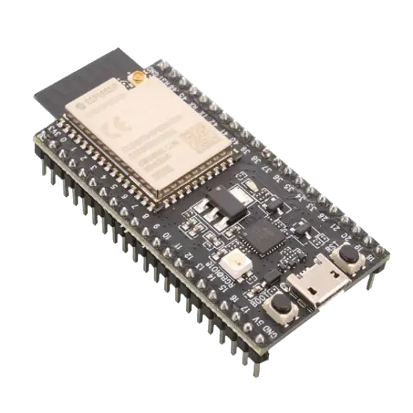

<!-- Copyright 2015-2026 Zephyr Project members and individual contributors. -->
<!-- SPDX-License-Identifier: Apache-2.0 -->
<!-- 中文翻译；编号、导航与译注为本地新增。 -->

<a id="esp32s2_saola"></a>

# 第28章\_ESP32-S2-Saola

原文：[官方页面](https://docs.zephyrproject.org/latest/boards/espressif/esp32s2_saola/doc/index.html)。读取日期：2026-10-16；来源摘要见[来源记录](../SOURCES.md)。

开发板概览（Board Overview）

<a id="id1"></a>

[](images/esp32s2_saola.webp)

ESP32-S2-Saola

名称（Name）：

`esp32s2_saola`

厂商（Vendor）：

[乐鑫信息科技（Espressif Systems）](https://docs.zephyrproject.org/latest/boards/index.html#vendor=espressif)

状态（Status）：

维护中（Maintained）

架构（Architecture）：

[xtensa](https://docs.zephyrproject.org/latest/boards/index.html#arch=xtensa)

片上系统（SoC）：

[esp32s2](https://docs.zephyrproject.org/latest/boards/index.html#soc=esp32s2)

<a id="board-github-link"></a>

[浏览开发板源码（Browse Board Sources）](https://github.com/zephyrproject-rtos/zephyr/blob/main//boards/espressif/esp32s2_saola/doc/index.rst/../..)<a id="overview"></a>

## 概述（Overview）

<a id="id13"></a>

ESP32-S2-Saola是乐鑫生产的小尺寸ESP32-S2开发板。多数I/O引脚引出到两侧排针，便于连接；开发者可通过跳线连接外设，或将开发板安装到面包板。更多信息见[ESP32-S3-DevKitC](https://docs.espressif.com/projects/esp-idf/en/latest/esp32s2/hw-reference/esp32s2/user-guide-saola-1-v1.2.html)[注6](#id12)，链接名称依原文保留。

<a id="hardware"></a>

## 硬件（Hardware）

<a id="esp32-s2-features"></a>

### ESP32-S2特性（Features）

ESP32-S2是一款高度集成、低功耗的单核Wi-Fi微控制器SoC，设计兼顾安全、成本效益、高性能及丰富I/O能力。

其特性包括：


- 基于RSA-3072的安全启动（Secure Boot）
- 基于AES-XTS-256的闪存加密（Flash Encryption）
- 保护私钥及设备秘密数据，使其不被软件访问
- 通过密码加速器提升性能
- 防护物理故障注入攻击（Physical Fault Injection Attacks）
- 多种外设（Peripherals）：


  - 43个可编程GPIO
  - 14个可配置电容触摸GPIO
  - USB双角色接口（OTG / On-The-Go）
  - 液晶显示（LCD）接口
  - 摄像头接口（Camera Interface）
  - 串行外设接口（SPI）
  - 集成电路间音频总线（I2S）
  - 通用异步收发器（UART）
  - 模数转换器（ADC）
  - 数模转换器（DAC）
  - LED PWM，最多八通道

<a id="id3"></a>

<a id="id5"></a>

更多信息见ESP32-S2数据手册[注1](#id2)或ESP32-S2技术参考手册[注2](#id4)。（[ESP32-S2数据手册（Datasheet）](https://www.espressif.com/sites/default/files/documentation/esp32-s2_datasheet_en.pdf)；[ESP32-S2技术参考手册（Technical Reference Manual）](https://espressif.com/sites/default/files/documentation/esp32-s2_technical_reference_manual_en.pdf)）

<a id="supported-features"></a>

### 支持的功能（Supported Features）

`esp32s2_saola`开发板支持下表所列的硬件功能。

片上／板载（On-Chip / On-Board）

功能集成在片上系统（SoC）内／位于开发板上。

2 / 2

分别表示已启用／已禁用的实例数。点击数量标签，可查看开发板或SoC设备树源码（DTS）中该功能的第一个实例。

`vnd,foo`

与此功能匹配的设备树绑定兼容字符串（Compatible String）；点击链接可查看绑定文档。

<a id="esp32s2_saola-hw-features"></a>

<a id="esp32s2_saola-esp32s2_saola/esp32s2-hw-features-section"></a>

#### `esp32s2_saola/esp32s2`目标（Target）

<a id="esp32s2_saola-esp32s2_saola/esp32s2-hw-features-panel"></a>

<a id="esp32s2_saola-esp32s2_saola/esp32s2-hw-features-memory"></a>

该开发板目标的片上存储容量：288 KiB RAM、4 MiB Flash。

<a id="esp32s2_saola-esp32s2_saola/esp32s2-hw-features-table"></a>

<table>
<tr>
<th>类型（Type）</th>
<th>位置（Location）</th>
<th>说明（Description）</th>
<th>兼容字符串（Compatible）</th>
</tr>
<tr>
<td rowspan="1">中央处理器（CPU）</td>
<td>片上（On-Chip）</td>
<td>乐鑫（Espressif）Xtensa LX7处理器（CPU）（<a href="https://github.com/zephyrproject-rtos/zephyr/blob/main/dts/xtensa/espressif/esp32s2/esp32s2_common.dtsi?plain=1#L34">已启用：1</a>）</td>
<td><a href="../cpu_vendor_multiarc_binding_reference/P001_espressif_xtensa-lx7.md#std-dtcompatible-espressif-xtensa-lx7"><code>espressif,xtensa-lx7</code></a></td>
</tr>
<tr>
<td rowspan="1">模数转换器（ADC）</td>
<td>片上（On-Chip）</td>
<td>ESP32模数转换器（ADC）（<a href="https://github.com/zephyrproject-rtos/zephyr/blob/main/dts/xtensa/espressif/esp32s2/esp32s2_common.dtsi?plain=1#L423">已禁用：2</a>）</td>
<td><a href="../hardware/P889_ESP32模数转换器绑定.md#dtbinding-espressif-esp32-adc"><code>espressif,esp32-adc</code></a></td>
</tr>
<tr>
<td rowspan="1">蓝牙（Bluetooth）</td>
<td>片上（On-Chip）</td>
<td>乐鑫（Espressif）ESP32蓝牙主机控制器接口（Bluetooth HCI）（<a href="https://github.com/zephyrproject-rtos/zephyr/blob/main/dts/xtensa/espressif/esp32s2/esp32s2_common.dtsi?plain=1#L69">已禁用：1</a>）</td>
<td><a href="../bluetooth_vendor_hci_binding_reference/P004_espressif_esp32-bt-hci.md#std-dtcompatible-espressif-esp32-bt-hci"><code>espressif,esp32-bt-hci</code></a></td>
</tr>
<tr>
<td rowspan="1">控制器局域网（CAN）</td>
<td>片上（On-Chip）</td>
<td>ESP32双线汽车接口（TWAI / Two-Wire Automotive Interface）（<a href="https://github.com/zephyrproject-rtos/zephyr/blob/main/dts/xtensa/espressif/esp32s2/esp32s2_common.dtsi?plain=1#L444">已禁用：1</a>）</td>
<td><a href="../can_adi_atmel_nxp_binding_reference/P005_espressif_esp32-twai.md#std-dtcompatible-espressif-esp32-twai"><code>espressif,esp32-twai</code></a></td>
</tr>
<tr>
<td rowspan="1">时钟控制（Clock Control）</td>
<td>片上（On-Chip）</td>
<td>ESP32时钟模块（Clock Module，电源与时钟控制器模块 / Power &amp; Clock Controller Module）（<a href="https://github.com/zephyrproject-rtos/zephyr/blob/main/dts/xtensa/espressif/esp32s2/esp32s2_common.dtsi?plain=1#L79">已启用：1</a>）</td>
<td><a href="../clock_esp_infineon_microchip_binding_reference/P004_espressif_esp32-clock.md#std-dtcompatible-espressif-esp32-clock"><code>espressif,esp32-clock</code></a></td>
</tr>
<tr>
<td rowspan="3">计数器（Counter）</td>
<td>片上（On-Chip）</td>
<td>基于RTC主定时器（Main Timer）的ESP32计数器驱动（Counter Driver）（<a href="https://github.com/zephyrproject-rtos/zephyr/blob/main/dts/xtensa/espressif/esp32s2/esp32s2_common.dtsi?plain=1#L164">已禁用：1</a>）</td>
<td><a href="../counter_binding_reference/P016_espressif_esp32-rtc-timer.md#std-dtcompatible-espressif-esp32-rtc-timer"><code>espressif,esp32-rtc-timer</code></a></td>
</tr>
<tr>
<td>片上（On-Chip）</td>
<td>ESP32通用定时器（General-purpose Timers）（<a href="https://github.com/zephyrproject-rtos/zephyr/blob/main/dts/xtensa/espressif/esp32s2/esp32s2_common.dtsi?plain=1#L297">已禁用：4</a>）</td>
<td><a href="../counter_binding_reference/P017_espressif_esp32-timer.md#std-dtcompatible-espressif-esp32-timer"><code>espressif,esp32-timer</code></a></td>
</tr>
<tr>
<td>片上（On-Chip）</td>
<td>ESP32计数器（Counters）（<a href="https://github.com/zephyrproject-rtos/zephyr/blob/main/dts/xtensa/espressif/esp32s2/esp32s2_common.dtsi?plain=1#L307">已禁用：4</a>）</td>
<td><a href="../counter_binding_reference/P015_espressif_esp32-counter.md#std-dtcompatible-espressif-esp32-counter"><code>espressif,esp32-counter</code></a></td>
</tr>
<tr>
<td rowspan="2">密码学加速器（Cryptographic Accelerator）</td>
<td>片上（On-Chip）</td>
<td>乐鑫（Espressif）ESP32 SHA硬件加速器（Hardware Accelerator）（<a href="https://github.com/zephyrproject-rtos/zephyr/blob/main/dts/xtensa/espressif/esp32s2/esp32s2_common.dtsi?plain=1#L453">已启用：1</a>）</td>
<td><a href="../crypto_aes_sha_ccm_binding_reference/P008_espressif_esp32-sha.md#std-dtcompatible-espressif-esp32-sha"><code>espressif,esp32-sha</code></a></td>
</tr>
<tr>
<td>片上（On-Chip）</td>
<td>乐鑫（Espressif）ESP32系列AES硬件加速器（Hardware Accelerator）（<a href="https://github.com/zephyrproject-rtos/zephyr/blob/main/dts/xtensa/espressif/esp32s2/esp32s2_common.dtsi?plain=1#L460">已启用：1</a>）</td>
<td><a href="../crypto_aes_sha_ccm_binding_reference/P007_espressif_esp32-aes.md#std-dtcompatible-espressif-esp32-aes"><code>espressif,esp32-aes</code></a></td>
</tr>
<tr>
<td rowspan="1">数模转换器（DAC）</td>
<td>片上（On-Chip）</td>
<td>ESP32数模转换器（DAC / Digital-to-Analog Converter）（<a href="https://github.com/zephyrproject-rtos/zephyr/blob/main/dts/xtensa/espressif/esp32s2/esp32s2_common.dtsi?plain=1#L407">已启用：1</a>）</td>
<td><a href="../hardware/P771_ESP32数模转换器绑定.md#dtbinding-espressif-esp32-dac"><code>espressif,esp32-dac</code></a></td>
</tr>
<tr>
<td rowspan="1">闪存控制器（Flash Controller）</td>
<td>片上（On-Chip）</td>
<td>ESP32闪存控制器（Flash Controller）（<a href="https://github.com/zephyrproject-rtos/zephyr/blob/main/dts/xtensa/espressif/esp32s2/esp32s2_common.dtsi?plain=1#L173">已启用：1</a>）</td>
<td><a href="../flash_adi_microchip_nordic_binding_reference/P012_espressif_esp32-flash-controller.md#std-dtcompatible-espressif-esp32-flash-controller"><code>espressif,esp32-flash-controller</code></a></td>
</tr>
<tr>
<td rowspan="1">通用输入输出与接插件（GPIO &amp; Headers）</td>
<td>片上（On-Chip）</td>
<td>ESP32通用输入输出控制器（GPIO Controller）（<a href="https://github.com/zephyrproject-rtos/zephyr/blob/main/dts/xtensa/espressif/esp32s2/esp32s2_common.dtsi?plain=1#L228">已启用：2</a>）</td>
<td><a href="../gpio_connectors_bflb_esp_binding_reference/P022_espressif_esp32-gpio.md#std-dtcompatible-espressif-esp32-gpio"><code>espressif,esp32-gpio</code></a></td>
</tr>
<tr>
<td rowspan="1">集成电路间总线（I2C）</td>
<td>片上（On-Chip）</td>
<td>ESP32 I2C控制器（<a href="https://github.com/zephyrproject-rtos/zephyr/blob/main/dts/xtensa/espressif/esp32s2/esp32s2_common.dtsi?plain=1#L261">已启用：1</a>；<a href="https://github.com/zephyrproject-rtos/zephyr/blob/main/dts/xtensa/espressif/esp32s2/esp32s2_common.dtsi?plain=1#L272">已禁用：1</a>）</td>
<td><a href="../i2c_adi_atmel_esp_binding_reference/P018_espressif_esp32-i2c.md#std-dtcompatible-espressif-esp32-i2c"><code>espressif,esp32-i2c</code></a></td>
</tr>
<tr>
<td rowspan="1">集成电路间音频总线（I2S）</td>
<td>片上（On-Chip）</td>
<td>ESP32芯片间音频接口（I2S）（<a href="https://github.com/zephyrproject-rtos/zephyr/blob/main/dts/xtensa/espressif/esp32s2/esp32s2_common.dtsi?plain=1#L283">已禁用：1</a>）</td>
<td><a href="../i2s_binding_reference/P003_espressif_esp32-i2s.md#std-dtcompatible-espressif-esp32-i2s"><code>espressif,esp32-i2s</code></a></td>
</tr>
<tr>
<td rowspan="2">输入（Input）</td>
<td>片上（On-Chip）</td>
<td>ESP32触摸传感器输入（Touch Sensor Input）（<a href="https://github.com/zephyrproject-rtos/zephyr/blob/main/dts/xtensa/espressif/esp32s2/esp32s2_common.dtsi?plain=1#L253">已禁用：1</a>）</td>
<td><a href="../input_adc_touch_matrix_binding_reference/P013_espressif_esp32-touch.md#std-dtcompatible-espressif-esp32-touch"><code>espressif,esp32-touch</code></a></td>
</tr>
<tr>
<td>板载（On-Board）</td>
<td>一组绑定到 GPIO 的输入按键（GPIO-Bound Input Keys）（<a href="https://github.com/zephyrproject-rtos/zephyr/blob/main/boards/espressif/esp32s2_saola/esp32s2_saola.dts?plain=1#L33">已启用：1</a>）</td>
<td><a href="../hardware/P563_GPIO按键绑定.md#std-dtcompatible-gpio-keys"><code>gpio-keys</code></a></td>
</tr>
<tr>
<td rowspan="1">中断控制器（Interrupt Controller）</td>
<td>片上（On-Chip）</td>
<td>ESP32中断控制器（Interrupt Controller）（<a href="https://github.com/zephyrproject-rtos/zephyr/blob/main/dts/xtensa/espressif/esp32s2/esp32s2_common.dtsi?plain=1#L146">已启用：1</a>）</td>
<td><a href="../soc_interrupt_binding_reference/P005_espressif_esp32-intc.md#std-dtcompatible-espressif-esp32-intc"><code>espressif,esp32-intc</code></a></td>
</tr>
<tr>
<td rowspan="1">存储器控制器（Memory Controller）</td>
<td>片上（On-Chip）</td>
<td>ESP32伪静态随机存储器控制器（PSRAM Controller）（<a href="https://github.com/zephyrproject-rtos/zephyr/blob/main/dts/xtensa/espressif/esp32s2/esp32s2_common.dtsi?plain=1#L116">已启用：1</a>）</td>
<td><a href="../memory_controller_hyperbus_smc_binding_reference/P009_espressif_esp32-psram.md#std-dtcompatible-espressif-esp32-psram"><code>espressif,esp32-psram</code></a></td>
</tr>
<tr>
<td rowspan="1">存储技术设备（MTD）</td>
<td>片上（On-Chip）</td>
<td>闪存（Flash）节点（<a href="https://github.com/zephyrproject-rtos/zephyr/blob/main/dts/xtensa/espressif/esp32s2/esp32s2_common.dtsi?plain=1#L181">已启用：1</a>）</td>
<td><a href="../mtd_nxp_st_ti_partition_binding_reference/P013_soc-nv-flash.md#std-dtcompatible-soc-nv-flash"><code>soc-nv-flash</code></a></td>
</tr>
<tr>
<td rowspan="1">引脚控制（Pin Control）</td>
<td>片上（On-Chip）</td>
<td>ESP32引脚控制器（Pin Controller）（<a href="https://github.com/zephyrproject-rtos/zephyr/blob/main/dts/xtensa/espressif/esp32s2/esp32s2_common.dtsi?plain=1#L74">已启用：1</a>）</td>
<td><a href="../pinctrl_adi_ambiq_arm_binding_reference/P022_espressif_esp32-pinctrl.md#std-dtcompatible-espressif-esp32-pinctrl"><code>espressif,esp32-pinctrl</code></a></td>
</tr>
<tr>
<td rowspan="1">脉冲输入输出（Pulse IO）</td>
<td>片上（On-Chip）</td>
<td>乐鑫遥控收发器（RMT / Remote Control Transceiver）pulse_io控制器（<a href="https://github.com/zephyrproject-rtos/zephyr/blob/main/dts/xtensa/espressif/esp32s2/esp32s2_common.dtsi?plain=1#L467">已禁用：1</a>）</td>
<td><a href="../platform_rmt_openthread_binding_reference/P008_espressif_esp32-rmt.md#std-dtcompatible-espressif-esp32-rmt"><code>espressif,esp32-rmt</code></a></td>
</tr>
<tr>
<td rowspan="1">脉宽调制（PWM）</td>
<td>片上（On-Chip）</td>
<td>ESP32 LED控制（LEDC / LED Control）（<a href="https://github.com/zephyrproject-rtos/zephyr/blob/main/dts/xtensa/espressif/esp32s2/esp32s2_common.dtsi?plain=1#L219">已禁用：1</a>）</td>
<td><a href="../pwm_adi_esp_infineon_binding_reference/P015_espressif_esp32-ledc.md#std-dtcompatible-espressif-esp32-ledc"><code>espressif,esp32-ledc</code></a></td>
</tr>
<tr>
<td rowspan="1">随机数生成器（RNG）</td>
<td>片上（On-Chip）</td>
<td>ESP32真随机数发生器（TRNG / True Random Number Generator）（<a href="https://github.com/zephyrproject-rtos/zephyr/blob/main/dts/xtensa/espressif/esp32s2/esp32s2_common.dtsi?plain=1#L360">已启用：1</a>）</td>
<td><a href="../rng_binding_reference/P007_espressif_esp32-trng.md#std-dtcompatible-espressif-esp32-trng"><code>espressif,esp32-trng</code></a></td>
</tr>
<tr>
<td rowspan="2">传感器（Sensors）</td>
<td>片上（On-Chip）</td>
<td>ESP32脉冲计数器（PCNT / Pulse Counter）（<a href="https://github.com/zephyrproject-rtos/zephyr/blob/main/dts/xtensa/espressif/esp32s2/esp32s2_common.dtsi?plain=1#L210">已禁用：1</a>）</td>
<td><a href="../sensor_bosch_broadcom_espressif_binding_reference/P030_espressif_esp32-pcnt.md#std-dtcompatible-espressif-esp32-pcnt"><code>espressif,esp32-pcnt</code></a></td>
</tr>
<tr>
<td>片上（On-Chip）</td>
<td>ESP32内部温度传感器（Internal Temperature Sensor）（<a href="https://github.com/zephyrproject-rtos/zephyr/blob/main/dts/xtensa/espressif/esp32s2/esp32s2_common.dtsi?plain=1#L416">已禁用：1</a>）</td>
<td><a href="../sensor_espressif_honeywell_invensense_binding_reference/P001_espressif_esp32-temp.md#std-dtcompatible-espressif-esp32-temp"><code>espressif,esp32-temp</code></a></td>
</tr>
<tr>
<td rowspan="1">串行控制器（Serial Controller）</td>
<td>片上（On-Chip）</td>
<td>ESP32通用异步收发器（UART）（<a href="https://github.com/zephyrproject-rtos/zephyr/blob/main/dts/xtensa/espressif/esp32s2/esp32s2_common.dtsi?plain=1#L191">已启用：1</a>；<a href="https://github.com/zephyrproject-rtos/zephyr/blob/main/dts/xtensa/espressif/esp32s2/esp32s2_common.dtsi?plain=1#L200">已禁用：1</a>）</td>
<td><a href="../uart_espressif_infineon_microchip_binding_reference/P002_espressif_esp32-uart.md#std-dtcompatible-espressif-esp32-uart"><code>espressif,esp32-uart</code></a></td>
</tr>
<tr>
<td rowspan="1">串行外设接口（SPI）</td>
<td>片上（On-Chip）</td>
<td>ESP32串行外设接口控制器（SPI Controller）（<a href="https://github.com/zephyrproject-rtos/zephyr/blob/main/dts/xtensa/espressif/esp32s2/esp32s2_common.dtsi?plain=1#L367">已启用：2</a>）</td>
<td><a href="../spi_adi_atmel_esp_binding_reference/P014_espressif_esp32-spi.md#std-dtcompatible-espressif-esp32-spi"><code>espressif,esp32-spi</code></a></td>
</tr>
<tr>
<td rowspan="2">看门狗（Watchdog）</td>
<td>片上（On-Chip）</td>
<td>ESP32 XT看门狗定时器（Watchdog Timer）（<a href="https://github.com/zephyrproject-rtos/zephyr/blob/main/dts/xtensa/espressif/esp32s2/esp32s2_common.dtsi?plain=1#L155">已禁用：1</a>）</td>
<td><a href="../watchdog_binding_reference/P014_espressif_esp32-xt-wdt.md#std-dtcompatible-espressif-esp32-xt-wdt"><code>espressif,esp32-xt-wdt</code></a></td>
</tr>
<tr>
<td>片上（On-Chip）</td>
<td>ESP32看门狗（Watchdog）（<a href="https://github.com/zephyrproject-rtos/zephyr/blob/main/dts/xtensa/espressif/esp32s2/esp32s2_common.dtsi?plain=1#L389">已启用：1</a>；<a href="https://github.com/zephyrproject-rtos/zephyr/blob/main/dts/xtensa/espressif/esp32s2/esp32s2_common.dtsi?plain=1#L398">已禁用：1</a>）</td>
<td><a href="../watchdog_binding_reference/P013_espressif_esp32-watchdog.md#std-dtcompatible-espressif-esp32-watchdog"><code>espressif,esp32-watchdog</code></a></td>
</tr>
<tr>
<td rowspan="1">无线局域网（Wi-Fi）</td>
<td>片上（On-Chip）</td>
<td>ESP32片上系统（SoC）Wi-Fi（<a href="https://github.com/zephyrproject-rtos/zephyr/blob/main/dts/xtensa/espressif/esp32s2/esp32s2_common.dtsi?plain=1#L64">已启用：1</a>）</td>
<td><a href="../wifi_esp_hosted_airoc_binding_reference/P009_espressif_esp32-wifi.md#std-dtcompatible-espressif-esp32-wifi"><code>espressif,esp32-wifi</code></a></td>
</tr>
</table>

<a id="system-requirements"></a>

## 系统要求（System Requirements）

<a id="binary-blobs"></a>

### 二进制组件（Binary Blobs）

Espressif 硬件抽象层（HAL）需要射频（RF）二进制组件才能工作。运行下面的命令获取这些文件。

```text
west blobs fetch hal_espressif
```

注意（Note）

建议在 `west update` 之后运行上述命令。

<a id="programming-and-debugging"></a>

## 烧录与调试（Programming and Debugging）

`esp32s2_saola`开发板支持下表所列的运行工具（Runners）及相关west命令。

<table>
<tr>
<th></th>
<th>烧录（flash）</th>
<th>调试（debug）</th>
<th>连接调试会话（attach）</th>
<th>实时传输（rtt）</th>
<th>调试服务器（debugserver）</th>
</tr>
<tr>
<td><code>esp32</code></td>
<td>✅（默认 / default）</td>
<td></td>
<td></td>
<td></td>
<td></td>
</tr>
<tr>
<td><a href="https://docs.zephyrproject.org/latest/develop/flash_debug/host-tools.html#runner-openocd">openocd</a></td>
<td>✅</td>
<td>✅（默认 / default）</td>
<td>✅</td>
<td>✅</td>
<td>✅</td>
</tr>
</table>

<a id="simple-boot"></a>

### 简单启动（Simple Boot）

可以通过单一二进制镜像加载开发板，无需第二阶段引导加载程序（2nd-Stage Bootloader）。构建应用时没有附加配置，默认使用此方式。

注意（Note）

简单启动不提供安全功能，也不提供空中更新（Over-the-Air，OTA）。

<a id="mcuboot-bootloader"></a>

### MCUboot 引导加载程序（MCUboot Bootloader）

也可选择 MCUboot；此时必须至少构建并烧录一次引导加载程序。

构建应用有两种选择：


1. 系统构建（Sysbuild）
2. 手动构建（Manual Build）

注意（Note）

在开发板默认配置文件加入下面一行即可选择 MCUboot 引导加载程序。

```text
CONFIG_BOOTLOADER_MCUBOOT=y
```

<a id="sysbuild"></a>

### 系统构建（Sysbuild）

Sysbuild 可以统一构建并烧录启动 ESP32 SoC 开发板所需的全部镜像。

使用 Sysbuild 构建示例应用的命令如下：

```text
west build -b <board> --sysbuild samples/hello_world
```

默认情况下，ESP32 Sysbuild 生成引导加载程序（MCUboot）与应用镜像；也可配置为生成其他类型的镜像。

Sysbuild 生成的构建目录结构与传统 Zephyr 构建不同，输出按域（Domain）子目录组织：

```text
build/
├── hello_world
│   └── zephyr
│       ├── zephyr.elf
│       └── zephyr.bin
├── mcuboot
│    └── zephyr
│       ├── zephyr.elf
│       └── zephyr.bin
└── domains.yaml
```

注意（Note）

使用 `--sysbuild` 时，每次执行全新构建（Pristine Build）都会重新构建并重新烧录引导加载程序。

系统构建的更多信息见 Sysbuild（System Build）文档。（[系统构建（Sysbuild / System Build）](../sysbuild/P001_系统构建.md#sysbuild)）

<a id="manual-build"></a>

### 手动构建（Manual Build）

开发期间通常希望尽可能快地构建和烧录，因此可采用传统构建方式，每次只构建一个镜像。

以下说明同时适用于手动构建与 Sysbuild，区别仅在构建目录结构。

注意（Note）

请记住，必须至少烧录一次 MCUboot 引导加载程序。

按通常方式构建并烧录应用，详见“构建应用”（[Building an Application](../application/P001_应用开发.md#build-an-application)）与“运行应用”（[Run an Application](https://docs.zephyrproject.org/latest/develop/application/index.html#application-run)）。

```text
# From the root of the zephyr repository
west build -b <board> samples/hello_world
```

常规 `flash` 目标适用于此开发板配置。下面以 [Hello World](../getting_started/P005_HelloWorld示例.md#hello_world) 应用为例。

```text
# From the root of the zephyr repository
west build -b <board> samples/hello_world
west flash
```

注意（Note）

对于提供内置 USB Serial/JTAG 控制器的目标，芯片在 `west flash` 后可能仍处于下载模式，直到重新断电上电才启动新镜像。遇到此情况，可在烧录时选择看门狗复位（Watchdog Reset），使芯片自行重新启动：

```text
west flash --reset-type watchdog-reset
```

<a id="faster-flashing"></a>

### 加快烧录（Faster Flashing）

`--esp-skip-flashed` 在设备上进行 MD5 校验；若闪存中的二进制文件与待烧录文件相同，就跳过写入，加快开发过程：

```text
west flash --esp-skip-flashed
```

`--esp-diff` 仅写入相对于上次烧录镜像发生变化的区域，可进一步加快重复烧录。它与本地缓存副本比较，而不读取设备；因此仅当自上次 `west flash` 以来，闪存未被其他工具、其他开发板或手动写操作修改时使用：

```text
west flash --esp-diff
```

可关闭进度输出，使日志更简洁，适合持续集成（CI）：

```text
west flash --esp-no-progress
```

使用以下命令打开串口监视器（Serial Monitor）：

```text
west espressif monitor
```

开发板自动复位并启动后，监视器应显示以下消息：

```text
***** Booting Zephyr OS vx.x.x-xxx-gxxxxxxxxxxxx *****
Hello World! <board>
```

<a id="board-variants-using-snippets"></a>

### 使用配置片段的开发板变型（Board Variants Using Snippets）

ESP32 开发板可搭配不同模块，组合不同的 SPI 闪存容量、伪静态随机存储器（PSRAM）容量及 PSRAM 模式。`snippets/espressif` 中的配置片段提供模块化方式，在构建时应用这些差异，无需复制开发板定义。

支持以下基于配置片段的变型：

<table>
<tr>
<th>配置片段名称（Snippet Name）</th>
<th>说明（Description）</th>
</tr>
<tr>
<td colspan="2">闪存容量（Flash Memory Size）</td>
</tr>
<tr>
<td><code>espressif-flash-4M</code></td>
<td>配备 4 MB 闪存的开发板。</td>
</tr>
<tr>
<td><code>espressif-flash-8M</code></td>
<td>配备 8 MB 闪存的开发板。</td>
</tr>
<tr>
<td><code>espressif-flash-16M</code></td>
<td>配备 16 MB 闪存的开发板。</td>
</tr>
<tr>
<td><code>espressif-flash-32M</code></td>
<td>配备 32 MB 闪存的开发板。</td>
</tr>
<tr>
<td><code>espressif-flash-64M</code></td>
<td>配备 64 MB 闪存的开发板。</td>
</tr>
<tr>
<td><code>espressif-flash-128M</code></td>
<td>配备 128 MB 闪存的开发板。</td>
</tr>
<tr>
<td colspan="2">PSRAM 容量（PSRAM Memory Size）</td>
</tr>
<tr>
<td><code>espressif-psram-2M</code></td>
<td>配备 2 MB PSRAM 的开发板。</td>
</tr>
<tr>
<td><code>espressif-psram-4M</code></td>
<td>配备 4 MB PSRAM 的开发板。</td>
</tr>
<tr>
<td><code>espressif-psram-8M</code></td>
<td>配备 8 MB PSRAM 的开发板。</td>
</tr>
<tr>
<td colspan="2">PSRAM 用途（PSRAM Utilization）</td>
</tr>
<tr>
<td><code>espressif-psram-reloc</code></td>
<td>将闪存内容重定位（Relocate）到 PSRAM。</td>
</tr>
<tr>
<td><code>espressif-psram-wifi</code></td>
<td>将 Wi-Fi 缓冲区放入 PSRAM。</td>
</tr>
</table>

应用开发板变型时，在 `west build` 中使用 `-S` 参数：

```text
west build -b <board> -S espressif-flash-32M -S espressif-psram-4M samples/hello_world
```

注意（Note）

这些配置片段只适用于具有所选 Flash／PSRAM 配置对应硬件支持的开发板。


- 未选择 FLASH 配置片段时，使用开发板默认闪存容量。
- 未选择 PSRAM 配置片段时，使用开发板默认 PSRAM 容量。

<a id="debugging"></a>

### 调试（Debugging）

<a id="openocd-debugging"></a>

### OpenOCD 调试（OpenOCD Debugging）

<a id="id7"></a>

Espressif 芯片需要带 ESP32 专用补丁的自定义 OpenOCD 构建版本。请从 [OpenOCD for ESP32](https://github.com/espressif/openocd-esp32/releases) [注3](#id6) 下载最新发行版。

<a id="id11"></a>

详细的 JTAG 设置步骤见 ESP32 JTAG 调试文档 [注5](#id10)。（[ESP32的JTAG调试（JTAG Debugging）](https://docs.espressif.com/projects/esp-idf/en/latest/esp32/api-guides/jtag-debugging/index.html)）

<a id="zephyr-thread-awareness"></a>

#### Zephyr 线程感知（Zephyr Thread Awareness）

OpenOCD 支持 Zephyr RTOS 线程感知，使 GDB 能够：


- 使用 `info threads` 列出全部线程。
- 显示线程名称、优先级和状态。
- 在线程上下文（Thread Contexts）之间切换。
- 显示任意线程的调用栈回溯（Backtrace）。

要求（Requirements）：


- <a id="id9"></a>

  [OpenOCD ESP32 v0.12.0-esp32-20251215](https://github.com/espressif/openocd-esp32/releases/tag/v0.12.0-esp32-20251215) [注4](#id8) 或更高版本。
- 使用 `CONFIG_DEBUG_THREAD_INFO=y` 构建。

示例（Example）：

```text
# From the root of the zephyr repository
west build -b <board> samples/hello_world -- -DCONFIG_DEBUG_THREAD_INFO=y -DOPENOCD=<path/to/bin/openocd> -DOPENOCD_DEFAULT_PATH=<path/to/openocd/share/openocd/scripts>
west debug
```

<a id="using-a-custom-openocd"></a>

#### 使用自定义 OpenOCD（Using a Custom OpenOCD）

Zephyr SDK 自带 OpenOCD，但该版本可能不支持 ESP32。要使用 Espressif OpenOCD，需在构建时指定其路径：

```text
# From the root of the zephyr repository
west build -b <board> samples/hello_world -- -DOPENOCD=/path/to/openocd -DOPENOCD_DEFAULT_PATH=/path/to/openocd/scripts
west debug
```

下表给出ESP32-S2开发板与JTAG接口的引脚映射。

<table>
<tr>
<th>ESP32引脚（Pin）</th>
<th>JTAG引脚（Pin）</th>
</tr>
<tr>
<td><code>MTDO / GPIO40</code></td>
<td>测试数据输出（TDO）</td>
</tr>
<tr>
<td><code>MTDI / GPIO41</code></td>
<td>测试数据输入（TDI）</td>
</tr>
<tr>
<td><code>MTCK / GPIO39</code></td>
<td>测试时钟（TCK）</td>
</tr>
<tr>
<td><code>MTMS / GPIO42</code></td>
<td>测试模式选择（TMS）</td>
</tr>
</table>

<a id="references"></a>

## 参考资料（References）

<a id="id2"></a>

〔[1](#id3)〕 [https://www.espressif.com/sites/default/files/documentation/esp32-s2_datasheet_en.pdf](https://www.espressif.com/sites/default/files/documentation/esp32-s2_datasheet_en.pdf)

<a id="id4"></a>

〔[2](#id5)〕 [https://espressif.com/sites/default/files/documentation/esp32-s2_technical_reference_manual_en.pdf](https://espressif.com/sites/default/files/documentation/esp32-s2_technical_reference_manual_en.pdf)

<a id="id6"></a>

〔[3](#id7)〕 [https://github.com/espressif/openocd-esp32/releases](https://github.com/espressif/openocd-esp32/releases)

<a id="id8"></a>

〔[4](#id9)〕 [https://github.com/espressif/openocd-esp32/releases/tag/v0.12.0-esp32-20251215](https://github.com/espressif/openocd-esp32/releases/tag/v0.12.0-esp32-20251215)

<a id="id10"></a>

〔[5](#id11)〕 [https://docs.espressif.com/projects/esp-idf/en/latest/esp32/api-guides/jtag-debugging/index.html](https://docs.espressif.com/projects/esp-idf/en/latest/esp32/api-guides/jtag-debugging/index.html)

<a id="id12"></a>

〔[6](#id13)〕 [https://docs.espressif.com/projects/esp-idf/en/latest/esp32s2/hw-reference/esp32s2/user-guide-saola-1-v1.2.html](https://docs.espressif.com/projects/esp-idf/en/latest/esp32s2/hw-reference/esp32s2/user-guide-saola-1-v1.2.html)

## 译注

ESP32-S2-Saola页面的进一步阅读链接写ESP32-S3-DevKitC，译文照录并指出型号差异，不改写为未经核对的其他链接。

## 原文外链核对

2026-10-16核对并重试以下原文外链时未能确认可访问性，保留原始目标，不将访问失败解释为原文内容有误。

- [user-guide-saola-1-v1.2.html](https://docs.espressif.com/projects/esp-idf/en/latest/esp32s2/hw-reference/esp32s2/user-guide-saola-1-v1.2.html)：HTTP Error 404: Not Found。

---

[上一章](P027_ESP32-S2-DevKitC.md) · [返回大纲](大纲.md) · [全站翻译进度](../PROGRESS.md) · [下一章](P029_ESP32-S3-BOX-3.md)
