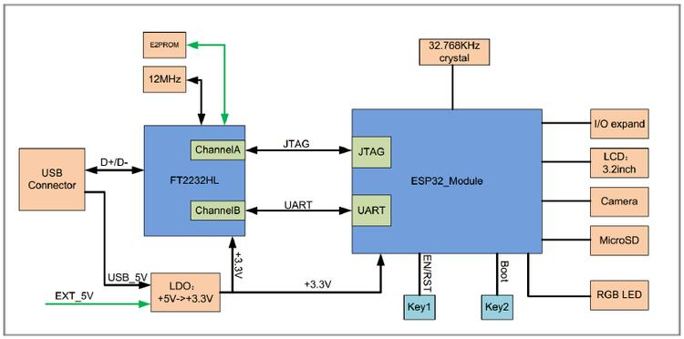
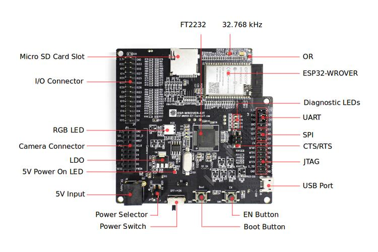
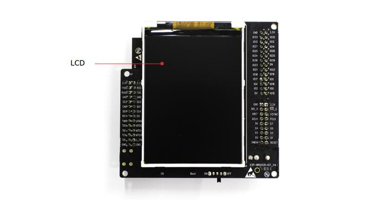
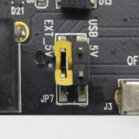
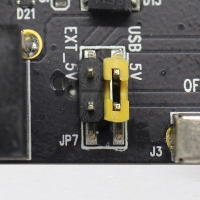
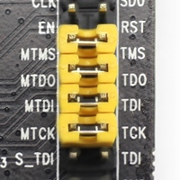
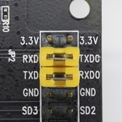
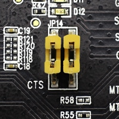

<!-- Copyright 2015-2026 Zephyr Project members and individual contributors. -->
<!-- SPDX-License-Identifier: Apache-2.0 -->
<!-- 中文翻译；编号、导航与译注为本地新增。 -->

<a id="esp_wrover_kit"></a>

# 第34章\_ESP-WROVER-KIT

原文：[官方页面](https://docs.zephyrproject.org/latest/boards/espressif/esp_wrover_kit/doc/index.html)。读取日期：2026-10-16；来源摘要见[来源记录](../SOURCES.md)。

开发板概览（Board Overview）

<a id="id3"></a>

[](images/esp_wrover_kit.webp)

ESP-WROVER-KIT

名称（Name）：

`esp_wrover_kit`

厂商（Vendor）：

[乐鑫信息科技（Espressif Systems）](https://docs.zephyrproject.org/latest/boards/index.html#vendor=espressif)

状态（Status）：

维护中（Maintained）

架构（Architecture）：

[xtensa](https://docs.zephyrproject.org/latest/boards/index.html#arch=xtensa)

片上系统（SoC）：

[`esp32`](https://docs.zephyrproject.org/latest/boards/index.html#soc=esp32)

<a id="board-github-link"></a>

[浏览开发板源码（Browse Board Sources）](https://github.com/zephyrproject-rtos/zephyr/blob/main//boards/espressif/esp_wrover_kit/doc/index.rst/../..)<a id="overview"></a>

## 概述（Overview）

ESP-WROVER-KIT集成以下组件：


- ESP32-WROVER-E模块
- 液晶显示屏（LCD Screen）
- MicroSD卡槽（Card Slot）

另一个特点是内置FTDI FT2232HL高级多接口USB桥接芯片，可通过USB直接使用JTAG调试ESP32，无需单独的JTAG调试器，使开发更方便、简单且经济。

ESP32的大多数I/O引脚引出到开发板排针，便于访问。

注意（Note）

ESP32的GPIO16及GPIO17用于PSRAM片选和时钟。为保证可靠性能，默认不将这两个GPIO引出到开发板排针。

<a id="id18"></a>

<a id="id7"></a>

更多信息见[ESP32-WROVER-E数据手册](https://www.espressif.com/sites/default/files/documentation/esp32-wrover-e_esp32-wrover-ie_datasheet_en.pdf(PDF))[注6](#id17)及ESP32数据手册[注1](#id6)。（[ESP32数据手册（Datasheet）](https://www.espressif.com/sites/default/files/documentation/esp32_datasheet_en.pdf)）

<a id="hardware"></a>

## 硬件（Hardware）

<a id="esp32-features"></a>

### ESP32特性（Features）


- 双核Xtensa LX6微处理器（Microprocessor），运行频率160或240 MHz
- 520 KB静态随机存储器（SRAM）
- 802.11b/g/n/e/i
- 蓝牙（Bluetooth）v4.2，支持基本速率／增强数据速率（BR/EDR）及低功耗蓝牙（BLE）
- 多种外设（Peripherals）：


  - 12位模数转换器（ADC），最多18个通道
  - 2个8位数模转换器（DAC）
  - 10个触摸传感器（Touch Sensors）
  - 4路串行外设接口（SPI）
  - 2路芯片间音频接口（I2S）
  - 2路I2C总线
  - 3路通用异步收发器（UART）
  - SD / SDIO / MMC主机（Host）
  - 从机接口（Slave，SDIO / SPI）
  - 以太网媒体访问控制器（Ethernet MAC）
  - CAN 2.0总线
  - 红外收发（IR RX/TX）
  - 电机脉宽调制（Motor PWM）
  - LED脉宽调制（PWM），最多16个通道
  - 霍尔效应传感器（Hall Effect Sensor）
  - 温度传感器（Temperature Sensor）。
- 密码学硬件加速（Cryptographic Hardware Acceleration）：RNG、ECC、RSA、SHA-2、AES。
- 深度睡眠电流（Deep-sleep Current）5 μA

<a id="asymmetric-multiprocessing-amp"></a>

### 非对称多处理（AMP / Asymmetric Multiprocessing）

采用ESP32或ESP32-S3片上系统（SoC）的开发板允许运行两个不同的应用。借助双核架构，各内核可以独立运行自定义任务，也可以通过OpenAMP框架交换数据。代码参考见[处理器间通信（IPC / Inter-Processor Communication）](../intercore_reference/P086_处理器间通信示例目录.md#inter-processor-communication-ipc)目录。

注意（Note）

**AMP与串口输出支持（AMP and Serial Output Support）**

在原文所述的Zephyr ESP32实现中，尚未为运行于APPCPU的应用实现对Zephyr管理的串口驱动的访问，例如`printk()`、日志（Logging）和控制台UART。因此，Zephyr提供的串口输出API仅可用于PROCPU。

作为替代办法，运行于APPCPU的应用可以使用ESP32 ROM函数，例如`ets_printf()`，输出诊断或调试信息。

<a id="id8"></a>

<a id="id10"></a>

更多信息见[ESP32数据手册（Datasheet）](https://www.espressif.com/sites/default/files/documentation/esp32_datasheet_en.pdf)[注1](#id6)或[ESP32技术参考手册（Technical Reference Manual）](https://www.espressif.com/sites/default/files/documentation/esp32_technical_reference_manual_en.pdf)[注2](#id9)。

<a id="supported-features"></a>

### 支持的功能（Supported Features）

`esp_wrover_kit`开发板支持下表所列的硬件功能。

片上／板载（On-Chip / On-Board）

功能集成在片上系统（SoC）内／位于开发板上。

2 / 2

分别表示已启用／已禁用的实例数。点击数量标签，可查看开发板或SoC设备树源码（DTS）中该功能的第一个实例。

`vnd,foo`

与此功能匹配的设备树绑定兼容字符串（Compatible String）；点击链接可查看绑定文档。

<a id="esp_wrover_kit-hw-features"></a>

<a id="esp_wrover_kit-esp_wrover_kit/esp32/appcpu-hw-features-section"></a>

#### `esp_wrover_kit/esp32/appcpu`目标（Target）

<a id="esp_wrover_kit-esp_wrover_kit/esp32/appcpu-hw-features-panel"></a>

<a id="esp_wrover_kit-esp_wrover_kit/esp32/appcpu-hw-features-memory"></a>

该开发板目标的片上存储容量：128 KiB RAM、4 MiB Flash。

<a id="esp_wrover_kit-esp_wrover_kit/esp32/appcpu-hw-features-table"></a>

<table>
<tr>
<th>类型（Type）</th>
<th>位置（Location）</th>
<th>说明（Description）</th>
<th>兼容字符串（Compatible）</th>
</tr>
<tr>
<td rowspan="1">中央处理器（CPU）</td>
<td>片上（On-Chip）</td>
<td>乐鑫（Espressif）Xtensa LX6处理器（CPU）（<a href="https://github.com/zephyrproject-rtos/zephyr/blob/main/dts/xtensa/espressif/esp32/esp32_common.dtsi?plain=1#L30">已启用：2</a>）</td>
<td><a href="../cpu_cortex_xtensa_binding_reference/P025_espressif_xtensa-lx6.md#std-dtcompatible-espressif-xtensa-lx6"><code>espressif,xtensa-lx6</code></a></td>
</tr>
<tr>
<td rowspan="1">模数转换器（ADC）</td>
<td>片上（On-Chip）</td>
<td>ESP32模数转换器（ADC）（<a href="https://github.com/zephyrproject-rtos/zephyr/blob/main/dts/xtensa/espressif/esp32/esp32_common.dtsi?plain=1#L523">已禁用：2</a>）</td>
<td><a href="../hardware/P889_ESP32模数转换器绑定.md#dtbinding-espressif-esp32-adc"><code>espressif,esp32-adc</code></a></td>
</tr>
<tr>
<td rowspan="1">蓝牙（Bluetooth）</td>
<td>片上（On-Chip）</td>
<td>乐鑫（Espressif）ESP32蓝牙主机控制器接口（Bluetooth HCI）（<a href="https://github.com/zephyrproject-rtos/zephyr/blob/main/dts/xtensa/espressif/esp32/esp32_common.dtsi?plain=1#L73">已禁用：1</a>）</td>
<td><a href="../bluetooth_vendor_hci_binding_reference/P004_espressif_esp32-bt-hci.md#std-dtcompatible-espressif-esp32-bt-hci"><code>espressif,esp32-bt-hci</code></a></td>
</tr>
<tr>
<td rowspan="1">控制器局域网（CAN）</td>
<td>片上（On-Chip）</td>
<td>ESP32双线汽车接口（TWAI / Two-Wire Automotive Interface）（<a href="https://github.com/zephyrproject-rtos/zephyr/blob/main/dts/xtensa/espressif/esp32/esp32_common.dtsi?plain=1#L440">已禁用：1</a>）</td>
<td><a href="../can_adi_atmel_nxp_binding_reference/P005_espressif_esp32-twai.md#std-dtcompatible-espressif-esp32-twai"><code>espressif,esp32-twai</code></a></td>
</tr>
<tr>
<td rowspan="1">时钟控制（Clock Control）</td>
<td>片上（On-Chip）</td>
<td>ESP32时钟模块（Clock Module，电源与时钟控制器模块 / Power &amp; Clock Controller Module）（<a href="https://github.com/zephyrproject-rtos/zephyr/blob/main/dts/xtensa/espressif/esp32/esp32_common.dtsi?plain=1#L84">已启用：1</a>）</td>
<td><a href="../clock_esp_infineon_microchip_binding_reference/P004_espressif_esp32-clock.md#std-dtcompatible-espressif-esp32-clock"><code>espressif,esp32-clock</code></a></td>
</tr>
<tr>
<td rowspan="3">计数器（Counter）</td>
<td>片上（On-Chip）</td>
<td>基于RTC主定时器（Main Timer）的ESP32计数器驱动（Counter Driver）（<a href="https://github.com/zephyrproject-rtos/zephyr/blob/main/dts/xtensa/espressif/esp32/esp32_common.dtsi?plain=1#L194">已禁用：1</a>）</td>
<td><a href="../counter_binding_reference/P016_espressif_esp32-rtc-timer.md#std-dtcompatible-espressif-esp32-rtc-timer"><code>espressif,esp32-rtc-timer</code></a></td>
</tr>
<tr>
<td>片上（On-Chip）</td>
<td>ESP32通用定时器（General-purpose Timers）（<a href="https://github.com/zephyrproject-rtos/zephyr/blob/main/dts/xtensa/espressif/esp32/esp32_common.dtsi?plain=1#L449">已禁用：4</a>）</td>
<td><a href="../counter_binding_reference/P017_espressif_esp32-timer.md#std-dtcompatible-espressif-esp32-timer"><code>espressif,esp32-timer</code></a></td>
</tr>
<tr>
<td>片上（On-Chip）</td>
<td>ESP32计数器（Counters）（<a href="https://github.com/zephyrproject-rtos/zephyr/blob/main/dts/xtensa/espressif/esp32/esp32_common.dtsi?plain=1#L459">已禁用：4</a>）</td>
<td><a href="../counter_binding_reference/P015_espressif_esp32-counter.md#std-dtcompatible-espressif-esp32-counter"><code>espressif,esp32-counter</code></a></td>
</tr>
<tr>
<td rowspan="2">密码学加速器（Cryptographic Accelerator）</td>
<td>片上（On-Chip）</td>
<td>乐鑫（Espressif）ESP32 SHA硬件加速器（Hardware Accelerator）（<a href="https://github.com/zephyrproject-rtos/zephyr/blob/main/dts/xtensa/espressif/esp32/esp32_common.dtsi?plain=1#L566">已启用：1</a>）</td>
<td><a href="../crypto_aes_sha_ccm_binding_reference/P008_espressif_esp32-sha.md#std-dtcompatible-espressif-esp32-sha"><code>espressif,esp32-sha</code></a></td>
</tr>
<tr>
<td>片上（On-Chip）</td>
<td>乐鑫（Espressif）ESP32系列AES硬件加速器（Hardware Accelerator）（<a href="https://github.com/zephyrproject-rtos/zephyr/blob/main/dts/xtensa/espressif/esp32/esp32_common.dtsi?plain=1#L573">已启用：1</a>）</td>
<td><a href="../crypto_aes_sha_ccm_binding_reference/P007_espressif_esp32-aes.md#std-dtcompatible-espressif-esp32-aes"><code>espressif,esp32-aes</code></a></td>
</tr>
<tr>
<td rowspan="1">数模转换器（DAC）</td>
<td>片上（On-Chip）</td>
<td>ESP32数模转换器（DAC / Digital-to-Analog Converter）（<a href="https://github.com/zephyrproject-rtos/zephyr/blob/main/dts/xtensa/espressif/esp32/esp32_common.dtsi?plain=1#L513">已禁用：1</a>）</td>
<td><a href="../hardware/P771_ESP32数模转换器绑定.md#dtbinding-espressif-esp32-dac"><code>espressif,esp32-dac</code></a></td>
</tr>
<tr>
<td rowspan="2">以太网（Ethernet）</td>
<td>片上（On-Chip）</td>
<td>ESP32以太网（Ethernet）（<a href="https://github.com/zephyrproject-rtos/zephyr/blob/main/dts/xtensa/espressif/esp32/esp32_common.dtsi?plain=1#L580">已禁用：1</a>）</td>
<td><a href="../ethernet_mac_mdio_binding_reference/P008_espressif_esp32-eth.md#std-dtcompatible-espressif-esp32-eth"><code>espressif,esp32-eth</code></a></td>
</tr>
<tr>
<td>片上（On-Chip）</td>
<td>Synopsys DesignWare MAC 的管理数据输入输出控制器（MDIO Controller）（<a href="https://github.com/zephyrproject-rtos/zephyr/blob/main/dts/xtensa/espressif/esp32/esp32_common.dtsi?plain=1#L590">已禁用：1</a>）</td>
<td><a href="../ethernet_mdio_microchip_binding_reference/P010_snps_dwmac-mdio.md#std-dtcompatible-snps-dwmac-mdio"><code>snps,dwmac-mdio</code></a></td>
</tr>
<tr>
<td rowspan="1">闪存控制器（Flash Controller）</td>
<td>片上（On-Chip）</td>
<td>ESP32闪存控制器（Flash Controller）（<a href="https://github.com/zephyrproject-rtos/zephyr/blob/main/dts/xtensa/espressif/esp32/esp32_common.dtsi?plain=1#L203">已启用：1</a>）</td>
<td><a href="../flash_adi_microchip_nordic_binding_reference/P012_espressif_esp32-flash-controller.md#std-dtcompatible-espressif-esp32-flash-controller"><code>espressif,esp32-flash-controller</code></a></td>
</tr>
<tr>
<td rowspan="1">通用输入输出与接插件（GPIO &amp; Headers）</td>
<td>片上（On-Chip）</td>
<td>ESP32通用输入输出控制器（GPIO Controller）（<a href="https://github.com/zephyrproject-rtos/zephyr/blob/main/dts/xtensa/espressif/esp32/esp32_common.dtsi?plain=1#L309">已启用：2</a>）</td>
<td><a href="../gpio_connectors_bflb_esp_binding_reference/P022_espressif_esp32-gpio.md#std-dtcompatible-espressif-esp32-gpio"><code>espressif,esp32-gpio</code></a></td>
</tr>
<tr>
<td rowspan="1">集成电路间总线（I2C）</td>
<td>片上（On-Chip）</td>
<td>ESP32 I2C控制器（<a href="https://github.com/zephyrproject-rtos/zephyr/blob/main/dts/xtensa/espressif/esp32/esp32_common.dtsi?plain=1#L343">已禁用：2</a>）</td>
<td><a href="../i2c_adi_atmel_esp_binding_reference/P018_espressif_esp32-i2c.md#std-dtcompatible-espressif-esp32-i2c"><code>espressif,esp32-i2c</code></a></td>
</tr>
<tr>
<td rowspan="1">集成电路间音频总线（I2S）</td>
<td>片上（On-Chip）</td>
<td>ESP32芯片间音频接口（I2S）（<a href="https://github.com/zephyrproject-rtos/zephyr/blob/main/dts/xtensa/espressif/esp32/esp32_common.dtsi?plain=1#L365">已禁用：2</a>）</td>
<td><a href="../i2s_binding_reference/P003_espressif_esp32-i2s.md#std-dtcompatible-espressif-esp32-i2s"><code>espressif,esp32-i2s</code></a></td>
</tr>
<tr>
<td rowspan="1">输入（Input）</td>
<td>片上（On-Chip）</td>
<td>ESP32触摸传感器输入（Touch Sensor Input）（<a href="https://github.com/zephyrproject-rtos/zephyr/blob/main/dts/xtensa/espressif/esp32/esp32_common.dtsi?plain=1#L335">已禁用：1</a>）</td>
<td><a href="../input_adc_touch_matrix_binding_reference/P013_espressif_esp32-touch.md#std-dtcompatible-espressif-esp32-touch"><code>espressif,esp32-touch</code></a></td>
</tr>
<tr>
<td rowspan="1">中断控制器（Interrupt Controller）</td>
<td>片上（On-Chip）</td>
<td>ESP32中断控制器（Interrupt Controller）（<a href="https://github.com/zephyrproject-rtos/zephyr/blob/main/dts/xtensa/espressif/esp32/esp32_common.dtsi?plain=1#L185">已启用：1</a>）</td>
<td><a href="../soc_interrupt_binding_reference/P005_espressif_esp32-intc.md#std-dtcompatible-espressif-esp32-intc"><code>espressif,esp32-intc</code></a></td>
</tr>
<tr>
<td rowspan="1">处理器间消息（IPM）</td>
<td>片上（On-Chip）</td>
<td>ESP32软件处理器间消息（Soft Interprocessor Message）（<a href="https://github.com/zephyrproject-rtos/zephyr/blob/main/dts/xtensa/espressif/esp32/esp32_common.dtsi?plain=1#L162">已启用：1</a>）</td>
<td><a href="../intercore_reference/P068_ESP32处理器间邮箱绑定.md#dtbinding-espressif-esp32-ipm"><code>espressif,esp32-ipm</code></a></td>
</tr>
<tr>
<td rowspan="1">邮箱（Mailbox）</td>
<td>片上（On-Chip）</td>
<td>ESP32软件邮箱（Soft Mailbox）（<a href="https://github.com/zephyrproject-rtos/zephyr/blob/main/dts/xtensa/espressif/esp32/esp32_common.dtsi?plain=1#L173">已禁用：1</a>）</td>
<td><a href="../intercore_reference/P037_ESP32邮箱绑定.md#dtbinding-espressif-mbox-esp32"><code>espressif,mbox-esp32</code></a></td>
</tr>
<tr>
<td rowspan="1">存储器控制器（Memory Controller）</td>
<td>片上（On-Chip）</td>
<td>ESP32伪静态随机存储器控制器（PSRAM Controller）（<a href="https://github.com/zephyrproject-rtos/zephyr/blob/main/dts/xtensa/espressif/esp32/esp32_common.dtsi?plain=1#L122">已启用：1</a>）</td>
<td><a href="../memory_controller_hyperbus_smc_binding_reference/P009_espressif_esp32-psram.md#std-dtcompatible-espressif-esp32-psram"><code>espressif,esp32-psram</code></a></td>
</tr>
<tr>
<td rowspan="1">存储技术设备（MTD）</td>
<td>片上（On-Chip）</td>
<td>闪存（Flash）节点（<a href="https://github.com/zephyrproject-rtos/zephyr/blob/main/dts/xtensa/espressif/esp32/esp32_common.dtsi?plain=1#L210">已启用：1</a>）</td>
<td><a href="../mtd_nxp_st_ti_partition_binding_reference/P013_soc-nv-flash.md#std-dtcompatible-soc-nv-flash"><code>soc-nv-flash</code></a></td>
</tr>
<tr>
<td rowspan="1">引脚控制（Pin Control）</td>
<td>片上（On-Chip）</td>
<td>ESP32引脚控制器（Pin Controller）（<a href="https://github.com/zephyrproject-rtos/zephyr/blob/main/dts/xtensa/espressif/esp32/esp32_common.dtsi?plain=1#L79">已启用：1</a>）</td>
<td><a href="../pinctrl_adi_ambiq_arm_binding_reference/P022_espressif_esp32-pinctrl.md#std-dtcompatible-espressif-esp32-pinctrl"><code>espressif,esp32-pinctrl</code></a></td>
</tr>
<tr>
<td rowspan="1">脉冲输入输出（Pulse IO）</td>
<td>片上（On-Chip）</td>
<td>乐鑫遥控收发器（RMT / Remote Control Transceiver）pulse_io控制器（<a href="https://github.com/zephyrproject-rtos/zephyr/blob/main/dts/xtensa/espressif/esp32/esp32_common.dtsi?plain=1#L598">已禁用：1</a>）</td>
<td><a href="../platform_rmt_openthread_binding_reference/P008_espressif_esp32-rmt.md#std-dtcompatible-espressif-esp32-rmt"><code>espressif,esp32-rmt</code></a></td>
</tr>
<tr>
<td rowspan="2">脉宽调制（PWM）</td>
<td>片上（On-Chip）</td>
<td>ESP32 LED控制（LEDC / LED Control）（<a href="https://github.com/zephyrproject-rtos/zephyr/blob/main/dts/xtensa/espressif/esp32/esp32_common.dtsi?plain=1#L270">已禁用：1</a>）</td>
<td><a href="../pwm_adi_esp_infineon_binding_reference/P015_espressif_esp32-ledc.md#std-dtcompatible-espressif-esp32-ledc"><code>espressif,esp32-ledc</code></a></td>
</tr>
<tr>
<td>片上（On-Chip）</td>
<td>ESP32电机控制脉宽调制器（MCPWM / Motor Control Pulse Width Modulator）（<a href="https://github.com/zephyrproject-rtos/zephyr/blob/main/dts/xtensa/espressif/esp32/esp32_common.dtsi?plain=1#L278">已禁用：2</a>）</td>
<td><a href="../pwm_adi_esp_infineon_binding_reference/P016_espressif_esp32-mcpwm.md#std-dtcompatible-espressif-esp32-mcpwm"><code>espressif,esp32-mcpwm</code></a></td>
</tr>
<tr>
<td rowspan="1">随机数生成器（RNG）</td>
<td>片上（On-Chip）</td>
<td>ESP32真随机数发生器（TRNG / True Random Number Generator）（<a href="https://github.com/zephyrproject-rtos/zephyr/blob/main/dts/xtensa/espressif/esp32/esp32_common.dtsi?plain=1#L393">已启用：1</a>）</td>
<td><a href="../rng_binding_reference/P007_espressif_esp32-trng.md#std-dtcompatible-espressif-esp32-trng"><code>espressif,esp32-trng</code></a></td>
</tr>
<tr>
<td rowspan="2">SD 主机控制器（SDHC）</td>
<td>片上（On-Chip）</td>
<td>ESP32安全数字主机控制器（SDHC）（<a href="https://github.com/zephyrproject-rtos/zephyr/blob/main/dts/xtensa/espressif/esp32/esp32_common.dtsi?plain=1#L544">已启用：1</a>）</td>
<td><a href="../sdhc_binding_reference/P007_espressif_esp32-sdhc.md#std-dtcompatible-espressif-esp32-sdhc"><code>espressif,esp32-sdhc</code></a></td>
</tr>
<tr>
<td>片上（On-Chip）</td>
<td>ESP32 SDHC控制器插槽（Slot）（<a href="https://github.com/zephyrproject-rtos/zephyr/blob/main/dts/xtensa/espressif/esp32/esp32_common.dtsi?plain=1#L553">已禁用：2</a>）</td>
<td><a href="../sdhc_binding_reference/P006_espressif_esp32-sdhc-slot.md#std-dtcompatible-espressif-esp32-sdhc-slot"><code>espressif,esp32-sdhc-slot</code></a></td>
</tr>
<tr>
<td rowspan="1">传感器（Sensors）</td>
<td>片上（On-Chip）</td>
<td>ESP32脉冲计数器（PCNT / Pulse Counter）（<a href="https://github.com/zephyrproject-rtos/zephyr/blob/main/dts/xtensa/espressif/esp32/esp32_common.dtsi?plain=1#L261">已禁用：1</a>）</td>
<td><a href="../sensor_bosch_broadcom_espressif_binding_reference/P030_espressif_esp32-pcnt.md#std-dtcompatible-espressif-esp32-pcnt"><code>espressif,esp32-pcnt</code></a></td>
</tr>
<tr>
<td rowspan="1">串行控制器（Serial Controller）</td>
<td>片上（On-Chip）</td>
<td>ESP32通用异步收发器（UART）（<a href="https://github.com/zephyrproject-rtos/zephyr/blob/main/dts/xtensa/espressif/esp32/esp32_common.dtsi?plain=1#L234">已禁用：3</a>）</td>
<td><a href="../uart_espressif_infineon_microchip_binding_reference/P002_espressif_esp32-uart.md#std-dtcompatible-espressif-esp32-uart"><code>espressif,esp32-uart</code></a></td>
</tr>
<tr>
<td rowspan="1">串行外设接口（SPI）</td>
<td>片上（On-Chip）</td>
<td>ESP32串行外设接口控制器（SPI Controller）（<a href="https://github.com/zephyrproject-rtos/zephyr/blob/main/dts/xtensa/espressif/esp32/esp32_common.dtsi?plain=1#L418">已禁用：2</a>）</td>
<td><a href="../spi_adi_atmel_esp_binding_reference/P014_espressif_esp32-spi.md#std-dtcompatible-espressif-esp32-spi"><code>espressif,esp32-spi</code></a></td>
</tr>
<tr>
<td rowspan="1">静态随机存储器（SRAM）</td>
<td>片上（On-Chip）</td>
<td>通用片上静态随机存储器（SRAM）（<a href="https://github.com/zephyrproject-rtos/zephyr/blob/main/dts/xtensa/espressif/esp32/esp32_common.dtsi?plain=1#L152">已启用：2</a>）</td>
<td><a href="../hardware/P567_内存映射SRAM绑定.md#dtbinding-mmio-sram"><code>mmio-sram</code></a></td>
</tr>
<tr>
<td rowspan="1">看门狗（Watchdog）</td>
<td>片上（On-Chip）</td>
<td>ESP32看门狗（Watchdog）（<a href="https://github.com/zephyrproject-rtos/zephyr/blob/main/dts/xtensa/espressif/esp32/esp32_common.dtsi?plain=1#L400">已启用：1</a>；<a href="https://github.com/zephyrproject-rtos/zephyr/blob/main/dts/xtensa/espressif/esp32/esp32_common.dtsi?plain=1#L409">已禁用：1</a>）</td>
<td><a href="../watchdog_binding_reference/P013_espressif_esp32-watchdog.md#std-dtcompatible-espressif-esp32-watchdog"><code>espressif,esp32-watchdog</code></a></td>
</tr>
<tr>
<td rowspan="1">无线局域网（Wi-Fi）</td>
<td>片上（On-Chip）</td>
<td>ESP32片上系统（SoC）Wi-Fi（<a href="https://github.com/zephyrproject-rtos/zephyr/blob/main/dts/xtensa/espressif/esp32/esp32_common.dtsi?plain=1#L68">已禁用：1</a>）</td>
<td><a href="../wifi_esp_hosted_airoc_binding_reference/P009_espressif_esp32-wifi.md#std-dtcompatible-espressif-esp32-wifi"><code>espressif,esp32-wifi</code></a></td>
</tr>
</table>

<a id="esp_wrover_kit-esp_wrover_kit/esp32/procpu-hw-features-section"></a>

#### `esp_wrover_kit/esp32/procpu`目标（Target）

<a id="esp_wrover_kit-esp_wrover_kit/esp32/procpu-hw-features-panel"></a>

<a id="esp_wrover_kit-esp_wrover_kit/esp32/procpu-hw-features-memory"></a>

该开发板目标的片上存储容量：128 KiB RAM、4 MiB Flash。

<a id="esp_wrover_kit-esp_wrover_kit/esp32/procpu-hw-features-table"></a>

<table>
<tr>
<th>类型（Type）</th>
<th>位置（Location）</th>
<th>说明（Description）</th>
<th>兼容字符串（Compatible）</th>
</tr>
<tr>
<td rowspan="1">中央处理器（CPU）</td>
<td>片上（On-Chip）</td>
<td>乐鑫（Espressif）Xtensa LX6处理器（CPU）（<a href="https://github.com/zephyrproject-rtos/zephyr/blob/main/dts/xtensa/espressif/esp32/esp32_common.dtsi?plain=1#L30">已启用：2</a>）</td>
<td><a href="../cpu_cortex_xtensa_binding_reference/P025_espressif_xtensa-lx6.md#std-dtcompatible-espressif-xtensa-lx6"><code>espressif,xtensa-lx6</code></a></td>
</tr>
<tr>
<td rowspan="1">模数转换器（ADC）</td>
<td>片上（On-Chip）</td>
<td>ESP32模数转换器（ADC）（<a href="https://github.com/zephyrproject-rtos/zephyr/blob/main/dts/xtensa/espressif/esp32/esp32_common.dtsi?plain=1#L523">已禁用：2</a>）</td>
<td><a href="../hardware/P889_ESP32模数转换器绑定.md#dtbinding-espressif-esp32-adc"><code>espressif,esp32-adc</code></a></td>
</tr>
<tr>
<td rowspan="1">蓝牙（Bluetooth）</td>
<td>片上（On-Chip）</td>
<td>乐鑫（Espressif）ESP32蓝牙主机控制器接口（Bluetooth HCI）（<a href="https://github.com/zephyrproject-rtos/zephyr/blob/main/dts/xtensa/espressif/esp32/esp32_common.dtsi?plain=1#L73">已启用：1</a>）</td>
<td><a href="../bluetooth_vendor_hci_binding_reference/P004_espressif_esp32-bt-hci.md#std-dtcompatible-espressif-esp32-bt-hci"><code>espressif,esp32-bt-hci</code></a></td>
</tr>
<tr>
<td rowspan="1">控制器局域网（CAN）</td>
<td>片上（On-Chip）</td>
<td>ESP32双线汽车接口（TWAI / Two-Wire Automotive Interface）（<a href="https://github.com/zephyrproject-rtos/zephyr/blob/main/dts/xtensa/espressif/esp32/esp32_common.dtsi?plain=1#L440">已禁用：1</a>）</td>
<td><a href="../can_adi_atmel_nxp_binding_reference/P005_espressif_esp32-twai.md#std-dtcompatible-espressif-esp32-twai"><code>espressif,esp32-twai</code></a></td>
</tr>
<tr>
<td rowspan="1">时钟控制（Clock Control）</td>
<td>片上（On-Chip）</td>
<td>ESP32时钟模块（Clock Module，电源与时钟控制器模块 / Power &amp; Clock Controller Module）（<a href="https://github.com/zephyrproject-rtos/zephyr/blob/main/dts/xtensa/espressif/esp32/esp32_common.dtsi?plain=1#L84">已启用：1</a>）</td>
<td><a href="../clock_esp_infineon_microchip_binding_reference/P004_espressif_esp32-clock.md#std-dtcompatible-espressif-esp32-clock"><code>espressif,esp32-clock</code></a></td>
</tr>
<tr>
<td rowspan="3">计数器（Counter）</td>
<td>片上（On-Chip）</td>
<td>基于RTC主定时器（Main Timer）的ESP32计数器驱动（Counter Driver）（<a href="https://github.com/zephyrproject-rtos/zephyr/blob/main/dts/xtensa/espressif/esp32/esp32_common.dtsi?plain=1#L194">已禁用：1</a>）</td>
<td><a href="../counter_binding_reference/P016_espressif_esp32-rtc-timer.md#std-dtcompatible-espressif-esp32-rtc-timer"><code>espressif,esp32-rtc-timer</code></a></td>
</tr>
<tr>
<td>片上（On-Chip）</td>
<td>ESP32通用定时器（General-purpose Timers）（<a href="https://github.com/zephyrproject-rtos/zephyr/blob/main/dts/xtensa/espressif/esp32/esp32_common.dtsi?plain=1#L449">已启用：4</a>）</td>
<td><a href="../counter_binding_reference/P017_espressif_esp32-timer.md#std-dtcompatible-espressif-esp32-timer"><code>espressif,esp32-timer</code></a></td>
</tr>
<tr>
<td>片上（On-Chip）</td>
<td>ESP32计数器（Counters）（<a href="https://github.com/zephyrproject-rtos/zephyr/blob/main/dts/xtensa/espressif/esp32/esp32_common.dtsi?plain=1#L459">已禁用：4</a>）</td>
<td><a href="../counter_binding_reference/P015_espressif_esp32-counter.md#std-dtcompatible-espressif-esp32-counter"><code>espressif,esp32-counter</code></a></td>
</tr>
<tr>
<td rowspan="2">密码学加速器（Cryptographic Accelerator）</td>
<td>片上（On-Chip）</td>
<td>乐鑫（Espressif）ESP32 SHA硬件加速器（Hardware Accelerator）（<a href="https://github.com/zephyrproject-rtos/zephyr/blob/main/dts/xtensa/espressif/esp32/esp32_common.dtsi?plain=1#L566">已启用：1</a>）</td>
<td><a href="../crypto_aes_sha_ccm_binding_reference/P008_espressif_esp32-sha.md#std-dtcompatible-espressif-esp32-sha"><code>espressif,esp32-sha</code></a></td>
</tr>
<tr>
<td>片上（On-Chip）</td>
<td>乐鑫（Espressif）ESP32系列AES硬件加速器（Hardware Accelerator）（<a href="https://github.com/zephyrproject-rtos/zephyr/blob/main/dts/xtensa/espressif/esp32/esp32_common.dtsi?plain=1#L573">已启用：1</a>）</td>
<td><a href="../crypto_aes_sha_ccm_binding_reference/P007_espressif_esp32-aes.md#std-dtcompatible-espressif-esp32-aes"><code>espressif,esp32-aes</code></a></td>
</tr>
<tr>
<td rowspan="1">数模转换器（DAC）</td>
<td>片上（On-Chip）</td>
<td>ESP32数模转换器（DAC / Digital-to-Analog Converter）（<a href="https://github.com/zephyrproject-rtos/zephyr/blob/main/dts/xtensa/espressif/esp32/esp32_common.dtsi?plain=1#L513">已禁用：1</a>）</td>
<td><a href="../hardware/P771_ESP32数模转换器绑定.md#dtbinding-espressif-esp32-dac"><code>espressif,esp32-dac</code></a></td>
</tr>
<tr>
<td rowspan="1">显示（Display）</td>
<td>板载（On-Board）</td>
<td>奕力（Ilitek）ILI9341显示控制器，320 × 240（<a href="https://github.com/zephyrproject-rtos/zephyr/blob/main/boards/espressif/esp_wrover_kit/esp_wrover_kit_procpu.dts?plain=1#L89">已启用：1</a>）</td>
<td><a href="../display_ilitek_matrix_nxp_binding_reference/P004_ilitek_ili9341.md#std-dtcompatible-ilitek-ili9341"><code>ilitek,ili9341</code></a></td>
</tr>
<tr>
<td rowspan="2">以太网（Ethernet）</td>
<td>片上（On-Chip）</td>
<td>ESP32以太网（Ethernet）（<a href="https://github.com/zephyrproject-rtos/zephyr/blob/main/dts/xtensa/espressif/esp32/esp32_common.dtsi?plain=1#L580">已禁用：1</a>）</td>
<td><a href="../ethernet_mac_mdio_binding_reference/P008_espressif_esp32-eth.md#std-dtcompatible-espressif-esp32-eth"><code>espressif,esp32-eth</code></a></td>
</tr>
<tr>
<td>片上（On-Chip）</td>
<td>Synopsys DesignWare MAC 的管理数据输入输出控制器（MDIO Controller）（<a href="https://github.com/zephyrproject-rtos/zephyr/blob/main/dts/xtensa/espressif/esp32/esp32_common.dtsi?plain=1#L590">已禁用：1</a>）</td>
<td><a href="../ethernet_mdio_microchip_binding_reference/P010_snps_dwmac-mdio.md#std-dtcompatible-snps-dwmac-mdio"><code>snps,dwmac-mdio</code></a></td>
</tr>
<tr>
<td rowspan="1">闪存控制器（Flash Controller）</td>
<td>片上（On-Chip）</td>
<td>ESP32闪存控制器（Flash Controller）（<a href="https://github.com/zephyrproject-rtos/zephyr/blob/main/dts/xtensa/espressif/esp32/esp32_common.dtsi?plain=1#L203">已启用：1</a>）</td>
<td><a href="../flash_adi_microchip_nordic_binding_reference/P012_espressif_esp32-flash-controller.md#std-dtcompatible-espressif-esp32-flash-controller"><code>espressif,esp32-flash-controller</code></a></td>
</tr>
<tr>
<td rowspan="1">通用输入输出与接插件（GPIO &amp; Headers）</td>
<td>片上（On-Chip）</td>
<td>ESP32通用输入输出控制器（GPIO Controller）（<a href="https://github.com/zephyrproject-rtos/zephyr/blob/main/dts/xtensa/espressif/esp32/esp32_common.dtsi?plain=1#L309">已启用：2</a>）</td>
<td><a href="../gpio_connectors_bflb_esp_binding_reference/P022_espressif_esp32-gpio.md#std-dtcompatible-espressif-esp32-gpio"><code>espressif,esp32-gpio</code></a></td>
</tr>
<tr>
<td rowspan="1">集成电路间总线（I2C）</td>
<td>片上（On-Chip）</td>
<td>ESP32 I2C控制器（<a href="https://github.com/zephyrproject-rtos/zephyr/blob/main/dts/xtensa/espressif/esp32/esp32_common.dtsi?plain=1#L343">已启用：1</a>；<a href="https://github.com/zephyrproject-rtos/zephyr/blob/main/dts/xtensa/espressif/esp32/esp32_common.dtsi?plain=1#L354">已禁用：1</a>）</td>
<td><a href="../i2c_adi_atmel_esp_binding_reference/P018_espressif_esp32-i2c.md#std-dtcompatible-espressif-esp32-i2c"><code>espressif,esp32-i2c</code></a></td>
</tr>
<tr>
<td rowspan="1">集成电路间音频总线（I2S）</td>
<td>片上（On-Chip）</td>
<td>ESP32芯片间音频接口（I2S）（<a href="https://github.com/zephyrproject-rtos/zephyr/blob/main/dts/xtensa/espressif/esp32/esp32_common.dtsi?plain=1#L365">已禁用：2</a>）</td>
<td><a href="../i2s_binding_reference/P003_espressif_esp32-i2s.md#std-dtcompatible-espressif-esp32-i2s"><code>espressif,esp32-i2s</code></a></td>
</tr>
<tr>
<td rowspan="1">输入（Input）</td>
<td>片上（On-Chip）</td>
<td>ESP32触摸传感器输入（Touch Sensor Input）（<a href="https://github.com/zephyrproject-rtos/zephyr/blob/main/dts/xtensa/espressif/esp32/esp32_common.dtsi?plain=1#L335">已禁用：1</a>）</td>
<td><a href="../input_adc_touch_matrix_binding_reference/P013_espressif_esp32-touch.md#std-dtcompatible-espressif-esp32-touch"><code>espressif,esp32-touch</code></a></td>
</tr>
<tr>
<td rowspan="1">中断控制器（Interrupt Controller）</td>
<td>片上（On-Chip）</td>
<td>ESP32中断控制器（Interrupt Controller）（<a href="https://github.com/zephyrproject-rtos/zephyr/blob/main/dts/xtensa/espressif/esp32/esp32_common.dtsi?plain=1#L185">已启用：1</a>）</td>
<td><a href="../soc_interrupt_binding_reference/P005_espressif_esp32-intc.md#std-dtcompatible-espressif-esp32-intc"><code>espressif,esp32-intc</code></a></td>
</tr>
<tr>
<td rowspan="1">处理器间消息（IPM）</td>
<td>片上（On-Chip）</td>
<td>ESP32软件处理器间消息（Soft Interprocessor Message）（<a href="https://github.com/zephyrproject-rtos/zephyr/blob/main/dts/xtensa/espressif/esp32/esp32_common.dtsi?plain=1#L162">已禁用：1</a>）</td>
<td><a href="../intercore_reference/P068_ESP32处理器间邮箱绑定.md#dtbinding-espressif-esp32-ipm"><code>espressif,esp32-ipm</code></a></td>
</tr>
<tr>
<td rowspan="2">发光二极管（LED）</td>
<td>板载（On-Board）</td>
<td>一组由 GPIO 控制的 LED（GPIO-Controlled LEDs）（<a href="https://github.com/zephyrproject-rtos/zephyr/blob/main/boards/espressif/esp_wrover_kit/esp_wrover_kit_procpu.dts?plain=1#L42">已启用：1</a>）</td>
<td><a href="../hardware/P564_GPIO指示灯绑定.md#dtbinding-gpio-leds"><code>gpio-leds</code></a></td>
</tr>
<tr>
<td>板载（On-Board）</td>
<td>一组由脉宽调制（PWM）控制的LED（<a href="https://github.com/zephyrproject-rtos/zephyr/blob/main/boards/espressif/esp_wrover_kit/esp_wrover_kit_procpu.dts?plain=1#L61">已启用：1</a>）</td>
<td><a href="../hardware/P565_PWM指示灯绑定.md#dtbinding-pwm-leds"><code>pwm-leds</code></a></td>
</tr>
<tr>
<td rowspan="1">邮箱（Mailbox）</td>
<td>片上（On-Chip）</td>
<td>ESP32软件邮箱（Soft Mailbox）（<a href="https://github.com/zephyrproject-rtos/zephyr/blob/main/dts/xtensa/espressif/esp32/esp32_common.dtsi?plain=1#L173">已禁用：1</a>）</td>
<td><a href="../intercore_reference/P037_ESP32邮箱绑定.md#dtbinding-espressif-mbox-esp32"><code>espressif,mbox-esp32</code></a></td>
</tr>
<tr>
<td rowspan="1">存储器控制器（Memory Controller）</td>
<td>片上（On-Chip）</td>
<td>ESP32伪静态随机存储器控制器（PSRAM Controller）（<a href="https://github.com/zephyrproject-rtos/zephyr/blob/main/dts/xtensa/espressif/esp32/esp32_common.dtsi?plain=1#L122">已启用：1</a>）</td>
<td><a href="../memory_controller_hyperbus_smc_binding_reference/P009_espressif_esp32-psram.md#std-dtcompatible-espressif-esp32-psram"><code>espressif,esp32-psram</code></a></td>
</tr>
<tr>
<td rowspan="1">存储技术设备（MTD）</td>
<td>片上（On-Chip）</td>
<td>闪存（Flash）节点（<a href="https://github.com/zephyrproject-rtos/zephyr/blob/main/dts/xtensa/espressif/esp32/esp32_common.dtsi?plain=1#L210">已启用：1</a>）</td>
<td><a href="../mtd_nxp_st_ti_partition_binding_reference/P013_soc-nv-flash.md#std-dtcompatible-soc-nv-flash"><code>soc-nv-flash</code></a></td>
</tr>
<tr>
<td rowspan="1">引脚控制（Pin Control）</td>
<td>片上（On-Chip）</td>
<td>ESP32引脚控制器（Pin Controller）（<a href="https://github.com/zephyrproject-rtos/zephyr/blob/main/dts/xtensa/espressif/esp32/esp32_common.dtsi?plain=1#L79">已启用：1</a>）</td>
<td><a href="../pinctrl_adi_ambiq_arm_binding_reference/P022_espressif_esp32-pinctrl.md#std-dtcompatible-espressif-esp32-pinctrl"><code>espressif,esp32-pinctrl</code></a></td>
</tr>
<tr>
<td rowspan="1">脉冲输入输出（Pulse IO）</td>
<td>片上（On-Chip）</td>
<td>乐鑫遥控收发器（RMT / Remote Control Transceiver）pulse_io控制器（<a href="https://github.com/zephyrproject-rtos/zephyr/blob/main/dts/xtensa/espressif/esp32/esp32_common.dtsi?plain=1#L598">已禁用：1</a>）</td>
<td><a href="../platform_rmt_openthread_binding_reference/P008_espressif_esp32-rmt.md#std-dtcompatible-espressif-esp32-rmt"><code>espressif,esp32-rmt</code></a></td>
</tr>
<tr>
<td rowspan="2">脉宽调制（PWM）</td>
<td>片上（On-Chip）</td>
<td>ESP32 LED控制（LEDC / LED Control）（<a href="https://github.com/zephyrproject-rtos/zephyr/blob/main/dts/xtensa/espressif/esp32/esp32_common.dtsi?plain=1#L270">已启用：1</a>）</td>
<td><a href="../pwm_adi_esp_infineon_binding_reference/P015_espressif_esp32-ledc.md#std-dtcompatible-espressif-esp32-ledc"><code>espressif,esp32-ledc</code></a></td>
</tr>
<tr>
<td>片上（On-Chip）</td>
<td>ESP32电机控制脉宽调制器（MCPWM / Motor Control Pulse Width Modulator）（<a href="https://github.com/zephyrproject-rtos/zephyr/blob/main/dts/xtensa/espressif/esp32/esp32_common.dtsi?plain=1#L278">已禁用：2</a>）</td>
<td><a href="../pwm_adi_esp_infineon_binding_reference/P016_espressif_esp32-mcpwm.md#std-dtcompatible-espressif-esp32-mcpwm"><code>espressif,esp32-mcpwm</code></a></td>
</tr>
<tr>
<td rowspan="1">随机数生成器（RNG）</td>
<td>片上（On-Chip）</td>
<td>ESP32真随机数发生器（TRNG / True Random Number Generator）（<a href="https://github.com/zephyrproject-rtos/zephyr/blob/main/dts/xtensa/espressif/esp32/esp32_common.dtsi?plain=1#L393">已启用：1</a>）</td>
<td><a href="../rng_binding_reference/P007_espressif_esp32-trng.md#std-dtcompatible-espressif-esp32-trng"><code>espressif,esp32-trng</code></a></td>
</tr>
<tr>
<td rowspan="2">SD 主机控制器（SDHC）</td>
<td>片上（On-Chip）</td>
<td>ESP32安全数字主机控制器（SDHC）（<a href="https://github.com/zephyrproject-rtos/zephyr/blob/main/dts/xtensa/espressif/esp32/esp32_common.dtsi?plain=1#L544">已启用：1</a>）</td>
<td><a href="../sdhc_binding_reference/P007_espressif_esp32-sdhc.md#std-dtcompatible-espressif-esp32-sdhc"><code>espressif,esp32-sdhc</code></a></td>
</tr>
<tr>
<td>片上（On-Chip）</td>
<td>ESP32 SDHC控制器插槽（Slot）（<a href="https://github.com/zephyrproject-rtos/zephyr/blob/main/dts/xtensa/espressif/esp32/esp32_common.dtsi?plain=1#L559">已启用：1</a>；<a href="https://github.com/zephyrproject-rtos/zephyr/blob/main/dts/xtensa/espressif/esp32/esp32_common.dtsi?plain=1#L553">已禁用：1</a>）</td>
<td><a href="../sdhc_binding_reference/P006_espressif_esp32-sdhc-slot.md#std-dtcompatible-espressif-esp32-sdhc-slot"><code>espressif,esp32-sdhc-slot</code></a></td>
</tr>
<tr>
<td rowspan="1">传感器（Sensors）</td>
<td>片上（On-Chip）</td>
<td>ESP32脉冲计数器（PCNT / Pulse Counter）（<a href="https://github.com/zephyrproject-rtos/zephyr/blob/main/dts/xtensa/espressif/esp32/esp32_common.dtsi?plain=1#L261">已禁用：1</a>）</td>
<td><a href="../sensor_bosch_broadcom_espressif_binding_reference/P030_espressif_esp32-pcnt.md#std-dtcompatible-espressif-esp32-pcnt"><code>espressif,esp32-pcnt</code></a></td>
</tr>
<tr>
<td rowspan="1">串行控制器（Serial Controller）</td>
<td>片上（On-Chip）</td>
<td>ESP32通用异步收发器（UART）（<a href="https://github.com/zephyrproject-rtos/zephyr/blob/main/dts/xtensa/espressif/esp32/esp32_common.dtsi?plain=1#L234">已启用：1</a>；<a href="https://github.com/zephyrproject-rtos/zephyr/blob/main/dts/xtensa/espressif/esp32/esp32_common.dtsi?plain=1#L243">已禁用：2</a>）</td>
<td><a href="../uart_espressif_infineon_microchip_binding_reference/P002_espressif_esp32-uart.md#std-dtcompatible-espressif-esp32-uart"><code>espressif,esp32-uart</code></a></td>
</tr>
<tr>
<td rowspan="1">串行外设接口（SPI）</td>
<td>片上（On-Chip）</td>
<td>ESP32串行外设接口控制器（SPI Controller）（<a href="https://github.com/zephyrproject-rtos/zephyr/blob/main/dts/xtensa/espressif/esp32/esp32_common.dtsi?plain=1#L418">已启用：2</a>）</td>
<td><a href="../spi_adi_atmel_esp_binding_reference/P014_espressif_esp32-spi.md#std-dtcompatible-espressif-esp32-spi"><code>espressif,esp32-spi</code></a></td>
</tr>
<tr>
<td rowspan="1">静态随机存储器（SRAM）</td>
<td>片上（On-Chip）</td>
<td>通用片上静态随机存储器（SRAM）（<a href="https://github.com/zephyrproject-rtos/zephyr/blob/main/dts/xtensa/espressif/esp32/esp32_common.dtsi?plain=1#L152">已启用：2</a>）</td>
<td><a href="../hardware/P567_内存映射SRAM绑定.md#dtbinding-mmio-sram"><code>mmio-sram</code></a></td>
</tr>
<tr>
<td rowspan="1">看门狗（Watchdog）</td>
<td>片上（On-Chip）</td>
<td>ESP32看门狗（Watchdog）（<a href="https://github.com/zephyrproject-rtos/zephyr/blob/main/dts/xtensa/espressif/esp32/esp32_common.dtsi?plain=1#L400">已启用：1</a>；<a href="https://github.com/zephyrproject-rtos/zephyr/blob/main/dts/xtensa/espressif/esp32/esp32_common.dtsi?plain=1#L409">已禁用：1</a>）</td>
<td><a href="../watchdog_binding_reference/P013_espressif_esp32-watchdog.md#std-dtcompatible-espressif-esp32-watchdog"><code>espressif,esp32-watchdog</code></a></td>
</tr>
<tr>
<td rowspan="1">无线局域网（Wi-Fi）</td>
<td>片上（On-Chip）</td>
<td>ESP32片上系统（SoC）Wi-Fi（<a href="https://github.com/zephyrproject-rtos/zephyr/blob/main/dts/xtensa/espressif/esp32/esp32_common.dtsi?plain=1#L68">已启用：1</a>）</td>
<td><a href="../wifi_esp_hosted_airoc_binding_reference/P009_espressif_esp32-wifi.md#std-dtcompatible-espressif-esp32-wifi"><code>espressif,esp32-wifi</code></a></td>
</tr>
</table>

<a id="functionality-overview"></a>

### 功能概览（Functionality Overview）

下方框图展示ESP-WROVER-KIT的主要组件及连接关系。



<a id="functional-description"></a>

### 功能说明（Functional Description）

下面两张图及表格描述ESP-WROVER-KIT的关键组件、接口及控制元件。

<a id="id4"></a>



ESP-WROVER-KIT开发板布局：正面（Front）

<a id="id5"></a>

<a id="esp-wrover-back"></a>



ESP-WROVER-KIT开发板布局：背面（Back）

下表先从第一张图片右上角开始按顺时针顺序说明，再转到第二张图片。

<table>
<tr>
<th>关键组件（Key Component）</th>
<th>说明（Description）</th>
</tr>
<tr>
<td>FT2232</td>
<td>FT2232是多协议USB转串口桥，可通过USB编程及控制，与ESP32通信。它还提供位于A通道的USB转JTAG接口，USB转串口位于B通道。该芯片便于应用开发及调试，见<a href="https://dl.espressif.com/dl/schematics/ESP-WROVER-KIT_V4_1.pdf">ESP-WROVER-KIT V4.1原理图</a>。</td>
</tr>
<tr>
<td>32.768 kHz</td>
<td>外部精密32.768 kHz晶体振荡器，在芯片深度睡眠（Deep-Sleep）模式下提供低功耗时钟。</td>
</tr>
<tr>
<td>0R</td>
<td>一个零欧姆电阻（Zero-Ohm Resistor），作为电流采样分流电阻（Current Shunt）的预留位置。可将其拆除或替换为分流电阻，方便测量ESP32在不同模式下的电流。</td>
</tr>
<tr>
<td>ESP32-WROVER-E模块</td>
<td>该ESP32模块具有64 Mbit PSRAM，用于灵活的扩展存储和数据处理。</td>
</tr>
<tr>
<td>诊断LED（Diagnostic LEDs）</td>
<td>连接FT2232 GPIO的四个红色LED，预留供未来使用。</td>
</tr>
<tr>
<td>通用异步收发器（UART）</td>
<td>串口：FT2232及ESP32的TX／RX信号分别引出到JP2内侧及外侧，默认通过跳线连接。要使用ESP32串口连接其他外部串口设备，应取下跳线，再将外部设备接到对应引脚。</td>
</tr>
<tr>
<td>串行外设接口（SPI）</td>
<td>ESP32默认使用SPI接口访问模块内闪存及PSRAM。可通过这些引脚连接其他SPI器件，但需要额外片选（CS）信号。注意，此接口电压为3.3 V。</td>
</tr>
<tr>
<td>CTS/RTS</td>
<td>串口流控制信号（Flow Control）：默认未接入电路；要启用，用跳线短接JP14对应引脚。</td>
</tr>
<tr>
<td>联合测试行动组调试接口（JTAG）</td>
<td>JTAG接口：FT2232及ESP32的JTAG信号分别引出到JP2内侧和外侧，默认断开。要启用JTAG，按<a href="#setup-options">配置选项（Setup Options）</a>一节所示，用跳线短接对应引脚。</td>
</tr>
<tr>
<td>USB端口（Port）</td>
<td>USB接口，同时用于开发板供电，以及计算机与开发板之间的通信。</td>
</tr>
<tr>
<td>EN使能按键（Button）</td>
<td>复位按键。</td>
</tr>
<tr>
<td>BOOT启动按键（Button）</td>
<td>下载按键：按住Boot再按EN，会启动固件下载模式，以便通过……下载固件；原文此句到“through the”即中断。</td>
</tr>
<tr>
<td>电源开关（Power Switch）</td>
<td>电源开关：向Boot按键方向拨动时上电，背离Boot方向拨动时断电。</td>
</tr>
<tr>
<td>电源选择器（Power Selector）</td>
<td>供电来源选择接口。开发板可通过USB或5 V输入接口供电，用跳线选择来源。详情见配置选项一节的JP7跳线排针。</td>
</tr>
<tr>
<td>5 V输入（Input）</td>
<td>标准同轴电源连接器的5 V供电接口，尺寸5.5 × 2.1 mm，中心正极；开发板独立运行、不连接计算机时可能更方便。</td>
</tr>
<tr>
<td>5 V电源指示LED（Power On LED）</td>
<td>通过USB或5 V输入给开发板供电时，该红色LED点亮。</td>
</tr>
<tr>
<td>低压差稳压器（LDO）</td>
<td>NCP1117（1 A）是5 V转3.3 V低压差稳压器（LDO），最大输出电流1 A。板载LDO输出电压固定，用户也可安装输出可调的LDO。详情见<a href="https://dl.espressif.com/dl/schematics/ESP-WROVER-KIT_V4_1.pdf">ESP-WROVER-KIT V4.1原理图</a>。</td>
</tr>
<tr>
<td>摄像头连接器（Camera Connector）</td>
<td>摄像头接口，适用于标准OV7670摄像头模块。</td>
</tr>
<tr>
<td>RGB发光二极管（LED）</td>
<td>红、绿、蓝（RGB）发光二极管，可通过脉宽调制（PWM）控制。</td>
</tr>
<tr>
<td>输入输出连接器（I/O Connector）</td>
<td>ESP32模块的全部引脚引出到排针，可通过编程启用PWM、ADC、DAC、I2C、I2S及SPI等功能；此处为原文概述，具体引出限制见相关引脚说明。</td>
</tr>
<tr>
<td>MicroSD卡槽（Card Slot）</td>
<td>用于开发通过MicroSD卡存储和读取数据的应用。</td>
</tr>
<tr>
<td>液晶显示屏（LCD）</td>
<td>支持安装并连接3.2英寸SPI LCD，采用标准四线串行外设接口，见ESP-WROVER-KIT背面布局图。（<a href="#esp-wrover-back">ESP-WROVER-KIT开发板布局：背面（Back）</a>）</td>
</tr>
</table>

<a id="setup-options"></a>

<a id="id2"></a>

### 配置选项（Setup Options）

开发板具有三个用于配置功能的跳线块。下表列出最常用的设置。

<table>
<tr>
<th colspan="4">排针（Header） | 跳线设置（Jumper Setting） | 功能说明（Description of Functionality）</th>
</tr>
<tr>
<td>JP7</td>
<td colspan="2"></td>
<td>通过外部电源给ESP-WROVER-KIT供电</td>
</tr>
<tr>
<td>JP7</td>
<td colspan="2"></td>
<td>通过USB给ESP-WROVER-KIT供电</td>
</tr>
<tr>
<td>JP2</td>
<td colspan="2"></td>
<td>启用JTAG功能</td>
</tr>
<tr>
<td>JP2</td>
<td colspan="2"></td>
<td>启用UART通信</td>
</tr>
<tr>
<td>JP14</td>
<td colspan="2"></td>
<td>启用串行通信的RTS／CTS硬件流控制</td>
</tr>
</table>

<a id="allocation-of-esp32-pins"></a>

### ESP32引脚分配（Allocation of ESP32 Pins）

ESP32的部分引脚或端子分配给板载或外接硬件。未使用相应硬件时，例如摄像头排针JP4未插入设备，这些GPIO可用于其他用途。

GPIO0或GPIO2等部分引脚具有多种功能，且由板载和外接外设共用，因此某些外设组合不能同时工作。例如，应用使用SD卡时无法进行JTAG调试，因为JTAG与SD卡槽共用多个引脚。

某些情况下，外设可有条件地共存。例如LCD与SD卡仅共用GPIO21，该引脚既为LCD提供D/C（Data/Control，数据／控制）信号，也读取SD卡槽的卡检测（Card Detect）信号。如果不需要卡检测功能，可拆除R167来禁用，使LCD和SD卡同时工作。

各外设共用引脚的详细关系见下一节表格。

<a id="main-i-o-connector-jp1"></a>

### 主I/O连接器／JP1（Main I/O Connector）

JP1由14 × 2公排针组成，功能见下表中间两个“I/O”列；两侧“Shared With（共用）”列说明相应GPIO在板上还用于何处。

<table>
<tr>
<th>共用（Shared With）</th>
<th>I/O</th>
<th>I/O</th>
<th>共用（Shared With）</th>
</tr>
<tr>
<td>n/a</td>
<td>3.3V</td>
<td>地（GND）</td>
<td>n/a</td>
</tr>
<tr>
<td>NC/XTAL</td>
<td>IO32</td>
<td>IO33</td>
<td>NC/XTAL</td>
</tr>
<tr>
<td>JTAG、MicroSD</td>
<td>IO12</td>
<td>IO13</td>
<td>JTAG、MicroSD</td>
</tr>
<tr>
<td>JTAG、MicroSD</td>
<td>IO14</td>
<td>IO27</td>
<td>摄像头（Camera）</td>
</tr>
<tr>
<td>摄像头（Camera）</td>
<td>IO26</td>
<td>IO25</td>
<td>摄像头、LCD</td>
</tr>
<tr>
<td>摄像头（Camera）</td>
<td>IO35</td>
<td>IO34</td>
<td>摄像头（Camera）</td>
</tr>
<tr>
<td>摄像头（Camera）</td>
<td>IO39</td>
<td>IO36</td>
<td>摄像头（Camera）</td>
</tr>
<tr>
<td>联合测试行动组调试接口（JTAG）</td>
<td>使能（EN）</td>
<td>IO23</td>
<td>摄像头、LCD</td>
</tr>
<tr>
<td>摄像头、LCD</td>
<td>IO22</td>
<td>IO21</td>
<td>摄像头、LCD、MicroSD</td>
</tr>
<tr>
<td>摄像头、LCD</td>
<td>IO19</td>
<td>IO18</td>
<td>摄像头、LCD</td>
</tr>
<tr>
<td>摄像头、LCD</td>
<td>IO5</td>
<td>IO17</td>
<td>伪静态随机存取存储器（PSRAM）</td>
</tr>
<tr>
<td>伪静态随机存取存储器（PSRAM）</td>
<td>IO16</td>
<td>IO4</td>
<td>LED、摄像头、MicroSD</td>
</tr>
<tr>
<td>摄像头、LED、启动（Boot）</td>
<td>IO0</td>
<td>IO2</td>
<td>LED、MicroSD</td>
</tr>
<tr>
<td>JTAG、MicroSD</td>
<td>IO15</td>
<td>5V</td>
<td></td>
</tr>
</table>

Legend:

> - NC／XTAL：32.768 kHz振荡器
> - JTAG：JTAG接口／JP2
> - Boot：启动按键／SW2
> - Camera：摄像头／JP4
> - LED：RGB发光二极管
> - MicroSD：MicroSD卡／J4
> - LCD：液晶显示器／U5
> - PSRAM：ESP32-WROVER-E的伪静态随机存储器

<a id="khz-oscillator"></a>

### 32.768 kHz振荡器（Oscillator）

<table>
<tr>
<th>.</th>
<th>ESP32引脚（Pin）</th>
</tr>
<tr>
<td>1</td>
<td>GPIO32</td>
</tr>
<tr>
<td>2</td>
<td>GPIO33</td>
</tr>
</table>

注意（Note）

GPIO32及GPIO33默认连接振荡器，为保持信号完整性，不连接JP1 I/O排针。可将零欧姆电阻从R11／R23拆下并焊到R12／R24，使其由振荡器改接JP1。

<a id="spi-flash-jp2"></a>

### SPI闪存／JP2（SPI Flash）

<table>
<tr>
<th>.</th>
<th>ESP32引脚（Pin）</th>
</tr>
<tr>
<td>1</td>
<td><code>CLK / GPIO6</code></td>
</tr>
<tr>
<td>2</td>
<td><code>SD0 / GPIO7</code></td>
</tr>
<tr>
<td>3</td>
<td><code>SD1 / GPIO8</code></td>
</tr>
<tr>
<td>4</td>
<td><code>SD2 / GPIO9</code></td>
</tr>
<tr>
<td>5</td>
<td><code>SD3 / GPIO10</code></td>
</tr>
<tr>
<td>6</td>
<td><code>CDM / GPIO11</code></td>
</tr>
</table>

重要提示（Important）

模块闪存总线通过零欧姆电阻R140至R145连接JP2跳线块。闪存需要以80 MHz运行时，为改善总线信号完整性等目的，可拆除这些电阻，断开模块闪存总线与JP2排针的连接。

<a id="jtag-jp2"></a>

### JTAG接口／JP2

<table>
<tr>
<th>.</th>
<th>ESP32引脚（Pin）</th>
<th>JTAG信号（Signal）</th>
</tr>
<tr>
<td>1</td>
<td>使能（EN）</td>
<td>TRST_N</td>
</tr>
<tr>
<td>2</td>
<td><code>MTMS / GPIO14</code></td>
<td>测试模式选择（TMS）</td>
</tr>
<tr>
<td>3</td>
<td><code>MTDO / GPIO15</code></td>
<td>测试数据输出（TDO）</td>
</tr>
<tr>
<td>4</td>
<td><code>MTDI / GPIO12</code></td>
<td>测试数据输入（TDI）</td>
</tr>
<tr>
<td>5</td>
<td><code>MTCK / GPIO13</code></td>
<td>测试时钟（TCK）</td>
</tr>
</table>

<a id="camera-jp4"></a>

### 摄像头／JP4（Camera）

<table>
<tr>
<th>.</th>
<th>ESP32引脚（Pin）</th>
<th>摄像头信号（Camera Signal）</th>
</tr>
<tr>
<td>1</td>
<td>n/a</td>
<td>3.3V</td>
</tr>
<tr>
<td>2</td>
<td>n/a</td>
<td>地（Ground）</td>
</tr>
<tr>
<td>3</td>
<td>GPIO27</td>
<td>SIO_C／串行摄像头控制总线（SCCB）时钟</td>
</tr>
<tr>
<td>4</td>
<td>GPIO26</td>
<td>SIO_D／SCCB数据</td>
</tr>
<tr>
<td>5</td>
<td>GPIO25</td>
<td>VSYNC／垂直同步（Vertical Sync）</td>
</tr>
<tr>
<td>6</td>
<td>GPIO23</td>
<td>HREF／水平参考（Horizontal Reference）</td>
</tr>
<tr>
<td>7</td>
<td>GPIO22</td>
<td>PCLK／像素时钟（Pixel Clock）</td>
</tr>
<tr>
<td>8</td>
<td>GPIO21</td>
<td>XCLK／系统时钟（System Clock）</td>
</tr>
<tr>
<td>9</td>
<td>GPIO35</td>
<td>D7／像素数据位7</td>
</tr>
<tr>
<td>10</td>
<td>GPIO34</td>
<td>D6／像素数据位6</td>
</tr>
<tr>
<td>11</td>
<td>GPIO39</td>
<td>D5／像素数据位5</td>
</tr>
<tr>
<td>12</td>
<td>GPIO36</td>
<td>D4／像素数据位4</td>
</tr>
<tr>
<td>13</td>
<td>GPIO19</td>
<td>D3／像素数据位3</td>
</tr>
<tr>
<td>14</td>
<td>GPIO18</td>
<td>D2／像素数据位2</td>
</tr>
<tr>
<td>15</td>
<td>GPIO5</td>
<td>D1／像素数据位1</td>
</tr>
<tr>
<td>16</td>
<td>GPIO4</td>
<td>D0／像素数据位0</td>
</tr>
<tr>
<td>17</td>
<td>GPIO0</td>
<td>RESET／摄像头复位</td>
</tr>
<tr>
<td>18</td>
<td>n/a</td>
<td>PWDN／摄像头掉电（Power Down）</td>
</tr>
</table>


- D0至D7表示摄像头数据总线

<a id="rgb-led"></a>

### RGB发光二极管（LED）

<table>
<tr>
<th>.</th>
<th>ESP32引脚（Pin）</th>
<th>RGB发光二极管（LED）</th>
</tr>
<tr>
<td>1</td>
<td>GPIO0</td>
<td>红色（Red）</td>
</tr>
<tr>
<td>2</td>
<td>GPIO2</td>
<td>绿色（Green）</td>
</tr>
<tr>
<td>3</td>
<td>GPIO4</td>
<td>蓝色（Blue）</td>
</tr>
</table>

<a id="microsd-card"></a>

### MicroSD存储卡（Card）

<table>
<tr>
<th>.</th>
<th>ESP32引脚（Pin）</th>
<th>MicroSD信号（Signal）</th>
</tr>
<tr>
<td>1</td>
<td><code>MTDI / GPIO12</code></td>
<td>DATA2</td>
</tr>
<tr>
<td>2</td>
<td><code>MTCK / GPIO13</code></td>
<td>CD／DATA3</td>
</tr>
<tr>
<td>3</td>
<td><code>MTDO / GPIO15</code></td>
<td>命令（CMD）</td>
</tr>
<tr>
<td>4</td>
<td><code>MTMS / GPIO14</code></td>
<td>时钟（CLK）</td>
</tr>
<tr>
<td>5</td>
<td>GPIO2</td>
<td>DATA0</td>
</tr>
<tr>
<td>6</td>
<td>GPIO4</td>
<td>DATA1</td>
</tr>
<tr>
<td>7</td>
<td>GPIO21</td>
<td>卡检测（Card Detect）</td>
</tr>
</table>

<a id="lcd-u5"></a>

### LCD液晶显示器／U5

<table>
<tr>
<th>.</th>
<th>ESP32引脚（Pin）</th>
<th>LCD信号（Signal）</th>
</tr>
<tr>
<td>1</td>
<td>GPIO18</td>
<td>复位（RESET）</td>
</tr>
<tr>
<td>2</td>
<td>GPIO19</td>
<td>串行时钟线（SCL）</td>
</tr>
<tr>
<td>3</td>
<td>GPIO21</td>
<td>D/C</td>
</tr>
<tr>
<td>4</td>
<td>GPIO22</td>
<td>片选（CS）</td>
</tr>
<tr>
<td>5</td>
<td>GPIO23</td>
<td>串行数据线（SDA）</td>
</tr>
<tr>
<td>6</td>
<td>GPIO25</td>
<td>串行数据输出（SDO）</td>
</tr>
<tr>
<td>7</td>
<td>GPIO5</td>
<td>背光（Backlight）</td>
</tr>
</table>

<a id="initial-setup"></a>

### 初始设置（Initial Setup）

仅按下图设置以下跳线：


- 通过JP7跳线块选择USB作为电源。
- 通过JP2跳线块启用UART通信。

<table>
<tr>
<th colspan="2">通过USB端口上电</th>
<th>启用UART通信</th>
</tr>
<tr>
<td colspan="2"></td>
<td></td>
</tr>
</table>

不要安装其他跳线。

将电源开关拨到ON，5 V电源指示LED应点亮。

<a id="system-requirements"></a>

## 系统要求（System Requirements）

<a id="binary-blobs"></a>

### 二进制组件（Binary Blobs）

Espressif 硬件抽象层（HAL）需要射频（RF）二进制组件才能工作。运行下面的命令获取这些文件。

```text
west blobs fetch hal_espressif
```

注意（Note）

建议在 `west update` 之后运行上述命令。

<a id="programming-and-debugging"></a>

## 烧录与调试（Programming and Debugging）

`esp_wrover_kit`开发板支持下表所列的运行工具（Runners）及相关west命令。

<table>
<tr>
<th></th>
<th>烧录（flash）</th>
<th>调试（debug）</th>
<th>连接调试会话（attach）</th>
<th>实时传输（rtt）</th>
<th>调试服务器（debugserver）</th>
</tr>
<tr>
<td><code>esp32</code></td>
<td>✅（默认 / default）</td>
<td></td>
<td></td>
<td></td>
<td></td>
</tr>
<tr>
<td><a href="https://docs.zephyrproject.org/latest/develop/flash_debug/host-tools.html#runner-openocd">openocd</a></td>
<td>✅</td>
<td>✅（默认 / default）</td>
<td>✅</td>
<td>✅</td>
<td>✅</td>
</tr>
</table>

<a id="simple-boot"></a>

### 简单启动（Simple Boot）

可以通过单一二进制镜像加载开发板，无需第二阶段引导加载程序（2nd-Stage Bootloader）。构建应用时没有附加配置，默认使用此方式。

注意（Note）

简单启动不提供安全功能，也不提供空中更新（Over-the-Air，OTA）。

<a id="mcuboot-bootloader"></a>

### MCUboot 引导加载程序（MCUboot Bootloader）

也可选择 MCUboot；此时必须至少构建并烧录一次引导加载程序。

构建应用有两种选择：


1. 系统构建（Sysbuild）
2. 手动构建（Manual Build）

注意（Note）

在开发板默认配置文件加入下面一行即可选择 MCUboot 引导加载程序。

```text
CONFIG_BOOTLOADER_MCUBOOT=y
```

<a id="sysbuild"></a>

### 系统构建（Sysbuild）

Sysbuild 可以统一构建并烧录启动 ESP32 SoC 开发板所需的全部镜像。

使用 Sysbuild 构建示例应用的命令如下：

```text
west build -b <board> --sysbuild samples/hello_world
```

默认情况下，ESP32 Sysbuild 生成引导加载程序（MCUboot）与应用镜像；也可配置为生成其他类型的镜像。

Sysbuild 生成的构建目录结构与传统 Zephyr 构建不同，输出按域（Domain）子目录组织：

```text
build/
├── hello_world
│   └── zephyr
│       ├── zephyr.elf
│       └── zephyr.bin
├── mcuboot
│    └── zephyr
│       ├── zephyr.elf
│       └── zephyr.bin
└── domains.yaml
```

注意（Note）

使用 `--sysbuild` 时，每次执行全新构建（Pristine Build）都会重新构建并重新烧录引导加载程序。

系统构建的更多信息见 Sysbuild（System Build）文档。（[系统构建（Sysbuild / System Build）](../sysbuild/P001_系统构建.md#sysbuild)）

<a id="manual-build"></a>

### 手动构建（Manual Build）

开发期间通常希望尽可能快地构建和烧录，因此可采用传统构建方式，每次只构建一个镜像。

以下说明同时适用于手动构建与 Sysbuild，区别仅在构建目录结构。

注意（Note）

请记住，必须至少烧录一次 MCUboot 引导加载程序。

按通常方式构建并烧录应用，详见“构建应用”（[Building an Application](../application/P001_应用开发.md#build-an-application)）与“运行应用”（[Run an Application](https://docs.zephyrproject.org/latest/develop/application/index.html#application-run)）。

```text
# From the root of the zephyr repository
west build -b <board> samples/hello_world
```

常规 `flash` 目标适用于此开发板配置。下面以 [Hello World](../getting_started/P005_HelloWorld示例.md#hello_world) 应用为例。

```text
# From the root of the zephyr repository
west build -b <board> samples/hello_world
west flash
```

注意（Note）

对于提供内置 USB Serial/JTAG 控制器的目标，芯片在 `west flash` 后可能仍处于下载模式，直到重新断电上电才启动新镜像。遇到此情况，可在烧录时选择看门狗复位（Watchdog Reset），使芯片自行重新启动：

```text
west flash --reset-type watchdog-reset
```

<a id="faster-flashing"></a>

### 加快烧录（Faster Flashing）

`--esp-skip-flashed` 在设备上进行 MD5 校验；若闪存中的二进制文件与待烧录文件相同，就跳过写入，加快开发过程：

```text
west flash --esp-skip-flashed
```

`--esp-diff` 仅写入相对于上次烧录镜像发生变化的区域，可进一步加快重复烧录。它与本地缓存副本比较，而不读取设备；因此仅当自上次 `west flash` 以来，闪存未被其他工具、其他开发板或手动写操作修改时使用：

```text
west flash --esp-diff
```

可关闭进度输出，使日志更简洁，适合持续集成（CI）：

```text
west flash --esp-no-progress
```

使用以下命令打开串口监视器（Serial Monitor）：

```text
west espressif monitor
```

开发板自动复位并启动后，监视器应显示以下消息：

```text
***** Booting Zephyr OS vx.x.x-xxx-gxxxxxxxxxxxx *****
Hello World! <board>
```

<a id="board-variants-using-snippets"></a>

### 使用配置片段的开发板变型（Board Variants Using Snippets）

ESP32 开发板可搭配不同模块，组合不同的 SPI 闪存容量、伪静态随机存储器（PSRAM）容量及 PSRAM 模式。`snippets/espressif` 中的配置片段提供模块化方式，在构建时应用这些差异，无需复制开发板定义。

支持以下基于配置片段的变型：

<table>
<tr>
<th>配置片段名称（Snippet Name）</th>
<th>说明（Description）</th>
</tr>
<tr>
<td colspan="2">闪存容量（Flash Memory Size）</td>
</tr>
<tr>
<td><code>espressif-flash-4M</code></td>
<td>配备 4 MB 闪存的开发板。</td>
</tr>
<tr>
<td><code>espressif-flash-8M</code></td>
<td>配备 8 MB 闪存的开发板。</td>
</tr>
<tr>
<td><code>espressif-flash-16M</code></td>
<td>配备 16 MB 闪存的开发板。</td>
</tr>
<tr>
<td><code>espressif-flash-32M</code></td>
<td>配备 32 MB 闪存的开发板。</td>
</tr>
<tr>
<td><code>espressif-flash-64M</code></td>
<td>配备 64 MB 闪存的开发板。</td>
</tr>
<tr>
<td><code>espressif-flash-128M</code></td>
<td>配备 128 MB 闪存的开发板。</td>
</tr>
<tr>
<td colspan="2">PSRAM 容量（PSRAM Memory Size）</td>
</tr>
<tr>
<td><code>espressif-psram-2M</code></td>
<td>配备 2 MB PSRAM 的开发板。</td>
</tr>
<tr>
<td><code>espressif-psram-4M</code></td>
<td>配备 4 MB PSRAM 的开发板。</td>
</tr>
<tr>
<td><code>espressif-psram-8M</code></td>
<td>配备 8 MB PSRAM 的开发板。</td>
</tr>
<tr>
<td colspan="2">PSRAM 用途（PSRAM Utilization）</td>
</tr>
<tr>
<td><code>espressif-psram-reloc</code></td>
<td>将闪存内容重定位（Relocate）到 PSRAM。</td>
</tr>
<tr>
<td><code>espressif-psram-wifi</code></td>
<td>将 Wi-Fi 缓冲区放入 PSRAM。</td>
</tr>
</table>

应用开发板变型时，在 `west build` 中使用 `-S` 参数：

```text
west build -b <board> -S espressif-flash-32M -S espressif-psram-4M samples/hello_world
```

注意（Note）

这些配置片段只适用于具有所选 Flash／PSRAM 配置对应硬件支持的开发板。


- 未选择 FLASH 配置片段时，使用开发板默认闪存容量。
- 未选择 PSRAM 配置片段时，使用开发板默认 PSRAM 容量。

<a id="debugging"></a>

### 调试（Debugging）

<a id="openocd-debugging"></a>

### OpenOCD 调试（OpenOCD Debugging）

<a id="id12"></a>

Espressif 芯片需要带 ESP32 专用补丁的自定义 OpenOCD 构建版本。请从 [OpenOCD for ESP32](https://github.com/espressif/openocd-esp32/releases) [注3](#id11) 下载最新发行版。

<a id="id16"></a>

详细的 JTAG 设置步骤见 ESP32 JTAG 调试文档 [注5](#id15)。（[ESP32的JTAG调试（JTAG Debugging）](https://docs.espressif.com/projects/esp-idf/en/latest/esp32/api-guides/jtag-debugging/index.html)）

<a id="zephyr-thread-awareness"></a>

#### Zephyr 线程感知（Zephyr Thread Awareness）

OpenOCD 支持 Zephyr RTOS 线程感知，使 GDB 能够：


- 使用 `info threads` 列出全部线程。
- 显示线程名称、优先级和状态。
- 在线程上下文（Thread Contexts）之间切换。
- 显示任意线程的调用栈回溯（Backtrace）。

要求（Requirements）：


- <a id="id14"></a>

  [OpenOCD ESP32 v0.12.0-esp32-20251215](https://github.com/espressif/openocd-esp32/releases/tag/v0.12.0-esp32-20251215) [注4](#id13) 或更高版本。
- 使用 `CONFIG_DEBUG_THREAD_INFO=y` 构建。

示例（Example）：

```text
# From the root of the zephyr repository
west build -b <board> samples/hello_world -- -DCONFIG_DEBUG_THREAD_INFO=y -DOPENOCD=<path/to/bin/openocd> -DOPENOCD_DEFAULT_PATH=<path/to/openocd/share/openocd/scripts>
west debug
```

<a id="using-a-custom-openocd"></a>

#### 使用自定义 OpenOCD（Using a Custom OpenOCD）

Zephyr SDK 自带 OpenOCD，但该版本可能不支持 ESP32。要使用 Espressif OpenOCD，需在构建时指定其路径：

```text
# From the root of the zephyr repository
west build -b <board> samples/hello_world -- -DOPENOCD=/path/to/openocd -DOPENOCD_DEFAULT_PATH=/path/to/openocd/scripts
west debug
```

<a id="id20"></a>

ESP-WROVER-KIT的JTAG引脚内部连接到与控制台同一USB设备上的串行接口，开发板无需外部硬件即可调试。但必须通过跳线短接JTAG信号，才能连接内部控制器；默认保持断开。从电源开关方向观察，跳线排针位于开发板右侧，靠近类似的SPI及UART排针。详情见[ESP-WROVER-32 V3快速入门指南](https://docs.espressif.com/projects/esp-idf/en/latest/esp32/hw-reference/esp32/get-started-wrover-kit.html)[注7](#id19)。

<a id="references"></a>

## 参考资料（References）

<a id="id6"></a>

〔1〕 ([1](#id7),[2](#id8)) [https://www.espressif.com/sites/default/files/documentation/esp32_datasheet_en.pdf](https://www.espressif.com/sites/default/files/documentation/esp32_datasheet_en.pdf)

<a id="id9"></a>

〔[2](#id10)〕 [https://www.espressif.com/sites/default/files/documentation/esp32_technical_reference_manual_en.pdf](https://www.espressif.com/sites/default/files/documentation/esp32_technical_reference_manual_en.pdf)

<a id="id11"></a>

〔[3](#id12)〕 [https://github.com/espressif/openocd-esp32/releases](https://github.com/espressif/openocd-esp32/releases)

<a id="id13"></a>

〔[4](#id14)〕 [https://github.com/espressif/openocd-esp32/releases/tag/v0.12.0-esp32-20251215](https://github.com/espressif/openocd-esp32/releases/tag/v0.12.0-esp32-20251215)

<a id="id15"></a>

〔[5](#id16)〕 [https://docs.espressif.com/projects/esp-idf/en/latest/esp32/api-guides/jtag-debugging/index.html](https://docs.espressif.com/projects/esp-idf/en/latest/esp32/api-guides/jtag-debugging/index.html)

<a id="id17"></a>

〔[6](#id18)〕 [https://www.espressif.com/sites/default/files/documentation/esp32-wrover-e_esp32-wrover-ie_datasheet_en.pdf(PDF)](https://www.espressif.com/sites/default/files/documentation/esp32-wrover-e_esp32-wrover-ie_datasheet_en.pdf(PDF))

<a id="id19"></a>

〔[7](#id20)〕 [https://docs.espressif.com/projects/esp-idf/en/latest/esp32/hw-reference/esp32/get-started-wrover-kit.html](https://docs.espressif.com/projects/esp-idf/en/latest/esp32/hw-reference/esp32/get-started-wrover-kit.html)

## 译注

原文Boot按键说明在through the处中断，译文明确标出缺句。GPIO16／17用于PSRAM、GPIO32／33用于振荡器、JTAG与SD卡冲突、GPIO21卡检测与LCD共用等限制均保留；原文泛称全部引脚引出时不能忽略这些具体条件。

---

[上一章](P033_ESP_Thread_Border_Router_ZigBee_Gateway.md) · [返回大纲](大纲.md) · [全站翻译进度](../PROGRESS.md) · [下一章](P035_Espressif.md)
