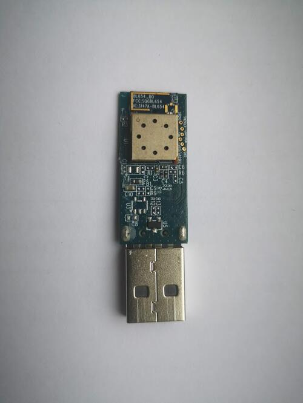
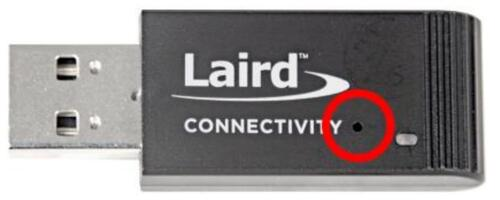

<!-- Copyright 2015-2026 Zephyr Project members and individual contributors. -->
<!-- SPDX-License-Identifier: Apache-2.0 -->
<!-- 中文翻译；编号、导航与译注为本地新增。 -->

<a id="bl654_usb"></a>

# 第9章\_BL654 USB（451-00004）

原文：[官方页面](https://docs.zephyrproject.org/latest/boards/ezurio/bl654_usb/doc/bl654_usb.html)。读取日期：2026-10-16；来源摘要见[来源记录](../SOURCES.md)。

开发板概览（Board Overview）

<a id="id1"></a>

[](images/bl654_usb.jpg)

BL654 USB（451-00004）

名称（Name）：

`bl654_usb`

厂商（Vendor）：

[Ezurio](https://docs.zephyrproject.org/latest/boards/index.html#vendor=ezurio)

状态（Status）：

维护中（Maintained）

架构（Architecture）：

[arm](https://docs.zephyrproject.org/latest/boards/index.html#arch=arm)

片上系统（SoC）：

[nrf52840](https://docs.zephyrproject.org/latest/boards/index.html#soc=nrf52840)

<a id="board-github-link"></a>

[浏览开发板源码（Browse Board Sources）](https://github.com/zephyrproject-rtos/zephyr/blob/main//boards/ezurio/bl654_usb/doc/bl654_usb.rst/../..)<a id="overview"></a>

## 概述（Overview）

BL654 USB适配器（Ezurio料号451-00004）支持Ezurio BL654模块，该模块采用Nordic Semiconductor nRF52840 Arm Cortex-M4F CPU。

BL654 USB适配器具备以下特性：


- 时钟（CLOCK）
- 闪存（FLASH）
- 通用输入输出（GPIO）
- 存储器保护单元（MPU）
- 嵌套向量中断控制器（NVIC）
- 脉宽调制（PWM）
- 无线电（RADIO），支持低功耗蓝牙（Bluetooth Low Energy）和IEEE 802.15.4
- 实时时钟（RTC）
- 通用串行总线（USB）
- 看门狗定时器（WDT）

<a id="id2"></a>



BL654 USB适配器印制电路板（PCB）

<a id="id4"></a>

<a id="id6"></a>

BL654 USB适配器更多信息见BL654 USB Dongle快速入门指南[注1](#id3)；BL654系列更多信息见[BL654网站](https://ezurio.com/wireless-modules/bluetooth-modules/bluetooth-5-modules/bl654-series)[注2](#id5)。（[BL654 USB适配器快速入门指南](https://www.ezurio.com/documentation/user-guide-bl654-usb-nordic-sdk-zephyr)）

<a id="hardware"></a>

## 硬件（Hardware）

`bl654_usb`有两个外部振荡器：慢时钟32.768 kHz，主时钟32 MHz。

<a id="supported-features"></a>

### 支持的功能（Supported Features）

`bl654_usb`开发板支持下表所列的硬件功能。

片上／板载（On-Chip / On-Board）

功能集成在片上系统（SoC）内／位于开发板上。

2 / 2

分别表示已启用／已禁用的实例数。点击数量标签，可查看开发板或SoC设备树源码（DTS）中该功能的第一个实例。

`vnd,foo`

与此功能匹配的设备树绑定兼容字符串（Compatible String）；点击链接可查看绑定文档。

<a id="bl654_usb-hw-features"></a>

<a id="bl654_usb-bl654_usb/nrf52840-hw-features-section"></a>

#### `bl654_usb/nrf52840`目标（Target）

<a id="bl654_usb-bl654_usb/nrf52840-hw-features-panel"></a>

<a id="bl654_usb-bl654_usb/nrf52840-hw-features-memory"></a>

此开发板目标可用存储器：256 KiB RAM、1 MiB 闪存。

<a id="bl654_usb-bl654_usb/nrf52840-hw-features-table"></a>

<table>
<tr>
<th>类型（Type）</th>
<th>位置（Location）</th>
<th>说明（Description）</th>
<th>兼容字符串（Compatible）</th>
</tr>
<tr>
<td rowspan="1">中央处理器（CPU）</td>
<td>片上（On-Chip）</td>
<td>ARM Cortex-M4F 处理器（CPU）（<a href="https://github.com/zephyrproject-rtos/zephyr/blob/main/dts/arm/nordic/nrf52840.dtsi?plain=1#L23">已启用：1</a>）</td>
<td><a href="../cpu_arm_riscv_binding_reference/P025_arm_cortex-m4f.md#std-dtcompatible-arm-cortex-m4f"><code>arm,cortex-m4f</code></a></td>
</tr>
<tr>
<td rowspan="1">模数转换器（ADC）</td>
<td>片上（On-Chip）</td>
<td>Nordic Semiconductor nRF系列逐次逼近模数转换器（SAADC）节点（<a href="https://github.com/zephyrproject-rtos/zephyr/blob/main/dts/arm/nordic/nrf52840.dtsi?plain=1#L243">已禁用：1</a>）</td>
<td><a href="../hardware/P846_NordicNRF逐次逼近ADC绑定.md#dtbinding-nordic-nrf-saadc"><code>nordic,nrf-saadc</code></a></td>
</tr>
<tr>
<td rowspan="4">ARM 架构（ARM Architecture）</td>
<td>片上（On-Chip）</td>
<td>Nordic用户信息配置寄存器（UICR / User Information Configuration Registers）（<a href="https://github.com/zephyrproject-rtos/zephyr/blob/main/dts/arm/nordic/nrf52840.dtsi?plain=1#L57">已启用：1</a>）</td>
<td><a href="../arm_nordic_nxp_control_binding_reference/P007_nordic_nrf-uicr.md#std-dtcompatible-nordic-nrf-uicr"><code>nordic,nrf-uicr</code></a></td>
</tr>
<tr>
<td>片上（On-Chip）</td>
<td>Nordic事件发生器单元（EGU / Event Generator Unit）（<a href="https://github.com/zephyrproject-rtos/zephyr/blob/main/dts/arm/nordic/nrf52840.dtsi?plain=1#L356">已启用：6</a>）</td>
<td><a href="../arm_timing_ethosu_control_binding_reference/P018_nordic_nrf-egu.md#std-dtcompatible-nordic-nrf-egu"><code>nordic,nrf-egu</code></a></td>
</tr>
<tr>
<td>片上（On-Chip）</td>
<td>Nordic nRF系列访问控制列表（ACL / Access Control List）（<a href="https://github.com/zephyrproject-rtos/zephyr/blob/main/dts/arm/nordic/nrf52840.dtsi?plain=1#L433">已启用：1</a>）</td>
<td><a href="../arm_timing_ethosu_control_binding_reference/P014_nordic_nrf-acl.md#std-dtcompatible-nordic-nrf-acl"><code>nordic,nrf-acl</code></a></td>
</tr>
<tr>
<td>片上（On-Chip）</td>
<td>Nordic nRF系列存储器监视单元（MWU / Memory Watch Unit）（<a href="https://github.com/zephyrproject-rtos/zephyr/blob/main/dts/arm/nordic/nrf52840.dtsi?plain=1#L465">已启用：1</a>）</td>
<td><a href="../arm_timing_ethosu_control_binding_reference/P022_nordic_nrf-mwu.md#std-dtcompatible-nordic-nrf-mwu"><code>nordic,nrf-mwu</code></a></td>
</tr>
<tr>
<td rowspan="1">音频（Audio）</td>
<td>片上（On-Chip）</td>
<td>Nordic脉冲密度调制接口（PDM / Pulse Density Modulation Interface）（<a href="https://github.com/zephyrproject-rtos/zephyr/blob/main/dts/arm/nordic/nrf52840.dtsi?plain=1#L426">已禁用：1</a>）</td>
<td><a href="../audio_pdm_codec_binding_reference/P012_nordic_nrf-pdm.md#std-dtcompatible-nordic-nrf-pdm"><code>nordic,nrf-pdm</code></a></td>
</tr>
<tr>
<td rowspan="4">时钟控制（Clock Control）</td>
<td>片上（On-Chip）</td>
<td>Nordic nRF时钟控制（Clock Control）节点（<a href="https://github.com/zephyrproject-rtos/zephyr/blob/main/dts/arm/nordic/nrf52840.dtsi?plain=1#L74">已启用：1</a>）</td>
<td><a href="../clock_sam_nordic_binding_reference/P015_nordic_nrf-clock.md#std-dtcompatible-nordic-nrf-clock"><code>nordic,nrf-clock</code></a></td>
</tr>
<tr>
<td>片上（On-Chip）</td>
<td>Nordic nRF高频时钟（HFCLK）控制节点（<a href="https://github.com/zephyrproject-rtos/zephyr/blob/main/dts/arm/nordic/nrf52840.dtsi?plain=1#L80">已启用：1</a>）</td>
<td><a href="../clock_sam_nordic_binding_reference/P009_nordic_nrf-clock-hfclk.md#std-dtcompatible-nordic-nrf-clock-hfclk"><code>nordic,nrf-clock-hfclk</code></a></td>
</tr>
<tr>
<td>片上（On-Chip）</td>
<td>Nordic nRF低频时钟（LFCLK）控制节点（<a href="https://github.com/zephyrproject-rtos/zephyr/blob/main/dts/arm/nordic/nrf52840.dtsi?plain=1#L85">已启用：1</a>）</td>
<td><a href="../clock_sam_nordic_binding_reference/P012_nordic_nrf-clock-lfclk.md#std-dtcompatible-nordic-nrf-clock-lfclk"><code>nordic,nrf-clock-lfclk</code></a></td>
</tr>
<tr>
<td>片上（On-Chip）</td>
<td>Nordic nRF高频晶体振荡器（High-frequency Crystal Oscillator，nRF52系列）（<a href="https://github.com/zephyrproject-rtos/zephyr/blob/main/dts/arm/nordic/nrf52840.dtsi?plain=1#L39">已启用：1</a>）</td>
<td><a href="../clock_sam_nordic_binding_reference/P022_nordic_nrf52-hfxo.md#std-dtcompatible-nordic-nrf52-hfxo"><code>nordic,nrf52-hfxo</code></a></td>
</tr>
<tr>
<td rowspan="1">比较器（Comparator）</td>
<td>片上（On-Chip）</td>
<td>Nordic nRF模拟比较器（COMP / Analog Comparator）（<a href="https://github.com/zephyrproject-rtos/zephyr/blob/main/dts/arm/nordic/nrf52840.dtsi?plain=1#L345">已禁用：1</a>）</td>
<td><a href="../hardware/P752_NordicnRF比较器绑定.md#dtbinding-nordic-nrf-comp"><code>nordic,nrf-comp</code></a></td>
</tr>
<tr>
<td rowspan="1">计数器（Counter）</td>
<td>片上（On-Chip）</td>
<td>Nordic nRF定时器（Timer）节点（<a href="https://github.com/zephyrproject-rtos/zephyr/blob/main/dts/arm/nordic/nrf52840.dtsi?plain=1#L252">已禁用：5</a>）</td>
<td><a href="../microchip_soc_counter_binding_reference/P017_nordic_nrf-timer.md#std-dtcompatible-nordic-nrf-timer"><code>nordic,nrf-timer</code></a></td>
</tr>
<tr>
<td rowspan="3">密码学加速器（Cryptographic Accelerator）</td>
<td>片上（On-Chip）</td>
<td>Nordic ECB（AES电子密码本模式加密 / Electronic Codebook Mode Encryption）（<a href="https://github.com/zephyrproject-rtos/zephyr/blob/main/dts/arm/nordic/nrf52840.dtsi?plain=1#L306">已启用：1</a>）</td>
<td><a href="../crypto_secure_engine_st_ti_binding_reference/P001_nordic_nrf-ecb.md#std-dtcompatible-nordic-nrf-ecb"><code>nordic,nrf-ecb</code></a></td>
</tr>
<tr>
<td>片上（On-Chip）</td>
<td>Nordic nRF系列CCM（AES CCM模式加密 / CCM Mode Encryption）（<a href="https://github.com/zephyrproject-rtos/zephyr/blob/main/dts/arm/nordic/nrf52840.dtsi?plain=1#L313">已启用：1</a>）</td>
<td><a href="../crypto_aes_sha_ccm_binding_reference/P020_nordic_nrf-ccm.md#std-dtcompatible-nordic-nrf-ccm"><code>nordic,nrf-ccm</code></a></td>
</tr>
<tr>
<td>片上（On-Chip）</td>
<td>ARM TrustZone CryptoCell 310密码模块（<a href="https://github.com/zephyrproject-rtos/zephyr/blob/main/dts/arm/nordic/nrf52840.dtsi?plain=1#L597">已禁用：1</a>）</td>
<td><a href="../crypto_aes_sha_ccm_binding_reference/P001_arm_cryptocell-310.md#std-dtcompatible-arm-cryptocell-310"><code>arm,cryptocell-310</code></a></td>
</tr>
<tr>
<td rowspan="1">调试（Debug）</td>
<td>片上（On-Chip）</td>
<td>ARMv7仪器化跟踪宏单元（ITM / Instrumentation Trace Macrocell）（<a href="https://github.com/zephyrproject-rtos/zephyr/blob/main/dts/arm/nordic/nrf52840.dtsi?plain=1#L30">已启用：1</a>）</td>
<td><a href="../debug_binding_reference/P001_ARMv7M_ITM调试绑定.md#std-dtcompatible-arm-armv7m-itm"><code>arm,armv7m-itm</code></a></td>
</tr>
<tr>
<td rowspan="2">闪存控制器（Flash Controller）</td>
<td>片上（On-Chip）</td>
<td>Nordic非易失性存储器控制器（NVMC / Non-Volatile Memory Controller）（<a href="https://github.com/zephyrproject-rtos/zephyr/blob/main/dts/arm/nordic/nrf52840.dtsi?plain=1#L439">已启用：1</a>）</td>
<td><a href="../flash_adi_microchip_nordic_binding_reference/P030_nordic_nrf52-flash-controller.md#std-dtcompatible-nordic-nrf52-flash-controller"><code>nordic,nrf52-flash-controller</code></a></td>
</tr>
<tr>
<td>片上（On-Chip）</td>
<td>定义Nordic四线SPI外设（QSPI Peripheral）接口的属性（<a href="https://github.com/zephyrproject-rtos/zephyr/blob/main/dts/arm/nordic/nrf52840.dtsi?plain=1#L543">已禁用：1</a>）</td>
<td><a href="../flash_adi_microchip_nordic_binding_reference/P028_nordic_nrf-qspi.md#std-dtcompatible-nordic-nrf-qspi"><code>nordic,nrf-qspi</code></a></td>
</tr>
<tr>
<td rowspan="2">通用输入输出与接插件（GPIO &amp; Headers）</td>
<td>片上（On-Chip）</td>
<td>NRF5 GPIO任务与事件（GPIOTE）（<a href="https://github.com/zephyrproject-rtos/zephyr/blob/main/dts/arm/nordic/nrf52840.dtsi?plain=1#L235">已启用：1</a>）</td>
<td><a href="../gpio_microchip_nordic_nuvoton_binding_reference/P017_nordic_nrf-gpiote.md#std-dtcompatible-nordic-nrf-gpiote"><code>nordic,nrf-gpiote</code></a></td>
</tr>
<tr>
<td>片上（On-Chip）</td>
<td>NRF5通用输入输出（GPIO）（<a href="https://github.com/zephyrproject-rtos/zephyr/blob/main/dts/arm/nordic/nrf52840.dtsi?plain=1#L574">已启用：2</a>）</td>
<td><a href="../gpio_microchip_nordic_nuvoton_binding_reference/P016_nordic_nrf-gpio.md#std-dtcompatible-nordic-nrf-gpio"><code>nordic,nrf-gpio</code></a></td>
</tr>
<tr>
<td rowspan="1">集成电路间总线（I2C）</td>
<td>片上（On-Chip）</td>
<td>Nordic nRF系列TWIM（带EasyDMA的TWI主机）（<a href="https://github.com/zephyrproject-rtos/zephyr/blob/main/dts/arm/nordic/nrf52840.dtsi?plain=1#L156">已禁用：2</a>）</td>
<td><a href="../i2c_infineon_ite_nordic_binding_reference/P016_nordic_nrf-twim.md#std-dtcompatible-nordic-nrf-twim"><code>nordic,nrf-twim</code></a></td>
</tr>
<tr>
<td rowspan="1">集成电路间音频总线（I2S）</td>
<td>片上（On-Chip）</td>
<td>Nordic芯片间音频接口（I2S / Inter-IC Sound Interface）（<a href="https://github.com/zephyrproject-rtos/zephyr/blob/main/dts/arm/nordic/nrf52840.dtsi?plain=1#L515">已禁用：1</a>）</td>
<td><a href="../i2s_binding_reference/P010_nordic_nrf-i2s.md#std-dtcompatible-nordic-nrf-i2s"><code>nordic,nrf-i2s</code></a></td>
</tr>
<tr>
<td rowspan="1">低速率无线个域网（IEEE 802.15.4）</td>
<td>片上（On-Chip）</td>
<td>Nordic nRF IEEE 802.15.4节点（<a href="https://github.com/zephyrproject-rtos/zephyr/blob/main/dts/arm/nordic/nrf52840.dtsi?plain=1#L133">已启用：1</a>）</td>
<td><a href="../lora_ieee802154_binding_reference/P005_nordic_nrf-ieee802154.md#std-dtcompatible-nordic-nrf-ieee802154"><code>nordic,nrf-ieee802154</code></a></td>
</tr>
<tr>
<td rowspan="1">中断控制器（Interrupt Controller）</td>
<td>片上（On-Chip）</td>
<td>ARMv7-M 嵌套向量中断控制器（Nested Vectored Interrupt Controller，NVIC）（<a href="https://github.com/zephyrproject-rtos/zephyr/blob/main/dts/arm/armv7-m.dtsi?plain=1#L13">已启用：1</a>）</td>
<td><a href="../arm_interrupt_timer_binding_reference/P002_ARMv7_M_NVIC.md#std-dtcompatible-arm-v7m-nvic"><code>arm,v7m-nvic</code></a></td>
</tr>
<tr>
<td rowspan="2">发光二极管（LED）</td>
<td>板载（On-Board）</td>
<td>一组由 GPIO 控制的 LED（GPIO-Controlled LEDs）（<a href="https://github.com/zephyrproject-rtos/zephyr/blob/main/boards/ezurio/bl654_usb/bl654_usb_common.dtsi?plain=1#L24">已启用：1</a>）</td>
<td><a href="../hardware/P564_GPIO指示灯绑定.md#dtbinding-gpio-leds"><code>gpio-leds</code></a></td>
</tr>
<tr>
<td>板载（On-Board）</td>
<td>一组由脉宽调制（PWM）控制的LED（<a href="https://github.com/zephyrproject-rtos/zephyr/blob/main/boards/ezurio/bl654_usb/bl654_usb_common.dtsi?plain=1#L33">已启用：1</a>）</td>
<td><a href="../hardware/P565_PWM指示灯绑定.md#dtbinding-pwm-leds"><code>pwm-leds</code></a></td>
</tr>
<tr>
<td rowspan="2">其他绑定（Miscellaneous）</td>
<td>片上（On-Chip）</td>
<td>Nordic工厂信息配置寄存器（FICR / Factory Information Configuration Registers）（<a href="https://github.com/zephyrproject-rtos/zephyr/blob/main/dts/arm/nordic/nrf52840.dtsi?plain=1#L50">已启用：1</a>）</td>
<td><a href="../misc_adi_nordic_binding_reference/P018_nordic_nrf-ficr.md#std-dtcompatible-nordic-nrf-ficr"><code>nordic,nrf-ficr</code></a></td>
</tr>
<tr>
<td>片上（On-Chip）</td>
<td>Nordic nRF系列可编程外设互连（PPI / Programmable Peripheral Interconnect）（<a href="https://github.com/zephyrproject-rtos/zephyr/blob/main/dts/arm/nordic/nrf52840.dtsi?plain=1#L459">已启用：1</a>）</td>
<td><a href="../misc_adi_nordic_binding_reference/P020_nordic_nrf-ppi.md#std-dtcompatible-nordic-nrf-ppi"><code>nordic,nrf-ppi</code></a></td>
</tr>
<tr>
<td rowspan="1">存储技术设备（MTD）</td>
<td>片上（On-Chip）</td>
<td>闪存（Flash）节点（<a href="https://github.com/zephyrproject-rtos/zephyr/blob/main/dts/arm/nordic/nrf52840.dtsi?plain=1#L447">已启用：1</a>）</td>
<td><a href="../mtd_nxp_st_ti_partition_binding_reference/P013_soc-nv-flash.md#std-dtcompatible-soc-nv-flash"><code>soc-nv-flash</code></a></td>
</tr>
<tr>
<td rowspan="2">网络（Networking）</td>
<td>片上（On-Chip）</td>
<td>Nordic nRF系列无线电（RADIO）外设（<a href="https://github.com/zephyrproject-rtos/zephyr/blob/main/dts/arm/nordic/nrf52840.dtsi?plain=1#L123">已启用：1</a>）</td>
<td><a href="../network_radio_frontend_binding_reference/P009_nordic_nrf-radio.md#std-dtcompatible-nordic-nrf-radio"><code>nordic,nrf-radio</code></a></td>
</tr>
<tr>
<td>片上（On-Chip）</td>
<td>Nordic nRF系列近场通信标签（NFCT / Near Field Communication Tag）（<a href="https://github.com/zephyrproject-rtos/zephyr/blob/main/dts/arm/nordic/nrf52840.dtsi?plain=1#L228">已禁用：1</a>）</td>
<td><a href="../network_radio_frontend_binding_reference/P008_nordic_nrf-nfct.md#std-dtcompatible-nordic-nrf-nfct"><code>nordic,nrf-nfct</code></a></td>
</tr>
<tr>
<td rowspan="1">引脚控制（Pin Control）</td>
<td>片上（On-Chip）</td>
<td>Nordic nRF系列引脚控制器（Pin Controller）（<a href="https://github.com/zephyrproject-rtos/zephyr/blob/main/dts/vendor/nordic/nrf_common.dtsi?plain=1#L26">已启用：1</a>）</td>
<td><a href="../pinctrl_infineon_nordic_nxp_binding_reference/P009_nordic_nrf-pinctrl.md#std-dtcompatible-nordic-nrf-pinctrl"><code>nordic,nrf-pinctrl</code></a></td>
</tr>
<tr>
<td rowspan="1">电源管理（Power Management）</td>
<td>片上（On-Chip）</td>
<td>Nordic nRF电源控制（Power Control）节点（<a href="https://github.com/zephyrproject-rtos/zephyr/blob/main/dts/arm/nordic/nrf52840.dtsi?plain=1#L91">已启用：1</a>）</td>
<td><a href="../power_control_binding_reference/P008_nordic_nrf-power.md#std-dtcompatible-nordic-nrf-power"><code>nordic,nrf-power</code></a></td>
</tr>
<tr>
<td rowspan="2">脉宽调制（PWM）</td>
<td>片上（On-Chip）</td>
<td>nRF脉宽调制（PWM）（<a href="https://github.com/zephyrproject-rtos/zephyr/blob/main/dts/arm/nordic/nrf52840.dtsi?plain=1#L418">已启用：1</a>；<a href="https://github.com/zephyrproject-rtos/zephyr/blob/main/dts/arm/nordic/nrf52840.dtsi?plain=1#L471">已禁用：3</a>）</td>
<td><a href="../pwm_intel_microchip_nxp_binding_reference/P015_nordic_nrf-pwm.md#std-dtcompatible-nordic-nrf-pwm"><code>nordic,nrf-pwm</code></a></td>
</tr>
<tr>
<td>片上（On-Chip）</td>
<td>nRFx软件脉宽调制（S/W PWM）（<a href="https://github.com/zephyrproject-rtos/zephyr/blob/main/dts/vendor/nordic/nrf_common.dtsi?plain=1#L39">已禁用：1</a>）</td>
<td><a href="../pwm_intel_microchip_nxp_binding_reference/P016_nordic_nrf-sw-pwm.md#std-dtcompatible-nordic-nrf-sw-pwm"><code>nordic,nrf-sw-pwm</code></a></td>
</tr>
<tr>
<td rowspan="2">稳压器（Regulator）</td>
<td>片上（On-Chip）</td>
<td>Nordic nRF5X稳压器（Regulator，内核供电的固定级）（<a href="https://github.com/zephyrproject-rtos/zephyr/blob/main/dts/arm/nordic/nrf52840.dtsi?plain=1#L115">已启用：1</a>）</td>
<td><a href="../hardware/P643_nRF5X稳压器绑定.md#dtbinding-nordic-nrf5x-regulator"><code>nordic,nrf5x-regulator</code></a></td>
</tr>
<tr>
<td>片上（On-Chip）</td>
<td>Nordic nRF52X稳压器（Regulator），主电源的高压级（High-voltage Stage）（<a href="https://github.com/zephyrproject-rtos/zephyr/blob/main/dts/arm/nordic/nrf52840_qiaa.dtsi?plain=1#L11">已启用：1</a>）</td>
<td><a href="../hardware/P639_nRF52高压稳压器绑定.md#dtbinding-nordic-nrf52x-regulator-hv"><code>nordic,nrf52x-regulator-hv</code></a></td>
</tr>
<tr>
<td rowspan="1">保持存储器（Retained Memory）</td>
<td>片上（On-Chip）</td>
<td>Nordic通用保持寄存器（GPREGRET / General Purpose Register Retention）设备（<a href="https://github.com/zephyrproject-rtos/zephyr/blob/main/dts/arm/nordic/nrf52840.dtsi?plain=1#L99">已启用：2</a>）</td>
<td><a href="../hardware/P627_Nordic通用保留寄存器绑定.md#dtbinding-nordic-nrf-gpregret"><code>nordic,nrf-gpregret</code></a></td>
</tr>
<tr>
<td rowspan="1">随机数生成器（RNG）</td>
<td>片上（On-Chip）</td>
<td>Nordic nRF系列随机数发生器（RNG / Random Number Generator）（<a href="https://github.com/zephyrproject-rtos/zephyr/blob/main/dts/arm/nordic/nrf52840.dtsi?plain=1#L299">已启用：1</a>）</td>
<td><a href="../rng_binding_reference/P014_nordic_nrf-rng.md#std-dtcompatible-nordic-nrf-rng"><code>nordic,nrf-rng</code></a></td>
</tr>
<tr>
<td rowspan="1">实时时钟（RTC）</td>
<td>片上（On-Chip）</td>
<td>Nordic nRF实时时间计数器（RTC / Real-Time Counter）（<a href="https://github.com/zephyrproject-rtos/zephyr/blob/main/dts/arm/nordic/nrf52840.dtsi?plain=1#L282">已禁用：3</a>）</td>
<td><a href="../microchip_microcrystal_nxp_rtc_binding_reference/P010_nordic_nrf-rtc.md#std-dtcompatible-nordic-nrf-rtc"><code>nordic,nrf-rtc</code></a></td>
</tr>
<tr>
<td rowspan="2">传感器（Sensors）</td>
<td>片上（On-Chip）</td>
<td>Nordic nRF系列温度（TEMP）节点（<a href="https://github.com/zephyrproject-rtos/zephyr/blob/main/dts/arm/nordic/nrf52840.dtsi?plain=1#L292">已启用：1</a>）</td>
<td><a href="../sensor_microchip_nordic_nxp_binding_reference/P023_nordic_nrf-temp.md#std-dtcompatible-nordic-nrf-temp"><code>nordic,nrf-temp</code></a></td>
</tr>
<tr>
<td>片上（On-Chip）</td>
<td>Nordic nRF正交解码器（QDEC / Quadrature Decoder）节点（<a href="https://github.com/zephyrproject-rtos/zephyr/blob/main/dts/arm/nordic/nrf52840.dtsi?plain=1#L338">已禁用：1</a>）</td>
<td><a href="../sensor_microchip_nordic_nxp_binding_reference/P021_nordic_nrf-qdec.md#std-dtcompatible-nordic-nrf-qdec"><code>nordic,nrf-qdec</code></a></td>
</tr>
<tr>
<td rowspan="1">串行控制器（Serial Controller）</td>
<td>片上（On-Chip）</td>
<td>Nordic nRF系列UARTE（带EasyDMA的UART）（<a href="https://github.com/zephyrproject-rtos/zephyr/blob/main/dts/arm/nordic/nrf52840.dtsi?plain=1#L147">已禁用：2</a>）</td>
<td><a href="../uart_microchip_nordic_nxp_binding_reference/P004_nordic_nrf-uarte.md#std-dtcompatible-nordic-nrf-uarte"><code>nordic,nrf-uarte</code></a></td>
</tr>
<tr>
<td rowspan="1">串行外设接口（SPI）</td>
<td>片上（On-Chip）</td>
<td>Nordic nRF系列SPIM（带EasyDMA的SPI控制器）（<a href="https://github.com/zephyrproject-rtos/zephyr/blob/main/dts/arm/nordic/nrf52840.dtsi?plain=1#L174">已禁用：4</a>）</td>
<td><a href="../spi_microchip_nordic_nxp_binding_reference/P013_nordic_nrf-spim.md#std-dtcompatible-nordic-nrf-spim"><code>nordic,nrf-spim</code></a></td>
</tr>
<tr>
<td rowspan="1">静态随机存储器（SRAM）</td>
<td>片上（On-Chip）</td>
<td>通用片上静态随机存储器（SRAM）（<a href="https://github.com/zephyrproject-rtos/zephyr/blob/main/dts/arm/nordic/nrf52840.dtsi?plain=1#L66">已启用：1</a>）</td>
<td><a href="../hardware/P567_内存映射SRAM绑定.md#dtbinding-mmio-sram"><code>mmio-sram</code></a></td>
</tr>
<tr>
<td rowspan="1">定时器（Timer）</td>
<td>片上（On-Chip）</td>
<td>ARMv7-M 系统节拍（System Tick）（<a href="https://github.com/zephyrproject-rtos/zephyr/blob/main/dts/arm/armv7-m.dtsi?plain=1#L21">已禁用：1</a>）</td>
<td><a href="../arm_interrupt_timer_binding_reference/P006_ARMv7_M_SysTick.md#std-dtcompatible-arm-armv7m-systick"><code>arm,armv7m-systick</code></a></td>
</tr>
<tr>
<td rowspan="1">通用串行总线（USB）</td>
<td>片上（On-Chip）</td>
<td>Nordic nRF52 USB设备控制器（USB Device Controller）（<a href="https://github.com/zephyrproject-rtos/zephyr/blob/main/dts/arm/nordic/nrf52840.dtsi?plain=1#L524">已启用：1</a>）</td>
<td><a href="../usb_controller_binding_reference/P018_nordic_nrf-usbd.md#std-dtcompatible-nordic-nrf-usbd"><code>nordic,nrf-usbd</code></a></td>
</tr>
<tr>
<td rowspan="1">看门狗（Watchdog）</td>
<td>片上（On-Chip）</td>
<td>Nordic nRF系列看门狗定时器（WDT / Watchdog Timer）（<a href="https://github.com/zephyrproject-rtos/zephyr/blob/main/dts/arm/nordic/nrf52840.dtsi?plain=1#L321">已启用：1</a>）</td>
<td><a href="../nxp_nordic_nuvoton_watchdog_binding_reference/P002_nordic_nrf-wdt.md#std-dtcompatible-nordic-nrf-wdt"><code>nordic,nrf-wdt</code></a></td>
</tr>
</table>

<a id="bl654_usb-bl654_usb/nrf52840/bare-hw-features-section"></a>

#### `bl654_usb/nrf52840/bare`目标（Target）

<a id="bl654_usb-bl654_usb/nrf52840/bare-hw-features-panel"></a>

<a id="bl654_usb-bl654_usb/nrf52840/bare-hw-features-memory"></a>

此开发板目标可用存储器：256 KiB RAM、1 MiB 闪存。

<a id="bl654_usb-bl654_usb/nrf52840/bare-hw-features-table"></a>

<table>
<tr>
<th>类型（Type）</th>
<th>位置（Location）</th>
<th>说明（Description）</th>
<th>兼容字符串（Compatible）</th>
</tr>
<tr>
<td rowspan="1">中央处理器（CPU）</td>
<td>片上（On-Chip）</td>
<td>ARM Cortex-M4F 处理器（CPU）（<a href="https://github.com/zephyrproject-rtos/zephyr/blob/main/dts/arm/nordic/nrf52840.dtsi?plain=1#L23">已启用：1</a>）</td>
<td><a href="../cpu_arm_riscv_binding_reference/P025_arm_cortex-m4f.md#std-dtcompatible-arm-cortex-m4f"><code>arm,cortex-m4f</code></a></td>
</tr>
<tr>
<td rowspan="1">模数转换器（ADC）</td>
<td>片上（On-Chip）</td>
<td>Nordic Semiconductor nRF系列逐次逼近模数转换器（SAADC）节点（<a href="https://github.com/zephyrproject-rtos/zephyr/blob/main/dts/arm/nordic/nrf52840.dtsi?plain=1#L243">已禁用：1</a>）</td>
<td><a href="../hardware/P846_NordicNRF逐次逼近ADC绑定.md#dtbinding-nordic-nrf-saadc"><code>nordic,nrf-saadc</code></a></td>
</tr>
<tr>
<td rowspan="4">ARM 架构（ARM Architecture）</td>
<td>片上（On-Chip）</td>
<td>Nordic用户信息配置寄存器（UICR / User Information Configuration Registers）（<a href="https://github.com/zephyrproject-rtos/zephyr/blob/main/dts/arm/nordic/nrf52840.dtsi?plain=1#L57">已启用：1</a>）</td>
<td><a href="../arm_nordic_nxp_control_binding_reference/P007_nordic_nrf-uicr.md#std-dtcompatible-nordic-nrf-uicr"><code>nordic,nrf-uicr</code></a></td>
</tr>
<tr>
<td>片上（On-Chip）</td>
<td>Nordic事件发生器单元（EGU / Event Generator Unit）（<a href="https://github.com/zephyrproject-rtos/zephyr/blob/main/dts/arm/nordic/nrf52840.dtsi?plain=1#L356">已启用：6</a>）</td>
<td><a href="../arm_timing_ethosu_control_binding_reference/P018_nordic_nrf-egu.md#std-dtcompatible-nordic-nrf-egu"><code>nordic,nrf-egu</code></a></td>
</tr>
<tr>
<td>片上（On-Chip）</td>
<td>Nordic nRF系列访问控制列表（ACL / Access Control List）（<a href="https://github.com/zephyrproject-rtos/zephyr/blob/main/dts/arm/nordic/nrf52840.dtsi?plain=1#L433">已启用：1</a>）</td>
<td><a href="../arm_timing_ethosu_control_binding_reference/P014_nordic_nrf-acl.md#std-dtcompatible-nordic-nrf-acl"><code>nordic,nrf-acl</code></a></td>
</tr>
<tr>
<td>片上（On-Chip）</td>
<td>Nordic nRF系列存储器监视单元（MWU / Memory Watch Unit）（<a href="https://github.com/zephyrproject-rtos/zephyr/blob/main/dts/arm/nordic/nrf52840.dtsi?plain=1#L465">已启用：1</a>）</td>
<td><a href="../arm_timing_ethosu_control_binding_reference/P022_nordic_nrf-mwu.md#std-dtcompatible-nordic-nrf-mwu"><code>nordic,nrf-mwu</code></a></td>
</tr>
<tr>
<td rowspan="1">音频（Audio）</td>
<td>片上（On-Chip）</td>
<td>Nordic脉冲密度调制接口（PDM / Pulse Density Modulation Interface）（<a href="https://github.com/zephyrproject-rtos/zephyr/blob/main/dts/arm/nordic/nrf52840.dtsi?plain=1#L426">已禁用：1</a>）</td>
<td><a href="../audio_pdm_codec_binding_reference/P012_nordic_nrf-pdm.md#std-dtcompatible-nordic-nrf-pdm"><code>nordic,nrf-pdm</code></a></td>
</tr>
<tr>
<td rowspan="4">时钟控制（Clock Control）</td>
<td>片上（On-Chip）</td>
<td>Nordic nRF时钟控制（Clock Control）节点（<a href="https://github.com/zephyrproject-rtos/zephyr/blob/main/dts/arm/nordic/nrf52840.dtsi?plain=1#L74">已启用：1</a>）</td>
<td><a href="../clock_sam_nordic_binding_reference/P015_nordic_nrf-clock.md#std-dtcompatible-nordic-nrf-clock"><code>nordic,nrf-clock</code></a></td>
</tr>
<tr>
<td>片上（On-Chip）</td>
<td>Nordic nRF高频时钟（HFCLK）控制节点（<a href="https://github.com/zephyrproject-rtos/zephyr/blob/main/dts/arm/nordic/nrf52840.dtsi?plain=1#L80">已启用：1</a>）</td>
<td><a href="../clock_sam_nordic_binding_reference/P009_nordic_nrf-clock-hfclk.md#std-dtcompatible-nordic-nrf-clock-hfclk"><code>nordic,nrf-clock-hfclk</code></a></td>
</tr>
<tr>
<td>片上（On-Chip）</td>
<td>Nordic nRF低频时钟（LFCLK）控制节点（<a href="https://github.com/zephyrproject-rtos/zephyr/blob/main/dts/arm/nordic/nrf52840.dtsi?plain=1#L85">已启用：1</a>）</td>
<td><a href="../clock_sam_nordic_binding_reference/P012_nordic_nrf-clock-lfclk.md#std-dtcompatible-nordic-nrf-clock-lfclk"><code>nordic,nrf-clock-lfclk</code></a></td>
</tr>
<tr>
<td>片上（On-Chip）</td>
<td>Nordic nRF高频晶体振荡器（High-frequency Crystal Oscillator，nRF52系列）（<a href="https://github.com/zephyrproject-rtos/zephyr/blob/main/dts/arm/nordic/nrf52840.dtsi?plain=1#L39">已启用：1</a>）</td>
<td><a href="../clock_sam_nordic_binding_reference/P022_nordic_nrf52-hfxo.md#std-dtcompatible-nordic-nrf52-hfxo"><code>nordic,nrf52-hfxo</code></a></td>
</tr>
<tr>
<td rowspan="1">比较器（Comparator）</td>
<td>片上（On-Chip）</td>
<td>Nordic nRF模拟比较器（COMP / Analog Comparator）（<a href="https://github.com/zephyrproject-rtos/zephyr/blob/main/dts/arm/nordic/nrf52840.dtsi?plain=1#L345">已禁用：1</a>）</td>
<td><a href="../hardware/P752_NordicnRF比较器绑定.md#dtbinding-nordic-nrf-comp"><code>nordic,nrf-comp</code></a></td>
</tr>
<tr>
<td rowspan="1">计数器（Counter）</td>
<td>片上（On-Chip）</td>
<td>Nordic nRF定时器（Timer）节点（<a href="https://github.com/zephyrproject-rtos/zephyr/blob/main/dts/arm/nordic/nrf52840.dtsi?plain=1#L252">已禁用：5</a>）</td>
<td><a href="../microchip_soc_counter_binding_reference/P017_nordic_nrf-timer.md#std-dtcompatible-nordic-nrf-timer"><code>nordic,nrf-timer</code></a></td>
</tr>
<tr>
<td rowspan="3">密码学加速器（Cryptographic Accelerator）</td>
<td>片上（On-Chip）</td>
<td>Nordic ECB（AES电子密码本模式加密 / Electronic Codebook Mode Encryption）（<a href="https://github.com/zephyrproject-rtos/zephyr/blob/main/dts/arm/nordic/nrf52840.dtsi?plain=1#L306">已启用：1</a>）</td>
<td><a href="../crypto_secure_engine_st_ti_binding_reference/P001_nordic_nrf-ecb.md#std-dtcompatible-nordic-nrf-ecb"><code>nordic,nrf-ecb</code></a></td>
</tr>
<tr>
<td>片上（On-Chip）</td>
<td>Nordic nRF系列CCM（AES CCM模式加密 / CCM Mode Encryption）（<a href="https://github.com/zephyrproject-rtos/zephyr/blob/main/dts/arm/nordic/nrf52840.dtsi?plain=1#L313">已启用：1</a>）</td>
<td><a href="../crypto_aes_sha_ccm_binding_reference/P020_nordic_nrf-ccm.md#std-dtcompatible-nordic-nrf-ccm"><code>nordic,nrf-ccm</code></a></td>
</tr>
<tr>
<td>片上（On-Chip）</td>
<td>ARM TrustZone CryptoCell 310密码模块（<a href="https://github.com/zephyrproject-rtos/zephyr/blob/main/dts/arm/nordic/nrf52840.dtsi?plain=1#L597">已禁用：1</a>）</td>
<td><a href="../crypto_aes_sha_ccm_binding_reference/P001_arm_cryptocell-310.md#std-dtcompatible-arm-cryptocell-310"><code>arm,cryptocell-310</code></a></td>
</tr>
<tr>
<td rowspan="1">调试（Debug）</td>
<td>片上（On-Chip）</td>
<td>ARMv7仪器化跟踪宏单元（ITM / Instrumentation Trace Macrocell）（<a href="https://github.com/zephyrproject-rtos/zephyr/blob/main/dts/arm/nordic/nrf52840.dtsi?plain=1#L30">已启用：1</a>）</td>
<td><a href="../debug_binding_reference/P001_ARMv7M_ITM调试绑定.md#std-dtcompatible-arm-armv7m-itm"><code>arm,armv7m-itm</code></a></td>
</tr>
<tr>
<td rowspan="2">闪存控制器（Flash Controller）</td>
<td>片上（On-Chip）</td>
<td>Nordic非易失性存储器控制器（NVMC / Non-Volatile Memory Controller）（<a href="https://github.com/zephyrproject-rtos/zephyr/blob/main/dts/arm/nordic/nrf52840.dtsi?plain=1#L439">已启用：1</a>）</td>
<td><a href="../flash_adi_microchip_nordic_binding_reference/P030_nordic_nrf52-flash-controller.md#std-dtcompatible-nordic-nrf52-flash-controller"><code>nordic,nrf52-flash-controller</code></a></td>
</tr>
<tr>
<td>片上（On-Chip）</td>
<td>定义Nordic四线SPI外设（QSPI Peripheral）接口的属性（<a href="https://github.com/zephyrproject-rtos/zephyr/blob/main/dts/arm/nordic/nrf52840.dtsi?plain=1#L543">已禁用：1</a>）</td>
<td><a href="../flash_adi_microchip_nordic_binding_reference/P028_nordic_nrf-qspi.md#std-dtcompatible-nordic-nrf-qspi"><code>nordic,nrf-qspi</code></a></td>
</tr>
<tr>
<td rowspan="2">通用输入输出与接插件（GPIO &amp; Headers）</td>
<td>片上（On-Chip）</td>
<td>NRF5 GPIO任务与事件（GPIOTE）（<a href="https://github.com/zephyrproject-rtos/zephyr/blob/main/dts/arm/nordic/nrf52840.dtsi?plain=1#L235">已启用：1</a>）</td>
<td><a href="../gpio_microchip_nordic_nuvoton_binding_reference/P017_nordic_nrf-gpiote.md#std-dtcompatible-nordic-nrf-gpiote"><code>nordic,nrf-gpiote</code></a></td>
</tr>
<tr>
<td>片上（On-Chip）</td>
<td>NRF5通用输入输出（GPIO）（<a href="https://github.com/zephyrproject-rtos/zephyr/blob/main/dts/arm/nordic/nrf52840.dtsi?plain=1#L574">已启用：2</a>）</td>
<td><a href="../gpio_microchip_nordic_nuvoton_binding_reference/P016_nordic_nrf-gpio.md#std-dtcompatible-nordic-nrf-gpio"><code>nordic,nrf-gpio</code></a></td>
</tr>
<tr>
<td rowspan="1">集成电路间总线（I2C）</td>
<td>片上（On-Chip）</td>
<td>Nordic nRF系列TWIM（带EasyDMA的TWI主机）（<a href="https://github.com/zephyrproject-rtos/zephyr/blob/main/dts/arm/nordic/nrf52840.dtsi?plain=1#L156">已禁用：2</a>）</td>
<td><a href="../i2c_infineon_ite_nordic_binding_reference/P016_nordic_nrf-twim.md#std-dtcompatible-nordic-nrf-twim"><code>nordic,nrf-twim</code></a></td>
</tr>
<tr>
<td rowspan="1">集成电路间音频总线（I2S）</td>
<td>片上（On-Chip）</td>
<td>Nordic芯片间音频接口（I2S / Inter-IC Sound Interface）（<a href="https://github.com/zephyrproject-rtos/zephyr/blob/main/dts/arm/nordic/nrf52840.dtsi?plain=1#L515">已禁用：1</a>）</td>
<td><a href="../i2s_binding_reference/P010_nordic_nrf-i2s.md#std-dtcompatible-nordic-nrf-i2s"><code>nordic,nrf-i2s</code></a></td>
</tr>
<tr>
<td rowspan="1">低速率无线个域网（IEEE 802.15.4）</td>
<td>片上（On-Chip）</td>
<td>Nordic nRF IEEE 802.15.4节点（<a href="https://github.com/zephyrproject-rtos/zephyr/blob/main/dts/arm/nordic/nrf52840.dtsi?plain=1#L133">已启用：1</a>）</td>
<td><a href="../lora_ieee802154_binding_reference/P005_nordic_nrf-ieee802154.md#std-dtcompatible-nordic-nrf-ieee802154"><code>nordic,nrf-ieee802154</code></a></td>
</tr>
<tr>
<td rowspan="1">中断控制器（Interrupt Controller）</td>
<td>片上（On-Chip）</td>
<td>ARMv7-M 嵌套向量中断控制器（Nested Vectored Interrupt Controller，NVIC）（<a href="https://github.com/zephyrproject-rtos/zephyr/blob/main/dts/arm/armv7-m.dtsi?plain=1#L13">已启用：1</a>）</td>
<td><a href="../arm_interrupt_timer_binding_reference/P002_ARMv7_M_NVIC.md#std-dtcompatible-arm-v7m-nvic"><code>arm,v7m-nvic</code></a></td>
</tr>
<tr>
<td rowspan="2">发光二极管（LED）</td>
<td>板载（On-Board）</td>
<td>一组由 GPIO 控制的 LED（GPIO-Controlled LEDs）（<a href="https://github.com/zephyrproject-rtos/zephyr/blob/main/boards/ezurio/bl654_usb/bl654_usb_common.dtsi?plain=1#L24">已启用：1</a>）</td>
<td><a href="../hardware/P564_GPIO指示灯绑定.md#dtbinding-gpio-leds"><code>gpio-leds</code></a></td>
</tr>
<tr>
<td>板载（On-Board）</td>
<td>一组由脉宽调制（PWM）控制的LED（<a href="https://github.com/zephyrproject-rtos/zephyr/blob/main/boards/ezurio/bl654_usb/bl654_usb_common.dtsi?plain=1#L33">已启用：1</a>）</td>
<td><a href="../hardware/P565_PWM指示灯绑定.md#dtbinding-pwm-leds"><code>pwm-leds</code></a></td>
</tr>
<tr>
<td rowspan="2">其他绑定（Miscellaneous）</td>
<td>片上（On-Chip）</td>
<td>Nordic工厂信息配置寄存器（FICR / Factory Information Configuration Registers）（<a href="https://github.com/zephyrproject-rtos/zephyr/blob/main/dts/arm/nordic/nrf52840.dtsi?plain=1#L50">已启用：1</a>）</td>
<td><a href="../misc_adi_nordic_binding_reference/P018_nordic_nrf-ficr.md#std-dtcompatible-nordic-nrf-ficr"><code>nordic,nrf-ficr</code></a></td>
</tr>
<tr>
<td>片上（On-Chip）</td>
<td>Nordic nRF系列可编程外设互连（PPI / Programmable Peripheral Interconnect）（<a href="https://github.com/zephyrproject-rtos/zephyr/blob/main/dts/arm/nordic/nrf52840.dtsi?plain=1#L459">已启用：1</a>）</td>
<td><a href="../misc_adi_nordic_binding_reference/P020_nordic_nrf-ppi.md#std-dtcompatible-nordic-nrf-ppi"><code>nordic,nrf-ppi</code></a></td>
</tr>
<tr>
<td rowspan="1">存储技术设备（MTD）</td>
<td>片上（On-Chip）</td>
<td>闪存（Flash）节点（<a href="https://github.com/zephyrproject-rtos/zephyr/blob/main/dts/arm/nordic/nrf52840.dtsi?plain=1#L447">已启用：1</a>）</td>
<td><a href="../mtd_nxp_st_ti_partition_binding_reference/P013_soc-nv-flash.md#std-dtcompatible-soc-nv-flash"><code>soc-nv-flash</code></a></td>
</tr>
<tr>
<td rowspan="2">网络（Networking）</td>
<td>片上（On-Chip）</td>
<td>Nordic nRF系列无线电（RADIO）外设（<a href="https://github.com/zephyrproject-rtos/zephyr/blob/main/dts/arm/nordic/nrf52840.dtsi?plain=1#L123">已启用：1</a>）</td>
<td><a href="../network_radio_frontend_binding_reference/P009_nordic_nrf-radio.md#std-dtcompatible-nordic-nrf-radio"><code>nordic,nrf-radio</code></a></td>
</tr>
<tr>
<td>片上（On-Chip）</td>
<td>Nordic nRF系列近场通信标签（NFCT / Near Field Communication Tag）（<a href="https://github.com/zephyrproject-rtos/zephyr/blob/main/dts/arm/nordic/nrf52840.dtsi?plain=1#L228">已禁用：1</a>）</td>
<td><a href="../network_radio_frontend_binding_reference/P008_nordic_nrf-nfct.md#std-dtcompatible-nordic-nrf-nfct"><code>nordic,nrf-nfct</code></a></td>
</tr>
<tr>
<td rowspan="1">引脚控制（Pin Control）</td>
<td>片上（On-Chip）</td>
<td>Nordic nRF系列引脚控制器（Pin Controller）（<a href="https://github.com/zephyrproject-rtos/zephyr/blob/main/dts/vendor/nordic/nrf_common.dtsi?plain=1#L26">已启用：1</a>）</td>
<td><a href="../pinctrl_infineon_nordic_nxp_binding_reference/P009_nordic_nrf-pinctrl.md#std-dtcompatible-nordic-nrf-pinctrl"><code>nordic,nrf-pinctrl</code></a></td>
</tr>
<tr>
<td rowspan="1">电源管理（Power Management）</td>
<td>片上（On-Chip）</td>
<td>Nordic nRF电源控制（Power Control）节点（<a href="https://github.com/zephyrproject-rtos/zephyr/blob/main/dts/arm/nordic/nrf52840.dtsi?plain=1#L91">已启用：1</a>）</td>
<td><a href="../power_control_binding_reference/P008_nordic_nrf-power.md#std-dtcompatible-nordic-nrf-power"><code>nordic,nrf-power</code></a></td>
</tr>
<tr>
<td rowspan="2">脉宽调制（PWM）</td>
<td>片上（On-Chip）</td>
<td>nRF脉宽调制（PWM）（<a href="https://github.com/zephyrproject-rtos/zephyr/blob/main/dts/arm/nordic/nrf52840.dtsi?plain=1#L418">已启用：1</a>；<a href="https://github.com/zephyrproject-rtos/zephyr/blob/main/dts/arm/nordic/nrf52840.dtsi?plain=1#L471">已禁用：3</a>）</td>
<td><a href="../pwm_intel_microchip_nxp_binding_reference/P015_nordic_nrf-pwm.md#std-dtcompatible-nordic-nrf-pwm"><code>nordic,nrf-pwm</code></a></td>
</tr>
<tr>
<td>片上（On-Chip）</td>
<td>nRFx软件脉宽调制（S/W PWM）（<a href="https://github.com/zephyrproject-rtos/zephyr/blob/main/dts/vendor/nordic/nrf_common.dtsi?plain=1#L39">已禁用：1</a>）</td>
<td><a href="../pwm_intel_microchip_nxp_binding_reference/P016_nordic_nrf-sw-pwm.md#std-dtcompatible-nordic-nrf-sw-pwm"><code>nordic,nrf-sw-pwm</code></a></td>
</tr>
<tr>
<td rowspan="2">稳压器（Regulator）</td>
<td>片上（On-Chip）</td>
<td>Nordic nRF5X稳压器（Regulator，内核供电的固定级）（<a href="https://github.com/zephyrproject-rtos/zephyr/blob/main/dts/arm/nordic/nrf52840.dtsi?plain=1#L115">已启用：1</a>）</td>
<td><a href="../hardware/P643_nRF5X稳压器绑定.md#dtbinding-nordic-nrf5x-regulator"><code>nordic,nrf5x-regulator</code></a></td>
</tr>
<tr>
<td>片上（On-Chip）</td>
<td>Nordic nRF52X稳压器（Regulator），主电源的高压级（High-voltage Stage）（<a href="https://github.com/zephyrproject-rtos/zephyr/blob/main/dts/arm/nordic/nrf52840_qiaa.dtsi?plain=1#L11">已启用：1</a>）</td>
<td><a href="../hardware/P639_nRF52高压稳压器绑定.md#dtbinding-nordic-nrf52x-regulator-hv"><code>nordic,nrf52x-regulator-hv</code></a></td>
</tr>
<tr>
<td rowspan="1">保持存储器（Retained Memory）</td>
<td>片上（On-Chip）</td>
<td>Nordic通用保持寄存器（GPREGRET / General Purpose Register Retention）设备（<a href="https://github.com/zephyrproject-rtos/zephyr/blob/main/dts/arm/nordic/nrf52840.dtsi?plain=1#L99">已启用：2</a>）</td>
<td><a href="../hardware/P627_Nordic通用保留寄存器绑定.md#dtbinding-nordic-nrf-gpregret"><code>nordic,nrf-gpregret</code></a></td>
</tr>
<tr>
<td rowspan="1">随机数生成器（RNG）</td>
<td>片上（On-Chip）</td>
<td>Nordic nRF系列随机数发生器（RNG / Random Number Generator）（<a href="https://github.com/zephyrproject-rtos/zephyr/blob/main/dts/arm/nordic/nrf52840.dtsi?plain=1#L299">已启用：1</a>）</td>
<td><a href="../rng_binding_reference/P014_nordic_nrf-rng.md#std-dtcompatible-nordic-nrf-rng"><code>nordic,nrf-rng</code></a></td>
</tr>
<tr>
<td rowspan="1">实时时钟（RTC）</td>
<td>片上（On-Chip）</td>
<td>Nordic nRF实时时间计数器（RTC / Real-Time Counter）（<a href="https://github.com/zephyrproject-rtos/zephyr/blob/main/dts/arm/nordic/nrf52840.dtsi?plain=1#L282">已禁用：3</a>）</td>
<td><a href="../microchip_microcrystal_nxp_rtc_binding_reference/P010_nordic_nrf-rtc.md#std-dtcompatible-nordic-nrf-rtc"><code>nordic,nrf-rtc</code></a></td>
</tr>
<tr>
<td rowspan="2">传感器（Sensors）</td>
<td>片上（On-Chip）</td>
<td>Nordic nRF系列温度（TEMP）节点（<a href="https://github.com/zephyrproject-rtos/zephyr/blob/main/dts/arm/nordic/nrf52840.dtsi?plain=1#L292">已启用：1</a>）</td>
<td><a href="../sensor_microchip_nordic_nxp_binding_reference/P023_nordic_nrf-temp.md#std-dtcompatible-nordic-nrf-temp"><code>nordic,nrf-temp</code></a></td>
</tr>
<tr>
<td>片上（On-Chip）</td>
<td>Nordic nRF正交解码器（QDEC / Quadrature Decoder）节点（<a href="https://github.com/zephyrproject-rtos/zephyr/blob/main/dts/arm/nordic/nrf52840.dtsi?plain=1#L338">已禁用：1</a>）</td>
<td><a href="../sensor_microchip_nordic_nxp_binding_reference/P021_nordic_nrf-qdec.md#std-dtcompatible-nordic-nrf-qdec"><code>nordic,nrf-qdec</code></a></td>
</tr>
<tr>
<td rowspan="1">串行控制器（Serial Controller）</td>
<td>片上（On-Chip）</td>
<td>Nordic nRF系列UARTE（带EasyDMA的UART）（<a href="https://github.com/zephyrproject-rtos/zephyr/blob/main/dts/arm/nordic/nrf52840.dtsi?plain=1#L147">已禁用：2</a>）</td>
<td><a href="../uart_microchip_nordic_nxp_binding_reference/P004_nordic_nrf-uarte.md#std-dtcompatible-nordic-nrf-uarte"><code>nordic,nrf-uarte</code></a></td>
</tr>
<tr>
<td rowspan="1">串行外设接口（SPI）</td>
<td>片上（On-Chip）</td>
<td>Nordic nRF系列SPIM（带EasyDMA的SPI控制器）（<a href="https://github.com/zephyrproject-rtos/zephyr/blob/main/dts/arm/nordic/nrf52840.dtsi?plain=1#L174">已禁用：4</a>）</td>
<td><a href="../spi_microchip_nordic_nxp_binding_reference/P013_nordic_nrf-spim.md#std-dtcompatible-nordic-nrf-spim"><code>nordic,nrf-spim</code></a></td>
</tr>
<tr>
<td rowspan="1">静态随机存储器（SRAM）</td>
<td>片上（On-Chip）</td>
<td>通用片上静态随机存储器（SRAM）（<a href="https://github.com/zephyrproject-rtos/zephyr/blob/main/dts/arm/nordic/nrf52840.dtsi?plain=1#L66">已启用：1</a>）</td>
<td><a href="../hardware/P567_内存映射SRAM绑定.md#dtbinding-mmio-sram"><code>mmio-sram</code></a></td>
</tr>
<tr>
<td rowspan="1">定时器（Timer）</td>
<td>片上（On-Chip）</td>
<td>ARMv7-M 系统节拍（System Tick）（<a href="https://github.com/zephyrproject-rtos/zephyr/blob/main/dts/arm/armv7-m.dtsi?plain=1#L21">已禁用：1</a>）</td>
<td><a href="../arm_interrupt_timer_binding_reference/P006_ARMv7_M_SysTick.md#std-dtcompatible-arm-armv7m-systick"><code>arm,armv7m-systick</code></a></td>
</tr>
<tr>
<td rowspan="1">通用串行总线（USB）</td>
<td>片上（On-Chip）</td>
<td>Nordic nRF52 USB设备控制器（USB Device Controller）（<a href="https://github.com/zephyrproject-rtos/zephyr/blob/main/dts/arm/nordic/nrf52840.dtsi?plain=1#L524">已启用：1</a>）</td>
<td><a href="../usb_controller_binding_reference/P018_nordic_nrf-usbd.md#std-dtcompatible-nordic-nrf-usbd"><code>nordic,nrf-usbd</code></a></td>
</tr>
<tr>
<td rowspan="1">看门狗（Watchdog）</td>
<td>片上（On-Chip）</td>
<td>Nordic nRF系列看门狗定时器（WDT / Watchdog Timer）（<a href="https://github.com/zephyrproject-rtos/zephyr/blob/main/dts/arm/nordic/nrf52840.dtsi?plain=1#L321">已启用：1</a>）</td>
<td><a href="../nxp_nordic_nuvoton_watchdog_binding_reference/P002_nordic_nrf-wdt.md#std-dtcompatible-nordic-nrf-wdt"><code>nordic,nrf-wdt</code></a></td>
</tr>
</table>

<a id="id7"></a>

BL654 USB适配器的完整硬件功能列表见[BL654网站](https://ezurio.com/wireless-modules/bluetooth-modules/bluetooth-5-modules/bl654-series)[注2](#id5)。

<a id="connections-and-ios"></a>

### 连接与输入输出（Connections and IOs）

<a id="led"></a>

#### 发光二极管（LED）


- LED1 （蓝色 / blue） = P0.13

<a id="push-buttons"></a>

#### 按键（Push Buttons）


- RESET = SW1 = nReset（低电平复位）

<a id="serial-port"></a>

### 串口（Serial Port）

可通过以下方式获得Zephyr控制台输出：


- 通过USB连接器，在计算机上以USB通信设备类（CDC）方式提供控制台。

<a id="programming-and-debugging"></a>

## 烧录与调试（Programming and Debugging）

`bl654_usb`开发板支持下表所列的运行工具（Runners）及相关west命令。

<table>
<tr>
<th></th>
<th>烧录（flash）</th>
<th>调试（debug）</th>
<th>连接调试会话（attach）</th>
<th>实时传输（rtt）</th>
<th>复位（reset）</th>
<th>调试服务器（debugserver）</th>
</tr>
<tr>
<td><a href="https://docs.zephyrproject.org/latest/develop/flash_debug/host-tools.html#runner-jlink">jlink</a></td>
<td>✅</td>
<td>✅（默认 / default）</td>
<td>✅</td>
<td>✅</td>
<td>✅</td>
<td>✅</td>
</tr>
<tr>
<td>nrfjprog</td>
<td>✅</td>
<td></td>
<td></td>
<td></td>
<td></td>
<td></td>
</tr>
<tr>
<td><code>nrfutil</code></td>
<td>✅（默认 / default）</td>
<td></td>
<td></td>
<td></td>
<td></td>
<td></td>
</tr>
<tr>
<td><a href="https://docs.zephyrproject.org/latest/develop/flash_debug/host-tools.html#runner-pyocd">pyocd</a></td>
<td>✅</td>
<td>✅</td>
<td>✅</td>
<td>✅</td>
<td>✅</td>
<td>✅</td>
</tr>
</table>

`bl654_usb`配置的应用可按常规方式构建，详见构建应用。该板可用于调试，但为操作方便，也可优先考虑兼容的[BL654 DVK](P007_BL654_DVK.md#bl654_dvk)。相关文档见BL654 DVK网站及[boards/ezurio/bl654_dvk/doc/bl654_dvk.rst](https://github.com/zephyrproject-rtos/zephyr/blob/main/boards/ezurio/bl654_dvk/doc/bl654_dvk.rst)。（[构建应用（Building an Application）](../application/P001_应用开发.md#build-an-application)）

<a id="flashing"></a>

### 烧录（Flashing）

开发板支持以下编程方式：


1. 仅使用内置引导加载程序（Bootloader）
2. 使用外部调试探针（External Debug Probe）（[调试探针（Debug Probe）](https://docs.zephyrproject.org/latest/develop/flash_debug/probes.html#debug-probes)）

以下说明使用[west](../west/P014_west官方总入口.md#west)工具，并假定当前位置为west安装的根目录。（[west安装目录](https://docs.zephyrproject.org/latest/glossary.html#term-west-installation)）

<a id="option-1-using-the-built-in-bootloader-only"></a>

#### 方案1：仅使用内置引导加载程序（Built-In Bootloader）

<a id="id11"></a>

开发板出厂时已写入Nordic nRF5 SDK提供的引导加载程序。本方案使用Nordic的[nrfutil](https://www.nordicsemi.com/Products/Development-tools/nrf-util)程序[注4](#id10)创建与该引导程序兼容的固件包，并烧录设备。继续前确认：


- 已安装`nrfutil`。
- 已在`nrfutil`内安装`nrf5sdk-tools`命令。


1. 插入适配器后，按RESET键将开发板复位到引导程序。

  该按键位于USB适配器带标志一侧的小孔内。

  

  蓝色LED应开始渐亮渐暗（Fade），表示引导程序正在运行。
2. 编译Zephyr应用，此处使用[Blinky](../getting_started/P004_LED闪烁示例.md#blinky)闪灯示例。

  ```text
  west build -b bl654_usb zephyr/samples/basic/blinky
  ```
3. 使用`nrfutil`将应用打包为引导程序支持的格式：

  ```text
  nrfutil nrf5sdk-tools pkg generate \
           --hw-version 52 \
           --sd-req=0x00 \
           --application build/zephyr/zephyr.hex \
           --application-version 1 \
           blinky.zip
  ```
4. 将其烧录到开发板。注意，`/dev/ttyACM0`是Linux设备名；Windows通常为`COMx`，macOS的名称则不同。

  ```text
  nrfutil nrf5sdk-tools dfu usb-serial -pkg blinky.zip -p /dev/ttyACM0
  ```

  命令结束后，观察蓝色LED是否闪烁，区别于引导程序的渐亮渐暗模式。

<a id="id9"></a>

更多信息见Nordic Semiconductor USB设备固件升级（USB DFU）[注3](#id8)。（[Nordic Semiconductor USB设备固件升级（DFU）](https://docs.nordicsemi.com/bundle/sdk_nrf5_v17.1.0/page/sdk_app_serial_dfu_bootloader.html)）

<a id="option-2-using-an-external-debug-probe"></a>

#### 方案2：使用外部调试探针（External Debug Probe）

<a id="id13"></a>

也可使用外部调试探针烧录和调试Zephyr应用，但需要在开发板上焊接SWD排针。连接点见[开发板原理图](https://www.ezurio.com/documentation/schematics-usb-adapter-bl654-451-00004)[注5](#id12)。（[调试探针（Debug Probe）](https://docs.zephyrproject.org/latest/develop/flash_debug/probes.html#debug-probes)）

对于Segger J-Link调试探针，请按[Nordic nRF5x Segger J-Link](../debugging/P005_Nordic_Segger_JLink.md#nordic-segger)页面安装并配置全部必要软件。进一步说明见[烧录（Flashing）](../debugging/P005_Nordic_Segger_JLink.md#nordic-segger-flashing)章节。

使用`bl654_usb/bare`开发板变体构建应用。此变体采用修改后的分区表，不为板载USB引导程序预留空间。

然后按通常方式构建和烧录应用，详情见[构建应用（Building an Application）](../application/P001_应用开发.md#build-an-application)及[运行应用（Run an Application）](https://docs.zephyrproject.org/latest/develop/application/index.html#application-run)。

以下以[Blinky](../getting_started/P004_LED闪烁示例.md#blinky)应用为例。

```text
# From the root of the zephyr repository
west build -b bl654_usb/nrf52840/bare samples/basic/blinky
west flash
```

观察开发板LED闪烁。

<a id="debugging"></a>

### 调试（Debugging）

`bl654_usb`与部分Ezurio开发板不同，没有板载J-Link调试芯片。[Nordic nRF5x Segger J-Link](../debugging/P005_Nordic_Segger_JLink.md#nordic-segger)页面的说明仍适用，但需额外连接外部调试器。

<a id="testing-the-led-on-the-bl654-usb"></a>

## 测试BL654 USB的LED

以下示例可测试LED是否能在Zephyr下正常工作：


- [闪灯（Blinky）](../getting_started/P004_LED闪烁示例.md#blinky)

构建并烧录示例，可确认Zephyr是否在开发板上正常运行。LED定义见[boards/ezurio/bl654_usb/bl654_usb.dts](https://github.com/zephyrproject-rtos/zephyr/blob/main/boards/ezurio/bl654_usb/bl654_usb.dts)。

<a id="testing-bluetooth-on-the-bl654-usb"></a>

## 在BL654 USB上测试蓝牙（Bluetooth）

许多蓝牙示例可在BL654 USB上运行，可以尝试以下示例：


- [外设（Peripheral）](../bluetooth_samples/P005_基础蓝牙外设.md#ble_peripheral)
- [Eddystone](../bluetooth_samples/P031_Eddystone信标.md#bluetooth_eddystone)
- [iBeacon](../bluetooth_samples/P034_iBeacon信标.md#bluetooth_ibeacon)

<a id="references"></a>

## 参考资料（References）

<a id="id3"></a>

〔[1](#id4)〕 [https://www.ezurio.com/documentation/user-guide-bl654-usb-nordic-sdk-zephyr](https://www.ezurio.com/documentation/user-guide-bl654-usb-nordic-sdk-zephyr)

<a id="id5"></a>

〔2〕 ([1](#id6),[2](#id7)) [https://ezurio.com/wireless-modules/bluetooth-modules/bluetooth-5-modules/bl654-series](https://ezurio.com/wireless-modules/bluetooth-modules/bluetooth-5-modules/bl654-series)

<a id="id8"></a>

〔[3](#id9)〕 [https://docs.nordicsemi.com/bundle/sdk_nrf5_v17.1.0/page/sdk_app_serial_dfu_bootloader.html](https://docs.nordicsemi.com/bundle/sdk_nrf5_v17.1.0/page/sdk_app_serial_dfu_bootloader.html)

<a id="id10"></a>

〔[4](#id11)〕 [https://www.nordicsemi.com/Products/Development-tools/nrf-util](https://www.nordicsemi.com/Products/Development-tools/nrf-util)

<a id="id12"></a>

〔[5](#id13)〕 [https://www.ezurio.com/documentation/schematics-usb-adapter-bl654-451-00004](https://www.ezurio.com/documentation/schematics-usb-adapter-bl654-451-00004)

## 译注

原文外部探针段使用bl654_usb/bare，自动生成目标表使用bl654_usb/nrf52840/bare；两种写法按出处保留。bare变体不预留USB引导程序空间。

## 原文外链核对

2026-10-16核对并重试以下原文外链时未能确认可访问性，保留原始目标，不将访问失败解释为原文内容有误。

- [sdk_app_serial_dfu_bootloader.html](https://docs.nordicsemi.com/bundle/sdk_nrf5_v17.1.0/page/sdk_app_serial_dfu_bootloader.html)：HTTP Error 403: Forbidden。
- [nrf-util](https://www.nordicsemi.com/Products/Development-tools/nrf-util)：HTTP Error 403: Forbidden。

---

[上一章](P008_BL654_Sensor_Board.md) · [返回大纲](大纲.md) · [全站翻译进度](../PROGRESS.md) · [下一章](P010_Sentrius_BT510_Sensor.md)
