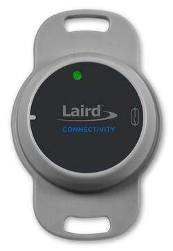
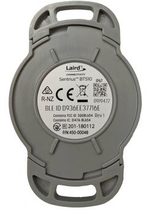
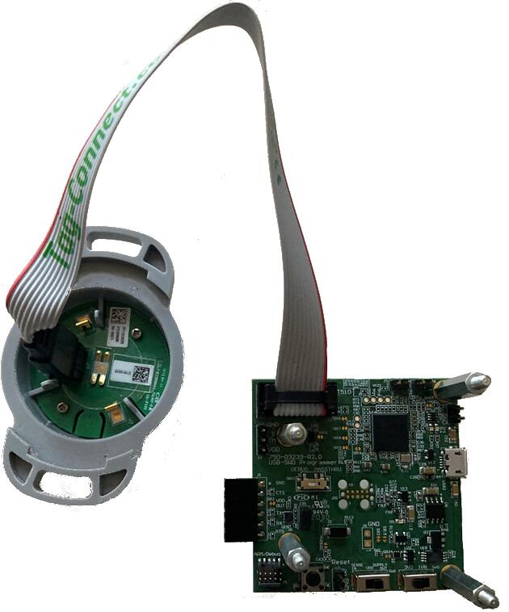

<!-- Copyright 2015-2026 Zephyr Project members and individual contributors. -->
<!-- SPDX-License-Identifier: Apache-2.0 -->
<!-- 中文翻译；编号、导航与译注为本地新增。 -->

<a id="bt510"></a>

# 第10章\_Sentrius BT510传感器（Sensor）

原文：[官方页面](https://docs.zephyrproject.org/latest/boards/ezurio/bt510/doc/bt510.html)。读取日期：2026-10-16；来源摘要见[来源记录](../SOURCES.md)。

开发板概览（Board Overview）

<a id="id1"></a>

[](images/bt510.jpg)

Sentrius BT510传感器（Sensor）

名称（Name）：

`bt510`

厂商（Vendor）：

[Ezurio](https://docs.zephyrproject.org/latest/boards/index.html#vendor=ezurio)

状态（Status）：

维护中（Maintained）

架构（Architecture）：

[arm](https://docs.zephyrproject.org/latest/boards/index.html#arch=arm)

片上系统（SoC）：

[nrf52840](https://docs.zephyrproject.org/latest/boards/index.html#soc=nrf52840)

<a id="board-github-link"></a>

[浏览开发板源码（Browse Board Sources）](https://github.com/zephyrproject-rtos/zephyr/blob/main//boards/ezurio/bt510/doc/bt510.rst/../..)<a id="overview"></a>

## 概述（Overview）

Sentrius BT510是一款由电池供电、集成Bluetooth v5远距离通信（Long Range）的传感器，采用Nordic Semiconductor nRF52840 Arm Cortex-M4F CPU。

传感器具备以下特性：


- 模数转换器（ADC）
- 时钟（CLOCK）
- 闪存（FLASH）
- 通用输入输出（GPIO）
- 集成电路间总线（I2C）
- 存储器保护单元（MPU）
- 嵌套向量中断控制器（NVIC）
- 脉宽调制（PWM）
- 无线电（RADIO），支持低功耗蓝牙（Bluetooth Low Energy）和IEEE 802.15.4
- 实时时钟（RTC）
- Segger实时传输（RTT，RTT控制台 / RTT Console）
- 通用异步收发器（UART）
- 看门狗定时器（WDT）

<a id="id2"></a>



Sentrius BT510传感器背面视图（Rear View）

<a id="id5"></a>

开发板更多信息见[Sentrius BT510网站](https://www.ezurio.com/iot-devices/iot-sensors/bt510-bluetooth-5-long-range-ip67-multi-sensor)[注1](#id4)。

<a id="hardware"></a>

## 硬件（Hardware）

<a id="supported-features"></a>

### 支持的功能（Supported Features）

`bt510`开发板支持下表所列的硬件功能。

片上／板载（On-Chip / On-Board）

功能集成在片上系统（SoC）内／位于开发板上。

2 / 2

分别表示已启用／已禁用的实例数。点击数量标签，可查看开发板或SoC设备树源码（DTS）中该功能的第一个实例。

`vnd,foo`

与此功能匹配的设备树绑定兼容字符串（Compatible String）；点击链接可查看绑定文档。

<a id="bt510-hw-features"></a>

<a id="bt510-bt510/nrf52840-hw-features-section"></a>

#### `bt510/nrf52840`目标（Target）

<a id="bt510-bt510/nrf52840-hw-features-panel"></a>

<a id="bt510-bt510/nrf52840-hw-features-memory"></a>

此开发板目标可用存储器：256 KiB RAM、1 MiB 闪存。

<a id="bt510-bt510/nrf52840-hw-features-table"></a>

<table>
<tr>
<th>类型（Type）</th>
<th>位置（Location）</th>
<th>说明（Description）</th>
<th>兼容字符串（Compatible）</th>
</tr>
<tr>
<td rowspan="1">中央处理器（CPU）</td>
<td>片上（On-Chip）</td>
<td>ARM Cortex-M4F 处理器（CPU）（<a href="https://github.com/zephyrproject-rtos/zephyr/blob/main/dts/arm/nordic/nrf52840.dtsi?plain=1#L23">已启用：1</a>）</td>
<td><a href="../cpu_arm_riscv_binding_reference/P025_arm_cortex-m4f.md#std-dtcompatible-arm-cortex-m4f"><code>arm,cortex-m4f</code></a></td>
</tr>
<tr>
<td rowspan="1">模数转换器（ADC）</td>
<td>片上（On-Chip）</td>
<td>Nordic Semiconductor nRF系列逐次逼近模数转换器（SAADC）节点（<a href="https://github.com/zephyrproject-rtos/zephyr/blob/main/dts/arm/nordic/nrf52840.dtsi?plain=1#L243">已启用：1</a>）</td>
<td><a href="../hardware/P846_NordicNRF逐次逼近ADC绑定.md#dtbinding-nordic-nrf-saadc"><code>nordic,nrf-saadc</code></a></td>
</tr>
<tr>
<td rowspan="4">ARM 架构（ARM Architecture）</td>
<td>片上（On-Chip）</td>
<td>Nordic用户信息配置寄存器（UICR / User Information Configuration Registers）（<a href="https://github.com/zephyrproject-rtos/zephyr/blob/main/dts/arm/nordic/nrf52840.dtsi?plain=1#L57">已启用：1</a>）</td>
<td><a href="../arm_nordic_nxp_control_binding_reference/P007_nordic_nrf-uicr.md#std-dtcompatible-nordic-nrf-uicr"><code>nordic,nrf-uicr</code></a></td>
</tr>
<tr>
<td>片上（On-Chip）</td>
<td>Nordic事件发生器单元（EGU / Event Generator Unit）（<a href="https://github.com/zephyrproject-rtos/zephyr/blob/main/dts/arm/nordic/nrf52840.dtsi?plain=1#L356">已启用：6</a>）</td>
<td><a href="../arm_timing_ethosu_control_binding_reference/P018_nordic_nrf-egu.md#std-dtcompatible-nordic-nrf-egu"><code>nordic,nrf-egu</code></a></td>
</tr>
<tr>
<td>片上（On-Chip）</td>
<td>Nordic nRF系列访问控制列表（ACL / Access Control List）（<a href="https://github.com/zephyrproject-rtos/zephyr/blob/main/dts/arm/nordic/nrf52840.dtsi?plain=1#L433">已启用：1</a>）</td>
<td><a href="../arm_timing_ethosu_control_binding_reference/P014_nordic_nrf-acl.md#std-dtcompatible-nordic-nrf-acl"><code>nordic,nrf-acl</code></a></td>
</tr>
<tr>
<td>片上（On-Chip）</td>
<td>Nordic nRF系列存储器监视单元（MWU / Memory Watch Unit）（<a href="https://github.com/zephyrproject-rtos/zephyr/blob/main/dts/arm/nordic/nrf52840.dtsi?plain=1#L465">已启用：1</a>）</td>
<td><a href="../arm_timing_ethosu_control_binding_reference/P022_nordic_nrf-mwu.md#std-dtcompatible-nordic-nrf-mwu"><code>nordic,nrf-mwu</code></a></td>
</tr>
<tr>
<td rowspan="1">音频（Audio）</td>
<td>片上（On-Chip）</td>
<td>Nordic脉冲密度调制接口（PDM / Pulse Density Modulation Interface）（<a href="https://github.com/zephyrproject-rtos/zephyr/blob/main/dts/arm/nordic/nrf52840.dtsi?plain=1#L426">已禁用：1</a>）</td>
<td><a href="../audio_pdm_codec_binding_reference/P012_nordic_nrf-pdm.md#std-dtcompatible-nordic-nrf-pdm"><code>nordic,nrf-pdm</code></a></td>
</tr>
<tr>
<td rowspan="4">时钟控制（Clock Control）</td>
<td>片上（On-Chip）</td>
<td>Nordic nRF时钟控制（Clock Control）节点（<a href="https://github.com/zephyrproject-rtos/zephyr/blob/main/dts/arm/nordic/nrf52840.dtsi?plain=1#L74">已启用：1</a>）</td>
<td><a href="../clock_sam_nordic_binding_reference/P015_nordic_nrf-clock.md#std-dtcompatible-nordic-nrf-clock"><code>nordic,nrf-clock</code></a></td>
</tr>
<tr>
<td>片上（On-Chip）</td>
<td>Nordic nRF高频时钟（HFCLK）控制节点（<a href="https://github.com/zephyrproject-rtos/zephyr/blob/main/dts/arm/nordic/nrf52840.dtsi?plain=1#L80">已启用：1</a>）</td>
<td><a href="../clock_sam_nordic_binding_reference/P009_nordic_nrf-clock-hfclk.md#std-dtcompatible-nordic-nrf-clock-hfclk"><code>nordic,nrf-clock-hfclk</code></a></td>
</tr>
<tr>
<td>片上（On-Chip）</td>
<td>Nordic nRF低频时钟（LFCLK）控制节点（<a href="https://github.com/zephyrproject-rtos/zephyr/blob/main/dts/arm/nordic/nrf52840.dtsi?plain=1#L85">已启用：1</a>）</td>
<td><a href="../clock_sam_nordic_binding_reference/P012_nordic_nrf-clock-lfclk.md#std-dtcompatible-nordic-nrf-clock-lfclk"><code>nordic,nrf-clock-lfclk</code></a></td>
</tr>
<tr>
<td>片上（On-Chip）</td>
<td>Nordic nRF高频晶体振荡器（High-frequency Crystal Oscillator，nRF52系列）（<a href="https://github.com/zephyrproject-rtos/zephyr/blob/main/dts/arm/nordic/nrf52840.dtsi?plain=1#L39">已启用：1</a>）</td>
<td><a href="../clock_sam_nordic_binding_reference/P022_nordic_nrf52-hfxo.md#std-dtcompatible-nordic-nrf52-hfxo"><code>nordic,nrf52-hfxo</code></a></td>
</tr>
<tr>
<td rowspan="1">比较器（Comparator）</td>
<td>片上（On-Chip）</td>
<td>Nordic nRF模拟比较器（COMP / Analog Comparator）（<a href="https://github.com/zephyrproject-rtos/zephyr/blob/main/dts/arm/nordic/nrf52840.dtsi?plain=1#L345">已禁用：1</a>）</td>
<td><a href="../hardware/P752_NordicnRF比较器绑定.md#dtbinding-nordic-nrf-comp"><code>nordic,nrf-comp</code></a></td>
</tr>
<tr>
<td rowspan="1">计数器（Counter）</td>
<td>片上（On-Chip）</td>
<td>Nordic nRF定时器（Timer）节点（<a href="https://github.com/zephyrproject-rtos/zephyr/blob/main/dts/arm/nordic/nrf52840.dtsi?plain=1#L252">已禁用：5</a>）</td>
<td><a href="../microchip_soc_counter_binding_reference/P017_nordic_nrf-timer.md#std-dtcompatible-nordic-nrf-timer"><code>nordic,nrf-timer</code></a></td>
</tr>
<tr>
<td rowspan="3">密码学加速器（Cryptographic Accelerator）</td>
<td>片上（On-Chip）</td>
<td>Nordic ECB（AES电子密码本模式加密 / Electronic Codebook Mode Encryption）（<a href="https://github.com/zephyrproject-rtos/zephyr/blob/main/dts/arm/nordic/nrf52840.dtsi?plain=1#L306">已启用：1</a>）</td>
<td><a href="../crypto_secure_engine_st_ti_binding_reference/P001_nordic_nrf-ecb.md#std-dtcompatible-nordic-nrf-ecb"><code>nordic,nrf-ecb</code></a></td>
</tr>
<tr>
<td>片上（On-Chip）</td>
<td>Nordic nRF系列CCM（AES CCM模式加密 / CCM Mode Encryption）（<a href="https://github.com/zephyrproject-rtos/zephyr/blob/main/dts/arm/nordic/nrf52840.dtsi?plain=1#L313">已启用：1</a>）</td>
<td><a href="../crypto_aes_sha_ccm_binding_reference/P020_nordic_nrf-ccm.md#std-dtcompatible-nordic-nrf-ccm"><code>nordic,nrf-ccm</code></a></td>
</tr>
<tr>
<td>片上（On-Chip）</td>
<td>ARM TrustZone CryptoCell 310密码模块（<a href="https://github.com/zephyrproject-rtos/zephyr/blob/main/dts/arm/nordic/nrf52840.dtsi?plain=1#L597">已禁用：1</a>）</td>
<td><a href="../crypto_aes_sha_ccm_binding_reference/P001_arm_cryptocell-310.md#std-dtcompatible-arm-cryptocell-310"><code>arm,cryptocell-310</code></a></td>
</tr>
<tr>
<td rowspan="1">调试（Debug）</td>
<td>片上（On-Chip）</td>
<td>ARMv7仪器化跟踪宏单元（ITM / Instrumentation Trace Macrocell）（<a href="https://github.com/zephyrproject-rtos/zephyr/blob/main/dts/arm/nordic/nrf52840.dtsi?plain=1#L30">已启用：1</a>）</td>
<td><a href="../debug_binding_reference/P001_ARMv7M_ITM调试绑定.md#std-dtcompatible-arm-armv7m-itm"><code>arm,armv7m-itm</code></a></td>
</tr>
<tr>
<td rowspan="2">闪存控制器（Flash Controller）</td>
<td>片上（On-Chip）</td>
<td>Nordic非易失性存储器控制器（NVMC / Non-Volatile Memory Controller）（<a href="https://github.com/zephyrproject-rtos/zephyr/blob/main/dts/arm/nordic/nrf52840.dtsi?plain=1#L439">已启用：1</a>）</td>
<td><a href="../flash_adi_microchip_nordic_binding_reference/P030_nordic_nrf52-flash-controller.md#std-dtcompatible-nordic-nrf52-flash-controller"><code>nordic,nrf52-flash-controller</code></a></td>
</tr>
<tr>
<td>片上（On-Chip）</td>
<td>定义Nordic四线SPI外设（QSPI Peripheral）接口的属性（<a href="https://github.com/zephyrproject-rtos/zephyr/blob/main/dts/arm/nordic/nrf52840.dtsi?plain=1#L543">已禁用：1</a>）</td>
<td><a href="../flash_adi_microchip_nordic_binding_reference/P028_nordic_nrf-qspi.md#std-dtcompatible-nordic-nrf-qspi"><code>nordic,nrf-qspi</code></a></td>
</tr>
<tr>
<td rowspan="2">通用输入输出与接插件（GPIO &amp; Headers）</td>
<td>片上（On-Chip）</td>
<td>NRF5 GPIO任务与事件（GPIOTE）（<a href="https://github.com/zephyrproject-rtos/zephyr/blob/main/dts/arm/nordic/nrf52840.dtsi?plain=1#L235">已启用：1</a>）</td>
<td><a href="../gpio_microchip_nordic_nuvoton_binding_reference/P017_nordic_nrf-gpiote.md#std-dtcompatible-nordic-nrf-gpiote"><code>nordic,nrf-gpiote</code></a></td>
</tr>
<tr>
<td>片上（On-Chip）</td>
<td>NRF5通用输入输出（GPIO）（<a href="https://github.com/zephyrproject-rtos/zephyr/blob/main/dts/arm/nordic/nrf52840.dtsi?plain=1#L574">已启用：2</a>）</td>
<td><a href="../gpio_microchip_nordic_nuvoton_binding_reference/P016_nordic_nrf-gpio.md#std-dtcompatible-nordic-nrf-gpio"><code>nordic,nrf-gpio</code></a></td>
</tr>
<tr>
<td rowspan="1">集成电路间总线（I2C）</td>
<td>片上（On-Chip）</td>
<td>Nordic nRF系列TWIM（带EasyDMA的TWI主机）（<a href="https://github.com/zephyrproject-rtos/zephyr/blob/main/dts/arm/nordic/nrf52840.dtsi?plain=1#L156">已启用：1</a>；<a href="https://github.com/zephyrproject-rtos/zephyr/blob/main/dts/arm/nordic/nrf52840.dtsi?plain=1#L192">已禁用：1</a>）</td>
<td><a href="../i2c_infineon_ite_nordic_binding_reference/P016_nordic_nrf-twim.md#std-dtcompatible-nordic-nrf-twim"><code>nordic,nrf-twim</code></a></td>
</tr>
<tr>
<td rowspan="1">集成电路间音频总线（I2S）</td>
<td>片上（On-Chip）</td>
<td>Nordic芯片间音频接口（I2S / Inter-IC Sound Interface）（<a href="https://github.com/zephyrproject-rtos/zephyr/blob/main/dts/arm/nordic/nrf52840.dtsi?plain=1#L515">已禁用：1</a>）</td>
<td><a href="../i2s_binding_reference/P010_nordic_nrf-i2s.md#std-dtcompatible-nordic-nrf-i2s"><code>nordic,nrf-i2s</code></a></td>
</tr>
<tr>
<td rowspan="1">低速率无线个域网（IEEE 802.15.4）</td>
<td>片上（On-Chip）</td>
<td>Nordic nRF IEEE 802.15.4节点（<a href="https://github.com/zephyrproject-rtos/zephyr/blob/main/dts/arm/nordic/nrf52840.dtsi?plain=1#L133">已启用：1</a>）</td>
<td><a href="../lora_ieee802154_binding_reference/P005_nordic_nrf-ieee802154.md#std-dtcompatible-nordic-nrf-ieee802154"><code>nordic,nrf-ieee802154</code></a></td>
</tr>
<tr>
<td rowspan="1">输入（Input）</td>
<td>板载（On-Board）</td>
<td>一组绑定到 GPIO 的输入按键（GPIO-Bound Input Keys）（<a href="https://github.com/zephyrproject-rtos/zephyr/blob/main/boards/ezurio/bt510/bt510.dts?plain=1#L43">已启用：1</a>）</td>
<td><a href="../hardware/P563_GPIO按键绑定.md#std-dtcompatible-gpio-keys"><code>gpio-keys</code></a></td>
</tr>
<tr>
<td rowspan="1">中断控制器（Interrupt Controller）</td>
<td>片上（On-Chip）</td>
<td>ARMv7-M 嵌套向量中断控制器（Nested Vectored Interrupt Controller，NVIC）（<a href="https://github.com/zephyrproject-rtos/zephyr/blob/main/dts/arm/armv7-m.dtsi?plain=1#L13">已启用：1</a>）</td>
<td><a href="../arm_interrupt_timer_binding_reference/P002_ARMv7_M_NVIC.md#std-dtcompatible-arm-v7m-nvic"><code>arm,v7m-nvic</code></a></td>
</tr>
<tr>
<td rowspan="1">发光二极管（LED）</td>
<td>板载（On-Board）</td>
<td>一组由 GPIO 控制的 LED（GPIO-Controlled LEDs）（<a href="https://github.com/zephyrproject-rtos/zephyr/blob/main/boards/ezurio/bt510/bt510.dts?plain=1#L29">已启用：1</a>）</td>
<td><a href="../hardware/P564_GPIO指示灯绑定.md#dtbinding-gpio-leds"><code>gpio-leds</code></a></td>
</tr>
<tr>
<td rowspan="2">其他绑定（Miscellaneous）</td>
<td>片上（On-Chip）</td>
<td>Nordic工厂信息配置寄存器（FICR / Factory Information Configuration Registers）（<a href="https://github.com/zephyrproject-rtos/zephyr/blob/main/dts/arm/nordic/nrf52840.dtsi?plain=1#L50">已启用：1</a>）</td>
<td><a href="../misc_adi_nordic_binding_reference/P018_nordic_nrf-ficr.md#std-dtcompatible-nordic-nrf-ficr"><code>nordic,nrf-ficr</code></a></td>
</tr>
<tr>
<td>片上（On-Chip）</td>
<td>Nordic nRF系列可编程外设互连（PPI / Programmable Peripheral Interconnect）（<a href="https://github.com/zephyrproject-rtos/zephyr/blob/main/dts/arm/nordic/nrf52840.dtsi?plain=1#L459">已启用：1</a>）</td>
<td><a href="../misc_adi_nordic_binding_reference/P020_nordic_nrf-ppi.md#std-dtcompatible-nordic-nrf-ppi"><code>nordic,nrf-ppi</code></a></td>
</tr>
<tr>
<td rowspan="1">存储技术设备（MTD）</td>
<td>片上（On-Chip）</td>
<td>闪存（Flash）节点（<a href="https://github.com/zephyrproject-rtos/zephyr/blob/main/dts/arm/nordic/nrf52840.dtsi?plain=1#L447">已启用：1</a>）</td>
<td><a href="../mtd_nxp_st_ti_partition_binding_reference/P013_soc-nv-flash.md#std-dtcompatible-soc-nv-flash"><code>soc-nv-flash</code></a></td>
</tr>
<tr>
<td rowspan="2">网络（Networking）</td>
<td>片上（On-Chip）</td>
<td>Nordic nRF系列无线电（RADIO）外设（<a href="https://github.com/zephyrproject-rtos/zephyr/blob/main/dts/arm/nordic/nrf52840.dtsi?plain=1#L123">已启用：1</a>）</td>
<td><a href="../network_radio_frontend_binding_reference/P009_nordic_nrf-radio.md#std-dtcompatible-nordic-nrf-radio"><code>nordic,nrf-radio</code></a></td>
</tr>
<tr>
<td>片上（On-Chip）</td>
<td>Nordic nRF系列近场通信标签（NFCT / Near Field Communication Tag）（<a href="https://github.com/zephyrproject-rtos/zephyr/blob/main/dts/arm/nordic/nrf52840.dtsi?plain=1#L228">已禁用：1</a>）</td>
<td><a href="../network_radio_frontend_binding_reference/P008_nordic_nrf-nfct.md#std-dtcompatible-nordic-nrf-nfct"><code>nordic,nrf-nfct</code></a></td>
</tr>
<tr>
<td rowspan="1">引脚控制（Pin Control）</td>
<td>片上（On-Chip）</td>
<td>Nordic nRF系列引脚控制器（Pin Controller）（<a href="https://github.com/zephyrproject-rtos/zephyr/blob/main/dts/vendor/nordic/nrf_common.dtsi?plain=1#L26">已启用：1</a>）</td>
<td><a href="../pinctrl_infineon_nordic_nxp_binding_reference/P009_nordic_nrf-pinctrl.md#std-dtcompatible-nordic-nrf-pinctrl"><code>nordic,nrf-pinctrl</code></a></td>
</tr>
<tr>
<td rowspan="1">电源管理（Power Management）</td>
<td>片上（On-Chip）</td>
<td>Nordic nRF电源控制（Power Control）节点（<a href="https://github.com/zephyrproject-rtos/zephyr/blob/main/dts/arm/nordic/nrf52840.dtsi?plain=1#L91">已启用：1</a>）</td>
<td><a href="../power_control_binding_reference/P008_nordic_nrf-power.md#std-dtcompatible-nordic-nrf-power"><code>nordic,nrf-power</code></a></td>
</tr>
<tr>
<td rowspan="2">脉宽调制（PWM）</td>
<td>片上（On-Chip）</td>
<td>nRF脉宽调制（PWM）（<a href="https://github.com/zephyrproject-rtos/zephyr/blob/main/dts/arm/nordic/nrf52840.dtsi?plain=1#L418">已禁用：4</a>）</td>
<td><a href="../pwm_intel_microchip_nxp_binding_reference/P015_nordic_nrf-pwm.md#std-dtcompatible-nordic-nrf-pwm"><code>nordic,nrf-pwm</code></a></td>
</tr>
<tr>
<td>片上（On-Chip）</td>
<td>nRFx软件脉宽调制（S/W PWM）（<a href="https://github.com/zephyrproject-rtos/zephyr/blob/main/dts/vendor/nordic/nrf_common.dtsi?plain=1#L39">已禁用：1</a>）</td>
<td><a href="../pwm_intel_microchip_nxp_binding_reference/P016_nordic_nrf-sw-pwm.md#std-dtcompatible-nordic-nrf-sw-pwm"><code>nordic,nrf-sw-pwm</code></a></td>
</tr>
<tr>
<td rowspan="2">稳压器（Regulator）</td>
<td>片上（On-Chip）</td>
<td>Nordic nRF5X稳压器（Regulator，内核供电的固定级）（<a href="https://github.com/zephyrproject-rtos/zephyr/blob/main/dts/arm/nordic/nrf52840.dtsi?plain=1#L115">已启用：1</a>）</td>
<td><a href="../hardware/P643_nRF5X稳压器绑定.md#dtbinding-nordic-nrf5x-regulator"><code>nordic,nrf5x-regulator</code></a></td>
</tr>
<tr>
<td>片上（On-Chip）</td>
<td>Nordic nRF52X稳压器（Regulator），主电源的高压级（High-voltage Stage）（<a href="https://github.com/zephyrproject-rtos/zephyr/blob/main/dts/arm/nordic/nrf52840_qiaa.dtsi?plain=1#L11">已禁用：1</a>）</td>
<td><a href="../hardware/P639_nRF52高压稳压器绑定.md#dtbinding-nordic-nrf52x-regulator-hv"><code>nordic,nrf52x-regulator-hv</code></a></td>
</tr>
<tr>
<td rowspan="1">保持存储器（Retained Memory）</td>
<td>片上（On-Chip）</td>
<td>Nordic通用保持寄存器（GPREGRET / General Purpose Register Retention）设备（<a href="https://github.com/zephyrproject-rtos/zephyr/blob/main/dts/arm/nordic/nrf52840.dtsi?plain=1#L99">已启用：2</a>）</td>
<td><a href="../hardware/P627_Nordic通用保留寄存器绑定.md#dtbinding-nordic-nrf-gpregret"><code>nordic,nrf-gpregret</code></a></td>
</tr>
<tr>
<td rowspan="1">随机数生成器（RNG）</td>
<td>片上（On-Chip）</td>
<td>Nordic nRF系列随机数发生器（RNG / Random Number Generator）（<a href="https://github.com/zephyrproject-rtos/zephyr/blob/main/dts/arm/nordic/nrf52840.dtsi?plain=1#L299">已启用：1</a>）</td>
<td><a href="../rng_binding_reference/P014_nordic_nrf-rng.md#std-dtcompatible-nordic-nrf-rng"><code>nordic,nrf-rng</code></a></td>
</tr>
<tr>
<td rowspan="1">实时时钟（RTC）</td>
<td>片上（On-Chip）</td>
<td>Nordic nRF实时时间计数器（RTC / Real-Time Counter）（<a href="https://github.com/zephyrproject-rtos/zephyr/blob/main/dts/arm/nordic/nrf52840.dtsi?plain=1#L282">已禁用：3</a>）</td>
<td><a href="../microchip_microcrystal_nxp_rtc_binding_reference/P010_nordic_nrf-rtc.md#std-dtcompatible-nordic-nrf-rtc"><code>nordic,nrf-rtc</code></a></td>
</tr>
<tr>
<td rowspan="5">传感器（Sensors）</td>
<td>板载（On-Board）</td>
<td>意法半导体（STMicroelectronics）LIS2DH12三轴加速度计（3-axis Accelerometer）（<a href="https://github.com/zephyrproject-rtos/zephyr/blob/main/boards/ezurio/bt510/bt510.dts?plain=1#L117">已启用：1</a>）</td>
<td><a href="../sensor_st_lis_lps_binding_reference/P003_st_lis2dh12-i2c.md#std-dtcompatible-st-lis2dh12"><code>st,lis2dh12</code></a></td>
</tr>
<tr>
<td>板载（On-Board）</td>
<td>Si7055温度传感器（Temperature Sensor）（<a href="https://github.com/zephyrproject-rtos/zephyr/blob/main/boards/ezurio/bt510/bt510.dts?plain=1#L125">已启用：1</a>）</td>
<td><a href="../sensor_silabs_st_industrial_binding_reference/P003_silabs_si7055.md#std-dtcompatible-silabs-si7055"><code>silabs,si7055</code></a></td>
</tr>
<tr>
<td>片上（On-Chip）</td>
<td>Nordic nRF系列温度（TEMP）节点（<a href="https://github.com/zephyrproject-rtos/zephyr/blob/main/dts/arm/nordic/nrf52840.dtsi?plain=1#L292">已启用：1</a>）</td>
<td><a href="../sensor_microchip_nordic_nxp_binding_reference/P023_nordic_nrf-temp.md#std-dtcompatible-nordic-nrf-temp"><code>nordic,nrf-temp</code></a></td>
</tr>
<tr>
<td>片上（On-Chip）</td>
<td>Nordic nRF正交解码器（QDEC / Quadrature Decoder）节点（<a href="https://github.com/zephyrproject-rtos/zephyr/blob/main/dts/arm/nordic/nrf52840.dtsi?plain=1#L338">已禁用：1</a>）</td>
<td><a href="../sensor_microchip_nordic_nxp_binding_reference/P021_nordic_nrf-qdec.md#std-dtcompatible-nordic-nrf-qdec"><code>nordic,nrf-qdec</code></a></td>
</tr>
<tr>
<td>板载（On-Board）</td>
<td>SM351LT磁阻传感器（Magnetoresistive Sensor）（<a href="https://github.com/zephyrproject-rtos/zephyr/blob/main/boards/ezurio/bt510/bt510.dts?plain=1#L70">已启用：1</a>）</td>
<td><a href="../sensor_espressif_honeywell_invensense_binding_reference/P011_honeywell_sm351lt.md#std-dtcompatible-honeywell-sm351lt"><code>honeywell,sm351lt</code></a></td>
</tr>
<tr>
<td rowspan="1">串行控制器（Serial Controller）</td>
<td>片上（On-Chip）</td>
<td>Nordic nRF系列UARTE（带EasyDMA的UART）（<a href="https://github.com/zephyrproject-rtos/zephyr/blob/main/dts/arm/nordic/nrf52840.dtsi?plain=1#L147">已启用：1</a>；<a href="https://github.com/zephyrproject-rtos/zephyr/blob/main/dts/arm/nordic/nrf52840.dtsi?plain=1#L536">已禁用：1</a>）</td>
<td><a href="../uart_microchip_nordic_nxp_binding_reference/P004_nordic_nrf-uarte.md#std-dtcompatible-nordic-nrf-uarte"><code>nordic,nrf-uarte</code></a></td>
</tr>
<tr>
<td rowspan="1">串行外设接口（SPI）</td>
<td>片上（On-Chip）</td>
<td>Nordic nRF系列SPIM（带EasyDMA的SPI控制器）（<a href="https://github.com/zephyrproject-rtos/zephyr/blob/main/dts/arm/nordic/nrf52840.dtsi?plain=1#L174">已禁用：4</a>）</td>
<td><a href="../spi_microchip_nordic_nxp_binding_reference/P013_nordic_nrf-spim.md#std-dtcompatible-nordic-nrf-spim"><code>nordic,nrf-spim</code></a></td>
</tr>
<tr>
<td rowspan="1">静态随机存储器（SRAM）</td>
<td>片上（On-Chip）</td>
<td>通用片上静态随机存储器（SRAM）（<a href="https://github.com/zephyrproject-rtos/zephyr/blob/main/dts/arm/nordic/nrf52840.dtsi?plain=1#L66">已启用：1</a>）</td>
<td><a href="../hardware/P567_内存映射SRAM绑定.md#dtbinding-mmio-sram"><code>mmio-sram</code></a></td>
</tr>
<tr>
<td rowspan="1">定时器（Timer）</td>
<td>片上（On-Chip）</td>
<td>ARMv7-M 系统节拍（System Tick）（<a href="https://github.com/zephyrproject-rtos/zephyr/blob/main/dts/arm/armv7-m.dtsi?plain=1#L21">已禁用：1</a>）</td>
<td><a href="../arm_interrupt_timer_binding_reference/P006_ARMv7_M_SysTick.md#std-dtcompatible-arm-armv7m-systick"><code>arm,armv7m-systick</code></a></td>
</tr>
<tr>
<td rowspan="1">通用串行总线（USB）</td>
<td>片上（On-Chip）</td>
<td>Nordic nRF52 USB设备控制器（USB Device Controller）（<a href="https://github.com/zephyrproject-rtos/zephyr/blob/main/dts/arm/nordic/nrf52840.dtsi?plain=1#L524">已禁用：1</a>）</td>
<td><a href="../usb_controller_binding_reference/P018_nordic_nrf-usbd.md#std-dtcompatible-nordic-nrf-usbd"><code>nordic,nrf-usbd</code></a></td>
</tr>
<tr>
<td rowspan="1">看门狗（Watchdog）</td>
<td>片上（On-Chip）</td>
<td>Nordic nRF系列看门狗定时器（WDT / Watchdog Timer）（<a href="https://github.com/zephyrproject-rtos/zephyr/blob/main/dts/arm/nordic/nrf52840.dtsi?plain=1#L321">已启用：1</a>）</td>
<td><a href="../nxp_nordic_nuvoton_watchdog_binding_reference/P002_nordic_nrf-wdt.md#std-dtcompatible-nordic-nrf-wdt"><code>nordic,nrf-wdt</code></a></td>
</tr>
</table>

<a id="connections-and-ios"></a>

### 连接与输入输出（Connections and IOs）

<a id="led"></a>

#### 发光二极管（LED）

透过BT510外壳盖可看到两个LED。


- LED_1A （绿色 / green） = P0.22
- LED_1B （红色 / red） = P0.20

<a id="push-button"></a>

#### 按键（Push Button）

BT510外壳盖同时用作按键。


- `BUTTON_1 = SW1 = P1.10`

<a id="magnetoresistive-sensor"></a>

#### 磁阻传感器（Magnetoresistive Sensor）

<a id="id17"></a>

BT510集成Honeywell SM351LT磁阻传感器，详情见Honeywell SM351LT数据手册[注7](#id16)。（[Honeywell SM351LT数据手册（Datasheet）](https://sensing.honeywell.com/honeywell-sensing-nanopower-series-datasheet-50095501-c-en.pdf)）


- `MAG = P1.14`

<a id="accelerometer"></a>

#### 加速度计（Accelerometer）

<a id="id15"></a>

BT510集成通过I2C连接的STMicroelectronics LIS2DH加速度计（Accelerometer），详情见STMicroelectronics LIS2DH数据手册[注6](#id14)。（[ST Microelectronics LIS2DH数据手册（Datasheet）](https://www.st.com/resource/en/datasheet/lis2dh.pdf)）


- `SDA = P0.26`
- `SCL = P0.27`
- `INT_1 = P1.05`
- `INT_2 = P1.12`

<a id="temperature-sensor"></a>

#### 温度传感器（Temperature Sensor）

<a id="id13"></a>

BT510集成通过I2C连接的Silabs SI7055温度传感器，详情见Silabs 7055数据手册[注5](#id12)。（[Silabs 7055数据手册（Datasheet）](https://www.silabs.com/documents/public/data-sheets/Si7050-1-3-4-5-A20.pdf)）


- `SDA = P0.26`
- `SCL = P0.27`

<a id="programming-and-debugging"></a>

## 烧录与调试（Programming and Debugging）

`bt510`开发板支持下表所列的运行工具（Runners）及相关west命令。

<table>
<tr>
<th></th>
<th>烧录（flash）</th>
<th>调试（debug）</th>
<th>连接调试会话（attach）</th>
<th>实时传输（rtt）</th>
<th>复位（reset）</th>
<th>调试服务器（debugserver）</th>
</tr>
<tr>
<td><a href="https://docs.zephyrproject.org/latest/develop/flash_debug/host-tools.html#runner-jlink">jlink</a></td>
<td>✅</td>
<td>✅</td>
<td>✅</td>
<td>✅</td>
<td>✅</td>
<td>✅</td>
</tr>
<tr>
<td>nrfjprog</td>
<td>✅</td>
<td></td>
<td></td>
<td></td>
<td></td>
<td></td>
</tr>
<tr>
<td><code>nrfutil</code></td>
<td>✅</td>
<td></td>
<td></td>
<td></td>
<td></td>
<td></td>
</tr>
<tr>
<td><a href="https://docs.zephyrproject.org/latest/develop/flash_debug/host-tools.html#runner-pyocd">pyocd</a></td>
<td>✅（默认 / default）</td>
<td>✅（默认 / default）</td>
<td>✅</td>
<td>✅</td>
<td>✅</td>
<td>✅</td>
</tr>
</table>

`bt510`开发板配置的应用可按常规方式构建、烧录及调试，详见构建应用及运行应用。（[构建应用（Building an Application）](../application/P001_应用开发.md#build-an-application)；[运行应用（Run an Application）](https://docs.zephyrproject.org/latest/develop/application/index.html#application-run)）

<a id="id7"></a>

BT510提供Tag-Connect 10路插座用于连接编程器／调试器，合适线缆的信息见[TagConnect TC2050产品页](https://www.tag-connect.com/product/tc2050-idc-050)[注2](#id6)。

该插座采用非标准引脚布局，额外引出传感器调试UART。

<table>
<tr>
<th>引脚编号（Pin No.）</th>
<th>名称（Name）</th>
<th>说明（Description）</th>
</tr>
<tr>
<td>1</td>
<td>电源（Vcc）</td>
<td>电源（Power Supply），3.3 V</td>
</tr>
<tr>
<td>2</td>
<td>串行线调试数据（SWDIO）</td>
<td>SWD数据（Data）</td>
</tr>
<tr>
<td>3</td>
<td>接收数据（RXD）</td>
<td>调试UART接收数据（RX Data）</td>
</tr>
<tr>
<td>4</td>
<td>串行线调试时钟（SWDCLK）</td>
<td>SWD时钟（Clock）</td>
</tr>
<tr>
<td>5</td>
<td>TM</td>
<td>备用GPIO（Spare GPIO）</td>
</tr>
<tr>
<td>6</td>
<td>串行线输出（SWO）</td>
<td>SWD输出（Output）</td>
</tr>
<tr>
<td>7</td>
<td>N/C</td>
<td>未连接（Not Connected）</td>
</tr>
<tr>
<td>8</td>
<td>发送数据（TXD）</td>
<td>调试UART发送数据（TX Data）</td>
</tr>
<tr>
<td>9</td>
<td>地（GND）</td>
<td>地（Ground）</td>
</tr>
<tr>
<td>10</td>
<td>复位（RESET）</td>
<td>复位，低电平有效（Reset, Active Low）</td>
</tr>
</table>

连接编程器／调试器时，必须调整接线以匹配上述引脚分配。

<a id="id9"></a>

Ezurio的USB-SWD编程器板750-03239支持该连接器布局，见USB SWD Programmer产品页[注3](#id8)。（[USB SWD编程器产品页](https://www.ezurio.com/wireless-modules/programming-kits/usb-swd-programming-kit)）

<a id="flashing"></a>

### 烧录（Flashing）

使用USB-SWD编程器板对BT510编程或调试时，将编程器板SW6设为供电输出（Supply Out），SW5设为3V3，确认J35已安装跳线且SW1位于调试（Debug）位置，再通过J3和Tag-Connect线缆连接BT510：

<a id="id3"></a>



连接到编程器板的Sentrius BT510传感器

随后按常规方式构建及烧录应用，详见构建应用及运行应用。例如，执行以下命令烧录：（[构建应用（Building an Application）](../application/P001_应用开发.md#build-an-application)；[运行应用（Run an Application）](https://docs.zephyrproject.org/latest/develop/application/index.html#application-run)）

```text
$ west flash
```

下面以[Hello World](../getting_started/P005_HelloWorld示例.md#hello_world)应用为例。

首先运行常用终端程序查看输出。

<a id="id11"></a>

<a id="id19"></a>

注意：BT510 UART线为TTL电平，需要合适的线路驱动电路转换为RS232电平。可用的驱动芯片见MAX3232数据手册[注4](#id10)。USB-SWD编程器板内置连接BT510的UART，在主机上表现为USB CDC端口。Linux和Windows 10应自动安装驱动；Windows 7使用串口需要MBED驱动，详情及安装方法见MBED串口驱动[注8](#id18)。（[MAX3232数据手册（Datasheet）](https://www.ti.com/lit/ds/symlink/max3232.pdf)；[MBED串口驱动（Serial Driver）](https://os.mbed.com/docs/mbed-os/v6.8/program-setup/windows-serial-driver.html)）

```text
$ minicom -D <tty_device> -b 115200
```

将`<tty_device>`替换为BT510对应的串口，例如Linux下的`/dev/ttyACM0`。

随后按通常方式构建并烧录应用。

```text
# From the root of the zephyr repository
west build -b bt510 samples/hello_world
west flash
```

注意，烧录应用需要外部调试器。

<a id="debugging"></a>

### 调试（Debugging）

`bt510`没有部分nRF5x开发板所带的板载J-Link调试芯片。[Nordic nRF5x Segger J-Link](../debugging/P005_Nordic_Segger_JLink.md#nordic-segger)页面的说明仍适用，但需额外连接外部调试器。USB-SWD编程器板提供兼容CMSIS调试器的接口，可使用pyOCD、OpenOCD或其他支持该CMSIS接口的软件调试。

<a id="testing-bluetooth-on-the-bt510"></a>

## 在BT510上测试蓝牙（Bluetooth）

许多蓝牙示例可在BT510上运行，可以尝试以下示例：


- [外设（Peripheral）](../bluetooth_samples/P005_基础蓝牙外设.md#ble_peripheral)
- [Eddystone](../bluetooth_samples/P031_Eddystone信标.md#bluetooth_eddystone)
- [iBeacon](../bluetooth_samples/P034_iBeacon信标.md#bluetooth_ibeacon)

<a id="testing-the-leds-and-buttons-on-the-bt510"></a>

## 测试BT510的LED和按键

有两个示例可用于测试开发板按键（开关）及LED是否能在Zephyr下正常工作：


- [闪灯（Blinky）](../getting_started/P004_LED闪烁示例.md#blinky)
- [按键（Button）](../basic_samples/P003_按钮输入.md#button)

构建并烧录示例，可确认Zephyr是否在开发板上正常运行。按键、LED及传感器设备定义见[boards/ezurio/bt510/bt510.dts](https://github.com/zephyrproject-rtos/zephyr/blob/main/boards/ezurio/bt510/bt510.dts)。

<a id="references"></a>

## 参考资料（References）

<a id="id4"></a>

〔[1](#id5)〕 [https://www.ezurio.com/iot-devices/iot-sensors/bt510-bluetooth-5-long-range-ip67-multi-sensor](https://www.ezurio.com/iot-devices/iot-sensors/bt510-bluetooth-5-long-range-ip67-multi-sensor)

<a id="id6"></a>

〔[2](#id7)〕 [https://www.tag-connect.com/product/tc2050-idc-050](https://www.tag-connect.com/product/tc2050-idc-050)

<a id="id8"></a>

〔[3](#id9)〕 [https://www.ezurio.com/wireless-modules/programming-kits/usb-swd-programming-kit](https://www.ezurio.com/wireless-modules/programming-kits/usb-swd-programming-kit)

<a id="id10"></a>

〔[4](#id11)〕 [https://www.ti.com/lit/ds/symlink/max3232.pdf](https://www.ti.com/lit/ds/symlink/max3232.pdf)

<a id="id12"></a>

〔[5](#id13)〕 [https://www.silabs.com/documents/public/data-sheets/Si7050-1-3-4-5-A20.pdf](https://www.silabs.com/documents/public/data-sheets/Si7050-1-3-4-5-A20.pdf)

<a id="id14"></a>

〔[6](#id15)〕 [https://www.st.com/resource/en/datasheet/lis2dh.pdf](https://www.st.com/resource/en/datasheet/lis2dh.pdf)

<a id="id16"></a>

〔[7](#id17)〕 [https://sensing.honeywell.com/honeywell-sensing-nanopower-series-datasheet-50095501-c-en.pdf](https://sensing.honeywell.com/honeywell-sensing-nanopower-series-datasheet-50095501-c-en.pdf)

<a id="id18"></a>

〔[8](#id19)〕 [https://os.mbed.com/docs/mbed-os/v6.8/program-setup/windows-serial-driver.html](https://os.mbed.com/docs/mbed-os/v6.8/program-setup/windows-serial-driver.html)

## 译注

BT510的Tag-Connect连接器采用非标准布局，需要按本文引脚表匹配编程器接线，不能直接套用常规SWD排针。

## 原文外链核对

2026-10-16核对并重试以下原文外链时未能确认可访问性，保留原始目标，不将访问失败解释为原文内容有误。

- [honeywell-sensing-nanopower-series-datasheet-50095501-c-en.pdf](https://sensing.honeywell.com/honeywell-sensing-nanopower-series-datasheet-50095501-c-en.pdf)：HTTP Error 503: Service Temporarily Unavailable。
- [Si7050-1-3-4-5-A20.pdf](https://www.silabs.com/documents/public/data-sheets/Si7050-1-3-4-5-A20.pdf)：HTTP Error 403: Forbidden。
- [lis2dh.pdf](https://www.st.com/resource/en/datasheet/lis2dh.pdf)：HTTP Error 567: Unknown Status。

---

[上一章](P009_BL654_USB_451-00004.md) · [返回大纲](大纲.md) · [全站翻译进度](../PROGRESS.md) · [下一章](P011_Sentrius_BT610_Sensor.md)
