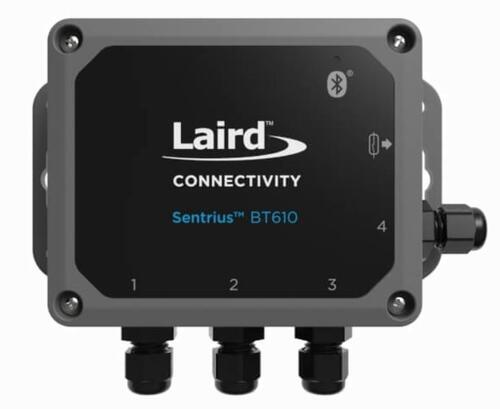
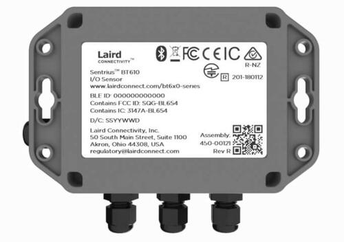
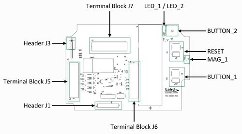

<!-- Copyright 2015-2026 Zephyr Project members and individual contributors. -->
<!-- SPDX-License-Identifier: Apache-2.0 -->
<!-- 中文翻译；编号、导航与译注为本地新增。 -->

<a id="bt610"></a>

# 第11章\_Sentrius BT610传感器（Sensor）

原文：[官方页面](https://docs.zephyrproject.org/latest/boards/ezurio/bt610/doc/bt610.html)。读取日期：2026-10-16；来源摘要见[来源记录](../SOURCES.md)。

开发板概览（Board Overview）

<a id="id1"></a>

[](images/bt610.jpg)

Sentrius BT610传感器（Sensor）

名称（Name）：

`bt610`

厂商（Vendor）：

[Ezurio](https://docs.zephyrproject.org/latest/boards/index.html#vendor=ezurio)

状态（Status）：

维护中（Maintained）

架构（Architecture）：

[arm](https://docs.zephyrproject.org/latest/boards/index.html#arch=arm)

片上系统（SoC）：

[nrf52840](https://docs.zephyrproject.org/latest/boards/index.html#soc=nrf52840)

<a id="board-github-link"></a>

[浏览开发板源码（Browse Board Sources）](https://github.com/zephyrproject-rtos/zephyr/blob/main//boards/ezurio/bt610/doc/bt610.rst/../..)<a id="overview"></a>

## 概述（Overview）

Sentrius BT610是一款由电池供电、集成Bluetooth v5远距离通信（Long Range）的传感器平台，采用Nordic Semiconductor nRF52840 Arm Cortex-M4F CPU。

传感器具备以下特性：


- 模数转换器（ADC）
- 时钟（CLOCK）
- 闪存（FLASH）
- 通用输入输出（GPIO）
- 集成电路间总线（I2C）
- 存储器保护单元（MPU）
- 嵌套向量中断控制器（NVIC）
- 脉宽调制（PWM）
- 四线串行外设接口（QSPI）
- 无线电（RADIO），支持低功耗蓝牙（Bluetooth Low Energy）和IEEE 802.15.4
- 实时时钟（RTC）
- Segger实时传输（RTT，RTT控制台 / RTT Console）
- 串行外设接口（SPI）
- 通用异步收发器（UART）
- 看门狗定时器（WDT）

<a id="id2"></a>



Sentrius BT610传感器背面视图（Rear View）

<a id="id5"></a>

开发板更多信息见[Sentrius BT610网站](https://www.ezurio.com/iot-devices/iot-sensors/sentrius-bt610-io-sensor)[注1](#id4)。

<a id="hardware"></a>

## 硬件（Hardware）

<a id="supported-features"></a>

### 支持的功能（Supported Features）

`bt610`开发板支持下表所列的硬件功能。

片上／板载（On-Chip / On-Board）

功能集成在片上系统（SoC）内／位于开发板上。

2 / 2

分别表示已启用／已禁用的实例数。点击数量标签，可查看开发板或SoC设备树源码（DTS）中该功能的第一个实例。

`vnd,foo`

与此功能匹配的设备树绑定兼容字符串（Compatible String）；点击链接可查看绑定文档。

<a id="bt610-hw-features"></a>

<a id="bt610-bt610/nrf52840-hw-features-section"></a>

#### `bt610/nrf52840`目标（Target）

<a id="bt610-bt610/nrf52840-hw-features-panel"></a>

<a id="bt610-bt610/nrf52840-hw-features-memory"></a>

此开发板目标可用存储器：256 KiB RAM、1 MiB 闪存。

<a id="bt610-bt610/nrf52840-hw-features-table"></a>

<table>
<tr>
<th>类型（Type）</th>
<th>位置（Location）</th>
<th>说明（Description）</th>
<th>兼容字符串（Compatible）</th>
</tr>
<tr>
<td rowspan="1">中央处理器（CPU）</td>
<td>片上（On-Chip）</td>
<td>ARM Cortex-M4F 处理器（CPU）（<a href="https://github.com/zephyrproject-rtos/zephyr/blob/main/dts/arm/nordic/nrf52840.dtsi?plain=1#L23">已启用：1</a>）</td>
<td><a href="../cpu_arm_riscv_binding_reference/P025_arm_cortex-m4f.md#std-dtcompatible-arm-cortex-m4f"><code>arm,cortex-m4f</code></a></td>
</tr>
<tr>
<td rowspan="1">模数转换器（ADC）</td>
<td>片上（On-Chip）</td>
<td>Nordic Semiconductor nRF系列逐次逼近模数转换器（SAADC）节点（<a href="https://github.com/zephyrproject-rtos/zephyr/blob/main/dts/arm/nordic/nrf52840.dtsi?plain=1#L243">已启用：1</a>）</td>
<td><a href="../hardware/P846_NordicNRF逐次逼近ADC绑定.md#dtbinding-nordic-nrf-saadc"><code>nordic,nrf-saadc</code></a></td>
</tr>
<tr>
<td rowspan="4">ARM 架构（ARM Architecture）</td>
<td>片上（On-Chip）</td>
<td>Nordic用户信息配置寄存器（UICR / User Information Configuration Registers）（<a href="https://github.com/zephyrproject-rtos/zephyr/blob/main/dts/arm/nordic/nrf52840.dtsi?plain=1#L57">已启用：1</a>）</td>
<td><a href="../arm_nordic_nxp_control_binding_reference/P007_nordic_nrf-uicr.md#std-dtcompatible-nordic-nrf-uicr"><code>nordic,nrf-uicr</code></a></td>
</tr>
<tr>
<td>片上（On-Chip）</td>
<td>Nordic事件发生器单元（EGU / Event Generator Unit）（<a href="https://github.com/zephyrproject-rtos/zephyr/blob/main/dts/arm/nordic/nrf52840.dtsi?plain=1#L356">已启用：6</a>）</td>
<td><a href="../arm_timing_ethosu_control_binding_reference/P018_nordic_nrf-egu.md#std-dtcompatible-nordic-nrf-egu"><code>nordic,nrf-egu</code></a></td>
</tr>
<tr>
<td>片上（On-Chip）</td>
<td>Nordic nRF系列访问控制列表（ACL / Access Control List）（<a href="https://github.com/zephyrproject-rtos/zephyr/blob/main/dts/arm/nordic/nrf52840.dtsi?plain=1#L433">已启用：1</a>）</td>
<td><a href="../arm_timing_ethosu_control_binding_reference/P014_nordic_nrf-acl.md#std-dtcompatible-nordic-nrf-acl"><code>nordic,nrf-acl</code></a></td>
</tr>
<tr>
<td>片上（On-Chip）</td>
<td>Nordic nRF系列存储器监视单元（MWU / Memory Watch Unit）（<a href="https://github.com/zephyrproject-rtos/zephyr/blob/main/dts/arm/nordic/nrf52840.dtsi?plain=1#L465">已启用：1</a>）</td>
<td><a href="../arm_timing_ethosu_control_binding_reference/P022_nordic_nrf-mwu.md#std-dtcompatible-nordic-nrf-mwu"><code>nordic,nrf-mwu</code></a></td>
</tr>
<tr>
<td rowspan="1">音频（Audio）</td>
<td>片上（On-Chip）</td>
<td>Nordic脉冲密度调制接口（PDM / Pulse Density Modulation Interface）（<a href="https://github.com/zephyrproject-rtos/zephyr/blob/main/dts/arm/nordic/nrf52840.dtsi?plain=1#L426">已禁用：1</a>）</td>
<td><a href="../audio_pdm_codec_binding_reference/P012_nordic_nrf-pdm.md#std-dtcompatible-nordic-nrf-pdm"><code>nordic,nrf-pdm</code></a></td>
</tr>
<tr>
<td rowspan="4">时钟控制（Clock Control）</td>
<td>片上（On-Chip）</td>
<td>Nordic nRF时钟控制（Clock Control）节点（<a href="https://github.com/zephyrproject-rtos/zephyr/blob/main/dts/arm/nordic/nrf52840.dtsi?plain=1#L74">已启用：1</a>）</td>
<td><a href="../clock_sam_nordic_binding_reference/P015_nordic_nrf-clock.md#std-dtcompatible-nordic-nrf-clock"><code>nordic,nrf-clock</code></a></td>
</tr>
<tr>
<td>片上（On-Chip）</td>
<td>Nordic nRF高频时钟（HFCLK）控制节点（<a href="https://github.com/zephyrproject-rtos/zephyr/blob/main/dts/arm/nordic/nrf52840.dtsi?plain=1#L80">已启用：1</a>）</td>
<td><a href="../clock_sam_nordic_binding_reference/P009_nordic_nrf-clock-hfclk.md#std-dtcompatible-nordic-nrf-clock-hfclk"><code>nordic,nrf-clock-hfclk</code></a></td>
</tr>
<tr>
<td>片上（On-Chip）</td>
<td>Nordic nRF低频时钟（LFCLK）控制节点（<a href="https://github.com/zephyrproject-rtos/zephyr/blob/main/dts/arm/nordic/nrf52840.dtsi?plain=1#L85">已启用：1</a>）</td>
<td><a href="../clock_sam_nordic_binding_reference/P012_nordic_nrf-clock-lfclk.md#std-dtcompatible-nordic-nrf-clock-lfclk"><code>nordic,nrf-clock-lfclk</code></a></td>
</tr>
<tr>
<td>片上（On-Chip）</td>
<td>Nordic nRF高频晶体振荡器（High-frequency Crystal Oscillator，nRF52系列）（<a href="https://github.com/zephyrproject-rtos/zephyr/blob/main/dts/arm/nordic/nrf52840.dtsi?plain=1#L39">已启用：1</a>）</td>
<td><a href="../clock_sam_nordic_binding_reference/P022_nordic_nrf52-hfxo.md#std-dtcompatible-nordic-nrf52-hfxo"><code>nordic,nrf52-hfxo</code></a></td>
</tr>
<tr>
<td rowspan="1">比较器（Comparator）</td>
<td>片上（On-Chip）</td>
<td>Nordic nRF模拟比较器（COMP / Analog Comparator）（<a href="https://github.com/zephyrproject-rtos/zephyr/blob/main/dts/arm/nordic/nrf52840.dtsi?plain=1#L345">已禁用：1</a>）</td>
<td><a href="../hardware/P752_NordicnRF比较器绑定.md#dtbinding-nordic-nrf-comp"><code>nordic,nrf-comp</code></a></td>
</tr>
<tr>
<td rowspan="1">计数器（Counter）</td>
<td>片上（On-Chip）</td>
<td>Nordic nRF定时器（Timer）节点（<a href="https://github.com/zephyrproject-rtos/zephyr/blob/main/dts/arm/nordic/nrf52840.dtsi?plain=1#L252">已禁用：5</a>）</td>
<td><a href="../microchip_soc_counter_binding_reference/P017_nordic_nrf-timer.md#std-dtcompatible-nordic-nrf-timer"><code>nordic,nrf-timer</code></a></td>
</tr>
<tr>
<td rowspan="3">密码学加速器（Cryptographic Accelerator）</td>
<td>片上（On-Chip）</td>
<td>Nordic ECB（AES电子密码本模式加密 / Electronic Codebook Mode Encryption）（<a href="https://github.com/zephyrproject-rtos/zephyr/blob/main/dts/arm/nordic/nrf52840.dtsi?plain=1#L306">已启用：1</a>）</td>
<td><a href="../crypto_secure_engine_st_ti_binding_reference/P001_nordic_nrf-ecb.md#std-dtcompatible-nordic-nrf-ecb"><code>nordic,nrf-ecb</code></a></td>
</tr>
<tr>
<td>片上（On-Chip）</td>
<td>Nordic nRF系列CCM（AES CCM模式加密 / CCM Mode Encryption）（<a href="https://github.com/zephyrproject-rtos/zephyr/blob/main/dts/arm/nordic/nrf52840.dtsi?plain=1#L313">已启用：1</a>）</td>
<td><a href="../crypto_aes_sha_ccm_binding_reference/P020_nordic_nrf-ccm.md#std-dtcompatible-nordic-nrf-ccm"><code>nordic,nrf-ccm</code></a></td>
</tr>
<tr>
<td>片上（On-Chip）</td>
<td>ARM TrustZone CryptoCell 310密码模块（<a href="https://github.com/zephyrproject-rtos/zephyr/blob/main/dts/arm/nordic/nrf52840.dtsi?plain=1#L597">已禁用：1</a>）</td>
<td><a href="../crypto_aes_sha_ccm_binding_reference/P001_arm_cryptocell-310.md#std-dtcompatible-arm-cryptocell-310"><code>arm,cryptocell-310</code></a></td>
</tr>
<tr>
<td rowspan="1">调试（Debug）</td>
<td>片上（On-Chip）</td>
<td>ARMv7仪器化跟踪宏单元（ITM / Instrumentation Trace Macrocell）（<a href="https://github.com/zephyrproject-rtos/zephyr/blob/main/dts/arm/nordic/nrf52840.dtsi?plain=1#L30">已启用：1</a>）</td>
<td><a href="../debug_binding_reference/P001_ARMv7M_ITM调试绑定.md#std-dtcompatible-arm-armv7m-itm"><code>arm,armv7m-itm</code></a></td>
</tr>
<tr>
<td rowspan="2">闪存控制器（Flash Controller）</td>
<td>片上（On-Chip）</td>
<td>Nordic非易失性存储器控制器（NVMC / Non-Volatile Memory Controller）（<a href="https://github.com/zephyrproject-rtos/zephyr/blob/main/dts/arm/nordic/nrf52840.dtsi?plain=1#L439">已启用：1</a>）</td>
<td><a href="../flash_adi_microchip_nordic_binding_reference/P030_nordic_nrf52-flash-controller.md#std-dtcompatible-nordic-nrf52-flash-controller"><code>nordic,nrf52-flash-controller</code></a></td>
</tr>
<tr>
<td>片上（On-Chip）</td>
<td>定义Nordic四线SPI外设（QSPI Peripheral）接口的属性（<a href="https://github.com/zephyrproject-rtos/zephyr/blob/main/dts/arm/nordic/nrf52840.dtsi?plain=1#L543">已启用：1</a>）</td>
<td><a href="../flash_adi_microchip_nordic_binding_reference/P028_nordic_nrf-qspi.md#std-dtcompatible-nordic-nrf-qspi"><code>nordic,nrf-qspi</code></a></td>
</tr>
<tr>
<td rowspan="3">通用输入输出与接插件（GPIO &amp; Headers）</td>
<td>板载（On-Board）</td>
<td>TCA9538通用输入输出（GPIO）（<a href="https://github.com/zephyrproject-rtos/zephyr/blob/main/boards/ezurio/bt610/bt610.dts?plain=1#L194">已启用：1</a>）</td>
<td><a href="../gpio_ti_xilinx_sdl_binding_reference/P020_ti_tca9538.md#std-dtcompatible-ti-tca9538"><code>ti,tca9538</code></a></td>
</tr>
<tr>
<td>片上（On-Chip）</td>
<td>NRF5 GPIO任务与事件（GPIOTE）（<a href="https://github.com/zephyrproject-rtos/zephyr/blob/main/dts/arm/nordic/nrf52840.dtsi?plain=1#L235">已启用：1</a>）</td>
<td><a href="../gpio_microchip_nordic_nuvoton_binding_reference/P017_nordic_nrf-gpiote.md#std-dtcompatible-nordic-nrf-gpiote"><code>nordic,nrf-gpiote</code></a></td>
</tr>
<tr>
<td>片上（On-Chip）</td>
<td>NRF5通用输入输出（GPIO）（<a href="https://github.com/zephyrproject-rtos/zephyr/blob/main/dts/arm/nordic/nrf52840.dtsi?plain=1#L574">已启用：2</a>）</td>
<td><a href="../gpio_microchip_nordic_nuvoton_binding_reference/P016_nordic_nrf-gpio.md#std-dtcompatible-nordic-nrf-gpio"><code>nordic,nrf-gpio</code></a></td>
</tr>
<tr>
<td rowspan="2">集成电路间总线（I2C）</td>
<td>片上（On-Chip）</td>
<td>Nordic nRF系列双线接口（TWI，TWI主机）（<a href="https://github.com/zephyrproject-rtos/zephyr/blob/main/dts/arm/nordic/nrf52840.dtsi?plain=1#L156">已启用：1</a>）</td>
<td><a href="../i2c_infineon_ite_nordic_binding_reference/P015_nordic_nrf-twi.md#std-dtcompatible-nordic-nrf-twi"><code>nordic,nrf-twi</code></a></td>
</tr>
<tr>
<td>片上（On-Chip）</td>
<td>Nordic nRF系列TWIM（带EasyDMA的TWI主机）（<a href="https://github.com/zephyrproject-rtos/zephyr/blob/main/dts/arm/nordic/nrf52840.dtsi?plain=1#L192">已禁用：1</a>）</td>
<td><a href="../i2c_infineon_ite_nordic_binding_reference/P016_nordic_nrf-twim.md#std-dtcompatible-nordic-nrf-twim"><code>nordic,nrf-twim</code></a></td>
</tr>
<tr>
<td rowspan="1">集成电路间音频总线（I2S）</td>
<td>片上（On-Chip）</td>
<td>Nordic芯片间音频接口（I2S / Inter-IC Sound Interface）（<a href="https://github.com/zephyrproject-rtos/zephyr/blob/main/dts/arm/nordic/nrf52840.dtsi?plain=1#L515">已禁用：1</a>）</td>
<td><a href="../i2s_binding_reference/P010_nordic_nrf-i2s.md#std-dtcompatible-nordic-nrf-i2s"><code>nordic,nrf-i2s</code></a></td>
</tr>
<tr>
<td rowspan="1">低速率无线个域网（IEEE 802.15.4）</td>
<td>片上（On-Chip）</td>
<td>Nordic nRF IEEE 802.15.4节点（<a href="https://github.com/zephyrproject-rtos/zephyr/blob/main/dts/arm/nordic/nrf52840.dtsi?plain=1#L133">已启用：1</a>）</td>
<td><a href="../lora_ieee802154_binding_reference/P005_nordic_nrf-ieee802154.md#std-dtcompatible-nordic-nrf-ieee802154"><code>nordic,nrf-ieee802154</code></a></td>
</tr>
<tr>
<td rowspan="1">输入（Input）</td>
<td>板载（On-Board）</td>
<td>一组绑定到 GPIO 的输入按键（GPIO-Bound Input Keys）（<a href="https://github.com/zephyrproject-rtos/zephyr/blob/main/boards/ezurio/bt610/bt610.dts?plain=1#L57">已启用：1</a>）</td>
<td><a href="../hardware/P563_GPIO按键绑定.md#std-dtcompatible-gpio-keys"><code>gpio-keys</code></a></td>
</tr>
<tr>
<td rowspan="1">中断控制器（Interrupt Controller）</td>
<td>片上（On-Chip）</td>
<td>ARMv7-M 嵌套向量中断控制器（Nested Vectored Interrupt Controller，NVIC）（<a href="https://github.com/zephyrproject-rtos/zephyr/blob/main/dts/arm/armv7-m.dtsi?plain=1#L13">已启用：1</a>）</td>
<td><a href="../arm_interrupt_timer_binding_reference/P002_ARMv7_M_NVIC.md#std-dtcompatible-arm-v7m-nvic"><code>arm,v7m-nvic</code></a></td>
</tr>
<tr>
<td rowspan="2">发光二极管（LED）</td>
<td>板载（On-Board）</td>
<td>一组由 GPIO 控制的 LED（GPIO-Controlled LEDs）（<a href="https://github.com/zephyrproject-rtos/zephyr/blob/main/boards/ezurio/bt610/bt610.dts?plain=1#L29">已启用：1</a>）</td>
<td><a href="../hardware/P564_GPIO指示灯绑定.md#dtbinding-gpio-leds"><code>gpio-leds</code></a></td>
</tr>
<tr>
<td>板载（On-Board）</td>
<td>一组由脉宽调制（PWM）控制的LED（<a href="https://github.com/zephyrproject-rtos/zephyr/blob/main/boards/ezurio/bt610/bt610.dts?plain=1#L43">已启用：1</a>）</td>
<td><a href="../hardware/P565_PWM指示灯绑定.md#dtbinding-pwm-leds"><code>pwm-leds</code></a></td>
</tr>
<tr>
<td rowspan="2">其他绑定（Miscellaneous）</td>
<td>片上（On-Chip）</td>
<td>Nordic工厂信息配置寄存器（FICR / Factory Information Configuration Registers）（<a href="https://github.com/zephyrproject-rtos/zephyr/blob/main/dts/arm/nordic/nrf52840.dtsi?plain=1#L50">已启用：1</a>）</td>
<td><a href="../misc_adi_nordic_binding_reference/P018_nordic_nrf-ficr.md#std-dtcompatible-nordic-nrf-ficr"><code>nordic,nrf-ficr</code></a></td>
</tr>
<tr>
<td>片上（On-Chip）</td>
<td>Nordic nRF系列可编程外设互连（PPI / Programmable Peripheral Interconnect）（<a href="https://github.com/zephyrproject-rtos/zephyr/blob/main/dts/arm/nordic/nrf52840.dtsi?plain=1#L459">已启用：1</a>）</td>
<td><a href="../misc_adi_nordic_binding_reference/P020_nordic_nrf-ppi.md#std-dtcompatible-nordic-nrf-ppi"><code>nordic,nrf-ppi</code></a></td>
</tr>
<tr>
<td rowspan="3">存储技术设备（MTD）</td>
<td>片上（On-Chip）</td>
<td>闪存（Flash）节点（<a href="https://github.com/zephyrproject-rtos/zephyr/blob/main/dts/arm/nordic/nrf52840.dtsi?plain=1#L447">已启用：1</a>）</td>
<td><a href="../mtd_nxp_st_ti_partition_binding_reference/P013_soc-nv-flash.md#std-dtcompatible-soc-nv-flash"><code>soc-nv-flash</code></a></td>
</tr>
<tr>
<td>板载（On-Board）</td>
<td>支持JEDEC公共闪存接口（CFI）的QSPI NOR闪存（<a href="https://github.com/zephyrproject-rtos/zephyr/blob/main/boards/ezurio/bt610/bt610.dts?plain=1#L220">已启用：1</a>）</td>
<td><a href="../mtd_microchip_nordic_nxp_binding_reference/P012_nordic_qspi-nor.md#std-dtcompatible-nordic-qspi-nor"><code>nordic,qspi-nor</code></a></td>
</tr>
<tr>
<td>板载（On-Board）</td>
<td>闪存或其他非易失性存储器的固定分区（Fixed Partitions）（<a href="https://github.com/zephyrproject-rtos/zephyr/blob/main/boards/ezurio/bt610/bt610.dts?plain=1#L280">已启用：1</a>）</td>
<td><a href="../hardware/P568_固定分区绑定.md#dtbinding-fixed-partitions"><code>fixed-partitions</code></a></td>
</tr>
<tr>
<td rowspan="2">网络（Networking）</td>
<td>片上（On-Chip）</td>
<td>Nordic nRF系列无线电（RADIO）外设（<a href="https://github.com/zephyrproject-rtos/zephyr/blob/main/dts/arm/nordic/nrf52840.dtsi?plain=1#L123">已启用：1</a>）</td>
<td><a href="../network_radio_frontend_binding_reference/P009_nordic_nrf-radio.md#std-dtcompatible-nordic-nrf-radio"><code>nordic,nrf-radio</code></a></td>
</tr>
<tr>
<td>片上（On-Chip）</td>
<td>Nordic nRF系列近场通信标签（NFCT / Near Field Communication Tag）（<a href="https://github.com/zephyrproject-rtos/zephyr/blob/main/dts/arm/nordic/nrf52840.dtsi?plain=1#L228">已禁用：1</a>）</td>
<td><a href="../network_radio_frontend_binding_reference/P008_nordic_nrf-nfct.md#std-dtcompatible-nordic-nrf-nfct"><code>nordic,nrf-nfct</code></a></td>
</tr>
<tr>
<td rowspan="1">引脚控制（Pin Control）</td>
<td>片上（On-Chip）</td>
<td>Nordic nRF系列引脚控制器（Pin Controller）（<a href="https://github.com/zephyrproject-rtos/zephyr/blob/main/dts/vendor/nordic/nrf_common.dtsi?plain=1#L26">已启用：1</a>）</td>
<td><a href="../pinctrl_infineon_nordic_nxp_binding_reference/P009_nordic_nrf-pinctrl.md#std-dtcompatible-nordic-nrf-pinctrl"><code>nordic,nrf-pinctrl</code></a></td>
</tr>
<tr>
<td rowspan="1">电源管理（Power Management）</td>
<td>片上（On-Chip）</td>
<td>Nordic nRF电源控制（Power Control）节点（<a href="https://github.com/zephyrproject-rtos/zephyr/blob/main/dts/arm/nordic/nrf52840.dtsi?plain=1#L91">已启用：1</a>）</td>
<td><a href="../power_control_binding_reference/P008_nordic_nrf-power.md#std-dtcompatible-nordic-nrf-power"><code>nordic,nrf-power</code></a></td>
</tr>
<tr>
<td rowspan="2">脉宽调制（PWM）</td>
<td>片上（On-Chip）</td>
<td>nRF脉宽调制（PWM）（<a href="https://github.com/zephyrproject-rtos/zephyr/blob/main/dts/arm/nordic/nrf52840.dtsi?plain=1#L418">已启用：2</a>；<a href="https://github.com/zephyrproject-rtos/zephyr/blob/main/dts/arm/nordic/nrf52840.dtsi?plain=1#L479">已禁用：2</a>）</td>
<td><a href="../pwm_intel_microchip_nxp_binding_reference/P015_nordic_nrf-pwm.md#std-dtcompatible-nordic-nrf-pwm"><code>nordic,nrf-pwm</code></a></td>
</tr>
<tr>
<td>片上（On-Chip）</td>
<td>nRFx软件脉宽调制（S/W PWM）（<a href="https://github.com/zephyrproject-rtos/zephyr/blob/main/dts/vendor/nordic/nrf_common.dtsi?plain=1#L39">已禁用：1</a>）</td>
<td><a href="../pwm_intel_microchip_nxp_binding_reference/P016_nordic_nrf-sw-pwm.md#std-dtcompatible-nordic-nrf-sw-pwm"><code>nordic,nrf-sw-pwm</code></a></td>
</tr>
<tr>
<td rowspan="3">稳压器（Regulator）</td>
<td>片上（On-Chip）</td>
<td>Nordic nRF5X稳压器（Regulator，内核供电的固定级）（<a href="https://github.com/zephyrproject-rtos/zephyr/blob/main/dts/arm/nordic/nrf52840.dtsi?plain=1#L115">已启用：1</a>）</td>
<td><a href="../hardware/P643_nRF5X稳压器绑定.md#dtbinding-nordic-nrf5x-regulator"><code>nordic,nrf5x-regulator</code></a></td>
</tr>
<tr>
<td>片上（On-Chip）</td>
<td>Nordic nRF52X稳压器（Regulator），主电源的高压级（High-voltage Stage）（<a href="https://github.com/zephyrproject-rtos/zephyr/blob/main/dts/arm/nordic/nrf52840_qiaa.dtsi?plain=1#L11">已禁用：1</a>）</td>
<td><a href="../hardware/P639_nRF52高压稳压器绑定.md#dtbinding-nordic-nrf52x-regulator-hv"><code>nordic,nrf52x-regulator-hv</code></a></td>
</tr>
<tr>
<td>板载（On-Board）</td>
<td>固定电压稳压器（Fixed Voltage Regulators）（<a href="https://github.com/zephyrproject-rtos/zephyr/blob/main/boards/ezurio/bt610/bt610.dts?plain=1#L92">已启用：6</a>）</td>
<td><a href="../hardware/P635_固定稳压器设备树绑定.md#dtbinding-regulator-fixed"><code>regulator-fixed</code></a></td>
</tr>
<tr>
<td rowspan="1">保持存储器（Retained Memory）</td>
<td>片上（On-Chip）</td>
<td>Nordic通用保持寄存器（GPREGRET / General Purpose Register Retention）设备（<a href="https://github.com/zephyrproject-rtos/zephyr/blob/main/dts/arm/nordic/nrf52840.dtsi?plain=1#L99">已启用：2</a>）</td>
<td><a href="../hardware/P627_Nordic通用保留寄存器绑定.md#dtbinding-nordic-nrf-gpregret"><code>nordic,nrf-gpregret</code></a></td>
</tr>
<tr>
<td rowspan="1">随机数生成器（RNG）</td>
<td>片上（On-Chip）</td>
<td>Nordic nRF系列随机数发生器（RNG / Random Number Generator）（<a href="https://github.com/zephyrproject-rtos/zephyr/blob/main/dts/arm/nordic/nrf52840.dtsi?plain=1#L299">已启用：1</a>）</td>
<td><a href="../rng_binding_reference/P014_nordic_nrf-rng.md#std-dtcompatible-nordic-nrf-rng"><code>nordic,nrf-rng</code></a></td>
</tr>
<tr>
<td rowspan="1">实时时钟（RTC）</td>
<td>片上（On-Chip）</td>
<td>Nordic nRF实时时间计数器（RTC / Real-Time Counter）（<a href="https://github.com/zephyrproject-rtos/zephyr/blob/main/dts/arm/nordic/nrf52840.dtsi?plain=1#L282">已禁用：3</a>）</td>
<td><a href="../microchip_microcrystal_nxp_rtc_binding_reference/P010_nordic_nrf-rtc.md#std-dtcompatible-nordic-nrf-rtc"><code>nordic,nrf-rtc</code></a></td>
</tr>
<tr>
<td rowspan="3">传感器（Sensors）</td>
<td>片上（On-Chip）</td>
<td>Nordic nRF系列温度（TEMP）节点（<a href="https://github.com/zephyrproject-rtos/zephyr/blob/main/dts/arm/nordic/nrf52840.dtsi?plain=1#L292">已启用：1</a>）</td>
<td><a href="../sensor_microchip_nordic_nxp_binding_reference/P023_nordic_nrf-temp.md#std-dtcompatible-nordic-nrf-temp"><code>nordic,nrf-temp</code></a></td>
</tr>
<tr>
<td>片上（On-Chip）</td>
<td>Nordic nRF正交解码器（QDEC / Quadrature Decoder）节点（<a href="https://github.com/zephyrproject-rtos/zephyr/blob/main/dts/arm/nordic/nrf52840.dtsi?plain=1#L338">已禁用：1</a>）</td>
<td><a href="../sensor_microchip_nordic_nxp_binding_reference/P021_nordic_nrf-qdec.md#std-dtcompatible-nordic-nrf-qdec"><code>nordic,nrf-qdec</code></a></td>
</tr>
<tr>
<td>板载（On-Board）</td>
<td>SM351LT磁阻传感器（Magnetoresistive Sensor）（<a href="https://github.com/zephyrproject-rtos/zephyr/blob/main/boards/ezurio/bt610/bt610.dts?plain=1#L87">已启用：1</a>）</td>
<td><a href="../sensor_espressif_honeywell_invensense_binding_reference/P011_honeywell_sm351lt.md#std-dtcompatible-honeywell-sm351lt"><code>honeywell,sm351lt</code></a></td>
</tr>
<tr>
<td rowspan="1">串行控制器（Serial Controller）</td>
<td>片上（On-Chip）</td>
<td>Nordic nRF系列UARTE（带EasyDMA的UART）（<a href="https://github.com/zephyrproject-rtos/zephyr/blob/main/dts/arm/nordic/nrf52840.dtsi?plain=1#L147">已启用：2</a>）</td>
<td><a href="../uart_microchip_nordic_nxp_binding_reference/P004_nordic_nrf-uarte.md#std-dtcompatible-nordic-nrf-uarte"><code>nordic,nrf-uarte</code></a></td>
</tr>
<tr>
<td rowspan="2">串行外设接口（SPI）</td>
<td>片上（On-Chip）</td>
<td>Nordic nRF系列SPIM（带EasyDMA的SPI控制器）（<a href="https://github.com/zephyrproject-rtos/zephyr/blob/main/dts/arm/nordic/nrf52840.dtsi?plain=1#L174">已禁用：3</a>）</td>
<td><a href="../spi_microchip_nordic_nxp_binding_reference/P013_nordic_nrf-spim.md#std-dtcompatible-nordic-nrf-spim"><code>nordic,nrf-spim</code></a></td>
</tr>
<tr>
<td>片上（On-Chip）</td>
<td>Nordic nRF系列串行外设接口（SPI）控制器（<a href="https://github.com/zephyrproject-rtos/zephyr/blob/main/dts/arm/nordic/nrf52840.dtsi?plain=1#L210">已启用：1</a>）</td>
<td><a href="../spi_microchip_nordic_nxp_binding_reference/P012_nordic_nrf-spi.md#std-dtcompatible-nordic-nrf-spi"><code>nordic,nrf-spi</code></a></td>
</tr>
<tr>
<td rowspan="1">静态随机存储器（SRAM）</td>
<td>片上（On-Chip）</td>
<td>通用片上静态随机存储器（SRAM）（<a href="https://github.com/zephyrproject-rtos/zephyr/blob/main/dts/arm/nordic/nrf52840.dtsi?plain=1#L66">已启用：1</a>）</td>
<td><a href="../hardware/P567_内存映射SRAM绑定.md#dtbinding-mmio-sram"><code>mmio-sram</code></a></td>
</tr>
<tr>
<td rowspan="1">定时器（Timer）</td>
<td>片上（On-Chip）</td>
<td>ARMv7-M 系统节拍（System Tick）（<a href="https://github.com/zephyrproject-rtos/zephyr/blob/main/dts/arm/armv7-m.dtsi?plain=1#L21">已禁用：1</a>）</td>
<td><a href="../arm_interrupt_timer_binding_reference/P006_ARMv7_M_SysTick.md#std-dtcompatible-arm-armv7m-systick"><code>arm,armv7m-systick</code></a></td>
</tr>
<tr>
<td rowspan="1">通用串行总线（USB）</td>
<td>片上（On-Chip）</td>
<td>Nordic nRF52 USB设备控制器（USB Device Controller）（<a href="https://github.com/zephyrproject-rtos/zephyr/blob/main/dts/arm/nordic/nrf52840.dtsi?plain=1#L524">已禁用：1</a>）</td>
<td><a href="../usb_controller_binding_reference/P018_nordic_nrf-usbd.md#std-dtcompatible-nordic-nrf-usbd"><code>nordic,nrf-usbd</code></a></td>
</tr>
<tr>
<td rowspan="1">看门狗（Watchdog）</td>
<td>片上（On-Chip）</td>
<td>Nordic nRF系列看门狗定时器（WDT / Watchdog Timer）（<a href="https://github.com/zephyrproject-rtos/zephyr/blob/main/dts/arm/nordic/nrf52840.dtsi?plain=1#L321">已启用：1</a>）</td>
<td><a href="../nxp_nordic_nuvoton_watchdog_binding_reference/P002_nordic_nrf-wdt.md#std-dtcompatible-nordic-nrf-wdt"><code>nordic,nrf-wdt</code></a></td>
</tr>
</table>

<a id="id3"></a>



Sentrius BT610传感器开发板布局（Board Layout）

<a id="connections-and-ios"></a>

### 连接与输入输出（Connections and IOs）

<a id="led"></a>

#### 发光二极管（LED）

透过BT610外壳盖可看到两个LED。LED既可直接驱动，也可通过脉宽调制（PWM）驱动；需要尽可能减小电流消耗时，应使用PWM。


- LED_1（红色 / red）= LED0 = P1.07（红色LED 1）
- LED_2（绿色 / green）= LED1 = P1.03（绿色LED 2）
- LED_PWM_1（红色 / red）= LED0PWM = P1.07（红色PWM LED 1）
- LED_PWM_2（绿色 / green）= LED1PWM = P1.03（绿色PWM LED 2）

<a id="push-button"></a>

#### 按键（Push Button）

BT610有三个机械按键，只有拆下外壳盖后才能操作。

其中两个按键可通过开发板设备树源文件（DTS）使用，如下所示。


- BUTTON_1 = SW0 = P0.24（启动按键 / Boot Button，SW1）
- BUTTON_2 = SW1 = P1.01（防拆开关 / Tamper Switch，SW2）

第三个机械按键用于复位板载微控制器。

<a id="magnetoresistive-sensor"></a>

#### 磁阻传感器（Magnetoresistive Sensor）

<a id="id7"></a>

BT610集成Honeywell SM351LT磁阻传感器（Magnetoresistive Sensor），详情见Honeywell SM351LT数据手册[注2](#id6)。（[Honeywell SM351LT数据手册（Datasheet）](https://sensing.honeywell.com/honeywell-sensing-nanopower-series-datasheet-50095501-c-en.pdf)）


- `MAG_1 = SW2 = P1.15 (SM3531LT_0)`

<a id="external-flash-memory"></a>

#### 外部闪存（External Flash Memory）

<a id="id16"></a>

64 Mbit外部闪存用于存储应用镜像及数据，详情见Macronix MX25R6435FZNIL0数据手册[注6](#id15)。（[Macronix MX25R6435FZNIL0数据手册（Datasheet）](https://www.macronix.com/Lists/Datasheet/Attachments/7913/MX25R6435F,%20Wide%20Range,%2064Mb,%20v1.5.pdf)）

闪存连接到板载QSPI设备控制器。


- `MX25R64 = QSPI`

<a id="voltage-reference"></a>

#### 参考电压（Voltage Reference）

V_REF输入提供精密2.5 V参考电压，用于模数转换（AD）测量。

可提供最高50 mA峰值电流和20 mA连续电流。

<a id="sensor-connectivity"></a>

#### 传感器连接（Sensor Connectivity）

BT610有J5、J6、J7三个接线端子（Terminal Blocks），用于连接传感器输入，如下所示。

<a id="terminal-block-j5"></a>

#### 接线端子J5（Terminal Block）

<table>
<tr>
<th>引脚编号（Pin No.）</th>
<th>名称（Name）</th>
<th>说明（Description）</th>
<th>方向（Direction）</th>
</tr>
<tr>
<td>1</td>
<td>EXT_SPI_CS_2</td>
<td>外部SPI片选2（CS 2）</td>
<td>输出（OUT）</td>
</tr>
<tr>
<td>2</td>
<td>地（GND）</td>
<td>地（GND）</td>
<td>不适用（N/A）</td>
</tr>
<tr>
<td>3</td>
<td>AIN4</td>
<td>模拟输入4（Analog Input 4）</td>
<td>输入（IN）</td>
</tr>
<tr>
<td>4</td>
<td>AIN3</td>
<td>模拟输入3（Analog Input 3）</td>
<td>输入（IN）</td>
</tr>
<tr>
<td>5</td>
<td>地（GND）</td>
<td>地（GND）</td>
<td>不适用（N/A）</td>
</tr>
<tr>
<td>6</td>
<td>AIN2</td>
<td>模拟输入2（Analog Input 2）</td>
<td>输入（IN）</td>
</tr>
<tr>
<td>7</td>
<td>AIN1</td>
<td>模拟输入1（Analog Input 1）</td>
<td>输入（IN）</td>
</tr>
<tr>
<td>8</td>
<td>地（GND）</td>
<td>地（GND）</td>
<td>不适用（N/A）</td>
</tr>
<tr>
<td>9</td>
<td>DIN2</td>
<td>数字输入2（Digital Input 2）</td>
<td>输入（IN）</td>
</tr>
<tr>
<td>10</td>
<td>DO2</td>
<td>数字输出2（Digital Output 2）</td>
<td>输出（OUT）</td>
</tr>
</table>

<a id="terminal-block-j6"></a>

#### 接线端子J6（Terminal Block）

<table>
<tr>
<th>引脚编号（Pin No.）</th>
<th>名称（Name）</th>
<th>说明（Description）</th>
<th>方向（Direction）</th>
</tr>
<tr>
<td>1</td>
<td>DO1</td>
<td>数字输出1（Digital Output 1）</td>
<td>输出（OUT）</td>
</tr>
<tr>
<td>2</td>
<td>DIN1</td>
<td>数字输入1（Digital Input 1）</td>
<td>输入（IN）</td>
</tr>
<tr>
<td>3</td>
<td>地（GND）</td>
<td>地（GND）</td>
<td>不适用（N/A）</td>
</tr>
<tr>
<td>4</td>
<td>THERM4</td>
<td>热敏电阻输入4（Thermistor Input 4）</td>
<td>输入（IN）</td>
</tr>
<tr>
<td>5</td>
<td>THERM3</td>
<td>热敏电阻输入3（Thermistor Input 3）</td>
<td>输入（IN）</td>
</tr>
<tr>
<td>6</td>
<td>地（GND）</td>
<td>地（GND）</td>
<td>不适用（N/A）</td>
</tr>
<tr>
<td>7</td>
<td>THERM2</td>
<td>热敏电阻输入2（Thermistor Input 2）</td>
<td>输入（IN）</td>
</tr>
<tr>
<td>8</td>
<td>THERM1</td>
<td>热敏电阻输入1（Thermistor Input 1）</td>
<td>输入（IN）</td>
</tr>
<tr>
<td>9</td>
<td>地（GND）</td>
<td>地（GND）</td>
<td>不适用（N/A）</td>
</tr>
<tr>
<td>10</td>
<td>B+ OUT（电池正极输出）</td>
<td>外部传感器电源（Ext. Sensor Power Supply）</td>
<td>不适用（N/A）</td>
</tr>
</table>

<a id="terminal-block-j7"></a>

#### 接线端子J7（Terminal Block）

<table>
<tr>
<th>引脚编号（Pin No.）</th>
<th>名称（Name）</th>
<th>说明（Description）</th>
<th>方向（Direction）</th>
</tr>
<tr>
<td>1</td>
<td>UART_1_RTS</td>
<td>UART 1请求发送（RTS）</td>
<td>输入（IN）</td>
</tr>
<tr>
<td>2</td>
<td>UART_1_CTS</td>
<td>UART 1允许发送（CTS）</td>
<td>输出（OUT）</td>
</tr>
<tr>
<td>3</td>
<td>UART_1_RXD</td>
<td>UART 1接收数据（RXD）</td>
<td>输入（IN）</td>
</tr>
<tr>
<td>4</td>
<td>UART_1_TXD</td>
<td>UART 1发送数据（TXD）</td>
<td>输出（OUT）</td>
</tr>
<tr>
<td>5</td>
<td>EXT_I2C_SCL</td>
<td>外部I2C串行时钟（SCL）</td>
<td>输出（OUT）</td>
</tr>
<tr>
<td>6</td>
<td>EXT_I2C_SDA</td>
<td>外部I2C串行数据（SDA）</td>
<td>IN/OUT</td>
</tr>
<tr>
<td>7</td>
<td>EXT_SPI_CLK/TRACEDATA3</td>
<td>外部SPI时钟／跟踪数据3（CLK / TRACE DATA 3）</td>
<td>输出（OUT）</td>
</tr>
<tr>
<td>8</td>
<td>EXT_SPI_MISO</td>
<td>外部SPI主机输入从机输出（MISO）</td>
<td>输入（IN）</td>
</tr>
<tr>
<td>9</td>
<td>EXT_SPI_MOSI</td>
<td>外部SPI主机输出从机输入（MOSI）</td>
<td>输出（OUT）</td>
</tr>
<tr>
<td>10</td>
<td>EXT_SPI_CS_1</td>
<td>外部SPI片选1（CS 1）</td>
<td>输出（OUT）</td>
</tr>
</table>

<a id="analog-inputs"></a>

#### 模拟输入（Analog Inputs）

四路外部模拟输入通过TI TMUX1204多路复用器（Multiplexer）复用到主控微控制器的同一个AD输入AIN_1。

<a id="id11"></a>

更多细节见TI TMUX1204数据手册[注4](#id10)。（[TI TMUX1204数据手册（Datasheet）](https://www.ti.com/lit/gpn/TMUX1204)）

外部模拟输入可施加最高12 V、最大50 mA的信号。

外部模拟输入与多路复用器的连接如下。

<table>
<tr>
<th>输入（Input）</th>
<th>多路复用器输入（MUX Input）</th>
</tr>
<tr>
<td>AIN1</td>
<td>S1</td>
</tr>
<tr>
<td>AIN2</td>
<td>S2</td>
</tr>
<tr>
<td>AIN3</td>
<td>S3</td>
</tr>
<tr>
<td>AIN4</td>
<td>S4</td>
</tr>
</table>

TI TCA9538端口扩展器（Port Expander）用于选择每路模拟输入的电压或电流测量模式，并控制多路复用器。对相应扩展器端口引脚施加高电平，将对应模拟输入设为电流输入；施加低逻辑电平则选择电压测量模式。

<a id="id14"></a>

更多细节见TI TCA9538数据手册[注5](#id13)。（[TI TCA9538数据手册（Datasheet）](https://www.ti.com/lit/gpn/TCA9538)）

端口扩展器的连接如下。

<table>
<tr>
<th>引脚（Pin）</th>
<th>功能（Function）</th>
</tr>
<tr>
<td>P0</td>
<td>AIN1模式（Mode）</td>
</tr>
<tr>
<td>P1</td>
<td>AIN2模式（Mode）</td>
</tr>
<tr>
<td>P2</td>
<td>AIN3模式（Mode）</td>
</tr>
<tr>
<td>P3</td>
<td>AIN4模式（Mode）</td>
</tr>
<tr>
<td>P4</td>
<td>多路复用器地址A0（MUX A0）</td>
</tr>
<tr>
<td>P5</td>
<td>多路复用器地址A1（MUX A1）</td>
</tr>
<tr>
<td>P6</td>
<td>未连接（N/C）</td>
</tr>
<tr>
<td>P7</td>
<td>未连接（N/C）</td>
</tr>
</table>

下表给出端口扩展器的一些配置值。电压及电流测量可以组合使用，使部分外部模拟输入测电流、其他输入测电压；下表未展示这种组合。

<table>
<tr>
<th>扩展器数值（Expander Value）</th>
<th>选定的模拟输入及模式（Selected Analog Input &amp; Mode）</th>
</tr>
<tr>
<td><code>b’00000000’</code></td>
<td>AIN1，电压测量（Voltage Measurement）</td>
</tr>
<tr>
<td><code>b’00000001’</code></td>
<td>AIN1，电流测量（Current Measurement）</td>
</tr>
<tr>
<td><code>b’00010000’</code></td>
<td>AIN2，电压测量（Voltage Measurement）</td>
</tr>
<tr>
<td><code>b’00010010’</code></td>
<td>AIN2，电流测量（Current Measurement）</td>
</tr>
<tr>
<td><code>b’00100000’</code></td>
<td>AIN3，电压测量（Voltage Measurement）</td>
</tr>
<tr>
<td><code>b’00100100’</code></td>
<td>AIN3，电流测量（Current Measurement）</td>
</tr>
<tr>
<td><code>b’00110000’</code></td>
<td>AIN4，电压测量（Voltage Measurement）</td>
</tr>
<tr>
<td><code>b’00111000’</code></td>
<td>AIN4，电流测量（Current Measurement）</td>
</tr>
</table>

模拟输入测量相关电路可在不用时禁用。

通过一个GPIO控制该行为，如下所示。

<table>
<tr>
<th>ANALOG_ENABLE</th>
<th>行为（Behaviour）</th>
</tr>
<tr>
<td>0</td>
<td>已禁用（Disabled）</td>
</tr>
<tr>
<td>1</td>
<td>已启用（Enabled）</td>
</tr>
</table>

<a id="thermistor-inputs"></a>

#### 热敏电阻输入（Thermistor Inputs）

四路外部热敏电阻输入通过TI TMUX1204多路复用器连接到同一个AD输入AIN_2。

<a id="id12"></a>

更多细节见TI TMUX1204数据手册[注4](#id10)。（[TI TMUX1204数据手册（Datasheet）](https://www.ti.com/lit/gpn/TMUX1204)）

外部模拟输入与多路复用器的连接如下。

<table>
<tr>
<th>输入（Input）</th>
<th>多路复用器输入（MUX Input）</th>
</tr>
<tr>
<td>THERM1</td>
<td>S1</td>
</tr>
<tr>
<td>THERM2</td>
<td>S2</td>
</tr>
<tr>
<td>THERM3</td>
<td>S3</td>
</tr>
<tr>
<td>THERM4</td>
<td>S4</td>
</tr>
</table>

选择外部模拟输入的同一个端口扩展器也用于选择外部热敏电阻输入。

下表给出可写入的数值。

<table>
<tr>
<th>扩展器数值（Expander Value）</th>
<th>选定的模拟输入（Selected Analog Input）</th>
</tr>
<tr>
<td><code>b’00000000’</code></td>
<td>THERM1</td>
</tr>
<tr>
<td><code>b’00010000’</code></td>
<td>THERM2</td>
</tr>
<tr>
<td><code>b’00100000’</code></td>
<td>THERM3</td>
</tr>
<tr>
<td><code>b’00110000’</code></td>
<td>THERM4</td>
</tr>
</table>

用一个GPIO信号线启用热敏电阻测量相关电路，控制方式如下。

<table>
<tr>
<th>THERM_ENABLE</th>
<th>行为（Behaviour）</th>
</tr>
<tr>
<td>0</td>
<td>已启用（Enabled）</td>
</tr>
<tr>
<td>1</td>
<td>已禁用（Disabled）</td>
</tr>
</table>

<a id="id18"></a>

注意，使用前必须校准热敏电阻电路。推荐方法见应用说明BT610 Zephyr应用热敏电阻校准（[BT610 Zephyr Application Thermistor Calibration](https://www.ezurio.com/technology/bt610-thermistor-coefficient-calculator)）[注7](#id17)。

<a id="digital-inputs"></a>

#### 数字输入（Digital Inputs）

两路外部数字输入可连接外部信号。要检测输入逻辑电平，必须先设置对应的输出引脚；这样在不检测输入状态时，可关闭辅助电路电源。使用时，从对应输入引脚读取外部数字输入电平。

所需输出及输入引脚如下。

<table>
<tr>
<th>使能引脚（Enable Pin）</th>
<th>输入读取引脚（Input Read Pin）</th>
</tr>
<tr>
<td>DIN_1_ENABLE</td>
<td>DIN_1</td>
</tr>
<tr>
<td>DIN_2_ENABLE</td>
<td>DIN_2</td>
</tr>
</table>

<a id="digital-outputs"></a>

#### 数字输出（Digital Outputs）

两路外部数字输出可为外部设备提供信号，或直接驱动外部设备。

要在外部数字输出上产生高电平，需将主控微控制器的对应输出设为高逻辑电平。

所需输出引脚如下。

<table>
<tr>
<th>输出引脚（Output Pin）</th>
<th>外部传感器端子（External Sensor Terminal）</th>
</tr>
<tr>
<td>DO_1_MCU</td>
<td>DO1</td>
</tr>
<tr>
<td>DO_2_MCU</td>
<td>DO2</td>
</tr>
</table>

<a id="external-power-supply"></a>

#### 外部供电（External Power Supply）

通过B+ OUT端子可为外部传感器供电，设置`BATTERY_OUTPUT_ENABLE` GPIO使能。此外，设置`HIGH_SUPPLY_ENABLE` GPIO可将外部供电升压至5 V；未选择5 V时，外部电源电压跟随电池电压。

外部电源可提供最高50 mA峰值电流和20 mA连续电流。

<a id="external-sensor-i2c-port"></a>

#### 外部传感器I2C端口

可在外部I2C端口连接I2C传感器。注意，外部I2C传感器应由B+端子供电，以确保信号电压符合板内电平要求。

所需引脚如下。

<table>
<tr>
<th>输出引脚（Output Pin）</th>
<th>外部传感器端子（External Sensor Terminal）</th>
</tr>
<tr>
<td>SCL_PIN</td>
<td>EXT_I2C_SCL</td>
</tr>
<tr>
<td>SDA_PIN</td>
<td>EXT_I2C_SDA</td>
</tr>
</table>

<a id="external-sensor-spi-port"></a>

#### 外部传感器SPI端口

外部SPI端口最多可连接两个SPI传感器。注意，外部SPI传感器应由B+端子供电，以确保信号电压符合板内电平要求。

所需引脚如下。

<table>
<tr>
<th>输出引脚（Output Pin）</th>
<th>外部传感器端子（External Sensor Terminal）</th>
</tr>
<tr>
<td>SCK_PIN</td>
<td>EXT_I2C_SCL</td>
</tr>
<tr>
<td>MOSI_PIN</td>
<td>EXT_I2C_SDA</td>
</tr>
<tr>
<td>MISO_PIN</td>
<td>EXT_SPI_MISO</td>
</tr>
<tr>
<td>SDA_PIN</td>
<td>EXT_I2C_SDA</td>
</tr>
<tr>
<td>CS_GPIOS</td>
<td>EXT_I2C_SDA</td>
</tr>
<tr>
<td>CS_GPIOS</td>
<td>EXT_I2C_SDA</td>
</tr>
</table>

<a id="programming-and-debugging"></a>

## 烧录与调试（Programming and Debugging）

`bt610`开发板支持下表所列的运行工具（Runners）及相关west命令。

<table>
<tr>
<th></th>
<th>烧录（flash）</th>
<th>调试（debug）</th>
<th>连接调试会话（attach）</th>
<th>实时传输（rtt）</th>
<th>复位（reset）</th>
<th>调试服务器（debugserver）</th>
</tr>
<tr>
<td><a href="https://docs.zephyrproject.org/latest/develop/flash_debug/host-tools.html#runner-jlink">jlink</a></td>
<td>✅</td>
<td>✅（默认 / default）</td>
<td>✅</td>
<td>✅</td>
<td>✅</td>
<td>✅</td>
</tr>
<tr>
<td>nrfjprog</td>
<td>✅</td>
<td></td>
<td></td>
<td></td>
<td></td>
<td></td>
</tr>
<tr>
<td><code>nrfutil</code></td>
<td>✅（默认 / default）</td>
<td></td>
<td></td>
<td></td>
<td></td>
<td></td>
</tr>
<tr>
<td><a href="https://docs.zephyrproject.org/latest/develop/flash_debug/host-tools.html#runner-pyocd">pyocd</a></td>
<td>✅</td>
<td>✅</td>
<td>✅</td>
<td>✅</td>
<td>✅</td>
<td>✅</td>
</tr>
</table>

`bt610`开发板配置的应用可按常规方式构建及烧录，详见构建应用及运行应用；但目前无法使用标准调试目标（Debugging Targets）。（[构建应用（Building an Application）](../application/P001_应用开发.md#build-an-application)；[运行应用（Run an Application）](https://docs.zephyrproject.org/latest/develop/application/index.html#application-run)）

BT610提供10路排针J3用于连接编程器／调试器，引脚分配如下。

<table>
<tr>
<th>引脚编号（Pin No.）</th>
<th>名称（Name）</th>
<th>说明（Description）</th>
</tr>
<tr>
<td>1</td>
<td>3.3V</td>
<td>电源（Power Supply），3.3 V</td>
</tr>
<tr>
<td>2</td>
<td>串行线调试数据（SWDIO）</td>
<td>数据输入输出（Data Input/Output）</td>
</tr>
<tr>
<td>3</td>
<td>地（GND）</td>
<td>地（GND）</td>
</tr>
<tr>
<td>4</td>
<td>串行线调试时钟（SWDCLK）</td>
<td>时钟引脚（Clock Pin）</td>
</tr>
<tr>
<td>5</td>
<td>地（GND）</td>
<td>地（GND）</td>
</tr>
<tr>
<td>6</td>
<td>串行线输出（SWO）</td>
<td>跟踪输出引脚（Trace Output Pin）</td>
</tr>
<tr>
<td>7</td>
<td>未连接（N/C）</td>
<td>未连接（Not Connected）</td>
</tr>
<tr>
<td>8</td>
<td>未连接（N/C）</td>
<td>未连接（Not Connected）</td>
</tr>
<tr>
<td>9</td>
<td>地（GND）</td>
<td>地（GND）</td>
</tr>
<tr>
<td>10</td>
<td>低电平复位（nRESET）</td>
<td>复位引脚（Reset Pin）</td>
</tr>
</table>

通过6针排针J1访问传感器调试UART，引脚分配如下。

<table>
<tr>
<th>引脚编号（Pin No.）</th>
<th>名称（Name）</th>
<th>说明（Description）</th>
<th>方向（Direction）</th>
</tr>
<tr>
<td>1</td>
<td>地（GND）</td>
<td>地（GND）</td>
<td>N/A</td>
</tr>
<tr>
<td>2</td>
<td>UART_0_RTS</td>
<td>UART 0请求发送引脚（RTS）</td>
<td>输入（IN）</td>
</tr>
<tr>
<td>3</td>
<td>3.3V</td>
<td>电源（Power Supply），3.3 V</td>
<td>N/A</td>
</tr>
<tr>
<td>4</td>
<td>UART_0_RX</td>
<td>UART 0接收引脚（RX）</td>
<td>输入（IN）</td>
</tr>
<tr>
<td>5</td>
<td>UART_0_TX</td>
<td>UART 0发送引脚（TX）</td>
<td>输出（OUT）</td>
</tr>
<tr>
<td>6</td>
<td>UART_0_CTS</td>
<td>UART 0允许发送引脚（CTS）</td>
<td>输出（OUT）</td>
</tr>
</table>

注意，要通过UART连接器的3号引脚为BT610供电，必须短接相应焊桥。

<a id="flashing"></a>

### 烧录（Flashing）

按照[Nordic nRF5x Segger J-Link](../debugging/P005_Nordic_Segger_JLink.md#nordic-segger)页面安装并配置所需软件，更多信息见[烧录（Flashing）](../debugging/P005_Nordic_Segger_JLink.md#nordic-segger-flashing)。随后按常规方式构建和烧录应用；详见[构建应用（Building an Application）](../application/P001_应用开发.md#build-an-application)和[运行应用（Run an Application）](https://docs.zephyrproject.org/latest/develop/application/index.html#application-run)。

下面以[Hello World](../getting_started/P005_HelloWorld示例.md#hello_world)应用为例。

首先运行常用终端程序查看输出。

<a id="id9"></a>

注意：BT610的UART线为TTL电平，需通过合适的线路驱动电路转换为RS232电平。可用的驱动芯片见MAX3232数据手册[注3](#id8)。（[MAX3232数据手册（Datasheet）](https://www.ti.com/lit/ds/symlink/max3232.pdf)）

```text
$ minicom -D <tty_device> -b 115200
```

将`<tty_device>`替换为BT610对应的串口，例如Linux下的`/dev/ttyUSB0`。

随后按通常方式构建并烧录应用。

```text
# From the root of the zephyr repository
west build -b bt610 samples/hello_world
west flash
```

注意，烧录应用需要外部调试器。

<a id="debugging"></a>

### 调试（Debugging）

`bt610`没有部分nRF5x开发板所带的板载J-Link调试芯片。[Nordic nRF5x Segger J-Link](../debugging/P005_Nordic_Segger_JLink.md#nordic-segger)页面的说明仍适用，但需额外连接外部调试器。

<a id="testing-bluetooth-on-the-bt610"></a>

## 在BT610上测试蓝牙（Bluetooth）

许多蓝牙示例可在BT610上运行，可以尝试以下示例：


- [外设（Peripheral）](../bluetooth_samples/P005_基础蓝牙外设.md#ble_peripheral)
- [Eddystone](../bluetooth_samples/P031_Eddystone信标.md#bluetooth_eddystone)
- [iBeacon](../bluetooth_samples/P034_iBeacon信标.md#bluetooth_ibeacon)

<a id="testing-the-leds-and-buttons-on-the-bt610"></a>

## 测试BT610的LED和按键

有两个示例可用于测试开发板按键（开关）及LED是否能在Zephyr下正常工作：


- [闪灯（Blinky）](../getting_started/P004_LED闪烁示例.md#blinky)
- [按键（Button）](../basic_samples/P003_按钮输入.md#button)

构建并烧录示例，可确认Zephyr是否在开发板上正常运行。按键、LED及传感器设备定义见[boards/ezurio/bt610/bt610.dts](https://github.com/zephyrproject-rtos/zephyr/blob/main/boards/ezurio/bt610/bt610.dts)。

<a id="references"></a>

## 参考资料（References）

<a id="id4"></a>

〔[1](#id5)〕 [https://www.ezurio.com/iot-devices/iot-sensors/sentrius-bt610-io-sensor](https://www.ezurio.com/iot-devices/iot-sensors/sentrius-bt610-io-sensor)

<a id="id6"></a>

〔[2](#id7)〕 [https://sensing.honeywell.com/honeywell-sensing-nanopower-series-datasheet-50095501-c-en.pdf](https://sensing.honeywell.com/honeywell-sensing-nanopower-series-datasheet-50095501-c-en.pdf)

<a id="id8"></a>

〔[3](#id9)〕 [https://www.ti.com/lit/ds/symlink/max3232.pdf](https://www.ti.com/lit/ds/symlink/max3232.pdf)

<a id="id10"></a>

〔4〕 ([1](#id11),[2](#id12)) [https://www.ti.com/lit/gpn/TMUX1204](https://www.ti.com/lit/gpn/TMUX1204)

<a id="id13"></a>

〔[5](#id14)〕 [https://www.ti.com/lit/gpn/TCA9538](https://www.ti.com/lit/gpn/TCA9538)

<a id="id15"></a>

〔[6](#id16)〕 [https://www.macronix.com/Lists/Datasheet/Attachments/7913/MX25R6435F,%20Wide%20Range,%2064Mb,%20v1.5.pdf](https://www.macronix.com/Lists/Datasheet/Attachments/7913/MX25R6435F,%20Wide%20Range,%2064Mb,%20v1.5.pdf)

<a id="id17"></a>

〔[7](#id18)〕 [https://www.ezurio.com/technology/bt610-thermistor-coefficient-calculator](https://www.ezurio.com/technology/bt610-thermistor-coefficient-calculator)

## 译注

热敏电阻必须先校准；外部模拟输入、电流／电压模式、端子供电与GPIO使能条件均保留。原文前面说标准调试目标暂不可用，后面又介绍外接调试器方式，译文不将两段合并为已验证的调试支持。磁传感器正文SM351LT与信号项SM3531LT_0拼写差异按原文保留。

## 原文外链核对

2026-10-16核对并重试以下原文外链时未能确认可访问性，保留原始目标，不将访问失败解释为原文内容有误。

- [honeywell-sensing-nanopower-series-datasheet-50095501-c-en.pdf](https://sensing.honeywell.com/honeywell-sensing-nanopower-series-datasheet-50095501-c-en.pdf)：HTTP Error 503: Service Temporarily Unavailable。
- [MX25R6435F,%20Wide%20Range,%2064Mb,%20v1.5.pdf](https://www.macronix.com/Lists/Datasheet/Attachments/7913/MX25R6435F,%20Wide%20Range,%2064Mb,%20v1.5.pdf)：HTTP Error 404: NOT FOUND。

---

[上一章](P010_Sentrius_BT510_Sensor.md) · [返回大纲](大纲.md) · [全站翻译进度](../PROGRESS.md) · [下一章](P012_Ezurio.md)
