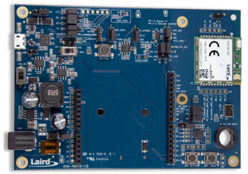
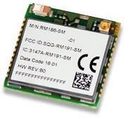

<!-- Copyright 2015-2026 Zephyr Project members and individual contributors. -->
<!-- SPDX-License-Identifier: Apache-2.0 -->
<!-- 中文翻译；编号、导航与译注为本地新增。 -->

<a id="rm1xx_dvk"></a>

# 第23章\_RM1xx开发套件（DVK）

原文：[官方页面](https://docs.zephyrproject.org/latest/boards/ezurio/rm1xx_dvk/doc/index.html)。读取日期：2026-10-16；来源摘要见[来源记录](../SOURCES.md)。

开发板概览（Board Overview）

<a id="id1"></a>

[](images/rm1xx_dvk.jpg)

RM1xx开发套件（DVK）

名称（Name）：

`rm1xx_dvk`

厂商（Vendor）：

[Ezurio](https://docs.zephyrproject.org/latest/boards/index.html#vendor=ezurio)

状态（Status）：

维护中（Maintained）

架构（Architecture）：

[arm](https://docs.zephyrproject.org/latest/boards/index.html#arch=arm)

片上系统（SoC）：

[nrf51822](https://docs.zephyrproject.org/latest/boards/index.html#soc=nrf51822)

<a id="board-github-link"></a>

[浏览开发板源码（Browse Board Sources）](https://github.com/zephyrproject-rtos/zephyr/blob/main//boards/ezurio/rm1xx_dvk/doc/index.rst/../..)<a id="overview"></a>

## 概述（Overview）

Ezurio RM1xx模块同时集成LoRa及低功耗蓝牙（BLE）通信，采用Nordic Semiconductor nRF51822 Arm Cortex-M0 CPU和板载Semtech SX1272 LoRa射频芯片。此开发板配置支持RM1xx开发板上的RM1xx模块，其中RM191为915 MHz版本，RM186为868 MHz版本。

该开发套件（Development Kit）具有以下特性：


- 模数转换器（ADC）
- 时钟（CLOCK）
- 闪存（FLASH）
- 通用输入输出（GPIO）
- 集成电路间总线（I2C）
- 嵌套向量中断控制器（NVIC）
- 脉宽调制（PWM）
- 无线电（RADIO，低功耗蓝牙 / Bluetooth Low Energy）
- 实时时钟（RTC）
- Segger实时传输（RTT，RTT控制台 / RTT Console）
- 串行外设接口（SPI）
- 通用异步收发器（UART）
- 看门狗定时器（WDT）

<a id="id2"></a>



RM1xx模块，图片来源（Credit）：Ezurio

<a id="id4"></a>

模块更多信息见[RM1xx主页](https://www.ezurio.com/wireless-modules/lorawan-solutions/sentrius-rm1xx-lora-ble-module)[注1](#id3)。

<a id="id6"></a>

[Nordic Semiconductor Infocenter](https://infocenter.nordicsemi.com)[注2](#id5)提供处理器信息及数据手册。

<a id="hardware"></a>

## 硬件（Hardware）

RM1xx有两个内部振荡器：慢时钟32.768 kHz，主时钟16 MHz。

<a id="supported-features"></a>

### 支持的功能（Supported Features）

`rm1xx_dvk`开发板支持下表所列的硬件功能。

片上／板载（On-Chip / On-Board）

功能集成在片上系统（SoC）内／位于开发板上。

2 / 2

分别表示已启用／已禁用的实例数。点击数量标签，可查看开发板或SoC设备树源码（DTS）中该功能的第一个实例。

`vnd,foo`

与此功能匹配的设备树绑定兼容字符串（Compatible String）；点击链接可查看绑定文档。

<a id="rm1xx_dvk-hw-features"></a>

<a id="rm1xx_dvk-rm1xx_dvk/nrf51822-hw-features-section"></a>

#### `rm1xx_dvk/nrf51822`目标（Target）

<a id="rm1xx_dvk-rm1xx_dvk/nrf51822-hw-features-panel"></a>

<a id="rm1xx_dvk-rm1xx_dvk/nrf51822-hw-features-memory"></a>

该开发板目标的片上存储容量：32 KiB RAM、256 KiB Flash。

<a id="rm1xx_dvk-rm1xx_dvk/nrf51822-hw-features-table"></a>

<table>
<tr>
<th>类型（Type）</th>
<th>位置（Location）</th>
<th>说明（Description）</th>
<th>兼容字符串（Compatible）</th>
</tr>
<tr>
<td rowspan="1">中央处理器（CPU）</td>
<td>片上（On-Chip）</td>
<td>ARM Cortex-M0处理器（CPU）（<a href="https://github.com/zephyrproject-rtos/zephyr/blob/main/dts/arm/nordic/nrf51822.dtsi?plain=1#L22">已启用：1</a>）</td>
<td><a href="../cpu_arm_riscv_binding_reference/P018_arm_cortex-m0.md#std-dtcompatible-arm-cortex-m0"><code>arm,cortex-m0</code></a></td>
</tr>
<tr>
<td rowspan="1">模数转换器（ADC）</td>
<td>片上（On-Chip）</td>
<td>Nordic nRF模数转换器（ADC）节点（<a href="https://github.com/zephyrproject-rtos/zephyr/blob/main/dts/arm/nordic/nrf51822.dtsi?plain=1#L178">已禁用：1</a>）</td>
<td><a href="../hardware/P845_NordicNRF模数转换器绑定.md#dtbinding-nordic-nrf-adc"><code>nordic,nrf-adc</code></a></td>
</tr>
<tr>
<td rowspan="3">ARM 架构（ARM Architecture）</td>
<td>片上（On-Chip）</td>
<td>Nordic用户信息配置寄存器（UICR / User Information Configuration Registers）（<a href="https://github.com/zephyrproject-rtos/zephyr/blob/main/dts/arm/nordic/nrf51822.dtsi?plain=1#L48">已启用：1</a>）</td>
<td><a href="../arm_nordic_nxp_control_binding_reference/P007_nordic_nrf-uicr.md#std-dtcompatible-nordic-nrf-uicr"><code>nordic,nrf-uicr</code></a></td>
</tr>
<tr>
<td>片上（On-Chip）</td>
<td>Nordic nRF系列内存保护单元（MPU / Memory Protection Unit）（<a href="https://github.com/zephyrproject-rtos/zephyr/blob/main/dts/arm/nordic/nrf51822.dtsi?plain=1#L97">已启用：1</a>）</td>
<td><a href="../arm_timing_ethosu_control_binding_reference/P020_nordic_nrf-mpu.md#std-dtcompatible-nordic-nrf-mpu"><code>nordic,nrf-mpu</code></a></td>
</tr>
<tr>
<td>片上（On-Chip）</td>
<td>Nordic nRF系列软件中断（SWI / Software Interrupt）（<a href="https://github.com/zephyrproject-rtos/zephyr/blob/main/dts/arm/nordic/nrf51822.dtsi?plain=1#L286">已启用：6</a>）</td>
<td><a href="../arm_nordic_nxp_control_binding_reference/P005_nordic_nrf-swi.md#std-dtcompatible-nordic-nrf-swi"><code>nordic,nrf-swi</code></a></td>
</tr>
<tr>
<td rowspan="4">时钟控制（Clock Control）</td>
<td>片上（On-Chip）</td>
<td>Nordic nRF时钟控制（Clock Control）节点（<a href="https://github.com/zephyrproject-rtos/zephyr/blob/main/dts/arm/nordic/nrf51822.dtsi?plain=1#L80">已启用：1</a>）</td>
<td><a href="../clock_sam_nordic_binding_reference/P015_nordic_nrf-clock.md#std-dtcompatible-nordic-nrf-clock"><code>nordic,nrf-clock</code></a></td>
</tr>
<tr>
<td>片上（On-Chip）</td>
<td>Nordic nRF高频时钟（HFCLK）控制节点（<a href="https://github.com/zephyrproject-rtos/zephyr/blob/main/dts/arm/nordic/nrf51822.dtsi?plain=1#L86">已启用：1</a>）</td>
<td><a href="../clock_sam_nordic_binding_reference/P009_nordic_nrf-clock-hfclk.md#std-dtcompatible-nordic-nrf-clock-hfclk"><code>nordic,nrf-clock-hfclk</code></a></td>
</tr>
<tr>
<td>片上（On-Chip）</td>
<td>Nordic nRF低频时钟（LFCLK）控制节点（<a href="https://github.com/zephyrproject-rtos/zephyr/blob/main/dts/arm/nordic/nrf51822.dtsi?plain=1#L91">已启用：1</a>）</td>
<td><a href="../clock_sam_nordic_binding_reference/P012_nordic_nrf-clock-lfclk.md#std-dtcompatible-nordic-nrf-clock-lfclk"><code>nordic,nrf-clock-lfclk</code></a></td>
</tr>
<tr>
<td>片上（On-Chip）</td>
<td>Nordic nRF高频晶体振荡器，nRF51系列（<a href="https://github.com/zephyrproject-rtos/zephyr/blob/main/dts/arm/nordic/nrf51822.dtsi?plain=1#L30">已启用：1</a>）</td>
<td><a href="../clock_sam_nordic_binding_reference/P021_nordic_nrf51-hfxo.md#std-dtcompatible-nordic-nrf51-hfxo"><code>nordic,nrf51-hfxo</code></a></td>
</tr>
<tr>
<td rowspan="1">比较器（Comparator）</td>
<td>片上（On-Chip）</td>
<td>Nordic nRF低功耗模拟比较器（LPCOMP）（<a href="https://github.com/zephyrproject-rtos/zephyr/blob/main/dts/arm/nordic/nrf51822.dtsi?plain=1#L278">已禁用：1</a>）</td>
<td><a href="../hardware/P753_NordicnRF低功耗比较器绑定.md#dtbinding-nordic-nrf-lpcomp"><code>nordic,nrf-lpcomp</code></a></td>
</tr>
<tr>
<td rowspan="1">计数器（Counter）</td>
<td>片上（On-Chip）</td>
<td>Nordic nRF定时器（Timer）节点（<a href="https://github.com/zephyrproject-rtos/zephyr/blob/main/dts/arm/nordic/nrf51822.dtsi?plain=1#L186">已禁用：3</a>）</td>
<td><a href="../microchip_soc_counter_binding_reference/P017_nordic_nrf-timer.md#std-dtcompatible-nordic-nrf-timer"><code>nordic,nrf-timer</code></a></td>
</tr>
<tr>
<td rowspan="2">密码学加速器（Cryptographic Accelerator）</td>
<td>片上（On-Chip）</td>
<td>Nordic ECB（AES电子密码本模式加密 / Electronic Codebook Mode Encryption）（<a href="https://github.com/zephyrproject-rtos/zephyr/blob/main/dts/arm/nordic/nrf51822.dtsi?plain=1#L240">已启用：1</a>）</td>
<td><a href="../crypto_secure_engine_st_ti_binding_reference/P001_nordic_nrf-ecb.md#std-dtcompatible-nordic-nrf-ecb"><code>nordic,nrf-ecb</code></a></td>
</tr>
<tr>
<td>片上（On-Chip）</td>
<td>Nordic nRF系列CCM（AES CCM模式加密 / CCM Mode Encryption）（<a href="https://github.com/zephyrproject-rtos/zephyr/blob/main/dts/arm/nordic/nrf51822.dtsi?plain=1#L247">已启用：1</a>）</td>
<td><a href="../crypto_aes_sha_ccm_binding_reference/P020_nordic_nrf-ccm.md#std-dtcompatible-nordic-nrf-ccm"><code>nordic,nrf-ccm</code></a></td>
</tr>
<tr>
<td rowspan="1">闪存控制器（Flash Controller）</td>
<td>片上（On-Chip）</td>
<td>Nordic非易失性存储器控制器（NVMC / Non-Volatile Memory Controller）（<a href="https://github.com/zephyrproject-rtos/zephyr/blob/main/dts/arm/nordic/nrf51822.dtsi?plain=1#L328">已启用：1</a>）</td>
<td><a href="../flash_adi_microchip_nordic_binding_reference/P029_nordic_nrf51-flash-controller.md#std-dtcompatible-nordic-nrf51-flash-controller"><code>nordic,nrf51-flash-controller</code></a></td>
</tr>
<tr>
<td rowspan="2">通用输入输出与接插件（GPIO &amp; Headers）</td>
<td>片上（On-Chip）</td>
<td>NRF5 GPIO任务与事件（GPIOTE）（<a href="https://github.com/zephyrproject-rtos/zephyr/blob/main/dts/arm/nordic/nrf51822.dtsi?plain=1#L170">已启用：1</a>）</td>
<td><a href="../gpio_microchip_nordic_nuvoton_binding_reference/P017_nordic_nrf-gpiote.md#std-dtcompatible-nordic-nrf-gpiote"><code>nordic,nrf-gpiote</code></a></td>
</tr>
<tr>
<td>片上（On-Chip）</td>
<td>NRF5通用输入输出（GPIO）（<a href="https://github.com/zephyrproject-rtos/zephyr/blob/main/dts/arm/nordic/nrf51822.dtsi?plain=1#L351">已启用：1</a>）</td>
<td><a href="../gpio_microchip_nordic_nuvoton_binding_reference/P016_nordic_nrf-gpio.md#std-dtcompatible-nordic-nrf-gpio"><code>nordic,nrf-gpio</code></a></td>
</tr>
<tr>
<td rowspan="1">集成电路间总线（I2C）</td>
<td>片上（On-Chip）</td>
<td>Nordic nRF系列双线接口（TWI，TWI主机）（<a href="https://github.com/zephyrproject-rtos/zephyr/blob/main/dts/arm/nordic/nrf51822.dtsi?plain=1#L133">已启用：1</a>；<a href="https://github.com/zephyrproject-rtos/zephyr/blob/main/dts/arm/nordic/nrf51822.dtsi?plain=1#L160">已禁用：1</a>）</td>
<td><a href="../i2c_infineon_ite_nordic_binding_reference/P015_nordic_nrf-twi.md#std-dtcompatible-nordic-nrf-twi"><code>nordic,nrf-twi</code></a></td>
</tr>
<tr>
<td rowspan="1">输入（Input）</td>
<td>板载（On-Board）</td>
<td>一组绑定到 GPIO 的输入按键（GPIO-Bound Input Keys）（<a href="https://github.com/zephyrproject-rtos/zephyr/blob/main/boards/ezurio/rm1xx_dvk/rm1xx_dvk.dts?plain=1#L27">已启用：1</a>）</td>
<td><a href="../hardware/P563_GPIO按键绑定.md#std-dtcompatible-gpio-keys"><code>gpio-keys</code></a></td>
</tr>
<tr>
<td rowspan="1">中断控制器（Interrupt Controller）</td>
<td>片上（On-Chip）</td>
<td>ARMv6-M嵌套向量中断控制器（NVIC / Nested Vectored Interrupt Controller）（<a href="https://github.com/zephyrproject-rtos/zephyr/blob/main/dts/arm/armv6-m.dtsi?plain=1#L13">已启用：1</a>）</td>
<td><a href="../arm_interrupt_timer_binding_reference/P001_ARMv6_M_NVIC.md#std-dtcompatible-arm-v6m-nvic"><code>arm,v6m-nvic</code></a></td>
</tr>
<tr>
<td rowspan="1">远距离无线通信（LoRa）</td>
<td>板载（On-Board）</td>
<td>Semtech SX1272 LoRa调制解调器（Modem）（<a href="https://github.com/zephyrproject-rtos/zephyr/blob/main/boards/ezurio/rm1xx_dvk/rm1xx_dvk.dts?plain=1#L93">已启用：1</a>）</td>
<td><a href="../lora_ieee802154_binding_reference/P023_semtech_sx1272.md#std-dtcompatible-semtech-sx1272"><code>semtech,sx1272</code></a></td>
</tr>
<tr>
<td rowspan="2">其他绑定（Miscellaneous）</td>
<td>片上（On-Chip）</td>
<td>Nordic工厂信息配置寄存器（FICR / Factory Information Configuration Registers）（<a href="https://github.com/zephyrproject-rtos/zephyr/blob/main/dts/arm/nordic/nrf51822.dtsi?plain=1#L41">已启用：1</a>）</td>
<td><a href="../misc_adi_nordic_binding_reference/P018_nordic_nrf-ficr.md#std-dtcompatible-nordic-nrf-ficr"><code>nordic,nrf-ficr</code></a></td>
</tr>
<tr>
<td>片上（On-Chip）</td>
<td>Nordic nRF系列可编程外设互连（PPI / Programmable Peripheral Interconnect）（<a href="https://github.com/zephyrproject-rtos/zephyr/blob/main/dts/arm/nordic/nrf51822.dtsi?plain=1#L345">已启用：1</a>）</td>
<td><a href="../misc_adi_nordic_binding_reference/P020_nordic_nrf-ppi.md#std-dtcompatible-nordic-nrf-ppi"><code>nordic,nrf-ppi</code></a></td>
</tr>
<tr>
<td rowspan="3">存储技术设备（MTD）</td>
<td>板载（On-Board）</td>
<td>这些属性用于支持Zephyr的<code>spi-nor</code>闪存驱动通过Zephyr SPI API，使用基于M25P80的标准命令集控制串行闪存（Serial Flash Memory）。（<a href="https://github.com/zephyrproject-rtos/zephyr/blob/main/boards/ezurio/rm1xx_dvk/rm1xx_dvk.dts?plain=1#L81">已启用：1</a>）</td>
<td><a href="../mtd_microchip_nordic_nxp_binding_reference/P002_jedec_spi-nor.md#std-dtcompatible-jedec-spi-nor"><code>jedec,spi-nor</code></a></td>
</tr>
<tr>
<td>板载（On-Board）</td>
<td>闪存或其他非易失性存储器的固定分区（Fixed Partitions）（<a href="https://github.com/zephyrproject-rtos/zephyr/blob/main/boards/ezurio/rm1xx_dvk/rm1xx_dvk.dts?plain=1#L151">已启用：1</a>）</td>
<td><a href="../hardware/P568_固定分区绑定.md#dtbinding-fixed-partitions"><code>fixed-partitions</code></a></td>
</tr>
<tr>
<td>片上（On-Chip）</td>
<td>闪存（Flash）节点（<a href="https://github.com/zephyrproject-rtos/zephyr/blob/main/dts/arm/nordic/nrf51822.dtsi?plain=1#L335">已启用：1</a>）</td>
<td><a href="../mtd_nxp_st_ti_partition_binding_reference/P013_soc-nv-flash.md#std-dtcompatible-soc-nv-flash"><code>soc-nv-flash</code></a></td>
</tr>
<tr>
<td rowspan="1">网络（Networking）</td>
<td>片上（On-Chip）</td>
<td>Nordic nRF系列无线电（RADIO）外设（<a href="https://github.com/zephyrproject-rtos/zephyr/blob/main/dts/arm/nordic/nrf51822.dtsi?plain=1#L103">已启用：1</a>）</td>
<td><a href="../network_radio_frontend_binding_reference/P009_nordic_nrf-radio.md#std-dtcompatible-nordic-nrf-radio"><code>nordic,nrf-radio</code></a></td>
</tr>
<tr>
<td rowspan="1">引脚控制（Pin Control）</td>
<td>片上（On-Chip）</td>
<td>Nordic nRF系列引脚控制器（Pin Controller）（<a href="https://github.com/zephyrproject-rtos/zephyr/blob/main/dts/vendor/nordic/nrf_common.dtsi?plain=1#L26">已启用：1</a>）</td>
<td><a href="../pinctrl_infineon_nordic_nxp_binding_reference/P009_nordic_nrf-pinctrl.md#std-dtcompatible-nordic-nrf-pinctrl"><code>nordic,nrf-pinctrl</code></a></td>
</tr>
<tr>
<td rowspan="1">电源管理（Power Management）</td>
<td>片上（On-Chip）</td>
<td>Nordic nRF电源控制（Power Control）节点（<a href="https://github.com/zephyrproject-rtos/zephyr/blob/main/dts/arm/nordic/nrf51822.dtsi?plain=1#L63">已启用：1</a>）</td>
<td><a href="../power_control_binding_reference/P008_nordic_nrf-power.md#std-dtcompatible-nordic-nrf-power"><code>nordic,nrf-power</code></a></td>
</tr>
<tr>
<td rowspan="1">脉宽调制（PWM）</td>
<td>片上（On-Chip）</td>
<td>nRFx软件脉宽调制（S/W PWM）（<a href="https://github.com/zephyrproject-rtos/zephyr/blob/main/dts/vendor/nordic/nrf_common.dtsi?plain=1#L39">已禁用：1</a>）</td>
<td><a href="../pwm_intel_microchip_nxp_binding_reference/P016_nordic_nrf-sw-pwm.md#std-dtcompatible-nordic-nrf-sw-pwm"><code>nordic,nrf-sw-pwm</code></a></td>
</tr>
<tr>
<td rowspan="1">保持存储器（Retained Memory）</td>
<td>片上（On-Chip）</td>
<td>Nordic通用保持寄存器（GPREGRET / General Purpose Register Retention）设备（<a href="https://github.com/zephyrproject-rtos/zephyr/blob/main/dts/arm/nordic/nrf51822.dtsi?plain=1#L71">已启用：1</a>）</td>
<td><a href="../hardware/P627_Nordic通用保留寄存器绑定.md#dtbinding-nordic-nrf-gpregret"><code>nordic,nrf-gpregret</code></a></td>
</tr>
<tr>
<td rowspan="1">随机数生成器（RNG）</td>
<td>片上（On-Chip）</td>
<td>Nordic nRF系列随机数发生器（RNG / Random Number Generator）（<a href="https://github.com/zephyrproject-rtos/zephyr/blob/main/dts/arm/nordic/nrf51822.dtsi?plain=1#L233">已启用：1</a>）</td>
<td><a href="../rng_binding_reference/P014_nordic_nrf-rng.md#std-dtcompatible-nordic-nrf-rng"><code>nordic,nrf-rng</code></a></td>
</tr>
<tr>
<td rowspan="1">实时时钟（RTC）</td>
<td>片上（On-Chip）</td>
<td>Nordic nRF实时时间计数器（RTC / Real-Time Counter）（<a href="https://github.com/zephyrproject-rtos/zephyr/blob/main/dts/arm/nordic/nrf51822.dtsi?plain=1#L216">已禁用：2</a>）</td>
<td><a href="../microchip_microcrystal_nxp_rtc_binding_reference/P010_nordic_nrf-rtc.md#std-dtcompatible-nordic-nrf-rtc"><code>nordic,nrf-rtc</code></a></td>
</tr>
<tr>
<td rowspan="2">传感器（Sensors）</td>
<td>片上（On-Chip）</td>
<td>Nordic nRF系列温度（TEMP）节点（<a href="https://github.com/zephyrproject-rtos/zephyr/blob/main/dts/arm/nordic/nrf51822.dtsi?plain=1#L226">已启用：1</a>）</td>
<td><a href="../sensor_microchip_nordic_nxp_binding_reference/P023_nordic_nrf-temp.md#std-dtcompatible-nordic-nrf-temp"><code>nordic,nrf-temp</code></a></td>
</tr>
<tr>
<td>片上（On-Chip）</td>
<td>Nordic nRF正交解码器（QDEC / Quadrature Decoder）节点（<a href="https://github.com/zephyrproject-rtos/zephyr/blob/main/dts/arm/nordic/nrf51822.dtsi?plain=1#L271">已禁用：1</a>）</td>
<td><a href="../sensor_microchip_nordic_nxp_binding_reference/P021_nordic_nrf-qdec.md#std-dtcompatible-nordic-nrf-qdec"><code>nordic,nrf-qdec</code></a></td>
</tr>
<tr>
<td rowspan="1">串行控制器（Serial Controller）</td>
<td>片上（On-Chip）</td>
<td>Nordic nRF系列通用异步收发器（UART）（<a href="https://github.com/zephyrproject-rtos/zephyr/blob/main/dts/arm/nordic/nrf51822.dtsi?plain=1#L115">已启用：1</a>）</td>
<td><a href="../uart_microchip_nordic_nxp_binding_reference/P003_nordic_nrf-uart.md#std-dtcompatible-nordic-nrf-uart"><code>nordic,nrf-uart</code></a></td>
</tr>
<tr>
<td rowspan="1">串行外设接口（SPI）</td>
<td>片上（On-Chip）</td>
<td>Nordic nRF系列串行外设接口（SPI）控制器（<a href="https://github.com/zephyrproject-rtos/zephyr/blob/main/dts/arm/nordic/nrf51822.dtsi?plain=1#L143">已启用：1</a>；<a href="https://github.com/zephyrproject-rtos/zephyr/blob/main/dts/arm/nordic/nrf51822.dtsi?plain=1#L122">已禁用：1</a>）</td>
<td><a href="../spi_microchip_nordic_nxp_binding_reference/P012_nordic_nrf-spi.md#std-dtcompatible-nordic-nrf-spi"><code>nordic,nrf-spi</code></a></td>
</tr>
<tr>
<td rowspan="1">静态随机存储器（SRAM）</td>
<td>片上（On-Chip）</td>
<td>通用片上静态随机存储器（SRAM）（<a href="https://github.com/zephyrproject-rtos/zephyr/blob/main/dts/arm/nordic/nrf51822.dtsi?plain=1#L57">已启用：1</a>）</td>
<td><a href="../hardware/P567_内存映射SRAM绑定.md#dtbinding-mmio-sram"><code>mmio-sram</code></a></td>
</tr>
<tr>
<td rowspan="1">看门狗（Watchdog）</td>
<td>片上（On-Chip）</td>
<td>Nordic nRF系列看门狗定时器（WDT / Watchdog Timer）（<a href="https://github.com/zephyrproject-rtos/zephyr/blob/main/dts/arm/nordic/nrf51822.dtsi?plain=1#L254">已启用：1</a>）</td>
<td><a href="../nxp_nordic_nuvoton_watchdog_binding_reference/P002_nordic_nrf-wdt.md#std-dtcompatible-nordic-nrf-wdt"><code>nordic,nrf-wdt</code></a></td>
</tr>
</table>

<a id="id7"></a>

完整硬件功能列表见[Nordic Semiconductor Infocenter](https://infocenter.nordicsemi.com)[注2](#id5)。

<a id="connections-and-ios"></a>

### 连接与输入输出（Connections and IOs）

开发板包含Microchip MCP23S08 SPI端口扩展器，注意，Zephyr目前不支持此器件。

<a id="id13"></a>

更多细节见Microchip MCP23S08数据手册[注5](#id12)。（[Microchip MCP23S08数据手册（Datasheet）](https://ww1.microchip.com/downloads/en/DeviceDoc/MCP23008-MCP23S08-Data-Sheet-20001919F.pdf)）

<a id="push-buttons"></a>

#### 按键（Push Buttons）


- `BUTTON2 = SW0 = P0.05`

<a id="internal-memory"></a>

### 内部存储器（Internal Memory）

<a id="eeprom-memory"></a>

#### 电可擦可编程只读存储器（EEPROM Memory）

通过SPI连接的512 KB（4 Mb）Adesto AT25DF041B EEPROM可存储更新不频繁的数据及小型数据集，并可使用`spi-nor`驱动。注意，此EEPROM与SX1272 LoRa收发器共用SPI总线，应优先允许LoRa无线电访问总线。

<a id="id9"></a>

更多细节见Adesto AT25DF041B数据手册[注3](#id8)。（[Adesto AT25DF041B数据手册（Datasheet）](https://www.dialog-semiconductor.com/sites/default/files/ds-at25df041b_040.pdf)）

<a id="lora"></a>

### 远距离无线通信（LoRa）

模块内部包含Semtech SX1272收发器（Transceiver）。使用RM191模块时，可在915 MHz LoRa频段工作；使用RM186模块时，可在868 MHz LoRa频段工作。

<a id="id11"></a>

更多细节见Semtech SX1272数据手册[注4](#id10)。（[Semtech SX1272数据手册（Datasheet）](https://semtech.my.salesforce.com/sfc/p/#E0000000JelG/a/440000001NCE/v_VBhk1IolDgxwwnOpcS_vTFxPfSEPQbuneK3mWsXlU)）

<a id="programming-and-debugging"></a>

## 烧录与调试（Programming and Debugging）

`rm1xx_dvk`开发板支持下表所列的运行工具（Runners）及相关west命令。

<table>
<tr>
<th></th>
<th>烧录（flash）</th>
<th>调试（debug）</th>
<th>连接调试会话（attach）</th>
<th>实时传输（rtt）</th>
<th>复位（reset）</th>
<th>调试服务器（debugserver）</th>
</tr>
<tr>
<td><a href="https://docs.zephyrproject.org/latest/develop/flash_debug/host-tools.html#runner-jlink">jlink</a></td>
<td>✅</td>
<td>✅（默认 / default）</td>
<td>✅</td>
<td>✅</td>
<td>✅</td>
<td>✅</td>
</tr>
<tr>
<td>nrfjprog</td>
<td>✅</td>
<td></td>
<td></td>
<td></td>
<td></td>
<td></td>
</tr>
<tr>
<td><code>nrfutil</code></td>
<td>✅（默认 / default）</td>
<td></td>
<td></td>
<td></td>
<td></td>
<td></td>
</tr>
</table>

<a id="flashing"></a>

### 烧录（Flashing）

按照[Nordic nRF5x Segger J-Link](../debugging/P005_Nordic_Segger_JLink.md#nordic-segger)页面安装并配置所需软件，更多信息见[烧录（Flashing）](../debugging/P005_Nordic_Segger_JLink.md#nordic-segger-flashing)。随后按常规方式构建和烧录应用；详见[构建应用（Building an Application）](../application/P001_应用开发.md#build-an-application)和[运行应用（Run an Application）](https://docs.zephyrproject.org/latest/develop/application/index.html#application-run)。

下面以[Hello World](../getting_started/P005_HelloWorld示例.md#hello_world)应用为例。

首先运行常用终端程序查看输出。

```text
$ minicom -D <tty_device> -b 115200
```

将`<tty_device>`替换为开发板nRF51 DK所在串口（板名依原文保留），例如Linux上的`/dev/ttyACM0`。

随后按通常方式构建并烧录应用。

```text
# From the root of the zephyr repository
west build -b rm1xx_dvk samples/hello_world
west flash
```

<a id="debugging"></a>

### 调试（Debugging）

关于通过Segger芯片调试开发板，见[Nordic nRF5x Segger J-Link](../debugging/P005_Nordic_Segger_JLink.md#nordic-segger)页面。

<a id="references"></a>

## 参考资料（References）

<a id="id3"></a>

〔[1](#id4)〕 [https://www.ezurio.com/wireless-modules/lorawan-solutions/sentrius-rm1xx-lora-ble-module](https://www.ezurio.com/wireless-modules/lorawan-solutions/sentrius-rm1xx-lora-ble-module)

<a id="id5"></a>

〔2〕 ([1](#id6),[2](#id7)) [https://infocenter.nordicsemi.com](https://infocenter.nordicsemi.com)

<a id="id8"></a>

〔[3](#id9)〕 [https://www.dialog-semiconductor.com/sites/default/files/ds-at25df041b_040.pdf](https://www.dialog-semiconductor.com/sites/default/files/ds-at25df041b_040.pdf)

<a id="id10"></a>

〔[4](#id11)〕 [https://semtech.my.salesforce.com/sfc/p/#E0000000JelG/a/440000001NCE/v_VBhk1IolDgxwwnOpcS_vTFxPfSEPQbuneK3mWsXlU](https://semtech.my.salesforce.com/sfc/p/#E0000000JelG/a/440000001NCE/v_VBhk1IolDgxwwnOpcS_vTFxPfSEPQbuneK3mWsXlU)

<a id="id12"></a>

〔[5](#id13)〕 [https://ww1.microchip.com/downloads/en/DeviceDoc/MCP23008-MCP23S08-Data-Sheet-20001919F.pdf](https://ww1.microchip.com/downloads/en/DeviceDoc/MCP23008-MCP23S08-Data-Sheet-20001919F.pdf)

## 译注

原文将AT25DF041B称为EEPROM，并说明可使用spi-nor驱动及与LoRa无线电共享总线；本文保留这一用词和优先级要求。MCP23S08不受支持的说明为原文状态，未进行硬件验证。

## 原文外链核对

2026-10-16核对并重试以下原文外链时未能确认可访问性，保留原始目标，不将访问失败解释为原文内容有误。

- [infocenter.nordicsemi.com](https://infocenter.nordicsemi.com)：HTTP Error 403: Forbidden。
- [](https://semtech.my.salesforce.com/sfc/p/#E0000000JelG/a/440000001NCE/v_VBhk1IolDgxwwnOpcS_vTFxPfSEPQbuneK3mWsXlU)：页面可访问，但未确认目标片段。

---

[上一章](P022_RM1262_DVK.md) · [返回大纲](大纲.md) · [全站翻译进度](../PROGRESS.md)
