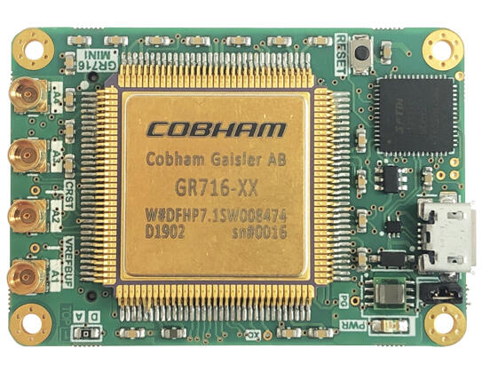

<!-- Copyright 2015-2026 Zephyr Project members and individual contributors. -->
<!-- SPDX-License-Identifier: Apache-2.0 -->
<!-- 中文翻译；编号、导航与译注为本地新增。 -->

<a id="gr716a_mini"></a>

# 第22章\_GR716-MINI开发板（Development Board）

原文：[官方页面](https://docs.zephyrproject.org/latest/boards/gaisler/gr716a_mini/doc/index.html)。读取日期：2026-10-16；来源摘要见[来源记录](../SOURCES.md)。

开发板概览（Board Overview）

<a id="id1"></a>

[](images/gr716a_mini.jpg)

GR716-MINI开发板（Development Board）

名称（Name）：

`gr716a_mini`

厂商（Vendor）：

[Gaisler](https://docs.zephyrproject.org/latest/boards/index.html#vendor=gaisler)

状态（Status）：

当前未积极维护（Not Actively Maintained）

架构（Architecture）：

[sparc](https://docs.zephyrproject.org/latest/boards/index.html#arch=sparc)

片上系统（SoC）：

[gr716a](https://docs.zephyrproject.org/latest/boards/index.html#soc=gr716a)

<a id="board-github-link"></a>

[浏览开发板源码（Browse Board Sources）](https://github.com/zephyrproject-rtos/zephyr/blob/main//boards/gaisler/gr716a_mini/doc/index.rst/../..)<a id="overview"></a>

## 概述（Overview）

GR716-MINI开发板提供：


- GR716微控制器（Microcontroller）
- SPI闪存PROM，32 MiB
- 静态随机存储器（SRAM），2 MiB
- FTDI USB接口，用于UART调试链路（AHBUART）及应用UART（APBUART）。
- 4个MMCX连接器，2个ADC、2个DAC
- 位于底面的微型80针夹层连接器（Mezzanine Connector）

<a id="hardware"></a>

## 硬件（Hardware）

<a id="console-output"></a>

### 控制台输出（Console Output）

内核默认将控制台输出发送到第一个APBUART外设`apbuart0`。若GRMON启用了UART调试转发（Debug Forwarding），该设置会保留。

<a id="programming-and-debugging"></a>

## 烧录与调试（Programming and Debugging）

`gr716a_mini`开发板支持下表所列的运行工具（Runners）及相关west命令。

<table>
<tr>
<th></th>
<th>烧录（flash）</th>
<th>调试（debug）</th>
</tr>
</table>

<a id="building"></a>

### 构建（Building）

`gr716a_mini`应用可按常规方法构建，详见构建应用。为此目标构建时，将`BOARD`变量设为`gr716a_mini`。（[构建应用（Building an Application）](../application/P001_应用开发.md#build-an-application)）

应用默认链接到片上紧耦合存储器（Tightly Coupled Memory）。

<a id="running-on-hardware"></a>

### 在硬件上运行（Running on Hardware）

通过GRMON连接，然后加载并运行应用。

```text
$ grmon -u -cginit 0x00010000 -uart /dev/ttyUSB0
  GRMON debug monitor v3.2.8

  Copyright (C) 2020 Cobham Gaisler - All rights reserved.
  For latest updates, go to http://www.gaisler.com/
  Comments or bug-reports to support@gaisler.com

  Device ID:           0x716
  GRLIB build version: 4204
  Detected system:     GR716
  Detected frequency:  20.0 MHz

  Component                            Vendor
  AHB-to-AHB Bridge                    Cobham Gaisler
  MIL-STD-1553B Interface              Cobham Gaisler
  GRSPW2 SpaceWire Serial Link         Cobham Gaisler
  SPI to AHB Bridge                    Cobham Gaisler
  I2C to AHB Bridge                    Cobham Gaisler
  CAN Controller with DMA              Cobham Gaisler
  CAN Controller with DMA              Cobham Gaisler
  AHB Debug UART                       Cobham Gaisler
  AHB-to-AHB Bridge                    Cobham Gaisler
  PacketWire Receiver with DMA         Cobham Gaisler
  PacketWire Transmitter with DMA      Cobham Gaisler
  GRDMAC DMA Controller                Cobham Gaisler
  GRDMAC DMA Controller                Cobham Gaisler
  GRDMAC DMA Controller                Cobham Gaisler
  GRDMAC DMA Controller                Cobham Gaisler
  Dual-port SPI Slave                  Cobham Gaisler
  LEON3FT SPARC V8 Processor           Cobham Gaisler
  AHB-to-AHB Bridge                    Cobham Gaisler
  AHB Memory Scrubber                  Cobham Gaisler
  AHB-to-AHB Bridge                    Cobham Gaisler
  AHB Debug UART                       Cobham Gaisler
  Dual-port AHB(/CPU) On-Chip RAM      Cobham Gaisler
  Dual-port AHB(/CPU) On-Chip RAM      Cobham Gaisler
  Generic AHB ROM                      Cobham Gaisler
  Memory controller with EDAC          Cobham Gaisler
  SPI Memory Controller                Cobham Gaisler
  SPI Memory Controller                Cobham Gaisler
  AHB/APB Bridge                       Cobham Gaisler
  AHB/APB Bridge                       Cobham Gaisler
  AHB/APB Bridge                       Cobham Gaisler
  AHB/APB Bridge                       Cobham Gaisler
  Memory controller with EDAC          Cobham Gaisler
  LEON3 Debug Support Unit             Cobham Gaisler
  AHB/APB Bridge                       Cobham Gaisler
  AMBA Trace Buffer                    Cobham Gaisler
  Multi-processor Interrupt Ctrl.      Cobham Gaisler
  Modular Timer Unit                   Cobham Gaisler
  Modular Timer Unit                   Cobham Gaisler
  GR716 AMBA Protection unit           Cobham Gaisler
  Clock gating unit                    Cobham Gaisler
  Clock gating unit                    Cobham Gaisler
  General Purpose Register             Cobham Gaisler
  LEON3 Statistics Unit                Cobham Gaisler
  AHB Status Register                  Cobham Gaisler
  CCSDS TDP / SpaceWire I/F            Cobham Gaisler
  General Purpose Register Bank        Cobham Gaisler
  General Purpose Register             Cobham Gaisler
  GR716 AMBA Protection unit           Cobham Gaisler
  GR716 Bandgap                        Cobham Gaisler
  GR716 Brownout detector              Cobham Gaisler
  GR716 Phase-locked loop              Cobham Gaisler
  Generic UART                         Cobham Gaisler
  Generic UART                         Cobham Gaisler
  Generic UART                         Cobham Gaisler
  Generic UART                         Cobham Gaisler
  Generic UART                         Cobham Gaisler
  Generic UART                         Cobham Gaisler
  AHB Status Register                  Cobham Gaisler
  ADC / DAC Interface                  Cobham Gaisler
  SPI Controller                       Cobham Gaisler
  SPI Controller                       Cobham Gaisler
  PWM generator                        Cobham Gaisler
  General Purpose I/O port             Cobham Gaisler
  General Purpose I/O port             Cobham Gaisler
  AMBA Wrapper for OC I2C-master       Cobham Gaisler
  AMBA Wrapper for OC I2C-master       Cobham Gaisler
  GR716 Analog-to-Digital Conv         Cobham Gaisler
  GR716 Analog-to-Digital Conv         Cobham Gaisler
  GR716 Analog-to-Digital Conv         Cobham Gaisler
  GR716 Analog-to-Digital Conv         Cobham Gaisler
  GR716 Analog-to-Digital Conv         Cobham Gaisler
  GR716 Analog-to-Digital Conv         Cobham Gaisler
  GR716 Analog-to-Digital Conv         Cobham Gaisler
  GR716 Analog-to-Digital Conv         Cobham Gaisler
  GR716 Digital-to-Analog Conv         Cobham Gaisler
  GR716 Digital-to-Analog Conv         Cobham Gaisler
  GR716 Digital-to-Analog Conv         Cobham Gaisler
  GR716 Digital-to-Analog Conv         Cobham Gaisler
  I2C Slave                            Cobham Gaisler
  I2C Slave                            Cobham Gaisler
  PWM generator                        Cobham Gaisler
  LEON3 Statistics Unit                Cobham Gaisler
  General Purpose Register             Cobham Gaisler

  Use command 'info sys' to print a detailed report of attached cores

grmon3> load zephyr/zephyr.elf
      31000000 text              16.2kB /  16.2kB   [===============>] 100%
      300040A8 initlevel           40B              [===============>] 100%
      300040D0 rodata             484B              [===============>] 100%
      300042B4 datas               20B              [===============>] 100%
      300042C8 sw_isr_table       256B              [===============>] 100%
      300043C8 devices             36B              [===============>] 100%
  Total size: 16.98kB (1.91Mbit/s)
  Entry point 0x31000000
  Image zephyr/zephyr.elf loaded

grmon3> run
*** Booting Zephyr OS build zephyr-v2.4.0-788-gc82a8736a65e  ***
Hello World! gr716a_mini
```

<a id="running-in-simulation"></a>

### 在仿真器中运行（Running in Simulation）

同一个应用二进制文件可在TSIM3 LEON3仿真器中运行。

```text
$ tsim-leon3 -freq 20 -gr716

 TSIM3 LEON3 SPARC simulator, version v3.0.2

 Copyright (C) 2020, Cobham Gaisler - all rights reserved.
 For latest updates, go to https://www.gaisler.com/
 Comments or bug-reports to support@gaisler.com

Number of CPUs: 1
register windows: 31
system frequency: 20.000 MHz
using 64-bit time
Allocated 128 KiB local instruction RAM memory at 0x31000000
Allocated 64 KiB local data RAM memory at 0x30000000
Allocated 4096 KiB SRAM memory, in 1 bank at 0x40000000
Allocated 2048 KiB ROM memory at 0x01000000
Allocated 16384 KiB SPIM ROM memory at 0x02000000
Allocated 16384 KiB SPIM ROM memory at 0x04000000

tsim> load zephyr/zephyr.elf
  section: text, addr: 0x31000000, size 16956 bytes
  section: initlevel, addr: 0x30000000, size 40 bytes
  section: rodata, addr: 0x30000028, size 484 bytes
  section: datas, addr: 0x3000020c, size 20 bytes
  section: sw_isr_table, addr: 0x30000220, size 256 bytes
  section: devices, addr: 0x30000320, size 36 bytes
  Read 438 symbols
tsim> run
  Initializing and starting from 0x31000000
*** Booting Zephyr OS build zephyr-v2.4.0-788-gc82a8736a65e  ***
Hello World! gr716a_mini
```

<a id="references"></a>

## 参考资料（References）


- [GR716评估与开发板（Evaluation and Development Boards）](https://www.gaisler.com/index.php/products/boards/gr716-boards)
- [TSIM3 LEON3仿真器（Simulator）](https://www.gaisler.com/index.php/products/simulators/tsim3/tsim3-leon3)
- [GRMON3调试监控器（Debug Monitor）](https://www.gaisler.com/index.php/products/debug-tools/grmon3)

---

[上一章](P021_Generic_LEON3.md) · [返回大纲](大纲.md) · [全站翻译进度](../PROGRESS.md) · [下一章](P023_Gaisler.md)
