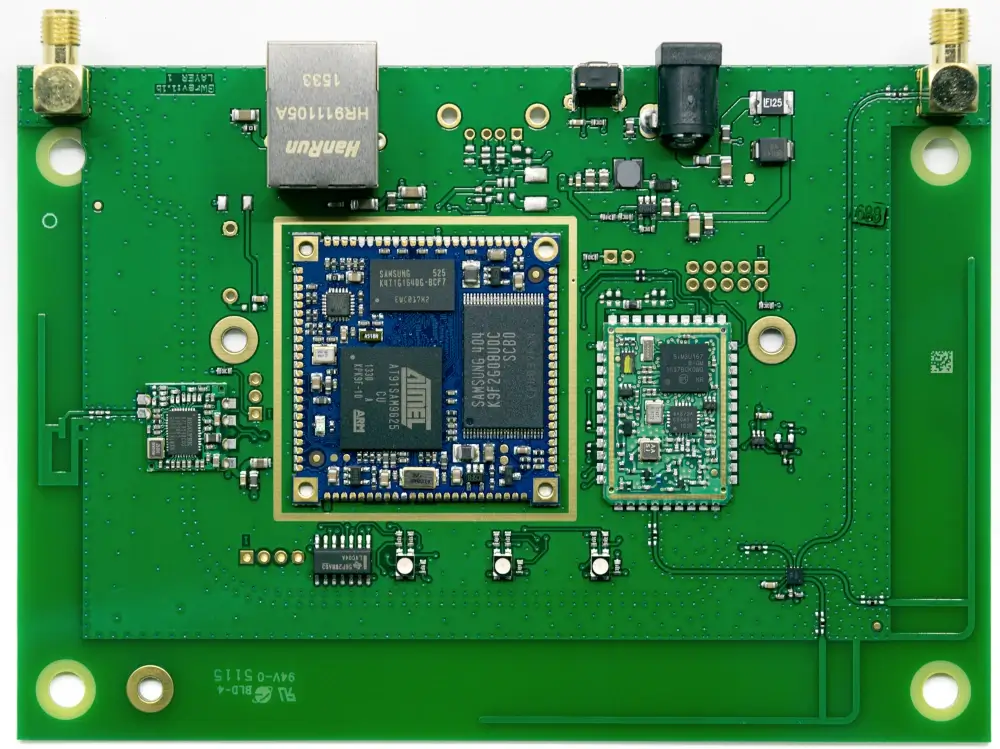

<!-- Copyright 2015-2026 Zephyr Project members and individual contributors. -->
<!-- SPDX-License-Identifier: Apache-2.0 -->
<!-- 中文翻译；编号、导航与译注为本地新增。 -->

<a id="sgrm"></a>

# 第25章\_智能花园无线电模块（Smart Garden Radio Module）

原文：[官方页面](https://docs.zephyrproject.org/latest/boards/gardena/sgrm/doc/index.html)。读取日期：2026-10-16；来源摘要见[来源记录](../SOURCES.md)。

开发板概览（Board Overview）

<a id="id1"></a>

[](images/sgrm.webp)

智能花园无线电模块（Smart Garden Radio Module）

名称（Name）：

`sgrm`

厂商（Vendor）：

[GARDENA GmbH](https://docs.zephyrproject.org/latest/boards/index.html#vendor=gardena)

状态（Status）：

维护中（Maintained）

架构（Architecture）：

[arm](https://docs.zephyrproject.org/latest/boards/index.html#arch=arm)

片上系统（SoC）：

[sim3u167](https://docs.zephyrproject.org/latest/boards/index.html#soc=sim3u167)

<a id="board-github-link"></a>

[浏览开发板源码（Browse Board Sources）](https://github.com/zephyrproject-rtos/zephyr/blob/main//boards/gardena/sgrm/doc/index.rst/../..)<a id="overview"></a>

## 概述（Overview）

此系统模块（SoM / System-on-Module）用作GARDENA智能网关的无线电模块，参见[手册（Manual）](https://content.tdr.dss.husqvarnagroup.net/pub000094159/doc000240276)及[自由开源软件部分（FOSS Parts）](https://github.com/husqvarnagroup/smart-garden-gateway-public)。

<a id="hardware"></a>

## 硬件（Hardware）


- Silicon Labs [SiM3U167-B-GM](https://www.silabs.com/products/mcu/32-bit/precision32-sim3u1xx/device.sim3u167-b-gm) SoC
- Silicon Labs [Si4467](https://www.silabs.com/wireless/proprietary/ezradiopro-sub-ghz-ics/device.si4467?tab=specs)收发器（Transceiver），通过SPI连接
- 通过高驱动能力引脚（High Drive Pins）控制RGB LED，预期镜像来自Linux SoC的三个低驱动能力引脚的状态。
- UART连接到Linux SoC，通常用于点对点协议（PPP）；PPP未运行时，也可用于调试。

<a id="supported-features"></a>

### 支持的功能（Supported Features）

`sgrm`开发板支持下表所列的硬件功能。

片上／板载（On-Chip / On-Board）

功能集成在片上系统（SoC）内／位于开发板上。

2 / 2

分别表示已启用／已禁用的实例数。点击数量标签，可查看开发板或SoC设备树源码（DTS）中该功能的第一个实例。

`vnd,foo`

与此功能匹配的设备树绑定兼容字符串（Compatible String）；点击链接可查看绑定文档。

<a id="sgrm-hw-features"></a>

<a id="sgrm-sgrm/sim3u167-hw-features-section"></a>

#### `sgrm/sim3u167`目标（Target）

<a id="sgrm-sgrm/sim3u167-hw-features-panel"></a>

<a id="sgrm-sgrm/sim3u167-hw-features-memory"></a>

该开发板目标的片上存储容量：32 KiB RAM、256 KiB Flash。

<a id="sgrm-sgrm/sim3u167-hw-features-table"></a>

<table>
<tr>
<th>类型（Type）</th>
<th>位置（Location）</th>
<th>说明（Description）</th>
<th>兼容字符串（Compatible）</th>
</tr>
<tr>
<td rowspan="1">中央处理器（CPU）</td>
<td>片上（On-Chip）</td>
<td>ARM Cortex-M3处理器（CPU）（<a href="https://github.com/zephyrproject-rtos/zephyr/blob/main/dts/arm/silabs/sim3u.dtsi?plain=1#L20">已启用：1</a>）</td>
<td><a href="../cpu_arm_riscv_binding_reference/P021_arm_cortex-m3.md#std-dtcompatible-arm-cortex-m3"><code>arm,cortex-m3</code></a></td>
</tr>
<tr>
<td rowspan="3">时钟控制（Clock Control）</td>
<td>片上（On-Chip）</td>
<td>Silabs Si32 PLL时钟控制器节点（<a href="https://github.com/zephyrproject-rtos/zephyr/blob/main/dts/arm/silabs/sim3u.dtsi?plain=1#L41">已启用：1</a>）</td>
<td><a href="../clock_silabs_ti_xilinx_binding_reference/P010_silabs_si32-pll.md#std-dtcompatible-silabs-si32-pll"><code>silabs,si32-pll</code></a></td>
</tr>
<tr>
<td>片上（On-Chip）</td>
<td>Silabs Si32 AHB时钟控制器节点（<a href="https://github.com/zephyrproject-rtos/zephyr/blob/main/dts/arm/silabs/sim3u.dtsi?plain=1#L48">已启用：1</a>）</td>
<td><a href="../clock_silabs_ti_xilinx_binding_reference/P008_silabs_si32-ahb.md#std-dtcompatible-silabs-si32-ahb"><code>silabs,si32-ahb</code></a></td>
</tr>
<tr>
<td>片上（On-Chip）</td>
<td>Silabs Si32 APB时钟控制器节点（<a href="https://github.com/zephyrproject-rtos/zephyr/blob/main/dts/arm/silabs/sim3u.dtsi?plain=1#L54">已启用：1</a>）</td>
<td><a href="../clock_silabs_ti_xilinx_binding_reference/P009_silabs_si32-apb.md#std-dtcompatible-silabs-si32-apb"><code>silabs,si32-apb</code></a></td>
</tr>
<tr>
<td rowspan="1">密码学加速器（Cryptographic Accelerator）</td>
<td>片上（On-Chip）</td>
<td>Si32高级加密标准（AES）节点（<a href="https://github.com/zephyrproject-rtos/zephyr/blob/main/dts/arm/silabs/sim3u.dtsi?plain=1#L76">已禁用：1</a>）</td>
<td><a href="../crypto_secure_engine_st_ti_binding_reference/P014_silabs_si32-aes.md#std-dtcompatible-silabs-si32-aes"><code>silabs,si32-aes</code></a></td>
</tr>
<tr>
<td rowspan="1">直接存储器访问（DMA）</td>
<td>片上（On-Chip）</td>
<td>Si32直接存储器访问（DMA）控制器（<a href="https://github.com/zephyrproject-rtos/zephyr/blob/main/dts/arm/silabs/sim3u.dtsi?plain=1#L64">已禁用：1</a>）</td>
<td><a href="../stm32_ti_xilinx_dma_binding_reference/P002_silabs_si32-dma.md#std-dtcompatible-silabs-si32-dma"><code>silabs,si32-dma</code></a></td>
</tr>
<tr>
<td rowspan="1">闪存控制器（Flash Controller）</td>
<td>片上（On-Chip）</td>
<td>Silabs Si32闪存控制器（<a href="https://github.com/zephyrproject-rtos/zephyr/blob/main/dts/arm/silabs/sim3u.dtsi?plain=1#L87">已启用：1</a>）</td>
<td><a href="../flash_renesas_st_ti_binding_reference/P009_silabs_si32-flash-controller.md#std-dtcompatible-silabs-si32-flash-controller"><code>silabs,si32-flash-controller</code></a></td>
</tr>
<tr>
<td rowspan="1">通用输入输出与接插件（GPIO &amp; Headers）</td>
<td>片上（On-Chip）</td>
<td>Si32通用输入输出（GPIO）（<a href="https://github.com/zephyrproject-rtos/zephyr/blob/main/dts/arm/silabs/sim3u.dtsi?plain=1#L119">已启用：4</a>）</td>
<td><a href="../gpio_silabs_st_connectors_binding_reference/P016_silabs_si32-gpio.md#std-dtcompatible-silabs-si32-gpio"><code>silabs,si32-gpio</code></a></td>
</tr>
<tr>
<td rowspan="1">中断控制器（Interrupt Controller）</td>
<td>片上（On-Chip）</td>
<td>ARMv7-M 嵌套向量中断控制器（Nested Vectored Interrupt Controller，NVIC）（<a href="https://github.com/zephyrproject-rtos/zephyr/blob/main/dts/arm/armv7-m.dtsi?plain=1#L13">已启用：1</a>）</td>
<td><a href="../arm_interrupt_timer_binding_reference/P002_ARMv7_M_NVIC.md#std-dtcompatible-arm-v7m-nvic"><code>arm,v7m-nvic</code></a></td>
</tr>
<tr>
<td rowspan="1">存储技术设备（MTD）</td>
<td>片上（On-Chip）</td>
<td>闪存（Flash）节点（<a href="https://github.com/zephyrproject-rtos/zephyr/blob/main/dts/arm/silabs/sim3u.dtsi?plain=1#L95">已启用：1</a>）</td>
<td><a href="../mtd_nxp_st_ti_partition_binding_reference/P013_soc-nv-flash.md#std-dtcompatible-soc-nv-flash"><code>soc-nv-flash</code></a></td>
</tr>
<tr>
<td rowspan="1">引脚控制（Pin Control）</td>
<td>片上（On-Chip）</td>
<td>Silabs Si32引脚控制器（Pin Controller）（<a href="https://github.com/zephyrproject-rtos/zephyr/blob/main/dts/arm/silabs/sim3u.dtsi?plain=1#L32">已启用：1</a>）</td>
<td><a href="../pinctrl_stm32_ti_xilinx_binding_reference/P001_silabs_si32-pinctrl.md#std-dtcompatible-silabs-si32-pinctrl"><code>silabs,si32-pinctrl</code></a></td>
</tr>
<tr>
<td rowspan="1">串行控制器（Serial Controller）</td>
<td>片上（On-Chip）</td>
<td>Si32通用同步异步收发器（USART）（<a href="https://github.com/zephyrproject-rtos/zephyr/blob/main/dts/arm/silabs/sim3u.dtsi?plain=1#L103">已启用：2</a>）</td>
<td><a href="../uart_silabs_stm32_ti_binding_reference/P009_silabs_si32-usart.md#std-dtcompatible-silabs-si32-usart"><code>silabs,si32-usart</code></a></td>
</tr>
<tr>
<td rowspan="1">静态随机存储器（SRAM）</td>
<td>片上（On-Chip）</td>
<td>通用片上静态随机存储器（SRAM）（<a href="https://github.com/zephyrproject-rtos/zephyr/blob/main/dts/arm/silabs/sim3u.dtsi?plain=1#L28">已启用：1</a>）</td>
<td><a href="../hardware/P567_内存映射SRAM绑定.md#dtbinding-mmio-sram"><code>mmio-sram</code></a></td>
</tr>
<tr>
<td rowspan="1">定时器（Timer）</td>
<td>片上（On-Chip）</td>
<td>ARMv7-M 系统节拍（System Tick）（<a href="https://github.com/zephyrproject-rtos/zephyr/blob/main/dts/arm/armv7-m.dtsi?plain=1#L21">已启用：1</a>）</td>
<td><a href="../arm_interrupt_timer_binding_reference/P006_ARMv7_M_SysTick.md#std-dtcompatible-arm-armv7m-systick"><code>arm,armv7m-systick</code></a></td>
</tr>
</table>

<a id="connections-and-ios"></a>

### 连接与输入输出（Connections and IOs）

<table>
<tr>
<th>引脚（Pin）</th>
<th>名称（Name）</th>
<th>注意（Note）</th>
</tr>
<tr>
<td>PB0.0</td>
<td>发送（TX），输出（O）</td>
<td rowspan="4">与Linux SoM的串行连接</td>
</tr>
<tr>
<td>PB0.1</td>
<td>接收（RX），输入（I）</td>
</tr>
<tr>
<td>PB0.2</td>
<td>请求发送（RTS），输出（O）</td>
</tr>
<tr>
<td>PB0.3</td>
<td>允许发送（CTS），输入（I）</td>
</tr>
<tr>
<td>PB0.4</td>
<td>红色LED，输入（I）</td>
<td rowspan="3">由Linux SoM控制</td>
</tr>
<tr>
<td>PB0.5</td>
<td>绿色LED，输入（I）</td>
</tr>
<tr>
<td>PB0.6</td>
<td>蓝色LED，输入（I）</td>
</tr>
<tr>
<td>PB0.13</td>
<td>发送（TX），输出（O）</td>
<td rowspan="2">用于调试的UART1，不连接Linux SoM</td>
</tr>
<tr>
<td>PB0.14</td>
<td>接收（RX），输入（I）</td>
</tr>
<tr>
<td>PB4.0</td>
<td>红色LED，输出（O）</td>
<td>镜像PB0.4的状态</td>
</tr>
<tr>
<td>PB4.1</td>
<td>绿色LED，输出（O）</td>
<td>镜像PB0.5的状态</td>
</tr>
<tr>
<td>PB4.2</td>
<td>蓝色LED，输出（O）</td>
<td>镜像PB0.6的状态</td>
</tr>
</table>

<a id="programming-and-debugging"></a>

## 烧录与调试（Programming and Debugging）

`sgrm`开发板支持下表所列的运行工具（Runners）及相关west命令。

<table>
<tr>
<th></th>
<th>烧录（flash）</th>
<th>调试（debug）</th>
<th>连接调试会话（attach）</th>
<th>实时传输（rtt）</th>
<th>调试服务器（debugserver）</th>
<th>复位（reset）</th>
</tr>
<tr>
<td><a href="https://docs.zephyrproject.org/latest/develop/flash_debug/host-tools.html#runner-jlink">jlink</a></td>
<td>✅</td>
<td>✅</td>
<td>✅</td>
<td>✅</td>
<td>✅</td>
<td>✅</td>
</tr>
<tr>
<td><a href="https://docs.zephyrproject.org/latest/develop/flash_debug/host-tools.html#runner-openocd">openocd</a></td>
<td>✅（默认 / default）</td>
<td>✅（默认 / default）</td>
<td>✅</td>
<td>✅</td>
<td>✅</td>
<td></td>
</tr>
</table>

<a id="flashing"></a>

### 烧录（Flashing）

最简单的方法是通过SSH，在连接到SiM3U SoM的Linux SoM上执行。

在构建主机上：

```text
scp -O build/zephyr/zephyr.hex root@IP:/tmp/
```

在网关上：

```text
openocd -f board/gardena_radio.cfg -c 'program /tmp/zephyr.hex verify exit'
reset-rm
```

<a id="debugging"></a>

### 调试（Debugging）

最简单的方法同样是在Linux网关上通过SSH执行：

```text
openocd -f board/gardena_radio.cfg -c init
```

## 译注

SSH、加载及调试命令在网关Linux SoM执行；构建主机和网关分别标明。UART运行PPP时与调试用途有互斥条件。

## 原文外链核对

2026-10-16核对并重试以下原文外链时未能确认可访问性，保留原始目标，不将访问失败解释为原文内容有误。

- [device.sim3u167-b-gm](https://www.silabs.com/products/mcu/32-bit/precision32-sim3u1xx/device.sim3u167-b-gm)：HTTP Error 403: Forbidden。
- [device.si4467?tab=specs](https://www.silabs.com/wireless/proprietary/ezradiopro-sub-ghz-ics/device.si4467?tab=specs)：HTTP Error 403: Forbidden。

---

[上一章](P024_GARDENA_GmbH.md) · [返回大纲](大纲.md) · [全站翻译进度](../PROGRESS.md)
