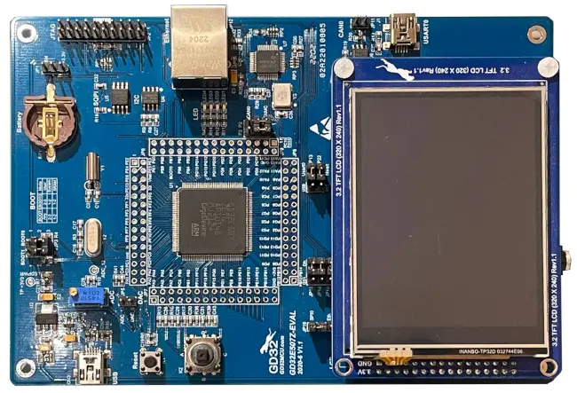

<!-- Copyright 2015-2026 Zephyr Project members and individual contributors. -->
<!-- SPDX-License-Identifier: Apache-2.0 -->
<!-- 中文翻译；编号、导航与译注为本地新增。 -->

<a id="gd32e507z_eval"></a>

# 第5章\_GD32E507Z-EVAL

原文：[官方页面](https://docs.zephyrproject.org/latest/boards/gd/gd32e507z_eval/doc/index.html)。读取日期：2026-10-16；来源摘要见[来源记录](../SOURCES.md)。

开发板概览（Board Overview）

<a id="id1"></a>

[](images/gd32e507z_eval.webp)

GD32E507Z-EVAL

名称（Name）：

`gd32e507z_eval`

厂商（Vendor）：

[兆易创新半导体（GigaDevice Semiconductor）](https://docs.zephyrproject.org/latest/boards/index.html#vendor=gd)

状态（Status）：

维护中（Maintained）

架构（Architecture）：

[arm](https://docs.zephyrproject.org/latest/boards/index.html#arch=arm)

片上系统（SoC）：

[gd32e507](https://docs.zephyrproject.org/latest/boards/index.html#soc=gd32e507)

<a id="board-github-link"></a>

[浏览开发板源码（Browse Board Sources）](https://github.com/zephyrproject-rtos/zephyr/blob/main//boards/gd/gd32e507z_eval/doc/index.rst/../..)<a id="overview"></a>

## 概述（Overview）

GD32E507Z-EVAL是用于GD32E507ZE Cortex-M33高性能微控制器（High Performance MCU）原型开发的硬件平台。

GD32E507ZE采用单核Arm Cortex-M33 MCU，最高180 MHz，支持闪存零等待状态（Zero Wait States）访问，提供512kiB Flash、128kiB SRAM及112个GPIO。

<a id="hardware"></a>

## 硬件（Hardware）


- GD32E507ZET6微控制器（MCU）
- AT24C02C 2 Kb EEPROM
- GD25Q16 16 Mbit SPI及QSPI NOR闪存
- GD9FU1G8F2A 1 Gbit NAND闪存
- Micron MT48LC16M16A2P-6AIT 256 Mbit同步动态随机存储器（SDRAM）
- 4个用户LED
- 1个摇杆，左／右／上／下／中（L/R/U/D/C）
- 1路USART，在J1连接器上连接USB虚拟串口（VCOM）
- 1个接到ADC输入的电位器（POT）
- 耳机接口（Headphone Interface）
- USB全速（FS）接口
- 1路CAN，包含SN65HVD230物理层（PHY）
- 以太网接口（Ethernet Interface）
- 3.2英寸RGB LCD，320 × 240
- 板载GD-Link编程器（Programmer）
- J-Link／JTAG连接器

GD32E507 SoC及GD32E507Z-EVAL开发板更多信息见：


- [兆易创新Cortex-M33高性能SoC网站（High Performance SoC Website）](https://www.gigadevice.com/product/mcu/high-performance-mcus/gd32e5xx-series)
- [GD32E507X数据手册（Datasheet）](https://gd32mcu.com/download/down/document_id/252/path_type/1)
- [GD32E50X用户手册（User Manual）](https://www.gd32mcu.com/download/down/document_id/249/path_type/1)
- [GD32E507Z-EVAL用户手册（User Manual）](https://www.gd32mcu.com/data/documents/evaluationBoard/GD32E50x_Demo_Suites_V1.2.1.rar)

<a id="supported-features"></a>

### 支持的功能（Supported Features）

`gd32e507z_eval`开发板支持下表所列的硬件功能。

片上／板载（On-Chip / On-Board）

功能集成在片上系统（SoC）内／位于开发板上。

2 / 2

分别表示已启用／已禁用的实例数。点击数量标签，可查看开发板或SoC设备树源码（DTS）中该功能的第一个实例。

`vnd,foo`

与此功能匹配的设备树绑定兼容字符串（Compatible String）；点击链接可查看绑定文档。

<a id="gd32e507z_eval-hw-features"></a>

<a id="gd32e507z_eval-gd32e507z_eval/gd32e507-hw-features-section"></a>

#### `gd32e507z_eval/gd32e507`目标（Target）

<a id="gd32e507z_eval-gd32e507z_eval/gd32e507-hw-features-panel"></a>

<a id="gd32e507z_eval-gd32e507z_eval/gd32e507-hw-features-memory"></a>

该开发板目标的片上存储容量：128 KiB RAM、512 KiB Flash。

<a id="gd32e507z_eval-gd32e507z_eval/gd32e507-hw-features-table"></a>

<table>
<tr>
<th>类型（Type）</th>
<th>位置（Location）</th>
<th>说明（Description）</th>
<th>兼容字符串（Compatible）</th>
</tr>
<tr>
<td rowspan="1">中央处理器（CPU）</td>
<td>片上（On-Chip）</td>
<td>ARM Cortex-M33处理器（CPU）（<a href="https://github.com/zephyrproject-rtos/zephyr/blob/main/dts/arm/gd/gd32e50x/gd32e50x.dtsi?plain=1#L22">已启用：1</a>）</td>
<td><a href="../cpu_arm_riscv_binding_reference/P022_arm_cortex-m33.md#std-dtcompatible-arm-cortex-m33"><code>arm,cortex-m33</code></a></td>
</tr>
<tr>
<td rowspan="1">时钟控制（Clock Control）</td>
<td>片上（On-Chip）</td>
<td>兆易创新复位与时钟单元（RCU）时钟控制器（<a href="https://github.com/zephyrproject-rtos/zephyr/blob/main/dts/arm/gd/gd32e50x/gd32e50x.dtsi?plain=1#L45">已启用：1</a>）</td>
<td><a href="../timer_reference/P184_GD32时钟控制绑定.md#dtbinding-gd-gd32-cctl"><code>gd,gd32-cctl</code></a></td>
</tr>
<tr>
<td rowspan="1">计数器（Counter）</td>
<td>片上（On-Chip）</td>
<td>兆易创新GD32定时器（Timer）（<a href="https://github.com/zephyrproject-rtos/zephyr/blob/main/dts/arm/gd/gd32e50x/gd32e50x.dtsi?plain=1#L305">已启用：1</a>；<a href="https://github.com/zephyrproject-rtos/zephyr/blob/main/dts/arm/gd/gd32e50x/gd32e50x.dtsi?plain=1#L323">已禁用：13</a>）</td>
<td><a href="../counter_binding_reference/P018_gd_gd32-timer.md#std-dtcompatible-gd-gd32-timer"><code>gd,gd32-timer</code></a></td>
</tr>
<tr>
<td rowspan="1">数模转换器（DAC）</td>
<td>片上（On-Chip）</td>
<td>兆易创新GD32系列数模转换器（DAC）模块（<a href="https://github.com/zephyrproject-rtos/zephyr/blob/main/dts/arm/gd/gd32e50x/gd32e50x.dtsi?plain=1#L143">已禁用：1</a>）</td>
<td><a href="../hardware/P761_GD32数模转换器绑定.md#dtbinding-gd-gd32-dac"><code>gd,gd32-dac</code></a></td>
</tr>
<tr>
<td rowspan="1">直接存储器访问（DMA）</td>
<td>片上（On-Chip）</td>
<td>GD32直接存储器访问（DMA）控制器（<a href="https://github.com/zephyrproject-rtos/zephyr/blob/main/dts/arm/gd/gd32e50x/gd32e50x.dtsi?plain=1#L415">已禁用：2</a>）</td>
<td><a href="../dma_binding_reference/P017_gd_gd32-dma.md#std-dtcompatible-gd-gd32-dma"><code>gd,gd32-dma</code></a></td>
</tr>
<tr>
<td rowspan="1">闪存控制器（Flash Controller）</td>
<td>片上（On-Chip）</td>
<td>GD32闪存控制器（FMC）有三种类型（<a href="https://github.com/zephyrproject-rtos/zephyr/blob/main/dts/arm/gd/gd32e50x/gd32e50x.dtsi?plain=1#L58">已启用：1</a>）</td>
<td><a href="../flash_adi_microchip_nordic_binding_reference/P013_gd_gd32-flash-controller.md#std-dtcompatible-gd-gd32-flash-controller"><code>gd,gd32-flash-controller</code></a></td>
</tr>
<tr>
<td rowspan="1">通用输入输出与接插件（GPIO &amp; Headers）</td>
<td>片上（On-Chip）</td>
<td>GD32通用输入输出（GPIO）（<a href="https://github.com/zephyrproject-rtos/zephyr/blob/main/dts/arm/gd/gd32e50x/gd32e50x.dtsi?plain=1#L234">已启用：4</a>；<a href="https://github.com/zephyrproject-rtos/zephyr/blob/main/dts/arm/gd/gd32e50x/gd32e50x.dtsi?plain=1#L244">已禁用：3</a>）</td>
<td><a href="../gpio_connectors_bflb_esp_binding_reference/P027_gd_gd32-gpio.md#std-dtcompatible-gd-gd32-gpio"><code>gd,gd32-gpio</code></a></td>
</tr>
<tr>
<td rowspan="1">集成电路间总线（I2C）</td>
<td>片上（On-Chip）</td>
<td>兆易创新GD32 I2C（<a href="https://github.com/zephyrproject-rtos/zephyr/blob/main/dts/arm/gd/gd32e50x/gd32e50x.dtsi?plain=1#L153">已禁用：3</a>）</td>
<td><a href="../i2c_adi_atmel_esp_binding_reference/P020_gd_gd32-i2c.md#std-dtcompatible-gd-gd32-i2c"><code>gd,gd32-i2c</code></a></td>
</tr>
<tr>
<td rowspan="1">输入（Input）</td>
<td>板载（On-Board）</td>
<td>一组绑定到 GPIO 的输入按键（GPIO-Bound Input Keys）（<a href="https://github.com/zephyrproject-rtos/zephyr/blob/main/boards/gd/gd32e507z_eval/gd32e507z_eval.dts?plain=1#L43">已启用：1</a>）</td>
<td><a href="../hardware/P563_GPIO按键绑定.md#std-dtcompatible-gpio-keys"><code>gpio-keys</code></a></td>
</tr>
<tr>
<td rowspan="2">中断控制器（Interrupt Controller）</td>
<td>片上（On-Chip）</td>
<td>ARMv8-M嵌套向量中断控制器（NVIC / Nested Vectored Interrupt Controller）（<a href="https://github.com/zephyrproject-rtos/zephyr/blob/main/dts/arm/armv8-m.dtsi?plain=1#L13">已启用：1</a>）</td>
<td><a href="../arm_interrupt_timer_binding_reference/P003_ARMv8_M_NVIC.md#std-dtcompatible-arm-v8m-nvic"><code>arm,v8m-nvic</code></a></td>
</tr>
<tr>
<td>片上（On-Chip）</td>
<td>兆易创新外部中断控制器（External Interrupt Controller）（<a href="https://github.com/zephyrproject-rtos/zephyr/blob/main/dts/arm/gd/gd32e50x/gd32e50x.dtsi?plain=1#L192">已启用：1</a>）</td>
<td><a href="../mcu_external_interrupt_binding_reference/P007_gd_gd32-exti.md#std-dtcompatible-gd-gd32-exti"><code>gd,gd32-exti</code></a></td>
</tr>
<tr>
<td rowspan="2">发光二极管（LED）</td>
<td>板载（On-Board）</td>
<td>一组由 GPIO 控制的 LED（GPIO-Controlled LEDs）（<a href="https://github.com/zephyrproject-rtos/zephyr/blob/main/boards/gd/gd32e507z_eval/gd32e507z_eval.dts?plain=1#L23">已启用：1</a>）</td>
<td><a href="../hardware/P564_GPIO指示灯绑定.md#dtbinding-gpio-leds"><code>gpio-leds</code></a></td>
</tr>
<tr>
<td>板载（On-Board）</td>
<td>一组由脉宽调制（PWM）控制的LED（<a href="https://github.com/zephyrproject-rtos/zephyr/blob/main/boards/gd/gd32e507z_eval/gd32e507z_eval.dts?plain=1#L77">已启用：1</a>）</td>
<td><a href="../hardware/P565_PWM指示灯绑定.md#dtbinding-pwm-leds"><code>pwm-leds</code></a></td>
</tr>
<tr>
<td rowspan="1">多功能设备（Multi-Function Device）</td>
<td>片上（On-Chip）</td>
<td>兆易创新复位与时钟单元（RCU）（<a href="https://github.com/zephyrproject-rtos/zephyr/blob/main/dts/arm/gd/gd32e50x/gd32e50x.dtsi?plain=1#L40">已启用：1</a>）</td>
<td><a href="../hardware/P705_GD32复位与时钟单元绑定.md#dtbinding-gd-gd32-rcu"><code>gd,gd32-rcu</code></a></td>
</tr>
<tr>
<td rowspan="1">内存管理单元／内存保护单元（MMU / MPU）</td>
<td>片上（On-Chip）</td>
<td>ARMv8-M存储器保护单元（MPU / Memory Protection Unit）（<a href="https://github.com/zephyrproject-rtos/zephyr/blob/main/dts/arm/gd/gd32e50x/gd32e50x.dtsi?plain=1#L83">已启用：1</a>）</td>
<td><a href="../memory_protection_binding_reference/P007_arm_armv8m-mpu.md#std-dtcompatible-arm-armv8m-mpu"><code>arm,armv8m-mpu</code></a></td>
</tr>
<tr>
<td rowspan="1">存储技术设备（MTD）</td>
<td>片上（On-Chip）</td>
<td>GD32 FMC v1的闪存绑定（<a href="https://github.com/zephyrproject-rtos/zephyr/blob/main/dts/arm/gd/gd32e50x/gd32e50x.dtsi?plain=1#L66">已启用：1</a>）</td>
<td><a href="../mtd_atmel_bouffalo_binding_reference/P016_gd_gd32-nv-flash-v1.md#std-dtcompatible-gd-gd32-nv-flash-v1"><code>gd,gd32-nv-flash-v1</code></a></td>
</tr>
<tr>
<td rowspan="2">引脚控制（Pin Control）</td>
<td>片上（On-Chip）</td>
<td>GD32复用功能输入输出（AFIO）（<a href="https://github.com/zephyrproject-rtos/zephyr/blob/main/dts/arm/gd/gd32e50x/gd32e50x.dtsi?plain=1#L205">已启用：1</a>）</td>
<td><a href="../pinctrl_adi_ambiq_arm_binding_reference/P023_gd_gd32-afio.md#std-dtcompatible-gd-gd32-afio"><code>gd,gd32-afio</code></a></td>
</tr>
<tr>
<td>片上（On-Chip）</td>
<td>GD32引脚控制器，AFIO模型（<a href="https://github.com/zephyrproject-rtos/zephyr/blob/main/dts/arm/gd/gd32e50x/gd32e50x.dtsi?plain=1#L227">已启用：1</a>）</td>
<td><a href="../pinctrl_adi_ambiq_arm_binding_reference/P025_gd_gd32-pinctrl-afio.md#std-dtcompatible-gd-gd32-pinctrl-afio"><code>gd,gd32-pinctrl-afio</code></a></td>
</tr>
<tr>
<td rowspan="1">脉宽调制（PWM）</td>
<td>片上（On-Chip）</td>
<td>兆易创新GD32脉宽调制（PWM）（<a href="https://github.com/zephyrproject-rtos/zephyr/blob/main/dts/arm/gd/gd32e50x/gd32e50x.dtsi?plain=1#L316">已启用：1</a>；<a href="https://github.com/zephyrproject-rtos/zephyr/blob/main/dts/arm/gd/gd32e50x/gd32e50x.dtsi?plain=1#L334">已禁用：11</a>）</td>
<td><a href="../pwm_adi_esp_infineon_binding_reference/P018_gd_gd32-pwm.md#std-dtcompatible-gd-gd32-pwm"><code>gd,gd32-pwm</code></a></td>
</tr>
<tr>
<td rowspan="1">复位控制器（Reset Controller）</td>
<td>片上（On-Chip）</td>
<td>兆易创新RCU复位控制器（<a href="https://github.com/zephyrproject-rtos/zephyr/blob/main/dts/arm/gd/gd32e50x/gd32e50x.dtsi?plain=1#L51">已启用：1</a>）</td>
<td><a href="../reset_controller_binding_reference/P003_gd_gd32-rctl.md#std-dtcompatible-gd-gd32-rctl"><code>gd,gd32-rctl</code></a></td>
</tr>
<tr>
<td rowspan="1">串行控制器（Serial Controller）</td>
<td>片上（On-Chip）</td>
<td>兆易创新通用同步异步收发器（USART）（<a href="https://github.com/zephyrproject-rtos/zephyr/blob/main/dts/arm/gd/gd32e50x/gd32e50x.dtsi?plain=1#L88">已启用：1</a>；<a href="https://github.com/zephyrproject-rtos/zephyr/blob/main/dts/arm/gd/gd32e50x/gd32e50x.dtsi?plain=1#L97">已禁用：5</a>）</td>
<td><a href="../uart_espressif_infineon_microchip_binding_reference/P006_gd_gd32-usart.md#std-dtcompatible-gd-gd32-usart"><code>gd,gd32-usart</code></a></td>
</tr>
<tr>
<td rowspan="1">定时器（Timer）</td>
<td>片上（On-Chip）</td>
<td>ARMv8-M系统节拍（System Tick）（<a href="https://github.com/zephyrproject-rtos/zephyr/blob/main/dts/arm/armv8-m.dtsi?plain=1#L21">已启用：1</a>）</td>
<td><a href="../arm_interrupt_timer_binding_reference/P007_ARMv8_M_SysTick.md#std-dtcompatible-arm-armv8m-systick"><code>arm,armv8m-systick</code></a></td>
</tr>
<tr>
<td rowspan="2">看门狗（Watchdog）</td>
<td>片上（On-Chip）</td>
<td>GD32独立看门狗定时器（Free Watchdog Timer）（<a href="https://github.com/zephyrproject-rtos/zephyr/blob/main/dts/arm/gd/gd32e50x/gd32e50x.dtsi?plain=1#L212">已禁用：1</a>）</td>
<td><a href="../watchdog_binding_reference/P015_gd_gd32-fwdgt.md#std-dtcompatible-gd-gd32-fwdgt"><code>gd,gd32-fwdgt</code></a></td>
</tr>
<tr>
<td>片上（On-Chip）</td>
<td>GD32窗口看门狗定时器（Window Watchdog Timer）（<a href="https://github.com/zephyrproject-rtos/zephyr/blob/main/dts/arm/gd/gd32e50x/gd32e50x.dtsi?plain=1#L218">已禁用：1</a>）</td>
<td><a href="../watchdog_binding_reference/P016_gd_gd32-wwdgt.md#std-dtcompatible-gd-gd32-wwdgt"><code>gd,gd32-wwdgt</code></a></td>
</tr>
</table>

<a id="serial-port"></a>

### 串口（Serial Port）

GD32E507Z-EVAL有一个串行通信端口，默认USART0的TX接PA9、RX接PA10，通过J1 USB连接器提供虚拟串口。

<a id="programming-and-debugging"></a>

## 烧录与调试（Programming and Debugging）

`gd32e507z_eval`开发板支持下表所列的运行工具（Runners）及相关west命令。

<table>
<tr>
<th></th>
<th>烧录（flash）</th>
<th>调试（debug）</th>
<th>连接调试会话（attach）</th>
<th>实时传输（rtt）</th>
<th>复位（reset）</th>
<th>调试服务器（debugserver）</th>
</tr>
<tr>
<td><a href="https://docs.zephyrproject.org/latest/develop/flash_debug/host-tools.html#runner-jlink">jlink</a></td>
<td>✅</td>
<td>✅</td>
<td>✅</td>
<td>✅</td>
<td>✅</td>
<td>✅</td>
</tr>
<tr>
<td><a href="https://docs.zephyrproject.org/latest/develop/flash_debug/host-tools.html#runner-pyocd">pyocd</a></td>
<td>✅（默认 / default）</td>
<td>✅（默认 / default）</td>
<td>✅</td>
<td>✅</td>
<td>✅</td>
<td>✅</td>
</tr>
</table>

编程前，按以下要求设置启动跳线：


- JP3／4：均选择2–3位置，从用户存储器启动

<a id="using-gd-link-or-j-link"></a>

### 使用GD-Link或J-Link

开发板带有嵌入式GD-Link编程器，安装所需CMSIS软件包（CMSIS-Pack）后，可配合pyOCD使用：

```text
pyocd pack install gd32e507ze
```

也可通过JP2排针引出的JTAG接口使用J-Link编程。


1. 构建Zephyr内核和[Hello World](../getting_started/P005_HelloWorld示例.md#hello_world)示例应用：

  ```text
  west build -b gd32e507z_eval samples/hello_world
  ```
2. 启动串口终端监听输出。在Linux下，设备名通常类似`/dev/ttyUSB0`。例如：

  ```text
  minicom -D /dev/ttyUSB0 -o
  ```

  `-o`选项让`minicom`不发送调制解调器初始化字符串（Modem Initialization String）。连接参数应配置如下：

  > - 速率（Speed）：115200波特率
  > - 数据位（Data）：8位
  > - 奇偶校验（Parity）：无（None）
  > - 停止位（Stop Bits）：1位
3. 烧录镜像：

  ```text
  west build -b gd32e507z_eval samples/hello_world
  west flash
  ```

  终端应显示“Hello World! gd32e507z_eval”。
4. 调试镜像的方法：

  ```text
  west build -b gd32e507z_eval samples/hello_world
  west debug
  ```

---

[上一章](P004_GD32E507V-START.md) · [返回大纲](大纲.md) · [全站翻译进度](../PROGRESS.md) · [下一章](P006_GD32F350R-EVAL.md)
