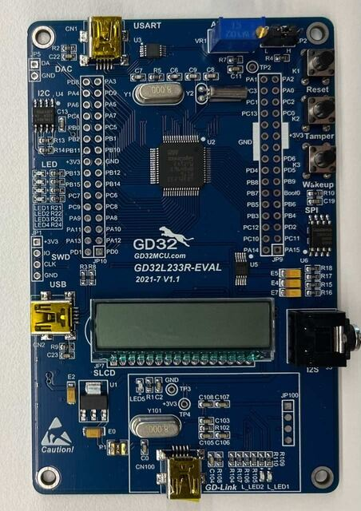

<!-- Copyright 2015-2026 Zephyr Project members and individual contributors. -->
<!-- SPDX-License-Identifier: Apache-2.0 -->
<!-- 中文翻译；编号、导航与译注为本地新增。 -->

<a id="gd32l233r_eval"></a>

# 第13章\_GD32L233R-EVA

原文：[官方页面](https://docs.zephyrproject.org/latest/boards/gd/gd32l233r_eval/doc/index.html)。读取日期：2026-10-16；来源摘要见[来源记录](../SOURCES.md)。

开发板概览（Board Overview）

<a id="id1"></a>

[](images/gd32l233r_eval.jpg)

GD32L233R-EVA

名称（Name）：

`gd32l233r_eval`

厂商（Vendor）：

[兆易创新半导体（GigaDevice Semiconductor）](https://docs.zephyrproject.org/latest/boards/index.html#vendor=gd)

状态（Status）：

维护中（Maintained）

架构（Architecture）：

[arm](https://docs.zephyrproject.org/latest/boards/index.html#arch=arm)

片上系统（SoC）：

[gd32l233](https://docs.zephyrproject.org/latest/boards/index.html#soc=gd32l233)

<a id="board-github-link"></a>

[浏览开发板源码（Browse Board Sources）](https://github.com/zephyrproject-rtos/zephyr/blob/main//boards/gd/gd32l233r_eval/doc/index.rst/../..)<a id="overview"></a>

## 概述（Overview）

GD32L233R-EVAL是用于设计和调试兆易创新GD32L233 Cortex-M23低功耗微控制器（Low Power MCU）的硬件平台。

原文此处称GD32RCT6具有单核Arm Cortex-M4F MCU，最高64 MHz、闪存零等待状态（Zero Wait States）访问，提供256 kB Flash、32 kB SRAM及59个GPIO。此型号和内核表述与前文不一致。

<a id="hardware"></a>

## 硬件（Hardware）


- GD32L233RCT6微控制器（MCU）
- AT24C02C 2 Kb EEPROM
- 4个用户LED
- 2个用户按键
- 1路USART，通过Mini-USB连接
- 1个接到ADC输入的电位器（POT）
- 耳机接口（Headphone Interface）
- 段码液晶显示屏（SLCD）
- 板载GD-Link编程器（Programmer）
- J-Link／SWD连接器

GD32L233 SoC及GD32L233R-EVAL开发板更多信息见：


- [兆易创新Cortex-M23低功耗SoC网站（Low Power SoC Website）](https://www.gigadevice.com/products/microcontrollers/gd32/arm-cortex-m23/low-power-line/)
- [GD32L233xx数据手册（Datasheet）](https://gd32mcu.com/download/down/document_id/289/path_type/1)
- [GD32L23x用户手册（User Manual）](https://gd32mcu.com/download/down/document_id/293/path_type/1)
- [GD32L23x演示套件（Demo Suites）](https://gd32mcu.com/download/down/document_id/292/path_type/1)

<a id="supported-features"></a>

### 支持的功能（Supported Features）

`gd32l233r_eval`开发板支持下表所列的硬件功能。

片上／板载（On-Chip / On-Board）

功能集成在片上系统（SoC）内／位于开发板上。

2 / 2

分别表示已启用／已禁用的实例数。点击数量标签，可查看开发板或SoC设备树源码（DTS）中该功能的第一个实例。

`vnd,foo`

与此功能匹配的设备树绑定兼容字符串（Compatible String）；点击链接可查看绑定文档。

<a id="gd32l233r_eval-hw-features"></a>

<a id="gd32l233r_eval-gd32l233r_eval/gd32l233-hw-features-section"></a>

#### `gd32l233r_eval/gd32l233`目标（Target）

<a id="gd32l233r_eval-gd32l233r_eval/gd32l233-hw-features-panel"></a>

<a id="gd32l233r_eval-gd32l233r_eval/gd32l233-hw-features-memory"></a>

该开发板目标的片上存储容量：32 KiB RAM、256 KiB Flash。

<a id="gd32l233r_eval-gd32l233r_eval/gd32l233-hw-features-table"></a>

<table>
<tr>
<th>类型（Type）</th>
<th>位置（Location）</th>
<th>说明（Description）</th>
<th>兼容字符串（Compatible）</th>
</tr>
<tr>
<td rowspan="1">中央处理器（CPU）</td>
<td>片上（On-Chip）</td>
<td>Arm Cortex-M23 CPU（<a href="https://github.com/zephyrproject-rtos/zephyr/blob/main/dts/arm/gd/gd32l23x/gd32l23x.dtsi?plain=1#L21">已启用：1</a>）</td>
<td><a href="../cpu_arm_riscv_binding_reference/P020_arm_cortex-m23.md#std-dtcompatible-arm-cortex-m23"><code>arm,cortex-m23</code></a></td>
</tr>
<tr>
<td rowspan="1">模数转换器（ADC）</td>
<td>片上（On-Chip）</td>
<td>兆易创新GD32模数转换器（ADC）（<a href="https://github.com/zephyrproject-rtos/zephyr/blob/main/dts/arm/gd/gd32l23x/gd32l23x.dtsi?plain=1#L105">已启用：1</a>）</td>
<td><a href="../hardware/P844_GD32模数转换器绑定.md#dtbinding-gd-gd32-adc"><code>gd,gd32-adc</code></a></td>
</tr>
<tr>
<td rowspan="1">时钟控制（Clock Control）</td>
<td>片上（On-Chip）</td>
<td>兆易创新复位与时钟单元（RCU）时钟控制器（<a href="https://github.com/zephyrproject-rtos/zephyr/blob/main/dts/arm/gd/gd32l23x/gd32l23x.dtsi?plain=1#L43">已启用：1</a>）</td>
<td><a href="../timer_reference/P184_GD32时钟控制绑定.md#dtbinding-gd-gd32-cctl"><code>gd,gd32-cctl</code></a></td>
</tr>
<tr>
<td rowspan="1">闪存控制器（Flash Controller）</td>
<td>片上（On-Chip）</td>
<td>GD32闪存控制器（FMC）有三种类型（<a href="https://github.com/zephyrproject-rtos/zephyr/blob/main/dts/arm/gd/gd32l23x/gd32l23x.dtsi?plain=1#L62">已启用：1</a>）</td>
<td><a href="../flash_adi_microchip_nordic_binding_reference/P013_gd_gd32-flash-controller.md#std-dtcompatible-gd-gd32-flash-controller"><code>gd,gd32-flash-controller</code></a></td>
</tr>
<tr>
<td rowspan="1">通用输入输出与接插件（GPIO &amp; Headers）</td>
<td>片上（On-Chip）</td>
<td>GD32通用输入输出（GPIO）（<a href="https://github.com/zephyrproject-rtos/zephyr/blob/main/dts/arm/gd/gd32l23x/gd32l23x.dtsi?plain=1#L136">已启用：5</a>）</td>
<td><a href="../gpio_connectors_bflb_esp_binding_reference/P027_gd_gd32-gpio.md#std-dtcompatible-gd-gd32-gpio"><code>gd,gd32-gpio</code></a></td>
</tr>
<tr>
<td rowspan="1">输入（Input）</td>
<td>板载（On-Board）</td>
<td>一组绑定到 GPIO 的输入按键（GPIO-Bound Input Keys）（<a href="https://github.com/zephyrproject-rtos/zephyr/blob/main/boards/gd/gd32l233r_eval/gd32l233r_eval.dts?plain=1#L48">已启用：1</a>）</td>
<td><a href="../hardware/P563_GPIO按键绑定.md#std-dtcompatible-gpio-keys"><code>gpio-keys</code></a></td>
</tr>
<tr>
<td rowspan="2">中断控制器（Interrupt Controller）</td>
<td>片上（On-Chip）</td>
<td>ARMv8-M嵌套向量中断控制器（NVIC / Nested Vectored Interrupt Controller）（<a href="https://github.com/zephyrproject-rtos/zephyr/blob/main/dts/arm/armv8-m.dtsi?plain=1#L13">已启用：1</a>）</td>
<td><a href="../arm_interrupt_timer_binding_reference/P003_ARMv8_M_NVIC.md#std-dtcompatible-arm-v8m-nvic"><code>arm,v8m-nvic</code></a></td>
</tr>
<tr>
<td>片上（On-Chip）</td>
<td>兆易创新外部中断控制器（External Interrupt Controller）（<a href="https://github.com/zephyrproject-rtos/zephyr/blob/main/dts/arm/gd/gd32l23x/gd32l23x.dtsi?plain=1#L116">已启用：1</a>）</td>
<td><a href="../mcu_external_interrupt_binding_reference/P007_gd_gd32-exti.md#std-dtcompatible-gd-gd32-exti"><code>gd,gd32-exti</code></a></td>
</tr>
<tr>
<td rowspan="1">发光二极管（LED）</td>
<td>板载（On-Board）</td>
<td>一组由 GPIO 控制的 LED（GPIO-Controlled LEDs）（<a href="https://github.com/zephyrproject-rtos/zephyr/blob/main/boards/gd/gd32l233r_eval/gd32l233r_eval.dts?plain=1#L24">已启用：1</a>）</td>
<td><a href="../hardware/P564_GPIO指示灯绑定.md#dtbinding-gpio-leds"><code>gpio-leds</code></a></td>
</tr>
<tr>
<td rowspan="1">多功能设备（Multi-Function Device）</td>
<td>片上（On-Chip）</td>
<td>兆易创新复位与时钟单元（RCU）（<a href="https://github.com/zephyrproject-rtos/zephyr/blob/main/dts/arm/gd/gd32l23x/gd32l23x.dtsi?plain=1#L38">已启用：1</a>）</td>
<td><a href="../hardware/P705_GD32复位与时钟单元绑定.md#dtbinding-gd-gd32-rcu"><code>gd,gd32-rcu</code></a></td>
</tr>
<tr>
<td rowspan="1">其他绑定（Miscellaneous）</td>
<td>片上（On-Chip）</td>
<td>兆易创新GD32系统配置寄存器（System Configuration Registers）（<a href="https://github.com/zephyrproject-rtos/zephyr/blob/main/dts/arm/gd/gd32l23x/gd32l23x.dtsi?plain=1#L56">已启用：1</a>）</td>
<td><a href="../misc_adi_nordic_binding_reference/P009_gd_gd32-syscfg.md#std-dtcompatible-gd-gd32-syscfg"><code>gd,gd32-syscfg</code></a></td>
</tr>
<tr>
<td rowspan="1">存储技术设备（MTD）</td>
<td>片上（On-Chip）</td>
<td>GD32 FMC v1的闪存绑定（<a href="https://github.com/zephyrproject-rtos/zephyr/blob/main/dts/arm/gd/gd32l23x/gd32l23x.dtsi?plain=1#L70">已启用：1</a>）</td>
<td><a href="../mtd_atmel_bouffalo_binding_reference/P016_gd_gd32-nv-flash-v1.md#std-dtcompatible-gd-gd32-nv-flash-v1"><code>gd,gd32-nv-flash-v1</code></a></td>
</tr>
<tr>
<td rowspan="1">引脚控制（Pin Control）</td>
<td>片上（On-Chip）</td>
<td>GD32引脚控制器，复用功能模型（AF Model）（<a href="https://github.com/zephyrproject-rtos/zephyr/blob/main/dts/arm/gd/gd32l23x/gd32l23x.dtsi?plain=1#L129">已启用：1</a>）</td>
<td><a href="../pinctrl_adi_ambiq_arm_binding_reference/P024_gd_gd32-pinctrl-af.md#std-dtcompatible-gd-gd32-pinctrl-af"><code>gd,gd32-pinctrl-af</code></a></td>
</tr>
<tr>
<td rowspan="1">复位控制器（Reset Controller）</td>
<td>片上（On-Chip）</td>
<td>兆易创新RCU复位控制器（<a href="https://github.com/zephyrproject-rtos/zephyr/blob/main/dts/arm/gd/gd32l23x/gd32l23x.dtsi?plain=1#L49">已启用：1</a>）</td>
<td><a href="../reset_controller_binding_reference/P003_gd_gd32-rctl.md#std-dtcompatible-gd-gd32-rctl"><code>gd,gd32-rctl</code></a></td>
</tr>
<tr>
<td rowspan="1">串行控制器（Serial Controller）</td>
<td>片上（On-Chip）</td>
<td>兆易创新通用同步异步收发器（USART）（<a href="https://github.com/zephyrproject-rtos/zephyr/blob/main/dts/arm/gd/gd32l23x/gd32l23x.dtsi?plain=1#L87">已启用：1</a>；<a href="https://github.com/zephyrproject-rtos/zephyr/blob/main/dts/arm/gd/gd32l23x/gd32l23x.dtsi?plain=1#L78">已禁用：3</a>）</td>
<td><a href="../uart_espressif_infineon_microchip_binding_reference/P006_gd_gd32-usart.md#std-dtcompatible-gd-gd32-usart"><code>gd,gd32-usart</code></a></td>
</tr>
<tr>
<td rowspan="1">静态随机存储器（SRAM）</td>
<td>片上（On-Chip）</td>
<td>通用片上静态随机存储器（SRAM）（<a href="https://github.com/zephyrproject-rtos/zephyr/blob/main/dts/arm/gd/gd32l23x/gd32l233rc.dtsi?plain=1#L12">已启用：1</a>）</td>
<td><a href="../hardware/P567_内存映射SRAM绑定.md#dtbinding-mmio-sram"><code>mmio-sram</code></a></td>
</tr>
<tr>
<td rowspan="1">定时器（Timer）</td>
<td>片上（On-Chip）</td>
<td>ARMv8-M系统节拍（System Tick）（<a href="https://github.com/zephyrproject-rtos/zephyr/blob/main/dts/arm/armv8-m.dtsi?plain=1#L21">已启用：1</a>）</td>
<td><a href="../arm_interrupt_timer_binding_reference/P007_ARMv8_M_SysTick.md#std-dtcompatible-arm-armv8m-systick"><code>arm,armv8m-systick</code></a></td>
</tr>
</table>

<a id="serial-port"></a>

### 串口（Serial Port）

GD32L233R-EVAL有一个串行通信端口，默认USART1的TX接PA2、RX接PA3，通过Mini-USB连接到CH04E串口连接器。

<a id="programming-and-debugging"></a>

## 烧录与调试（Programming and Debugging）

`gd32l233r_eval`开发板支持下表所列的运行工具（Runners）及相关west命令。

<table>
<tr>
<th></th>
<th>烧录（flash）</th>
<th>调试（debug）</th>
<th>连接调试会话（attach）</th>
<th>实时传输（rtt）</th>
<th>复位（reset）</th>
<th>调试服务器（debugserver）</th>
</tr>
<tr>
<td><a href="https://docs.zephyrproject.org/latest/develop/flash_debug/host-tools.html#runner-jlink">jlink</a></td>
<td>✅（默认 / default）</td>
<td>✅（默认 / default）</td>
<td>✅</td>
<td>✅</td>
<td>✅</td>
<td>✅</td>
</tr>
</table>

<a id="using-j-link"></a>

### 使用J-Link

GD32L233R-EVAL带有板载GD-Link编程器／调试器，可通过USB烧录和调试。另有SWD排针，可配合Segger J-Link等工具使用，J-Link需最新版本。


1. 构建Zephyr内核和[Hello World](../getting_started/P005_HelloWorld示例.md#hello_world)示例应用：

  ```text
  west build -b gd32l233r_eval samples/hello_world
  ```
2. 启动串口终端监听输出。在Linux下，设备名通常类似`/dev/ttyUSB0`。例如：

  ```text
  minicom -D /dev/ttyUSB0 -o
  ```

  `-o`选项让`minicom`不发送调制解调器初始化字符串（Modem Initialization String）。连接参数应配置如下：

  > - 速率（Speed）：115200波特率
  > - 数据位（Data）：8位
  > - 奇偶校验（Parity）：无（None）
  > - 停止位（Stop Bits）：1位
3. 烧录镜像：

  ```text
  west build -b gd32l233r_eval samples/hello_world
  west flash
  ```

  终端应显示“Hello World! gd32l233r_eval”。
4. 调试镜像的方法：

  ```text
  west build -b gd32l233r_eval samples/hello_world
  west debug
  ```

## 译注

概述为GD32L233 Cortex-M23，而详细段写GD32RCT6 Cortex-M4F；串口桥写CH04E。译文明确这些原文差异，保留数值、型号及命令。

---

[上一章](P012_GD32F470I-EVAL.md) · [返回大纲](大纲.md) · [全站翻译进度](../PROGRESS.md) · [下一章](P014_GD32VF103C-STARTER.md)
