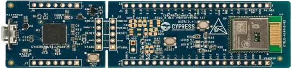

<!-- Copyright 2015-2026 Zephyr Project members and individual contributors. -->
<!-- SPDX-License-Identifier: Apache-2.0 -->
<!-- 中文翻译；编号、导航与译注为本地新增。 -->

<a id="cy8cproto_063_ble"></a>

# 第8章\_CY8CPROTO-063-BLE

原文：[官方页面](https://docs.zephyrproject.org/latest/boards/infineon/cy8cproto_063_ble/doc/index.html)。读取日期：2026-10-16；来源摘要见[来源记录](../SOURCES.md)。

开发板概览（Board Overview）

<a id="id1"></a>

[](images/cy8cproto_063_ble.webp)

CY8CPROTO-063-BLE

名称（Name）：

`cy8cproto_063_ble`

厂商（Vendor）：

[英飞凌科技（Infineon Technologies）](https://docs.zephyrproject.org/latest/boards/index.html#vendor=infineon)

状态（Status）：

维护中（Maintained）

架构（Architecture）：

[arm](https://docs.zephyrproject.org/latest/boards/index.html#arch=arm)

片上系统（SoC）：

[cyble_416045_02](https://docs.zephyrproject.org/latest/boards/index.html#soc=cyble_416045_02)

<a id="board-github-link"></a>

[浏览开发板源码（Browse Board Sources）](https://github.com/zephyrproject-rtos/zephyr/blob/main//boards/infineon/cy8cproto_063_ble/doc/index.rst/../..)<a id="overview"></a>

## 概述（Overview）

[CY8CPROTO-063-BLE](https://www.infineon.com/cms/en/product/evaluation-boards/cy8cproto-063-ble/)是PSOC 6 BLE原型开发套件，采用CYBLE-416045-02 EZ-BLE模块，包含PSOC 63双核微控制器（Arm Cortex-M4及Cortex-M0+），集成BLE 5.0及模块板载走线天线（Trace Antenna），面向低功耗蓝牙应用。

主要特性包括最多36个GPIO、CAPSENSE触摸感应、PDM-PCM数字麦克风接口、Quad-SPI、ADC及比较器。

套件采用可折断分离式结构，用户可将各部分拆开独立使用。

开发板集成通过USB Micro-B连接的[KitProg3](https://github.com/Infineon/KitProg3)编程器／调试器。

<a id="hardware"></a>

## 硬件（Hardware）


- 片上系统（SoC）：带低功耗蓝牙（BLE）的PSOC 63，使用CYBLE-416045-02 EZ-BLE模块
- CPU：Arm Cortex-M4及Cortex-M0+双核
- 无线连接：BLE 5.0，模块板载走线天线
- 通用输入输出（GPIO）：最多36个
- 触摸：CAPSENSE
- 外设：PDM-PCM、Quad-SPI、ADC及比较器
- 调试：板载KitProg3，提供SWD及UART桥接
- 电源：USB供电，工作电压3.3 V
- 连接器：USB Micro-B，用于编程和供电
- 外形结构：可折断分离（Snap-Away）

PSOC™ 63及CY8CPROTO-063-BLE更多信息见：


- [CY8CPROTO-063-BLE开发板网站](https://www.infineon.com/cms/en/product/evaluation-boards/cy8cproto-063-ble/)

<a id="kit-contents"></a>

### 套件内容（Kit Contents）


- PSOC 6 BLE原型开发板
- USB Type-A转Micro-B线缆
- 快速入门指南（Quick Start Guide）

<a id="supported-features"></a>

### 支持的功能（Supported Features）

`cy8cproto_063_ble`开发板支持下表所列的硬件功能。

片上／板载（On-Chip / On-Board）

功能集成在片上系统（SoC）内／位于开发板上。

2 / 2

分别表示已启用／已禁用的实例数。点击数量标签，可查看开发板或SoC设备树源码（DTS）中该功能的第一个实例。

`vnd,foo`

与此功能匹配的设备树绑定兼容字符串（Compatible String）；点击链接可查看绑定文档。

<a id="cy8cproto_063_ble-hw-features"></a>

<a id="cy8cproto_063_ble-cy8cproto_063_ble/cyble_416045_02-hw-features-section"></a>

#### `cy8cproto_063_ble/cyble_416045_02`目标（Target）

<a id="cy8cproto_063_ble-cy8cproto_063_ble/cyble_416045_02-hw-features-panel"></a>

<a id="cy8cproto_063_ble-cy8cproto_063_ble/cyble_416045_02-hw-features-memory"></a>

该开发板目标的片上存储容量：288 KiB RAM、1 MiB Flash。

<a id="cy8cproto_063_ble-cy8cproto_063_ble/cyble_416045_02-hw-features-table"></a>

<table>
<tr>
<th>类型（Type）</th>
<th>位置（Location）</th>
<th>说明（Description）</th>
<th>兼容字符串（Compatible）</th>
</tr>
<tr>
<td rowspan="2">中央处理器（CPU）</td>
<td>片上（On-Chip）</td>
<td>ARM Cortex-M0+处理器（CPU）（<a href="https://github.com/zephyrproject-rtos/zephyr/blob/main/dts/arm/infineon/cat1a/psoc6_01/psoc6_01.dtsi?plain=1#L17">已启用：1</a>）</td>
<td><a href="../cpu_arm_riscv_binding_reference/P017_arm_cortex-m0+.md#std-dtcompatible-arm-cortex-m0"><code>arm,cortex-m0+</code></a></td>
</tr>
<tr>
<td>片上（On-Chip）</td>
<td>ARM Cortex-M4F 处理器（CPU）（<a href="https://github.com/zephyrproject-rtos/zephyr/blob/main/dts/arm/infineon/cat1a/psoc6_01/psoc6_01.dtsi?plain=1#L23">已启用：1</a>）</td>
<td><a href="../cpu_arm_riscv_binding_reference/P025_arm_cortex-m4f.md#std-dtcompatible-arm-cortex-m4f"><code>arm,cortex-m4f</code></a></td>
</tr>
<tr>
<td rowspan="1">模数转换器（ADC）</td>
<td>片上（On-Chip）</td>
<td>英飞凌Cat1 ADC，每个Cat1 ADC组对应一个Zephyr设备（<a href="https://github.com/zephyrproject-rtos/zephyr/blob/main/dts/arm/infineon/cat1a/psoc6_01/psoc6_01.dtsi?plain=1#L228">已禁用：1</a>）</td>
<td><a href="../hardware/P877_Infineon模数转换器绑定.md#dtbinding-infineon-adc"><code>infineon,adc</code></a></td>
</tr>
<tr>
<td rowspan="1">ARM 架构（ARM Architecture）</td>
<td>片上（On-Chip）</td>
<td>英飞凌串行通信模块（SCB / Serial Communication Blocks）节点（<a href="https://github.com/zephyrproject-rtos/zephyr/blob/main/dts/arm/infineon/cat1a/psoc6_01/psoc6_01.dtsi?plain=1#L236">已禁用：8</a>）</td>
<td><a href="../arm_timing_ethosu_control_binding_reference/P011_infineon_scb.md#std-dtcompatible-infineon-scb"><code>infineon,scb</code></a></td>
</tr>
<tr>
<td rowspan="1">蓝牙（Bluetooth）</td>
<td>片上（On-Chip）</td>
<td>使用英飞凌主机控制器接口（HCI / Host Controller Interface）的蓝牙模块（<a href="https://github.com/zephyrproject-rtos/zephyr/blob/main/dts/arm/infineon/cat1a/psoc6_01/psoc6_01.dtsi?plain=1#L347">已启用：1</a>）</td>
<td><a href="../bluetooth_vendor_hci_binding_reference/P005_infineon_bless-hci.md#std-dtcompatible-infineon-bless-hci"><code>infineon,bless-hci</code></a></td>
</tr>
<tr>
<td rowspan="2">时钟控制（Clock Control）</td>
<td>片上（On-Chip）</td>
<td>通用固定频率时钟提供者（Fixed-Rate Clock Provider）（<a href="https://github.com/zephyrproject-rtos/zephyr/blob/main/dts/arm/infineon/cat1a/system_clocks.dtsi?plain=1#L11">已启用：2</a>；<a href="https://github.com/zephyrproject-rtos/zephyr/blob/main/dts/arm/infineon/cat1a/system_clocks.dtsi?plain=1#L67">已禁用：1</a>）</td>
<td><a href="../hardware/P566_固定时钟绑定.md#dtbinding-fixed-clock"><code>fixed-clock</code></a></td>
</tr>
<tr>
<td>片上（On-Chip）</td>
<td>通用固定比例时钟提供器（Fixed Factor Clock Provider）（<a href="https://github.com/zephyrproject-rtos/zephyr/blob/main/dts/arm/infineon/cat1a/system_clocks.dtsi?plain=1#L19">已启用：6</a>；<a href="https://github.com/zephyrproject-rtos/zephyr/blob/main/dts/arm/infineon/cat1a/system_clocks.dtsi?plain=1#L35">已禁用：7</a>）</td>
<td><a href="../timer_reference/P110_固定比例时钟绑定.md#dtbinding-fixed-factor-clock"><code>fixed-factor-clock</code></a></td>
</tr>
<tr>
<td rowspan="1">计数器（Counter）</td>
<td>片上（On-Chip）</td>
<td>英飞凌计数器（Counters）（<a href="https://github.com/zephyrproject-rtos/zephyr/blob/main/dts/arm/infineon/cat1a/psoc6_01/psoc6_01.dtsi?plain=1#L353">已禁用：32</a>）</td>
<td><a href="../microchip_soc_counter_binding_reference/P001_infineon_counter.md#std-dtcompatible-infineon-counter"><code>infineon,counter</code></a></td>
</tr>
<tr>
<td rowspan="1">直接存储器访问（DMA）</td>
<td>片上（On-Chip）</td>
<td>英飞凌CAT1 DMA（<a href="https://github.com/zephyrproject-rtos/zephyr/blob/main/dts/arm/infineon/cat1a/psoc6_01/psoc6_01.dtsi?plain=1#L616">已禁用：1</a>）</td>
<td><a href="../dma_binding_reference/P018_infineon_dma.md#std-dtcompatible-infineon-dma"><code>infineon,dma</code></a></td>
</tr>
<tr>
<td rowspan="1">闪存控制器（Flash Controller）</td>
<td>片上（On-Chip）</td>
<td>英飞凌CAT1闪存控制器（<a href="https://github.com/zephyrproject-rtos/zephyr/blob/main/dts/arm/infineon/cat1a/psoc6_01/psoc6_01.dtsi?plain=1#L30">已启用：1</a>）</td>
<td><a href="../flash_adi_microchip_nordic_binding_reference/P014_infineon_flash-controller.md#std-dtcompatible-infineon-flash-controller"><code>infineon,flash-controller</code></a></td>
</tr>
<tr>
<td rowspan="1">通用输入输出与接插件（GPIO &amp; Headers）</td>
<td>片上（On-Chip）</td>
<td>英飞凌GPIO端口（<a href="https://github.com/zephyrproject-rtos/zephyr/blob/main/dts/arm/infineon/cat1a/psoc6_01/psoc6_01.dtsi?plain=1#L72">已启用：7</a>）</td>
<td><a href="../gpio_infineon_intel_ite_microchip_binding_reference/P001_infineon_gpio.md#std-dtcompatible-infineon-gpio"><code>infineon,gpio</code></a></td>
</tr>
<tr>
<td rowspan="1">输入（Input）</td>
<td>板载（On-Board）</td>
<td>一组绑定到 GPIO 的输入按键（GPIO-Bound Input Keys）（<a href="https://github.com/zephyrproject-rtos/zephyr/blob/main/boards/infineon/cy8cproto_063_ble/cy8cproto_063_ble.dts?plain=1#L44">已启用：1</a>）</td>
<td><a href="../hardware/P563_GPIO按键绑定.md#std-dtcompatible-gpio-keys"><code>gpio-keys</code></a></td>
</tr>
<tr>
<td rowspan="1">中断控制器（Interrupt Controller）</td>
<td>片上（On-Chip）</td>
<td>ARMv7-M 嵌套向量中断控制器（Nested Vectored Interrupt Controller，NVIC）（<a href="https://github.com/zephyrproject-rtos/zephyr/blob/main/dts/arm/armv7-m.dtsi?plain=1#L13">已启用：1</a>）</td>
<td><a href="../arm_interrupt_timer_binding_reference/P002_ARMv7_M_NVIC.md#std-dtcompatible-arm-v7m-nvic"><code>arm,v7m-nvic</code></a></td>
</tr>
<tr>
<td rowspan="1">发光二极管（LED）</td>
<td>板载（On-Board）</td>
<td>一组由 GPIO 控制的 LED（GPIO-Controlled LEDs）（<a href="https://github.com/zephyrproject-rtos/zephyr/blob/main/boards/infineon/cy8cproto_063_ble/cy8cproto_063_ble.dts?plain=1#L35">已启用：1</a>）</td>
<td><a href="../hardware/P564_GPIO指示灯绑定.md#dtbinding-gpio-leds"><code>gpio-leds</code></a></td>
</tr>
<tr>
<td rowspan="1">存储技术设备（MTD）</td>
<td>片上（On-Chip）</td>
<td>闪存（Flash）节点（<a href="https://github.com/zephyrproject-rtos/zephyr/blob/main/dts/arm/infineon/cat1a/psoc6_01/psoc6_01.dtsi?plain=1#L36">已启用：1</a>；<a href="https://github.com/zephyrproject-rtos/zephyr/blob/main/dts/arm/infineon/cat1a/psoc6_01/psoc6_01.dtsi?plain=1#L43">已禁用：1</a>）</td>
<td><a href="../mtd_nxp_st_ti_partition_binding_reference/P013_soc-nv-flash.md#std-dtcompatible-soc-nv-flash"><code>soc-nv-flash</code></a></td>
</tr>
<tr>
<td rowspan="1">引脚控制（Pin Control）</td>
<td>片上（On-Chip）</td>
<td>英飞凌（Infineon）CAT1引脚控制容器（Pinctrl Container）（<a href="https://github.com/zephyrproject-rtos/zephyr/blob/main/dts/arm/infineon/cat1a/psoc6_01/psoc6_01.dtsi?plain=1#L58">已启用：1</a>）</td>
<td><a href="../pinctrl_infineon_nordic_nxp_binding_reference/P001_infineon_pinctrl.md#std-dtcompatible-infineon-pinctrl"><code>infineon,pinctrl</code></a></td>
</tr>
<tr>
<td rowspan="1">SD 主机控制器（SDHC）</td>
<td>片上（On-Chip）</td>
<td>英飞凌CAT1 SDHC／SDIO控制器（<a href="https://github.com/zephyrproject-rtos/zephyr/blob/main/dts/arm/infineon/cat1a/psoc6_01/psoc6_01.dtsi?plain=1#L609">已禁用：1</a>）</td>
<td><a href="../sdhc_binding_reference/P008_infineon_sdhc-sdio.md#std-dtcompatible-infineon-sdhc-sdio"><code>infineon,sdhc-sdio</code></a></td>
</tr>
<tr>
<td rowspan="1">串行控制器（Serial Controller）</td>
<td>片上（On-Chip）</td>
<td>英飞凌CAT1 UART（<a href="https://github.com/zephyrproject-rtos/zephyr/blob/main/dts/arm/infineon/cat1a/psoc6_01/psoc6_01.dtsi?plain=1#L286">已启用：1</a>）</td>
<td><a href="../uart_espressif_infineon_microchip_binding_reference/P008_infineon_uart.md#std-dtcompatible-infineon-uart"><code>infineon,uart</code></a></td>
</tr>
<tr>
<td rowspan="1">静态随机存储器（SRAM）</td>
<td>片上（On-Chip）</td>
<td>通用片上静态随机存储器（SRAM）（<a href="https://github.com/zephyrproject-rtos/zephyr/blob/main/dts/arm/infineon/cat1a/psoc6_01/psoc6_01.dtsi?plain=1#L52">已启用：1</a>）</td>
<td><a href="../hardware/P567_内存映射SRAM绑定.md#dtbinding-mmio-sram"><code>mmio-sram</code></a></td>
</tr>
<tr>
<td rowspan="1">定时器（Timer）</td>
<td>片上（On-Chip）</td>
<td>ARMv7-M 系统节拍（System Tick）（<a href="https://github.com/zephyrproject-rtos/zephyr/blob/main/dts/arm/armv7-m.dtsi?plain=1#L21">已启用：1</a>）</td>
<td><a href="../arm_interrupt_timer_binding_reference/P006_ARMv7_M_SysTick.md#std-dtcompatible-arm-armv7m-systick"><code>arm,armv7m-systick</code></a></td>
</tr>
<tr>
<td rowspan="1">看门狗（Watchdog）</td>
<td>片上（On-Chip）</td>
<td>英飞凌CAT1看门狗（Watchdog）（<a href="https://github.com/zephyrproject-rtos/zephyr/blob/main/dts/arm/infineon/cat1a/psoc6_01/psoc6_01.dtsi?plain=1#L340">已启用：1</a>）</td>
<td><a href="../soc_pmic_watchdog_binding_reference/P001_infineon_watchdog.md#std-dtcompatible-infineon-watchdog"><code>infineon,watchdog</code></a></td>
</tr>
</table>

<a id="connections-and-ios"></a>

### 连接与输入输出（Connections and IOs）

<a id="leds"></a>

#### 发光二极管（LEDs）

<table>
<tr>
<th>名称（Name）</th>
<th>GPIO引脚（Pin）</th>
</tr>
<tr>
<td>LED0</td>
<td>P6.3（低电平有效 / active low）</td>
</tr>
</table>

<a id="push-buttons"></a>

#### 按键（Push Buttons）

<table>
<tr>
<th>名称（Name）</th>
<th>GPIO引脚（Pin）</th>
</tr>
<tr>
<td>SW0</td>
<td>P0.4（低电平有效 / active low）</td>
</tr>
</table>

<a id="default-zephyr-peripheral-mapping"></a>

#### Zephyr默认外设映射（Default Peripheral Mapping）

<table>
<tr>
<th>引脚（Pin）</th>
<th>功能（Function）</th>
<th>用途（Usage）</th>
</tr>
<tr>
<td>P5.1</td>
<td>SCB5 UART 发送（TX）</td>
<td>控制台发送（Console TX）</td>
</tr>
<tr>
<td>P5.0</td>
<td>SCB5 UART 接收（RX）</td>
<td>控制台接收（Console RX）</td>
</tr>
<tr>
<td>P6.3</td>
<td>通用输入输出（GPIO）</td>
<td>LED0</td>
</tr>
<tr>
<td>P0.4</td>
<td>通用输入输出（GPIO）</td>
<td>按键SW0（Button SW0）</td>
</tr>
</table>

<a id="system-clock"></a>

### 系统时钟（System Clock）

PSOC 63默认使用内部主振荡器（IMO）作为系统时钟源，时钟路径如下：


- 内部主振荡器（IMO）：8 MHz
- 锁频环（FLL）：IMO → 100 MHz
- 锁相环（PLL）：IMO → 48 MHz
- CLK_HF0：100 MHz，系统时钟

<a id="serial-port"></a>

### 串口（Serial Port）

PSOC 63有多个串行通信模块（SCB）接口，可配置为UART、SPI或I2C。Zephyr控制台分配到SCB5（uart5），通过KitProg3 USB-UART桥接器连接主机。

默认通信设置为115200、8N1。

<a id="prerequisites"></a>

## 前置条件（Prerequisites）

<a id="fetch-binary-blobs"></a>

### 获取二进制文件（Fetch Binary Blobs）

`cy8cproto_063_ble`需要二进制固件，包括蓝牙控制器固件及CM0+预构建镜像。运行以下命令获取：

```text
west blobs fetch hal_infineon
```

<a id="building"></a>

## 构建（Building）

下面以[Hello World](../getting_started/P005_HelloWorld示例.md#hello_world)应用为例。

```text
# From the root of the zephyr repository
west build -b cy8cproto_063_ble samples/hello_world
```

<a id="programming-and-debugging"></a>

## 烧录与调试（Programming and Debugging）

`cy8cproto_063_ble`开发板支持下表所列的运行工具（Runners）及相关west命令。

<table>
<tr>
<th></th>
<th>烧录（flash）</th>
<th>调试（debug）</th>
<th>连接调试会话（attach）</th>
<th>实时传输（rtt）</th>
<th>调试服务器（debugserver）</th>
<th>复位（reset）</th>
</tr>
<tr>
<td><a href="https://docs.zephyrproject.org/latest/develop/flash_debug/host-tools.html#runner-openocd">openocd</a></td>
<td>✅（默认 / default）</td>
<td>✅（默认 / default）</td>
<td>✅</td>
<td>✅</td>
<td>✅</td>
<td></td>
</tr>
<tr>
<td><a href="https://docs.zephyrproject.org/latest/develop/flash_debug/host-tools.html#runner-pyocd">pyocd</a></td>
<td>✅</td>
<td>✅</td>
<td>✅</td>
<td>✅</td>
<td>✅</td>
<td>✅</td>
</tr>
</table>

[CY8CPROTO-063-BLE](https://www.infineon.com/cms/en/product/evaluation-boards/cy8cproto-063-ble/)集成板载[KitProg3](https://github.com/Infineon/KitProg3)编程器／调试器，可编程及调试PSOC™ 63 Cortex-M4内核。

<a id="infineon-openocd-installation"></a>

### 英飞凌OpenOCD安装（Installation）

ModusToolbox编程工具包（Programming Tools）包含[英飞凌OpenOCD](https://github.com/Infineon/openocd/releases/latest)。也可下载适用于当前系统的英飞凌OpenOCD发行版，解压到选定位置，独立安装。（[ModusToolbox编程工具（Programming Tools）](https://softwaretools.infineon.com/tools/com.ifx.tb.tool.modustoolboxprogtools)）

注意（Note）

Linux需要为KitProg3设置设备访问权限，ModusToolbox编程工具安装过程会自动处理。独立安装OpenOCD时，可手动执行`openocd/udev_rules/install_rules.sh`脚本设置。

<a id="configuring-a-console"></a>

### 配置控制台（Configuring a Console）

使用USB线缆连接计算机与[CY8CPROTO-063-BLE](https://www.infineon.com/cms/en/product/evaluation-boards/cy8cproto-063-ble/)的KitProg3 USB Micro-B连接器J8，选择minicom、PuTTY等串口终端，并使用以下设置：


- 速率（Speed）：115200波特率
- 数据位（Data）：8位
- 奇偶校验（Parity）：无（None）
- 停止位（Stop Bits）：1位

<a id="flashing"></a>

### 烧录（Flashing）

<a id="tab-0-V2luZG93cw=="></a>

<a id="tab-0-TGludXg="></a>

<a id="panel-0-V2luZG93cw=="></a>

**Windows**

一次性设置英飞凌OpenOCD路径：

```text
west config build.cmake-args -- "-DOPENOCD=path/to/infineon/openocd/bin/openocd.exe"
```

构建并烧录应用：

```text
west build -b cy8cproto_063_ble -p always samples/hello_world
west flash
```

<a id="panel-0-TGludXg="></a>

**Linux**

一次性设置英飞凌OpenOCD路径：

```text
west config build.cmake-args -- -DOPENOCD=path/to/infineon/openocd/bin/openocd
```

构建并烧录应用：

```text
west build -b cy8cproto_063_ble -p always samples/hello_world
west flash
```

控制台上应显示以下消息：

```text
*** Booting Zephyr OS build vX.Y.Z ***
Hello World! cy8cproto_063_ble
```

<a id="debugging"></a>

### 调试（Debugging）

```text
# From the root of the zephyr repository
west build -b cy8cproto_063_ble samples/hello_world
west debug
```

GDB控制台启动后，可设置断点（Breakpoints），并对PSOC™ 63 Cortex-M4内核执行标准GDB调试。

<a id="references"></a>

## 参考资料（References）

---

[上一章](P007_CY8CPROTO-062-4343W.md) · [返回大纲](大纲.md) · [全站翻译进度](../PROGRESS.md) · [下一章](P009_CYW920829M2EVK-02.md)
