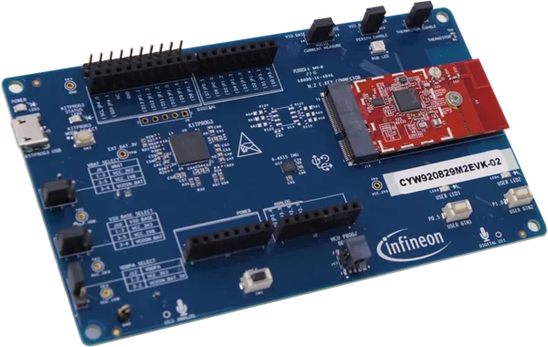

<!-- Copyright 2015-2026 Zephyr Project members and individual contributors. -->
<!-- SPDX-License-Identifier: Apache-2.0 -->
<!-- 中文翻译；编号、导航与译注为本地新增。 -->

<a id="cyw920829m2evk_02"></a>

# 第9章\_CYW920829M2EVK-02

原文：[官方页面](https://docs.zephyrproject.org/latest/boards/infineon/cyw920829m2evk_02/doc/index.html)。读取日期：2026-10-16；来源摘要见[来源记录](../SOURCES.md)。

开发板概览（Board Overview）

<a id="id1"></a>

[](images/cyw920829m2evk_02.webp)

CYW920829M2EVK-02

名称（Name）：

`cyw920829m2evk_02`

厂商（Vendor）：

[英飞凌科技（Infineon Technologies）](https://docs.zephyrproject.org/latest/boards/index.html#vendor=infineon)

状态（Status）：

维护中（Maintained）

架构（Architecture）：

[arm](https://docs.zephyrproject.org/latest/boards/index.html#arch=arm)

片上系统（SoC）：

[cyw20829b1340](https://docs.zephyrproject.org/latest/boards/index.html#soc=cyw20829b1340)、[cyw20829b1010](https://docs.zephyrproject.org/latest/boards/index.html#soc=cyw20829b1010)、[cyw20829b0lkml](https://docs.zephyrproject.org/latest/boards/index.html#soc=cyw20829b0lkml)

<a id="board-github-link"></a>

[浏览开发板源码（Browse Board Sources）](https://github.com/zephyrproject-rtos/zephyr/blob/main//boards/infineon/cyw920829m2evk_02/doc/index.rst/../..)<a id="overview"></a>

## 概述（Overview）

[CYW920829M2EVK-02](https://www.infineon.com/cms/en/product/promopages/airoc20829/)是AIROC CYW20829低功耗蓝牙（Bluetooth LE）MCU的评估套件，采用96 MHz Arm Cortex-M33内核，面向工业IoT、智能家居、资产跟踪、信标、传感器及医疗设备等低功耗蓝牙应用。

主要特性包括2048 KB Flash、1024 KB SRAM、无需外部功率放大器（PA）即可达到10 dBm发射功率的低功耗蓝牙，以及丰富板载传感器和外设。

开发板支持Arduino Uno R3排针，集成通过Micro-B USB连接的[KitProg3](https://github.com/Infineon/KitProg3)编程器／调试器。

CYW920829M2EVK-02支持多种SoC变体：

<table>
<tr>
<th>构建目标（Build Target）</th>
<th>SoC变体（Variant）</th>
</tr>
<tr>
<td><code>cyw920829m2evk_02/cyw20829b0lkml</code></td>
<td>CYW20829 B0LKML</td>
</tr>
<tr>
<td><code>cyw920829m2evk_02/cyw20829b1010</code></td>
<td>CYW20829 B1010</td>
</tr>
<tr>
<td><code>cyw920829m2evk_02/cyw20829b1340</code></td>
<td>CYW20829 B1340</td>
</tr>
</table>

<a id="hardware"></a>

## 硬件（Hardware）


- 片上系统（SoC）：AIROC CYW20829低功耗蓝牙MCU，56针QFN封装
- CPU：Arm Cortex-M33，96 MHz
- 闪存（Flash）：2048 KB
- 静态随机存储器（SRAM）：1024 KB
- 无线连接：低功耗蓝牙，10 dBm发射功率，无需外部PA
- 传感器：六轴IMU、热敏电阻、模拟麦克风及数字麦克风
- USB：Micro-B，用于供电、编程及USB-UART桥接
- 扩展：兼容Arduino Uno R3的排针
- 用户I/O：RGB LED、2个用户LED、2个用户开关
- 调试：板载KitProg3，SWD及USB-UART
- 电源：USB供电，工作电压3.3 V

CYW20829 SoC及CYW920829M2EVK-02开发板更多信息见：


- [CYW20829 SoC网站](https://www.infineon.com/cms/en/product/wireless-connectivity/airoc-bluetooth-le-bluetooth-multiprotocol/airoc-bluetooth-le/cyw20829/)
- [CYW920829M2EVK-02开发板网站](https://www.infineon.com/cms/en/product/evaluation-boards/cyw920829m2evk-02/)

<a id="kit-contents"></a>

### 套件内容（Kit Contents）


- CYW20829评估板，CYW9BTM2BASE3及CYW920829M2IPA2
- USB Type-A转Micro-B线缆
- 6根跳线
- 快速入门指南（Quick Start Guide）

<a id="supported-features"></a>

### 支持的功能（Supported Features）

`cyw920829m2evk_02`开发板支持下表所列的硬件功能。

片上／板载（On-Chip / On-Board）

功能集成在片上系统（SoC）内／位于开发板上。

2 / 2

分别表示已启用／已禁用的实例数。点击数量标签，可查看开发板或SoC设备树源码（DTS）中该功能的第一个实例。

`vnd,foo`

与此功能匹配的设备树绑定兼容字符串（Compatible String）；点击链接可查看绑定文档。

<a id="cyw920829m2evk_02-hw-features"></a>

<a id="cyw920829m2evk_02-cyw920829m2evk_02/cyw20829b0lkml-hw-features-section"></a>

#### `cyw920829m2evk_02/cyw20829b0lkml`目标（Target）

<a id="cyw920829m2evk_02-cyw920829m2evk_02/cyw20829b0lkml-hw-features-panel"></a>

<a id="cyw920829m2evk_02-cyw920829m2evk_02/cyw20829b0lkml-hw-features-memory"></a>

该开发板目标的片上存储容量：240 KiB RAM、1 MiB Flash。

<a id="cyw920829m2evk_02-cyw920829m2evk_02/cyw20829b0lkml-hw-features-table"></a>

<table>
<tr>
<th>类型（Type）</th>
<th>位置（Location）</th>
<th>说明（Description）</th>
<th>兼容字符串（Compatible）</th>
</tr>
<tr>
<td rowspan="1">中央处理器（CPU）</td>
<td>片上（On-Chip）</td>
<td>ARM Cortex-M33处理器（CPU）（<a href="https://github.com/zephyrproject-rtos/zephyr/blob/main/dts/arm/infineon/cat1b/cyw20829/cyw20829.cm33.dtsi?plain=1#L15">已启用：1</a>）</td>
<td><a href="../cpu_arm_riscv_binding_reference/P022_arm_cortex-m33.md#std-dtcompatible-arm-cortex-m33"><code>arm,cortex-m33</code></a></td>
</tr>
<tr>
<td rowspan="1">模数转换器（ADC）</td>
<td>片上（On-Chip）</td>
<td>英飞凌Cat1 ADC，每个Cat1 ADC组对应一个Zephyr设备（<a href="https://github.com/zephyrproject-rtos/zephyr/blob/main/dts/arm/infineon/cat1b/cyw20829/cyw20829.dtsi?plain=1#L90">已禁用：1</a>）</td>
<td><a href="../hardware/P877_Infineon模数转换器绑定.md#dtbinding-infineon-adc"><code>infineon,adc</code></a></td>
</tr>
<tr>
<td rowspan="1">ARM 架构（ARM Architecture）</td>
<td>片上（On-Chip）</td>
<td>英飞凌串行通信模块（SCB / Serial Communication Blocks）节点（<a href="https://github.com/zephyrproject-rtos/zephyr/blob/main/dts/arm/infineon/cat1b/cyw20829/cyw20829.dtsi?plain=1#L107">已禁用：2</a>）</td>
<td><a href="../arm_timing_ethosu_control_binding_reference/P011_infineon_scb.md#std-dtcompatible-infineon-scb"><code>infineon,scb</code></a></td>
</tr>
<tr>
<td rowspan="1">蓝牙（Bluetooth）</td>
<td>片上（On-Chip）</td>
<td>使用英飞凌CYW208XX HCI蓝牙接口的蓝牙模块（<a href="https://github.com/zephyrproject-rtos/zephyr/blob/main/dts/arm/infineon/cat1b/cyw20829/cyw20829.dtsi?plain=1#L390">已启用：1</a>）</td>
<td><a href="../bluetooth_vendor_hci_binding_reference/P007_infineon_cyw208xx-hci.md#std-dtcompatible-infineon-cyw208xx-hci"><code>infineon,cyw208xx-hci</code></a></td>
</tr>
<tr>
<td rowspan="2">控制器局域网（CAN）</td>
<td>片上（On-Chip）</td>
<td>英飞凌CAN FD控制器封装层（Wrapper）（<a href="https://github.com/zephyrproject-rtos/zephyr/blob/main/dts/arm/infineon/cat1b/cyw20829/cyw20829.dtsi?plain=1#L131">已禁用：1</a>）</td>
<td><a href="../can_adi_atmel_nxp_binding_reference/P008_infineon_canfd-controller.md#std-dtcompatible-infineon-canfd-controller"><code>infineon,canfd-controller</code></a></td>
</tr>
<tr>
<td>片上（On-Chip）</td>
<td>英飞凌MCAN驱动（<a href="https://github.com/zephyrproject-rtos/zephyr/blob/main/dts/arm/infineon/cat1b/cyw20829/cyw20829.dtsi?plain=1#L140">已禁用：1</a>）</td>
<td><a href="../can_adi_atmel_nxp_binding_reference/P007_infineon_can.md#std-dtcompatible-infineon-can"><code>infineon,can</code></a></td>
</tr>
<tr>
<td rowspan="3">时钟控制（Clock Control）</td>
<td>片上（On-Chip）</td>
<td>通用固定频率时钟提供者（Fixed-Rate Clock Provider）（<a href="https://github.com/zephyrproject-rtos/zephyr/blob/main/dts/arm/infineon/cat1b/cyw20829/system_clocks.dtsi?plain=1#L25">已启用：4</a>；<a href="https://github.com/zephyrproject-rtos/zephyr/blob/main/dts/arm/infineon/cat1b/cyw20829/system_clocks.dtsi?plain=1#L127">已禁用：2</a>）</td>
<td><a href="../hardware/P566_固定时钟绑定.md#dtbinding-fixed-clock"><code>fixed-clock</code></a></td>
</tr>
<tr>
<td>片上（On-Chip）</td>
<td>通用固定比例时钟提供器（Fixed Factor Clock Provider）（<a href="https://github.com/zephyrproject-rtos/zephyr/blob/main/dts/arm/infineon/cat1b/cyw20829/system_clocks.dtsi?plain=1#L49">已启用：9</a>）</td>
<td><a href="../timer_reference/P110_固定比例时钟绑定.md#dtbinding-fixed-factor-clock"><code>fixed-factor-clock</code></a></td>
</tr>
<tr>
<td>片上（On-Chip）</td>
<td>英飞凌外设分频器（Peripheral Divider）（<a href="https://github.com/zephyrproject-rtos/zephyr/blob/main/dts/arm/infineon/cat1b/cyw20829/system_clocks.dtsi?plain=1#L154">已禁用：15</a>）</td>
<td><a href="../clock_esp_infineon_microchip_binding_reference/P009_infineon_peri-div.md#std-dtcompatible-infineon-peri-div"><code>infineon,peri-div</code></a></td>
</tr>
<tr>
<td rowspan="1">计数器（Counter）</td>
<td>片上（On-Chip）</td>
<td>英飞凌TCPWM计数器（Counter）（<a href="https://github.com/zephyrproject-rtos/zephyr/blob/main/dts/arm/infineon/cat1b/cyw20829/cyw20829.dtsi?plain=1#L193">已禁用：9</a>）</td>
<td><a href="../microchip_soc_counter_binding_reference/P002_infineon_tcpwm-counter.md#std-dtcompatible-infineon-tcpwm-counter"><code>infineon,tcpwm-counter</code></a></td>
</tr>
<tr>
<td rowspan="2">密码学加速器（Cryptographic Accelerator）</td>
<td>片上（On-Chip）</td>
<td>英飞凌MXCRYPTOLITE真随机数发生器（TRNG）（<a href="https://github.com/zephyrproject-rtos/zephyr/blob/main/dts/arm/infineon/cat1b/cyw20829/cyw20829.dtsi?plain=1#L401">已启用：1</a>）</td>
<td><a href="../crypto_aes_sha_ccm_binding_reference/P012_infineon_mxcryptolite-trng.md#std-dtcompatible-infineon-mxcryptolite-trng"><code>infineon,mxcryptolite-trng</code></a></td>
</tr>
<tr>
<td>片上（On-Chip）</td>
<td>英飞凌MXCRYPTOLITE密码引擎（Crypto Engine），AES／SHA-256（<a href="https://github.com/zephyrproject-rtos/zephyr/blob/main/dts/arm/infineon/cat1b/cyw20829/cyw20829.dtsi?plain=1#L406">已启用：1</a>）</td>
<td><a href="../crypto_aes_sha_ccm_binding_reference/P011_infineon_mxcryptolite-crypto.md#std-dtcompatible-infineon-mxcryptolite-crypto"><code>infineon,mxcryptolite-crypto</code></a></td>
</tr>
<tr>
<td rowspan="1">直接存储器访问（DMA）</td>
<td>片上（On-Chip）</td>
<td>英飞凌CAT1 DMA（<a href="https://github.com/zephyrproject-rtos/zephyr/blob/main/dts/arm/infineon/cat1b/cyw20829/cyw20829.dtsi?plain=1#L366">已启用：1</a>）</td>
<td><a href="../dma_binding_reference/P018_infineon_dma.md#std-dtcompatible-infineon-dma"><code>infineon,dma</code></a></td>
</tr>
<tr>
<td rowspan="1">闪存控制器（Flash Controller）</td>
<td>板载（On-Board）</td>
<td>英飞凌CAT1 QSPI闪存控制器（<a href="https://github.com/zephyrproject-rtos/zephyr/blob/main/boards/infineon/cyw920829m2evk_02/cyw920829m2ipa2.dtsi?plain=1#L13">已启用：1</a>）</td>
<td><a href="../flash_adi_microchip_nordic_binding_reference/P015_infineon_qspi-flash.md#std-dtcompatible-infineon-qspi-flash"><code>infineon,qspi-flash</code></a></td>
</tr>
<tr>
<td rowspan="1">通用输入输出与接插件（GPIO &amp; Headers）</td>
<td>片上（On-Chip）</td>
<td>英飞凌GPIO端口（<a href="https://github.com/zephyrproject-rtos/zephyr/blob/main/dts/arm/infineon/cat1b/cyw20829/cyw20829.dtsi?plain=1#L30">已启用：4</a>；<a href="https://github.com/zephyrproject-rtos/zephyr/blob/main/dts/arm/infineon/cat1b/cyw20829/cyw20829.dtsi?plain=1#L50">已禁用：2</a>）</td>
<td><a href="../gpio_infineon_intel_ite_microchip_binding_reference/P001_infineon_gpio.md#std-dtcompatible-infineon-gpio"><code>infineon,gpio</code></a></td>
</tr>
<tr>
<td rowspan="1">输入（Input）</td>
<td>板载（On-Board）</td>
<td>一组绑定到 GPIO 的输入按键（GPIO-Bound Input Keys）（<a href="https://github.com/zephyrproject-rtos/zephyr/blob/main/boards/infineon/cyw920829m2evk_02/cyw920829m2evk_02-common.dtsi?plain=1#L30">已启用：1</a>）</td>
<td><a href="../hardware/P563_GPIO按键绑定.md#std-dtcompatible-gpio-keys"><code>gpio-keys</code></a></td>
</tr>
<tr>
<td rowspan="1">中断控制器（Interrupt Controller）</td>
<td>片上（On-Chip）</td>
<td>ARMv8-M嵌套向量中断控制器（NVIC / Nested Vectored Interrupt Controller）（<a href="https://github.com/zephyrproject-rtos/zephyr/blob/main/dts/arm/armv8-m.dtsi?plain=1#L13">已启用：1</a>）</td>
<td><a href="../arm_interrupt_timer_binding_reference/P003_ARMv8_M_NVIC.md#std-dtcompatible-arm-v8m-nvic"><code>arm,v8m-nvic</code></a></td>
</tr>
<tr>
<td rowspan="1">处理器间／进程间通信（IPC）</td>
<td>片上（On-Chip）</td>
<td>英飞凌核间通信（IPC）实例（<a href="https://github.com/zephyrproject-rtos/zephyr/blob/main/dts/arm/infineon/cat1b/cyw20829/cyw20829.dtsi?plain=1#L98">已禁用：1</a>）</td>
<td><a href="../intercore_reference/P099_Infineon处理器间通信绑定.md#dtbinding-infineon-ipc"><code>infineon,ipc</code></a></td>
</tr>
<tr>
<td rowspan="1">发光二极管（LED）</td>
<td>板载（On-Board）</td>
<td>一组由 GPIO 控制的 LED（GPIO-Controlled LEDs）（<a href="https://github.com/zephyrproject-rtos/zephyr/blob/main/boards/infineon/cyw920829m2evk_02/cyw920829m2evk_02-common.dtsi?plain=1#L16">已启用：1</a>）</td>
<td><a href="../hardware/P564_GPIO指示灯绑定.md#dtbinding-gpio-leds"><code>gpio-leds</code></a></td>
</tr>
<tr>
<td rowspan="1">多功能设备（Multi-Function Device）</td>
<td>片上（On-Chip）</td>
<td>英飞凌MXCRYPTOLITE多功能设备（MFD）（<a href="https://github.com/zephyrproject-rtos/zephyr/blob/main/dts/arm/infineon/cat1b/cyw20829/cyw20829.dtsi?plain=1#L397">已启用：1</a>）</td>
<td><a href="../hardware/P728_Infineon轻量加密硬件模块绑定.md#dtbinding-infineon-mxcryptolite"><code>infineon,mxcryptolite</code></a></td>
</tr>
<tr>
<td rowspan="1">存储技术设备（MTD）</td>
<td>板载（On-Board）</td>
<td>闪存（Flash）节点（<a href="https://github.com/zephyrproject-rtos/zephyr/blob/main/boards/infineon/cyw920829m2evk_02/cyw920829m2ipa2.dtsi?plain=1#L32">已启用：1</a>）</td>
<td><a href="../mtd_nxp_st_ti_partition_binding_reference/P013_soc-nv-flash.md#std-dtcompatible-soc-nv-flash"><code>soc-nv-flash</code></a></td>
</tr>
<tr>
<td rowspan="1">引脚控制（Pin Control）</td>
<td>片上（On-Chip）</td>
<td>英飞凌（Infineon）CAT1引脚控制容器（Pinctrl Container）（<a href="https://github.com/zephyrproject-rtos/zephyr/blob/main/dts/arm/infineon/cat1b/cyw20829/cyw20829.dtsi?plain=1#L18">已启用：1</a>）</td>
<td><a href="../pinctrl_infineon_nordic_nxp_binding_reference/P001_infineon_pinctrl.md#std-dtcompatible-infineon-pinctrl"><code>infineon,pinctrl</code></a></td>
</tr>
<tr>
<td rowspan="1">电源管理（Power Management）</td>
<td>片上（On-Chip）</td>
<td>英飞凌CAT1B电源控制（<a href="https://github.com/zephyrproject-rtos/zephyr/blob/main/dts/arm/infineon/cat1b/cyw20829/system_clocks.dtsi?plain=1#L16">已启用：1</a>）</td>
<td><a href="../power_control_binding_reference/P003_infineon_cat1b-power.md#std-dtcompatible-infineon-cat1b-power"><code>infineon,cat1b-power</code></a></td>
</tr>
<tr>
<td rowspan="1">脉宽调制（PWM）</td>
<td>片上（On-Chip）</td>
<td>英飞凌TCPWM脉宽调制（PWM）（<a href="https://github.com/zephyrproject-rtos/zephyr/blob/main/dts/arm/infineon/cat1b/cyw20829/cyw20829.dtsi?plain=1#L187">已禁用：9</a>）</td>
<td><a href="../pwm_adi_esp_infineon_binding_reference/P019_infineon_tcpwm-pwm.md#std-dtcompatible-infineon-tcpwm-pwm"><code>infineon,tcpwm-pwm</code></a></td>
</tr>
<tr>
<td rowspan="1">实时时钟（RTC）</td>
<td>片上（On-Chip）</td>
<td>英飞凌CAT1系列实时时钟（RTC）设备（<a href="https://github.com/zephyrproject-rtos/zephyr/blob/main/dts/arm/infineon/cat1b/cyw20829/cyw20829.dtsi?plain=1#L166">已禁用：1</a>）</td>
<td><a href="../rtc_binding_reference/P007_infineon_rtc.md#std-dtcompatible-infineon-rtc"><code>infineon,rtc</code></a></td>
</tr>
<tr>
<td rowspan="1">串行控制器（Serial Controller）</td>
<td>片上（On-Chip）</td>
<td>英飞凌CAT1 UART（<a href="https://github.com/zephyrproject-rtos/zephyr/blob/main/dts/arm/infineon/cat1b/cyw20829/cyw20829.dtsi?plain=1#L123">已启用：1</a>）</td>
<td><a href="../uart_espressif_infineon_microchip_binding_reference/P008_infineon_uart.md#std-dtcompatible-infineon-uart"><code>infineon,uart</code></a></td>
</tr>
<tr>
<td rowspan="1">静态随机存储器（SRAM）</td>
<td>片上（On-Chip）</td>
<td>通用片上静态随机存储器（SRAM）（<a href="https://github.com/zephyrproject-rtos/zephyr/blob/main/dts/arm/infineon/cat1b/cyw20829/cyw20829.dtsi?plain=1#L12">已启用：1</a>）</td>
<td><a href="../hardware/P567_内存映射SRAM绑定.md#dtbinding-mmio-sram"><code>mmio-sram</code></a></td>
</tr>
<tr>
<td rowspan="3">定时器（Timer）</td>
<td>片上（On-Chip）</td>
<td>ARMv8-M系统节拍（System Tick）（<a href="https://github.com/zephyrproject-rtos/zephyr/blob/main/dts/arm/armv8-m.dtsi?plain=1#L21">已启用：1</a>）</td>
<td><a href="../arm_interrupt_timer_binding_reference/P007_ARMv8_M_SysTick.md#std-dtcompatible-arm-armv8m-systick"><code>arm,armv8m-systick</code></a></td>
</tr>
<tr>
<td>片上（On-Chip）</td>
<td>英飞凌低功耗定时器（<a href="https://github.com/zephyrproject-rtos/zephyr/blob/main/dts/arm/infineon/cat1b/cyw20829/cyw20829.dtsi?plain=1#L159">已启用：1</a>）</td>
<td><a href="../mcu_timer_binding_reference/P008_infineon_lp-timer.md#std-dtcompatible-infineon-lp-timer"><code>infineon,lp-timer</code></a></td>
</tr>
<tr>
<td>片上（On-Chip）</td>
<td>英飞凌TCPWM定时器（Timer）（<a href="https://github.com/zephyrproject-rtos/zephyr/blob/main/dts/arm/infineon/cat1b/cyw20829/cyw20829.dtsi?plain=1#L179">已禁用：9</a>）</td>
<td><a href="../mcu_timer_binding_reference/P009_infineon_tcpwm.md#std-dtcompatible-infineon-tcpwm"><code>infineon,tcpwm</code></a></td>
</tr>
<tr>
<td rowspan="1">看门狗（Watchdog）</td>
<td>片上（On-Chip）</td>
<td>英飞凌CAT1看门狗（Watchdog）（<a href="https://github.com/zephyrproject-rtos/zephyr/blob/main/dts/arm/infineon/cat1b/cyw20829/cyw20829.dtsi?plain=1#L152">已启用：1</a>）</td>
<td><a href="../soc_pmic_watchdog_binding_reference/P001_infineon_watchdog.md#std-dtcompatible-infineon-watchdog"><code>infineon,watchdog</code></a></td>
</tr>
</table>

<a id="cyw920829m2evk_02-cyw920829m2evk_02/cyw20829b1010-hw-features-section"></a>

#### `cyw920829m2evk_02/cyw20829b1010`目标（Target）

<a id="cyw920829m2evk_02-cyw920829m2evk_02/cyw20829b1010-hw-features-panel"></a>

<a id="cyw920829m2evk_02-cyw920829m2evk_02/cyw20829b1010-hw-features-memory"></a>

该开发板目标的片上存储容量：240 KiB RAM、1 MiB Flash。

<a id="cyw920829m2evk_02-cyw920829m2evk_02/cyw20829b1010-hw-features-table"></a>

<table>
<tr>
<th>类型（Type）</th>
<th>位置（Location）</th>
<th>说明（Description）</th>
<th>兼容字符串（Compatible）</th>
</tr>
<tr>
<td rowspan="1">中央处理器（CPU）</td>
<td>片上（On-Chip）</td>
<td>ARM Cortex-M33处理器（CPU）（<a href="https://github.com/zephyrproject-rtos/zephyr/blob/main/dts/arm/infineon/cat1b/cyw20829/cyw20829.cm33.dtsi?plain=1#L15">已启用：1</a>）</td>
<td><a href="../cpu_arm_riscv_binding_reference/P022_arm_cortex-m33.md#std-dtcompatible-arm-cortex-m33"><code>arm,cortex-m33</code></a></td>
</tr>
<tr>
<td rowspan="1">模数转换器（ADC）</td>
<td>片上（On-Chip）</td>
<td>英飞凌Cat1 ADC，每个Cat1 ADC组对应一个Zephyr设备（<a href="https://github.com/zephyrproject-rtos/zephyr/blob/main/dts/arm/infineon/cat1b/cyw20829/cyw20829.dtsi?plain=1#L90">已禁用：1</a>）</td>
<td><a href="../hardware/P877_Infineon模数转换器绑定.md#dtbinding-infineon-adc"><code>infineon,adc</code></a></td>
</tr>
<tr>
<td rowspan="1">ARM 架构（ARM Architecture）</td>
<td>片上（On-Chip）</td>
<td>英飞凌串行通信模块（SCB / Serial Communication Blocks）节点（<a href="https://github.com/zephyrproject-rtos/zephyr/blob/main/dts/arm/infineon/cat1b/cyw20829/cyw20829.dtsi?plain=1#L107">已禁用：2</a>）</td>
<td><a href="../arm_timing_ethosu_control_binding_reference/P011_infineon_scb.md#std-dtcompatible-infineon-scb"><code>infineon,scb</code></a></td>
</tr>
<tr>
<td rowspan="1">蓝牙（Bluetooth）</td>
<td>片上（On-Chip）</td>
<td>使用英飞凌CYW208XX HCI蓝牙接口的蓝牙模块（<a href="https://github.com/zephyrproject-rtos/zephyr/blob/main/dts/arm/infineon/cat1b/cyw20829/cyw20829.dtsi?plain=1#L390">已启用：1</a>）</td>
<td><a href="../bluetooth_vendor_hci_binding_reference/P007_infineon_cyw208xx-hci.md#std-dtcompatible-infineon-cyw208xx-hci"><code>infineon,cyw208xx-hci</code></a></td>
</tr>
<tr>
<td rowspan="2">控制器局域网（CAN）</td>
<td>片上（On-Chip）</td>
<td>英飞凌CAN FD控制器封装层（Wrapper）（<a href="https://github.com/zephyrproject-rtos/zephyr/blob/main/dts/arm/infineon/cat1b/cyw20829/cyw20829.dtsi?plain=1#L131">已禁用：1</a>）</td>
<td><a href="../can_adi_atmel_nxp_binding_reference/P008_infineon_canfd-controller.md#std-dtcompatible-infineon-canfd-controller"><code>infineon,canfd-controller</code></a></td>
</tr>
<tr>
<td>片上（On-Chip）</td>
<td>英飞凌MCAN驱动（<a href="https://github.com/zephyrproject-rtos/zephyr/blob/main/dts/arm/infineon/cat1b/cyw20829/cyw20829.dtsi?plain=1#L140">已禁用：1</a>）</td>
<td><a href="../can_adi_atmel_nxp_binding_reference/P007_infineon_can.md#std-dtcompatible-infineon-can"><code>infineon,can</code></a></td>
</tr>
<tr>
<td rowspan="3">时钟控制（Clock Control）</td>
<td>片上（On-Chip）</td>
<td>通用固定频率时钟提供者（Fixed-Rate Clock Provider）（<a href="https://github.com/zephyrproject-rtos/zephyr/blob/main/dts/arm/infineon/cat1b/cyw20829/system_clocks.dtsi?plain=1#L25">已启用：4</a>；<a href="https://github.com/zephyrproject-rtos/zephyr/blob/main/dts/arm/infineon/cat1b/cyw20829/system_clocks.dtsi?plain=1#L127">已禁用：2</a>）</td>
<td><a href="../hardware/P566_固定时钟绑定.md#dtbinding-fixed-clock"><code>fixed-clock</code></a></td>
</tr>
<tr>
<td>片上（On-Chip）</td>
<td>通用固定比例时钟提供器（Fixed Factor Clock Provider）（<a href="https://github.com/zephyrproject-rtos/zephyr/blob/main/dts/arm/infineon/cat1b/cyw20829/system_clocks.dtsi?plain=1#L49">已启用：9</a>）</td>
<td><a href="../timer_reference/P110_固定比例时钟绑定.md#dtbinding-fixed-factor-clock"><code>fixed-factor-clock</code></a></td>
</tr>
<tr>
<td>片上（On-Chip）</td>
<td>英飞凌外设分频器（Peripheral Divider）（<a href="https://github.com/zephyrproject-rtos/zephyr/blob/main/dts/arm/infineon/cat1b/cyw20829/system_clocks.dtsi?plain=1#L154">已禁用：15</a>）</td>
<td><a href="../clock_esp_infineon_microchip_binding_reference/P009_infineon_peri-div.md#std-dtcompatible-infineon-peri-div"><code>infineon,peri-div</code></a></td>
</tr>
<tr>
<td rowspan="1">计数器（Counter）</td>
<td>片上（On-Chip）</td>
<td>英飞凌TCPWM计数器（Counter）（<a href="https://github.com/zephyrproject-rtos/zephyr/blob/main/dts/arm/infineon/cat1b/cyw20829/cyw20829.dtsi?plain=1#L193">已禁用：9</a>）</td>
<td><a href="../microchip_soc_counter_binding_reference/P002_infineon_tcpwm-counter.md#std-dtcompatible-infineon-tcpwm-counter"><code>infineon,tcpwm-counter</code></a></td>
</tr>
<tr>
<td rowspan="2">密码学加速器（Cryptographic Accelerator）</td>
<td>片上（On-Chip）</td>
<td>英飞凌MXCRYPTOLITE真随机数发生器（TRNG）（<a href="https://github.com/zephyrproject-rtos/zephyr/blob/main/dts/arm/infineon/cat1b/cyw20829/cyw20829.dtsi?plain=1#L401">已启用：1</a>）</td>
<td><a href="../crypto_aes_sha_ccm_binding_reference/P012_infineon_mxcryptolite-trng.md#std-dtcompatible-infineon-mxcryptolite-trng"><code>infineon,mxcryptolite-trng</code></a></td>
</tr>
<tr>
<td>片上（On-Chip）</td>
<td>英飞凌MXCRYPTOLITE密码引擎（Crypto Engine），AES／SHA-256（<a href="https://github.com/zephyrproject-rtos/zephyr/blob/main/dts/arm/infineon/cat1b/cyw20829/cyw20829.dtsi?plain=1#L406">已启用：1</a>）</td>
<td><a href="../crypto_aes_sha_ccm_binding_reference/P011_infineon_mxcryptolite-crypto.md#std-dtcompatible-infineon-mxcryptolite-crypto"><code>infineon,mxcryptolite-crypto</code></a></td>
</tr>
<tr>
<td rowspan="1">直接存储器访问（DMA）</td>
<td>片上（On-Chip）</td>
<td>英飞凌CAT1 DMA（<a href="https://github.com/zephyrproject-rtos/zephyr/blob/main/dts/arm/infineon/cat1b/cyw20829/cyw20829.dtsi?plain=1#L366">已启用：1</a>）</td>
<td><a href="../dma_binding_reference/P018_infineon_dma.md#std-dtcompatible-infineon-dma"><code>infineon,dma</code></a></td>
</tr>
<tr>
<td rowspan="1">闪存控制器（Flash Controller）</td>
<td>板载（On-Board）</td>
<td>英飞凌CAT1 QSPI闪存控制器（<a href="https://github.com/zephyrproject-rtos/zephyr/blob/main/boards/infineon/cyw920829m2evk_02/cyw920829m2ipa2.dtsi?plain=1#L13">已启用：1</a>）</td>
<td><a href="../flash_adi_microchip_nordic_binding_reference/P015_infineon_qspi-flash.md#std-dtcompatible-infineon-qspi-flash"><code>infineon,qspi-flash</code></a></td>
</tr>
<tr>
<td rowspan="1">通用输入输出与接插件（GPIO &amp; Headers）</td>
<td>片上（On-Chip）</td>
<td>英飞凌GPIO端口（<a href="https://github.com/zephyrproject-rtos/zephyr/blob/main/dts/arm/infineon/cat1b/cyw20829/cyw20829.dtsi?plain=1#L30">已启用：4</a>；<a href="https://github.com/zephyrproject-rtos/zephyr/blob/main/dts/arm/infineon/cat1b/cyw20829/cyw20829.dtsi?plain=1#L50">已禁用：2</a>）</td>
<td><a href="../gpio_infineon_intel_ite_microchip_binding_reference/P001_infineon_gpio.md#std-dtcompatible-infineon-gpio"><code>infineon,gpio</code></a></td>
</tr>
<tr>
<td rowspan="1">输入（Input）</td>
<td>板载（On-Board）</td>
<td>一组绑定到 GPIO 的输入按键（GPIO-Bound Input Keys）（<a href="https://github.com/zephyrproject-rtos/zephyr/blob/main/boards/infineon/cyw920829m2evk_02/cyw920829m2evk_02-common.dtsi?plain=1#L30">已启用：1</a>）</td>
<td><a href="../hardware/P563_GPIO按键绑定.md#std-dtcompatible-gpio-keys"><code>gpio-keys</code></a></td>
</tr>
<tr>
<td rowspan="1">中断控制器（Interrupt Controller）</td>
<td>片上（On-Chip）</td>
<td>ARMv8-M嵌套向量中断控制器（NVIC / Nested Vectored Interrupt Controller）（<a href="https://github.com/zephyrproject-rtos/zephyr/blob/main/dts/arm/armv8-m.dtsi?plain=1#L13">已启用：1</a>）</td>
<td><a href="../arm_interrupt_timer_binding_reference/P003_ARMv8_M_NVIC.md#std-dtcompatible-arm-v8m-nvic"><code>arm,v8m-nvic</code></a></td>
</tr>
<tr>
<td rowspan="1">处理器间／进程间通信（IPC）</td>
<td>片上（On-Chip）</td>
<td>英飞凌核间通信（IPC）实例（<a href="https://github.com/zephyrproject-rtos/zephyr/blob/main/dts/arm/infineon/cat1b/cyw20829/cyw20829.dtsi?plain=1#L98">已禁用：1</a>）</td>
<td><a href="../intercore_reference/P099_Infineon处理器间通信绑定.md#dtbinding-infineon-ipc"><code>infineon,ipc</code></a></td>
</tr>
<tr>
<td rowspan="1">发光二极管（LED）</td>
<td>板载（On-Board）</td>
<td>一组由 GPIO 控制的 LED（GPIO-Controlled LEDs）（<a href="https://github.com/zephyrproject-rtos/zephyr/blob/main/boards/infineon/cyw920829m2evk_02/cyw920829m2evk_02-common.dtsi?plain=1#L16">已启用：1</a>）</td>
<td><a href="../hardware/P564_GPIO指示灯绑定.md#dtbinding-gpio-leds"><code>gpio-leds</code></a></td>
</tr>
<tr>
<td rowspan="1">多功能设备（Multi-Function Device）</td>
<td>片上（On-Chip）</td>
<td>英飞凌MXCRYPTOLITE多功能设备（MFD）（<a href="https://github.com/zephyrproject-rtos/zephyr/blob/main/dts/arm/infineon/cat1b/cyw20829/cyw20829.dtsi?plain=1#L397">已启用：1</a>）</td>
<td><a href="../hardware/P728_Infineon轻量加密硬件模块绑定.md#dtbinding-infineon-mxcryptolite"><code>infineon,mxcryptolite</code></a></td>
</tr>
<tr>
<td rowspan="1">存储技术设备（MTD）</td>
<td>板载（On-Board）</td>
<td>闪存（Flash）节点（<a href="https://github.com/zephyrproject-rtos/zephyr/blob/main/boards/infineon/cyw920829m2evk_02/cyw920829m2ipa2.dtsi?plain=1#L32">已启用：1</a>）</td>
<td><a href="../mtd_nxp_st_ti_partition_binding_reference/P013_soc-nv-flash.md#std-dtcompatible-soc-nv-flash"><code>soc-nv-flash</code></a></td>
</tr>
<tr>
<td rowspan="1">引脚控制（Pin Control）</td>
<td>片上（On-Chip）</td>
<td>英飞凌（Infineon）CAT1引脚控制容器（Pinctrl Container）（<a href="https://github.com/zephyrproject-rtos/zephyr/blob/main/dts/arm/infineon/cat1b/cyw20829/cyw20829.dtsi?plain=1#L18">已启用：1</a>）</td>
<td><a href="../pinctrl_infineon_nordic_nxp_binding_reference/P001_infineon_pinctrl.md#std-dtcompatible-infineon-pinctrl"><code>infineon,pinctrl</code></a></td>
</tr>
<tr>
<td rowspan="1">电源管理（Power Management）</td>
<td>片上（On-Chip）</td>
<td>英飞凌CAT1B电源控制（<a href="https://github.com/zephyrproject-rtos/zephyr/blob/main/dts/arm/infineon/cat1b/cyw20829/system_clocks.dtsi?plain=1#L16">已启用：1</a>）</td>
<td><a href="../power_control_binding_reference/P003_infineon_cat1b-power.md#std-dtcompatible-infineon-cat1b-power"><code>infineon,cat1b-power</code></a></td>
</tr>
<tr>
<td rowspan="1">脉宽调制（PWM）</td>
<td>片上（On-Chip）</td>
<td>英飞凌TCPWM脉宽调制（PWM）（<a href="https://github.com/zephyrproject-rtos/zephyr/blob/main/dts/arm/infineon/cat1b/cyw20829/cyw20829.dtsi?plain=1#L187">已禁用：9</a>）</td>
<td><a href="../pwm_adi_esp_infineon_binding_reference/P019_infineon_tcpwm-pwm.md#std-dtcompatible-infineon-tcpwm-pwm"><code>infineon,tcpwm-pwm</code></a></td>
</tr>
<tr>
<td rowspan="1">实时时钟（RTC）</td>
<td>片上（On-Chip）</td>
<td>英飞凌CAT1系列实时时钟（RTC）设备（<a href="https://github.com/zephyrproject-rtos/zephyr/blob/main/dts/arm/infineon/cat1b/cyw20829/cyw20829.dtsi?plain=1#L166">已禁用：1</a>）</td>
<td><a href="../rtc_binding_reference/P007_infineon_rtc.md#std-dtcompatible-infineon-rtc"><code>infineon,rtc</code></a></td>
</tr>
<tr>
<td rowspan="1">串行控制器（Serial Controller）</td>
<td>片上（On-Chip）</td>
<td>英飞凌CAT1 UART（<a href="https://github.com/zephyrproject-rtos/zephyr/blob/main/dts/arm/infineon/cat1b/cyw20829/cyw20829.dtsi?plain=1#L123">已启用：1</a>）</td>
<td><a href="../uart_espressif_infineon_microchip_binding_reference/P008_infineon_uart.md#std-dtcompatible-infineon-uart"><code>infineon,uart</code></a></td>
</tr>
<tr>
<td rowspan="1">静态随机存储器（SRAM）</td>
<td>片上（On-Chip）</td>
<td>通用片上静态随机存储器（SRAM）（<a href="https://github.com/zephyrproject-rtos/zephyr/blob/main/dts/arm/infineon/cat1b/cyw20829/cyw20829.dtsi?plain=1#L12">已启用：1</a>）</td>
<td><a href="../hardware/P567_内存映射SRAM绑定.md#dtbinding-mmio-sram"><code>mmio-sram</code></a></td>
</tr>
<tr>
<td rowspan="3">定时器（Timer）</td>
<td>片上（On-Chip）</td>
<td>ARMv8-M系统节拍（System Tick）（<a href="https://github.com/zephyrproject-rtos/zephyr/blob/main/dts/arm/armv8-m.dtsi?plain=1#L21">已启用：1</a>）</td>
<td><a href="../arm_interrupt_timer_binding_reference/P007_ARMv8_M_SysTick.md#std-dtcompatible-arm-armv8m-systick"><code>arm,armv8m-systick</code></a></td>
</tr>
<tr>
<td>片上（On-Chip）</td>
<td>英飞凌低功耗定时器（<a href="https://github.com/zephyrproject-rtos/zephyr/blob/main/dts/arm/infineon/cat1b/cyw20829/cyw20829.dtsi?plain=1#L159">已启用：1</a>）</td>
<td><a href="../mcu_timer_binding_reference/P008_infineon_lp-timer.md#std-dtcompatible-infineon-lp-timer"><code>infineon,lp-timer</code></a></td>
</tr>
<tr>
<td>片上（On-Chip）</td>
<td>英飞凌TCPWM定时器（Timer）（<a href="https://github.com/zephyrproject-rtos/zephyr/blob/main/dts/arm/infineon/cat1b/cyw20829/cyw20829.dtsi?plain=1#L179">已禁用：9</a>）</td>
<td><a href="../mcu_timer_binding_reference/P009_infineon_tcpwm.md#std-dtcompatible-infineon-tcpwm"><code>infineon,tcpwm</code></a></td>
</tr>
<tr>
<td rowspan="1">看门狗（Watchdog）</td>
<td>片上（On-Chip）</td>
<td>英飞凌CAT1看门狗（Watchdog）（<a href="https://github.com/zephyrproject-rtos/zephyr/blob/main/dts/arm/infineon/cat1b/cyw20829/cyw20829.dtsi?plain=1#L152">已启用：1</a>）</td>
<td><a href="../soc_pmic_watchdog_binding_reference/P001_infineon_watchdog.md#std-dtcompatible-infineon-watchdog"><code>infineon,watchdog</code></a></td>
</tr>
</table>

<a id="cyw920829m2evk_02-cyw920829m2evk_02/cyw20829b1340-hw-features-section"></a>

#### `cyw920829m2evk_02/cyw20829b1340`目标（Target）

<a id="cyw920829m2evk_02-cyw920829m2evk_02/cyw20829b1340-hw-features-panel"></a>

<a id="cyw920829m2evk_02-cyw920829m2evk_02/cyw20829b1340-hw-features-memory"></a>

该开发板目标的片上存储容量：240 KiB RAM、2 MiB Flash。

<a id="cyw920829m2evk_02-cyw920829m2evk_02/cyw20829b1340-hw-features-table"></a>

<table>
<tr>
<th>类型（Type）</th>
<th>位置（Location）</th>
<th>说明（Description）</th>
<th>兼容字符串（Compatible）</th>
</tr>
<tr>
<td rowspan="1">中央处理器（CPU）</td>
<td>片上（On-Chip）</td>
<td>ARM Cortex-M33处理器（CPU）（<a href="https://github.com/zephyrproject-rtos/zephyr/blob/main/dts/arm/infineon/cat1b/cyw20829/cyw20829.cm33.dtsi?plain=1#L15">已启用：1</a>）</td>
<td><a href="../cpu_arm_riscv_binding_reference/P022_arm_cortex-m33.md#std-dtcompatible-arm-cortex-m33"><code>arm,cortex-m33</code></a></td>
</tr>
<tr>
<td rowspan="1">模数转换器（ADC）</td>
<td>片上（On-Chip）</td>
<td>英飞凌Cat1 ADC，每个Cat1 ADC组对应一个Zephyr设备（<a href="https://github.com/zephyrproject-rtos/zephyr/blob/main/dts/arm/infineon/cat1b/cyw20829/cyw20829.dtsi?plain=1#L90">已禁用：1</a>）</td>
<td><a href="../hardware/P877_Infineon模数转换器绑定.md#dtbinding-infineon-adc"><code>infineon,adc</code></a></td>
</tr>
<tr>
<td rowspan="1">ARM 架构（ARM Architecture）</td>
<td>片上（On-Chip）</td>
<td>英飞凌串行通信模块（SCB / Serial Communication Blocks）节点（<a href="https://github.com/zephyrproject-rtos/zephyr/blob/main/dts/arm/infineon/cat1b/cyw20829/cyw20829.dtsi?plain=1#L107">已禁用：2</a>）</td>
<td><a href="../arm_timing_ethosu_control_binding_reference/P011_infineon_scb.md#std-dtcompatible-infineon-scb"><code>infineon,scb</code></a></td>
</tr>
<tr>
<td rowspan="1">蓝牙（Bluetooth）</td>
<td>片上（On-Chip）</td>
<td>使用英飞凌CYW208XX HCI蓝牙接口的蓝牙模块（<a href="https://github.com/zephyrproject-rtos/zephyr/blob/main/dts/arm/infineon/cat1b/cyw20829/cyw20829.dtsi?plain=1#L390">已启用：1</a>）</td>
<td><a href="../bluetooth_vendor_hci_binding_reference/P007_infineon_cyw208xx-hci.md#std-dtcompatible-infineon-cyw208xx-hci"><code>infineon,cyw208xx-hci</code></a></td>
</tr>
<tr>
<td rowspan="2">控制器局域网（CAN）</td>
<td>片上（On-Chip）</td>
<td>英飞凌CAN FD控制器封装层（Wrapper）（<a href="https://github.com/zephyrproject-rtos/zephyr/blob/main/dts/arm/infineon/cat1b/cyw20829/cyw20829.dtsi?plain=1#L131">已禁用：1</a>）</td>
<td><a href="../can_adi_atmel_nxp_binding_reference/P008_infineon_canfd-controller.md#std-dtcompatible-infineon-canfd-controller"><code>infineon,canfd-controller</code></a></td>
</tr>
<tr>
<td>片上（On-Chip）</td>
<td>英飞凌MCAN驱动（<a href="https://github.com/zephyrproject-rtos/zephyr/blob/main/dts/arm/infineon/cat1b/cyw20829/cyw20829.dtsi?plain=1#L140">已禁用：1</a>）</td>
<td><a href="../can_adi_atmel_nxp_binding_reference/P007_infineon_can.md#std-dtcompatible-infineon-can"><code>infineon,can</code></a></td>
</tr>
<tr>
<td rowspan="3">时钟控制（Clock Control）</td>
<td>片上（On-Chip）</td>
<td>通用固定频率时钟提供者（Fixed-Rate Clock Provider）（<a href="https://github.com/zephyrproject-rtos/zephyr/blob/main/dts/arm/infineon/cat1b/cyw20829/system_clocks.dtsi?plain=1#L25">已启用：4</a>；<a href="https://github.com/zephyrproject-rtos/zephyr/blob/main/dts/arm/infineon/cat1b/cyw20829/system_clocks.dtsi?plain=1#L127">已禁用：2</a>）</td>
<td><a href="../hardware/P566_固定时钟绑定.md#dtbinding-fixed-clock"><code>fixed-clock</code></a></td>
</tr>
<tr>
<td>片上（On-Chip）</td>
<td>通用固定比例时钟提供器（Fixed Factor Clock Provider）（<a href="https://github.com/zephyrproject-rtos/zephyr/blob/main/dts/arm/infineon/cat1b/cyw20829/system_clocks.dtsi?plain=1#L49">已启用：9</a>）</td>
<td><a href="../timer_reference/P110_固定比例时钟绑定.md#dtbinding-fixed-factor-clock"><code>fixed-factor-clock</code></a></td>
</tr>
<tr>
<td>片上（On-Chip）</td>
<td>英飞凌外设分频器（Peripheral Divider）（<a href="https://github.com/zephyrproject-rtos/zephyr/blob/main/dts/arm/infineon/cat1b/cyw20829/system_clocks.dtsi?plain=1#L154">已禁用：15</a>）</td>
<td><a href="../clock_esp_infineon_microchip_binding_reference/P009_infineon_peri-div.md#std-dtcompatible-infineon-peri-div"><code>infineon,peri-div</code></a></td>
</tr>
<tr>
<td rowspan="1">计数器（Counter）</td>
<td>片上（On-Chip）</td>
<td>英飞凌TCPWM计数器（Counter）（<a href="https://github.com/zephyrproject-rtos/zephyr/blob/main/dts/arm/infineon/cat1b/cyw20829/cyw20829.dtsi?plain=1#L193">已禁用：9</a>）</td>
<td><a href="../microchip_soc_counter_binding_reference/P002_infineon_tcpwm-counter.md#std-dtcompatible-infineon-tcpwm-counter"><code>infineon,tcpwm-counter</code></a></td>
</tr>
<tr>
<td rowspan="2">密码学加速器（Cryptographic Accelerator）</td>
<td>片上（On-Chip）</td>
<td>英飞凌MXCRYPTOLITE真随机数发生器（TRNG）（<a href="https://github.com/zephyrproject-rtos/zephyr/blob/main/dts/arm/infineon/cat1b/cyw20829/cyw20829.dtsi?plain=1#L401">已启用：1</a>）</td>
<td><a href="../crypto_aes_sha_ccm_binding_reference/P012_infineon_mxcryptolite-trng.md#std-dtcompatible-infineon-mxcryptolite-trng"><code>infineon,mxcryptolite-trng</code></a></td>
</tr>
<tr>
<td>片上（On-Chip）</td>
<td>英飞凌MXCRYPTOLITE密码引擎（Crypto Engine），AES／SHA-256（<a href="https://github.com/zephyrproject-rtos/zephyr/blob/main/dts/arm/infineon/cat1b/cyw20829/cyw20829.dtsi?plain=1#L406">已启用：1</a>）</td>
<td><a href="../crypto_aes_sha_ccm_binding_reference/P011_infineon_mxcryptolite-crypto.md#std-dtcompatible-infineon-mxcryptolite-crypto"><code>infineon,mxcryptolite-crypto</code></a></td>
</tr>
<tr>
<td rowspan="1">直接存储器访问（DMA）</td>
<td>片上（On-Chip）</td>
<td>英飞凌CAT1 DMA（<a href="https://github.com/zephyrproject-rtos/zephyr/blob/main/dts/arm/infineon/cat1b/cyw20829/cyw20829.dtsi?plain=1#L366">已启用：1</a>）</td>
<td><a href="../dma_binding_reference/P018_infineon_dma.md#std-dtcompatible-infineon-dma"><code>infineon,dma</code></a></td>
</tr>
<tr>
<td rowspan="1">闪存控制器（Flash Controller）</td>
<td>片上（On-Chip）</td>
<td>英飞凌CAT1 QSPI闪存控制器（<a href="https://github.com/zephyrproject-rtos/zephyr/blob/main/dts/arm/infineon/cat1b/mpns/cyw20829b1340.dtsi?plain=1#L15">已启用：1</a>）</td>
<td><a href="../flash_adi_microchip_nordic_binding_reference/P015_infineon_qspi-flash.md#std-dtcompatible-infineon-qspi-flash"><code>infineon,qspi-flash</code></a></td>
</tr>
<tr>
<td rowspan="1">通用输入输出与接插件（GPIO &amp; Headers）</td>
<td>片上（On-Chip）</td>
<td>英飞凌GPIO端口（<a href="https://github.com/zephyrproject-rtos/zephyr/blob/main/dts/arm/infineon/cat1b/cyw20829/cyw20829.dtsi?plain=1#L30">已启用：4</a>；<a href="https://github.com/zephyrproject-rtos/zephyr/blob/main/dts/arm/infineon/cat1b/cyw20829/cyw20829.dtsi?plain=1#L50">已禁用：2</a>）</td>
<td><a href="../gpio_infineon_intel_ite_microchip_binding_reference/P001_infineon_gpio.md#std-dtcompatible-infineon-gpio"><code>infineon,gpio</code></a></td>
</tr>
<tr>
<td rowspan="1">输入（Input）</td>
<td>板载（On-Board）</td>
<td>一组绑定到 GPIO 的输入按键（GPIO-Bound Input Keys）（<a href="https://github.com/zephyrproject-rtos/zephyr/blob/main/boards/infineon/cyw920829m2evk_02/cyw920829m2evk_02-common.dtsi?plain=1#L30">已启用：1</a>）</td>
<td><a href="../hardware/P563_GPIO按键绑定.md#std-dtcompatible-gpio-keys"><code>gpio-keys</code></a></td>
</tr>
<tr>
<td rowspan="1">中断控制器（Interrupt Controller）</td>
<td>片上（On-Chip）</td>
<td>ARMv8-M嵌套向量中断控制器（NVIC / Nested Vectored Interrupt Controller）（<a href="https://github.com/zephyrproject-rtos/zephyr/blob/main/dts/arm/armv8-m.dtsi?plain=1#L13">已启用：1</a>）</td>
<td><a href="../arm_interrupt_timer_binding_reference/P003_ARMv8_M_NVIC.md#std-dtcompatible-arm-v8m-nvic"><code>arm,v8m-nvic</code></a></td>
</tr>
<tr>
<td rowspan="1">处理器间／进程间通信（IPC）</td>
<td>片上（On-Chip）</td>
<td>英飞凌核间通信（IPC）实例（<a href="https://github.com/zephyrproject-rtos/zephyr/blob/main/dts/arm/infineon/cat1b/cyw20829/cyw20829.dtsi?plain=1#L98">已禁用：1</a>）</td>
<td><a href="../intercore_reference/P099_Infineon处理器间通信绑定.md#dtbinding-infineon-ipc"><code>infineon,ipc</code></a></td>
</tr>
<tr>
<td rowspan="1">发光二极管（LED）</td>
<td>板载（On-Board）</td>
<td>一组由 GPIO 控制的 LED（GPIO-Controlled LEDs）（<a href="https://github.com/zephyrproject-rtos/zephyr/blob/main/boards/infineon/cyw920829m2evk_02/cyw920829m2evk_02-common.dtsi?plain=1#L16">已启用：1</a>）</td>
<td><a href="../hardware/P564_GPIO指示灯绑定.md#dtbinding-gpio-leds"><code>gpio-leds</code></a></td>
</tr>
<tr>
<td rowspan="1">多功能设备（Multi-Function Device）</td>
<td>片上（On-Chip）</td>
<td>英飞凌MXCRYPTOLITE多功能设备（MFD）（<a href="https://github.com/zephyrproject-rtos/zephyr/blob/main/dts/arm/infineon/cat1b/cyw20829/cyw20829.dtsi?plain=1#L397">已启用：1</a>）</td>
<td><a href="../hardware/P728_Infineon轻量加密硬件模块绑定.md#dtbinding-infineon-mxcryptolite"><code>infineon,mxcryptolite</code></a></td>
</tr>
<tr>
<td rowspan="1">存储技术设备（MTD）</td>
<td>片上（On-Chip）</td>
<td>闪存（Flash）节点（<a href="https://github.com/zephyrproject-rtos/zephyr/blob/main/dts/arm/infineon/cat1b/mpns/cyw20829b1340.dtsi?plain=1#L35">已启用：1</a>）</td>
<td><a href="../mtd_nxp_st_ti_partition_binding_reference/P013_soc-nv-flash.md#std-dtcompatible-soc-nv-flash"><code>soc-nv-flash</code></a></td>
</tr>
<tr>
<td rowspan="1">引脚控制（Pin Control）</td>
<td>片上（On-Chip）</td>
<td>英飞凌（Infineon）CAT1引脚控制容器（Pinctrl Container）（<a href="https://github.com/zephyrproject-rtos/zephyr/blob/main/dts/arm/infineon/cat1b/cyw20829/cyw20829.dtsi?plain=1#L18">已启用：1</a>）</td>
<td><a href="../pinctrl_infineon_nordic_nxp_binding_reference/P001_infineon_pinctrl.md#std-dtcompatible-infineon-pinctrl"><code>infineon,pinctrl</code></a></td>
</tr>
<tr>
<td rowspan="1">电源管理（Power Management）</td>
<td>片上（On-Chip）</td>
<td>英飞凌CAT1B电源控制（<a href="https://github.com/zephyrproject-rtos/zephyr/blob/main/dts/arm/infineon/cat1b/cyw20829/system_clocks.dtsi?plain=1#L16">已启用：1</a>）</td>
<td><a href="../power_control_binding_reference/P003_infineon_cat1b-power.md#std-dtcompatible-infineon-cat1b-power"><code>infineon,cat1b-power</code></a></td>
</tr>
<tr>
<td rowspan="1">脉宽调制（PWM）</td>
<td>片上（On-Chip）</td>
<td>英飞凌TCPWM脉宽调制（PWM）（<a href="https://github.com/zephyrproject-rtos/zephyr/blob/main/dts/arm/infineon/cat1b/cyw20829/cyw20829.dtsi?plain=1#L187">已禁用：9</a>）</td>
<td><a href="../pwm_adi_esp_infineon_binding_reference/P019_infineon_tcpwm-pwm.md#std-dtcompatible-infineon-tcpwm-pwm"><code>infineon,tcpwm-pwm</code></a></td>
</tr>
<tr>
<td rowspan="1">实时时钟（RTC）</td>
<td>片上（On-Chip）</td>
<td>英飞凌CAT1系列实时时钟（RTC）设备（<a href="https://github.com/zephyrproject-rtos/zephyr/blob/main/dts/arm/infineon/cat1b/cyw20829/cyw20829.dtsi?plain=1#L166">已禁用：1</a>）</td>
<td><a href="../rtc_binding_reference/P007_infineon_rtc.md#std-dtcompatible-infineon-rtc"><code>infineon,rtc</code></a></td>
</tr>
<tr>
<td rowspan="1">串行控制器（Serial Controller）</td>
<td>片上（On-Chip）</td>
<td>英飞凌CAT1 UART（<a href="https://github.com/zephyrproject-rtos/zephyr/blob/main/dts/arm/infineon/cat1b/cyw20829/cyw20829.dtsi?plain=1#L123">已启用：1</a>）</td>
<td><a href="../uart_espressif_infineon_microchip_binding_reference/P008_infineon_uart.md#std-dtcompatible-infineon-uart"><code>infineon,uart</code></a></td>
</tr>
<tr>
<td rowspan="1">静态随机存储器（SRAM）</td>
<td>片上（On-Chip）</td>
<td>通用片上静态随机存储器（SRAM）（<a href="https://github.com/zephyrproject-rtos/zephyr/blob/main/dts/arm/infineon/cat1b/cyw20829/cyw20829.dtsi?plain=1#L12">已启用：1</a>）</td>
<td><a href="../hardware/P567_内存映射SRAM绑定.md#dtbinding-mmio-sram"><code>mmio-sram</code></a></td>
</tr>
<tr>
<td rowspan="3">定时器（Timer）</td>
<td>片上（On-Chip）</td>
<td>ARMv8-M系统节拍（System Tick）（<a href="https://github.com/zephyrproject-rtos/zephyr/blob/main/dts/arm/armv8-m.dtsi?plain=1#L21">已启用：1</a>）</td>
<td><a href="../arm_interrupt_timer_binding_reference/P007_ARMv8_M_SysTick.md#std-dtcompatible-arm-armv8m-systick"><code>arm,armv8m-systick</code></a></td>
</tr>
<tr>
<td>片上（On-Chip）</td>
<td>英飞凌低功耗定时器（<a href="https://github.com/zephyrproject-rtos/zephyr/blob/main/dts/arm/infineon/cat1b/cyw20829/cyw20829.dtsi?plain=1#L159">已启用：1</a>）</td>
<td><a href="../mcu_timer_binding_reference/P008_infineon_lp-timer.md#std-dtcompatible-infineon-lp-timer"><code>infineon,lp-timer</code></a></td>
</tr>
<tr>
<td>片上（On-Chip）</td>
<td>英飞凌TCPWM定时器（Timer）（<a href="https://github.com/zephyrproject-rtos/zephyr/blob/main/dts/arm/infineon/cat1b/cyw20829/cyw20829.dtsi?plain=1#L179">已禁用：9</a>）</td>
<td><a href="../mcu_timer_binding_reference/P009_infineon_tcpwm.md#std-dtcompatible-infineon-tcpwm"><code>infineon,tcpwm</code></a></td>
</tr>
<tr>
<td rowspan="1">看门狗（Watchdog）</td>
<td>片上（On-Chip）</td>
<td>英飞凌CAT1看门狗（Watchdog）（<a href="https://github.com/zephyrproject-rtos/zephyr/blob/main/dts/arm/infineon/cat1b/cyw20829/cyw20829.dtsi?plain=1#L152">已启用：1</a>）</td>
<td><a href="../soc_pmic_watchdog_binding_reference/P001_infineon_watchdog.md#std-dtcompatible-infineon-watchdog"><code>infineon,watchdog</code></a></td>
</tr>
</table>

<a id="connections-and-ios"></a>

### 连接与输入输出（Connections and IOs）

<a id="leds"></a>

#### 发光二极管（LEDs）

<table>
<tr>
<th>名称（Name）</th>
<th>GPIO引脚（Pin）</th>
</tr>
<tr>
<td>LED0</td>
<td>P1.1（低电平有效 / active low）</td>
</tr>
<tr>
<td>LED1</td>
<td>P5.2（低电平有效 / active low）</td>
</tr>
</table>

<a id="push-buttons"></a>

#### 按键（Push Buttons）

<table>
<tr>
<th>名称（Name）</th>
<th>GPIO引脚（Pin）</th>
</tr>
<tr>
<td>SW1</td>
<td>P0.5，低电平有效（Active Low），上拉（Pull-Up）</td>
</tr>
<tr>
<td>SW2</td>
<td>P1.0，低电平有效（Active Low），上拉（Pull-Up）</td>
</tr>
</table>

<a id="default-zephyr-peripheral-mapping"></a>

#### Zephyr默认外设映射（Default Peripheral Mapping）

<table>
<tr>
<th>引脚（Pin）</th>
<th>功能（Function）</th>
<th>用途（Usage）</th>
</tr>
<tr>
<td>P3.3</td>
<td>SCB2 UART 发送（TX）</td>
<td>控制台发送（Console TX）</td>
</tr>
<tr>
<td>P3.2</td>
<td>SCB2 UART 接收（RX）</td>
<td>控制台接收（Console RX）</td>
</tr>
<tr>
<td>P3.1</td>
<td>SCB2 UART 请求发送（RTS）</td>
<td>控制台请求发送（RTS）</td>
</tr>
<tr>
<td>P3.0</td>
<td>SCB2 UART 允许发送（CTS）</td>
<td>控制台允许发送（CTS）</td>
</tr>
<tr>
<td>P1.1</td>
<td>通用输入输出（GPIO）</td>
<td>LED0</td>
</tr>
<tr>
<td>P5.2</td>
<td>通用输入输出（GPIO）</td>
<td>LED1</td>
</tr>
<tr>
<td>P0.5</td>
<td>通用输入输出（GPIO）</td>
<td>按键SW1</td>
</tr>
<tr>
<td>P1.0</td>
<td>通用输入输出（GPIO）</td>
<td>按键SW2</td>
</tr>
</table>

<a id="system-clock"></a>

### 系统时钟（System Clock）

AIROC CYW20829使用内部高频振荡器（IHO / Internal High-Frequency Oscillator）作为时钟源，时钟路径如下：


- 锁频环（FLL）：IHO → 96 MHz
- CLK_HF0：96 MHz，系统时钟

<a id="serial-port"></a>

### 串口（Serial Port）

AIROC CYW20829有多个串行通信模块（SCB）接口。Zephyr控制台分配到SCB2（uart2），通过支持硬件流控制（Hardware Flow Control）的KitProg3 USB-UART桥接器连接主机。

默认通信设置为115200、8N1。

<a id="prerequisites"></a>

## 前置条件（Prerequisites）

构建CYW920829M2EVK-02应用前，需要获取蓝牙控制器固件等二进制固件：

```text
west blobs fetch hal_infineon
```

注意（Note）

此开发板的MCUboot镜像签名需要`cysecuretools`，即Edge Protect Tools。安装命令为`pip install cysecuretools`。

<a id="building"></a>

## 构建（Building）

下面以[Hello World](../getting_started/P005_HelloWorld示例.md#hello_world)应用为例。

```text
# From the root of the zephyr repository
west build -b cyw920829m2evk_02/cyw20829b0lkml samples/hello_world
```

<a id="programming-and-debugging"></a>

## 烧录与调试（Programming and Debugging）

`cyw920829m2evk_02`开发板支持下表所列的运行工具（Runners）及相关west命令。

<table>
<tr>
<th></th>
<th>烧录（flash）</th>
<th>调试（debug）</th>
<th>连接调试会话（attach）</th>
<th>实时传输（rtt）</th>
<th>调试服务器（debugserver）</th>
<th>复位（reset）</th>
</tr>
<tr>
<td><a href="https://docs.zephyrproject.org/latest/develop/flash_debug/host-tools.html#runner-jlink">jlink</a></td>
<td>✅</td>
<td>✅</td>
<td>✅</td>
<td>✅</td>
<td>✅</td>
<td>✅</td>
</tr>
<tr>
<td><a href="https://docs.zephyrproject.org/latest/develop/flash_debug/host-tools.html#runner-openocd">openocd</a></td>
<td>✅（默认 / default）</td>
<td>✅（默认 / default）</td>
<td>✅</td>
<td>✅</td>
<td>✅</td>
<td></td>
</tr>
</table>

[CYW920829M2EVK-02](https://www.infineon.com/cms/en/product/promopages/airoc20829/)集成板载[KitProg3](https://github.com/Infineon/KitProg3)编程器／调试器，可编程及调试AIROC CYW20829 Cortex-M33内核。

CYW920829M2EVK-02还支持通过SEGGER J-Link使用实时传输（RTT），目标名称为`cyw20829_tm`。构建时使用`rtt-console`配置片段，或设置`CONFIG_UART_CONSOLE=n`、`CONFIG_RTT_CONSOLE=y`及`CONFIG_USE_SEGGER_RTT=y`，即可启用。

```text
west build -p always -b cyw920829m2evk_02/cyw20829b0lkml samples/basic/blinky -S rtt-console
```

注意（Note）

RTT控制块不能使用Auto Detection（自动检测）。应将搜索范围设为RAM RangeStart = `0x20000000`、RAM RangeSize = `0x3d000`。

<a id="infineon-openocd-installation"></a>

### 英飞凌OpenOCD安装（Installation）

ModusToolbox编程工具包（Programming Tools）包含[英飞凌OpenOCD](https://github.com/Infineon/openocd/releases/latest)。也可下载适用于当前系统的英飞凌OpenOCD发行版，解压到选定位置，独立安装。（[ModusToolbox编程工具（Programming Tools）](https://softwaretools.infineon.com/tools/com.ifx.tb.tool.modustoolboxprogtools)）

注意（Note）

Linux需要为KitProg3设置设备访问权限，ModusToolbox编程工具安装过程会自动处理。独立安装OpenOCD时，可手动执行`openocd/udev_rules/install_rules.sh`脚本设置。

<a id="configuring-a-console"></a>

### 配置控制台（Configuring a Console）

使用USB线缆连接计算机与[CYW920829M2EVK-02](https://www.infineon.com/cms/en/product/promopages/airoc20829/)的KitProg3 Micro-B USB连接器J5，选择minicom、PuTTY等串口终端，并使用以下设置：


- 速率（Speed）：115200波特率
- 数据位（Data）：8位
- 奇偶校验（Parity）：无（None）
- 停止位（Stop Bits）：1位

<a id="flashing"></a>

### 烧录（Flashing）

<a id="tab-0-V2luZG93cw=="></a>

<a id="tab-0-TGludXg="></a>

<a id="panel-0-V2luZG93cw=="></a>

**Windows**

一次性设置英飞凌OpenOCD路径：

```text
west config build.cmake-args -- "-DOPENOCD=path/to/infineon/openocd/bin/openocd.exe"
```

构建并烧录应用：

```text
west build -b cyw920829m2evk_02/cyw20829b0lkml -p always samples/hello_world
west flash
```

<a id="panel-0-TGludXg="></a>

**Linux**

一次性设置英飞凌OpenOCD路径：

```text
west config build.cmake-args -- -DOPENOCD=path/to/infineon/openocd/bin/openocd
```

构建并烧录应用：

```text
west build -b cyw920829m2evk_02/cyw20829b0lkml -p always samples/hello_world
west flash
```

控制台上应显示以下消息：

```text
*** Booting Zephyr OS build vX.Y.Z ***
Hello World! cyw920829m2evk_02
```

<a id="debugging"></a>

### 调试（Debugging）

```text
# From the root of the zephyr repository
west build -b cyw920829m2evk_02/cyw20829b0lkml samples/hello_world
west debug
```

GDB控制台启动后，可设置断点（Breakpoints），并对AIROC CYW20829 Cortex-M33内核执行标准GDB调试。

<a id="operate-in-secure-lifecycle-stage"></a>

## 在SECURE生命周期阶段运行（Lifecycle Stage）

设备生命周期阶段（LCS / Lifecycle Stage）是AIROC CYW20829蓝牙MCU安全机制的重要部分。生命周期由电子熔丝（eFuse）位从0编程为1，严格按不可逆顺序推进，用于按用户所需安全级别保护数据和代码。SECURE是已保护设备的生命周期阶段。

按应用说明[AN239590 Provision CYW20829 to SECURE LCS](https://www.infineon.com/dgdl/Infineon-AN239590_Provision_CYW20829_CYW89829_to_Secure_LCS-ApplicationNotes-v02_00-EN.pdf?fileId=8ac78c8c8d2fe47b018e3677dd517258)，将设备转换到SECURE LCS。此阶段的保护状态设为安全（Secure），只有Flash内容通过认证，设备才会启动。

对于已配置到SECURE LCS并启用加密闪存接口（Encrypted Flash Interface）的设备，构建时可使用以下配置项：


- [`CONFIG_INFINEON_SECURE_LCS`](https://docs.zephyrproject.org/latest/kconfig.html#CONFIG_INFINEON_SECURE_LCS)：目标设备处于SECURE LCS时启用。
- [`CONFIG_INFINEON_SECURE_POLICY`](https://docs.zephyrproject.org/latest/kconfig.html#CONFIG_INFINEON_SECURE_POLICY)：将设备配置到SECURE LCS时创建的策略JSON文件路径。参见[AN239590 Provision CYW20829 to SECURE LCS](https://www.infineon.com/dgdl/Infineon-AN239590_Provision_CYW20829_CYW89829_to_Secure_LCS-ApplicationNotes-v02_00-EN.pdf?fileId=8ac78c8c8d2fe47b018e3677dd517258)第3.2节Key Creation（密钥创建）。
- [`CONFIG_INFINEON_SMIF_ENCRYPTION`](https://docs.zephyrproject.org/latest/kconfig.html#CONFIG_INFINEON_SMIF_ENCRYPTION)：配置到SECURE LCS后启用，以使用加密闪存接口。

以下示例为SECURE LCS构建[Blinky](../getting_started/P004_LED闪烁示例.md#blinky)闪灯应用：

```text
# From the root of the zephyr repository
west build -b cyw920829m2evk_02/cyw20829b0lkml -p always samples/basic/blinky -- -DCONFIG_INFINEON_SECURE_LCS=y -DCONFIG_INFINEON_SECURE_POLICY=\"policy/policy_secure.json\"
```

<a id="using-mcuboot"></a>

## 使用MCUboot

CYW20829器件受MCUboot的Cypress分支中Cypress MCU引导程序（MCUBootApp）支持。（[MCUboot的Cypress分支（Branch）](https://github.com/mcu-tools/mcuboot/tree/cypress)）

<a id="building-cypress-mcu-bootloader-mcubootapp"></a>

### 构建Cypress MCU引导程序MCUBootApp

请参阅CYW20829平台说明，了解普通／安全器件的MCUBootApp构建流程，以及作为引导程序的整体用法。将密钥和策略相关目录放在`mcuboot/boot/cypress/`目录中。（[CYW20829平台说明（Platform Description）](https://github.com/mcu-tools/mcuboot/blob/v1.9.4-cypress/boot/cypress/platforms/CYW20829.md)）

确保默认内存映射与Zephyr应用一致，参见[boards/infineon/cyw920829m2evk_02/cyw920829m2evk_02-memory_map.dtsi](https://github.com/zephyrproject-rtos/zephyr/blob/main/boards/infineon/cyw920829m2evk_02/cyw920829m2evk_02-memory_map.dtsi)中`flash0`的分区。

可使用`west flash`烧录MCUBootApp：

```text
# Flash MCUBootApp.hex
west flash --no-rebuild --hex-file /path/to/cypress/mcuboot/boot/cypress/MCUBootApp/out/CYW20829/Debug/MCUBootApp.hex
```

注意（Note）

`west flash`要求已有Zephyr构建目录，可先为目标开发板构建任一Zephyr应用以创建该目录。

<a id="build-zephyr-application-with-mcuboot"></a>

### 构建使用MCUboot的Zephyr应用

下面演示为MCUboot构建并烧录[Blinky](../getting_started/P004_LED闪烁示例.md#blinky)应用：

```text
# From the root of the zephyr repository
west build -b cyw920829m2evk_02/cyw20829b0lkml -p always samples/basic/blinky -- -DCONFIG_BOOTLOADER_MCUBOOT=y -DCONFIG_MCUBOOT_SIGNATURE_KEY_FILE=\"/path/to/cypress/mcuboot/boot/cypress/keys/cypress-test-ec-p256.pem\"
west flash
```

若使用[`CONFIG_MCUBOOT_ENCRYPTION_KEY_FILE`](https://docs.zephyrproject.org/latest/kconfig.html#CONFIG_MCUBOOT_ENCRYPTION_KEY_FILE)生成加密镜像，最终HEX文件为`zephyr.signed.encrypted.hex`，对应BIN文件为`zephyr.signed.encrypted.bin`，分别用于烧录和空中升级上传（OTA Uploading）。

例如，构建并烧录供MCUboot使用的加密[Blinky](../getting_started/P004_LED闪烁示例.md#blinky)应用镜像：

```text
# From the root of the zephyr repository
west build -b cyw920829m2evk_02/cyw20829b0lkml -p always samples/basic/blinky -- -DCONFIG_BOOTLOADER_MCUBOOT=y -DCONFIG_MCUBOOT_SIGNATURE_KEY_FILE=\"/path/to/cypress/mcuboot/boot/cypress/keys/cypress-test-ec-p256.pem\" -DCONFIG_MCUBOOT_ENCRYPTION_KEY_FILE=\"/path/to/cypress/mcuboot/enc-ec256-pub.pem\"
west flash --hex-file build/zephyr/zephyr.signed.encrypted.hex
```

<a id="references"></a>

## 参考资料（References）

## 译注

硬件容量与各构建目标可用容量分别保留；eFuse只可从0写为1，安全生命周期变更不可逆。RTT、MCUbootApp及加密镜像的工具与地址条件按原文保留。

---

[上一章](P008_CY8CPROTO-063-BLE.md) · [返回大纲](大纲.md) · [全站翻译进度](../PROGRESS.md) · [下一章](P010_Infineon_Technologies.md)
