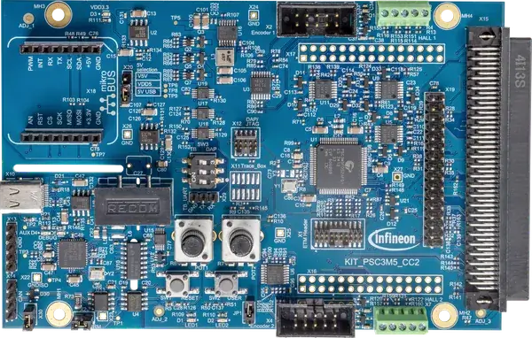

<!-- Copyright 2015-2026 Zephyr Project members and individual contributors. -->
<!-- SPDX-License-Identifier: Apache-2.0 -->
<!-- 中文翻译；编号、导航与译注为本地新增。 -->

<a id="kit_psc3m5_cc2"></a>

# 第11章\_PSOC Control C3M5通信卡2（Connectivity Card 2）

原文：[官方页面](https://docs.zephyrproject.org/latest/boards/infineon/kit_psc3m5_cc2/doc/index.html)。读取日期：2026-10-16；来源摘要见[来源记录](../SOURCES.md)。

开发板概览（Board Overview）

<a id="id1"></a>

[](images/kit_psc3m5_cc2.webp)

PSOC Control C3M5通信卡2（Connectivity Card 2）

名称（Name）：

`kit_psc3m5_cc2`

厂商（Vendor）：

[英飞凌科技（Infineon Technologies）](https://docs.zephyrproject.org/latest/boards/index.html#vendor=infineon)

状态（Status）：

维护中（Maintained）

架构（Architecture）：

[arm](https://docs.zephyrproject.org/latest/boards/index.html#arch=arm)

片上系统（SoC）：

[psc3m5fds2afq1](https://docs.zephyrproject.org/latest/boards/index.html#soc=psc3m5fds2afq1)

<a id="board-github-link"></a>

[浏览开发板源码（Browse Board Sources）](https://github.com/zephyrproject-rtos/zephyr/blob/main//boards/infineon/kit_psc3m5_cc2/doc/index.rst/../..)<a id="overview"></a>

## 概述（Overview）

[KIT_PSC3M5_CC2](https://www.infineon.com/cms/en/product/evaluation-boards/kit_psc3m5_cc2/)是[KIT_PSC3M5_MC1](https://www.infineon.com/cms/en/product/evaluation-boards/kit_psc3m5_mc1/)电机控制套件附带的通信卡，基于PSOC Control C3系列，采用Arm Cortex-M33内核的PSOC Control C3M5微控制器PSC3M5FDS2AFQ1。该卡提供套件的控制及通信接口，配套功率板（Power Board）则承载逆变器功率级（Inverter Stage）。

主要特性包括256 KB Flash、64 KB SRAM、隔离CAN FD接口、支持高分辨率的高级定时器，以及高性能可编程模拟子系统。

开发板支持mikroBUS扩展插座，并集成板载隔离式SEGGER J-Link LITE编程器／调试器。

<a id="hardware"></a>

## 硬件（Hardware）


- 片上系统（SoC）：PSOC™ Control C3M5 (PSC3M5FDS2AFQ1, PG-E-LQFP-80)
- CPU：Arm Cortex-M33，配置为180 MHz
- 闪存（Flash）：256 KB
- 静态随机存储器（SRAM）：64 KB
- 连接：隔离CAN FD、SCB（UART／SPI／I2C）
- 外设：TCPWM定时器、高性能可编程模拟子系统（HPPASS）
- 安全：Arm TrustZone-M
- 调试：板载隔离式SEGGER J-Link LITE，SWD及UART桥接
- 扩展：mikroBUS插座、100针功率板连接器
- 用户I/O：2个用户LED、1个用户按键、2个电位器

PSOC Control C3及KIT_PSC3M5_CC2更多信息见：


- [PSOC Control C3 SoC网站](https://www.infineon.com/cms/en/product/microcontroller/32-bit-psoc-arm-cortex-microcontroller/32-bit-psoc-control-arm-cortex-m33-mcu/)
- [KIT_PSC3M5_CC2开发板网站](https://www.infineon.com/cms/en/product/evaluation-boards/kit_psc3m5_cc2/)

<a id="supported-features"></a>

### 支持的功能（Supported Features）

`kit_psc3m5_cc2`开发板支持下表所列的硬件功能。

片上／板载（On-Chip / On-Board）

功能集成在片上系统（SoC）内／位于开发板上。

2 / 2

分别表示已启用／已禁用的实例数。点击数量标签，可查看开发板或SoC设备树源码（DTS）中该功能的第一个实例。

`vnd,foo`

与此功能匹配的设备树绑定兼容字符串（Compatible String）；点击链接可查看绑定文档。

<a id="kit_psc3m5_cc2-hw-features"></a>

<a id="kit_psc3m5_cc2-kit_psc3m5_cc2/psc3m5fds2afq1-hw-features-section"></a>

#### `kit_psc3m5_cc2/psc3m5fds2afq1`目标（Target）

<a id="kit_psc3m5_cc2-kit_psc3m5_cc2/psc3m5fds2afq1-hw-features-panel"></a>

<a id="kit_psc3m5_cc2-kit_psc3m5_cc2/psc3m5fds2afq1-hw-features-memory"></a>

该开发板目标的片上存储容量：64 KiB RAM、256 KiB Flash。

<a id="kit_psc3m5_cc2-kit_psc3m5_cc2/psc3m5fds2afq1-hw-features-table"></a>

<table>
<tr>
<th>类型（Type）</th>
<th>位置（Location）</th>
<th>说明（Description）</th>
<th>兼容字符串（Compatible）</th>
</tr>
<tr>
<td rowspan="1">中央处理器（CPU）</td>
<td>片上（On-Chip）</td>
<td>ARM Cortex-M33处理器（CPU）（<a href="https://github.com/zephyrproject-rtos/zephyr/blob/main/dts/arm/infineon/cat1b/psc3/psc3.cm33.dtsi?plain=1#L15">已启用：1</a>）</td>
<td><a href="../cpu_arm_riscv_binding_reference/P022_arm_cortex-m33.md#std-dtcompatible-arm-cortex-m33"><code>arm,cortex-m33</code></a></td>
</tr>
<tr>
<td rowspan="1">模数转换器（ADC）</td>
<td>片上（On-Chip）</td>
<td>PSOC C3 HPPASS逐次逼近模数转换器（SAR ADC）（<a href="https://github.com/zephyrproject-rtos/zephyr/blob/main/dts/arm/infineon/cat1b/psc3/psc3_s.dtsi?plain=1#L183">已启用：1</a>）</td>
<td><a href="../hardware/P881_Infineon高性能模拟子系统SAR绑定.md#dtbinding-infineon-hppass-sar-adc"><code>infineon,hppass-sar-adc</code></a></td>
</tr>
<tr>
<td rowspan="1">ARM 架构（ARM Architecture）</td>
<td>片上（On-Chip）</td>
<td>英飞凌串行通信模块（SCB / Serial Communication Blocks）节点（<a href="https://github.com/zephyrproject-rtos/zephyr/blob/main/dts/arm/infineon/cat1b/psc3/psc3_s.dtsi?plain=1#L316">已禁用：4</a>）</td>
<td><a href="../arm_timing_ethosu_control_binding_reference/P011_infineon_scb.md#std-dtcompatible-infineon-scb"><code>infineon,scb</code></a></td>
</tr>
<tr>
<td rowspan="2">控制器局域网（CAN）</td>
<td>片上（On-Chip）</td>
<td>英飞凌CAN FD控制器封装层（Wrapper）（<a href="https://github.com/zephyrproject-rtos/zephyr/blob/main/dts/arm/infineon/cat1b/psc3/psc3_s.dtsi?plain=1#L284">已启用：1</a>）</td>
<td><a href="../can_adi_atmel_nxp_binding_reference/P008_infineon_canfd-controller.md#std-dtcompatible-infineon-canfd-controller"><code>infineon,canfd-controller</code></a></td>
</tr>
<tr>
<td>片上（On-Chip）</td>
<td>英飞凌MCAN驱动（<a href="https://github.com/zephyrproject-rtos/zephyr/blob/main/dts/arm/infineon/cat1b/psc3/psc3_s.dtsi?plain=1#L304">已启用：1</a>；<a href="https://github.com/zephyrproject-rtos/zephyr/blob/main/dts/arm/infineon/cat1b/psc3/psc3_s.dtsi?plain=1#L293">已禁用：1</a>）</td>
<td><a href="../can_adi_atmel_nxp_binding_reference/P007_infineon_can.md#std-dtcompatible-infineon-can"><code>infineon,can</code></a></td>
</tr>
<tr>
<td rowspan="3">时钟控制（Clock Control）</td>
<td>片上（On-Chip）</td>
<td>通用固定频率时钟提供者（Fixed-Rate Clock Provider）（<a href="https://github.com/zephyrproject-rtos/zephyr/blob/main/dts/arm/infineon/cat1b/psc3/system_clocks.dtsi?plain=1#L26">已启用：5</a>；<a href="https://github.com/zephyrproject-rtos/zephyr/blob/main/dts/arm/infineon/cat1b/psc3/system_clocks.dtsi?plain=1#L44">已禁用：1</a>）</td>
<td><a href="../timer_reference/P112_Infineon固定时钟绑定.md#dtbinding-infineon-fixed-clock"><code>infineon,fixed-clock</code></a></td>
</tr>
<tr>
<td>片上（On-Chip）</td>
<td>通用固定频率时钟提供者（Fixed-Rate Clock Provider）（<a href="https://github.com/zephyrproject-rtos/zephyr/blob/main/dts/arm/infineon/cat1b/psc3/system_clocks.dtsi?plain=1#L78">已启用：8</a>；<a href="https://github.com/zephyrproject-rtos/zephyr/blob/main/dts/arm/infineon/cat1b/psc3/system_clocks.dtsi?plain=1#L162">已禁用：1</a>）</td>
<td><a href="../timer_reference/P113_Infineon固定比例时钟绑定.md#dtbinding-infineon-fixed-factor-clock"><code>infineon,fixed-factor-clock</code></a></td>
</tr>
<tr>
<td>片上（On-Chip）</td>
<td>英飞凌外设分频器（Peripheral Divider）（<a href="https://github.com/zephyrproject-rtos/zephyr/blob/main/dts/arm/infineon/cat1b/psc3/system_clocks.dtsi?plain=1#L200">已启用：3</a>；<a href="https://github.com/zephyrproject-rtos/zephyr/blob/main/dts/arm/infineon/cat1b/psc3/system_clocks.dtsi?plain=1#L176">已禁用：21</a>）</td>
<td><a href="../clock_esp_infineon_microchip_binding_reference/P009_infineon_peri-div.md#std-dtcompatible-infineon-peri-div"><code>infineon,peri-div</code></a></td>
</tr>
<tr>
<td rowspan="3">比较器（Comparator）</td>
<td>片上（On-Chip）</td>
<td>英飞凌CAT1系列低功耗比较器（LPComp / Low Power Comparator）（<a href="https://github.com/zephyrproject-rtos/zephyr/blob/main/dts/arm/infineon/cat1b/psc3/psc3_s.dtsi?plain=1#L136">已禁用：1</a>）</td>
<td><a href="../hardware/P737_Infineon低功耗比较器绑定.md#dtbinding-infineon-lp-comp"><code>infineon,lp-comp</code></a></td>
</tr>
<tr>
<td>片上（On-Chip）</td>
<td>英飞凌LPComp通道节点，为<code>infineon,lp-comp</code>的子节点（<a href="https://github.com/zephyrproject-rtos/zephyr/blob/main/dts/arm/infineon/cat1b/psc3/psc3_s.dtsi?plain=1#L142">已禁用：2</a>）</td>
<td><a href="../hardware/P738_Infineon低功耗比较器通道绑定.md#dtbinding-infineon-lp-comp-channel"><code>infineon,lp-comp-channel</code></a></td>
</tr>
<tr>
<td>片上（On-Chip）</td>
<td>英飞凌HPPASS CSG比较器（Comparator）（<a href="https://github.com/zephyrproject-rtos/zephyr/blob/main/dts/arm/infineon/cat1b/psc3/psc3_s.dtsi?plain=1#L203">已禁用：5</a>）</td>
<td><a href="../hardware/P736_Infineon斜坡发生器比较器绑定.md#dtbinding-infineon-hppass-csg-comp"><code>infineon,hppass-csg-comp</code></a></td>
</tr>
<tr>
<td rowspan="1">计数器（Counter）</td>
<td>片上（On-Chip）</td>
<td>英飞凌TCPWM计数器（Counter）（<a href="https://github.com/zephyrproject-rtos/zephyr/blob/main/dts/arm/infineon/cat1b/psc3/psc3_s.dtsi?plain=1#L411">已禁用：20</a>）</td>
<td><a href="../microchip_soc_counter_binding_reference/P002_infineon_tcpwm-counter.md#std-dtcompatible-infineon-tcpwm-counter"><code>infineon,tcpwm-counter</code></a></td>
</tr>
<tr>
<td rowspan="2">密码学加速器（Cryptographic Accelerator）</td>
<td>片上（On-Chip）</td>
<td>英飞凌MXCRYPTOLITE真随机数发生器（TRNG）（<a href="https://github.com/zephyrproject-rtos/zephyr/blob/main/dts/arm/infineon/cat1b/psc3/psc3_s.dtsi?plain=1#L862">已启用：1</a>）</td>
<td><a href="../crypto_aes_sha_ccm_binding_reference/P012_infineon_mxcryptolite-trng.md#std-dtcompatible-infineon-mxcryptolite-trng"><code>infineon,mxcryptolite-trng</code></a></td>
</tr>
<tr>
<td>片上（On-Chip）</td>
<td>英飞凌MXCRYPTOLITE密码引擎（Crypto Engine），AES／SHA-256（<a href="https://github.com/zephyrproject-rtos/zephyr/blob/main/dts/arm/infineon/cat1b/psc3/psc3_s.dtsi?plain=1#L867">已启用：1</a>）</td>
<td><a href="../crypto_aes_sha_ccm_binding_reference/P011_infineon_mxcryptolite-crypto.md#std-dtcompatible-infineon-mxcryptolite-crypto"><code>infineon,mxcryptolite-crypto</code></a></td>
</tr>
<tr>
<td rowspan="1">数模转换器（DAC）</td>
<td>片上（On-Chip）</td>
<td>英飞凌HPPASS CSG数模转换器（DAC）（<a href="https://github.com/zephyrproject-rtos/zephyr/blob/main/dts/arm/infineon/cat1b/psc3/psc3_s.dtsi?plain=1#L233">已禁用：5</a>）</td>
<td><a href="../hardware/P779_Infineon斜坡发生器数模转换器绑定.md#dtbinding-infineon-hppass-csg-dac"><code>infineon,hppass-csg-dac</code></a></td>
</tr>
<tr>
<td rowspan="1">直接存储器访问（DMA）</td>
<td>片上（On-Chip）</td>
<td>英飞凌CAT1 DMA（<a href="https://github.com/zephyrproject-rtos/zephyr/blob/main/dts/arm/infineon/cat1b/psc3/psc3_s.dtsi?plain=1#L810">已禁用：2</a>）</td>
<td><a href="../dma_binding_reference/P018_infineon_dma.md#std-dtcompatible-infineon-dma"><code>infineon,dma</code></a></td>
</tr>
<tr>
<td rowspan="1">闪存控制器（Flash Controller）</td>
<td>片上（On-Chip）</td>
<td>英飞凌CAT1闪存控制器（<a href="https://github.com/zephyrproject-rtos/zephyr/blob/main/dts/arm/infineon/cat1b/psc3/psc3_s.dtsi?plain=1#L17">已启用：1</a>）</td>
<td><a href="../flash_adi_microchip_nordic_binding_reference/P014_infineon_flash-controller.md#std-dtcompatible-infineon-flash-controller"><code>infineon,flash-controller</code></a></td>
</tr>
<tr>
<td rowspan="2">通用输入输出与接插件（GPIO &amp; Headers）</td>
<td>片上（On-Chip）</td>
<td>英飞凌GPIO端口（<a href="https://github.com/zephyrproject-rtos/zephyr/blob/main/dts/arm/infineon/cat1b/psc3/psc3_s.dtsi?plain=1#L36">已启用：10</a>）</td>
<td><a href="../gpio_infineon_intel_ite_microchip_binding_reference/P001_infineon_gpio.md#std-dtcompatible-infineon-gpio"><code>infineon,gpio</code></a></td>
</tr>
<tr>
<td>板载（On-Board）</td>
<td>通过Mikro BUS排针引出的GPIO引脚（<a href="https://github.com/zephyrproject-rtos/zephyr/blob/main/boards/infineon/kit_psc3m5_cc2/kit_psc3m5_cc2-common.dtsi?plain=1#L67">已启用：1</a>）</td>
<td><a href="../gpio_microchip_nordic_nuvoton_binding_reference/P006_mikro-bus.md#std-dtcompatible-mikro-bus"><code>mikro-bus</code></a></td>
</tr>
<tr>
<td rowspan="1">输入（Input）</td>
<td>板载（On-Board）</td>
<td>一组绑定到 GPIO 的输入按键（GPIO-Bound Input Keys）（<a href="https://github.com/zephyrproject-rtos/zephyr/blob/main/boards/infineon/kit_psc3m5_cc2/kit_psc3m5_cc2-common.dtsi?plain=1#L43">已启用：1</a>）</td>
<td><a href="../hardware/P563_GPIO按键绑定.md#std-dtcompatible-gpio-keys"><code>gpio-keys</code></a></td>
</tr>
<tr>
<td rowspan="1">中断控制器（Interrupt Controller）</td>
<td>片上（On-Chip）</td>
<td>ARMv8-M嵌套向量中断控制器（NVIC / Nested Vectored Interrupt Controller）（<a href="https://github.com/zephyrproject-rtos/zephyr/blob/main/dts/arm/armv8-m.dtsi?plain=1#L13">已启用：1</a>）</td>
<td><a href="../arm_interrupt_timer_binding_reference/P003_ARMv8_M_NVIC.md#std-dtcompatible-arm-v8m-nvic"><code>arm,v8m-nvic</code></a></td>
</tr>
<tr>
<td rowspan="1">处理器间／进程间通信（IPC）</td>
<td>片上（On-Chip）</td>
<td>英飞凌核间通信（IPC）实例（<a href="https://github.com/zephyrproject-rtos/zephyr/blob/main/dts/arm/infineon/cat1b/psc3/psc3_s.dtsi?plain=1#L275">已禁用：1</a>）</td>
<td><a href="../intercore_reference/P099_Infineon处理器间通信绑定.md#dtbinding-infineon-ipc"><code>infineon,ipc</code></a></td>
</tr>
<tr>
<td rowspan="1">发光二极管（LED）</td>
<td>板载（On-Board）</td>
<td>一组由 GPIO 控制的 LED（GPIO-Controlled LEDs）（<a href="https://github.com/zephyrproject-rtos/zephyr/blob/main/boards/infineon/kit_psc3m5_cc2/kit_psc3m5_cc2-common.dtsi?plain=1#L23">已启用：1</a>）</td>
<td><a href="../hardware/P564_GPIO指示灯绑定.md#dtbinding-gpio-leds"><code>gpio-leds</code></a></td>
</tr>
<tr>
<td rowspan="3">多功能设备（Multi-Function Device）</td>
<td>片上（On-Chip）</td>
<td>英飞凌高性能可编程模拟子系统（HPPASS / High Performance Programmable Analog Sub-System）多功能设备（MFD）（<a href="https://github.com/zephyrproject-rtos/zephyr/blob/main/dts/arm/infineon/cat1b/psc3/psc3_s.dtsi?plain=1#L155">已启用：1</a>）</td>
<td><a href="../hardware/P724_Infineon高性能可编程模拟子系统绑定.md#dtbinding-infineon-hppass-analog"><code>infineon,hppass-analog</code></a></td>
</tr>
<tr>
<td>片上（On-Chip）</td>
<td>英飞凌HPPASS比较器斜坡发生器（CSG / Comparator Slope Generator）多功能设备（<a href="https://github.com/zephyrproject-rtos/zephyr/blob/main/dts/arm/infineon/cat1b/psc3/psc3_s.dtsi?plain=1#L191">已禁用：1</a>）</td>
<td><a href="../hardware/P726_Infineon斜坡发生器绑定.md#dtbinding-infineon-hppass-csg"><code>infineon,hppass-csg</code></a></td>
</tr>
<tr>
<td>片上（On-Chip）</td>
<td>英飞凌MXCRYPTOLITE多功能设备（MFD）（<a href="https://github.com/zephyrproject-rtos/zephyr/blob/main/dts/arm/infineon/cat1b/psc3/psc3_s.dtsi?plain=1#L858">已启用：1</a>）</td>
<td><a href="../hardware/P728_Infineon轻量加密硬件模块绑定.md#dtbinding-infineon-mxcryptolite"><code>infineon,mxcryptolite</code></a></td>
</tr>
<tr>
<td rowspan="1">存储技术设备（MTD）</td>
<td>片上（On-Chip）</td>
<td>闪存（Flash）节点（<a href="https://github.com/zephyrproject-rtos/zephyr/blob/main/dts/arm/infineon/cat1b/mpns/psc3m5fds2afq1_s.dtsi?plain=1#L19">已启用：1</a>）</td>
<td><a href="../mtd_nxp_st_ti_partition_binding_reference/P013_soc-nv-flash.md#std-dtcompatible-soc-nv-flash"><code>soc-nv-flash</code></a></td>
</tr>
<tr>
<td rowspan="1">引脚控制（Pin Control）</td>
<td>片上（On-Chip）</td>
<td>英飞凌（Infineon）CAT1引脚控制容器（Pinctrl Container）（<a href="https://github.com/zephyrproject-rtos/zephyr/blob/main/dts/arm/infineon/cat1b/psc3/psc3_s.dtsi?plain=1#L24">已启用：1</a>）</td>
<td><a href="../pinctrl_infineon_nordic_nxp_binding_reference/P001_infineon_pinctrl.md#std-dtcompatible-infineon-pinctrl"><code>infineon,pinctrl</code></a></td>
</tr>
<tr>
<td rowspan="2">电源管理（Power Management）</td>
<td>片上（On-Chip）</td>
<td>英飞凌休眠／休眠RAM（Hibernate / Hibernate-RAM）唤醒源配置（<a href="https://github.com/zephyrproject-rtos/zephyr/blob/main/dts/arm/infineon/cat1b/psc3/psc3.cm33.dtsi?plain=1#L66">已禁用：1</a>）</td>
<td><a href="../power_control_binding_reference/P004_infineon_hibernate-wakeup.md#std-dtcompatible-infineon-hibernate-wakeup"><code>infineon,hibernate-wakeup</code></a></td>
</tr>
<tr>
<td>片上（On-Chip）</td>
<td>英飞凌CAT1B电源控制（<a href="https://github.com/zephyrproject-rtos/zephyr/blob/main/dts/arm/infineon/cat1b/psc3/system_clocks.dtsi?plain=1#L17">已启用：1</a>）</td>
<td><a href="../power_control_binding_reference/P003_infineon_cat1b-power.md#std-dtcompatible-infineon-cat1b-power"><code>infineon,cat1b-power</code></a></td>
</tr>
<tr>
<td rowspan="1">脉宽调制（PWM）</td>
<td>片上（On-Chip）</td>
<td>英飞凌TCPWM脉宽调制（PWM）（<a href="https://github.com/zephyrproject-rtos/zephyr/blob/main/dts/arm/infineon/cat1b/psc3/psc3_s.dtsi?plain=1#L405">已禁用：20</a>）</td>
<td><a href="../pwm_adi_esp_infineon_binding_reference/P019_infineon_tcpwm-pwm.md#std-dtcompatible-infineon-tcpwm-pwm"><code>infineon,tcpwm-pwm</code></a></td>
</tr>
<tr>
<td rowspan="1">实时时钟（RTC）</td>
<td>片上（On-Chip）</td>
<td>英飞凌CAT1系列实时时钟（RTC）设备（<a href="https://github.com/zephyrproject-rtos/zephyr/blob/main/dts/arm/infineon/cat1b/psc3/psc3_s.dtsi?plain=1#L384">已禁用：1</a>）</td>
<td><a href="../rtc_binding_reference/P007_infineon_rtc.md#std-dtcompatible-infineon-rtc"><code>infineon,rtc</code></a></td>
</tr>
<tr>
<td rowspan="1">串行控制器（Serial Controller）</td>
<td>片上（On-Chip）</td>
<td>英飞凌CAT1 UART（<a href="https://github.com/zephyrproject-rtos/zephyr/blob/main/dts/arm/infineon/cat1b/psc3/psc3_s.dtsi?plain=1#L325">已启用：1</a>）</td>
<td><a href="../uart_espressif_infineon_microchip_binding_reference/P008_infineon_uart.md#std-dtcompatible-infineon-uart"><code>infineon,uart</code></a></td>
</tr>
<tr>
<td rowspan="1">串行外设接口（SPI）</td>
<td>片上（On-Chip）</td>
<td>英飞凌CAT1 SPI（<a href="https://github.com/zephyrproject-rtos/zephyr/blob/main/dts/arm/infineon/cat1b/psc3/psc3_s.dtsi?plain=1#L343">已启用：1</a>）</td>
<td><a href="../spi_adi_atmel_esp_binding_reference/P017_infineon_spi.md#std-dtcompatible-infineon-spi"><code>infineon,spi</code></a></td>
</tr>
<tr>
<td rowspan="1">静态随机存储器（SRAM）</td>
<td>片上（On-Chip）</td>
<td>通用片上静态随机存储器（SRAM）（<a href="https://github.com/zephyrproject-rtos/zephyr/blob/main/dts/arm/infineon/cat1b/psc3/psc3_s.dtsi?plain=1#L12">已启用：1</a>）</td>
<td><a href="../hardware/P567_内存映射SRAM绑定.md#dtbinding-mmio-sram"><code>mmio-sram</code></a></td>
</tr>
<tr>
<td rowspan="3">定时器（Timer）</td>
<td>片上（On-Chip）</td>
<td>ARMv8-M系统节拍（System Tick）（<a href="https://github.com/zephyrproject-rtos/zephyr/blob/main/dts/arm/armv8-m.dtsi?plain=1#L21">已启用：1</a>）</td>
<td><a href="../arm_interrupt_timer_binding_reference/P007_ARMv8_M_SysTick.md#std-dtcompatible-arm-armv8m-systick"><code>arm,armv8m-systick</code></a></td>
</tr>
<tr>
<td>片上（On-Chip）</td>
<td>英飞凌低功耗定时器（<a href="https://github.com/zephyrproject-rtos/zephyr/blob/main/dts/arm/infineon/cat1b/psc3/psc3_s.dtsi?plain=1#L377">已启用：1</a>）</td>
<td><a href="../mcu_timer_binding_reference/P008_infineon_lp-timer.md#std-dtcompatible-infineon-lp-timer"><code>infineon,lp-timer</code></a></td>
</tr>
<tr>
<td>片上（On-Chip）</td>
<td>英飞凌TCPWM定时器（Timer）（<a href="https://github.com/zephyrproject-rtos/zephyr/blob/main/dts/arm/infineon/cat1b/psc3/psc3_s.dtsi?plain=1#L397">已禁用：20</a>）</td>
<td><a href="../mcu_timer_binding_reference/P009_infineon_tcpwm.md#std-dtcompatible-infineon-tcpwm"><code>infineon,tcpwm</code></a></td>
</tr>
<tr>
<td rowspan="1">看门狗（Watchdog）</td>
<td>片上（On-Chip）</td>
<td>英飞凌CAT1看门狗（Watchdog）（<a href="https://github.com/zephyrproject-rtos/zephyr/blob/main/dts/arm/infineon/cat1b/psc3/psc3_s.dtsi?plain=1#L370">已启用：1</a>）</td>
<td><a href="../soc_pmic_watchdog_binding_reference/P001_infineon_watchdog.md#std-dtcompatible-infineon-watchdog"><code>infineon,watchdog</code></a></td>
</tr>
</table>

<a id="connections-and-ios"></a>

### 连接与输入输出（Connections and IOs）

<a id="leds"></a>

#### 发光二极管（LEDs）

<table>
<tr>
<th>名称（Name）</th>
<th>丝印（Silkscreen）</th>
<th>颜色（Colour）</th>
<th>GPIO引脚（Pin）</th>
</tr>
<tr>
<td>LED0</td>
<td>LED1</td>
<td>黄色（Yellow）</td>
<td>P9.4（高电平有效 / active high）</td>
</tr>
<tr>
<td>LED1</td>
<td>LED2</td>
<td>红色（Red）</td>
<td>P9.5（高电平有效 / active high）</td>
</tr>
</table>

注意，设备树名称从0开始编号，开发板丝印从1开始。

两个用户LED均不能由硬件PWM驱动，因为P9.4和P9.5没有TCPWM复用功能。

<a id="push-buttons"></a>

#### 按键（Push Buttons）

<table>
<tr>
<th>名称（Name）</th>
<th>GPIO引脚（Pin）</th>
</tr>
<tr>
<td>SW1</td>
<td>P4.6（低电平有效 / active low）</td>
</tr>
</table>

<a id="default-zephyr-peripheral-mapping"></a>

#### Zephyr默认外设映射（Default Peripheral Mapping）

<table>
<tr>
<th>引脚（Pin）</th>
<th>功能（Function）</th>
<th>用途（Usage）</th>
</tr>
<tr>
<td>P2.2</td>
<td>SCB1 UART 接收（RX）</td>
<td>控制台接收（Console RX）</td>
</tr>
<tr>
<td>P2.3</td>
<td>SCB1 UART 发送（TX）</td>
<td>控制台发送（Console TX）</td>
</tr>
<tr>
<td>P6.2</td>
<td>CAN1接收（RX）</td>
<td>CAN FD接收（Receive）</td>
</tr>
<tr>
<td>P6.3</td>
<td>CAN1发送（TX）</td>
<td>CAN FD发送（Transmit）</td>
</tr>
<tr>
<td>P5.0</td>
<td>SCB3 SPI主机输出从机输入（MOSI）</td>
<td>mikroBUS主机输出从机输入（MOSI）</td>
</tr>
<tr>
<td>P5.1</td>
<td>SCB3 SPI主机输入从机输出（MISO）</td>
<td>mikroBUS主机输入从机输出（MISO）</td>
</tr>
<tr>
<td>P5.2</td>
<td>SCB3 SPI时钟（CLK）</td>
<td>mikroBUS串行时钟（SCK）</td>
</tr>
<tr>
<td>P5.3</td>
<td>SCB3 SPI片选0（SELECT0）</td>
<td>mikroBUS片选（CS）</td>
</tr>
<tr>
<td>P0.0</td>
<td>通用输入输出（GPIO）</td>
<td>mikroBUS中断（INT）</td>
</tr>
<tr>
<td>P0.1</td>
<td>通用输入输出（GPIO）</td>
<td>mikroBUS脉宽调制（PWM）</td>
</tr>
<tr>
<td>P9.4</td>
<td>通用输入输出（GPIO）</td>
<td>LED0</td>
</tr>
<tr>
<td>P9.5</td>
<td>通用输入输出（GPIO）</td>
<td>LED1</td>
</tr>
<tr>
<td>P4.6</td>
<td>通用输入输出（GPIO）</td>
<td>按键SW1</td>
</tr>
</table>

<a id="system-clock"></a>

### 系统时钟（System Clock）

PSOC Control C3M5使用内部振荡器，配置的时钟路径如下：


- 锁频环（FLL）：96 MHz
- 低功耗数字锁相环0（DPLL-LP0）：180 MHz
- 低功耗数字锁相环1（DPLL-LP1）：240 MHz
- CLK_HF0：180 MHz，系统时钟
- CLK_HF2：80 MHz，用于外设组4，包括UART、CAN FD和SPI
- CLK_HF3：240 MHz

将CLK_HF2分频至80 MHz，使CAN FD位时序（Bit Timing）符合CiA 601-3。

P1.0和P1.1安装了16 MHz晶体，但Zephyr目前没有提供PSOC Control C3外部晶体振荡器时钟节点，因此未使用。板上未安装32.768 kHz钟表晶体（Watch Crystal），设备树中禁用了对应振荡器，P0.0和P0.1改为连接到mikroBUS插座。

<a id="serial-port"></a>

### 串口（Serial Port）

PSOC Control C3M5有六个SCB接口，可配置为UART、SPI或I2C。Zephyr控制台分配到SCB1（uart1），通过板载J-Link LITE USB-UART桥接器连接主机。此板未连接硬件流控制信号。

默认通信设置为115200、8N1。

<a id="can-fd"></a>

### 灵活数据速率控制器局域网（CAN FD）

CAN接口采用电气隔离（Galvanic Isolation）。控制器信号通过2DIB1400F双路数字隔离器，连接到英飞凌TLE9371VSJ收发器：

```text
P6.3 CAN1_TX --> INA  ==||== OUTA --> TXD --+ TLE9371VSJ +-- CANH
P6.2 CAN1_RX <-- OUTB ==||== INB  <-- RXD --+  STB = GND +-- CANL
                  2DIB1400F
```

收发器待机（Standby）引脚连接隔离侧地。由于待机为高电平有效，收发器始终处于正常模式，无需软件控制。因此开发板设备树没有`can-transceiver-gpio`节点，`can1`也没有`phys`属性，CAN应用无需覆盖文件即可运行。

<a id="mikrobus-socket"></a>

### mikroBUS插座（Socket）

开发板提供`mikrobus_header` GPIO关联节点（Nexus）及`mikrobus_spi`总线标签，可直接为此板构建`boards/shields`中的SPI及GPIO扩展板：

```text
west build -b kit_psc3m5_cc2 --shield mikroe_adc_click samples/basic/blinky
```

<a id="header-pin-mapping"></a>

#### 排针引脚映射（Header Pin Mapping）

<table>
<tr>
<th>索引（Index）</th>
<th>信号（Signal）</th>
<th>引脚（Pin）</th>
</tr>
<tr>
<td>0</td>
<td>模拟输入（AN）</td>
<td>未映射（Not Mapped）</td>
</tr>
<tr>
<td>1</td>
<td>复位（RST）</td>
<td>未映射（Not Mapped）</td>
</tr>
<tr>
<td>2</td>
<td>片选（CS）</td>
<td>P5.3</td>
</tr>
<tr>
<td>3</td>
<td>串行时钟（SCK）</td>
<td>P5.2</td>
</tr>
<tr>
<td>4</td>
<td>主机输入从机输出（MISO）</td>
<td>P5.1</td>
</tr>
<tr>
<td>5</td>
<td>主机输出从机输入（MOSI）</td>
<td>P5.0</td>
</tr>
<tr>
<td>6</td>
<td>脉宽调制（PWM）</td>
<td>P0.1</td>
</tr>
<tr>
<td>7</td>
<td>中断（INT）</td>
<td>P0.0</td>
</tr>
<tr>
<td>8</td>
<td>接收（RX）</td>
<td>P2.2</td>
</tr>
<tr>
<td>9</td>
<td>发送（TX）</td>
<td>P2.3</td>
</tr>
<tr>
<td>10</td>
<td>串行时钟线（SCL）</td>
<td>未映射（Not Mapped）</td>
</tr>
<tr>
<td>11</td>
<td>串行数据线（SDA）</td>
<td>未映射（Not Mapped）</td>
</tr>
</table>

AN是与电位器POT1共用的模拟信号网络，不能作为GPIO；RST通过上拉接3V3，未连接微控制器。SCL及SDA与微控制器之间的0 Ω连接电阻未安装，详见下文。上述四个引脚均未纳入关联映射。未声明`mikrobus_uart`：P2.2和P2.3默认连接隔离式板载调试器的UART桥接器，也是Zephyr控制台。板级开关可将它们改接mikroBUS排针，但会失去调试控制台，因此设备树保留出厂默认配置，没有对排针UART建模。

<a id="spi"></a>

#### 串行外设接口（SPI）

SCB3提供插座的SPI信号：

<table>
<tr>
<th>引脚（Pin）</th>
<th>串行外设接口（SPI）</th>
</tr>
<tr>
<td>P5.0</td>
<td>主机输出从机输入（MOSI）</td>
</tr>
<tr>
<td>P5.1</td>
<td>主机输入从机输出（MISO）</td>
</tr>
<tr>
<td>P5.2</td>
<td>时钟（CLK）</td>
</tr>
<tr>
<td>P5.3</td>
<td>片选（CS）</td>
</tr>
</table>

片选由SCB驱动，而非GPIO。

<a id="i2c-is-not-available"></a>

#### I2C不可用（Not Available）

插座SCL及SDA未连接微控制器。连接到SCB3数据线的0 Ω电阻未安装，因此这些引脚只连接到插座端。

因此没有声明`mikrobus_i2c`，关联映射索引10和11保持未映射，使I2C扩展板在构建时即失败，避免到硬件运行时才暴露问题。

<a id="analog-inputs"></a>

### 模拟输入（Analog Inputs）

HPPASS SAR ADC提供28个通道：先是12个直接采样通道0–11，随后是4个多路复用采样器（Muxed Samplers），每个具有4个通道位置，分别为12–15、16–19、20–23、24–27，共由16个专用模拟引脚输入。

<table>
<tr>
<th>通道（Channel）</th>
<th>引脚（Pin）</th>
<th>网络（Net）</th>
<th>用途（Usage）</th>
</tr>
<tr>
<td>0-2</td>
<td>AN_A0-A2</td>
<td>电机1相电流U／V／W（Phase Current）</td>
<td>电机驱动（Motor Drive）</td>
</tr>
<tr>
<td>3-4</td>
<td>AN_A3-A4</td>
<td>电机1直流链路IDC／VDC</td>
<td>电机驱动（Motor Drive）</td>
</tr>
<tr>
<td>5-7</td>
<td>AN_A5-A7</td>
<td>功率因数校正（PFC）IL0／IL1／Iac</td>
<td>PFC检测（Sense）</td>
</tr>
<tr>
<td>8-10</td>
<td>AN_B0-B2</td>
<td>电机2相电流U／V／W</td>
<td>电机驱动（Motor Drive）</td>
</tr>
<tr>
<td>11</td>
<td>AN_B3</td>
<td>电机2直流链路IDC</td>
<td>电机驱动（Motor Drive）</td>
</tr>
<tr>
<td>12</td>
<td>AN_B4</td>
<td>Vac0</td>
<td>电位器POT1（Potentiometer）</td>
</tr>
<tr>
<td>16</td>
<td>AN_B5</td>
<td>Vac1</td>
<td>电位器POT2（Potentiometer）</td>
</tr>
<tr>
<td>20</td>
<td>AN_B6</td>
<td>BrakeTemp1</td>
<td>制动热敏电阻（Brake Thermistor）</td>
</tr>
<tr>
<td>24</td>
<td>AN_B7</td>
<td>PFC母线电压（Vbus PFC）</td>
<td>PFC检测（Sense）</td>
</tr>
</table>

只有通道12和16是用户输入，其余通道承载通过功率板连接器送到微控制器的电机驱动及PFC检测信号。

电位器POT1与mikroBUS AN共用信号网络，因此驱动AN的Click扩展板也会影响POT1读数；POT2则独立于该插座。

<a id="power-board-connector"></a>

### 功率板连接器（Power Board Connector）

上文未列出的引脚是两路电机的逆变器栅极驱动（Gate Drive）及功率级使能信号，均连接功率板连接器。开发板设备树未启用这些输出；需要某一输出的应用应在自身覆盖文件中启用。

警告（Warning）

连接功率板时，不要运行驱动这些引脚的应用。同时驱动某个高侧信号及与其配对的低侧信号，会导致半桥直通（Shoot-Through）。

<a id="building"></a>

## 构建（Building）

下面以[Hello World](../getting_started/P005_HelloWorld示例.md#hello_world)应用为例。

```text
# From the root of the zephyr repository
west build -b kit_psc3m5_cc2 samples/hello_world
```

<a id="programming-and-debugging"></a>

## 烧录与调试（Programming and Debugging）

`kit_psc3m5_cc2`开发板支持下表所列的运行工具（Runners）及相关west命令。

<table>
<tr>
<th></th>
<th>烧录（flash）</th>
<th>调试（debug）</th>
<th>连接调试会话（attach）</th>
<th>实时传输（rtt）</th>
<th>复位（reset）</th>
<th>调试服务器（debugserver）</th>
</tr>
<tr>
<td><a href="https://docs.zephyrproject.org/latest/develop/flash_debug/host-tools.html#runner-jlink">jlink</a></td>
<td>✅（默认 / default）</td>
<td>✅（默认 / default）</td>
<td>✅</td>
<td>✅</td>
<td>✅</td>
<td>✅</td>
</tr>
</table>

[KIT_PSC3M5_CC2](https://www.infineon.com/cms/en/product/evaluation-boards/kit_psc3m5_cc2/)集成板载隔离式SEGGER J-Link LITE编程器／调试器，可编程及调试PSOC Control C3M5 Cortex-M33内核。主机必须安装SEGGER J-Link软件包。（[SEGGER J-Link软件（Software）](https://www.segger.com/downloads/jlink/)）

<a id="configuring-a-console"></a>

### 配置控制台（Configuring a Console）

使用USB线缆连接计算机与[KIT_PSC3M5_CC2](https://www.infineon.com/cms/en/product/evaluation-boards/kit_psc3m5_cc2/)的调试USB连接器，选择minicom、PuTTY等串口终端，并使用以下设置：


- 速率（Speed）：115200波特率
- 数据位（Data）：8位
- 奇偶校验（Parity）：无（None）
- 停止位（Stop Bits）：1位

<a id="flashing"></a>

### 烧录（Flashing）

构建并烧录应用：

```text
west build -b kit_psc3m5_cc2 -p always samples/hello_world
west flash
```

控制台上应显示以下消息：

```text
*** Booting Zephyr OS build vX.Y.Z ***
Hello World! kit_psc3m5_cc2
```

<a id="debugging"></a>

### 调试（Debugging）

```text
# From the root of the zephyr repository
west build -b kit_psc3m5_cc2 samples/hello_world
west debug
```

GDB控制台启动后，可设置断点（Breakpoints），并对PSOC Control C3M5 Cortex-M33内核执行标准GDB调试。

<a id="references"></a>

## 参考资料（References）

## 译注

CC2按原文配置180 MHz；模拟输入、隔离CAN、mikroBUS跳线及电机功率板连接条件分别保留。原文禁止功率板连接时运行未正确控制门极输出的应用，避免半桥上下管同时导通。BOOT_SIMPLE_APP与MCUboot应用验证是不同阶段；安全配置涉及不可逆生命周期变更。

---

[上一章](P010_Infineon_Technologies.md) · [返回大纲](大纲.md) · [全站翻译进度](../PROGRESS.md) · [下一章](P012_PSOC_Control_C3M5_Evaluation_Kit.md)
