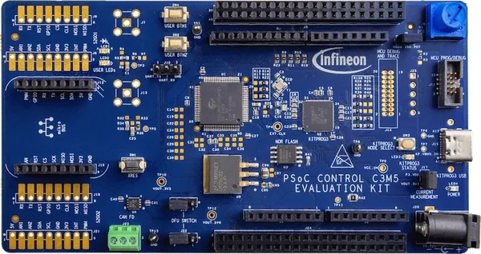

<!-- Copyright 2015-2026 Zephyr Project members and individual contributors. -->
<!-- SPDX-License-Identifier: Apache-2.0 -->
<!-- 中文翻译；编号、导航与译注为本地新增。 -->

<a id="kit_psc3m5_evk"></a>

# 第12章\_PSOC Control C3M5评估套件（Evaluation Kit）

原文：[官方页面](https://docs.zephyrproject.org/latest/boards/infineon/kit_psc3m5_evk/doc/index.html)。读取日期：2026-10-16；来源摘要见[来源记录](../SOURCES.md)。

开发板概览（Board Overview）

<a id="id1"></a>

[](images/kit_psc3m5_evk.webp)

PSOC Control C3M5评估套件（Evaluation Kit）

名称（Name）：

`kit_psc3m5_evk`

厂商（Vendor）：

[英飞凌科技（Infineon Technologies）](https://docs.zephyrproject.org/latest/boards/index.html#vendor=infineon)

状态（Status）：

维护中（Maintained）

架构（Architecture）：

[arm](https://docs.zephyrproject.org/latest/boards/index.html#arch=arm)

片上系统（SoC）：

[psc3m5fds2afq1](https://docs.zephyrproject.org/latest/boards/index.html#soc=psc3m5fds2afq1)

<a id="board-github-link"></a>

[浏览开发板源码（Browse Board Sources）](https://github.com/zephyrproject-rtos/zephyr/blob/main//boards/infineon/kit_psc3m5_evk/doc/index.rst/../..)<a id="overview"></a>

## 概述（Overview）

[KIT_PSC3M5_EVK](https://www.infineon.com/cms/en/product/evaluation-boards/kit_psc3m5_evk/)是基于PSOC Control C3系列的评估套件，采用PSC3M5FDS2AFQ1微控制器，Arm Cortex-M33内核最高240 MHz，面向工业控制和电机驱动应用。

主要特性包括256 KB Flash、64 KB SRAM、两个CAN FD接口、支持高分辨率的高级定时器、六个SCB接口及高性能可编程模拟子系统。

开发板支持Arduino Uno R3和mikroBUS扩展排针，集成通过USB Type-C连接的[KitProg3](https://github.com/Infineon/KitProg3)编程器／调试器。

KIT_PSC3M5_EVK支持以下开发板变体：


- `kit_psc3m5_evk`：默认安全变体（Secure Variant），使用Arm TrustZone-M
- `kit_psc3m5_evk/psc3m5fds2afq1/norflash`：NOR闪存变体，需要硬件改焊（Board Rework）（[开发板硬件改装（Board Rework）](#kit-psc3m5-evk-norflash-rework)）

<a id="hardware"></a>

## 硬件（Hardware）


- 片上系统（SoC）：PSOC™ Control C3M5 (PSC3M5FDS2AFQ1)
- CPU：Arm Cortex-M33，240 MHz
- 闪存（Flash）：256 KB
- 静态随机存储器（SRAM）：64 KB
- 连接：2路CAN FD、6路SCB（UART／SPI／I2C）
- 外设：高分辨率定时器、可编程模拟外设、比较器
- 安全：Arm TrustZone-M
- 调试：板载KitProg3，提供SWD及UART桥接
- 电源：USB供电，工作电压3.3 V
- 连接器：USB Type-C，用于编程及供电
- 扩展：Arduino Uno R3、mikroBUS、两个40针排针
- 用户I/O：2个用户LED、2个用户按键、电位器

PSOC Control C3及KIT_PSC3M5_EVK更多信息见：


- [PSOC Control C3 SoC网站](https://www.infineon.com/cms/en/product/microcontroller/32-bit-psoc-arm-cortex-microcontroller/32-bit-psoc-control-arm-cortex-m33-mcu/)
- [KIT_PSC3M5_EVK开发板网站](https://www.infineon.com/cms/en/product/evaluation-boards/kit_psc3m5_evk/)

<a id="kit-contents"></a>

### 套件内容（Kit Contents）


- PSOC Control C3M5 Evaluation Kit开发板
- USB Type-A转Type-C线缆
- 跳线（Jumper Wires）
- 快速入门指南，印在包装上

<a id="supported-features"></a>

### 支持的功能（Supported Features）

`kit_psc3m5_evk`开发板支持下表所列的硬件功能。

片上／板载（On-Chip / On-Board）

功能集成在片上系统（SoC）内／位于开发板上。

2 / 2

分别表示已启用／已禁用的实例数。点击数量标签，可查看开发板或SoC设备树源码（DTS）中该功能的第一个实例。

`vnd,foo`

与此功能匹配的设备树绑定兼容字符串（Compatible String）；点击链接可查看绑定文档。

<a id="kit_psc3m5_evk-hw-features"></a>

<a id="kit_psc3m5_evk-kit_psc3m5_evk/psc3m5fds2afq1-hw-features-section"></a>

#### `kit_psc3m5_evk/psc3m5fds2afq1`目标（Target）

<a id="kit_psc3m5_evk-kit_psc3m5_evk/psc3m5fds2afq1-hw-features-panel"></a>

<a id="kit_psc3m5_evk-kit_psc3m5_evk/psc3m5fds2afq1-hw-features-memory"></a>

该开发板目标的片上存储容量：64 KiB RAM、256 KiB Flash。

<a id="kit_psc3m5_evk-kit_psc3m5_evk/psc3m5fds2afq1-hw-features-table"></a>

<table>
<tr>
<th>类型（Type）</th>
<th>位置（Location）</th>
<th>说明（Description）</th>
<th>兼容字符串（Compatible）</th>
</tr>
<tr>
<td rowspan="1">中央处理器（CPU）</td>
<td>片上（On-Chip）</td>
<td>ARM Cortex-M33处理器（CPU）（<a href="https://github.com/zephyrproject-rtos/zephyr/blob/main/dts/arm/infineon/cat1b/psc3/psc3.cm33.dtsi?plain=1#L15">已启用：1</a>）</td>
<td><a href="../cpu_arm_riscv_binding_reference/P022_arm_cortex-m33.md#std-dtcompatible-arm-cortex-m33"><code>arm,cortex-m33</code></a></td>
</tr>
<tr>
<td rowspan="1">模数转换器（ADC）</td>
<td>片上（On-Chip）</td>
<td>PSOC C3 HPPASS逐次逼近模数转换器（SAR ADC）（<a href="https://github.com/zephyrproject-rtos/zephyr/blob/main/dts/arm/infineon/cat1b/psc3/psc3_s.dtsi?plain=1#L183">已启用：1</a>）</td>
<td><a href="../hardware/P881_Infineon高性能模拟子系统SAR绑定.md#dtbinding-infineon-hppass-sar-adc"><code>infineon,hppass-sar-adc</code></a></td>
</tr>
<tr>
<td rowspan="1">ARM 架构（ARM Architecture）</td>
<td>片上（On-Chip）</td>
<td>英飞凌串行通信模块（SCB / Serial Communication Blocks）节点（<a href="https://github.com/zephyrproject-rtos/zephyr/blob/main/dts/arm/infineon/cat1b/psc3/psc3_s.dtsi?plain=1#L316">已禁用：5</a>）</td>
<td><a href="../arm_timing_ethosu_control_binding_reference/P011_infineon_scb.md#std-dtcompatible-infineon-scb"><code>infineon,scb</code></a></td>
</tr>
<tr>
<td rowspan="2">控制器局域网（CAN）</td>
<td>片上（On-Chip）</td>
<td>英飞凌CAN FD控制器封装层（Wrapper）（<a href="https://github.com/zephyrproject-rtos/zephyr/blob/main/dts/arm/infineon/cat1b/psc3/psc3_s.dtsi?plain=1#L284">已启用：1</a>）</td>
<td><a href="../can_adi_atmel_nxp_binding_reference/P008_infineon_canfd-controller.md#std-dtcompatible-infineon-canfd-controller"><code>infineon,canfd-controller</code></a></td>
</tr>
<tr>
<td>片上（On-Chip）</td>
<td>英飞凌MCAN驱动（<a href="https://github.com/zephyrproject-rtos/zephyr/blob/main/dts/arm/infineon/cat1b/psc3/psc3_s.dtsi?plain=1#L304">已启用：1</a>；<a href="https://github.com/zephyrproject-rtos/zephyr/blob/main/dts/arm/infineon/cat1b/psc3/psc3_s.dtsi?plain=1#L293">已禁用：1</a>）</td>
<td><a href="../can_adi_atmel_nxp_binding_reference/P007_infineon_can.md#std-dtcompatible-infineon-can"><code>infineon,can</code></a></td>
</tr>
<tr>
<td rowspan="3">时钟控制（Clock Control）</td>
<td>片上（On-Chip）</td>
<td>通用固定频率时钟提供者（Fixed-Rate Clock Provider）（<a href="https://github.com/zephyrproject-rtos/zephyr/blob/main/dts/arm/infineon/cat1b/psc3/system_clocks.dtsi?plain=1#L26">已启用：6</a>）</td>
<td><a href="../timer_reference/P112_Infineon固定时钟绑定.md#dtbinding-infineon-fixed-clock"><code>infineon,fixed-clock</code></a></td>
</tr>
<tr>
<td>片上（On-Chip）</td>
<td>通用固定频率时钟提供者（Fixed-Rate Clock Provider）（<a href="https://github.com/zephyrproject-rtos/zephyr/blob/main/dts/arm/infineon/cat1b/psc3/system_clocks.dtsi?plain=1#L78">已启用：8</a>；<a href="https://github.com/zephyrproject-rtos/zephyr/blob/main/dts/arm/infineon/cat1b/psc3/system_clocks.dtsi?plain=1#L162">已禁用：1</a>）</td>
<td><a href="../timer_reference/P113_Infineon固定比例时钟绑定.md#dtbinding-infineon-fixed-factor-clock"><code>infineon,fixed-factor-clock</code></a></td>
</tr>
<tr>
<td>片上（On-Chip）</td>
<td>英飞凌外设分频器（Peripheral Divider）（<a href="https://github.com/zephyrproject-rtos/zephyr/blob/main/dts/arm/infineon/cat1b/psc3/system_clocks.dtsi?plain=1#L200">已启用：3</a>；<a href="https://github.com/zephyrproject-rtos/zephyr/blob/main/dts/arm/infineon/cat1b/psc3/system_clocks.dtsi?plain=1#L176">已禁用：21</a>）</td>
<td><a href="../clock_esp_infineon_microchip_binding_reference/P009_infineon_peri-div.md#std-dtcompatible-infineon-peri-div"><code>infineon,peri-div</code></a></td>
</tr>
<tr>
<td rowspan="3">比较器（Comparator）</td>
<td>片上（On-Chip）</td>
<td>英飞凌CAT1系列低功耗比较器（LPComp / Low Power Comparator）（<a href="https://github.com/zephyrproject-rtos/zephyr/blob/main/dts/arm/infineon/cat1b/psc3/psc3_s.dtsi?plain=1#L136">已禁用：1</a>）</td>
<td><a href="../hardware/P737_Infineon低功耗比较器绑定.md#dtbinding-infineon-lp-comp"><code>infineon,lp-comp</code></a></td>
</tr>
<tr>
<td>片上（On-Chip）</td>
<td>英飞凌LPComp通道节点，为<code>infineon,lp-comp</code>的子节点（<a href="https://github.com/zephyrproject-rtos/zephyr/blob/main/dts/arm/infineon/cat1b/psc3/psc3_s.dtsi?plain=1#L142">已禁用：2</a>）</td>
<td><a href="../hardware/P738_Infineon低功耗比较器通道绑定.md#dtbinding-infineon-lp-comp-channel"><code>infineon,lp-comp-channel</code></a></td>
</tr>
<tr>
<td>片上（On-Chip）</td>
<td>英飞凌HPPASS CSG比较器（Comparator）（<a href="https://github.com/zephyrproject-rtos/zephyr/blob/main/dts/arm/infineon/cat1b/psc3/psc3_s.dtsi?plain=1#L203">已启用：5</a>）</td>
<td><a href="../hardware/P736_Infineon斜坡发生器比较器绑定.md#dtbinding-infineon-hppass-csg-comp"><code>infineon,hppass-csg-comp</code></a></td>
</tr>
<tr>
<td rowspan="1">计数器（Counter）</td>
<td>片上（On-Chip）</td>
<td>英飞凌TCPWM计数器（Counter）（<a href="https://github.com/zephyrproject-rtos/zephyr/blob/main/dts/arm/infineon/cat1b/psc3/psc3_s.dtsi?plain=1#L411">已禁用：20</a>）</td>
<td><a href="../microchip_soc_counter_binding_reference/P002_infineon_tcpwm-counter.md#std-dtcompatible-infineon-tcpwm-counter"><code>infineon,tcpwm-counter</code></a></td>
</tr>
<tr>
<td rowspan="2">密码学加速器（Cryptographic Accelerator）</td>
<td>片上（On-Chip）</td>
<td>英飞凌MXCRYPTOLITE真随机数发生器（TRNG）（<a href="https://github.com/zephyrproject-rtos/zephyr/blob/main/dts/arm/infineon/cat1b/psc3/psc3_s.dtsi?plain=1#L862">已启用：1</a>）</td>
<td><a href="../crypto_aes_sha_ccm_binding_reference/P012_infineon_mxcryptolite-trng.md#std-dtcompatible-infineon-mxcryptolite-trng"><code>infineon,mxcryptolite-trng</code></a></td>
</tr>
<tr>
<td>片上（On-Chip）</td>
<td>英飞凌MXCRYPTOLITE密码引擎（Crypto Engine），AES／SHA-256（<a href="https://github.com/zephyrproject-rtos/zephyr/blob/main/dts/arm/infineon/cat1b/psc3/psc3_s.dtsi?plain=1#L867">已启用：1</a>）</td>
<td><a href="../crypto_aes_sha_ccm_binding_reference/P011_infineon_mxcryptolite-crypto.md#std-dtcompatible-infineon-mxcryptolite-crypto"><code>infineon,mxcryptolite-crypto</code></a></td>
</tr>
<tr>
<td rowspan="1">数模转换器（DAC）</td>
<td>片上（On-Chip）</td>
<td>英飞凌HPPASS CSG数模转换器（DAC）（<a href="https://github.com/zephyrproject-rtos/zephyr/blob/main/dts/arm/infineon/cat1b/psc3/psc3_s.dtsi?plain=1#L233">已启用：5</a>）</td>
<td><a href="../hardware/P779_Infineon斜坡发生器数模转换器绑定.md#dtbinding-infineon-hppass-csg-dac"><code>infineon,hppass-csg-dac</code></a></td>
</tr>
<tr>
<td rowspan="1">直接存储器访问（DMA）</td>
<td>片上（On-Chip）</td>
<td>英飞凌CAT1 DMA（<a href="https://github.com/zephyrproject-rtos/zephyr/blob/main/dts/arm/infineon/cat1b/psc3/psc3_s.dtsi?plain=1#L810">已禁用：2</a>）</td>
<td><a href="../dma_binding_reference/P018_infineon_dma.md#std-dtcompatible-infineon-dma"><code>infineon,dma</code></a></td>
</tr>
<tr>
<td rowspan="1">闪存控制器（Flash Controller）</td>
<td>片上（On-Chip）</td>
<td>英飞凌CAT1闪存控制器（<a href="https://github.com/zephyrproject-rtos/zephyr/blob/main/dts/arm/infineon/cat1b/psc3/psc3_s.dtsi?plain=1#L17">已启用：1</a>）</td>
<td><a href="../flash_adi_microchip_nordic_binding_reference/P014_infineon_flash-controller.md#std-dtcompatible-infineon-flash-controller"><code>infineon,flash-controller</code></a></td>
</tr>
<tr>
<td rowspan="1">通用输入输出与接插件（GPIO &amp; Headers）</td>
<td>片上（On-Chip）</td>
<td>英飞凌GPIO端口（<a href="https://github.com/zephyrproject-rtos/zephyr/blob/main/dts/arm/infineon/cat1b/psc3/psc3_s.dtsi?plain=1#L36">已启用：8</a>；<a href="https://github.com/zephyrproject-rtos/zephyr/blob/main/dts/arm/infineon/cat1b/psc3/psc3_s.dtsi?plain=1#L76">已禁用：2</a>）</td>
<td><a href="../gpio_infineon_intel_ite_microchip_binding_reference/P001_infineon_gpio.md#std-dtcompatible-infineon-gpio"><code>infineon,gpio</code></a></td>
</tr>
<tr>
<td rowspan="1">输入（Input）</td>
<td>板载（On-Board）</td>
<td>一组绑定到 GPIO 的输入按键（GPIO-Bound Input Keys）（<a href="https://github.com/zephyrproject-rtos/zephyr/blob/main/boards/infineon/kit_psc3m5_evk/kit_psc3m5_evk-common.dtsi?plain=1#L40">已启用：1</a>）</td>
<td><a href="../hardware/P563_GPIO按键绑定.md#std-dtcompatible-gpio-keys"><code>gpio-keys</code></a></td>
</tr>
<tr>
<td rowspan="1">中断控制器（Interrupt Controller）</td>
<td>片上（On-Chip）</td>
<td>ARMv8-M嵌套向量中断控制器（NVIC / Nested Vectored Interrupt Controller）（<a href="https://github.com/zephyrproject-rtos/zephyr/blob/main/dts/arm/armv8-m.dtsi?plain=1#L13">已启用：1</a>）</td>
<td><a href="../arm_interrupt_timer_binding_reference/P003_ARMv8_M_NVIC.md#std-dtcompatible-arm-v8m-nvic"><code>arm,v8m-nvic</code></a></td>
</tr>
<tr>
<td rowspan="1">处理器间／进程间通信（IPC）</td>
<td>片上（On-Chip）</td>
<td>英飞凌核间通信（IPC）实例（<a href="https://github.com/zephyrproject-rtos/zephyr/blob/main/dts/arm/infineon/cat1b/psc3/psc3_s.dtsi?plain=1#L275">已禁用：1</a>）</td>
<td><a href="../intercore_reference/P099_Infineon处理器间通信绑定.md#dtbinding-infineon-ipc"><code>infineon,ipc</code></a></td>
</tr>
<tr>
<td rowspan="1">发光二极管（LED）</td>
<td>板载（On-Board）</td>
<td>一组由 GPIO 控制的 LED（GPIO-Controlled LEDs）（<a href="https://github.com/zephyrproject-rtos/zephyr/blob/main/boards/infineon/kit_psc3m5_evk/kit_psc3m5_evk-common.dtsi?plain=1#L26">已启用：1</a>）</td>
<td><a href="../hardware/P564_GPIO指示灯绑定.md#dtbinding-gpio-leds"><code>gpio-leds</code></a></td>
</tr>
<tr>
<td rowspan="3">多功能设备（Multi-Function Device）</td>
<td>片上（On-Chip）</td>
<td>英飞凌高性能可编程模拟子系统（HPPASS / High Performance Programmable Analog Sub-System）多功能设备（MFD）（<a href="https://github.com/zephyrproject-rtos/zephyr/blob/main/dts/arm/infineon/cat1b/psc3/psc3_s.dtsi?plain=1#L155">已启用：1</a>）</td>
<td><a href="../hardware/P724_Infineon高性能可编程模拟子系统绑定.md#dtbinding-infineon-hppass-analog"><code>infineon,hppass-analog</code></a></td>
</tr>
<tr>
<td>片上（On-Chip）</td>
<td>英飞凌HPPASS比较器斜坡发生器（CSG / Comparator Slope Generator）多功能设备（<a href="https://github.com/zephyrproject-rtos/zephyr/blob/main/dts/arm/infineon/cat1b/psc3/psc3_s.dtsi?plain=1#L191">已启用：1</a>）</td>
<td><a href="../hardware/P726_Infineon斜坡发生器绑定.md#dtbinding-infineon-hppass-csg"><code>infineon,hppass-csg</code></a></td>
</tr>
<tr>
<td>片上（On-Chip）</td>
<td>英飞凌MXCRYPTOLITE多功能设备（MFD）（<a href="https://github.com/zephyrproject-rtos/zephyr/blob/main/dts/arm/infineon/cat1b/psc3/psc3_s.dtsi?plain=1#L858">已启用：1</a>）</td>
<td><a href="../hardware/P728_Infineon轻量加密硬件模块绑定.md#dtbinding-infineon-mxcryptolite"><code>infineon,mxcryptolite</code></a></td>
</tr>
<tr>
<td rowspan="1">存储技术设备（MTD）</td>
<td>片上（On-Chip）</td>
<td>闪存（Flash）节点（<a href="https://github.com/zephyrproject-rtos/zephyr/blob/main/dts/arm/infineon/cat1b/mpns/psc3m5fds2afq1_s.dtsi?plain=1#L19">已启用：1</a>）</td>
<td><a href="../mtd_nxp_st_ti_partition_binding_reference/P013_soc-nv-flash.md#std-dtcompatible-soc-nv-flash"><code>soc-nv-flash</code></a></td>
</tr>
<tr>
<td rowspan="1">物理层（PHY）</td>
<td>板载（On-Board）</td>
<td>由简单GPIO控制的CAN收发器（Transceiver）（<a href="https://github.com/zephyrproject-rtos/zephyr/blob/main/boards/infineon/kit_psc3m5_evk/kit_psc3m5_evk-common.dtsi?plain=1#L64">已启用：1</a>）</td>
<td><a href="../phy_binding_reference/P001_can-transceiver-gpio.md#std-dtcompatible-can-transceiver-gpio"><code>can-transceiver-gpio</code></a></td>
</tr>
<tr>
<td rowspan="1">引脚控制（Pin Control）</td>
<td>片上（On-Chip）</td>
<td>英飞凌（Infineon）CAT1引脚控制容器（Pinctrl Container）（<a href="https://github.com/zephyrproject-rtos/zephyr/blob/main/dts/arm/infineon/cat1b/psc3/psc3_s.dtsi?plain=1#L24">已启用：1</a>）</td>
<td><a href="../pinctrl_infineon_nordic_nxp_binding_reference/P001_infineon_pinctrl.md#std-dtcompatible-infineon-pinctrl"><code>infineon,pinctrl</code></a></td>
</tr>
<tr>
<td rowspan="2">电源管理（Power Management）</td>
<td>片上（On-Chip）</td>
<td>英飞凌休眠／休眠RAM（Hibernate / Hibernate-RAM）唤醒源配置（<a href="https://github.com/zephyrproject-rtos/zephyr/blob/main/dts/arm/infineon/cat1b/psc3/psc3.cm33.dtsi?plain=1#L66">已禁用：1</a>）</td>
<td><a href="../power_control_binding_reference/P004_infineon_hibernate-wakeup.md#std-dtcompatible-infineon-hibernate-wakeup"><code>infineon,hibernate-wakeup</code></a></td>
</tr>
<tr>
<td>片上（On-Chip）</td>
<td>英飞凌CAT1B电源控制（<a href="https://github.com/zephyrproject-rtos/zephyr/blob/main/dts/arm/infineon/cat1b/psc3/system_clocks.dtsi?plain=1#L17">已启用：1</a>）</td>
<td><a href="../power_control_binding_reference/P003_infineon_cat1b-power.md#std-dtcompatible-infineon-cat1b-power"><code>infineon,cat1b-power</code></a></td>
</tr>
<tr>
<td rowspan="1">脉宽调制（PWM）</td>
<td>片上（On-Chip）</td>
<td>英飞凌TCPWM脉宽调制（PWM）（<a href="https://github.com/zephyrproject-rtos/zephyr/blob/main/dts/arm/infineon/cat1b/psc3/psc3_s.dtsi?plain=1#L405">已禁用：20</a>）</td>
<td><a href="../pwm_adi_esp_infineon_binding_reference/P019_infineon_tcpwm-pwm.md#std-dtcompatible-infineon-tcpwm-pwm"><code>infineon,tcpwm-pwm</code></a></td>
</tr>
<tr>
<td rowspan="1">实时时钟（RTC）</td>
<td>片上（On-Chip）</td>
<td>英飞凌CAT1系列实时时钟（RTC）设备（<a href="https://github.com/zephyrproject-rtos/zephyr/blob/main/dts/arm/infineon/cat1b/psc3/psc3_s.dtsi?plain=1#L384">已禁用：1</a>）</td>
<td><a href="../rtc_binding_reference/P007_infineon_rtc.md#std-dtcompatible-infineon-rtc"><code>infineon,rtc</code></a></td>
</tr>
<tr>
<td rowspan="1">串行控制器（Serial Controller）</td>
<td>片上（On-Chip）</td>
<td>英飞凌CAT1 UART（<a href="https://github.com/zephyrproject-rtos/zephyr/blob/main/dts/arm/infineon/cat1b/psc3/psc3_s.dtsi?plain=1#L343">已启用：1</a>）</td>
<td><a href="../uart_espressif_infineon_microchip_binding_reference/P008_infineon_uart.md#std-dtcompatible-infineon-uart"><code>infineon,uart</code></a></td>
</tr>
<tr>
<td rowspan="1">静态随机存储器（SRAM）</td>
<td>片上（On-Chip）</td>
<td>通用片上静态随机存储器（SRAM）（<a href="https://github.com/zephyrproject-rtos/zephyr/blob/main/dts/arm/infineon/cat1b/psc3/psc3_s.dtsi?plain=1#L12">已启用：1</a>）</td>
<td><a href="../hardware/P567_内存映射SRAM绑定.md#dtbinding-mmio-sram"><code>mmio-sram</code></a></td>
</tr>
<tr>
<td rowspan="3">定时器（Timer）</td>
<td>片上（On-Chip）</td>
<td>ARMv8-M系统节拍（System Tick）（<a href="https://github.com/zephyrproject-rtos/zephyr/blob/main/dts/arm/armv8-m.dtsi?plain=1#L21">已启用：1</a>）</td>
<td><a href="../arm_interrupt_timer_binding_reference/P007_ARMv8_M_SysTick.md#std-dtcompatible-arm-armv8m-systick"><code>arm,armv8m-systick</code></a></td>
</tr>
<tr>
<td>片上（On-Chip）</td>
<td>英飞凌低功耗定时器（<a href="https://github.com/zephyrproject-rtos/zephyr/blob/main/dts/arm/infineon/cat1b/psc3/psc3_s.dtsi?plain=1#L377">已启用：1</a>）</td>
<td><a href="../mcu_timer_binding_reference/P008_infineon_lp-timer.md#std-dtcompatible-infineon-lp-timer"><code>infineon,lp-timer</code></a></td>
</tr>
<tr>
<td>片上（On-Chip）</td>
<td>英飞凌TCPWM定时器（Timer）（<a href="https://github.com/zephyrproject-rtos/zephyr/blob/main/dts/arm/infineon/cat1b/psc3/psc3_s.dtsi?plain=1#L397">已禁用：20</a>）</td>
<td><a href="../mcu_timer_binding_reference/P009_infineon_tcpwm.md#std-dtcompatible-infineon-tcpwm"><code>infineon,tcpwm</code></a></td>
</tr>
<tr>
<td rowspan="1">看门狗（Watchdog）</td>
<td>片上（On-Chip）</td>
<td>英飞凌CAT1看门狗（Watchdog）（<a href="https://github.com/zephyrproject-rtos/zephyr/blob/main/dts/arm/infineon/cat1b/psc3/psc3_s.dtsi?plain=1#L370">已启用：1</a>）</td>
<td><a href="../soc_pmic_watchdog_binding_reference/P001_infineon_watchdog.md#std-dtcompatible-infineon-watchdog"><code>infineon,watchdog</code></a></td>
</tr>
</table>

<a id="kit_psc3m5_evk-kit_psc3m5_evk/psc3m5fds2afq1/norflash-hw-features-section"></a>

#### `kit_psc3m5_evk/psc3m5fds2afq1/norflash`目标（Target）

<a id="kit_psc3m5_evk-kit_psc3m5_evk/psc3m5fds2afq1/norflash-hw-features-panel"></a>

<a id="kit_psc3m5_evk-kit_psc3m5_evk/psc3m5fds2afq1/norflash-hw-features-memory"></a>

该开发板目标的片上存储容量：64 KiB RAM、256 KiB Flash。

<a id="kit_psc3m5_evk-kit_psc3m5_evk/psc3m5fds2afq1/norflash-hw-features-table"></a>

<table>
<tr>
<th>类型（Type）</th>
<th>位置（Location）</th>
<th>说明（Description）</th>
<th>兼容字符串（Compatible）</th>
</tr>
<tr>
<td rowspan="1">中央处理器（CPU）</td>
<td>片上（On-Chip）</td>
<td>ARM Cortex-M33处理器（CPU）（<a href="https://github.com/zephyrproject-rtos/zephyr/blob/main/dts/arm/infineon/cat1b/psc3/psc3.cm33.dtsi?plain=1#L15">已启用：1</a>）</td>
<td><a href="../cpu_arm_riscv_binding_reference/P022_arm_cortex-m33.md#std-dtcompatible-arm-cortex-m33"><code>arm,cortex-m33</code></a></td>
</tr>
<tr>
<td rowspan="1">模数转换器（ADC）</td>
<td>片上（On-Chip）</td>
<td>PSOC C3 HPPASS逐次逼近模数转换器（SAR ADC）（<a href="https://github.com/zephyrproject-rtos/zephyr/blob/main/dts/arm/infineon/cat1b/psc3/psc3_s.dtsi?plain=1#L183">已启用：1</a>）</td>
<td><a href="../hardware/P881_Infineon高性能模拟子系统SAR绑定.md#dtbinding-infineon-hppass-sar-adc"><code>infineon,hppass-sar-adc</code></a></td>
</tr>
<tr>
<td rowspan="1">ARM 架构（ARM Architecture）</td>
<td>片上（On-Chip）</td>
<td>英飞凌串行通信模块（SCB / Serial Communication Blocks）节点（<a href="https://github.com/zephyrproject-rtos/zephyr/blob/main/dts/arm/infineon/cat1b/psc3/psc3_s.dtsi?plain=1#L316">已禁用：4</a>）</td>
<td><a href="../arm_timing_ethosu_control_binding_reference/P011_infineon_scb.md#std-dtcompatible-infineon-scb"><code>infineon,scb</code></a></td>
</tr>
<tr>
<td rowspan="2">控制器局域网（CAN）</td>
<td>片上（On-Chip）</td>
<td>英飞凌CAN FD控制器封装层（Wrapper）（<a href="https://github.com/zephyrproject-rtos/zephyr/blob/main/dts/arm/infineon/cat1b/psc3/psc3_s.dtsi?plain=1#L284">已启用：1</a>）</td>
<td><a href="../can_adi_atmel_nxp_binding_reference/P008_infineon_canfd-controller.md#std-dtcompatible-infineon-canfd-controller"><code>infineon,canfd-controller</code></a></td>
</tr>
<tr>
<td>片上（On-Chip）</td>
<td>英飞凌MCAN驱动（<a href="https://github.com/zephyrproject-rtos/zephyr/blob/main/dts/arm/infineon/cat1b/psc3/psc3_s.dtsi?plain=1#L304">已启用：1</a>；<a href="https://github.com/zephyrproject-rtos/zephyr/blob/main/dts/arm/infineon/cat1b/psc3/psc3_s.dtsi?plain=1#L293">已禁用：1</a>）</td>
<td><a href="../can_adi_atmel_nxp_binding_reference/P007_infineon_can.md#std-dtcompatible-infineon-can"><code>infineon,can</code></a></td>
</tr>
<tr>
<td rowspan="3">时钟控制（Clock Control）</td>
<td>片上（On-Chip）</td>
<td>通用固定频率时钟提供者（Fixed-Rate Clock Provider）（<a href="https://github.com/zephyrproject-rtos/zephyr/blob/main/dts/arm/infineon/cat1b/psc3/system_clocks.dtsi?plain=1#L26">已启用：6</a>）</td>
<td><a href="../timer_reference/P112_Infineon固定时钟绑定.md#dtbinding-infineon-fixed-clock"><code>infineon,fixed-clock</code></a></td>
</tr>
<tr>
<td>片上（On-Chip）</td>
<td>通用固定频率时钟提供者（Fixed-Rate Clock Provider）（<a href="https://github.com/zephyrproject-rtos/zephyr/blob/main/dts/arm/infineon/cat1b/psc3/system_clocks.dtsi?plain=1#L78">已启用：9</a>）</td>
<td><a href="../timer_reference/P113_Infineon固定比例时钟绑定.md#dtbinding-infineon-fixed-factor-clock"><code>infineon,fixed-factor-clock</code></a></td>
</tr>
<tr>
<td>片上（On-Chip）</td>
<td>英飞凌外设分频器（Peripheral Divider）（<a href="https://github.com/zephyrproject-rtos/zephyr/blob/main/dts/arm/infineon/cat1b/psc3/system_clocks.dtsi?plain=1#L200">已启用：4</a>；<a href="https://github.com/zephyrproject-rtos/zephyr/blob/main/dts/arm/infineon/cat1b/psc3/system_clocks.dtsi?plain=1#L176">已禁用：20</a>）</td>
<td><a href="../clock_esp_infineon_microchip_binding_reference/P009_infineon_peri-div.md#std-dtcompatible-infineon-peri-div"><code>infineon,peri-div</code></a></td>
</tr>
<tr>
<td rowspan="3">比较器（Comparator）</td>
<td>片上（On-Chip）</td>
<td>英飞凌CAT1系列低功耗比较器（LPComp / Low Power Comparator）（<a href="https://github.com/zephyrproject-rtos/zephyr/blob/main/dts/arm/infineon/cat1b/psc3/psc3_s.dtsi?plain=1#L136">已禁用：1</a>）</td>
<td><a href="../hardware/P737_Infineon低功耗比较器绑定.md#dtbinding-infineon-lp-comp"><code>infineon,lp-comp</code></a></td>
</tr>
<tr>
<td>片上（On-Chip）</td>
<td>英飞凌LPComp通道节点，为<code>infineon,lp-comp</code>的子节点（<a href="https://github.com/zephyrproject-rtos/zephyr/blob/main/dts/arm/infineon/cat1b/psc3/psc3_s.dtsi?plain=1#L142">已禁用：2</a>）</td>
<td><a href="../hardware/P738_Infineon低功耗比较器通道绑定.md#dtbinding-infineon-lp-comp-channel"><code>infineon,lp-comp-channel</code></a></td>
</tr>
<tr>
<td>片上（On-Chip）</td>
<td>英飞凌HPPASS CSG比较器（Comparator）（<a href="https://github.com/zephyrproject-rtos/zephyr/blob/main/dts/arm/infineon/cat1b/psc3/psc3_s.dtsi?plain=1#L203">已启用：5</a>）</td>
<td><a href="../hardware/P736_Infineon斜坡发生器比较器绑定.md#dtbinding-infineon-hppass-csg-comp"><code>infineon,hppass-csg-comp</code></a></td>
</tr>
<tr>
<td rowspan="1">计数器（Counter）</td>
<td>片上（On-Chip）</td>
<td>英飞凌TCPWM计数器（Counter）（<a href="https://github.com/zephyrproject-rtos/zephyr/blob/main/dts/arm/infineon/cat1b/psc3/psc3_s.dtsi?plain=1#L411">已禁用：20</a>）</td>
<td><a href="../microchip_soc_counter_binding_reference/P002_infineon_tcpwm-counter.md#std-dtcompatible-infineon-tcpwm-counter"><code>infineon,tcpwm-counter</code></a></td>
</tr>
<tr>
<td rowspan="2">密码学加速器（Cryptographic Accelerator）</td>
<td>片上（On-Chip）</td>
<td>英飞凌MXCRYPTOLITE真随机数发生器（TRNG）（<a href="https://github.com/zephyrproject-rtos/zephyr/blob/main/dts/arm/infineon/cat1b/psc3/psc3_s.dtsi?plain=1#L862">已禁用：1</a>）</td>
<td><a href="../crypto_aes_sha_ccm_binding_reference/P012_infineon_mxcryptolite-trng.md#std-dtcompatible-infineon-mxcryptolite-trng"><code>infineon,mxcryptolite-trng</code></a></td>
</tr>
<tr>
<td>片上（On-Chip）</td>
<td>英飞凌MXCRYPTOLITE密码引擎（Crypto Engine），AES／SHA-256（<a href="https://github.com/zephyrproject-rtos/zephyr/blob/main/dts/arm/infineon/cat1b/psc3/psc3_s.dtsi?plain=1#L867">已禁用：1</a>）</td>
<td><a href="../crypto_aes_sha_ccm_binding_reference/P011_infineon_mxcryptolite-crypto.md#std-dtcompatible-infineon-mxcryptolite-crypto"><code>infineon,mxcryptolite-crypto</code></a></td>
</tr>
<tr>
<td rowspan="1">数模转换器（DAC）</td>
<td>片上（On-Chip）</td>
<td>英飞凌HPPASS CSG数模转换器（DAC）（<a href="https://github.com/zephyrproject-rtos/zephyr/blob/main/dts/arm/infineon/cat1b/psc3/psc3_s.dtsi?plain=1#L233">已启用：5</a>）</td>
<td><a href="../hardware/P779_Infineon斜坡发生器数模转换器绑定.md#dtbinding-infineon-hppass-csg-dac"><code>infineon,hppass-csg-dac</code></a></td>
</tr>
<tr>
<td rowspan="1">直接存储器访问（DMA）</td>
<td>片上（On-Chip）</td>
<td>英飞凌CAT1 DMA（<a href="https://github.com/zephyrproject-rtos/zephyr/blob/main/dts/arm/infineon/cat1b/psc3/psc3_s.dtsi?plain=1#L810">已禁用：2</a>）</td>
<td><a href="../dma_binding_reference/P018_infineon_dma.md#std-dtcompatible-infineon-dma"><code>infineon,dma</code></a></td>
</tr>
<tr>
<td rowspan="1">闪存控制器（Flash Controller）</td>
<td>片上（On-Chip）</td>
<td>英飞凌CAT1闪存控制器（<a href="https://github.com/zephyrproject-rtos/zephyr/blob/main/dts/arm/infineon/cat1b/psc3/psc3_s.dtsi?plain=1#L17">已启用：1</a>）</td>
<td><a href="../flash_adi_microchip_nordic_binding_reference/P014_infineon_flash-controller.md#std-dtcompatible-infineon-flash-controller"><code>infineon,flash-controller</code></a></td>
</tr>
<tr>
<td rowspan="1">通用输入输出与接插件（GPIO &amp; Headers）</td>
<td>片上（On-Chip）</td>
<td>英飞凌GPIO端口（<a href="https://github.com/zephyrproject-rtos/zephyr/blob/main/dts/arm/infineon/cat1b/psc3/psc3_s.dtsi?plain=1#L36">已启用：8</a>；<a href="https://github.com/zephyrproject-rtos/zephyr/blob/main/dts/arm/infineon/cat1b/psc3/psc3_s.dtsi?plain=1#L76">已禁用：2</a>）</td>
<td><a href="../gpio_infineon_intel_ite_microchip_binding_reference/P001_infineon_gpio.md#std-dtcompatible-infineon-gpio"><code>infineon,gpio</code></a></td>
</tr>
<tr>
<td rowspan="1">输入（Input）</td>
<td>板载（On-Board）</td>
<td>一组绑定到 GPIO 的输入按键（GPIO-Bound Input Keys）（<a href="https://github.com/zephyrproject-rtos/zephyr/blob/main/boards/infineon/kit_psc3m5_evk/kit_psc3m5_evk-common.dtsi?plain=1#L40">已启用：1</a>）</td>
<td><a href="../hardware/P563_GPIO按键绑定.md#std-dtcompatible-gpio-keys"><code>gpio-keys</code></a></td>
</tr>
<tr>
<td rowspan="1">中断控制器（Interrupt Controller）</td>
<td>片上（On-Chip）</td>
<td>ARMv8-M嵌套向量中断控制器（NVIC / Nested Vectored Interrupt Controller）（<a href="https://github.com/zephyrproject-rtos/zephyr/blob/main/dts/arm/armv8-m.dtsi?plain=1#L13">已启用：1</a>）</td>
<td><a href="../arm_interrupt_timer_binding_reference/P003_ARMv8_M_NVIC.md#std-dtcompatible-arm-v8m-nvic"><code>arm,v8m-nvic</code></a></td>
</tr>
<tr>
<td rowspan="1">处理器间／进程间通信（IPC）</td>
<td>片上（On-Chip）</td>
<td>英飞凌核间通信（IPC）实例（<a href="https://github.com/zephyrproject-rtos/zephyr/blob/main/dts/arm/infineon/cat1b/psc3/psc3_s.dtsi?plain=1#L275">已禁用：1</a>）</td>
<td><a href="../intercore_reference/P099_Infineon处理器间通信绑定.md#dtbinding-infineon-ipc"><code>infineon,ipc</code></a></td>
</tr>
<tr>
<td rowspan="1">发光二极管（LED）</td>
<td>板载（On-Board）</td>
<td>一组由 GPIO 控制的 LED（GPIO-Controlled LEDs）（<a href="https://github.com/zephyrproject-rtos/zephyr/blob/main/boards/infineon/kit_psc3m5_evk/kit_psc3m5_evk-common.dtsi?plain=1#L26">已启用：1</a>）</td>
<td><a href="../hardware/P564_GPIO指示灯绑定.md#dtbinding-gpio-leds"><code>gpio-leds</code></a></td>
</tr>
<tr>
<td rowspan="3">多功能设备（Multi-Function Device）</td>
<td>片上（On-Chip）</td>
<td>英飞凌高性能可编程模拟子系统（HPPASS / High Performance Programmable Analog Sub-System）多功能设备（MFD）（<a href="https://github.com/zephyrproject-rtos/zephyr/blob/main/dts/arm/infineon/cat1b/psc3/psc3_s.dtsi?plain=1#L155">已启用：1</a>）</td>
<td><a href="../hardware/P724_Infineon高性能可编程模拟子系统绑定.md#dtbinding-infineon-hppass-analog"><code>infineon,hppass-analog</code></a></td>
</tr>
<tr>
<td>片上（On-Chip）</td>
<td>英飞凌HPPASS比较器斜坡发生器（CSG / Comparator Slope Generator）多功能设备（<a href="https://github.com/zephyrproject-rtos/zephyr/blob/main/dts/arm/infineon/cat1b/psc3/psc3_s.dtsi?plain=1#L191">已启用：1</a>）</td>
<td><a href="../hardware/P726_Infineon斜坡发生器绑定.md#dtbinding-infineon-hppass-csg"><code>infineon,hppass-csg</code></a></td>
</tr>
<tr>
<td>片上（On-Chip）</td>
<td>英飞凌MXCRYPTOLITE多功能设备（MFD）（<a href="https://github.com/zephyrproject-rtos/zephyr/blob/main/dts/arm/infineon/cat1b/psc3/psc3_s.dtsi?plain=1#L858">已启用：1</a>）</td>
<td><a href="../hardware/P728_Infineon轻量加密硬件模块绑定.md#dtbinding-infineon-mxcryptolite"><code>infineon,mxcryptolite</code></a></td>
</tr>
<tr>
<td rowspan="3">存储技术设备（MTD）</td>
<td>板载（On-Board）</td>
<td>这些属性用于支持Zephyr的<code>spi-nor</code>闪存驱动通过Zephyr SPI API，使用基于M25P80的标准命令集控制串行闪存（Serial Flash Memory）。（<a href="https://github.com/zephyrproject-rtos/zephyr/blob/main/boards/infineon/kit_psc3m5_evk/kit_psc3m5_evk_psc3m5fds2afq1_norflash.dts?plain=1#L53">已启用：1</a>）</td>
<td><a href="../mtd_microchip_nordic_nxp_binding_reference/P002_jedec_spi-nor.md#std-dtcompatible-jedec-spi-nor"><code>jedec,spi-nor</code></a></td>
</tr>
<tr>
<td>板载（On-Board）</td>
<td>闪存或其他非易失性存储器的固定分区（Fixed Partitions）（<a href="https://github.com/zephyrproject-rtos/zephyr/blob/main/boards/infineon/kit_psc3m5_evk/kit_psc3m5_evk_psc3m5fds2afq1_norflash.dts?plain=1#L60">已启用：1</a>）</td>
<td><a href="../hardware/P568_固定分区绑定.md#dtbinding-fixed-partitions"><code>fixed-partitions</code></a></td>
</tr>
<tr>
<td>片上（On-Chip）</td>
<td>闪存（Flash）节点（<a href="https://github.com/zephyrproject-rtos/zephyr/blob/main/dts/arm/infineon/cat1b/mpns/psc3m5fds2afq1_s.dtsi?plain=1#L19">已启用：1</a>）</td>
<td><a href="../mtd_nxp_st_ti_partition_binding_reference/P013_soc-nv-flash.md#std-dtcompatible-soc-nv-flash"><code>soc-nv-flash</code></a></td>
</tr>
<tr>
<td rowspan="1">物理层（PHY）</td>
<td>板载（On-Board）</td>
<td>由简单GPIO控制的CAN收发器（Transceiver）（<a href="https://github.com/zephyrproject-rtos/zephyr/blob/main/boards/infineon/kit_psc3m5_evk/kit_psc3m5_evk-common.dtsi?plain=1#L64">已启用：1</a>）</td>
<td><a href="../phy_binding_reference/P001_can-transceiver-gpio.md#std-dtcompatible-can-transceiver-gpio"><code>can-transceiver-gpio</code></a></td>
</tr>
<tr>
<td rowspan="1">引脚控制（Pin Control）</td>
<td>片上（On-Chip）</td>
<td>英飞凌（Infineon）CAT1引脚控制容器（Pinctrl Container）（<a href="https://github.com/zephyrproject-rtos/zephyr/blob/main/dts/arm/infineon/cat1b/psc3/psc3_s.dtsi?plain=1#L24">已启用：1</a>）</td>
<td><a href="../pinctrl_infineon_nordic_nxp_binding_reference/P001_infineon_pinctrl.md#std-dtcompatible-infineon-pinctrl"><code>infineon,pinctrl</code></a></td>
</tr>
<tr>
<td rowspan="2">电源管理（Power Management）</td>
<td>片上（On-Chip）</td>
<td>英飞凌休眠／休眠RAM（Hibernate / Hibernate-RAM）唤醒源配置（<a href="https://github.com/zephyrproject-rtos/zephyr/blob/main/dts/arm/infineon/cat1b/psc3/psc3.cm33.dtsi?plain=1#L66">已禁用：1</a>）</td>
<td><a href="../power_control_binding_reference/P004_infineon_hibernate-wakeup.md#std-dtcompatible-infineon-hibernate-wakeup"><code>infineon,hibernate-wakeup</code></a></td>
</tr>
<tr>
<td>片上（On-Chip）</td>
<td>英飞凌CAT1B电源控制（<a href="https://github.com/zephyrproject-rtos/zephyr/blob/main/dts/arm/infineon/cat1b/psc3/system_clocks.dtsi?plain=1#L17">已启用：1</a>）</td>
<td><a href="../power_control_binding_reference/P003_infineon_cat1b-power.md#std-dtcompatible-infineon-cat1b-power"><code>infineon,cat1b-power</code></a></td>
</tr>
<tr>
<td rowspan="1">脉宽调制（PWM）</td>
<td>片上（On-Chip）</td>
<td>英飞凌TCPWM脉宽调制（PWM）（<a href="https://github.com/zephyrproject-rtos/zephyr/blob/main/dts/arm/infineon/cat1b/psc3/psc3_s.dtsi?plain=1#L405">已禁用：20</a>）</td>
<td><a href="../pwm_adi_esp_infineon_binding_reference/P019_infineon_tcpwm-pwm.md#std-dtcompatible-infineon-tcpwm-pwm"><code>infineon,tcpwm-pwm</code></a></td>
</tr>
<tr>
<td rowspan="1">实时时钟（RTC）</td>
<td>片上（On-Chip）</td>
<td>英飞凌CAT1系列实时时钟（RTC）设备（<a href="https://github.com/zephyrproject-rtos/zephyr/blob/main/dts/arm/infineon/cat1b/psc3/psc3_s.dtsi?plain=1#L384">已禁用：1</a>）</td>
<td><a href="../rtc_binding_reference/P007_infineon_rtc.md#std-dtcompatible-infineon-rtc"><code>infineon,rtc</code></a></td>
</tr>
<tr>
<td rowspan="1">串行控制器（Serial Controller）</td>
<td>片上（On-Chip）</td>
<td>英飞凌CAT1 UART（<a href="https://github.com/zephyrproject-rtos/zephyr/blob/main/dts/arm/infineon/cat1b/psc3/psc3_s.dtsi?plain=1#L343">已启用：1</a>）</td>
<td><a href="../uart_espressif_infineon_microchip_binding_reference/P008_infineon_uart.md#std-dtcompatible-infineon-uart"><code>infineon,uart</code></a></td>
</tr>
<tr>
<td rowspan="1">串行外设接口（SPI）</td>
<td>片上（On-Chip）</td>
<td>英飞凌CAT1 SPI（<a href="https://github.com/zephyrproject-rtos/zephyr/blob/main/dts/arm/infineon/cat1b/psc3/psc3_s.dtsi?plain=1#L361">已启用：1</a>）</td>
<td><a href="../spi_adi_atmel_esp_binding_reference/P017_infineon_spi.md#std-dtcompatible-infineon-spi"><code>infineon,spi</code></a></td>
</tr>
<tr>
<td rowspan="1">静态随机存储器（SRAM）</td>
<td>片上（On-Chip）</td>
<td>通用片上静态随机存储器（SRAM）（<a href="https://github.com/zephyrproject-rtos/zephyr/blob/main/dts/arm/infineon/cat1b/psc3/psc3_s.dtsi?plain=1#L12">已启用：1</a>）</td>
<td><a href="../hardware/P567_内存映射SRAM绑定.md#dtbinding-mmio-sram"><code>mmio-sram</code></a></td>
</tr>
<tr>
<td rowspan="3">定时器（Timer）</td>
<td>片上（On-Chip）</td>
<td>ARMv8-M系统节拍（System Tick）（<a href="https://github.com/zephyrproject-rtos/zephyr/blob/main/dts/arm/armv8-m.dtsi?plain=1#L21">已启用：1</a>）</td>
<td><a href="../arm_interrupt_timer_binding_reference/P007_ARMv8_M_SysTick.md#std-dtcompatible-arm-armv8m-systick"><code>arm,armv8m-systick</code></a></td>
</tr>
<tr>
<td>片上（On-Chip）</td>
<td>英飞凌低功耗定时器（<a href="https://github.com/zephyrproject-rtos/zephyr/blob/main/dts/arm/infineon/cat1b/psc3/psc3_s.dtsi?plain=1#L377">已启用：1</a>）</td>
<td><a href="../mcu_timer_binding_reference/P008_infineon_lp-timer.md#std-dtcompatible-infineon-lp-timer"><code>infineon,lp-timer</code></a></td>
</tr>
<tr>
<td>片上（On-Chip）</td>
<td>英飞凌TCPWM定时器（Timer）（<a href="https://github.com/zephyrproject-rtos/zephyr/blob/main/dts/arm/infineon/cat1b/psc3/psc3_s.dtsi?plain=1#L397">已禁用：20</a>）</td>
<td><a href="../mcu_timer_binding_reference/P009_infineon_tcpwm.md#std-dtcompatible-infineon-tcpwm"><code>infineon,tcpwm</code></a></td>
</tr>
<tr>
<td rowspan="1">看门狗（Watchdog）</td>
<td>片上（On-Chip）</td>
<td>英飞凌CAT1看门狗（Watchdog）（<a href="https://github.com/zephyrproject-rtos/zephyr/blob/main/dts/arm/infineon/cat1b/psc3/psc3_s.dtsi?plain=1#L370">已启用：1</a>）</td>
<td><a href="../soc_pmic_watchdog_binding_reference/P001_infineon_watchdog.md#std-dtcompatible-infineon-watchdog"><code>infineon,watchdog</code></a></td>
</tr>
</table>

<a id="connections-and-ios"></a>

### 连接与输入输出（Connections and IOs）

<a id="leds"></a>

#### 发光二极管（LEDs）

<table>
<tr>
<th>名称（Name）</th>
<th>GPIO引脚（Pin）</th>
</tr>
<tr>
<td>LED0</td>
<td>P8.5（低电平有效 / active low）</td>
</tr>
<tr>
<td>LED1</td>
<td>P8.4（低电平有效 / active low）</td>
</tr>
</table>

<a id="push-buttons"></a>

#### 按键（Push Buttons）

<table>
<tr>
<th>名称（Name）</th>
<th>GPIO引脚（Pin）</th>
</tr>
<tr>
<td>SW1</td>
<td>P5.0（低电平有效 / active low）</td>
</tr>
<tr>
<td>SW2</td>
<td>P2.0（低电平有效 / active low）</td>
</tr>
</table>

<a id="default-zephyr-peripheral-mapping"></a>

#### Zephyr默认外设映射（Default Peripheral Mapping）

<table>
<tr>
<th>引脚（Pin）</th>
<th>功能（Function）</th>
<th>用途（Usage）</th>
</tr>
<tr>
<td>P6.3</td>
<td>SCB3 UART 发送（TX）</td>
<td>控制台发送（Console TX）</td>
</tr>
<tr>
<td>P6.2</td>
<td>SCB3 UART 接收（RX）</td>
<td>控制台接收（Console RX）</td>
</tr>
<tr>
<td>P6.1</td>
<td>SCB3 UART 请求发送（RTS）</td>
<td>控制台请求发送（RTS）</td>
</tr>
<tr>
<td>P6.0</td>
<td>SCB3 UART 允许发送（CTS）</td>
<td>控制台允许发送（CTS）</td>
</tr>
<tr>
<td>P8.5</td>
<td>通用输入输出（GPIO）</td>
<td>LED0</td>
</tr>
<tr>
<td>P8.4</td>
<td>通用输入输出（GPIO）</td>
<td>LED1</td>
</tr>
<tr>
<td>P5.0</td>
<td>通用输入输出（GPIO）</td>
<td>按键SW1</td>
</tr>
<tr>
<td>P2.0</td>
<td>通用输入输出（GPIO）</td>
<td>按键SW2</td>
</tr>
</table>

<a id="system-clock"></a>

### 系统时钟（System Clock）

PSOC Control C3M5默认使用内部主振荡器（IMO）作为系统时钟源，时钟路径如下：


- 内部主振荡器（IMO）：8 MHz
- 锁频环（FLL）：IMO → 100 MHz
- CLK_HF0：180 MHz，系统时钟
- CLK_HF3：240 MHz，用于高性能外设

<a id="serial-port"></a>

### 串口（Serial Port）

PSOC Control C3M5有六个SCB接口，可配置为UART、SPI或I2C。Zephyr控制台分配到SCB3（uart3），通过KitProg3 USB-UART桥接器连接主机。

默认通信设置为115200、8N1。

<a id="building"></a>

## 构建（Building）

下面以[Hello World](../getting_started/P005_HelloWorld示例.md#hello_world)应用为例。

```text
# From the root of the zephyr repository
west build -b kit_psc3m5_evk samples/hello_world
```

<a id="board-variants"></a>

## 开发板变体（Board Variants）

<a id="nor-flash-variant"></a>

### NOR闪存变体（NOR Flash Variant）

`kit_psc3m5_evk/psc3m5fds2afq1/norflash`变体启用通过SCB5连接的外部S25FL128P SPI NOR闪存，容量16 MB，并将其作为存储分区提供，可用于Flash API、文件系统或设置存储。

注意（Note）

此变体需要硬件改焊。未经修改的开发板应使用默认目标`kit_psc3m5_evk`。

<a id="kit-rework-for-nor-flash"></a>

<a id="kit-psc3m5-evk-norflash-rework"></a>

#### 为NOR闪存改焊套件（Kit Rework）

按KIT_PSC3M5_EVK用户指南表7，启用SCB5 SPI NOR闪存接口需要如下电阻改焊。这些修改会断开LPCOMP1输入，将对应引脚改用于SPI接口。

<table>
<tr>
<th>参考位号（Reference Designator）</th>
<th>装配（Assembly）</th>
</tr>
<tr>
<td>R96</td>
<td>安装（Stuff）</td>
</tr>
<tr>
<td>R105</td>
<td>安装（Stuff）</td>
</tr>
<tr>
<td>R101</td>
<td>安装（Stuff）</td>
</tr>
<tr>
<td>R114</td>
<td>安装（Stuff）</td>
</tr>
<tr>
<td>R113</td>
<td>不安装（DNI / Do Not Install）</td>
</tr>
<tr>
<td>R95</td>
<td>不安装（DNI / Do Not Install）</td>
</tr>
<tr>
<td>R104</td>
<td>不安装（DNI / Do Not Install）</td>
</tr>
<tr>
<td>R100</td>
<td>不安装（DNI / Do Not Install）</td>
</tr>
</table>

<a id="building-for-the-nor-flash-variant"></a>

#### 为NOR闪存变体构建

```text
# From the root of the zephyr repository
west build -b kit_psc3m5_evk/psc3m5fds2afq1/norflash samples/drivers/flash_shell
```

<a id="programming-and-debugging"></a>

## 烧录与调试（Programming and Debugging）

`kit_psc3m5_evk`开发板支持下表所列的运行工具（Runners）及相关west命令。

<table>
<tr>
<th></th>
<th>烧录（flash）</th>
<th>调试（debug）</th>
<th>连接调试会话（attach）</th>
<th>实时传输（rtt）</th>
<th>调试服务器（debugserver）</th>
</tr>
<tr>
<td><a href="https://docs.zephyrproject.org/latest/develop/flash_debug/host-tools.html#runner-openocd">openocd</a></td>
<td>✅（默认 / default）</td>
<td>✅（默认 / default）</td>
<td>✅</td>
<td>✅</td>
<td>✅</td>
</tr>
</table>

[KIT_PSC3M5_EVK](https://www.infineon.com/cms/en/product/evaluation-boards/kit_psc3m5_evk/)集成板载[KitProg3](https://github.com/Infineon/KitProg3)编程器／调试器，可编程及调试PSOC Control C3M5 Cortex-M33内核。

<a id="infineon-openocd-installation"></a>

### 英飞凌OpenOCD安装（Installation）

ModusToolbox编程工具包（Programming Tools）包含[英飞凌OpenOCD](https://github.com/Infineon/openocd/releases/latest)。也可下载适用于当前系统的英飞凌OpenOCD发行版，解压到选定位置，独立安装。（[ModusToolbox编程工具（Programming Tools）](https://softwaretools.infineon.com/tools/com.ifx.tb.tool.modustoolboxprogtools)）

注意（Note）

Linux需要为KitProg3设置设备访问权限，ModusToolbox编程工具安装过程会自动处理。独立安装OpenOCD时，可手动执行`openocd/udev_rules/install_rules.sh`脚本设置。

<a id="configuring-a-console"></a>

### 配置控制台（Configuring a Console）

使用USB线缆连接计算机与[KIT_PSC3M5_EVK](https://www.infineon.com/cms/en/product/evaluation-boards/kit_psc3m5_evk/)的KitProg3 USB Type-C连接器J15，选择minicom、PuTTY等串口终端，并使用以下设置：


- 速率（Speed）：115200波特率
- 数据位（Data）：8位
- 奇偶校验（Parity）：无（None）
- 停止位（Stop Bits）：1位

<a id="flashing"></a>

### 烧录（Flashing）

<a id="tab-0-V2luZG93cw=="></a>

<a id="tab-0-TGludXg="></a>

<a id="panel-0-V2luZG93cw=="></a>

**Windows**

一次性设置英飞凌OpenOCD路径：

```text
west config build.cmake-args -- "-DOPENOCD=path/to/infineon/openocd/bin/openocd.exe"
```

构建并烧录应用：

```text
west build -b kit_psc3m5_evk -p always samples/hello_world
west flash
```

<a id="panel-0-TGludXg="></a>

**Linux**

一次性设置英飞凌OpenOCD路径：

```text
west config build.cmake-args -- -DOPENOCD=path/to/infineon/openocd/bin/openocd
```

构建并烧录应用：

```text
west build -b kit_psc3m5_evk -p always samples/hello_world
west flash
```

控制台上应显示以下消息：

```text
*** Booting Zephyr OS build vX.Y.Z ***
Hello World! kit_psc3m5_evk
```

<a id="debugging"></a>

### 调试（Debugging）

```text
# From the root of the zephyr repository
west build -b kit_psc3m5_evk samples/hello_world
west debug
```

GDB控制台启动后，可设置断点（Breakpoints），并对PSOC™ Control C3M5 Cortex-M33内核执行标准GDB调试。

<a id="secure-boot"></a>

## 安全启动（Secure Boot）

PSOC Control C3M5 MCU包含ROM启动阶段`FLASH_BOOT`，负责认证并启动内部闪存中的第一个OEM应用。

设备运行于`BOOT_SIMPLE_APP`模式：FLASH_BOOT加载内部闪存起始位置的应用，不验证密码学签名。镜像采用基本Cortex-M33格式，即中断向量表后接代码。在此模式下，标准Zephyr构建无需签名即可运行。

通过Sysbuild使用MCUboot时，MCUboot自身是FLASH_BOOT启动的第一个应用。随后，MCUboot使用Zephyr标准imgtool签名流程，独立认证`slot0_partition`中的Zephyr应用镜像。此配置无需配置OEM密钥；仍采用BOOT_SIMPLE_APP模式，MCUboot二进制文件不经过BootROM签名验证。

<a id="enabling-secure-boot"></a>

### 启用安全启动（Enabling Secure Boot）

要启用BootROM签名验证，必须配置设备（Provisioning）。按照应用说明[AN240106 PSoC Control C3 Security](https://www.infineon.com/assets/row/public/documents/30/42/infineon-an240106-getting-started-psoc-control-c3-security-applicationnotes-en.pdf?fileId=8ac78c8c93956f500193d7bf85926689)，初始化英飞凌EdgeProtect Tools工程，生成OEM密钥对，再运行`provision-device`。（[英飞凌EdgeProtect工具（Tools）](https://pypi.org/project/edgeprotecttools/)）

警告（Warning）

`provision-device`不可逆：OEM密钥哈希会写入SFLASH，设备生命周期状态随之推进。应使用专门的开发板。

完成设备配置后，FLASH_BOOT验证的第一个镜像必须使用OEM密钥签名。通过Sysbuild使用MCUboot时，该镜像是MCUboot二进制文件；未使用MCUboot时，同样的`sign-image`步骤适用于独立Zephyr应用，但需调整`--image`及`--slot-size`，匹配应用二进制文件和分区大小。使用根据Zephyr分区布局得到的PSC3专用参数，并烧录已签名镜像：

```text
edgeprotecttools sign-image \
  --image  <build>/mcuboot/zephyr/zephyr.hex \
  --output <build>/mcuboot/zephyr/zephyr.signed.hex \
  --key    <oem-private-key>.pem \
  --header-size 0x400 --slot-size 0x10000 \
  --align 1 --min-erase-size 0x200 --erased-val 0 --overwrite-only

west flash --hex-file <build>/mcuboot/zephyr/zephyr.signed.hex
```

`zephyr.hex`已使用SAHB窗口地址`0x32000000`，无需覆盖`--hex-addr`。`west flash`通过CBUS别名写入，OpenOCD将其重映射到相同SAHB闪存区。使用MCUboot时，`slot0_partition`中的Zephyr应用由标准imgtool Sysbuild流程签名，无需EdgeProtect Tools（EPT）签名。

<a id="references"></a>

## 参考资料（References）

## 译注

外部NOR变体需要电阻改装并断开LPCOMP1相关连接，未改装开发板使用默认变体。

---

[上一章](P011_PSOC_Control_C3M5_Connectivity_Card_2.md) · [返回大纲](大纲.md) · [全站翻译进度](../PROGRESS.md) · [下一章](P013_PSOC_Control_C3M6_Evaluation_Kit.md)
