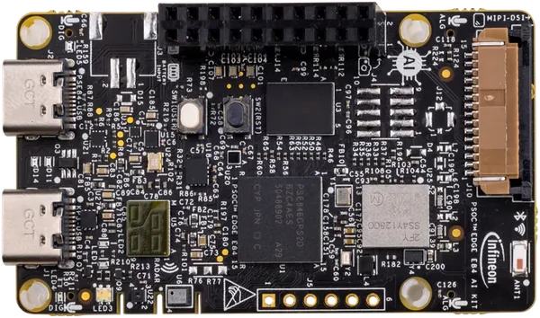

<!-- Copyright 2015-2026 Zephyr Project members and individual contributors. -->
<!-- SPDX-License-Identifier: Apache-2.0 -->
<!-- 中文翻译；编号、导航与译注为本地新增。 -->

<a id="kit_pse84_ai"></a>

# 第14章\_PSOC Edge E84 AI评估套件（AI Evaluation Kit）

原文：[官方页面](https://docs.zephyrproject.org/latest/boards/infineon/kit_pse84_ai/doc/index.html)。读取日期：2026-10-16；来源摘要见[来源记录](../SOURCES.md)。

开发板概览（Board Overview）

<a id="id3"></a>

[](images/kit_pse84_ai.webp)

PSOC Edge E84 AI评估套件（AI Evaluation Kit）

名称（Name）：

`kit_pse84_ai`

厂商（Vendor）：

[英飞凌科技（Infineon Technologies）](https://docs.zephyrproject.org/latest/boards/index.html#vendor=infineon)

状态（Status）：

维护中（Maintained）

架构（Architecture）：

[arm](https://docs.zephyrproject.org/latest/boards/index.html#arch=arm)

片上系统（SoC）：

[pse846gps2dbzc4a](https://docs.zephyrproject.org/latest/boards/index.html#soc=pse846gps2dbzc4a)

<a id="board-github-link"></a>

[浏览开发板源码（Browse Board Sources）](https://github.com/zephyrproject-rtos/zephyr/blob/main//boards/infineon/kit_pse84_ai/doc/index.rst/../..)<a id="overview"></a>

## 概述（Overview）

[KIT_PSE84_AI](https://www.infineon.com/evaluation-board/KIT-PSE84-AI)是基于PSOC Edge E84系列的评估套件，采用PSE846GPS2DBZC4A微控制器，包含400 MHz Arm Cortex-M55、200 MHz Arm Cortex-M33及Arm Ethos-U55神经网络处理器（NPU），面向机器学习、可穿戴设备及IoT应用。

主要特性包括512 Mb QSPI NOR闪存、128 Mb八线HYPERRAM、基于AIROC CYW55513的Wi-Fi及蓝牙连接（LBEE5HY2FY模块）、丰富传感器，包括六轴IMU、磁力计、气压、湿度及雷达、MIPI-DSI显示接口、模拟及数字麦克风，以及OV7675数字视频端口（DVP）摄像头模块。

开发板集成通过USB Type-C连接的[KitProg3](https://github.com/Infineon/KitProg3)编程器／调试器，提供扩展I/O排针，并支持兼容Raspberry Pi的MIPI-DSI显示屏。

<a id="board-targets"></a>

## 开发板目标（Board Targets）

KIT_PSE84_AI提供以下构建目标：

<table>
<tr>
<th>构建目标（Build Target）</th>
<th>说明（Description）</th>
</tr>
<tr>
<td><code>kit_pse84_ai/pse846gps2dbzc4a/m33</code></td>
<td>CM33安全目标（Secure），作为主要烧录及调试目标</td>
</tr>
<tr>
<td><code>kit_pse84_ai/pse846gps2dbzc4a/m33/ns</code></td>
<td>CM33非安全目标（Non-Secure），TF-M变体</td>
</tr>
<tr>
<td><code>kit_pse84_ai/pse846gps2dbzc4a/m55</code></td>
<td>CM55，需要<code>--sysbuild</code>选项</td>
</tr>
</table>

注意（Note）

构建CM55必须使用`--sysbuild`。Sysbuild会自动创建启动CM55所需的CM33配套应用`enable_cm55`。

注意（Note）

CM33安全镜像在构建过程中由imgtool自动签名，生成适合烧录的`.signed.hex`文件。非安全TF-M变体则输出`tfm_merged.hex`。

<a id="hardware"></a>

## 硬件（Hardware）


- 片上系统（SoC）：PSOC™ Edge E84 (PSE846GPS2DBZC4A)
- 主CPU：400 MHz Arm Cortex-M55
- 次级CPU：200 MHz Arm Cortex-M33
- 神经网络处理器（NPU）：Arm Ethos-U55
- 闪存（Flash）：512 Mb QSPI NOR闪存
- RAM：128 Mb八线HYPERRAM
- 无线连接：LBEE5HY2FY模块，Wi-Fi及蓝牙，使用AIROC CYW55513
- 传感器：六轴IMU、三轴磁力计、气压、湿度及雷达
- 显示：兼容Raspberry Pi的MIPI-DSI
- 音频：模拟及数字麦克风
- USB：Type-C，设备模式（Device）
- 扩展：I/O扩展排针
- 用户I/O：用户LED和用户按键
- 安全：Arm TrustZone-M，以及带密码加速器的安全隔离区（Secure Enclave）
- 调试：板载KitProg3，提供SWD及UART桥接
- 电源：活动高性能模式（Active HP）／空闲时深度睡眠（Deep Sleep），VDDA／VDDD为1800 mV

PSOC Edge E84及KIT_PSE84_AI更多信息见：


- [PSOC Edge E84 SoC网站](https://www.infineon.com/products/microcontroller/32-bit-psoc-arm-cortex/32-bit-psoc-edge-arm/psoc-edge-e84)
- [KIT_PSE84_AI开发板网站](https://www.infineon.com/evaluation-board/KIT-PSE84-AI)
- [KIT_PSE84_AI用户手册](https://www.infineon.com/assets/row/public/documents/30/44/infineon-kit-pse84-ai-user-guide-usermanual-en.pdf)

<a id="kit-contents"></a>

### 套件内容（Kit Contents）


- PSOC Edge E84 AI Evaluation Kit开发板
- OV7675 DVP摄像头模块

<a id="supported-features"></a>

### 支持的功能（Supported Features）

`kit_pse84_ai`开发板支持下表所列的硬件功能。

片上／板载（On-Chip / On-Board）

功能集成在片上系统（SoC）内／位于开发板上。

2 / 2

分别表示已启用／已禁用的实例数。点击数量标签，可查看开发板或SoC设备树源码（DTS）中该功能的第一个实例。

`vnd,foo`

与此功能匹配的设备树绑定兼容字符串（Compatible String）；点击链接可查看绑定文档。

<a id="kit_pse84_ai-hw-features"></a>

<a id="kit_pse84_ai-kit_pse84_ai/pse846gps2dbzc4a/m33-hw-features-section"></a>

#### `kit_pse84_ai/pse846gps2dbzc4a/m33`目标（Target）

<a id="kit_pse84_ai-kit_pse84_ai/pse846gps2dbzc4a/m33-hw-features-panel"></a>

<a id="kit_pse84_ai-kit_pse84_ai/pse846gps2dbzc4a/m33-hw-features-memory"></a>

该开发板目标的片上存储容量：132 KiB RAM、64 MiB Flash。

<a id="kit_pse84_ai-kit_pse84_ai/pse846gps2dbzc4a/m33-hw-features-table"></a>

<table>
<tr>
<th>类型（Type）</th>
<th>位置（Location）</th>
<th>说明（Description）</th>
<th>兼容字符串（Compatible）</th>
</tr>
<tr>
<td rowspan="1">中央处理器（CPU）</td>
<td>片上（On-Chip）</td>
<td>ARM Cortex-M33处理器（CPU）（<a href="https://github.com/zephyrproject-rtos/zephyr/blob/main/dts/arm/infineon/edge/pse84/pse84.cm33.dtsi?plain=1#L15">已启用：1</a>）</td>
<td><a href="../cpu_arm_riscv_binding_reference/P022_arm_cortex-m33.md#std-dtcompatible-arm-cortex-m33"><code>arm,cortex-m33</code></a></td>
</tr>
<tr>
<td rowspan="1">模数转换器（ADC）</td>
<td>片上（On-Chip）</td>
<td>PSOC Edge自主模拟系统（AutAnalog）SAR ADC（<a href="https://github.com/zephyrproject-rtos/zephyr/blob/main/dts/arm/infineon/edge/pse84/pse84_s.dtsi?plain=1#L394">已禁用：1</a>）</td>
<td><a href="../hardware/P878_Infineon自主模拟逐次逼近ADC绑定.md#dtbinding-infineon-autanalog-sar-adc"><code>infineon,autanalog-sar-adc</code></a></td>
</tr>
<tr>
<td rowspan="1">ARM 架构（ARM Architecture）</td>
<td>片上（On-Chip）</td>
<td>英飞凌串行通信模块（SCB / Serial Communication Blocks）节点（<a href="https://github.com/zephyrproject-rtos/zephyr/blob/main/dts/arm/infineon/edge/pse84/pse84_s.dtsi?plain=1#L465">已禁用：9</a>）</td>
<td><a href="../arm_timing_ethosu_control_binding_reference/P011_infineon_scb.md#std-dtcompatible-infineon-scb"><code>infineon,scb</code></a></td>
</tr>
<tr>
<td rowspan="1">音频（Audio）</td>
<td>片上（On-Chip）</td>
<td>英飞凌脉冲密度调制（PDM / Pulse Density Modulation）控制器（<a href="https://github.com/zephyrproject-rtos/zephyr/blob/main/dts/arm/infineon/edge/pse84/pse84_s.dtsi?plain=1#L1384">已禁用：1</a>）</td>
<td><a href="../audio_pdm_codec_binding_reference/P009_infineon_pdm.md#std-dtcompatible-infineon-pdm"><code>infineon,pdm</code></a></td>
</tr>
<tr>
<td rowspan="1">蓝牙（Bluetooth）</td>
<td>板载（On-Board）</td>
<td>使用Infineon蓝牙主机控制器接口UART驱动（Bluetooth HCI UART Driver）的连接芯片（<a href="https://github.com/zephyrproject-rtos/zephyr/blob/main/boards/infineon/kit_pse84_ai/kit_pse84_ai_m33.dts?plain=1#L223">已启用：1</a>）</td>
<td><a href="../bluetooth_vendor_hci_binding_reference/P006_infineon_bt-hci-uart.md#std-dtcompatible-infineon-bt-hci-uart"><code>infineon,bt-hci-uart</code></a></td>
</tr>
<tr>
<td rowspan="2">控制器局域网（CAN）</td>
<td>片上（On-Chip）</td>
<td>英飞凌CAN FD控制器封装层（Wrapper）（<a href="https://github.com/zephyrproject-rtos/zephyr/blob/main/dts/arm/infineon/edge/pse84/pse84_s.dtsi?plain=1#L585">已禁用：1</a>）</td>
<td><a href="../can_adi_atmel_nxp_binding_reference/P008_infineon_canfd-controller.md#std-dtcompatible-infineon-canfd-controller"><code>infineon,canfd-controller</code></a></td>
</tr>
<tr>
<td>片上（On-Chip）</td>
<td>英飞凌MCAN驱动（<a href="https://github.com/zephyrproject-rtos/zephyr/blob/main/dts/arm/infineon/edge/pse84/pse84_s.dtsi?plain=1#L594">已禁用：2</a>）</td>
<td><a href="../can_adi_atmel_nxp_binding_reference/P007_infineon_can.md#std-dtcompatible-infineon-can"><code>infineon,can</code></a></td>
</tr>
<tr>
<td rowspan="3">时钟控制（Clock Control）</td>
<td>片上（On-Chip）</td>
<td>通用固定频率时钟提供者（Fixed-Rate Clock Provider）（<a href="https://github.com/zephyrproject-rtos/zephyr/blob/main/dts/arm/infineon/edge/pse84/system_clocks.dtsi?plain=1#L18">已启用：5</a>）</td>
<td><a href="../timer_reference/P112_Infineon固定时钟绑定.md#dtbinding-infineon-fixed-clock"><code>infineon,fixed-clock</code></a></td>
</tr>
<tr>
<td>片上（On-Chip）</td>
<td>通用固定频率时钟提供者（Fixed-Rate Clock Provider）（<a href="https://github.com/zephyrproject-rtos/zephyr/blob/main/dts/arm/infineon/edge/pse84/system_clocks.dtsi?plain=1#L59">已启用：20</a>）</td>
<td><a href="../timer_reference/P113_Infineon固定比例时钟绑定.md#dtbinding-infineon-fixed-factor-clock"><code>infineon,fixed-factor-clock</code></a></td>
</tr>
<tr>
<td>片上（On-Chip）</td>
<td>英飞凌外设分频器（Peripheral Divider）（<a href="https://github.com/zephyrproject-rtos/zephyr/blob/main/dts/arm/infineon/edge/pse84/system_clocks.dtsi?plain=1#L317">已启用：3</a>；<a href="https://github.com/zephyrproject-rtos/zephyr/blob/main/dts/arm/infineon/edge/pse84/system_clocks.dtsi?plain=1#L256">已禁用：23</a>）</td>
<td><a href="../clock_esp_infineon_microchip_binding_reference/P009_infineon_peri-div.md#std-dtcompatible-infineon-peri-div"><code>infineon,peri-div</code></a></td>
</tr>
<tr>
<td rowspan="2">比较器（Comparator）</td>
<td>片上（On-Chip）</td>
<td>英飞凌CAT1系列低功耗比较器（LPComp / Low Power Comparator）（<a href="https://github.com/zephyrproject-rtos/zephyr/blob/main/dts/arm/infineon/edge/pse84/pse84_s.dtsi?plain=1#L308">已禁用：1</a>）</td>
<td><a href="../hardware/P737_Infineon低功耗比较器绑定.md#dtbinding-infineon-lp-comp"><code>infineon,lp-comp</code></a></td>
</tr>
<tr>
<td>片上（On-Chip）</td>
<td>英飞凌LPComp通道节点，为<code>infineon,lp-comp</code>的子节点（<a href="https://github.com/zephyrproject-rtos/zephyr/blob/main/dts/arm/infineon/edge/pse84/pse84_s.dtsi?plain=1#L314">已禁用：2</a>）</td>
<td><a href="../hardware/P738_Infineon低功耗比较器通道绑定.md#dtbinding-infineon-lp-comp-channel"><code>infineon,lp-comp-channel</code></a></td>
</tr>
<tr>
<td rowspan="1">计数器（Counter）</td>
<td>片上（On-Chip）</td>
<td>英飞凌TCPWM计数器（Counter）（<a href="https://github.com/zephyrproject-rtos/zephyr/blob/main/dts/arm/infineon/edge/pse84/pse84_s.dtsi?plain=1#L636">已禁用：32</a>）</td>
<td><a href="../microchip_soc_counter_binding_reference/P002_infineon_tcpwm-counter.md#std-dtcompatible-infineon-tcpwm-counter"><code>infineon,tcpwm-counter</code></a></td>
</tr>
<tr>
<td rowspan="2">密码学加速器（Cryptographic Accelerator）</td>
<td>片上（On-Chip）</td>
<td>英飞凌MXCRYPTO真随机数发生器（TRNG）（<a href="https://github.com/zephyrproject-rtos/zephyr/blob/main/dts/arm/infineon/edge/pse84/pse84_s.dtsi?plain=1#L1373">已启用：1</a>）</td>
<td><a href="../crypto_aes_sha_ccm_binding_reference/P010_infineon_mxcrypto-trng.md#std-dtcompatible-infineon-mxcrypto-trng"><code>infineon,mxcrypto-trng</code></a></td>
</tr>
<tr>
<td>片上（On-Chip）</td>
<td>英飞凌MXCRYPTO密码引擎（Crypto Engine），AES／SHA（<a href="https://github.com/zephyrproject-rtos/zephyr/blob/main/dts/arm/infineon/edge/pse84/pse84_s.dtsi?plain=1#L1378">已启用：1</a>）</td>
<td><a href="../crypto_aes_sha_ccm_binding_reference/P009_infineon_mxcrypto-crypto.md#std-dtcompatible-infineon-mxcrypto-crypto"><code>infineon,mxcrypto-crypto</code></a></td>
</tr>
<tr>
<td rowspan="1">数模转换器（DAC）</td>
<td>片上（On-Chip）</td>
<td>PSOC Edge AutAnalog连续时间（CT）数模转换器（DAC）（<a href="https://github.com/zephyrproject-rtos/zephyr/blob/main/dts/arm/infineon/edge/pse84/pse84_s.dtsi?plain=1#L362">已禁用：2</a>）</td>
<td><a href="../hardware/P778_Infineon自主模拟连续时间数模转换器绑定.md#dtbinding-infineon-autanalog-ctdac"><code>infineon,autanalog-ctdac</code></a></td>
</tr>
<tr>
<td rowspan="2">直接存储器访问（DMA）</td>
<td>片上（On-Chip）</td>
<td>英飞凌M-DMA控制器（<a href="https://github.com/zephyrproject-rtos/zephyr/blob/main/dts/arm/infineon/edge/pse84/pse84_s.dtsi?plain=1#L1269">已禁用：1</a>）</td>
<td><a href="../intel_microchip_dma_binding_reference/P002_infineon_mdma.md#std-dtcompatible-infineon-mdma"><code>infineon,mdma</code></a></td>
</tr>
<tr>
<td>片上（On-Chip）</td>
<td>英飞凌CAT1 DMA（<a href="https://github.com/zephyrproject-rtos/zephyr/blob/main/dts/arm/infineon/edge/pse84/pse84_s.dtsi?plain=1#L1281">已禁用：2</a>）</td>
<td><a href="../dma_binding_reference/P018_infineon_dma.md#std-dtcompatible-infineon-dma"><code>infineon,dma</code></a></td>
</tr>
<tr>
<td rowspan="1">闪存控制器（Flash Controller）</td>
<td>板载（On-Board）</td>
<td>英飞凌CAT1 QSPI闪存控制器（<a href="https://github.com/zephyrproject-rtos/zephyr/blob/main/boards/infineon/kit_pse84_ai/kit_pse84_ai_memory_map.dtsi?plain=1#L78">已启用：1</a>）</td>
<td><a href="../flash_adi_microchip_nordic_binding_reference/P015_infineon_qspi-flash.md#std-dtcompatible-infineon-qspi-flash"><code>infineon,qspi-flash</code></a></td>
</tr>
<tr>
<td rowspan="1">通用输入输出与接插件（GPIO &amp; Headers）</td>
<td>片上（On-Chip）</td>
<td>英飞凌GPIO端口（<a href="https://github.com/zephyrproject-rtos/zephyr/blob/main/dts/arm/infineon/edge/pse84/pse84_s.dtsi?plain=1#L70">已启用：11</a>；<a href="https://github.com/zephyrproject-rtos/zephyr/blob/main/dts/arm/infineon/edge/pse84/pse84_s.dtsi?plain=1#L81">已禁用：11</a>）</td>
<td><a href="../gpio_infineon_intel_ite_microchip_binding_reference/P001_infineon_gpio.md#std-dtcompatible-infineon-gpio"><code>infineon,gpio</code></a></td>
</tr>
<tr>
<td rowspan="1">集成电路间总线（I2C）</td>
<td>片上（On-Chip）</td>
<td>英飞凌CAT1 I2C驱动（<a href="https://github.com/zephyrproject-rtos/zephyr/blob/main/dts/arm/infineon/edge/pse84/pse84_s.dtsi?plain=1#L448">已启用：1</a>）</td>
<td><a href="../i2c_infineon_ite_nordic_binding_reference/P003_infineon_i2c.md#std-dtcompatible-infineon-i2c"><code>infineon,i2c</code></a></td>
</tr>
<tr>
<td rowspan="1">集成电路间音频总线（I2S）</td>
<td>片上（On-Chip）</td>
<td>英飞凌I2S控制器（<a href="https://github.com/zephyrproject-rtos/zephyr/blob/main/dts/arm/infineon/edge/pse84/pse84_s.dtsi?plain=1#L1347">已禁用：2</a>）</td>
<td><a href="../i2s_binding_reference/P004_infineon_i2s.md#std-dtcompatible-infineon-i2s"><code>infineon,i2s</code></a></td>
</tr>
<tr>
<td rowspan="1">输入（Input）</td>
<td>板载（On-Board）</td>
<td>一组绑定到 GPIO 的输入按键（GPIO-Bound Input Keys）（<a href="https://github.com/zephyrproject-rtos/zephyr/blob/main/boards/infineon/kit_pse84_ai/kit_pse84_ai_common.dtsi?plain=1#L51">已启用：1</a>）</td>
<td><a href="../hardware/P563_GPIO按键绑定.md#std-dtcompatible-gpio-keys"><code>gpio-keys</code></a></td>
</tr>
<tr>
<td rowspan="1">中断控制器（Interrupt Controller）</td>
<td>片上（On-Chip）</td>
<td>ARMv8-M嵌套向量中断控制器（NVIC / Nested Vectored Interrupt Controller）（<a href="https://github.com/zephyrproject-rtos/zephyr/blob/main/dts/arm/armv8-m.dtsi?plain=1#L13">已启用：1</a>）</td>
<td><a href="../arm_interrupt_timer_binding_reference/P003_ARMv8_M_NVIC.md#std-dtcompatible-arm-v8m-nvic"><code>arm,v8m-nvic</code></a></td>
</tr>
<tr>
<td rowspan="1">处理器间／进程间通信（IPC）</td>
<td>片上（On-Chip）</td>
<td>英飞凌核间通信（IPC）实例（<a href="https://github.com/zephyrproject-rtos/zephyr/blob/main/dts/arm/infineon/edge/pse84/pse84_s.dtsi?plain=1#L420">已禁用：2</a>）</td>
<td><a href="../intercore_reference/P099_Infineon处理器间通信绑定.md#dtbinding-infineon-ipc"><code>infineon,ipc</code></a></td>
</tr>
<tr>
<td rowspan="1">发光二极管（LED）</td>
<td>板载（On-Board）</td>
<td>一组由 GPIO 控制的 LED（GPIO-Controlled LEDs）（<a href="https://github.com/zephyrproject-rtos/zephyr/blob/main/boards/infineon/kit_pse84_ai/kit_pse84_ai_common.dtsi?plain=1#L22">已启用：1</a>）</td>
<td><a href="../hardware/P564_GPIO指示灯绑定.md#dtbinding-gpio-leds"><code>gpio-leds</code></a></td>
</tr>
<tr>
<td rowspan="5">多功能设备（Multi-Function Device）</td>
<td>片上（On-Chip）</td>
<td>英飞凌自主模拟系统（AutAnalog / Autonomous Analog）多功能设备（<a href="https://github.com/zephyrproject-rtos/zephyr/blob/main/dts/arm/infineon/edge/pse84/pse84_s.dtsi?plain=1#L327">已禁用：1</a>）</td>
<td><a href="../hardware/P720_Infineon自主模拟子系统绑定.md#dtbinding-infineon-autanalog"><code>infineon,autanalog</code></a></td>
</tr>
<tr>
<td>片上（On-Chip）</td>
<td>英飞凌AutAnalog连续时间模块（CTB / Continuous Time Block）多功能设备（<a href="https://github.com/zephyrproject-rtos/zephyr/blob/main/dts/arm/infineon/edge/pse84/pse84_s.dtsi?plain=1#L338">已禁用：2</a>）</td>
<td><a href="../hardware/P722_Infineon连续时间模块绑定.md#dtbinding-infineon-autanalog-ctb"><code>infineon,autanalog-ctb</code></a></td>
</tr>
<tr>
<td>片上（On-Chip）</td>
<td>英飞凌AutAnalog可编程阈值比较器（PTComp / Programmable Threshold Comparator）多功能设备（<a href="https://github.com/zephyrproject-rtos/zephyr/blob/main/dts/arm/infineon/edge/pse84/pse84_s.dtsi?plain=1#L354">已禁用：1</a>）</td>
<td><a href="../hardware/P723_Infineon可编程阈值比较器绑定.md#dtbinding-infineon-autanalog-ptcomp"><code>infineon,autanalog-ptcomp</code></a></td>
</tr>
<tr>
<td>片上（On-Chip）</td>
<td>英飞凌AutAnalog可编程参考模块（PRB / Programmable Reference Block）多功能设备（<a href="https://github.com/zephyrproject-rtos/zephyr/blob/main/dts/arm/infineon/edge/pse84/pse84_s.dtsi?plain=1#L402">已禁用：1</a>）</td>
<td><a href="../hardware/P659_Infineon可编程参考模块绑定.md#dtbinding-infineon-autanalog-prb"><code>infineon,autanalog-prb</code></a></td>
</tr>
<tr>
<td>片上（On-Chip）</td>
<td>英飞凌MXCRYPTO多功能设备（<a href="https://github.com/zephyrproject-rtos/zephyr/blob/main/dts/arm/infineon/edge/pse84/pse84_s.dtsi?plain=1#L1369">已启用：1</a>）</td>
<td><a href="../hardware/P727_Infineon加密硬件模块绑定.md#dtbinding-infineon-mxcrypto"><code>infineon,mxcrypto</code></a></td>
</tr>
<tr>
<td rowspan="1">存储技术设备（MTD）</td>
<td>片上（On-Chip）</td>
<td>闪存（Flash）节点（<a href="https://github.com/zephyrproject-rtos/zephyr/blob/main/dts/arm/infineon/edge/pse84/pse84_s.dtsi?plain=1#L42">已启用：4</a>）</td>
<td><a href="../mtd_nxp_st_ti_partition_binding_reference/P013_soc-nv-flash.md#std-dtcompatible-soc-nv-flash"><code>soc-nv-flash</code></a></td>
</tr>
<tr>
<td rowspan="1">引脚控制（Pin Control）</td>
<td>片上（On-Chip）</td>
<td>英飞凌（Infineon）CAT1引脚控制容器（Pinctrl Container）（<a href="https://github.com/zephyrproject-rtos/zephyr/blob/main/dts/arm/infineon/edge/pse84/pse84_s.dtsi?plain=1#L58">已启用：1</a>）</td>
<td><a href="../pinctrl_infineon_nordic_nxp_binding_reference/P001_infineon_pinctrl.md#std-dtcompatible-infineon-pinctrl"><code>infineon,pinctrl</code></a></td>
</tr>
<tr>
<td rowspan="1">脉宽调制（PWM）</td>
<td>片上（On-Chip）</td>
<td>英飞凌TCPWM脉宽调制（PWM）（<a href="https://github.com/zephyrproject-rtos/zephyr/blob/main/dts/arm/infineon/edge/pse84/pse84_s.dtsi?plain=1#L630">已禁用：32</a>）</td>
<td><a href="../pwm_adi_esp_infineon_binding_reference/P019_infineon_tcpwm-pwm.md#std-dtcompatible-infineon-tcpwm-pwm"><code>infineon,tcpwm-pwm</code></a></td>
</tr>
<tr>
<td rowspan="1">实时时钟（RTC）</td>
<td>片上（On-Chip）</td>
<td>英飞凌CAT1系列实时时钟（RTC）设备（<a href="https://github.com/zephyrproject-rtos/zephyr/blob/main/dts/arm/infineon/edge/pse84/pse84_s.dtsi?plain=1#L576">已禁用：1</a>）</td>
<td><a href="../rtc_binding_reference/P007_infineon_rtc.md#std-dtcompatible-infineon-rtc"><code>infineon,rtc</code></a></td>
</tr>
<tr>
<td rowspan="1">SD 主机控制器（SDHC）</td>
<td>片上（On-Chip）</td>
<td>英飞凌CAT1 SDHC／SDIO控制器（<a href="https://github.com/zephyrproject-rtos/zephyr/blob/main/dts/arm/infineon/edge/pse84/pse84_s.dtsi?plain=1#L1329">已禁用：2</a>）</td>
<td><a href="../sdhc_binding_reference/P008_infineon_sdhc-sdio.md#std-dtcompatible-infineon-sdhc-sdio"><code>infineon,sdhc-sdio</code></a></td>
</tr>
<tr>
<td rowspan="3">传感器（Sensors）</td>
<td>板载（On-Board）</td>
<td>BMI270惯性测量单元（IMU / Inertial Measurement Unit）（<a href="https://github.com/zephyrproject-rtos/zephyr/blob/main/boards/infineon/kit_pse84_ai/kit_pse84_ai_common.dtsi?plain=1#L95">已启用：1</a>）</td>
<td><a href="../compatible_binding_reference/P016_bosch_bmi270.md#std-dtcompatible-bosch-bmi270"><code>bosch,bmi270</code></a></td>
</tr>
<tr>
<td>板载（On-Board）</td>
<td>英飞凌DPS310温度与压力传感器（<a href="https://github.com/zephyrproject-rtos/zephyr/blob/main/boards/infineon/kit_pse84_ai/kit_pse84_ai_common.dtsi?plain=1#L102">已启用：1</a>）</td>
<td><a href="../sensor_espressif_honeywell_invensense_binding_reference/P016_infineon_dps310.md#std-dtcompatible-infineon-dps310"><code>infineon,dps310</code></a></td>
</tr>
<tr>
<td>板载（On-Board）</td>
<td>Sensirion SHT4x湿度与温度传感器（<a href="https://github.com/zephyrproject-rtos/zephyr/blob/main/boards/infineon/kit_pse84_ai/kit_pse84_ai_common.dtsi?plain=1#L108">已启用：1</a>）</td>
<td><a href="../sensor_realtek_rohm_sensirion_binding_reference/P025_sensirion_sht4x.md#std-dtcompatible-sensirion-sht4x"><code>sensirion,sht4x</code></a></td>
</tr>
<tr>
<td rowspan="1">串行控制器（Serial Controller）</td>
<td>片上（On-Chip）</td>
<td>英飞凌CAT1 UART（<a href="https://github.com/zephyrproject-rtos/zephyr/blob/main/dts/arm/infineon/edge/pse84/pse84_s.dtsi?plain=1#L457">已启用：2</a>）</td>
<td><a href="../uart_espressif_infineon_microchip_binding_reference/P008_infineon_uart.md#std-dtcompatible-infineon-uart"><code>infineon,uart</code></a></td>
</tr>
<tr>
<td rowspan="1">静态随机存储器（SRAM）</td>
<td>片上（On-Chip）</td>
<td>通用片上静态随机存储器（SRAM）（<a href="https://github.com/zephyrproject-rtos/zephyr/blob/main/dts/arm/infineon/edge/pse84/pse84_s.dtsi?plain=1#L11">已启用：1</a>）</td>
<td><a href="../hardware/P567_内存映射SRAM绑定.md#dtbinding-mmio-sram"><code>mmio-sram</code></a></td>
</tr>
<tr>
<td rowspan="3">定时器（Timer）</td>
<td>片上（On-Chip）</td>
<td>英飞凌低功耗定时器（<a href="https://github.com/zephyrproject-rtos/zephyr/blob/main/dts/arm/infineon/edge/pse84/pse84_s.dtsi?plain=1#L560">已启用：1</a>；<a href="https://github.com/zephyrproject-rtos/zephyr/blob/main/dts/arm/infineon/edge/pse84/pse84_s.dtsi?plain=1#L568">已禁用：1</a>）</td>
<td><a href="../mcu_timer_binding_reference/P008_infineon_lp-timer.md#std-dtcompatible-infineon-lp-timer"><code>infineon,lp-timer</code></a></td>
</tr>
<tr>
<td>片上（On-Chip）</td>
<td>英飞凌TCPWM定时器（Timer）（<a href="https://github.com/zephyrproject-rtos/zephyr/blob/main/dts/arm/infineon/edge/pse84/pse84_s.dtsi?plain=1#L622">已禁用：32</a>）</td>
<td><a href="../mcu_timer_binding_reference/P009_infineon_tcpwm.md#std-dtcompatible-infineon-tcpwm"><code>infineon,tcpwm</code></a></td>
</tr>
<tr>
<td>片上（On-Chip）</td>
<td>ARMv8-M系统节拍（System Tick）（<a href="https://github.com/zephyrproject-rtos/zephyr/blob/main/dts/arm/armv8-m.dtsi?plain=1#L21">已启用：1</a>）</td>
<td><a href="../arm_interrupt_timer_binding_reference/P007_ARMv8_M_SysTick.md#std-dtcompatible-arm-armv8m-systick"><code>arm,armv8m-systick</code></a></td>
</tr>
<tr>
<td rowspan="1">通用串行总线（USB）</td>
<td>片上（On-Chip）</td>
<td>英飞凌高速USB（USBHS）（<a href="https://github.com/zephyrproject-rtos/zephyr/blob/main/dts/arm/infineon/edge/pse84/pse84_s.dtsi?plain=1#L1435">已启用：1</a>）</td>
<td><a href="../usb_controller_binding_reference/P012_infineon_usbhs.md#std-dtcompatible-infineon-usbhs"><code>infineon,usbhs</code></a></td>
</tr>
<tr>
<td rowspan="1">看门狗（Watchdog）</td>
<td>片上（On-Chip）</td>
<td>英飞凌CAT1看门狗（Watchdog）（<a href="https://github.com/zephyrproject-rtos/zephyr/blob/main/dts/arm/infineon/edge/pse84/pse84_s.dtsi?plain=1#L552">已启用：1</a>）</td>
<td><a href="../soc_pmic_watchdog_binding_reference/P001_infineon_watchdog.md#std-dtcompatible-infineon-watchdog"><code>infineon,watchdog</code></a></td>
</tr>
</table>

<a id="kit_pse84_ai-kit_pse84_ai/pse846gps2dbzc4a/m33/ns-hw-features-section"></a>

#### `kit_pse84_ai/pse846gps2dbzc4a/m33/ns`目标（Target）

<a id="kit_pse84_ai-kit_pse84_ai/pse846gps2dbzc4a/m33/ns-hw-features-panel"></a>

<a id="kit_pse84_ai-kit_pse84_ai/pse846gps2dbzc4a/m33/ns-hw-features-memory"></a>

该开发板目标的片上存储容量：256 KiB RAM、64 MiB Flash。

<a id="kit_pse84_ai-kit_pse84_ai/pse846gps2dbzc4a/m33/ns-hw-features-table"></a>

<table>
<tr>
<th>类型（Type）</th>
<th>位置（Location）</th>
<th>说明（Description）</th>
<th>兼容字符串（Compatible）</th>
</tr>
<tr>
<td rowspan="1">中央处理器（CPU）</td>
<td>片上（On-Chip）</td>
<td>ARM Cortex-M33处理器（CPU）（<a href="https://github.com/zephyrproject-rtos/zephyr/blob/main/dts/arm/infineon/edge/pse84/pse84.cm33.dtsi?plain=1#L15">已启用：1</a>）</td>
<td><a href="../cpu_arm_riscv_binding_reference/P022_arm_cortex-m33.md#std-dtcompatible-arm-cortex-m33"><code>arm,cortex-m33</code></a></td>
</tr>
<tr>
<td rowspan="1">模数转换器（ADC）</td>
<td>片上（On-Chip）</td>
<td>PSOC Edge自主模拟系统（AutAnalog）SAR ADC（<a href="https://github.com/zephyrproject-rtos/zephyr/blob/main/dts/arm/infineon/edge/pse84/pse84.dtsi?plain=1#L391">已禁用：1</a>）</td>
<td><a href="../hardware/P878_Infineon自主模拟逐次逼近ADC绑定.md#dtbinding-infineon-autanalog-sar-adc"><code>infineon,autanalog-sar-adc</code></a></td>
</tr>
<tr>
<td rowspan="2">ARM 架构（ARM Architecture）</td>
<td>片上（On-Chip）</td>
<td>英飞凌PSE84的Arm Ethos-U NPU前端（Frontend）（<a href="https://github.com/zephyrproject-rtos/zephyr/blob/main/dts/arm/infineon/edge/pse84/pse84.dtsi?plain=1#L46">已禁用：1</a>）</td>
<td><a href="../arm_timing_ethosu_control_binding_reference/P010_infineon_edge-npu.md#std-dtcompatible-infineon-edge-npu"><code>infineon,edge-npu</code></a></td>
</tr>
<tr>
<td>片上（On-Chip）</td>
<td>英飞凌串行通信模块（SCB / Serial Communication Blocks）节点（<a href="https://github.com/zephyrproject-rtos/zephyr/blob/main/dts/arm/infineon/edge/pse84/pse84.dtsi?plain=1#L462">已禁用：9</a>）</td>
<td><a href="../arm_timing_ethosu_control_binding_reference/P011_infineon_scb.md#std-dtcompatible-infineon-scb"><code>infineon,scb</code></a></td>
</tr>
<tr>
<td rowspan="1">音频（Audio）</td>
<td>片上（On-Chip）</td>
<td>英飞凌脉冲密度调制（PDM / Pulse Density Modulation）控制器（<a href="https://github.com/zephyrproject-rtos/zephyr/blob/main/dts/arm/infineon/edge/pse84/pse84.dtsi?plain=1#L1381">已禁用：1</a>）</td>
<td><a href="../audio_pdm_codec_binding_reference/P009_infineon_pdm.md#std-dtcompatible-infineon-pdm"><code>infineon,pdm</code></a></td>
</tr>
<tr>
<td rowspan="1">蓝牙（Bluetooth）</td>
<td>板载（On-Board）</td>
<td>使用Infineon蓝牙主机控制器接口UART驱动（Bluetooth HCI UART Driver）的连接芯片（<a href="https://github.com/zephyrproject-rtos/zephyr/blob/main/boards/infineon/kit_pse84_ai/kit_pse84_ai_m33_ns.dts?plain=1#L73">已启用：1</a>）</td>
<td><a href="../bluetooth_vendor_hci_binding_reference/P006_infineon_bt-hci-uart.md#std-dtcompatible-infineon-bt-hci-uart"><code>infineon,bt-hci-uart</code></a></td>
</tr>
<tr>
<td rowspan="2">控制器局域网（CAN）</td>
<td>片上（On-Chip）</td>
<td>英飞凌CAN FD控制器封装层（Wrapper）（<a href="https://github.com/zephyrproject-rtos/zephyr/blob/main/dts/arm/infineon/edge/pse84/pse84.dtsi?plain=1#L582">已禁用：1</a>）</td>
<td><a href="../can_adi_atmel_nxp_binding_reference/P008_infineon_canfd-controller.md#std-dtcompatible-infineon-canfd-controller"><code>infineon,canfd-controller</code></a></td>
</tr>
<tr>
<td>片上（On-Chip）</td>
<td>英飞凌MCAN驱动（<a href="https://github.com/zephyrproject-rtos/zephyr/blob/main/dts/arm/infineon/edge/pse84/pse84.dtsi?plain=1#L591">已禁用：2</a>）</td>
<td><a href="../can_adi_atmel_nxp_binding_reference/P007_infineon_can.md#std-dtcompatible-infineon-can"><code>infineon,can</code></a></td>
</tr>
<tr>
<td rowspan="3">时钟控制（Clock Control）</td>
<td>片上（On-Chip）</td>
<td>通用固定频率时钟提供者（Fixed-Rate Clock Provider）（<a href="https://github.com/zephyrproject-rtos/zephyr/blob/main/dts/arm/infineon/edge/pse84/system_clocks.dtsi?plain=1#L18">已禁用：5</a>）</td>
<td><a href="../timer_reference/P112_Infineon固定时钟绑定.md#dtbinding-infineon-fixed-clock"><code>infineon,fixed-clock</code></a></td>
</tr>
<tr>
<td>片上（On-Chip）</td>
<td>通用固定频率时钟提供者（Fixed-Rate Clock Provider）（<a href="https://github.com/zephyrproject-rtos/zephyr/blob/main/dts/arm/infineon/edge/pse84/system_clocks.dtsi?plain=1#L59">已禁用：20</a>）</td>
<td><a href="../timer_reference/P113_Infineon固定比例时钟绑定.md#dtbinding-infineon-fixed-factor-clock"><code>infineon,fixed-factor-clock</code></a></td>
</tr>
<tr>
<td>片上（On-Chip）</td>
<td>英飞凌外设分频器（Peripheral Divider）（<a href="https://github.com/zephyrproject-rtos/zephyr/blob/main/dts/arm/infineon/edge/pse84/system_clocks.dtsi?plain=1#L317">已启用：3</a>；<a href="https://github.com/zephyrproject-rtos/zephyr/blob/main/dts/arm/infineon/edge/pse84/system_clocks.dtsi?plain=1#L256">已禁用：23</a>）</td>
<td><a href="../clock_esp_infineon_microchip_binding_reference/P009_infineon_peri-div.md#std-dtcompatible-infineon-peri-div"><code>infineon,peri-div</code></a></td>
</tr>
<tr>
<td rowspan="2">比较器（Comparator）</td>
<td>片上（On-Chip）</td>
<td>英飞凌CAT1系列低功耗比较器（LPComp / Low Power Comparator）（<a href="https://github.com/zephyrproject-rtos/zephyr/blob/main/dts/arm/infineon/edge/pse84/pse84.dtsi?plain=1#L305">已禁用：1</a>）</td>
<td><a href="../hardware/P737_Infineon低功耗比较器绑定.md#dtbinding-infineon-lp-comp"><code>infineon,lp-comp</code></a></td>
</tr>
<tr>
<td>片上（On-Chip）</td>
<td>英飞凌LPComp通道节点，为<code>infineon,lp-comp</code>的子节点（<a href="https://github.com/zephyrproject-rtos/zephyr/blob/main/dts/arm/infineon/edge/pse84/pse84.dtsi?plain=1#L311">已禁用：2</a>）</td>
<td><a href="../hardware/P738_Infineon低功耗比较器通道绑定.md#dtbinding-infineon-lp-comp-channel"><code>infineon,lp-comp-channel</code></a></td>
</tr>
<tr>
<td rowspan="1">计数器（Counter）</td>
<td>片上（On-Chip）</td>
<td>英飞凌TCPWM计数器（Counter）（<a href="https://github.com/zephyrproject-rtos/zephyr/blob/main/dts/arm/infineon/edge/pse84/pse84.dtsi?plain=1#L633">已禁用：32</a>）</td>
<td><a href="../microchip_soc_counter_binding_reference/P002_infineon_tcpwm-counter.md#std-dtcompatible-infineon-tcpwm-counter"><code>infineon,tcpwm-counter</code></a></td>
</tr>
<tr>
<td rowspan="2">密码学加速器（Cryptographic Accelerator）</td>
<td>片上（On-Chip）</td>
<td>英飞凌MXCRYPTO真随机数发生器（TRNG）（<a href="https://github.com/zephyrproject-rtos/zephyr/blob/main/dts/arm/infineon/edge/pse84/pse84.dtsi?plain=1#L1370">已禁用：1</a>）</td>
<td><a href="../crypto_aes_sha_ccm_binding_reference/P010_infineon_mxcrypto-trng.md#std-dtcompatible-infineon-mxcrypto-trng"><code>infineon,mxcrypto-trng</code></a></td>
</tr>
<tr>
<td>片上（On-Chip）</td>
<td>英飞凌MXCRYPTO密码引擎（Crypto Engine），AES／SHA（<a href="https://github.com/zephyrproject-rtos/zephyr/blob/main/dts/arm/infineon/edge/pse84/pse84.dtsi?plain=1#L1375">已禁用：1</a>）</td>
<td><a href="../crypto_aes_sha_ccm_binding_reference/P009_infineon_mxcrypto-crypto.md#std-dtcompatible-infineon-mxcrypto-crypto"><code>infineon,mxcrypto-crypto</code></a></td>
</tr>
<tr>
<td rowspan="1">数模转换器（DAC）</td>
<td>片上（On-Chip）</td>
<td>PSOC Edge AutAnalog连续时间（CT）数模转换器（DAC）（<a href="https://github.com/zephyrproject-rtos/zephyr/blob/main/dts/arm/infineon/edge/pse84/pse84.dtsi?plain=1#L359">已禁用：2</a>）</td>
<td><a href="../hardware/P778_Infineon自主模拟连续时间数模转换器绑定.md#dtbinding-infineon-autanalog-ctdac"><code>infineon,autanalog-ctdac</code></a></td>
</tr>
<tr>
<td rowspan="2">直接存储器访问（DMA）</td>
<td>片上（On-Chip）</td>
<td>英飞凌M-DMA控制器（<a href="https://github.com/zephyrproject-rtos/zephyr/blob/main/dts/arm/infineon/edge/pse84/pse84.dtsi?plain=1#L1266">已禁用：1</a>）</td>
<td><a href="../intel_microchip_dma_binding_reference/P002_infineon_mdma.md#std-dtcompatible-infineon-mdma"><code>infineon,mdma</code></a></td>
</tr>
<tr>
<td>片上（On-Chip）</td>
<td>英飞凌CAT1 DMA（<a href="https://github.com/zephyrproject-rtos/zephyr/blob/main/dts/arm/infineon/edge/pse84/pse84.dtsi?plain=1#L1278">已禁用：2</a>）</td>
<td><a href="../dma_binding_reference/P018_infineon_dma.md#std-dtcompatible-infineon-dma"><code>infineon,dma</code></a></td>
</tr>
<tr>
<td rowspan="2">闪存控制器（Flash Controller）</td>
<td>片上（On-Chip）</td>
<td>英飞凌CAT1电阻式随机存储器（RRAM）控制器（<a href="https://github.com/zephyrproject-rtos/zephyr/blob/main/dts/arm/infineon/edge/pse84/pse84.dtsi?plain=1#L16">已启用：1</a>）</td>
<td><a href="../flash_adi_microchip_nordic_binding_reference/P016_infineon_rram-controller.md#std-dtcompatible-infineon-rram-controller"><code>infineon,rram-controller</code></a></td>
</tr>
<tr>
<td>板载（On-Board）</td>
<td>英飞凌CAT1 QSPI闪存控制器（<a href="https://github.com/zephyrproject-rtos/zephyr/blob/main/boards/infineon/kit_pse84_ai/kit_pse84_ai_memory_map.dtsi?plain=1#L78">已启用：1</a>）</td>
<td><a href="../flash_adi_microchip_nordic_binding_reference/P015_infineon_qspi-flash.md#std-dtcompatible-infineon-qspi-flash"><code>infineon,qspi-flash</code></a></td>
</tr>
<tr>
<td rowspan="1">通用输入输出与接插件（GPIO &amp; Headers）</td>
<td>片上（On-Chip）</td>
<td>英飞凌GPIO端口（<a href="https://github.com/zephyrproject-rtos/zephyr/blob/main/dts/arm/infineon/edge/pse84/pse84.dtsi?plain=1#L65">已启用：11</a>；<a href="https://github.com/zephyrproject-rtos/zephyr/blob/main/dts/arm/infineon/edge/pse84/pse84.dtsi?plain=1#L76">已禁用：11</a>）</td>
<td><a href="../gpio_infineon_intel_ite_microchip_binding_reference/P001_infineon_gpio.md#std-dtcompatible-infineon-gpio"><code>infineon,gpio</code></a></td>
</tr>
<tr>
<td rowspan="1">集成电路间总线（I2C）</td>
<td>片上（On-Chip）</td>
<td>英飞凌CAT1 I2C驱动（<a href="https://github.com/zephyrproject-rtos/zephyr/blob/main/dts/arm/infineon/edge/pse84/pse84.dtsi?plain=1#L445">已启用：1</a>）</td>
<td><a href="../i2c_infineon_ite_nordic_binding_reference/P003_infineon_i2c.md#std-dtcompatible-infineon-i2c"><code>infineon,i2c</code></a></td>
</tr>
<tr>
<td rowspan="1">集成电路间音频总线（I2S）</td>
<td>片上（On-Chip）</td>
<td>英飞凌I2S控制器（<a href="https://github.com/zephyrproject-rtos/zephyr/blob/main/dts/arm/infineon/edge/pse84/pse84.dtsi?plain=1#L1344">已禁用：2</a>）</td>
<td><a href="../i2s_binding_reference/P004_infineon_i2s.md#std-dtcompatible-infineon-i2s"><code>infineon,i2s</code></a></td>
</tr>
<tr>
<td rowspan="1">输入（Input）</td>
<td>板载（On-Board）</td>
<td>一组绑定到 GPIO 的输入按键（GPIO-Bound Input Keys）（<a href="https://github.com/zephyrproject-rtos/zephyr/blob/main/boards/infineon/kit_pse84_ai/kit_pse84_ai_common.dtsi?plain=1#L51">已启用：1</a>）</td>
<td><a href="../hardware/P563_GPIO按键绑定.md#std-dtcompatible-gpio-keys"><code>gpio-keys</code></a></td>
</tr>
<tr>
<td rowspan="1">中断控制器（Interrupt Controller）</td>
<td>片上（On-Chip）</td>
<td>ARMv8-M嵌套向量中断控制器（NVIC / Nested Vectored Interrupt Controller）（<a href="https://github.com/zephyrproject-rtos/zephyr/blob/main/dts/arm/armv8-m.dtsi?plain=1#L13">已启用：1</a>）</td>
<td><a href="../arm_interrupt_timer_binding_reference/P003_ARMv8_M_NVIC.md#std-dtcompatible-arm-v8m-nvic"><code>arm,v8m-nvic</code></a></td>
</tr>
<tr>
<td rowspan="1">处理器间／进程间通信（IPC）</td>
<td>片上（On-Chip）</td>
<td>英飞凌核间通信（IPC）实例（<a href="https://github.com/zephyrproject-rtos/zephyr/blob/main/dts/arm/infineon/edge/pse84/pse84.dtsi?plain=1#L417">已禁用：2</a>）</td>
<td><a href="../intercore_reference/P099_Infineon处理器间通信绑定.md#dtbinding-infineon-ipc"><code>infineon,ipc</code></a></td>
</tr>
<tr>
<td rowspan="1">发光二极管（LED）</td>
<td>板载（On-Board）</td>
<td>一组由 GPIO 控制的 LED（GPIO-Controlled LEDs）（<a href="https://github.com/zephyrproject-rtos/zephyr/blob/main/boards/infineon/kit_pse84_ai/kit_pse84_ai_common.dtsi?plain=1#L22">已启用：1</a>）</td>
<td><a href="../hardware/P564_GPIO指示灯绑定.md#dtbinding-gpio-leds"><code>gpio-leds</code></a></td>
</tr>
<tr>
<td rowspan="5">多功能设备（Multi-Function Device）</td>
<td>片上（On-Chip）</td>
<td>英飞凌自主模拟系统（AutAnalog / Autonomous Analog）多功能设备（<a href="https://github.com/zephyrproject-rtos/zephyr/blob/main/dts/arm/infineon/edge/pse84/pse84.dtsi?plain=1#L324">已禁用：1</a>）</td>
<td><a href="../hardware/P720_Infineon自主模拟子系统绑定.md#dtbinding-infineon-autanalog"><code>infineon,autanalog</code></a></td>
</tr>
<tr>
<td>片上（On-Chip）</td>
<td>英飞凌AutAnalog连续时间模块（CTB / Continuous Time Block）多功能设备（<a href="https://github.com/zephyrproject-rtos/zephyr/blob/main/dts/arm/infineon/edge/pse84/pse84.dtsi?plain=1#L335">已禁用：2</a>）</td>
<td><a href="../hardware/P722_Infineon连续时间模块绑定.md#dtbinding-infineon-autanalog-ctb"><code>infineon,autanalog-ctb</code></a></td>
</tr>
<tr>
<td>片上（On-Chip）</td>
<td>英飞凌AutAnalog可编程阈值比较器（PTComp / Programmable Threshold Comparator）多功能设备（<a href="https://github.com/zephyrproject-rtos/zephyr/blob/main/dts/arm/infineon/edge/pse84/pse84.dtsi?plain=1#L351">已禁用：1</a>）</td>
<td><a href="../hardware/P723_Infineon可编程阈值比较器绑定.md#dtbinding-infineon-autanalog-ptcomp"><code>infineon,autanalog-ptcomp</code></a></td>
</tr>
<tr>
<td>片上（On-Chip）</td>
<td>英飞凌AutAnalog可编程参考模块（PRB / Programmable Reference Block）多功能设备（<a href="https://github.com/zephyrproject-rtos/zephyr/blob/main/dts/arm/infineon/edge/pse84/pse84.dtsi?plain=1#L399">已禁用：1</a>）</td>
<td><a href="../hardware/P659_Infineon可编程参考模块绑定.md#dtbinding-infineon-autanalog-prb"><code>infineon,autanalog-prb</code></a></td>
</tr>
<tr>
<td>片上（On-Chip）</td>
<td>英飞凌MXCRYPTO多功能设备（<a href="https://github.com/zephyrproject-rtos/zephyr/blob/main/dts/arm/infineon/edge/pse84/pse84.dtsi?plain=1#L1366">已启用：1</a>）</td>
<td><a href="../hardware/P727_Infineon加密硬件模块绑定.md#dtbinding-infineon-mxcrypto"><code>infineon,mxcrypto</code></a></td>
</tr>
<tr>
<td rowspan="1">存储技术设备（MTD）</td>
<td>片上（On-Chip）</td>
<td>闪存（Flash）节点（<a href="https://github.com/zephyrproject-rtos/zephyr/blob/main/dts/arm/infineon/edge/pse84/pse84.dtsi?plain=1#L24">已启用：4</a>）</td>
<td><a href="../mtd_nxp_st_ti_partition_binding_reference/P013_soc-nv-flash.md#std-dtcompatible-soc-nv-flash"><code>soc-nv-flash</code></a></td>
</tr>
<tr>
<td rowspan="1">引脚控制（Pin Control）</td>
<td>片上（On-Chip）</td>
<td>英飞凌（Infineon）CAT1引脚控制容器（Pinctrl Container）（<a href="https://github.com/zephyrproject-rtos/zephyr/blob/main/dts/arm/infineon/edge/pse84/pse84.dtsi?plain=1#L53">已启用：1</a>）</td>
<td><a href="../pinctrl_infineon_nordic_nxp_binding_reference/P001_infineon_pinctrl.md#std-dtcompatible-infineon-pinctrl"><code>infineon,pinctrl</code></a></td>
</tr>
<tr>
<td rowspan="1">脉宽调制（PWM）</td>
<td>片上（On-Chip）</td>
<td>英飞凌TCPWM脉宽调制（PWM）（<a href="https://github.com/zephyrproject-rtos/zephyr/blob/main/dts/arm/infineon/edge/pse84/pse84.dtsi?plain=1#L627">已禁用：32</a>）</td>
<td><a href="../pwm_adi_esp_infineon_binding_reference/P019_infineon_tcpwm-pwm.md#std-dtcompatible-infineon-tcpwm-pwm"><code>infineon,tcpwm-pwm</code></a></td>
</tr>
<tr>
<td rowspan="1">实时时钟（RTC）</td>
<td>片上（On-Chip）</td>
<td>英飞凌CAT1系列实时时钟（RTC）设备（<a href="https://github.com/zephyrproject-rtos/zephyr/blob/main/dts/arm/infineon/edge/pse84/pse84.dtsi?plain=1#L573">已禁用：1</a>）</td>
<td><a href="../rtc_binding_reference/P007_infineon_rtc.md#std-dtcompatible-infineon-rtc"><code>infineon,rtc</code></a></td>
</tr>
<tr>
<td rowspan="1">SD 主机控制器（SDHC）</td>
<td>片上（On-Chip）</td>
<td>英飞凌CAT1 SDHC／SDIO控制器（<a href="https://github.com/zephyrproject-rtos/zephyr/blob/main/dts/arm/infineon/edge/pse84/pse84.dtsi?plain=1#L1326">已禁用：2</a>）</td>
<td><a href="../sdhc_binding_reference/P008_infineon_sdhc-sdio.md#std-dtcompatible-infineon-sdhc-sdio"><code>infineon,sdhc-sdio</code></a></td>
</tr>
<tr>
<td rowspan="3">传感器（Sensors）</td>
<td>板载（On-Board）</td>
<td>BMI270惯性测量单元（IMU / Inertial Measurement Unit）（<a href="https://github.com/zephyrproject-rtos/zephyr/blob/main/boards/infineon/kit_pse84_ai/kit_pse84_ai_common.dtsi?plain=1#L95">已启用：1</a>）</td>
<td><a href="../compatible_binding_reference/P016_bosch_bmi270.md#std-dtcompatible-bosch-bmi270"><code>bosch,bmi270</code></a></td>
</tr>
<tr>
<td>板载（On-Board）</td>
<td>英飞凌DPS310温度与压力传感器（<a href="https://github.com/zephyrproject-rtos/zephyr/blob/main/boards/infineon/kit_pse84_ai/kit_pse84_ai_common.dtsi?plain=1#L102">已启用：1</a>）</td>
<td><a href="../sensor_espressif_honeywell_invensense_binding_reference/P016_infineon_dps310.md#std-dtcompatible-infineon-dps310"><code>infineon,dps310</code></a></td>
</tr>
<tr>
<td>板载（On-Board）</td>
<td>Sensirion SHT4x湿度与温度传感器（<a href="https://github.com/zephyrproject-rtos/zephyr/blob/main/boards/infineon/kit_pse84_ai/kit_pse84_ai_common.dtsi?plain=1#L108">已启用：1</a>）</td>
<td><a href="../sensor_realtek_rohm_sensirion_binding_reference/P025_sensirion_sht4x.md#std-dtcompatible-sensirion-sht4x"><code>sensirion,sht4x</code></a></td>
</tr>
<tr>
<td rowspan="1">串行控制器（Serial Controller）</td>
<td>片上（On-Chip）</td>
<td>英飞凌CAT1 UART（<a href="https://github.com/zephyrproject-rtos/zephyr/blob/main/dts/arm/infineon/edge/pse84/pse84.dtsi?plain=1#L454">已启用：2</a>）</td>
<td><a href="../uart_espressif_infineon_microchip_binding_reference/P008_infineon_uart.md#std-dtcompatible-infineon-uart"><code>infineon,uart</code></a></td>
</tr>
<tr>
<td rowspan="1">静态随机存储器（SRAM）</td>
<td>片上（On-Chip）</td>
<td>通用片上静态随机存储器（SRAM）（<a href="https://github.com/zephyrproject-rtos/zephyr/blob/main/dts/arm/infineon/edge/pse84/pse84.dtsi?plain=1#L11">已启用：1</a>）</td>
<td><a href="../hardware/P567_内存映射SRAM绑定.md#dtbinding-mmio-sram"><code>mmio-sram</code></a></td>
</tr>
<tr>
<td rowspan="3">定时器（Timer）</td>
<td>片上（On-Chip）</td>
<td>英飞凌低功耗定时器（<a href="https://github.com/zephyrproject-rtos/zephyr/blob/main/dts/arm/infineon/edge/pse84/pse84.dtsi?plain=1#L557">已启用：1</a>；<a href="https://github.com/zephyrproject-rtos/zephyr/blob/main/dts/arm/infineon/edge/pse84/pse84.dtsi?plain=1#L565">已禁用：1</a>）</td>
<td><a href="../mcu_timer_binding_reference/P008_infineon_lp-timer.md#std-dtcompatible-infineon-lp-timer"><code>infineon,lp-timer</code></a></td>
</tr>
<tr>
<td>片上（On-Chip）</td>
<td>英飞凌TCPWM定时器（Timer）（<a href="https://github.com/zephyrproject-rtos/zephyr/blob/main/dts/arm/infineon/edge/pse84/pse84.dtsi?plain=1#L619">已禁用：32</a>）</td>
<td><a href="../mcu_timer_binding_reference/P009_infineon_tcpwm.md#std-dtcompatible-infineon-tcpwm"><code>infineon,tcpwm</code></a></td>
</tr>
<tr>
<td>片上（On-Chip）</td>
<td>ARMv8-M系统节拍（System Tick）（<a href="https://github.com/zephyrproject-rtos/zephyr/blob/main/dts/arm/armv8-m.dtsi?plain=1#L21">已启用：1</a>）</td>
<td><a href="../arm_interrupt_timer_binding_reference/P007_ARMv8_M_SysTick.md#std-dtcompatible-arm-armv8m-systick"><code>arm,armv8m-systick</code></a></td>
</tr>
<tr>
<td rowspan="1">通用串行总线（USB）</td>
<td>片上（On-Chip）</td>
<td>英飞凌高速USB（USBHS）（<a href="https://github.com/zephyrproject-rtos/zephyr/blob/main/dts/arm/infineon/edge/pse84/pse84.dtsi?plain=1#L1432">已启用：1</a>）</td>
<td><a href="../usb_controller_binding_reference/P012_infineon_usbhs.md#std-dtcompatible-infineon-usbhs"><code>infineon,usbhs</code></a></td>
</tr>
<tr>
<td rowspan="1">看门狗（Watchdog）</td>
<td>片上（On-Chip）</td>
<td>英飞凌CAT1看门狗（Watchdog）（<a href="https://github.com/zephyrproject-rtos/zephyr/blob/main/dts/arm/infineon/edge/pse84/pse84.dtsi?plain=1#L549">已启用：1</a>）</td>
<td><a href="../soc_pmic_watchdog_binding_reference/P001_infineon_watchdog.md#std-dtcompatible-infineon-watchdog"><code>infineon,watchdog</code></a></td>
</tr>
</table>

<a id="kit_pse84_ai-kit_pse84_ai/pse846gps2dbzc4a/m55-hw-features-section"></a>

#### `kit_pse84_ai/pse846gps2dbzc4a/m55`目标（Target）

<a id="kit_pse84_ai-kit_pse84_ai/pse846gps2dbzc4a/m55-hw-features-panel"></a>

<a id="kit_pse84_ai-kit_pse84_ai/pse846gps2dbzc4a/m55-hw-features-memory"></a>

该开发板目标的片上存储容量：256 KiB RAM、64 MiB Flash。

<a id="kit_pse84_ai-kit_pse84_ai/pse846gps2dbzc4a/m55-hw-features-table"></a>

<table>
<tr>
<th>类型（Type）</th>
<th>位置（Location）</th>
<th>说明（Description）</th>
<th>兼容字符串（Compatible）</th>
</tr>
<tr>
<td rowspan="1">中央处理器（CPU）</td>
<td>片上（On-Chip）</td>
<td>ARM Cortex-M55处理器（CPU）（<a href="https://github.com/zephyrproject-rtos/zephyr/blob/main/dts/arm/infineon/edge/pse84/pse84.cm55.dtsi?plain=1#L15">已启用：1</a>）</td>
<td><a href="../cpu_cortex_xtensa_binding_reference/P003_arm_cortex-m55.md#std-dtcompatible-arm-cortex-m55"><code>arm,cortex-m55</code></a></td>
</tr>
<tr>
<td rowspan="1">模数转换器（ADC）</td>
<td>片上（On-Chip）</td>
<td>PSOC Edge自主模拟系统（AutAnalog）SAR ADC（<a href="https://github.com/zephyrproject-rtos/zephyr/blob/main/dts/arm/infineon/edge/pse84/pse84.dtsi?plain=1#L391">已禁用：1</a>）</td>
<td><a href="../hardware/P878_Infineon自主模拟逐次逼近ADC绑定.md#dtbinding-infineon-autanalog-sar-adc"><code>infineon,autanalog-sar-adc</code></a></td>
</tr>
<tr>
<td rowspan="2">ARM 架构（ARM Architecture）</td>
<td>片上（On-Chip）</td>
<td>英飞凌PSE84的Arm Ethos-U NPU前端（Frontend）（<a href="https://github.com/zephyrproject-rtos/zephyr/blob/main/dts/arm/infineon/edge/pse84/pse84.dtsi?plain=1#L46">已禁用：1</a>）</td>
<td><a href="../arm_timing_ethosu_control_binding_reference/P010_infineon_edge-npu.md#std-dtcompatible-infineon-edge-npu"><code>infineon,edge-npu</code></a></td>
</tr>
<tr>
<td>片上（On-Chip）</td>
<td>英飞凌串行通信模块（SCB / Serial Communication Blocks）节点（<a href="https://github.com/zephyrproject-rtos/zephyr/blob/main/dts/arm/infineon/edge/pse84/pse84.dtsi?plain=1#L462">已禁用：9</a>）</td>
<td><a href="../arm_timing_ethosu_control_binding_reference/P011_infineon_scb.md#std-dtcompatible-infineon-scb"><code>infineon,scb</code></a></td>
</tr>
<tr>
<td rowspan="1">音频（Audio）</td>
<td>片上（On-Chip）</td>
<td>英飞凌脉冲密度调制（PDM / Pulse Density Modulation）控制器（<a href="https://github.com/zephyrproject-rtos/zephyr/blob/main/dts/arm/infineon/edge/pse84/pse84.dtsi?plain=1#L1381">已禁用：1</a>）</td>
<td><a href="../audio_pdm_codec_binding_reference/P009_infineon_pdm.md#std-dtcompatible-infineon-pdm"><code>infineon,pdm</code></a></td>
</tr>
<tr>
<td rowspan="1">蓝牙（Bluetooth）</td>
<td>板载（On-Board）</td>
<td>使用Infineon蓝牙主机控制器接口UART驱动（Bluetooth HCI UART Driver）的连接芯片（<a href="https://github.com/zephyrproject-rtos/zephyr/blob/main/boards/infineon/kit_pse84_ai/kit_pse84_ai_m55.dts?plain=1#L71">已启用：1</a>）</td>
<td><a href="../bluetooth_vendor_hci_binding_reference/P006_infineon_bt-hci-uart.md#std-dtcompatible-infineon-bt-hci-uart"><code>infineon,bt-hci-uart</code></a></td>
</tr>
<tr>
<td rowspan="2">控制器局域网（CAN）</td>
<td>片上（On-Chip）</td>
<td>英飞凌CAN FD控制器封装层（Wrapper）（<a href="https://github.com/zephyrproject-rtos/zephyr/blob/main/dts/arm/infineon/edge/pse84/pse84.dtsi?plain=1#L582">已禁用：1</a>）</td>
<td><a href="../can_adi_atmel_nxp_binding_reference/P008_infineon_canfd-controller.md#std-dtcompatible-infineon-canfd-controller"><code>infineon,canfd-controller</code></a></td>
</tr>
<tr>
<td>片上（On-Chip）</td>
<td>英飞凌MCAN驱动（<a href="https://github.com/zephyrproject-rtos/zephyr/blob/main/dts/arm/infineon/edge/pse84/pse84.dtsi?plain=1#L591">已禁用：2</a>）</td>
<td><a href="../can_adi_atmel_nxp_binding_reference/P007_infineon_can.md#std-dtcompatible-infineon-can"><code>infineon,can</code></a></td>
</tr>
<tr>
<td rowspan="3">时钟控制（Clock Control）</td>
<td>片上（On-Chip）</td>
<td>通用固定频率时钟提供者（Fixed-Rate Clock Provider）（<a href="https://github.com/zephyrproject-rtos/zephyr/blob/main/dts/arm/infineon/edge/pse84/system_clocks.dtsi?plain=1#L18">已启用：2</a>；<a href="https://github.com/zephyrproject-rtos/zephyr/blob/main/dts/arm/infineon/edge/pse84/system_clocks.dtsi?plain=1#L35">已禁用：3</a>）</td>
<td><a href="../timer_reference/P112_Infineon固定时钟绑定.md#dtbinding-infineon-fixed-clock"><code>infineon,fixed-clock</code></a></td>
</tr>
<tr>
<td>片上（On-Chip）</td>
<td>通用固定频率时钟提供者（Fixed-Rate Clock Provider）（<a href="https://github.com/zephyrproject-rtos/zephyr/blob/main/dts/arm/infineon/edge/pse84/system_clocks.dtsi?plain=1#L59">已禁用：20</a>）</td>
<td><a href="../timer_reference/P113_Infineon固定比例时钟绑定.md#dtbinding-infineon-fixed-factor-clock"><code>infineon,fixed-factor-clock</code></a></td>
</tr>
<tr>
<td>片上（On-Chip）</td>
<td>英飞凌外设分频器（Peripheral Divider）（<a href="https://github.com/zephyrproject-rtos/zephyr/blob/main/dts/arm/infineon/edge/pse84/system_clocks.dtsi?plain=1#L317">已启用：4</a>；<a href="https://github.com/zephyrproject-rtos/zephyr/blob/main/dts/arm/infineon/edge/pse84/system_clocks.dtsi?plain=1#L256">已禁用：22</a>）</td>
<td><a href="../clock_esp_infineon_microchip_binding_reference/P009_infineon_peri-div.md#std-dtcompatible-infineon-peri-div"><code>infineon,peri-div</code></a></td>
</tr>
<tr>
<td rowspan="2">比较器（Comparator）</td>
<td>片上（On-Chip）</td>
<td>英飞凌CAT1系列低功耗比较器（LPComp / Low Power Comparator）（<a href="https://github.com/zephyrproject-rtos/zephyr/blob/main/dts/arm/infineon/edge/pse84/pse84.dtsi?plain=1#L305">已禁用：1</a>）</td>
<td><a href="../hardware/P737_Infineon低功耗比较器绑定.md#dtbinding-infineon-lp-comp"><code>infineon,lp-comp</code></a></td>
</tr>
<tr>
<td>片上（On-Chip）</td>
<td>英飞凌LPComp通道节点，为<code>infineon,lp-comp</code>的子节点（<a href="https://github.com/zephyrproject-rtos/zephyr/blob/main/dts/arm/infineon/edge/pse84/pse84.dtsi?plain=1#L311">已禁用：2</a>）</td>
<td><a href="../hardware/P738_Infineon低功耗比较器通道绑定.md#dtbinding-infineon-lp-comp-channel"><code>infineon,lp-comp-channel</code></a></td>
</tr>
<tr>
<td rowspan="1">计数器（Counter）</td>
<td>片上（On-Chip）</td>
<td>英飞凌TCPWM计数器（Counter）（<a href="https://github.com/zephyrproject-rtos/zephyr/blob/main/dts/arm/infineon/edge/pse84/pse84.dtsi?plain=1#L633">已禁用：32</a>）</td>
<td><a href="../microchip_soc_counter_binding_reference/P002_infineon_tcpwm-counter.md#std-dtcompatible-infineon-tcpwm-counter"><code>infineon,tcpwm-counter</code></a></td>
</tr>
<tr>
<td rowspan="2">密码学加速器（Cryptographic Accelerator）</td>
<td>片上（On-Chip）</td>
<td>英飞凌MXCRYPTO真随机数发生器（TRNG）（<a href="https://github.com/zephyrproject-rtos/zephyr/blob/main/dts/arm/infineon/edge/pse84/pse84.dtsi?plain=1#L1370">已启用：1</a>）</td>
<td><a href="../crypto_aes_sha_ccm_binding_reference/P010_infineon_mxcrypto-trng.md#std-dtcompatible-infineon-mxcrypto-trng"><code>infineon,mxcrypto-trng</code></a></td>
</tr>
<tr>
<td>片上（On-Chip）</td>
<td>英飞凌MXCRYPTO密码引擎（Crypto Engine），AES／SHA（<a href="https://github.com/zephyrproject-rtos/zephyr/blob/main/dts/arm/infineon/edge/pse84/pse84.dtsi?plain=1#L1375">已启用：1</a>）</td>
<td><a href="../crypto_aes_sha_ccm_binding_reference/P009_infineon_mxcrypto-crypto.md#std-dtcompatible-infineon-mxcrypto-crypto"><code>infineon,mxcrypto-crypto</code></a></td>
</tr>
<tr>
<td rowspan="1">数模转换器（DAC）</td>
<td>片上（On-Chip）</td>
<td>PSOC Edge AutAnalog连续时间（CT）数模转换器（DAC）（<a href="https://github.com/zephyrproject-rtos/zephyr/blob/main/dts/arm/infineon/edge/pse84/pse84.dtsi?plain=1#L359">已禁用：2</a>）</td>
<td><a href="../hardware/P778_Infineon自主模拟连续时间数模转换器绑定.md#dtbinding-infineon-autanalog-ctdac"><code>infineon,autanalog-ctdac</code></a></td>
</tr>
<tr>
<td rowspan="2">直接存储器访问（DMA）</td>
<td>片上（On-Chip）</td>
<td>英飞凌M-DMA控制器（<a href="https://github.com/zephyrproject-rtos/zephyr/blob/main/dts/arm/infineon/edge/pse84/pse84.dtsi?plain=1#L1266">已禁用：1</a>）</td>
<td><a href="../intel_microchip_dma_binding_reference/P002_infineon_mdma.md#std-dtcompatible-infineon-mdma"><code>infineon,mdma</code></a></td>
</tr>
<tr>
<td>片上（On-Chip）</td>
<td>英飞凌CAT1 DMA（<a href="https://github.com/zephyrproject-rtos/zephyr/blob/main/dts/arm/infineon/edge/pse84/pse84.dtsi?plain=1#L1278">已禁用：2</a>）</td>
<td><a href="../dma_binding_reference/P018_infineon_dma.md#std-dtcompatible-infineon-dma"><code>infineon,dma</code></a></td>
</tr>
<tr>
<td rowspan="2">闪存控制器（Flash Controller）</td>
<td>片上（On-Chip）</td>
<td>英飞凌CAT1电阻式随机存储器（RRAM）控制器（<a href="https://github.com/zephyrproject-rtos/zephyr/blob/main/dts/arm/infineon/edge/pse84/pse84.dtsi?plain=1#L16">已禁用：1</a>）</td>
<td><a href="../flash_adi_microchip_nordic_binding_reference/P016_infineon_rram-controller.md#std-dtcompatible-infineon-rram-controller"><code>infineon,rram-controller</code></a></td>
</tr>
<tr>
<td>板载（On-Board）</td>
<td>英飞凌CAT1 QSPI闪存控制器（<a href="https://github.com/zephyrproject-rtos/zephyr/blob/main/boards/infineon/kit_pse84_ai/kit_pse84_ai_memory_map.dtsi?plain=1#L78">已启用：1</a>）</td>
<td><a href="../flash_adi_microchip_nordic_binding_reference/P015_infineon_qspi-flash.md#std-dtcompatible-infineon-qspi-flash"><code>infineon,qspi-flash</code></a></td>
</tr>
<tr>
<td rowspan="1">通用输入输出与接插件（GPIO &amp; Headers）</td>
<td>片上（On-Chip）</td>
<td>英飞凌GPIO端口（<a href="https://github.com/zephyrproject-rtos/zephyr/blob/main/dts/arm/infineon/edge/pse84/pse84.dtsi?plain=1#L65">已启用：13</a>；<a href="https://github.com/zephyrproject-rtos/zephyr/blob/main/dts/arm/infineon/edge/pse84/pse84.dtsi?plain=1#L76">已禁用：9</a>）</td>
<td><a href="../gpio_infineon_intel_ite_microchip_binding_reference/P001_infineon_gpio.md#std-dtcompatible-infineon-gpio"><code>infineon,gpio</code></a></td>
</tr>
<tr>
<td rowspan="1">集成电路间总线（I2C）</td>
<td>片上（On-Chip）</td>
<td>英飞凌CAT1 I2C驱动（<a href="https://github.com/zephyrproject-rtos/zephyr/blob/main/dts/arm/infineon/edge/pse84/pse84.dtsi?plain=1#L445">已启用：1</a>）</td>
<td><a href="../i2c_infineon_ite_nordic_binding_reference/P003_infineon_i2c.md#std-dtcompatible-infineon-i2c"><code>infineon,i2c</code></a></td>
</tr>
<tr>
<td rowspan="1">集成电路间音频总线（I2S）</td>
<td>片上（On-Chip）</td>
<td>英飞凌I2S控制器（<a href="https://github.com/zephyrproject-rtos/zephyr/blob/main/dts/arm/infineon/edge/pse84/pse84.dtsi?plain=1#L1344">已禁用：2</a>）</td>
<td><a href="../i2s_binding_reference/P004_infineon_i2s.md#std-dtcompatible-infineon-i2s"><code>infineon,i2s</code></a></td>
</tr>
<tr>
<td rowspan="1">输入（Input）</td>
<td>板载（On-Board）</td>
<td>一组绑定到 GPIO 的输入按键（GPIO-Bound Input Keys）（<a href="https://github.com/zephyrproject-rtos/zephyr/blob/main/boards/infineon/kit_pse84_ai/kit_pse84_ai_common.dtsi?plain=1#L51">已启用：1</a>）</td>
<td><a href="../hardware/P563_GPIO按键绑定.md#std-dtcompatible-gpio-keys"><code>gpio-keys</code></a></td>
</tr>
<tr>
<td rowspan="1">中断控制器（Interrupt Controller）</td>
<td>片上（On-Chip）</td>
<td>ARMv8.1-M嵌套向量中断控制器（NVIC / Nested Vectored Interrupt Controller）（<a href="https://github.com/zephyrproject-rtos/zephyr/blob/main/dts/arm/armv8.1-m.dtsi?plain=1#L17">已启用：1</a>）</td>
<td><a href="../arm_interrupt_timer_binding_reference/P004_ARMv8_1_M_NVIC.md#std-dtcompatible-arm-v8.1m-nvic"><code>arm,v8.1m-nvic</code></a></td>
</tr>
<tr>
<td rowspan="1">处理器间／进程间通信（IPC）</td>
<td>片上（On-Chip）</td>
<td>英飞凌核间通信（IPC）实例（<a href="https://github.com/zephyrproject-rtos/zephyr/blob/main/dts/arm/infineon/edge/pse84/pse84.dtsi?plain=1#L417">已禁用：2</a>）</td>
<td><a href="../intercore_reference/P099_Infineon处理器间通信绑定.md#dtbinding-infineon-ipc"><code>infineon,ipc</code></a></td>
</tr>
<tr>
<td rowspan="1">发光二极管（LED）</td>
<td>板载（On-Board）</td>
<td>一组由 GPIO 控制的 LED（GPIO-Controlled LEDs）（<a href="https://github.com/zephyrproject-rtos/zephyr/blob/main/boards/infineon/kit_pse84_ai/kit_pse84_ai_common.dtsi?plain=1#L22">已启用：1</a>）</td>
<td><a href="../hardware/P564_GPIO指示灯绑定.md#dtbinding-gpio-leds"><code>gpio-leds</code></a></td>
</tr>
<tr>
<td rowspan="5">多功能设备（Multi-Function Device）</td>
<td>片上（On-Chip）</td>
<td>英飞凌自主模拟系统（AutAnalog / Autonomous Analog）多功能设备（<a href="https://github.com/zephyrproject-rtos/zephyr/blob/main/dts/arm/infineon/edge/pse84/pse84.dtsi?plain=1#L324">已禁用：1</a>）</td>
<td><a href="../hardware/P720_Infineon自主模拟子系统绑定.md#dtbinding-infineon-autanalog"><code>infineon,autanalog</code></a></td>
</tr>
<tr>
<td>片上（On-Chip）</td>
<td>英飞凌AutAnalog连续时间模块（CTB / Continuous Time Block）多功能设备（<a href="https://github.com/zephyrproject-rtos/zephyr/blob/main/dts/arm/infineon/edge/pse84/pse84.dtsi?plain=1#L335">已禁用：2</a>）</td>
<td><a href="../hardware/P722_Infineon连续时间模块绑定.md#dtbinding-infineon-autanalog-ctb"><code>infineon,autanalog-ctb</code></a></td>
</tr>
<tr>
<td>片上（On-Chip）</td>
<td>英飞凌AutAnalog可编程阈值比较器（PTComp / Programmable Threshold Comparator）多功能设备（<a href="https://github.com/zephyrproject-rtos/zephyr/blob/main/dts/arm/infineon/edge/pse84/pse84.dtsi?plain=1#L351">已禁用：1</a>）</td>
<td><a href="../hardware/P723_Infineon可编程阈值比较器绑定.md#dtbinding-infineon-autanalog-ptcomp"><code>infineon,autanalog-ptcomp</code></a></td>
</tr>
<tr>
<td>片上（On-Chip）</td>
<td>英飞凌AutAnalog可编程参考模块（PRB / Programmable Reference Block）多功能设备（<a href="https://github.com/zephyrproject-rtos/zephyr/blob/main/dts/arm/infineon/edge/pse84/pse84.dtsi?plain=1#L399">已禁用：1</a>）</td>
<td><a href="../hardware/P659_Infineon可编程参考模块绑定.md#dtbinding-infineon-autanalog-prb"><code>infineon,autanalog-prb</code></a></td>
</tr>
<tr>
<td>片上（On-Chip）</td>
<td>英飞凌MXCRYPTO多功能设备（<a href="https://github.com/zephyrproject-rtos/zephyr/blob/main/dts/arm/infineon/edge/pse84/pse84.dtsi?plain=1#L1366">已启用：1</a>）</td>
<td><a href="../hardware/P727_Infineon加密硬件模块绑定.md#dtbinding-infineon-mxcrypto"><code>infineon,mxcrypto</code></a></td>
</tr>
<tr>
<td rowspan="1">存储技术设备（MTD）</td>
<td>片上（On-Chip）</td>
<td>闪存（Flash）节点（<a href="https://github.com/zephyrproject-rtos/zephyr/blob/main/boards/infineon/kit_pse84_ai/kit_pse84_ai_memory_map.dtsi?plain=1#L94">已启用：3</a>；<a href="https://github.com/zephyrproject-rtos/zephyr/blob/main/dts/arm/infineon/edge/pse84/pse84.dtsi?plain=1#L24">已禁用：1</a>）</td>
<td><a href="../mtd_nxp_st_ti_partition_binding_reference/P013_soc-nv-flash.md#std-dtcompatible-soc-nv-flash"><code>soc-nv-flash</code></a></td>
</tr>
<tr>
<td rowspan="1">引脚控制（Pin Control）</td>
<td>片上（On-Chip）</td>
<td>英飞凌（Infineon）CAT1引脚控制容器（Pinctrl Container）（<a href="https://github.com/zephyrproject-rtos/zephyr/blob/main/dts/arm/infineon/edge/pse84/pse84.dtsi?plain=1#L53">已启用：1</a>）</td>
<td><a href="../pinctrl_infineon_nordic_nxp_binding_reference/P001_infineon_pinctrl.md#std-dtcompatible-infineon-pinctrl"><code>infineon,pinctrl</code></a></td>
</tr>
<tr>
<td rowspan="1">脉宽调制（PWM）</td>
<td>片上（On-Chip）</td>
<td>英飞凌TCPWM脉宽调制（PWM）（<a href="https://github.com/zephyrproject-rtos/zephyr/blob/main/dts/arm/infineon/edge/pse84/pse84.dtsi?plain=1#L627">已禁用：32</a>）</td>
<td><a href="../pwm_adi_esp_infineon_binding_reference/P019_infineon_tcpwm-pwm.md#std-dtcompatible-infineon-tcpwm-pwm"><code>infineon,tcpwm-pwm</code></a></td>
</tr>
<tr>
<td rowspan="1">实时时钟（RTC）</td>
<td>片上（On-Chip）</td>
<td>英飞凌CAT1系列实时时钟（RTC）设备（<a href="https://github.com/zephyrproject-rtos/zephyr/blob/main/dts/arm/infineon/edge/pse84/pse84.dtsi?plain=1#L573">已禁用：1</a>）</td>
<td><a href="../rtc_binding_reference/P007_infineon_rtc.md#std-dtcompatible-infineon-rtc"><code>infineon,rtc</code></a></td>
</tr>
<tr>
<td rowspan="1">SD 主机控制器（SDHC）</td>
<td>片上（On-Chip）</td>
<td>英飞凌CAT1 SDHC／SDIO控制器（<a href="https://github.com/zephyrproject-rtos/zephyr/blob/main/dts/arm/infineon/edge/pse84/pse84.dtsi?plain=1#L1326">已启用：1</a>；<a href="https://github.com/zephyrproject-rtos/zephyr/blob/main/dts/arm/infineon/edge/pse84/pse84.dtsi?plain=1#L1335">已禁用：1</a>）</td>
<td><a href="../sdhc_binding_reference/P008_infineon_sdhc-sdio.md#std-dtcompatible-infineon-sdhc-sdio"><code>infineon,sdhc-sdio</code></a></td>
</tr>
<tr>
<td rowspan="3">传感器（Sensors）</td>
<td>板载（On-Board）</td>
<td>BMI270惯性测量单元（IMU / Inertial Measurement Unit）（<a href="https://github.com/zephyrproject-rtos/zephyr/blob/main/boards/infineon/kit_pse84_ai/kit_pse84_ai_common.dtsi?plain=1#L95">已启用：1</a>）</td>
<td><a href="../compatible_binding_reference/P016_bosch_bmi270.md#std-dtcompatible-bosch-bmi270"><code>bosch,bmi270</code></a></td>
</tr>
<tr>
<td>板载（On-Board）</td>
<td>英飞凌DPS310温度与压力传感器（<a href="https://github.com/zephyrproject-rtos/zephyr/blob/main/boards/infineon/kit_pse84_ai/kit_pse84_ai_common.dtsi?plain=1#L102">已启用：1</a>）</td>
<td><a href="../sensor_espressif_honeywell_invensense_binding_reference/P016_infineon_dps310.md#std-dtcompatible-infineon-dps310"><code>infineon,dps310</code></a></td>
</tr>
<tr>
<td>板载（On-Board）</td>
<td>Sensirion SHT4x湿度与温度传感器（<a href="https://github.com/zephyrproject-rtos/zephyr/blob/main/boards/infineon/kit_pse84_ai/kit_pse84_ai_common.dtsi?plain=1#L108">已启用：1</a>）</td>
<td><a href="../sensor_realtek_rohm_sensirion_binding_reference/P025_sensirion_sht4x.md#std-dtcompatible-sensirion-sht4x"><code>sensirion,sht4x</code></a></td>
</tr>
<tr>
<td rowspan="1">串行控制器（Serial Controller）</td>
<td>片上（On-Chip）</td>
<td>英飞凌CAT1 UART（<a href="https://github.com/zephyrproject-rtos/zephyr/blob/main/dts/arm/infineon/edge/pse84/pse84.dtsi?plain=1#L454">已启用：2</a>）</td>
<td><a href="../uart_espressif_infineon_microchip_binding_reference/P008_infineon_uart.md#std-dtcompatible-infineon-uart"><code>infineon,uart</code></a></td>
</tr>
<tr>
<td rowspan="1">静态随机存储器（SRAM）</td>
<td>片上（On-Chip）</td>
<td>通用片上静态随机存储器（SRAM）（<a href="https://github.com/zephyrproject-rtos/zephyr/blob/main/dts/arm/infineon/edge/pse84/pse84.dtsi?plain=1#L11">已启用：1</a>）</td>
<td><a href="../hardware/P567_内存映射SRAM绑定.md#dtbinding-mmio-sram"><code>mmio-sram</code></a></td>
</tr>
<tr>
<td rowspan="3">定时器（Timer）</td>
<td>片上（On-Chip）</td>
<td>英飞凌低功耗定时器（<a href="https://github.com/zephyrproject-rtos/zephyr/blob/main/dts/arm/infineon/edge/pse84/pse84.dtsi?plain=1#L565">已启用：1</a>；<a href="https://github.com/zephyrproject-rtos/zephyr/blob/main/dts/arm/infineon/edge/pse84/pse84.dtsi?plain=1#L557">已禁用：1</a>）</td>
<td><a href="../mcu_timer_binding_reference/P008_infineon_lp-timer.md#std-dtcompatible-infineon-lp-timer"><code>infineon,lp-timer</code></a></td>
</tr>
<tr>
<td>片上（On-Chip）</td>
<td>英飞凌TCPWM定时器（Timer）（<a href="https://github.com/zephyrproject-rtos/zephyr/blob/main/dts/arm/infineon/edge/pse84/pse84.dtsi?plain=1#L619">已禁用：32</a>）</td>
<td><a href="../mcu_timer_binding_reference/P009_infineon_tcpwm.md#std-dtcompatible-infineon-tcpwm"><code>infineon,tcpwm</code></a></td>
</tr>
<tr>
<td>片上（On-Chip）</td>
<td>ARMv8.1-M系统节拍（System Tick）（<a href="https://github.com/zephyrproject-rtos/zephyr/blob/main/dts/arm/armv8.1-m.dtsi?plain=1#L25">已启用：1</a>）</td>
<td><a href="../arm_interrupt_timer_binding_reference/P008_ARMv8_1_M_SysTick.md#std-dtcompatible-arm-armv8.1m-systick"><code>arm,armv8.1m-systick</code></a></td>
</tr>
<tr>
<td rowspan="1">通用串行总线（USB）</td>
<td>片上（On-Chip）</td>
<td>英飞凌高速USB（USBHS）（<a href="https://github.com/zephyrproject-rtos/zephyr/blob/main/dts/arm/infineon/edge/pse84/pse84.dtsi?plain=1#L1432">已启用：1</a>）</td>
<td><a href="../usb_controller_binding_reference/P012_infineon_usbhs.md#std-dtcompatible-infineon-usbhs"><code>infineon,usbhs</code></a></td>
</tr>
<tr>
<td rowspan="1">看门狗（Watchdog）</td>
<td>片上（On-Chip）</td>
<td>英飞凌CAT1看门狗（Watchdog）（<a href="https://github.com/zephyrproject-rtos/zephyr/blob/main/dts/arm/infineon/edge/pse84/pse84.dtsi?plain=1#L549">已启用：1</a>）</td>
<td><a href="../soc_pmic_watchdog_binding_reference/P001_infineon_watchdog.md#std-dtcompatible-infineon-watchdog"><code>infineon,watchdog</code></a></td>
</tr>
<tr>
<td rowspan="1">无线局域网（Wi-Fi）</td>
<td>板载（On-Board）</td>
<td>通过SPI提供的AIROC Wi-Fi连接（<a href="https://github.com/zephyrproject-rtos/zephyr/blob/main/boards/infineon/kit_pse84_ai/kit_pse84_ai_m55.dts?plain=1#L103">已启用：1</a>）</td>
<td><a href="../compatible_binding_reference/P036_infineon_airoc-wifi.md#std-dtcompatible-infineon-airoc-wifi"><code>infineon,airoc-wifi</code></a></td>
</tr>
</table>

<a id="connections-and-ios"></a>

### 连接与输入输出（Connections and IOs）

<a id="leds"></a>

#### 发光二极管（LEDs）

<table>
<tr>
<th>名称（Name）</th>
<th>GPIO引脚（Pin）</th>
</tr>
<tr>
<td>LED0</td>
<td>P10.7 （高电平有效 / active HIGH）</td>
</tr>
<tr>
<td>LED1</td>
<td>P10.5 （高电平有效 / active HIGH）</td>
</tr>
<tr>
<td>LED_RED</td>
<td>P20.6 （高电平有效 / active HIGH）</td>
</tr>
<tr>
<td>LED_GREEN</td>
<td>P20.4 （高电平有效 / active HIGH）</td>
</tr>
<tr>
<td>LED_BLUE</td>
<td>P20.5 （高电平有效 / active HIGH）</td>
</tr>
</table>

<a id="push-buttons"></a>

#### 按键（Push Buttons）

<table>
<tr>
<th>名称（Name）</th>
<th>GPIO引脚（Pin）</th>
</tr>
<tr>
<td>SW0</td>
<td>P7.0，低电平有效（Active Low），上拉（Pull-Up）</td>
</tr>
</table>

<a id="default-zephyr-peripheral-mapping"></a>

#### Zephyr默认外设映射（Default Peripheral Mapping）

<table>
<tr>
<th>引脚（Pin）</th>
<th>功能（Function）</th>
<th>用途（Usage）</th>
</tr>
<tr>
<td>P6.7</td>
<td>SCB2 UART 发送（TX）</td>
<td>控制台发送（Console TX）</td>
</tr>
<tr>
<td>P6.5</td>
<td>SCB2 UART 接收（RX）</td>
<td>控制台接收（Console RX）</td>
</tr>
<tr>
<td>P10.1</td>
<td>SCB4 UART 发送（TX）</td>
<td>蓝牙HCI发送（TX）</td>
</tr>
<tr>
<td>P10.0</td>
<td>SCB4 UART 接收（RX）</td>
<td>蓝牙HCI接收（RX）</td>
</tr>
<tr>
<td>P10.3</td>
<td>SCB4 UART 请求发送（RTS）</td>
<td>蓝牙HCI请求发送（RTS）</td>
</tr>
<tr>
<td>P10.2</td>
<td>SCB4 UART 允许发送（CTS）</td>
<td>蓝牙HCI允许发送（CTS）</td>
</tr>
<tr>
<td>P10.7</td>
<td>通用输入输出（GPIO）</td>
<td>LED0</td>
</tr>
<tr>
<td>P10.5</td>
<td>通用输入输出（GPIO）</td>
<td>LED1</td>
</tr>
<tr>
<td>P20.6</td>
<td>通用输入输出（GPIO）</td>
<td>LED_RED</td>
</tr>
<tr>
<td>P20.4</td>
<td>通用输入输出（GPIO）</td>
<td>LED_GREEN</td>
</tr>
<tr>
<td>P20.5</td>
<td>通用输入输出（GPIO）</td>
<td>LED_BLUE</td>
</tr>
<tr>
<td>P7.0</td>
<td>通用输入输出（GPIO）</td>
<td>按键SW0（Button SW0）</td>
</tr>
</table>

<a id="system-clock"></a>

### 系统时钟（System Clock）

PSOC Edge E84使用14路高频时钟，主要时钟配置如下：


- CLK_HF0：200 MHz，系统时钟
- CLK_HF1：400 MHz，CM55内核
- CLK_HF2：300 MHz
- CLK_HF4：400 MHz

<a id="serial-port"></a>

### 串口（Serial Port）

PSOC Edge E84控制台分配到SCB2（uart2），通过KitProg3 USB-UART桥接器连接主机。

默认通信设置为115200、8N1。

蓝牙HCI UART分配到SCB4（uart4），带RTS／CTS硬件流控制。

<a id="building"></a>

## 构建（Building）

下面以CM33内核上的[Hello World](../getting_started/P005_HelloWorld示例.md#hello_world)应用为例。

```text
# From the root of the zephyr repository
west build -b kit_pse84_ai/pse846gps2dbzc4a/m33 samples/hello_world
```

构建CM33非安全TF-M变体的方法：

```text
west build -p -b kit_pse84_ai/pse846gps2dbzc4a/m33/ns samples/hello_world
```

为CM55内核构建时，使用`--sysbuild`选项：

```text
west build -p -b kit_pse84_ai/pse846gps2dbzc4a/m55 samples/hello_world --sysbuild
```

注意（Note）

CM55构建必须使用`--sysbuild`。Sysbuild会自动创建用于启动CM55内核的CM33配套应用`enable_cm55`。

<a id="programming-and-debugging"></a>

## 烧录与调试（Programming and Debugging）

`kit_pse84_ai`开发板支持下表所列的运行工具（Runners）及相关west命令。

<table>
<tr>
<th></th>
<th>烧录（flash）</th>
<th>调试（debug）</th>
<th>连接调试会话（attach）</th>
<th>实时传输（rtt）</th>
<th>调试服务器（debugserver）</th>
</tr>
<tr>
<td><a href="https://docs.zephyrproject.org/latest/develop/flash_debug/host-tools.html#runner-openocd">openocd</a></td>
<td>✅（默认 / default）</td>
<td>✅（默认 / default）</td>
<td>✅</td>
<td>✅</td>
<td>✅</td>
</tr>
<tr>
<td>probe-rs</td>
<td>✅</td>
<td>✅</td>
<td></td>
<td>✅</td>
<td>✅</td>
</tr>
</table>

[KIT_PSE84_AI](https://www.infineon.com/evaluation-board/KIT-PSE84-AI)集成板载[KitProg3](https://github.com/Infineon/KitProg3)编程器／调试器，可编程及调试PSOC Edge E84的内核。

<a id="infineon-openocd-installation"></a>

### 英飞凌OpenOCD安装（Installation）

ModusToolbox编程工具包（Programming Tools）包含[英飞凌OpenOCD](https://github.com/Infineon/openocd/releases/latest)。也可下载适用于当前系统的英飞凌OpenOCD发行版，解压到选定位置，独立安装。（[ModusToolbox编程工具（Programming Tools）](https://softwaretools.infineon.com/tools/com.ifx.tb.tool.modustoolboxprogtools)）

注意（Note）

Linux需要为KitProg3设置设备访问权限，ModusToolbox编程工具安装过程会自动处理。独立安装OpenOCD时，可手动执行`openocd/udev_rules/install_rules.sh`脚本设置。

<a id="configuring-a-console"></a>

### 配置控制台（Configuring a Console）

使用USB线缆连接计算机与[KIT_PSE84_AI](https://www.infineon.com/evaluation-board/KIT-PSE84-AI)的KitProg3 USB Type-C连接器J1，选择minicom、PuTTY等串口终端，并使用以下设置：


- 速率（Speed）：115200波特率
- 数据位（Data）：8位
- 奇偶校验（Parity）：无（None）
- 停止位（Stop Bits）：1位

<a id="flashing"></a>

### 烧录（Flashing）

<a id="tab-0-V2luZG93cw=="></a>

<a id="tab-0-TGludXg="></a>

<a id="panel-0-V2luZG93cw=="></a>

**Windows**

一次性设置英飞凌OpenOCD路径：

```text
west config build.cmake-args -- "-DOPENOCD=path/to/infineon/openocd/bin/openocd.exe"
```

构建并烧录CM33应用：

```text
west build -b kit_pse84_ai/pse846gps2dbzc4a/m33 -p always samples/hello_world
west flash
```

构建并烧录CM33非安全TF-M应用：

```text
west build -b kit_pse84_ai/pse846gps2dbzc4a/m33/ns -p always samples/hello_world
west flash
```

使用Sysbuild构建并烧录CM55应用：

```text
west build -b kit_pse84_ai/pse846gps2dbzc4a/m55 -p always samples/hello_world --sysbuild
west flash
```

<a id="panel-0-TGludXg="></a>

**Linux**

一次性设置英飞凌OpenOCD路径：

```text
west config build.cmake-args -- -DOPENOCD=path/to/infineon/openocd/bin/openocd
```

构建并烧录CM33应用：

```text
west build -b kit_pse84_ai/pse846gps2dbzc4a/m33 -p always samples/hello_world
west flash
```

构建并烧录CM33非安全TF-M应用：

```text
west build -b kit_pse84_ai/pse846gps2dbzc4a/m33/ns -p always samples/hello_world
west flash
```

使用Sysbuild构建并烧录CM55应用：

```text
west build -b kit_pse84_ai/pse846gps2dbzc4a/m55 -p always samples/hello_world --sysbuild
west flash
```

控制台上应显示以下消息：

```text
*** Booting Zephyr OS build vX.Y.Z ***
Hello World! kit_pse84_ai
```

<a id="debugging"></a>

### 调试（Debugging）

```text
# From the root of the zephyr repository
west build -b kit_pse84_ai/pse846gps2dbzc4a/m33 samples/hello_world
west debug
```

GDB控制台启动后，可设置断点，对PSOC Edge E84 CM33内核执行标准GDB调试。

<a id="secure-boot"></a>

## 安全启动（Secure Boot）

PSOC Edge E84 MCU在ROM中包含扩展启动阶段（Extended Boot），复位后跳转到第一个应用镜像。KIT-PSE84-AI由启动引脚电平选择跳转目标；默认上拉为高电平，使ROM扩展启动跳转到外部闪存中的第一个应用。

要让ROM扩展启动跳转到内部RRAM中的第一个应用，必须采用以下方式之一：


- 硬件改焊：拆除R188并安装R187，将启动引脚拉低。
- 重新配置设备（Reprovisioning），无需改焊：按下文启用安全启动流程操作，但修改生成的OEM策略JSON以忽略启动引脚状态。生成OEM密钥对后、配置套件前，将工程中`policy/policy_oem_provisioning.json`的`oem_alt_boot`设为`false`。（[启用安全启动（Enabling Secure Boot）](#enabling-secure-boot)）

无论采用哪一种方式，启动行为均锁定为从RRAM启动。若要恢复从外部闪存启动，必须撤销改动：重新安装R188并移除R187，或再次配置设备，将`oem_alt_boot`改回`true`。

所有情况下，第一个应用镜像都必须采用MCUboot镜像格式：前面是包含魔数（Magic Number）、头部大小、向量表地址和镜像大小的MCUboot镜像头，后面是包含哈希／签名类型长度值项（TLV）的尾部。出厂状态未配置安全启动，因此ROM扩展启动只检查镜像格式和哈希，不根据已配置的密钥执行密码学签名验证。

`soc/infineon/edge/pse84/pse84_metadata.cmake`中的辅助函数`pse84_add_extboot_metadata()`自动生成MCUboot镜像格式。它调用`imgtool sign`，头部地址、头部大小和槽位大小来自设备树内存映射。默认不传入签名密钥，对于尚未配置安全启动的设备已足够。

<a id="enabling-secure-boot"></a>

### 启用安全启动（Enabling Secure Boot）

要启用ROM扩展启动的实际签名验证，必须重新配置设备。按照PSOC Edge安全入门应用说明（Security Getting Started Application Note）第2.2.1、2.2.2及2.2.3节：（[PSOC Edge安全入门应用笔记（Security Getting Started Application Note）](https://www.infineon.com/assets/row/public/documents/30/42/infineon-an237849-getting-started-psoc-edge-security-applicationnotes-en.pdf)）


1. 生成或导入OEM签名密钥对。
2. 为设备配置对应公钥，并进行生命周期转换。
3. 写入所需安全计数器／防回滚值（Security Counter / Anti-Rollback）。

设备重新配置后，必须更新`soc/infineon/edge/pse84/pse84_metadata.cmake`中的`pse84_add_extboot_metadata()`，让`imgtool sign`同时接收签名密钥及安全计数器。需增加的参数如下：

```text
${PYTHON_EXECUTABLE} ${IMGTOOL} sign --version "0.0.0+0"
  --header-size ${header_size} --erased-val 0xff
  --slot-size ${slot_size} --hex-addr ${hex_addr}
  --key <oem-private-key-file>
  --security-counter <value>
  ${INPUT_FILE} ${OUTPUT_FILE}
```

其中，`<oem-private-key-file>`是OEM私钥文件路径，例如`.pem`文件，必须匹配设备中配置的公钥；`<value>`是设备配置时指定的安全计数器。不加这些参数，已配置设备的ROM扩展启动会拒绝所构建镜像。

<a id="tf-m-multicore-support"></a>

## TF-M多核支持（Multicore Support）

PSOC Edge E84支持TF-M配对构建（Paired Build）：CM33非安全应用作为安全固件本地的PSA客户端，CM55非安全应用通过基于邮箱的转发（Mailbox-Based Relay），访问同一个运行在CM33上的TF-M安全处理环境（SPE）。通过`CONFIG_PSOC_EDGE_M55_SRF_SUPPORT`启用，两个镜像均必须设置。

注意（Note）

此配置的CM55镜像不使用Sysbuild。两个镜像都作为独立Zephyr应用构建并分别烧录，配对构建通过CMake变量协调。

<a id="build-order-and-dependency"></a>

### 构建顺序与依赖（Build Order and Dependency）

CM55构建使用CM33-NS TF-M构建生成的PSA清单头文件，因此必须先构建CM33-NS镜像。CM55在CMake配置阶段就要求这些构建产物存在；找不到`<cm33-ns-build>/tfm/generated/interface/include`目录时，会触发`FATAL_ERROR`。

默认CM55在`${ZEPHYR_BASE}/build`中查找CM33-NS构建输出。如果通过`west build -d`等方式使用其他输出目录，必须通过CMake变量`PSE84_CM33_BUILD_DIR`将该路径传给CM55构建。

<a id="id1"></a>

### 构建（Building）


1. 启用邮箱／转发支持，构建CM33-NS镜像：

  ```text
  west build -b kit_pse84_ai/pse846gps2dbzc4a/m33/ns samples/hello_world -- -DCONFIG_PSOC_EDGE_M55_SRF_SUPPORT=y
  ```

  下例显式指定构建目录：

  ```text
  west build -b kit_pse84_ai/pse846gps2dbzc4a/m33/ns \
             -d build_multicore_33 samples/hello_world \
             -- -DCONFIG_PSOC_EDGE_M55_SRF_SUPPORT=y
  ```
2. 构建CM55-NS镜像，并通过`PSE84_CM33_BUILD_DIR`指向上一步的CM33-NS构建目录：

  ```text
  west build -b kit_pse84_ai/pse846gps2dbzc4a/m55 \
             -d build_multicore_55 samples/basic/blinky \
             -- -DCONFIG_PSOC_EDGE_M55_SRF_SUPPORT=y \
                -DPSE84_CM33_BUILD_DIR=build_multicore_33
  ```

  若CM33-NS使用默认构建目录，可省略`-DPSE84_CM33_BUILD_DIR=...`参数。

<a id="id2"></a>

### 烧录（Flashing）

两个镜像是独立烧录产物，必须分别写入。先烧录CM55，因为CM33-NS在复位时尝试启动CM55；找不到可跳转的有效镜像时会发生故障。

```text
west flash -d build_multicore_55
west flash -d build_multicore_33
```

<a id="references"></a>

## 参考资料（References）

## 译注

普通CM55构建需要Sysbuild，而TF-M双核配对使用独立构建；后者先构建CM33-NS以生成PSA清单头文件，先烧录CM55再烧录启动它的CM33-NS。AI套件的pse84_add_extboot_metadata()与EVAL套件函数名称按各自来源保留。

---

[上一章](P013_PSOC_Control_C3M6_Evaluation_Kit.md) · [返回大纲](大纲.md) · [全站翻译进度](../PROGRESS.md) · [下一章](P015_PSOC_Edge_E84_Evaluation_Kit.md)
