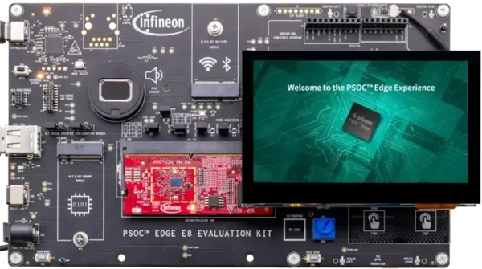

<!-- Copyright 2015-2026 Zephyr Project members and individual contributors. -->
<!-- SPDX-License-Identifier: Apache-2.0 -->
<!-- 中文翻译；编号、导航与译注为本地新增。 -->

<a id="kit_pse84_eval"></a>

# 第15章\_PSOC Edge E84评估套件（Evaluation Kit）

原文：[官方页面](https://docs.zephyrproject.org/latest/boards/infineon/kit_pse84_eval/doc/index.html)。读取日期：2026-10-16；来源摘要见[来源记录](../SOURCES.md)。

开发板概览（Board Overview）

<a id="id5"></a>

[](images/kit_pse84_eval.webp)

PSOC Edge E84评估套件（Evaluation Kit）

名称（Name）：

`kit_pse84_eval`

厂商（Vendor）：

[英飞凌科技（Infineon Technologies）](https://docs.zephyrproject.org/latest/boards/index.html#vendor=infineon)

状态（Status）：

维护中（Maintained）

架构（Architecture）：

[arm](https://docs.zephyrproject.org/latest/boards/index.html#arch=arm)

片上系统（SoC）：

[pse846gps2dbzc4a](https://docs.zephyrproject.org/latest/boards/index.html#soc=pse846gps2dbzc4a)

<a id="board-github-link"></a>

[浏览开发板源码（Browse Board Sources）](https://github.com/zephyrproject-rtos/zephyr/blob/main//boards/infineon/kit_pse84_eval/doc/index.rst/../..)<a id="overview"></a>

## 概述（Overview）

[KIT_PSE84_EVAL](https://www.infineon.com/evaluation-board/KIT-PSE84-EVAL)是基于PSOC Edge E84系列的评估套件，采用PSE846GPS2DBZC4A微控制器，包含400 MHz Arm Cortex-M55、200 MHz Arm Cortex-M33及Arm Ethos-U55 NPU，面向机器学习、可穿戴设备和IoT应用。

评估套件采用基于SODIMM的可拆卸系统模块（SOM），连接到功能丰富的底板（Baseboard）。SOM上有MCU、128 Mb QSPI闪存、1 Gb八线闪存、128 Mb八线HYPERRAM、PSOC 4000T CAPSENSE协处理器，以及板载AIROC CYW55513IUBG Wi-Fi／蓝牙组合模块。

底板提供丰富连接，包括USB主机Type-A、USB设备Type-C、RJ45以太网、M.2 B-key及E-key插槽、Arduino、mikroBUS和Shield2Go排针、MIPI-DSI显示接口、模拟及PDM麦克风、耳机和扬声器输出、microSD卡槽、CAPSENSE按键及滑条，以及ETM／JTAG／SWD等完整调试排针。

开发板集成通过USB Type-C连接的[KitProg3](https://github.com/Infineon/KitProg3)编程器／调试器。

<a id="board-targets"></a>

## 开发板目标（Board Targets）

KIT_PSE84_EVAL提供以下构建目标：

<table>
<tr>
<th>构建目标（Build Target）</th>
<th>说明（Description）</th>
</tr>
<tr>
<td><code>kit_pse84_eval/pse846gps2dbzc4a/m33</code></td>
<td>CM33安全目标（Secure），作为主要烧录及调试目标</td>
</tr>
<tr>
<td><code>kit_pse84_eval/pse846gps2dbzc4a/m33/ns</code></td>
<td>CM33非安全目标（Non-Secure），TF-M变体</td>
</tr>
<tr>
<td><code>kit_pse84_eval/pse846gps2dbzc4a/m55</code></td>
<td>CM55，需要<code>--sysbuild</code>选项</td>
</tr>
</table>

注意（Note）

构建CM55必须使用`--sysbuild`。Sysbuild会自动创建启动CM55所需的CM33配套应用`enable_cm55`。

注意（Note）

CM33安全镜像在构建过程中由imgtool自动签名，生成适合烧录的`.signed.hex`文件。非安全TF-M变体则输出`tfm_merged.hex`。

<a id="hardware"></a>

## 硬件（Hardware）


- 片上系统（SoC）：PSOC™ Edge E84 (PSE846GPS2DBZC4A)
- 主CPU：400 MHz Arm Cortex-M55
- 次级CPU：200 MHz Arm Cortex-M33
- 神经网络处理器（NPU）：Arm Ethos-U55
- SOM闪存：128 Mb QSPI闪存及1 Gb八线闪存
- SOM内存：128 Mb八线HYPERRAM
- 无线连接：SOM上的CYW55513IUBG，以及用于外部无线电的M.2 E-key插槽
- 协处理器：PSOC 4000T CAPSENSE协处理器
- 显示：MIPI-DSI，兼容Raspberry Pi及定制显示屏
- 音频：模拟及PDM麦克风、耳机、扬声器
- 传感器：六轴IMU、三轴磁力计
- USB：主机Type-A及设备Type-C
- 以太网：RJ45
- 扩展：M.2 B-key存储、E-key无线电，以及Shield2Go、mikroBUS、Arduino
- 存储：microSD卡槽
- 用户I/O：CAPSENSE按键及滑条
- 安全：Arm TrustZone-M，以及带密码加速器的安全隔离区（Secure Enclave）
- 调试：板载KitProg3，SWD及UART桥接，并提供ETM／JTAG／SWD排针
- 电源：活动高性能模式（Active HP）／空闲时深度睡眠（Deep Sleep），VDDA／VDDD为1800 mV
- 电压选项：MCU为2.7 V、3.3 V或4.2 V；外设为1.8 V或3.3 V

PSOC Edge E84及KIT_PSE84_EVAL更多信息见：


- [PSOC Edge E84 SoC网站](https://www.infineon.com/products/microcontroller/32-bit-psoc-arm-cortex/32-bit-psoc-edge-arm/psoc-edge-e84)
- [KIT_PSE84_EVAL开发板网站](https://www.infineon.com/evaluation-board/KIT-PSE84-EVAL)

<a id="kit-contents"></a>

### 套件内容（Kit Contents）


- PSOC Edge E84底板（Base Board）
- PSOC Edge E84系统模块（SOM）
- 4.3英寸电容触摸显示屏及USB摄像头模块
- USB Type-C转Type-C线缆
- 2根接近传感器线（Proximity Sensor Wires）
- 4个用于兼容Raspberry Pi显示屏的支撑柱（Stand-Offs）
- 快速入门指南（Quick Start Guide）

<a id="supported-features"></a>

### 支持的功能（Supported Features）

`kit_pse84_eval`开发板支持下表所列的硬件功能。

片上／板载（On-Chip / On-Board）

功能集成在片上系统（SoC）内／位于开发板上。

2 / 2

分别表示已启用／已禁用的实例数。点击数量标签，可查看开发板或SoC设备树源码（DTS）中该功能的第一个实例。

`vnd,foo`

与此功能匹配的设备树绑定兼容字符串（Compatible String）；点击链接可查看绑定文档。

<a id="kit_pse84_eval-hw-features"></a>

<a id="kit_pse84_eval-kit_pse84_eval/pse846gps2dbzc4a/m33-hw-features-section"></a>

#### `kit_pse84_eval/pse846gps2dbzc4a/m33`目标（Target）

<a id="kit_pse84_eval-kit_pse84_eval/pse846gps2dbzc4a/m33-hw-features-panel"></a>

<a id="kit_pse84_eval-kit_pse84_eval/pse846gps2dbzc4a/m33-hw-features-memory"></a>

该开发板目标的片上存储容量：132 KiB RAM、16 MiB Flash。

<a id="kit_pse84_eval-kit_pse84_eval/pse846gps2dbzc4a/m33-hw-features-table"></a>

<table>
<tr>
<th>类型（Type）</th>
<th>位置（Location）</th>
<th>说明（Description）</th>
<th>兼容字符串（Compatible）</th>
</tr>
<tr>
<td rowspan="1">中央处理器（CPU）</td>
<td>片上（On-Chip）</td>
<td>ARM Cortex-M33处理器（CPU）（<a href="https://github.com/zephyrproject-rtos/zephyr/blob/main/dts/arm/infineon/edge/pse84/pse84.cm33.dtsi?plain=1#L15">已启用：1</a>）</td>
<td><a href="../cpu_arm_riscv_binding_reference/P022_arm_cortex-m33.md#std-dtcompatible-arm-cortex-m33"><code>arm,cortex-m33</code></a></td>
</tr>
<tr>
<td rowspan="1">模数转换器（ADC）</td>
<td>片上（On-Chip）</td>
<td>PSOC Edge自主模拟系统（AutAnalog）SAR ADC（<a href="https://github.com/zephyrproject-rtos/zephyr/blob/main/dts/arm/infineon/edge/pse84/pse84_s.dtsi?plain=1#L394">已禁用：1</a>）</td>
<td><a href="../hardware/P878_Infineon自主模拟逐次逼近ADC绑定.md#dtbinding-infineon-autanalog-sar-adc"><code>infineon,autanalog-sar-adc</code></a></td>
</tr>
<tr>
<td rowspan="1">ARM 架构（ARM Architecture）</td>
<td>片上（On-Chip）</td>
<td>英飞凌串行通信模块（SCB / Serial Communication Blocks）节点（<a href="https://github.com/zephyrproject-rtos/zephyr/blob/main/dts/arm/infineon/edge/pse84/pse84_s.dtsi?plain=1#L465">已禁用：9</a>）</td>
<td><a href="../arm_timing_ethosu_control_binding_reference/P011_infineon_scb.md#std-dtcompatible-infineon-scb"><code>infineon,scb</code></a></td>
</tr>
<tr>
<td rowspan="1">音频（Audio）</td>
<td>片上（On-Chip）</td>
<td>英飞凌脉冲密度调制（PDM / Pulse Density Modulation）控制器（<a href="https://github.com/zephyrproject-rtos/zephyr/blob/main/dts/arm/infineon/edge/pse84/pse84_s.dtsi?plain=1#L1384">已禁用：1</a>）</td>
<td><a href="../audio_pdm_codec_binding_reference/P009_infineon_pdm.md#std-dtcompatible-infineon-pdm"><code>infineon,pdm</code></a></td>
</tr>
<tr>
<td rowspan="1">蓝牙（Bluetooth）</td>
<td>板载（On-Board）</td>
<td>使用Infineon蓝牙主机控制器接口UART驱动（Bluetooth HCI UART Driver）的连接芯片（<a href="https://github.com/zephyrproject-rtos/zephyr/blob/main/boards/infineon/kit_pse84_eval/kit_pse84_eval_m33.dts?plain=1#L242">已启用：1</a>）</td>
<td><a href="../bluetooth_vendor_hci_binding_reference/P006_infineon_bt-hci-uart.md#std-dtcompatible-infineon-bt-hci-uart"><code>infineon,bt-hci-uart</code></a></td>
</tr>
<tr>
<td rowspan="2">控制器局域网（CAN）</td>
<td>片上（On-Chip）</td>
<td>英飞凌CAN FD控制器封装层（Wrapper）（<a href="https://github.com/zephyrproject-rtos/zephyr/blob/main/dts/arm/infineon/edge/pse84/pse84_s.dtsi?plain=1#L585">已禁用：1</a>）</td>
<td><a href="../can_adi_atmel_nxp_binding_reference/P008_infineon_canfd-controller.md#std-dtcompatible-infineon-canfd-controller"><code>infineon,canfd-controller</code></a></td>
</tr>
<tr>
<td>片上（On-Chip）</td>
<td>英飞凌MCAN驱动（<a href="https://github.com/zephyrproject-rtos/zephyr/blob/main/dts/arm/infineon/edge/pse84/pse84_s.dtsi?plain=1#L594">已禁用：2</a>）</td>
<td><a href="../can_adi_atmel_nxp_binding_reference/P007_infineon_can.md#std-dtcompatible-infineon-can"><code>infineon,can</code></a></td>
</tr>
<tr>
<td rowspan="3">时钟控制（Clock Control）</td>
<td>片上（On-Chip）</td>
<td>通用固定频率时钟提供者（Fixed-Rate Clock Provider）（<a href="https://github.com/zephyrproject-rtos/zephyr/blob/main/dts/arm/infineon/edge/pse84/system_clocks.dtsi?plain=1#L18">已启用：5</a>）</td>
<td><a href="../timer_reference/P112_Infineon固定时钟绑定.md#dtbinding-infineon-fixed-clock"><code>infineon,fixed-clock</code></a></td>
</tr>
<tr>
<td>片上（On-Chip）</td>
<td>通用固定频率时钟提供者（Fixed-Rate Clock Provider）（<a href="https://github.com/zephyrproject-rtos/zephyr/blob/main/dts/arm/infineon/edge/pse84/system_clocks.dtsi?plain=1#L59">已启用：20</a>）</td>
<td><a href="../timer_reference/P113_Infineon固定比例时钟绑定.md#dtbinding-infineon-fixed-factor-clock"><code>infineon,fixed-factor-clock</code></a></td>
</tr>
<tr>
<td>片上（On-Chip）</td>
<td>英飞凌外设分频器（Peripheral Divider）（<a href="https://github.com/zephyrproject-rtos/zephyr/blob/main/dts/arm/infineon/edge/pse84/system_clocks.dtsi?plain=1#L317">已启用：3</a>；<a href="https://github.com/zephyrproject-rtos/zephyr/blob/main/dts/arm/infineon/edge/pse84/system_clocks.dtsi?plain=1#L256">已禁用：23</a>）</td>
<td><a href="../clock_esp_infineon_microchip_binding_reference/P009_infineon_peri-div.md#std-dtcompatible-infineon-peri-div"><code>infineon,peri-div</code></a></td>
</tr>
<tr>
<td rowspan="2">比较器（Comparator）</td>
<td>片上（On-Chip）</td>
<td>英飞凌CAT1系列低功耗比较器（LPComp / Low Power Comparator）（<a href="https://github.com/zephyrproject-rtos/zephyr/blob/main/dts/arm/infineon/edge/pse84/pse84_s.dtsi?plain=1#L308">已禁用：1</a>）</td>
<td><a href="../hardware/P737_Infineon低功耗比较器绑定.md#dtbinding-infineon-lp-comp"><code>infineon,lp-comp</code></a></td>
</tr>
<tr>
<td>片上（On-Chip）</td>
<td>英飞凌LPComp通道节点，为<code>infineon,lp-comp</code>的子节点（<a href="https://github.com/zephyrproject-rtos/zephyr/blob/main/dts/arm/infineon/edge/pse84/pse84_s.dtsi?plain=1#L314">已禁用：2</a>）</td>
<td><a href="../hardware/P738_Infineon低功耗比较器通道绑定.md#dtbinding-infineon-lp-comp-channel"><code>infineon,lp-comp-channel</code></a></td>
</tr>
<tr>
<td rowspan="1">计数器（Counter）</td>
<td>片上（On-Chip）</td>
<td>英飞凌TCPWM计数器（Counter）（<a href="https://github.com/zephyrproject-rtos/zephyr/blob/main/dts/arm/infineon/edge/pse84/pse84_s.dtsi?plain=1#L636">已禁用：32</a>）</td>
<td><a href="../microchip_soc_counter_binding_reference/P002_infineon_tcpwm-counter.md#std-dtcompatible-infineon-tcpwm-counter"><code>infineon,tcpwm-counter</code></a></td>
</tr>
<tr>
<td rowspan="2">密码学加速器（Cryptographic Accelerator）</td>
<td>片上（On-Chip）</td>
<td>英飞凌MXCRYPTO真随机数发生器（TRNG）（<a href="https://github.com/zephyrproject-rtos/zephyr/blob/main/dts/arm/infineon/edge/pse84/pse84_s.dtsi?plain=1#L1373">已启用：1</a>）</td>
<td><a href="../crypto_aes_sha_ccm_binding_reference/P010_infineon_mxcrypto-trng.md#std-dtcompatible-infineon-mxcrypto-trng"><code>infineon,mxcrypto-trng</code></a></td>
</tr>
<tr>
<td>片上（On-Chip）</td>
<td>英飞凌MXCRYPTO密码引擎（Crypto Engine），AES／SHA（<a href="https://github.com/zephyrproject-rtos/zephyr/blob/main/dts/arm/infineon/edge/pse84/pse84_s.dtsi?plain=1#L1378">已启用：1</a>）</td>
<td><a href="../crypto_aes_sha_ccm_binding_reference/P009_infineon_mxcrypto-crypto.md#std-dtcompatible-infineon-mxcrypto-crypto"><code>infineon,mxcrypto-crypto</code></a></td>
</tr>
<tr>
<td rowspan="1">数模转换器（DAC）</td>
<td>片上（On-Chip）</td>
<td>PSOC Edge AutAnalog连续时间（CT）数模转换器（DAC）（<a href="https://github.com/zephyrproject-rtos/zephyr/blob/main/dts/arm/infineon/edge/pse84/pse84_s.dtsi?plain=1#L362">已禁用：2</a>）</td>
<td><a href="../hardware/P778_Infineon自主模拟连续时间数模转换器绑定.md#dtbinding-infineon-autanalog-ctdac"><code>infineon,autanalog-ctdac</code></a></td>
</tr>
<tr>
<td rowspan="2">直接存储器访问（DMA）</td>
<td>片上（On-Chip）</td>
<td>英飞凌M-DMA控制器（<a href="https://github.com/zephyrproject-rtos/zephyr/blob/main/dts/arm/infineon/edge/pse84/pse84_s.dtsi?plain=1#L1269">已禁用：1</a>）</td>
<td><a href="../intel_microchip_dma_binding_reference/P002_infineon_mdma.md#std-dtcompatible-infineon-mdma"><code>infineon,mdma</code></a></td>
</tr>
<tr>
<td>片上（On-Chip）</td>
<td>英飞凌CAT1 DMA（<a href="https://github.com/zephyrproject-rtos/zephyr/blob/main/dts/arm/infineon/edge/pse84/pse84_s.dtsi?plain=1#L1281">已禁用：2</a>）</td>
<td><a href="../dma_binding_reference/P018_infineon_dma.md#std-dtcompatible-infineon-dma"><code>infineon,dma</code></a></td>
</tr>
<tr>
<td rowspan="2">闪存控制器（Flash Controller）</td>
<td>板载（On-Board）</td>
<td>英飞凌CAT1 QSPI闪存控制器（<a href="https://github.com/zephyrproject-rtos/zephyr/blob/main/boards/infineon/kit_pse84_eval/kit_pse84_eval_memory_map.dtsi?plain=1#L130">已启用：1</a>）</td>
<td><a href="../flash_adi_microchip_nordic_binding_reference/P015_infineon_qspi-flash.md#std-dtcompatible-infineon-qspi-flash"><code>infineon,qspi-flash</code></a></td>
</tr>
<tr>
<td>板载（On-Board）</td>
<td>英飞凌CAT1电阻式随机存储器（RRAM）控制器（<a href="https://github.com/zephyrproject-rtos/zephyr/blob/main/boards/infineon/kit_pse84_eval/kit_pse84_eval_memory_map.dtsi?plain=1#L252">已启用：1</a>）</td>
<td><a href="../flash_adi_microchip_nordic_binding_reference/P016_infineon_rram-controller.md#std-dtcompatible-infineon-rram-controller"><code>infineon,rram-controller</code></a></td>
</tr>
<tr>
<td rowspan="1">通用输入输出与接插件（GPIO &amp; Headers）</td>
<td>片上（On-Chip）</td>
<td>英飞凌GPIO端口（<a href="https://github.com/zephyrproject-rtos/zephyr/blob/main/dts/arm/infineon/edge/pse84/pse84_s.dtsi?plain=1#L70">已启用：11</a>；<a href="https://github.com/zephyrproject-rtos/zephyr/blob/main/dts/arm/infineon/edge/pse84/pse84_s.dtsi?plain=1#L81">已禁用：11</a>）</td>
<td><a href="../gpio_infineon_intel_ite_microchip_binding_reference/P001_infineon_gpio.md#std-dtcompatible-infineon-gpio"><code>infineon,gpio</code></a></td>
</tr>
<tr>
<td rowspan="1">集成电路间总线（I2C）</td>
<td>片上（On-Chip）</td>
<td>英飞凌CAT1 I2C驱动（<a href="https://github.com/zephyrproject-rtos/zephyr/blob/main/dts/arm/infineon/edge/pse84/pse84_s.dtsi?plain=1#L448">已启用：1</a>）</td>
<td><a href="../i2c_infineon_ite_nordic_binding_reference/P003_infineon_i2c.md#std-dtcompatible-infineon-i2c"><code>infineon,i2c</code></a></td>
</tr>
<tr>
<td rowspan="1">集成电路间音频总线（I2S）</td>
<td>片上（On-Chip）</td>
<td>英飞凌I2S控制器（<a href="https://github.com/zephyrproject-rtos/zephyr/blob/main/dts/arm/infineon/edge/pse84/pse84_s.dtsi?plain=1#L1347">已禁用：2</a>）</td>
<td><a href="../i2s_binding_reference/P004_infineon_i2s.md#std-dtcompatible-infineon-i2s"><code>infineon,i2s</code></a></td>
</tr>
<tr>
<td rowspan="1">输入（Input）</td>
<td>板载（On-Board）</td>
<td>一组绑定到 GPIO 的输入按键（GPIO-Bound Input Keys）（<a href="https://github.com/zephyrproject-rtos/zephyr/blob/main/boards/infineon/kit_pse84_eval/kit_pse84_eval_common.dtsi?plain=1#L39">已启用：1</a>）</td>
<td><a href="../hardware/P563_GPIO按键绑定.md#std-dtcompatible-gpio-keys"><code>gpio-keys</code></a></td>
</tr>
<tr>
<td rowspan="1">中断控制器（Interrupt Controller）</td>
<td>片上（On-Chip）</td>
<td>ARMv8-M嵌套向量中断控制器（NVIC / Nested Vectored Interrupt Controller）（<a href="https://github.com/zephyrproject-rtos/zephyr/blob/main/dts/arm/armv8-m.dtsi?plain=1#L13">已启用：1</a>）</td>
<td><a href="../arm_interrupt_timer_binding_reference/P003_ARMv8_M_NVIC.md#std-dtcompatible-arm-v8m-nvic"><code>arm,v8m-nvic</code></a></td>
</tr>
<tr>
<td rowspan="1">处理器间／进程间通信（IPC）</td>
<td>片上（On-Chip）</td>
<td>英飞凌核间通信（IPC）实例（<a href="https://github.com/zephyrproject-rtos/zephyr/blob/main/dts/arm/infineon/edge/pse84/pse84_s.dtsi?plain=1#L420">已禁用：2</a>）</td>
<td><a href="../intercore_reference/P099_Infineon处理器间通信绑定.md#dtbinding-infineon-ipc"><code>infineon,ipc</code></a></td>
</tr>
<tr>
<td rowspan="1">发光二极管（LED）</td>
<td>板载（On-Board）</td>
<td>一组由 GPIO 控制的 LED（GPIO-Controlled LEDs）（<a href="https://github.com/zephyrproject-rtos/zephyr/blob/main/boards/infineon/kit_pse84_eval/kit_pse84_eval_common.dtsi?plain=1#L20">已启用：1</a>）</td>
<td><a href="../hardware/P564_GPIO指示灯绑定.md#dtbinding-gpio-leds"><code>gpio-leds</code></a></td>
</tr>
<tr>
<td rowspan="5">多功能设备（Multi-Function Device）</td>
<td>片上（On-Chip）</td>
<td>英飞凌自主模拟系统（AutAnalog / Autonomous Analog）多功能设备（<a href="https://github.com/zephyrproject-rtos/zephyr/blob/main/dts/arm/infineon/edge/pse84/pse84_s.dtsi?plain=1#L327">已禁用：1</a>）</td>
<td><a href="../hardware/P720_Infineon自主模拟子系统绑定.md#dtbinding-infineon-autanalog"><code>infineon,autanalog</code></a></td>
</tr>
<tr>
<td>片上（On-Chip）</td>
<td>英飞凌AutAnalog连续时间模块（CTB / Continuous Time Block）多功能设备（<a href="https://github.com/zephyrproject-rtos/zephyr/blob/main/dts/arm/infineon/edge/pse84/pse84_s.dtsi?plain=1#L338">已禁用：2</a>）</td>
<td><a href="../hardware/P722_Infineon连续时间模块绑定.md#dtbinding-infineon-autanalog-ctb"><code>infineon,autanalog-ctb</code></a></td>
</tr>
<tr>
<td>片上（On-Chip）</td>
<td>英飞凌AutAnalog可编程阈值比较器（PTComp / Programmable Threshold Comparator）多功能设备（<a href="https://github.com/zephyrproject-rtos/zephyr/blob/main/dts/arm/infineon/edge/pse84/pse84_s.dtsi?plain=1#L354">已禁用：1</a>）</td>
<td><a href="../hardware/P723_Infineon可编程阈值比较器绑定.md#dtbinding-infineon-autanalog-ptcomp"><code>infineon,autanalog-ptcomp</code></a></td>
</tr>
<tr>
<td>片上（On-Chip）</td>
<td>英飞凌AutAnalog可编程参考模块（PRB / Programmable Reference Block）多功能设备（<a href="https://github.com/zephyrproject-rtos/zephyr/blob/main/dts/arm/infineon/edge/pse84/pse84_s.dtsi?plain=1#L402">已禁用：1</a>）</td>
<td><a href="../hardware/P659_Infineon可编程参考模块绑定.md#dtbinding-infineon-autanalog-prb"><code>infineon,autanalog-prb</code></a></td>
</tr>
<tr>
<td>片上（On-Chip）</td>
<td>英飞凌MXCRYPTO多功能设备（<a href="https://github.com/zephyrproject-rtos/zephyr/blob/main/dts/arm/infineon/edge/pse84/pse84_s.dtsi?plain=1#L1369">已启用：1</a>）</td>
<td><a href="../hardware/P727_Infineon加密硬件模块绑定.md#dtbinding-infineon-mxcrypto"><code>infineon,mxcrypto</code></a></td>
</tr>
<tr>
<td rowspan="1">存储技术设备（MTD）</td>
<td>片上（On-Chip）</td>
<td>闪存（Flash）节点（<a href="https://github.com/zephyrproject-rtos/zephyr/blob/main/dts/arm/infineon/edge/pse84/pse84_s.dtsi?plain=1#L42">已启用：5</a>）</td>
<td><a href="../mtd_nxp_st_ti_partition_binding_reference/P013_soc-nv-flash.md#std-dtcompatible-soc-nv-flash"><code>soc-nv-flash</code></a></td>
</tr>
<tr>
<td rowspan="1">引脚控制（Pin Control）</td>
<td>片上（On-Chip）</td>
<td>英飞凌（Infineon）CAT1引脚控制容器（Pinctrl Container）（<a href="https://github.com/zephyrproject-rtos/zephyr/blob/main/dts/arm/infineon/edge/pse84/pse84_s.dtsi?plain=1#L58">已启用：1</a>）</td>
<td><a href="../pinctrl_infineon_nordic_nxp_binding_reference/P001_infineon_pinctrl.md#std-dtcompatible-infineon-pinctrl"><code>infineon,pinctrl</code></a></td>
</tr>
<tr>
<td rowspan="1">脉宽调制（PWM）</td>
<td>片上（On-Chip）</td>
<td>英飞凌TCPWM脉宽调制（PWM）（<a href="https://github.com/zephyrproject-rtos/zephyr/blob/main/dts/arm/infineon/edge/pse84/pse84_s.dtsi?plain=1#L630">已禁用：32</a>）</td>
<td><a href="../pwm_adi_esp_infineon_binding_reference/P019_infineon_tcpwm-pwm.md#std-dtcompatible-infineon-tcpwm-pwm"><code>infineon,tcpwm-pwm</code></a></td>
</tr>
<tr>
<td rowspan="1">实时时钟（RTC）</td>
<td>片上（On-Chip）</td>
<td>英飞凌CAT1系列实时时钟（RTC）设备（<a href="https://github.com/zephyrproject-rtos/zephyr/blob/main/dts/arm/infineon/edge/pse84/pse84_s.dtsi?plain=1#L576">已禁用：1</a>）</td>
<td><a href="../rtc_binding_reference/P007_infineon_rtc.md#std-dtcompatible-infineon-rtc"><code>infineon,rtc</code></a></td>
</tr>
<tr>
<td rowspan="1">SD 主机控制器（SDHC）</td>
<td>片上（On-Chip）</td>
<td>英飞凌CAT1 SDHC／SDIO控制器（<a href="https://github.com/zephyrproject-rtos/zephyr/blob/main/dts/arm/infineon/edge/pse84/pse84_s.dtsi?plain=1#L1329">已禁用：2</a>）</td>
<td><a href="../sdhc_binding_reference/P008_infineon_sdhc-sdio.md#std-dtcompatible-infineon-sdhc-sdio"><code>infineon,sdhc-sdio</code></a></td>
</tr>
<tr>
<td rowspan="1">传感器（Sensors）</td>
<td>板载（On-Board）</td>
<td>BMI270惯性测量单元（IMU / Inertial Measurement Unit）（<a href="https://github.com/zephyrproject-rtos/zephyr/blob/main/boards/infineon/kit_pse84_eval/kit_pse84_eval_common.dtsi?plain=1#L83">已启用：1</a>）</td>
<td><a href="../compatible_binding_reference/P016_bosch_bmi270.md#std-dtcompatible-bosch-bmi270"><code>bosch,bmi270</code></a></td>
</tr>
<tr>
<td rowspan="1">串行控制器（Serial Controller）</td>
<td>片上（On-Chip）</td>
<td>英飞凌CAT1 UART（<a href="https://github.com/zephyrproject-rtos/zephyr/blob/main/dts/arm/infineon/edge/pse84/pse84_s.dtsi?plain=1#L457">已启用：2</a>）</td>
<td><a href="../uart_espressif_infineon_microchip_binding_reference/P008_infineon_uart.md#std-dtcompatible-infineon-uart"><code>infineon,uart</code></a></td>
</tr>
<tr>
<td rowspan="1">静态随机存储器（SRAM）</td>
<td>片上（On-Chip）</td>
<td>通用片上静态随机存储器（SRAM）（<a href="https://github.com/zephyrproject-rtos/zephyr/blob/main/dts/arm/infineon/edge/pse84/pse84_s.dtsi?plain=1#L11">已启用：1</a>）</td>
<td><a href="../hardware/P567_内存映射SRAM绑定.md#dtbinding-mmio-sram"><code>mmio-sram</code></a></td>
</tr>
<tr>
<td rowspan="3">定时器（Timer）</td>
<td>片上（On-Chip）</td>
<td>英飞凌低功耗定时器（<a href="https://github.com/zephyrproject-rtos/zephyr/blob/main/dts/arm/infineon/edge/pse84/pse84_s.dtsi?plain=1#L560">已启用：1</a>；<a href="https://github.com/zephyrproject-rtos/zephyr/blob/main/dts/arm/infineon/edge/pse84/pse84_s.dtsi?plain=1#L568">已禁用：1</a>）</td>
<td><a href="../mcu_timer_binding_reference/P008_infineon_lp-timer.md#std-dtcompatible-infineon-lp-timer"><code>infineon,lp-timer</code></a></td>
</tr>
<tr>
<td>片上（On-Chip）</td>
<td>英飞凌TCPWM定时器（Timer）（<a href="https://github.com/zephyrproject-rtos/zephyr/blob/main/dts/arm/infineon/edge/pse84/pse84_s.dtsi?plain=1#L622">已禁用：32</a>）</td>
<td><a href="../mcu_timer_binding_reference/P009_infineon_tcpwm.md#std-dtcompatible-infineon-tcpwm"><code>infineon,tcpwm</code></a></td>
</tr>
<tr>
<td>片上（On-Chip）</td>
<td>ARMv8-M系统节拍（System Tick）（<a href="https://github.com/zephyrproject-rtos/zephyr/blob/main/dts/arm/armv8-m.dtsi?plain=1#L21">已启用：1</a>）</td>
<td><a href="../arm_interrupt_timer_binding_reference/P007_ARMv8_M_SysTick.md#std-dtcompatible-arm-armv8m-systick"><code>arm,armv8m-systick</code></a></td>
</tr>
<tr>
<td rowspan="1">通用串行总线（USB）</td>
<td>片上（On-Chip）</td>
<td>英飞凌高速USB（USBHS）（<a href="https://github.com/zephyrproject-rtos/zephyr/blob/main/dts/arm/infineon/edge/pse84/pse84_s.dtsi?plain=1#L1435">已启用：1</a>）</td>
<td><a href="../usb_controller_binding_reference/P012_infineon_usbhs.md#std-dtcompatible-infineon-usbhs"><code>infineon,usbhs</code></a></td>
</tr>
<tr>
<td rowspan="1">看门狗（Watchdog）</td>
<td>片上（On-Chip）</td>
<td>英飞凌CAT1看门狗（Watchdog）（<a href="https://github.com/zephyrproject-rtos/zephyr/blob/main/dts/arm/infineon/edge/pse84/pse84_s.dtsi?plain=1#L552">已启用：1</a>）</td>
<td><a href="../soc_pmic_watchdog_binding_reference/P001_infineon_watchdog.md#std-dtcompatible-infineon-watchdog"><code>infineon,watchdog</code></a></td>
</tr>
</table>

<a id="kit_pse84_eval-kit_pse84_eval/pse846gps2dbzc4a/m33/ns-hw-features-section"></a>

#### `kit_pse84_eval/pse846gps2dbzc4a/m33/ns`目标（Target）

<a id="kit_pse84_eval-kit_pse84_eval/pse846gps2dbzc4a/m33/ns-hw-features-panel"></a>

<a id="kit_pse84_eval-kit_pse84_eval/pse846gps2dbzc4a/m33/ns-hw-features-memory"></a>

该开发板目标的片上存储容量：256 KiB RAM、16 MiB Flash。

<a id="kit_pse84_eval-kit_pse84_eval/pse846gps2dbzc4a/m33/ns-hw-features-table"></a>

<table>
<tr>
<th>类型（Type）</th>
<th>位置（Location）</th>
<th>说明（Description）</th>
<th>兼容字符串（Compatible）</th>
</tr>
<tr>
<td rowspan="1">中央处理器（CPU）</td>
<td>片上（On-Chip）</td>
<td>ARM Cortex-M33处理器（CPU）（<a href="https://github.com/zephyrproject-rtos/zephyr/blob/main/dts/arm/infineon/edge/pse84/pse84.cm33.dtsi?plain=1#L15">已启用：1</a>）</td>
<td><a href="../cpu_arm_riscv_binding_reference/P022_arm_cortex-m33.md#std-dtcompatible-arm-cortex-m33"><code>arm,cortex-m33</code></a></td>
</tr>
<tr>
<td rowspan="1">模数转换器（ADC）</td>
<td>片上（On-Chip）</td>
<td>PSOC Edge自主模拟系统（AutAnalog）SAR ADC（<a href="https://github.com/zephyrproject-rtos/zephyr/blob/main/dts/arm/infineon/edge/pse84/pse84.dtsi?plain=1#L391">已禁用：1</a>）</td>
<td><a href="../hardware/P878_Infineon自主模拟逐次逼近ADC绑定.md#dtbinding-infineon-autanalog-sar-adc"><code>infineon,autanalog-sar-adc</code></a></td>
</tr>
<tr>
<td rowspan="2">ARM 架构（ARM Architecture）</td>
<td>片上（On-Chip）</td>
<td>英飞凌PSE84的Arm Ethos-U NPU前端（Frontend）（<a href="https://github.com/zephyrproject-rtos/zephyr/blob/main/dts/arm/infineon/edge/pse84/pse84.dtsi?plain=1#L46">已禁用：1</a>）</td>
<td><a href="../arm_timing_ethosu_control_binding_reference/P010_infineon_edge-npu.md#std-dtcompatible-infineon-edge-npu"><code>infineon,edge-npu</code></a></td>
</tr>
<tr>
<td>片上（On-Chip）</td>
<td>英飞凌串行通信模块（SCB / Serial Communication Blocks）节点（<a href="https://github.com/zephyrproject-rtos/zephyr/blob/main/dts/arm/infineon/edge/pse84/pse84.dtsi?plain=1#L462">已禁用：9</a>）</td>
<td><a href="../arm_timing_ethosu_control_binding_reference/P011_infineon_scb.md#std-dtcompatible-infineon-scb"><code>infineon,scb</code></a></td>
</tr>
<tr>
<td rowspan="1">音频（Audio）</td>
<td>片上（On-Chip）</td>
<td>英飞凌脉冲密度调制（PDM / Pulse Density Modulation）控制器（<a href="https://github.com/zephyrproject-rtos/zephyr/blob/main/dts/arm/infineon/edge/pse84/pse84.dtsi?plain=1#L1381">已禁用：1</a>）</td>
<td><a href="../audio_pdm_codec_binding_reference/P009_infineon_pdm.md#std-dtcompatible-infineon-pdm"><code>infineon,pdm</code></a></td>
</tr>
<tr>
<td rowspan="1">蓝牙（Bluetooth）</td>
<td>板载（On-Board）</td>
<td>使用Infineon蓝牙主机控制器接口UART驱动（Bluetooth HCI UART Driver）的连接芯片（<a href="https://github.com/zephyrproject-rtos/zephyr/blob/main/boards/infineon/kit_pse84_eval/kit_pse84_eval_m33_ns.dts?plain=1#L131">已启用：1</a>）</td>
<td><a href="../bluetooth_vendor_hci_binding_reference/P006_infineon_bt-hci-uart.md#std-dtcompatible-infineon-bt-hci-uart"><code>infineon,bt-hci-uart</code></a></td>
</tr>
<tr>
<td rowspan="2">控制器局域网（CAN）</td>
<td>片上（On-Chip）</td>
<td>英飞凌CAN FD控制器封装层（Wrapper）（<a href="https://github.com/zephyrproject-rtos/zephyr/blob/main/dts/arm/infineon/edge/pse84/pse84.dtsi?plain=1#L582">已禁用：1</a>）</td>
<td><a href="../can_adi_atmel_nxp_binding_reference/P008_infineon_canfd-controller.md#std-dtcompatible-infineon-canfd-controller"><code>infineon,canfd-controller</code></a></td>
</tr>
<tr>
<td>片上（On-Chip）</td>
<td>英飞凌MCAN驱动（<a href="https://github.com/zephyrproject-rtos/zephyr/blob/main/dts/arm/infineon/edge/pse84/pse84.dtsi?plain=1#L591">已禁用：2</a>）</td>
<td><a href="../can_adi_atmel_nxp_binding_reference/P007_infineon_can.md#std-dtcompatible-infineon-can"><code>infineon,can</code></a></td>
</tr>
<tr>
<td rowspan="3">时钟控制（Clock Control）</td>
<td>片上（On-Chip）</td>
<td>通用固定频率时钟提供者（Fixed-Rate Clock Provider）（<a href="https://github.com/zephyrproject-rtos/zephyr/blob/main/dts/arm/infineon/edge/pse84/system_clocks.dtsi?plain=1#L18">已禁用：5</a>）</td>
<td><a href="../timer_reference/P112_Infineon固定时钟绑定.md#dtbinding-infineon-fixed-clock"><code>infineon,fixed-clock</code></a></td>
</tr>
<tr>
<td>片上（On-Chip）</td>
<td>通用固定频率时钟提供者（Fixed-Rate Clock Provider）（<a href="https://github.com/zephyrproject-rtos/zephyr/blob/main/dts/arm/infineon/edge/pse84/system_clocks.dtsi?plain=1#L59">已禁用：20</a>）</td>
<td><a href="../timer_reference/P113_Infineon固定比例时钟绑定.md#dtbinding-infineon-fixed-factor-clock"><code>infineon,fixed-factor-clock</code></a></td>
</tr>
<tr>
<td>片上（On-Chip）</td>
<td>英飞凌外设分频器（Peripheral Divider）（<a href="https://github.com/zephyrproject-rtos/zephyr/blob/main/dts/arm/infineon/edge/pse84/system_clocks.dtsi?plain=1#L317">已启用：4</a>；<a href="https://github.com/zephyrproject-rtos/zephyr/blob/main/dts/arm/infineon/edge/pse84/system_clocks.dtsi?plain=1#L256">已禁用：22</a>）</td>
<td><a href="../clock_esp_infineon_microchip_binding_reference/P009_infineon_peri-div.md#std-dtcompatible-infineon-peri-div"><code>infineon,peri-div</code></a></td>
</tr>
<tr>
<td rowspan="2">比较器（Comparator）</td>
<td>片上（On-Chip）</td>
<td>英飞凌CAT1系列低功耗比较器（LPComp / Low Power Comparator）（<a href="https://github.com/zephyrproject-rtos/zephyr/blob/main/dts/arm/infineon/edge/pse84/pse84.dtsi?plain=1#L305">已禁用：1</a>）</td>
<td><a href="../hardware/P737_Infineon低功耗比较器绑定.md#dtbinding-infineon-lp-comp"><code>infineon,lp-comp</code></a></td>
</tr>
<tr>
<td>片上（On-Chip）</td>
<td>英飞凌LPComp通道节点，为<code>infineon,lp-comp</code>的子节点（<a href="https://github.com/zephyrproject-rtos/zephyr/blob/main/dts/arm/infineon/edge/pse84/pse84.dtsi?plain=1#L311">已禁用：2</a>）</td>
<td><a href="../hardware/P738_Infineon低功耗比较器通道绑定.md#dtbinding-infineon-lp-comp-channel"><code>infineon,lp-comp-channel</code></a></td>
</tr>
<tr>
<td rowspan="1">计数器（Counter）</td>
<td>片上（On-Chip）</td>
<td>英飞凌TCPWM计数器（Counter）（<a href="https://github.com/zephyrproject-rtos/zephyr/blob/main/dts/arm/infineon/edge/pse84/pse84.dtsi?plain=1#L633">已禁用：32</a>）</td>
<td><a href="../microchip_soc_counter_binding_reference/P002_infineon_tcpwm-counter.md#std-dtcompatible-infineon-tcpwm-counter"><code>infineon,tcpwm-counter</code></a></td>
</tr>
<tr>
<td rowspan="2">密码学加速器（Cryptographic Accelerator）</td>
<td>片上（On-Chip）</td>
<td>英飞凌MXCRYPTO真随机数发生器（TRNG）（<a href="https://github.com/zephyrproject-rtos/zephyr/blob/main/dts/arm/infineon/edge/pse84/pse84.dtsi?plain=1#L1370">已禁用：1</a>）</td>
<td><a href="../crypto_aes_sha_ccm_binding_reference/P010_infineon_mxcrypto-trng.md#std-dtcompatible-infineon-mxcrypto-trng"><code>infineon,mxcrypto-trng</code></a></td>
</tr>
<tr>
<td>片上（On-Chip）</td>
<td>英飞凌MXCRYPTO密码引擎（Crypto Engine），AES／SHA（<a href="https://github.com/zephyrproject-rtos/zephyr/blob/main/dts/arm/infineon/edge/pse84/pse84.dtsi?plain=1#L1375">已禁用：1</a>）</td>
<td><a href="../crypto_aes_sha_ccm_binding_reference/P009_infineon_mxcrypto-crypto.md#std-dtcompatible-infineon-mxcrypto-crypto"><code>infineon,mxcrypto-crypto</code></a></td>
</tr>
<tr>
<td rowspan="1">数模转换器（DAC）</td>
<td>片上（On-Chip）</td>
<td>PSOC Edge AutAnalog连续时间（CT）数模转换器（DAC）（<a href="https://github.com/zephyrproject-rtos/zephyr/blob/main/dts/arm/infineon/edge/pse84/pse84.dtsi?plain=1#L359">已禁用：2</a>）</td>
<td><a href="../hardware/P778_Infineon自主模拟连续时间数模转换器绑定.md#dtbinding-infineon-autanalog-ctdac"><code>infineon,autanalog-ctdac</code></a></td>
</tr>
<tr>
<td rowspan="2">直接存储器访问（DMA）</td>
<td>片上（On-Chip）</td>
<td>英飞凌M-DMA控制器（<a href="https://github.com/zephyrproject-rtos/zephyr/blob/main/dts/arm/infineon/edge/pse84/pse84.dtsi?plain=1#L1266">已禁用：1</a>）</td>
<td><a href="../intel_microchip_dma_binding_reference/P002_infineon_mdma.md#std-dtcompatible-infineon-mdma"><code>infineon,mdma</code></a></td>
</tr>
<tr>
<td>片上（On-Chip）</td>
<td>英飞凌CAT1 DMA（<a href="https://github.com/zephyrproject-rtos/zephyr/blob/main/dts/arm/infineon/edge/pse84/pse84.dtsi?plain=1#L1278">已禁用：2</a>）</td>
<td><a href="../dma_binding_reference/P018_infineon_dma.md#std-dtcompatible-infineon-dma"><code>infineon,dma</code></a></td>
</tr>
<tr>
<td rowspan="2">闪存控制器（Flash Controller）</td>
<td>片上（On-Chip）</td>
<td>英飞凌CAT1电阻式随机存储器（RRAM）控制器（<a href="https://github.com/zephyrproject-rtos/zephyr/blob/main/dts/arm/infineon/edge/pse84/pse84.dtsi?plain=1#L16">已启用：1</a>）</td>
<td><a href="../flash_adi_microchip_nordic_binding_reference/P016_infineon_rram-controller.md#std-dtcompatible-infineon-rram-controller"><code>infineon,rram-controller</code></a></td>
</tr>
<tr>
<td>板载（On-Board）</td>
<td>英飞凌CAT1 QSPI闪存控制器（<a href="https://github.com/zephyrproject-rtos/zephyr/blob/main/boards/infineon/kit_pse84_eval/kit_pse84_eval_memory_map.dtsi?plain=1#L130">已启用：1</a>）</td>
<td><a href="../flash_adi_microchip_nordic_binding_reference/P015_infineon_qspi-flash.md#std-dtcompatible-infineon-qspi-flash"><code>infineon,qspi-flash</code></a></td>
</tr>
<tr>
<td rowspan="1">通用输入输出与接插件（GPIO &amp; Headers）</td>
<td>片上（On-Chip）</td>
<td>英飞凌GPIO端口（<a href="https://github.com/zephyrproject-rtos/zephyr/blob/main/dts/arm/infineon/edge/pse84/pse84.dtsi?plain=1#L65">已启用：11</a>；<a href="https://github.com/zephyrproject-rtos/zephyr/blob/main/dts/arm/infineon/edge/pse84/pse84.dtsi?plain=1#L76">已禁用：11</a>）</td>
<td><a href="../gpio_infineon_intel_ite_microchip_binding_reference/P001_infineon_gpio.md#std-dtcompatible-infineon-gpio"><code>infineon,gpio</code></a></td>
</tr>
<tr>
<td rowspan="1">集成电路间总线（I2C）</td>
<td>片上（On-Chip）</td>
<td>英飞凌CAT1 I2C驱动（<a href="https://github.com/zephyrproject-rtos/zephyr/blob/main/dts/arm/infineon/edge/pse84/pse84.dtsi?plain=1#L445">已启用：1</a>）</td>
<td><a href="../i2c_infineon_ite_nordic_binding_reference/P003_infineon_i2c.md#std-dtcompatible-infineon-i2c"><code>infineon,i2c</code></a></td>
</tr>
<tr>
<td rowspan="1">集成电路间音频总线（I2S）</td>
<td>片上（On-Chip）</td>
<td>英飞凌I2S控制器（<a href="https://github.com/zephyrproject-rtos/zephyr/blob/main/dts/arm/infineon/edge/pse84/pse84.dtsi?plain=1#L1344">已禁用：2</a>）</td>
<td><a href="../i2s_binding_reference/P004_infineon_i2s.md#std-dtcompatible-infineon-i2s"><code>infineon,i2s</code></a></td>
</tr>
<tr>
<td rowspan="1">输入（Input）</td>
<td>板载（On-Board）</td>
<td>一组绑定到 GPIO 的输入按键（GPIO-Bound Input Keys）（<a href="https://github.com/zephyrproject-rtos/zephyr/blob/main/boards/infineon/kit_pse84_eval/kit_pse84_eval_common.dtsi?plain=1#L39">已启用：1</a>）</td>
<td><a href="../hardware/P563_GPIO按键绑定.md#std-dtcompatible-gpio-keys"><code>gpio-keys</code></a></td>
</tr>
<tr>
<td rowspan="1">中断控制器（Interrupt Controller）</td>
<td>片上（On-Chip）</td>
<td>ARMv8-M嵌套向量中断控制器（NVIC / Nested Vectored Interrupt Controller）（<a href="https://github.com/zephyrproject-rtos/zephyr/blob/main/dts/arm/armv8-m.dtsi?plain=1#L13">已启用：1</a>）</td>
<td><a href="../arm_interrupt_timer_binding_reference/P003_ARMv8_M_NVIC.md#std-dtcompatible-arm-v8m-nvic"><code>arm,v8m-nvic</code></a></td>
</tr>
<tr>
<td rowspan="1">处理器间／进程间通信（IPC）</td>
<td>片上（On-Chip）</td>
<td>英飞凌核间通信（IPC）实例（<a href="https://github.com/zephyrproject-rtos/zephyr/blob/main/dts/arm/infineon/edge/pse84/pse84.dtsi?plain=1#L417">已禁用：2</a>）</td>
<td><a href="../intercore_reference/P099_Infineon处理器间通信绑定.md#dtbinding-infineon-ipc"><code>infineon,ipc</code></a></td>
</tr>
<tr>
<td rowspan="1">发光二极管（LED）</td>
<td>板载（On-Board）</td>
<td>一组由 GPIO 控制的 LED（GPIO-Controlled LEDs）（<a href="https://github.com/zephyrproject-rtos/zephyr/blob/main/boards/infineon/kit_pse84_eval/kit_pse84_eval_common.dtsi?plain=1#L20">已启用：1</a>）</td>
<td><a href="../hardware/P564_GPIO指示灯绑定.md#dtbinding-gpio-leds"><code>gpio-leds</code></a></td>
</tr>
<tr>
<td rowspan="5">多功能设备（Multi-Function Device）</td>
<td>片上（On-Chip）</td>
<td>英飞凌自主模拟系统（AutAnalog / Autonomous Analog）多功能设备（<a href="https://github.com/zephyrproject-rtos/zephyr/blob/main/dts/arm/infineon/edge/pse84/pse84.dtsi?plain=1#L324">已禁用：1</a>）</td>
<td><a href="../hardware/P720_Infineon自主模拟子系统绑定.md#dtbinding-infineon-autanalog"><code>infineon,autanalog</code></a></td>
</tr>
<tr>
<td>片上（On-Chip）</td>
<td>英飞凌AutAnalog连续时间模块（CTB / Continuous Time Block）多功能设备（<a href="https://github.com/zephyrproject-rtos/zephyr/blob/main/dts/arm/infineon/edge/pse84/pse84.dtsi?plain=1#L335">已禁用：2</a>）</td>
<td><a href="../hardware/P722_Infineon连续时间模块绑定.md#dtbinding-infineon-autanalog-ctb"><code>infineon,autanalog-ctb</code></a></td>
</tr>
<tr>
<td>片上（On-Chip）</td>
<td>英飞凌AutAnalog可编程阈值比较器（PTComp / Programmable Threshold Comparator）多功能设备（<a href="https://github.com/zephyrproject-rtos/zephyr/blob/main/dts/arm/infineon/edge/pse84/pse84.dtsi?plain=1#L351">已禁用：1</a>）</td>
<td><a href="../hardware/P723_Infineon可编程阈值比较器绑定.md#dtbinding-infineon-autanalog-ptcomp"><code>infineon,autanalog-ptcomp</code></a></td>
</tr>
<tr>
<td>片上（On-Chip）</td>
<td>英飞凌AutAnalog可编程参考模块（PRB / Programmable Reference Block）多功能设备（<a href="https://github.com/zephyrproject-rtos/zephyr/blob/main/dts/arm/infineon/edge/pse84/pse84.dtsi?plain=1#L399">已禁用：1</a>）</td>
<td><a href="../hardware/P659_Infineon可编程参考模块绑定.md#dtbinding-infineon-autanalog-prb"><code>infineon,autanalog-prb</code></a></td>
</tr>
<tr>
<td>片上（On-Chip）</td>
<td>英飞凌MXCRYPTO多功能设备（<a href="https://github.com/zephyrproject-rtos/zephyr/blob/main/dts/arm/infineon/edge/pse84/pse84.dtsi?plain=1#L1366">已启用：1</a>）</td>
<td><a href="../hardware/P727_Infineon加密硬件模块绑定.md#dtbinding-infineon-mxcrypto"><code>infineon,mxcrypto</code></a></td>
</tr>
<tr>
<td rowspan="1">存储技术设备（MTD）</td>
<td>片上（On-Chip）</td>
<td>闪存（Flash）节点（<a href="https://github.com/zephyrproject-rtos/zephyr/blob/main/dts/arm/infineon/edge/pse84/pse84.dtsi?plain=1#L24">已启用：4</a>）</td>
<td><a href="../mtd_nxp_st_ti_partition_binding_reference/P013_soc-nv-flash.md#std-dtcompatible-soc-nv-flash"><code>soc-nv-flash</code></a></td>
</tr>
<tr>
<td rowspan="1">引脚控制（Pin Control）</td>
<td>片上（On-Chip）</td>
<td>英飞凌（Infineon）CAT1引脚控制容器（Pinctrl Container）（<a href="https://github.com/zephyrproject-rtos/zephyr/blob/main/dts/arm/infineon/edge/pse84/pse84.dtsi?plain=1#L53">已启用：1</a>）</td>
<td><a href="../pinctrl_infineon_nordic_nxp_binding_reference/P001_infineon_pinctrl.md#std-dtcompatible-infineon-pinctrl"><code>infineon,pinctrl</code></a></td>
</tr>
<tr>
<td rowspan="1">脉宽调制（PWM）</td>
<td>片上（On-Chip）</td>
<td>英飞凌TCPWM脉宽调制（PWM）（<a href="https://github.com/zephyrproject-rtos/zephyr/blob/main/dts/arm/infineon/edge/pse84/pse84.dtsi?plain=1#L627">已禁用：32</a>）</td>
<td><a href="../pwm_adi_esp_infineon_binding_reference/P019_infineon_tcpwm-pwm.md#std-dtcompatible-infineon-tcpwm-pwm"><code>infineon,tcpwm-pwm</code></a></td>
</tr>
<tr>
<td rowspan="1">实时时钟（RTC）</td>
<td>片上（On-Chip）</td>
<td>英飞凌CAT1系列实时时钟（RTC）设备（<a href="https://github.com/zephyrproject-rtos/zephyr/blob/main/dts/arm/infineon/edge/pse84/pse84.dtsi?plain=1#L573">已禁用：1</a>）</td>
<td><a href="../rtc_binding_reference/P007_infineon_rtc.md#std-dtcompatible-infineon-rtc"><code>infineon,rtc</code></a></td>
</tr>
<tr>
<td rowspan="1">SD 主机控制器（SDHC）</td>
<td>片上（On-Chip）</td>
<td>英飞凌CAT1 SDHC／SDIO控制器（<a href="https://github.com/zephyrproject-rtos/zephyr/blob/main/dts/arm/infineon/edge/pse84/pse84.dtsi?plain=1#L1326">已启用：1</a>；<a href="https://github.com/zephyrproject-rtos/zephyr/blob/main/dts/arm/infineon/edge/pse84/pse84.dtsi?plain=1#L1335">已禁用：1</a>）</td>
<td><a href="../sdhc_binding_reference/P008_infineon_sdhc-sdio.md#std-dtcompatible-infineon-sdhc-sdio"><code>infineon,sdhc-sdio</code></a></td>
</tr>
<tr>
<td rowspan="1">传感器（Sensors）</td>
<td>板载（On-Board）</td>
<td>BMI270惯性测量单元（IMU / Inertial Measurement Unit）（<a href="https://github.com/zephyrproject-rtos/zephyr/blob/main/boards/infineon/kit_pse84_eval/kit_pse84_eval_common.dtsi?plain=1#L83">已启用：1</a>）</td>
<td><a href="../compatible_binding_reference/P016_bosch_bmi270.md#std-dtcompatible-bosch-bmi270"><code>bosch,bmi270</code></a></td>
</tr>
<tr>
<td rowspan="1">串行控制器（Serial Controller）</td>
<td>片上（On-Chip）</td>
<td>英飞凌CAT1 UART（<a href="https://github.com/zephyrproject-rtos/zephyr/blob/main/dts/arm/infineon/edge/pse84/pse84.dtsi?plain=1#L454">已启用：2</a>）</td>
<td><a href="../uart_espressif_infineon_microchip_binding_reference/P008_infineon_uart.md#std-dtcompatible-infineon-uart"><code>infineon,uart</code></a></td>
</tr>
<tr>
<td rowspan="1">静态随机存储器（SRAM）</td>
<td>片上（On-Chip）</td>
<td>通用片上静态随机存储器（SRAM）（<a href="https://github.com/zephyrproject-rtos/zephyr/blob/main/dts/arm/infineon/edge/pse84/pse84.dtsi?plain=1#L11">已启用：1</a>）</td>
<td><a href="../hardware/P567_内存映射SRAM绑定.md#dtbinding-mmio-sram"><code>mmio-sram</code></a></td>
</tr>
<tr>
<td rowspan="3">定时器（Timer）</td>
<td>片上（On-Chip）</td>
<td>英飞凌低功耗定时器（<a href="https://github.com/zephyrproject-rtos/zephyr/blob/main/dts/arm/infineon/edge/pse84/pse84.dtsi?plain=1#L557">已启用：1</a>；<a href="https://github.com/zephyrproject-rtos/zephyr/blob/main/dts/arm/infineon/edge/pse84/pse84.dtsi?plain=1#L565">已禁用：1</a>）</td>
<td><a href="../mcu_timer_binding_reference/P008_infineon_lp-timer.md#std-dtcompatible-infineon-lp-timer"><code>infineon,lp-timer</code></a></td>
</tr>
<tr>
<td>片上（On-Chip）</td>
<td>英飞凌TCPWM定时器（Timer）（<a href="https://github.com/zephyrproject-rtos/zephyr/blob/main/dts/arm/infineon/edge/pse84/pse84.dtsi?plain=1#L619">已禁用：32</a>）</td>
<td><a href="../mcu_timer_binding_reference/P009_infineon_tcpwm.md#std-dtcompatible-infineon-tcpwm"><code>infineon,tcpwm</code></a></td>
</tr>
<tr>
<td>片上（On-Chip）</td>
<td>ARMv8-M系统节拍（System Tick）（<a href="https://github.com/zephyrproject-rtos/zephyr/blob/main/dts/arm/armv8-m.dtsi?plain=1#L21">已启用：1</a>）</td>
<td><a href="../arm_interrupt_timer_binding_reference/P007_ARMv8_M_SysTick.md#std-dtcompatible-arm-armv8m-systick"><code>arm,armv8m-systick</code></a></td>
</tr>
<tr>
<td rowspan="1">通用串行总线（USB）</td>
<td>片上（On-Chip）</td>
<td>英飞凌高速USB（USBHS）（<a href="https://github.com/zephyrproject-rtos/zephyr/blob/main/dts/arm/infineon/edge/pse84/pse84.dtsi?plain=1#L1432">已启用：1</a>）</td>
<td><a href="../usb_controller_binding_reference/P012_infineon_usbhs.md#std-dtcompatible-infineon-usbhs"><code>infineon,usbhs</code></a></td>
</tr>
<tr>
<td rowspan="1">看门狗（Watchdog）</td>
<td>片上（On-Chip）</td>
<td>英飞凌CAT1看门狗（Watchdog）（<a href="https://github.com/zephyrproject-rtos/zephyr/blob/main/dts/arm/infineon/edge/pse84/pse84.dtsi?plain=1#L549">已禁用：1</a>）</td>
<td><a href="../soc_pmic_watchdog_binding_reference/P001_infineon_watchdog.md#std-dtcompatible-infineon-watchdog"><code>infineon,watchdog</code></a></td>
</tr>
<tr>
<td rowspan="1">无线局域网（Wi-Fi）</td>
<td>板载（On-Board）</td>
<td>通过SPI提供的AIROC Wi-Fi连接（<a href="https://github.com/zephyrproject-rtos/zephyr/blob/main/boards/infineon/kit_pse84_eval/kit_pse84_eval_m33_ns.dts?plain=1#L97">已启用：1</a>）</td>
<td><a href="../compatible_binding_reference/P036_infineon_airoc-wifi.md#std-dtcompatible-infineon-airoc-wifi"><code>infineon,airoc-wifi</code></a></td>
</tr>
</table>

<a id="kit_pse84_eval-kit_pse84_eval/pse846gps2dbzc4a/m55-hw-features-section"></a>

#### `kit_pse84_eval/pse846gps2dbzc4a/m55`目标（Target）

<a id="kit_pse84_eval-kit_pse84_eval/pse846gps2dbzc4a/m55-hw-features-panel"></a>

<a id="kit_pse84_eval-kit_pse84_eval/pse846gps2dbzc4a/m55-hw-features-memory"></a>

该开发板目标的片上存储容量：256 KiB RAM、16 MiB Flash。

<a id="kit_pse84_eval-kit_pse84_eval/pse846gps2dbzc4a/m55-hw-features-table"></a>

<table>
<tr>
<th>类型（Type）</th>
<th>位置（Location）</th>
<th>说明（Description）</th>
<th>兼容字符串（Compatible）</th>
</tr>
<tr>
<td rowspan="1">中央处理器（CPU）</td>
<td>片上（On-Chip）</td>
<td>ARM Cortex-M55处理器（CPU）（<a href="https://github.com/zephyrproject-rtos/zephyr/blob/main/dts/arm/infineon/edge/pse84/pse84.cm55.dtsi?plain=1#L15">已启用：1</a>）</td>
<td><a href="../cpu_cortex_xtensa_binding_reference/P003_arm_cortex-m55.md#std-dtcompatible-arm-cortex-m55"><code>arm,cortex-m55</code></a></td>
</tr>
<tr>
<td rowspan="1">模数转换器（ADC）</td>
<td>片上（On-Chip）</td>
<td>PSOC Edge自主模拟系统（AutAnalog）SAR ADC（<a href="https://github.com/zephyrproject-rtos/zephyr/blob/main/dts/arm/infineon/edge/pse84/pse84.dtsi?plain=1#L391">已禁用：1</a>）</td>
<td><a href="../hardware/P878_Infineon自主模拟逐次逼近ADC绑定.md#dtbinding-infineon-autanalog-sar-adc"><code>infineon,autanalog-sar-adc</code></a></td>
</tr>
<tr>
<td rowspan="2">ARM 架构（ARM Architecture）</td>
<td>片上（On-Chip）</td>
<td>英飞凌PSE84的Arm Ethos-U NPU前端（Frontend）（<a href="https://github.com/zephyrproject-rtos/zephyr/blob/main/dts/arm/infineon/edge/pse84/pse84.dtsi?plain=1#L46">已禁用：1</a>）</td>
<td><a href="../arm_timing_ethosu_control_binding_reference/P010_infineon_edge-npu.md#std-dtcompatible-infineon-edge-npu"><code>infineon,edge-npu</code></a></td>
</tr>
<tr>
<td>片上（On-Chip）</td>
<td>英飞凌串行通信模块（SCB / Serial Communication Blocks）节点（<a href="https://github.com/zephyrproject-rtos/zephyr/blob/main/dts/arm/infineon/edge/pse84/pse84.dtsi?plain=1#L462">已禁用：9</a>）</td>
<td><a href="../arm_timing_ethosu_control_binding_reference/P011_infineon_scb.md#std-dtcompatible-infineon-scb"><code>infineon,scb</code></a></td>
</tr>
<tr>
<td rowspan="1">音频（Audio）</td>
<td>片上（On-Chip）</td>
<td>英飞凌脉冲密度调制（PDM / Pulse Density Modulation）控制器（<a href="https://github.com/zephyrproject-rtos/zephyr/blob/main/dts/arm/infineon/edge/pse84/pse84.dtsi?plain=1#L1381">已禁用：1</a>）</td>
<td><a href="../audio_pdm_codec_binding_reference/P009_infineon_pdm.md#std-dtcompatible-infineon-pdm"><code>infineon,pdm</code></a></td>
</tr>
<tr>
<td rowspan="1">蓝牙（Bluetooth）</td>
<td>板载（On-Board）</td>
<td>使用Infineon蓝牙主机控制器接口UART驱动（Bluetooth HCI UART Driver）的连接芯片（<a href="https://github.com/zephyrproject-rtos/zephyr/blob/main/boards/infineon/kit_pse84_eval/kit_pse84_eval_m55.dts?plain=1#L86">已启用：1</a>）</td>
<td><a href="../bluetooth_vendor_hci_binding_reference/P006_infineon_bt-hci-uart.md#std-dtcompatible-infineon-bt-hci-uart"><code>infineon,bt-hci-uart</code></a></td>
</tr>
<tr>
<td rowspan="2">控制器局域网（CAN）</td>
<td>片上（On-Chip）</td>
<td>英飞凌CAN FD控制器封装层（Wrapper）（<a href="https://github.com/zephyrproject-rtos/zephyr/blob/main/dts/arm/infineon/edge/pse84/pse84.dtsi?plain=1#L582">已禁用：1</a>）</td>
<td><a href="../can_adi_atmel_nxp_binding_reference/P008_infineon_canfd-controller.md#std-dtcompatible-infineon-canfd-controller"><code>infineon,canfd-controller</code></a></td>
</tr>
<tr>
<td>片上（On-Chip）</td>
<td>英飞凌MCAN驱动（<a href="https://github.com/zephyrproject-rtos/zephyr/blob/main/dts/arm/infineon/edge/pse84/pse84.dtsi?plain=1#L591">已禁用：2</a>）</td>
<td><a href="../can_adi_atmel_nxp_binding_reference/P007_infineon_can.md#std-dtcompatible-infineon-can"><code>infineon,can</code></a></td>
</tr>
<tr>
<td rowspan="3">时钟控制（Clock Control）</td>
<td>片上（On-Chip）</td>
<td>通用固定频率时钟提供者（Fixed-Rate Clock Provider）（<a href="https://github.com/zephyrproject-rtos/zephyr/blob/main/dts/arm/infineon/edge/pse84/system_clocks.dtsi?plain=1#L18">已启用：2</a>；<a href="https://github.com/zephyrproject-rtos/zephyr/blob/main/dts/arm/infineon/edge/pse84/system_clocks.dtsi?plain=1#L35">已禁用：3</a>）</td>
<td><a href="../timer_reference/P112_Infineon固定时钟绑定.md#dtbinding-infineon-fixed-clock"><code>infineon,fixed-clock</code></a></td>
</tr>
<tr>
<td>片上（On-Chip）</td>
<td>通用固定频率时钟提供者（Fixed-Rate Clock Provider）（<a href="https://github.com/zephyrproject-rtos/zephyr/blob/main/dts/arm/infineon/edge/pse84/system_clocks.dtsi?plain=1#L59">已禁用：20</a>）</td>
<td><a href="../timer_reference/P113_Infineon固定比例时钟绑定.md#dtbinding-infineon-fixed-factor-clock"><code>infineon,fixed-factor-clock</code></a></td>
</tr>
<tr>
<td>片上（On-Chip）</td>
<td>英飞凌外设分频器（Peripheral Divider）（<a href="https://github.com/zephyrproject-rtos/zephyr/blob/main/dts/arm/infineon/edge/pse84/system_clocks.dtsi?plain=1#L317">已启用：5</a>；<a href="https://github.com/zephyrproject-rtos/zephyr/blob/main/dts/arm/infineon/edge/pse84/system_clocks.dtsi?plain=1#L256">已禁用：21</a>）</td>
<td><a href="../clock_esp_infineon_microchip_binding_reference/P009_infineon_peri-div.md#std-dtcompatible-infineon-peri-div"><code>infineon,peri-div</code></a></td>
</tr>
<tr>
<td rowspan="2">比较器（Comparator）</td>
<td>片上（On-Chip）</td>
<td>英飞凌CAT1系列低功耗比较器（LPComp / Low Power Comparator）（<a href="https://github.com/zephyrproject-rtos/zephyr/blob/main/dts/arm/infineon/edge/pse84/pse84.dtsi?plain=1#L305">已禁用：1</a>）</td>
<td><a href="../hardware/P737_Infineon低功耗比较器绑定.md#dtbinding-infineon-lp-comp"><code>infineon,lp-comp</code></a></td>
</tr>
<tr>
<td>片上（On-Chip）</td>
<td>英飞凌LPComp通道节点，为<code>infineon,lp-comp</code>的子节点（<a href="https://github.com/zephyrproject-rtos/zephyr/blob/main/dts/arm/infineon/edge/pse84/pse84.dtsi?plain=1#L311">已禁用：2</a>）</td>
<td><a href="../hardware/P738_Infineon低功耗比较器通道绑定.md#dtbinding-infineon-lp-comp-channel"><code>infineon,lp-comp-channel</code></a></td>
</tr>
<tr>
<td rowspan="1">计数器（Counter）</td>
<td>片上（On-Chip）</td>
<td>英飞凌TCPWM计数器（Counter）（<a href="https://github.com/zephyrproject-rtos/zephyr/blob/main/dts/arm/infineon/edge/pse84/pse84.dtsi?plain=1#L633">已禁用：32</a>）</td>
<td><a href="../microchip_soc_counter_binding_reference/P002_infineon_tcpwm-counter.md#std-dtcompatible-infineon-tcpwm-counter"><code>infineon,tcpwm-counter</code></a></td>
</tr>
<tr>
<td rowspan="2">密码学加速器（Cryptographic Accelerator）</td>
<td>片上（On-Chip）</td>
<td>英飞凌MXCRYPTO真随机数发生器（TRNG）（<a href="https://github.com/zephyrproject-rtos/zephyr/blob/main/dts/arm/infineon/edge/pse84/pse84.dtsi?plain=1#L1370">已启用：1</a>）</td>
<td><a href="../crypto_aes_sha_ccm_binding_reference/P010_infineon_mxcrypto-trng.md#std-dtcompatible-infineon-mxcrypto-trng"><code>infineon,mxcrypto-trng</code></a></td>
</tr>
<tr>
<td>片上（On-Chip）</td>
<td>英飞凌MXCRYPTO密码引擎（Crypto Engine），AES／SHA（<a href="https://github.com/zephyrproject-rtos/zephyr/blob/main/dts/arm/infineon/edge/pse84/pse84.dtsi?plain=1#L1375">已启用：1</a>）</td>
<td><a href="../crypto_aes_sha_ccm_binding_reference/P009_infineon_mxcrypto-crypto.md#std-dtcompatible-infineon-mxcrypto-crypto"><code>infineon,mxcrypto-crypto</code></a></td>
</tr>
<tr>
<td rowspan="1">数模转换器（DAC）</td>
<td>片上（On-Chip）</td>
<td>PSOC Edge AutAnalog连续时间（CT）数模转换器（DAC）（<a href="https://github.com/zephyrproject-rtos/zephyr/blob/main/dts/arm/infineon/edge/pse84/pse84.dtsi?plain=1#L359">已禁用：2</a>）</td>
<td><a href="../hardware/P778_Infineon自主模拟连续时间数模转换器绑定.md#dtbinding-infineon-autanalog-ctdac"><code>infineon,autanalog-ctdac</code></a></td>
</tr>
<tr>
<td rowspan="2">直接存储器访问（DMA）</td>
<td>片上（On-Chip）</td>
<td>英飞凌M-DMA控制器（<a href="https://github.com/zephyrproject-rtos/zephyr/blob/main/dts/arm/infineon/edge/pse84/pse84.dtsi?plain=1#L1266">已禁用：1</a>）</td>
<td><a href="../intel_microchip_dma_binding_reference/P002_infineon_mdma.md#std-dtcompatible-infineon-mdma"><code>infineon,mdma</code></a></td>
</tr>
<tr>
<td>片上（On-Chip）</td>
<td>英飞凌CAT1 DMA（<a href="https://github.com/zephyrproject-rtos/zephyr/blob/main/dts/arm/infineon/edge/pse84/pse84.dtsi?plain=1#L1278">已禁用：2</a>）</td>
<td><a href="../dma_binding_reference/P018_infineon_dma.md#std-dtcompatible-infineon-dma"><code>infineon,dma</code></a></td>
</tr>
<tr>
<td rowspan="2">闪存控制器（Flash Controller）</td>
<td>片上（On-Chip）</td>
<td>英飞凌CAT1电阻式随机存储器（RRAM）控制器（<a href="https://github.com/zephyrproject-rtos/zephyr/blob/main/dts/arm/infineon/edge/pse84/pse84.dtsi?plain=1#L16">已启用：1</a>）</td>
<td><a href="../flash_adi_microchip_nordic_binding_reference/P016_infineon_rram-controller.md#std-dtcompatible-infineon-rram-controller"><code>infineon,rram-controller</code></a></td>
</tr>
<tr>
<td>板载（On-Board）</td>
<td>英飞凌CAT1 QSPI闪存控制器（<a href="https://github.com/zephyrproject-rtos/zephyr/blob/main/boards/infineon/kit_pse84_eval/kit_pse84_eval_memory_map.dtsi?plain=1#L130">已启用：1</a>）</td>
<td><a href="../flash_adi_microchip_nordic_binding_reference/P015_infineon_qspi-flash.md#std-dtcompatible-infineon-qspi-flash"><code>infineon,qspi-flash</code></a></td>
</tr>
<tr>
<td rowspan="1">通用输入输出与接插件（GPIO &amp; Headers）</td>
<td>片上（On-Chip）</td>
<td>英飞凌GPIO端口（<a href="https://github.com/zephyrproject-rtos/zephyr/blob/main/dts/arm/infineon/edge/pse84/pse84.dtsi?plain=1#L65">已启用：11</a>；<a href="https://github.com/zephyrproject-rtos/zephyr/blob/main/dts/arm/infineon/edge/pse84/pse84.dtsi?plain=1#L76">已禁用：11</a>）</td>
<td><a href="../gpio_infineon_intel_ite_microchip_binding_reference/P001_infineon_gpio.md#std-dtcompatible-infineon-gpio"><code>infineon,gpio</code></a></td>
</tr>
<tr>
<td rowspan="1">集成电路间总线（I2C）</td>
<td>片上（On-Chip）</td>
<td>英飞凌CAT1 I2C驱动（<a href="https://github.com/zephyrproject-rtos/zephyr/blob/main/dts/arm/infineon/edge/pse84/pse84.dtsi?plain=1#L445">已启用：1</a>）</td>
<td><a href="../i2c_infineon_ite_nordic_binding_reference/P003_infineon_i2c.md#std-dtcompatible-infineon-i2c"><code>infineon,i2c</code></a></td>
</tr>
<tr>
<td rowspan="1">集成电路间音频总线（I2S）</td>
<td>片上（On-Chip）</td>
<td>英飞凌I2S控制器（<a href="https://github.com/zephyrproject-rtos/zephyr/blob/main/dts/arm/infineon/edge/pse84/pse84.dtsi?plain=1#L1344">已禁用：2</a>）</td>
<td><a href="../i2s_binding_reference/P004_infineon_i2s.md#std-dtcompatible-infineon-i2s"><code>infineon,i2s</code></a></td>
</tr>
<tr>
<td rowspan="2">输入（Input）</td>
<td>板载（On-Board）</td>
<td>FT3267/FT5XX6/FT6XX6电容式触摸面板（Capacitive Touch Panels）（<a href="https://github.com/zephyrproject-rtos/zephyr/blob/main/boards/infineon/kit_pse84_eval/kit_pse84_eval_m55.dts?plain=1#L46">已启用：1</a>）</td>
<td><a href="../input_adc_touch_matrix_binding_reference/P014_focaltech_ft5336.md#std-dtcompatible-focaltech-ft5336"><code>focaltech,ft5336</code></a></td>
</tr>
<tr>
<td>板载（On-Board）</td>
<td>一组绑定到 GPIO 的输入按键（GPIO-Bound Input Keys）（<a href="https://github.com/zephyrproject-rtos/zephyr/blob/main/boards/infineon/kit_pse84_eval/kit_pse84_eval_common.dtsi?plain=1#L39">已启用：1</a>）</td>
<td><a href="../hardware/P563_GPIO按键绑定.md#std-dtcompatible-gpio-keys"><code>gpio-keys</code></a></td>
</tr>
<tr>
<td rowspan="1">中断控制器（Interrupt Controller）</td>
<td>片上（On-Chip）</td>
<td>ARMv8.1-M嵌套向量中断控制器（NVIC / Nested Vectored Interrupt Controller）（<a href="https://github.com/zephyrproject-rtos/zephyr/blob/main/dts/arm/armv8.1-m.dtsi?plain=1#L17">已启用：1</a>）</td>
<td><a href="../arm_interrupt_timer_binding_reference/P004_ARMv8_1_M_NVIC.md#std-dtcompatible-arm-v8.1m-nvic"><code>arm,v8.1m-nvic</code></a></td>
</tr>
<tr>
<td rowspan="1">处理器间／进程间通信（IPC）</td>
<td>片上（On-Chip）</td>
<td>英飞凌核间通信（IPC）实例（<a href="https://github.com/zephyrproject-rtos/zephyr/blob/main/dts/arm/infineon/edge/pse84/pse84.dtsi?plain=1#L417">已禁用：2</a>）</td>
<td><a href="../intercore_reference/P099_Infineon处理器间通信绑定.md#dtbinding-infineon-ipc"><code>infineon,ipc</code></a></td>
</tr>
<tr>
<td rowspan="1">发光二极管（LED）</td>
<td>板载（On-Board）</td>
<td>一组由 GPIO 控制的 LED（GPIO-Controlled LEDs）（<a href="https://github.com/zephyrproject-rtos/zephyr/blob/main/boards/infineon/kit_pse84_eval/kit_pse84_eval_common.dtsi?plain=1#L20">已启用：1</a>）</td>
<td><a href="../hardware/P564_GPIO指示灯绑定.md#dtbinding-gpio-leds"><code>gpio-leds</code></a></td>
</tr>
<tr>
<td rowspan="5">多功能设备（Multi-Function Device）</td>
<td>片上（On-Chip）</td>
<td>英飞凌自主模拟系统（AutAnalog / Autonomous Analog）多功能设备（<a href="https://github.com/zephyrproject-rtos/zephyr/blob/main/dts/arm/infineon/edge/pse84/pse84.dtsi?plain=1#L324">已禁用：1</a>）</td>
<td><a href="../hardware/P720_Infineon自主模拟子系统绑定.md#dtbinding-infineon-autanalog"><code>infineon,autanalog</code></a></td>
</tr>
<tr>
<td>片上（On-Chip）</td>
<td>英飞凌AutAnalog连续时间模块（CTB / Continuous Time Block）多功能设备（<a href="https://github.com/zephyrproject-rtos/zephyr/blob/main/dts/arm/infineon/edge/pse84/pse84.dtsi?plain=1#L335">已禁用：2</a>）</td>
<td><a href="../hardware/P722_Infineon连续时间模块绑定.md#dtbinding-infineon-autanalog-ctb"><code>infineon,autanalog-ctb</code></a></td>
</tr>
<tr>
<td>片上（On-Chip）</td>
<td>英飞凌AutAnalog可编程阈值比较器（PTComp / Programmable Threshold Comparator）多功能设备（<a href="https://github.com/zephyrproject-rtos/zephyr/blob/main/dts/arm/infineon/edge/pse84/pse84.dtsi?plain=1#L351">已禁用：1</a>）</td>
<td><a href="../hardware/P723_Infineon可编程阈值比较器绑定.md#dtbinding-infineon-autanalog-ptcomp"><code>infineon,autanalog-ptcomp</code></a></td>
</tr>
<tr>
<td>片上（On-Chip）</td>
<td>英飞凌AutAnalog可编程参考模块（PRB / Programmable Reference Block）多功能设备（<a href="https://github.com/zephyrproject-rtos/zephyr/blob/main/dts/arm/infineon/edge/pse84/pse84.dtsi?plain=1#L399">已禁用：1</a>）</td>
<td><a href="../hardware/P659_Infineon可编程参考模块绑定.md#dtbinding-infineon-autanalog-prb"><code>infineon,autanalog-prb</code></a></td>
</tr>
<tr>
<td>片上（On-Chip）</td>
<td>英飞凌MXCRYPTO多功能设备（<a href="https://github.com/zephyrproject-rtos/zephyr/blob/main/dts/arm/infineon/edge/pse84/pse84.dtsi?plain=1#L1366">已启用：1</a>）</td>
<td><a href="../hardware/P727_Infineon加密硬件模块绑定.md#dtbinding-infineon-mxcrypto"><code>infineon,mxcrypto</code></a></td>
</tr>
<tr>
<td rowspan="1">存储技术设备（MTD）</td>
<td>片上（On-Chip）</td>
<td>闪存（Flash）节点（<a href="https://github.com/zephyrproject-rtos/zephyr/blob/main/dts/arm/infineon/edge/pse84/pse84.dtsi?plain=1#L24">已启用：4</a>）</td>
<td><a href="../mtd_nxp_st_ti_partition_binding_reference/P013_soc-nv-flash.md#std-dtcompatible-soc-nv-flash"><code>soc-nv-flash</code></a></td>
</tr>
<tr>
<td rowspan="1">引脚控制（Pin Control）</td>
<td>片上（On-Chip）</td>
<td>英飞凌（Infineon）CAT1引脚控制容器（Pinctrl Container）（<a href="https://github.com/zephyrproject-rtos/zephyr/blob/main/dts/arm/infineon/edge/pse84/pse84.dtsi?plain=1#L53">已启用：1</a>）</td>
<td><a href="../pinctrl_infineon_nordic_nxp_binding_reference/P001_infineon_pinctrl.md#std-dtcompatible-infineon-pinctrl"><code>infineon,pinctrl</code></a></td>
</tr>
<tr>
<td rowspan="1">脉宽调制（PWM）</td>
<td>片上（On-Chip）</td>
<td>英飞凌TCPWM脉宽调制（PWM）（<a href="https://github.com/zephyrproject-rtos/zephyr/blob/main/dts/arm/infineon/edge/pse84/pse84.dtsi?plain=1#L627">已禁用：32</a>）</td>
<td><a href="../pwm_adi_esp_infineon_binding_reference/P019_infineon_tcpwm-pwm.md#std-dtcompatible-infineon-tcpwm-pwm"><code>infineon,tcpwm-pwm</code></a></td>
</tr>
<tr>
<td rowspan="1">实时时钟（RTC）</td>
<td>片上（On-Chip）</td>
<td>英飞凌CAT1系列实时时钟（RTC）设备（<a href="https://github.com/zephyrproject-rtos/zephyr/blob/main/dts/arm/infineon/edge/pse84/pse84.dtsi?plain=1#L573">已禁用：1</a>）</td>
<td><a href="../rtc_binding_reference/P007_infineon_rtc.md#std-dtcompatible-infineon-rtc"><code>infineon,rtc</code></a></td>
</tr>
<tr>
<td rowspan="1">SD 主机控制器（SDHC）</td>
<td>片上（On-Chip）</td>
<td>英飞凌CAT1 SDHC／SDIO控制器（<a href="https://github.com/zephyrproject-rtos/zephyr/blob/main/dts/arm/infineon/edge/pse84/pse84.dtsi?plain=1#L1326">已启用：2</a>）</td>
<td><a href="../sdhc_binding_reference/P008_infineon_sdhc-sdio.md#std-dtcompatible-infineon-sdhc-sdio"><code>infineon,sdhc-sdio</code></a></td>
</tr>
<tr>
<td rowspan="1">传感器（Sensors）</td>
<td>板载（On-Board）</td>
<td>BMI270惯性测量单元（IMU / Inertial Measurement Unit）（<a href="https://github.com/zephyrproject-rtos/zephyr/blob/main/boards/infineon/kit_pse84_eval/kit_pse84_eval_common.dtsi?plain=1#L83">已启用：1</a>）</td>
<td><a href="../compatible_binding_reference/P016_bosch_bmi270.md#std-dtcompatible-bosch-bmi270"><code>bosch,bmi270</code></a></td>
</tr>
<tr>
<td rowspan="1">串行控制器（Serial Controller）</td>
<td>片上（On-Chip）</td>
<td>英飞凌CAT1 UART（<a href="https://github.com/zephyrproject-rtos/zephyr/blob/main/dts/arm/infineon/edge/pse84/pse84.dtsi?plain=1#L454">已启用：2</a>）</td>
<td><a href="../uart_espressif_infineon_microchip_binding_reference/P008_infineon_uart.md#std-dtcompatible-infineon-uart"><code>infineon,uart</code></a></td>
</tr>
<tr>
<td rowspan="1">静态随机存储器（SRAM）</td>
<td>片上（On-Chip）</td>
<td>通用片上静态随机存储器（SRAM）（<a href="https://github.com/zephyrproject-rtos/zephyr/blob/main/dts/arm/infineon/edge/pse84/pse84.dtsi?plain=1#L11">已启用：1</a>）</td>
<td><a href="../hardware/P567_内存映射SRAM绑定.md#dtbinding-mmio-sram"><code>mmio-sram</code></a></td>
</tr>
<tr>
<td rowspan="3">定时器（Timer）</td>
<td>片上（On-Chip）</td>
<td>英飞凌低功耗定时器（<a href="https://github.com/zephyrproject-rtos/zephyr/blob/main/dts/arm/infineon/edge/pse84/pse84.dtsi?plain=1#L565">已启用：1</a>；<a href="https://github.com/zephyrproject-rtos/zephyr/blob/main/dts/arm/infineon/edge/pse84/pse84.dtsi?plain=1#L557">已禁用：1</a>）</td>
<td><a href="../mcu_timer_binding_reference/P008_infineon_lp-timer.md#std-dtcompatible-infineon-lp-timer"><code>infineon,lp-timer</code></a></td>
</tr>
<tr>
<td>片上（On-Chip）</td>
<td>英飞凌TCPWM定时器（Timer）（<a href="https://github.com/zephyrproject-rtos/zephyr/blob/main/dts/arm/infineon/edge/pse84/pse84.dtsi?plain=1#L619">已禁用：32</a>）</td>
<td><a href="../mcu_timer_binding_reference/P009_infineon_tcpwm.md#std-dtcompatible-infineon-tcpwm"><code>infineon,tcpwm</code></a></td>
</tr>
<tr>
<td>片上（On-Chip）</td>
<td>ARMv8.1-M系统节拍（System Tick）（<a href="https://github.com/zephyrproject-rtos/zephyr/blob/main/dts/arm/armv8.1-m.dtsi?plain=1#L25">已启用：1</a>）</td>
<td><a href="../arm_interrupt_timer_binding_reference/P008_ARMv8_1_M_SysTick.md#std-dtcompatible-arm-armv8.1m-systick"><code>arm,armv8.1m-systick</code></a></td>
</tr>
<tr>
<td rowspan="1">通用串行总线（USB）</td>
<td>片上（On-Chip）</td>
<td>英飞凌高速USB（USBHS）（<a href="https://github.com/zephyrproject-rtos/zephyr/blob/main/dts/arm/infineon/edge/pse84/pse84.dtsi?plain=1#L1432">已启用：1</a>）</td>
<td><a href="../usb_controller_binding_reference/P012_infineon_usbhs.md#std-dtcompatible-infineon-usbhs"><code>infineon,usbhs</code></a></td>
</tr>
<tr>
<td rowspan="1">看门狗（Watchdog）</td>
<td>片上（On-Chip）</td>
<td>英飞凌CAT1看门狗（Watchdog）（<a href="https://github.com/zephyrproject-rtos/zephyr/blob/main/dts/arm/infineon/edge/pse84/pse84.dtsi?plain=1#L549">已启用：1</a>）</td>
<td><a href="../soc_pmic_watchdog_binding_reference/P001_infineon_watchdog.md#std-dtcompatible-infineon-watchdog"><code>infineon,watchdog</code></a></td>
</tr>
<tr>
<td rowspan="1">无线局域网（Wi-Fi）</td>
<td>板载（On-Board）</td>
<td>通过SPI提供的AIROC Wi-Fi连接（<a href="https://github.com/zephyrproject-rtos/zephyr/blob/main/boards/infineon/kit_pse84_eval/kit_pse84_eval_m55.dts?plain=1#L128">已启用：1</a>）</td>
<td><a href="../compatible_binding_reference/P036_infineon_airoc-wifi.md#std-dtcompatible-infineon-airoc-wifi"><code>infineon,airoc-wifi</code></a></td>
</tr>
</table>

<a id="connections-and-ios"></a>

### 连接与输入输出（Connections and IOs）

<a id="leds"></a>

#### 发光二极管（LEDs）

<table>
<tr>
<th>名称（Name）</th>
<th>GPIO引脚（Pin）</th>
</tr>
<tr>
<td>LED0／红色（Red）</td>
<td>P16.7 （高电平有效 / active HIGH）</td>
</tr>
<tr>
<td>LED1／绿色（Green）</td>
<td>P16.6 （高电平有效 / active HIGH）</td>
</tr>
<tr>
<td>LED2／蓝色（Blue）</td>
<td>P16.5 （高电平有效 / active HIGH）</td>
</tr>
</table>

<a id="push-buttons"></a>

#### 按键（Push Buttons）

<table>
<tr>
<th>名称（Name）</th>
<th>GPIO引脚（Pin）</th>
</tr>
<tr>
<td>SW0</td>
<td>P8.3，低电平有效（Active Low），上拉（Pull-Up）</td>
</tr>
</table>

<a id="default-zephyr-peripheral-mapping"></a>

#### Zephyr默认外设映射（Default Peripheral Mapping）

<table>
<tr>
<th>引脚（Pin）</th>
<th>功能（Function）</th>
<th>用途（Usage）</th>
</tr>
<tr>
<td>P6.7</td>
<td>SCB2 UART 发送（TX）</td>
<td>控制台发送（Console TX）</td>
</tr>
<tr>
<td>P6.5</td>
<td>SCB2 UART 接收（RX）</td>
<td>控制台接收（Console RX）</td>
</tr>
<tr>
<td>P10.1</td>
<td>SCB4 UART 发送（TX）</td>
<td>蓝牙HCI发送（TX）</td>
</tr>
<tr>
<td>P10.0</td>
<td>SCB4 UART 接收（RX）</td>
<td>蓝牙HCI接收（RX）</td>
</tr>
<tr>
<td>P10.3</td>
<td>SCB4 UART 请求发送（RTS）</td>
<td>蓝牙HCI请求发送（RTS）</td>
</tr>
<tr>
<td>P10.2</td>
<td>SCB4 UART 允许发送（CTS）</td>
<td>蓝牙HCI允许发送（CTS）</td>
</tr>
<tr>
<td>P16.7</td>
<td>通用输入输出（GPIO）</td>
<td>LED0／红色（Red）</td>
</tr>
<tr>
<td>P16.6</td>
<td>通用输入输出（GPIO）</td>
<td>LED1／绿色（Green）</td>
</tr>
<tr>
<td>P16.5</td>
<td>通用输入输出（GPIO）</td>
<td>LED2／蓝色（Blue）</td>
</tr>
<tr>
<td>P8.3</td>
<td>通用输入输出（GPIO）</td>
<td>按键SW0（Button SW0）</td>
</tr>
</table>

<a id="system-clock"></a>

### 系统时钟（System Clock）

PSOC Edge E84使用14路高频时钟，主要时钟配置如下：


- CLK_HF0：200 MHz，系统时钟
- CLK_HF1：400 MHz，CM55内核
- CLK_HF2：300 MHz
- CLK_HF4：400 MHz

<a id="serial-port"></a>

### 串口（Serial Port）

PSOC Edge E84控制台分配到SCB2（uart2），通过KitProg3 USB-UART桥接器连接主机。

默认通信设置为115200、8N1。

蓝牙HCI UART分配到SCB4（uart4），带RTS／CTS硬件流控制。

<a id="building"></a>

## 构建（Building）

下面以CM33内核上的[Hello World](../getting_started/P005_HelloWorld示例.md#hello_world)应用为例。

```text
# From the root of the zephyr repository
west build -b kit_pse84_eval/pse846gps2dbzc4a/m33 samples/hello_world
```

构建CM33非安全TF-M变体的方法：

```text
west build -p -b kit_pse84_eval/pse846gps2dbzc4a/m33/ns samples/hello_world
```

为CM55内核构建时，使用`--sysbuild`选项：

```text
west build -p -b kit_pse84_eval/pse846gps2dbzc4a/m55 samples/hello_world --sysbuild
```

注意（Note）

CM55构建必须使用`--sysbuild`。Sysbuild会自动创建用于启动CM55内核的CM33配套应用`enable_cm55`。

<a id="programming-and-debugging"></a>

## 烧录与调试（Programming and Debugging）

注意（Note）

SW6，即BOOT SW拨码开关，控制启动模式：


- ON，默认：扩展启动初始化外部QSPI闪存，再直接跳转到就地执行（XIP）代码分区。不使用MCUboot的应用开发应选此位置。
- OFF：扩展启动跳转到RRAM中地址`0x22011000`的MCUboot引导程序，由其初始化外部闪存并验证应用镜像，再跳转运行。启用MCUboot时应选此位置。

某些开发板上的开关可能位于已安装的LCD下面。

`kit_pse84_eval`开发板支持下表所列的运行工具（Runners）及相关west命令。

<table>
<tr>
<th></th>
<th>烧录（flash）</th>
<th>调试（debug）</th>
<th>连接调试会话（attach）</th>
<th>实时传输（rtt）</th>
<th>调试服务器（debugserver）</th>
</tr>
<tr>
<td><a href="https://docs.zephyrproject.org/latest/develop/flash_debug/host-tools.html#runner-openocd">openocd</a></td>
<td>✅（默认 / default）</td>
<td>✅（默认 / default）</td>
<td>✅</td>
<td>✅</td>
<td>✅</td>
</tr>
<tr>
<td>probe-rs</td>
<td>✅</td>
<td>✅</td>
<td></td>
<td>✅</td>
<td>✅</td>
</tr>
</table>

[KIT_PSE84_EVAL](https://www.infineon.com/evaluation-board/KIT-PSE84-EVAL)集成板载[KitProg3](https://github.com/Infineon/KitProg3)编程器／调试器，可编程及调试PSOC Edge E84内核。

<a id="infineon-openocd-installation"></a>

### 英飞凌OpenOCD安装（Installation）

ModusToolbox编程工具包（Programming Tools）包含[英飞凌OpenOCD](https://github.com/Infineon/openocd/releases/latest)。也可下载适用于当前系统的英飞凌OpenOCD发行版，解压到选定位置，独立安装。（[ModusToolbox编程工具（Programming Tools）](https://softwaretools.infineon.com/tools/com.ifx.tb.tool.modustoolboxprogtools)）

注意（Note）

Linux需要为KitProg3设置设备访问权限，ModusToolbox编程工具安装过程会自动处理。独立安装OpenOCD时，可手动执行`openocd/udev_rules/install_rules.sh`脚本设置。

<a id="configuring-a-console"></a>

### 配置控制台（Configuring a Console）

使用USB线缆连接计算机与[KIT_PSE84_EVAL](https://www.infineon.com/evaluation-board/KIT-PSE84-EVAL)的KitProg3 USB Type-C连接器J8，选择minicom、PuTTY等串口终端，并使用以下设置：


- 速率（Speed）：115200波特率
- 数据位（Data）：8位
- 奇偶校验（Parity）：无（None）
- 停止位（Stop Bits）：1位

<a id="flashing"></a>

### 烧录（Flashing）

<a id="tab-0-V2luZG93cw=="></a>

<a id="tab-0-TGludXg="></a>

<a id="panel-0-V2luZG93cw=="></a>

**Windows**

一次性设置英飞凌OpenOCD路径：

```text
west config build.cmake-args -- "-DOPENOCD=path/to/infineon/openocd/bin/openocd.exe"
```

构建并烧录CM33应用：

```text
west build -b kit_pse84_eval/pse846gps2dbzc4a/m33 -p always samples/hello_world
west flash
```

构建并烧录CM33非安全TF-M应用：

```text
west build -b kit_pse84_eval/pse846gps2dbzc4a/m33/ns -p always samples/hello_world
west flash
```

使用Sysbuild构建并烧录CM55应用：

```text
west build -b kit_pse84_eval/pse846gps2dbzc4a/m55 -p always samples/hello_world --sysbuild
west flash
```

<a id="panel-0-TGludXg="></a>

**Linux**

一次性设置英飞凌OpenOCD路径：

```text
west config build.cmake-args -- -DOPENOCD=path/to/infineon/openocd/bin/openocd
```

构建并烧录CM33应用：

```text
west build -b kit_pse84_eval/pse846gps2dbzc4a/m33 -p always samples/hello_world
west flash
```

构建并烧录CM33非安全TF-M应用：

```text
west build -b kit_pse84_eval/pse846gps2dbzc4a/m33/ns -p always samples/hello_world
west flash
```

使用Sysbuild构建并烧录CM55应用：

```text
west build -b kit_pse84_eval/pse846gps2dbzc4a/m55 -p always samples/hello_world --sysbuild
west flash
```

控制台上应显示以下消息：

```text
*** Booting Zephyr OS build vX.Y.Z ***
Hello World! kit_pse84_eval
```

<a id="debugging"></a>

### 调试（Debugging）

```text
# From the root of the zephyr repository
west build -b kit_pse84_eval/pse846gps2dbzc4a/m33 samples/hello_world
west debug
```

GDB控制台启动后，可设置断点，对PSOC Edge E84 CM33内核执行标准GDB调试。

<a id="secure-boot"></a>

## 安全启动（Secure Boot）

PSOC Edge E84 MCU的ROM包含扩展启动阶段，复位时跳转到第一个应用镜像，目标由板载BOOT SW选择：


- BOOT SW OFF：ROM扩展启动跳转到内部RRAM中的第一个应用。
- BOOT SW ON：ROM扩展启动跳转到外部闪存中的第一个应用。

两种情况下，第一个应用都必须采用MCUboot镜像格式：前面是包含魔数、头部大小、向量表地址及镜像大小的镜像头，后面是包含哈希／签名TLV的尾部。出厂状态未配置安全启动，因此ROM扩展启动只检查格式和哈希，不根据已配置密钥验证密码学签名。

`soc/infineon/edge/pse84/pse84_metadata.cmake`中的辅助函数`pse84_add_metadata_secure_hex()`自动生成MCUboot镜像格式。它调用`imgtool sign`，头部地址、头部大小和槽位大小来自设备树内存映射。默认不传入签名密钥，对于尚未配置安全启动的设备已足够。

<a id="enabling-secure-boot"></a>

### 启用安全启动（Enabling Secure Boot）

要启用ROM扩展启动的实际签名验证，必须重新配置设备。按照PSOC Edge安全入门应用说明（Security Getting Started Application Note）第2.2.1、2.2.2及2.2.3节：（[PSOC Edge安全入门应用笔记（Security Getting Started Application Note）](https://www.infineon.com/assets/row/public/documents/30/42/infineon-an237849-getting-started-psoc-edge-security-applicationnotes-en.pdf)）


1. 生成或导入OEM签名密钥对。
2. 为设备配置对应公钥，并进行生命周期转换。
3. 写入所需安全计数器／防回滚值（Security Counter / Anti-Rollback）。

设备重新配置后，必须更新`soc/infineon/edge/pse84/pse84_metadata.cmake`中的`pse84_add_metadata_secure_hex()`，让`imgtool sign`同时接收签名密钥及安全计数器。需增加的参数如下：

```text
${PYTHON_EXECUTABLE} ${IMGTOOL} sign --version "0.0.0+0"
  --header-size ${header_size} --erased-val 0xff --pad-header
  --slot-size ${slot_size} --hex-addr ${header_addr}
  --key <oem-private-key-file>
  --security-counter <value>
  ${INPUT_FILE} ${OUTPUT_FILE}
```

其中，`<oem-private-key-file>`是OEM私钥文件路径，例如`.pem`文件，必须匹配设备中配置的公钥；`<value>`是设备配置时指定的安全计数器。不加这些参数，已配置设备的ROM扩展启动会拒绝所构建镜像。以下内容为MCUboot引导程序支持（MCUBoot Bootloader Support）；原文将这一标题及星号分隔线并入了本段。

`kit_pse84_eval`支持MCUboot引导程序及空中固件升级（OTA）。PSOC Edge E84扩展启动ROM先验证RRAM中MCUboot位置的兼容镜像头，再将控制权交给MCUboot，由后者验证并启动应用。（[MCUBoot](https://docs.mcuboot.com/)）

重要提示（Important）

使用MCUboot时，SW6（BOOT SW）必须设为OFF，使扩展启动跳转到RRAM地址`0x22011000`的MCUboot。若保持ON，扩展启动会直接跳到外部闪存XIP地址，完全绕过MCUboot。

基础内存映射`kit_pse84_eval_memory_map.dtsi`为每个闪存区域定义描述其用途的角色标签，如`m33s_xip`、`m33_xip`、`m55_xip`。MCUboot镜像编号标签`slotN_partition`叠加在这些角色标签上。`slot2_partition`至`slot5_partition`是绝对编号的共享槽位，仅由MCUboot引导程序使用，因此在MCUboot仓库的引导程序覆盖文件`boot/zephyr/boards/kit_pse84_eval_pse846gps2dbzc4a_m33.overlay`中附加到对应节点。该文件还选择`boot_partition`及RRAM作为引导程序闪存设备。`slot0_partition`与`slot1_partition`相对于当前构建镜像，由各内核板级文件`kit_pse84_eval_m33.dts`及`kit_pse84_eval_m33_ns.dts`绑定，因此应用镜像不需要额外DTS覆盖文件。

<a id="flash-layout-with-mcuboot"></a>

### 使用MCUboot时的闪存布局（Flash Layout）

启用MCUboot时，闪存分区如下：

<table>
<tr>
<th>分区（Partition）</th>
<th>位置（Location）</th>
<th>偏移（Offset）</th>
<th>大小（Size）</th>
<th>说明（Description）</th>
</tr>
<tr>
<td><code>boot_partition</code></td>
<td>电阻式随机存储器（RRAM）</td>
<td><code>0x11000</code></td>
<td>256 KB</td>
<td>MCUboot引导程序，地址<code>0x22011000</code></td>
</tr>
<tr>
<td><code>slot0_partition</code></td>
<td>flash0_s</td>
<td><code>0x100000</code></td>
<td>2.25 MB</td>
<td>CM33S主应用，当前活动（Primary / Active）</td>
</tr>
<tr>
<td><code>slot1_partition</code></td>
<td>flash0_s</td>
<td><code>0x700000</code></td>
<td>2.25 MB</td>
<td>CM33S次级／更新槽位（Secondary / Update Slot）</td>
</tr>
<tr>
<td><code>slot2_partition</code></td>
<td>flash0</td>
<td><code>0x340000</code></td>
<td>1.75 MB</td>
<td>CM33NS主应用，当前活动（Primary / Active）</td>
</tr>
<tr>
<td><code>slot3_partition</code></td>
<td>flash0</td>
<td><code>0x940000</code></td>
<td>1.75 MB</td>
<td>CM33NS次级／更新槽位（Secondary / Update Slot）</td>
</tr>
<tr>
<td><code>slot4_partition</code></td>
<td>flash0_sahb</td>
<td><code>0x580000</code></td>
<td>1.5 MB</td>
<td>CM55主应用，当前活动（Primary / Active）</td>
</tr>
<tr>
<td><code>slot5_partition</code></td>
<td>flash0_sahb</td>
<td><code>0xB00000</code></td>
<td>1.5 MB</td>
<td>CM55次级／更新槽位（Secondary / Update Slot）</td>
</tr>
</table>

主槽位分区与XIP代码分区共用同一DTS节点，即`m33s_xip`、`m33_xip`或`m55_xip`。因此相同`zephyr,code-partition`设置可用于MCUboot及非MCUboot构建，`0x400`字节镜像头由`CONFIG_ROM_START_OFFSET`计入。

<a id="building-images-independently-standalone"></a>

### 独立构建各镜像（Standalone）

每个镜像都可独立构建及烧录。应用镜像通过各内核开发板设备树绑定`slot0_partition`，无需额外DTS覆盖文件。

下文使用的应用级`kit_pse84_eval_slot.conf`位于相对于`$ZEPHYR_BASE`的`boards/infineon/kit_pse84_eval/`目录中。

<a id="step-1-mcuboot-bootloader"></a>

#### 步骤1：MCUboot引导程序

引导程序必须链接到RRAM中的`boot_partition`。所需覆盖和配置文件位于MCUboot仓库，由Zephyr的开发板专用overlay／conf机制在为此板构建MCUboot时自动应用：`boot/zephyr/boards/kit_pse84_eval_pse846gps2dbzc4a_m33.overlay`及`boot/zephyr/boards/kit_pse84_eval_pse846gps2dbzc4a_m33.conf`。无需传入`EXTRA_DTC_OVERLAY_FILE`或`EXTRA_CONF_FILE`。

该`kit_pse84_eval_pse846gps2dbzc4a_m33.conf`默认设置`CONFIG_UPDATEABLE_IMAGE_NUMBER=2`，使MCUboot直接验证两个独立镜像：镜像0使用slot0／slot1，镜像1使用slot2／slot3。这与TF-M流程匹配，即slot0的已签名安全处理环境（SPE）及slot2的已签名非安全处理环境（NSPE）。

双镜像构建，即TF-M SPE及NSPE：

```text
west build -b kit_pse84_eval/pse846gps2dbzc4a/m33 \
    bootloader/mcuboot/boot/zephyr -d build_mcuboot
```

仅CM33S的单镜像配置，将镜像数量覆盖为1：

```text
west build -b kit_pse84_eval/pse846gps2dbzc4a/m33 \
    bootloader/mcuboot/boot/zephyr -d build_mcuboot \
    -- -DCONFIG_UPDATEABLE_IMAGE_NUMBER=1
```

<a id="step-2-cm33s-application-slot0"></a>

#### 步骤2：CM33S应用，slot0

无需额外DTS覆盖文件。conf文件设置`CONFIG_BOOTLOADER_MCUBOOT=y`、匹配的MCUboot模式及无签名镜像生成：

```text
west build -b kit_pse84_eval/pse846gps2dbzc4a/m33 \
    <path/to/cm33s/app> -d build_cm33s \
    -- -DEXTRA_CONF_FILE="$ZEPHYR_BASE/boards/infineon/kit_pse84_eval/kit_pse84_eval_slot.conf"
```

<a id="step-3-flashing"></a>

#### 步骤3：烧录

从各自构建目录分别烧录镜像，`west flash`会自动选择正确HEX文件。

先烧录MCUboot，只需一次，更新引导程序时才重新烧录：

```text
west flash -d build_mcuboot
```

烧录CM33S应用：

```text
west flash -d build_cm33s
```

<a id="upgrade-mode-swap-using-move"></a>

### 升级模式：移动交换（Swap-Using-Move）

开发板配置文件默认采用MCUboot的swap-using-move升级模式：


- MCUboot仓库中的`kit_pse84_eval_pse846gps2dbzc4a_m33.conf`为引导程序设置`CONFIG_BOOT_SWAP_USING_MOVE=y`及`CONFIG_MCUBOOT_BOOT_MAX_ALIGN=16`。
- `kit_pse84_eval_slot.conf`为应用设置`CONFIG_MCUBOOT_BOOTLOADER_MODE_SWAP_USING_MOVE=y`。

两个文件的模式必须一致。应用会编入自身的尾部布局参数（Trailer Geometry / BOOT_MAX_ALIGN）及imgtool对齐参数；它们必须匹配引导程序，否则镜像确认字段的偏移将不一致。

此板支持交换，因为外部QSPI闪存s25fs128s的`write-block-size`为16字节，即自动纠错码（Automatic ECC）块的大小，未超过MCUboot的`BOOT_MAX_ALIGN`限制。每个尾部字段及交换状态项在每个16字节ECC块中只写入一次，保留ECC能力。swap-using-move无需暂存分区（Scratch Partition），但要求主次槽位等大，且扇区大小一致。

交换模式下，imgtool通过`--align 16`为每个镜像签名并写入尾部，详见下文。

<a id="signing-and-staging-a-secondary-upgrade-image"></a>

#### 签名并放置次级升级镜像（Signing and Staging）

应用构建将已签名的`zephyr.signed.hex`放在主槽位，如slot0／m33s_xip。要测试升级，必须将第二个镜像及有效尾部放到次级槽位，如slot1／m33s_upgrade，使MCUboot识别待处理更新。对同一构建执行`west flash`只会重写主槽位，因此必须重新签名次级镜像、添加尾部，并将其重定位到次级地址。

相关地址，采用CM33S安全SAHB编程视图，基地址`0x70000000`：

<table>
<tr>
<th>槽位（Slot）</th>
<th>分区（Partition）</th>
<th>编程地址（Program Address）</th>
<th>用途（Purpose）</th>
</tr>
<tr>
<td><code>slot0</code></td>
<td><code>m33s_xip</code></td>
<td><code>0x70100000</code></td>
<td>主镜像，当前活动（Primary / Active）</td>
</tr>
<tr>
<td><code>slot1</code></td>
<td><code>m33s_upgrade</code></td>
<td><code>0x70700000</code></td>
<td>次级镜像，用于升级（Secondary / Upgrade）</td>
</tr>
</table>

使用imgtool为升级应用的原始二进制文件签名，添加带填充的尾部，并将其放到次级槽位编程地址。`--slot-size 0x240000`及`--align 16`匹配槽位布局及写块大小，`--header-size`匹配`CONFIG_ROM_START_OFFSET`：

```text
python bootloader/mcuboot/scripts/imgtool.py sign \
    --version 0.0.0+0 --header-size 0x400 --slot-size 0x240000 --align 16 \
    --pad --hex-addr 0x70700000 \
    build_cm33s_upgrade/zephyr/zephyr.bin \
    build_cm33s_upgrade/zephyr/upgrade_slot1.hex
```

随后无需重新构建，将重定位后的HEX烧录到次级槽位，保留主槽位原内容：

```text
west flash -d build_cm33s_upgrade --no-rebuild \
    --hex-file build_cm33s_upgrade/zephyr/upgrade_slot1.hex
```

下次复位时，MCUboot将次级镜像交换到主槽位并启动。

注意（Note）

单独使用`--pad`请求试运行交换（Test Swap）。升级镜像运行一次后，如果应用未通过`boot_write_img_confirmed()`确认，也未烧录使用`--pad --confirm`签名的镜像，MCUboot将在再下一次复位时回退到旧镜像。使用`--pad --confirm`可立即将升级设为永久。

<a id="tf-m-with-mcuboot-multi-image"></a>

### TF-M与MCUboot，多镜像（Multi-Image）

TF-M与MCUboot同时使用时，TF-M安全处理环境（SPE）位于`slot0_partition`，为镜像0；非安全应用（NSPE）位于`slot2_partition`，为镜像1。MCUboot使用开发板默认多镜像模式`CONFIG_UPDATEABLE_IMAGE_NUMBER=2`，分别验证SPE和NSPE。运行时从安全态到非安全态的转换仍由TF-M处理。

签名由`soc/infineon/edge/pse84/pse84_tfm_signing.cmake`中的辅助逻辑完成，这是默认`cmake/mcuboot.cmake`流程的一层轻量封装，执行以下步骤：


- 包含原有`cmake/mcuboot.cmake`以签名NSPE。由于非安全目标设备树将`slot0_partition`绑定到NS槽位，原有流程已按正确槽位，即slot2的NS视图，通过`imgtool sign --overwrite-only --align 1`设置镜像大小。
- 将TF-M自身构建生成的已签名SPE与新签名的NSPE合并为`tfm_merged.hex`，并让`west flash`使用该文件。

启动流程（Boot Flow）：

```text
Extended Boot (ROM) → MCUBoot (RRAM, 0x22011000)
    → validates image 0 (TF-M SPE  @ slot0 / 0x18100000)
    → validates image 1 (NSPE     @ slot2 / 0x08340000)
    → jumps to TF-M SPE
        → TF-M configures TrustZone / MPC / SAU
        → TF-M launches NSPE (@ 0x08340000)
```

<a id="id1"></a>

#### 步骤1：MCUboot引导程序

与上文独立双镜像配置相同，开发板默认已验证slot0和slot2，引导程序overlay／conf从MCUboot仓库自动应用：

```text
west build -b kit_pse84_eval/pse846gps2dbzc4a/m33 \
    bootloader/mcuboot/boot/zephyr -d build_mcuboot
```

<a id="step-2-tf-m-ns-application-spe-nspe"></a>

#### 步骤2：TF-M非安全应用，包含SPE及NSPE

构建`m33/ns`目标时，`CONFIG_BUILD_WITH_TFM=y`默认启用，会自动构建TF-M SPE，分别签名SPE和NSPE，并生成包含两份已签名镜像、可供MCUboot验证的`tfm_merged.hex`：

```text
west build -b kit_pse84_eval/pse846gps2dbzc4a/m33/ns \
    <path/to/ns/app> -d build_tfm_ns \
    -- -DEXTRA_CONF_FILE="$ZEPHYR_BASE/boards/infineon/kit_pse84_eval/kit_pse84_eval_slot.conf"
```

<a id="id2"></a>

#### 步骤3：烧录

烧录MCUboot，一次即可：

```text
west flash -d build_mcuboot
```

烧录TF-M及非安全应用。`west flash`自动使用`tfm_merged.hex`，其中包含slot0的已签名SPE及slot2的已签名NSPE：

```text
west flash -d build_tfm_ns
```

注意（Note）

SPE与NSPE作为两个独立MCUboot镜像分别签名和验证，因此OTA可单独更新其中一个而无需重签另一个：新SPE放到slot1，新NSPE放到slot3。

<a id="tf-m-multicore-support"></a>

## TF-M多核支持（Multicore Support）

PSOC Edge E84支持TF-M配对构建（Paired Build）：CM33非安全应用作为安全固件本地的PSA客户端，CM55非安全应用通过基于邮箱的转发（Mailbox-Based Relay），访问同一个运行在CM33上的TF-M安全处理环境（SPE）。通过`CONFIG_PSOC_EDGE_M55_SRF_SUPPORT`启用，两个镜像均必须设置。

注意（Note）

此配置的CM55镜像不使用Sysbuild。两个镜像都作为独立Zephyr应用构建并分别烧录，配对构建通过CMake变量协调。

<a id="build-order-and-dependency"></a>

### 构建顺序与依赖（Build Order and Dependency）

CM55构建使用CM33-NS TF-M构建生成的PSA清单头文件，因此必须先构建CM33-NS镜像。CM55在CMake配置阶段就要求这些构建产物存在；找不到`<cm33-ns-build>/tfm/generated/interface/include`目录时，会触发`FATAL_ERROR`。

默认CM55在`${ZEPHYR_BASE}/build`中查找CM33-NS构建输出。如果通过`west build -d`等方式使用其他输出目录，必须通过CMake变量`PSE84_CM33_BUILD_DIR`将该路径传给CM55构建。

<a id="id3"></a>

### 构建（Building）


1. 启用邮箱／转发支持，构建CM33-NS镜像：

  ```text
  west build -b kit_pse84_eval/pse846gps2dbzc4a/m33/ns samples/hello_world -- -DCONFIG_PSOC_EDGE_M55_SRF_SUPPORT=y
  ```

  下例显式指定构建目录：

  ```text
  west build -b kit_pse84_eval/pse846gps2dbzc4a/m33/ns \
             -d build_multicore_33 samples/hello_world \
             -- -DCONFIG_PSOC_EDGE_M55_SRF_SUPPORT=y
  ```
2. 构建CM55-NS镜像，并通过`PSE84_CM33_BUILD_DIR`指向上一步的CM33-NS构建目录：

  ```text
  west build -b kit_pse84_eval/pse846gps2dbzc4a/m55 \
             -d build_multicore_55 samples/basic/blinky \
             -- -DCONFIG_PSOC_EDGE_M55_SRF_SUPPORT=y \
                -DPSE84_CM33_BUILD_DIR=build_multicore_33
  ```

  若CM33-NS使用默认构建目录，可省略`-DPSE84_CM33_BUILD_DIR=...`参数。

<a id="id4"></a>

### 烧录（Flashing）

两个镜像是独立烧录产物，必须分别写入。先烧录CM55，因为CM33-NS在复位时尝试启动CM55；找不到可跳转的有效镜像时会发生故障。

```text
west flash -d build_multicore_55
west flash -d build_multicore_33
```

<a id="multicore-with-mcuboot-three-images"></a>

### MCUboot多核配置，三个镜像（Three Images）

TF-M多核配置也可由MCUboot启动，此时MCUboot在交出控制权前验证三个独立镜像：


- 镜像0：`slot0_partition`中的TF-M SPE，地址`0x100000`
- 镜像1：`slot2_partition`中的CM33非安全应用，地址`0x340000`
- 镜像2：`slot4_partition`中的CM55应用，地址`0x580000`

相对于上文独立多核构建，仅需增加两点：构建MCUboot时设置`CONFIG_UPDATEABLE_IMAGE_NUMBER=3`，并向两个应用构建传入启用`CONFIG_BOOTLOADER_MCUBOOT`的`kit_pse84_eval_slot.conf`。两个镜像仍必须设置`CONFIG_PSOC_EDGE_M55_SRF_SUPPORT=y`，以启用CM55内核。

注意（Note）

SW6（BOOT SW）必须位于OFF，使扩展启动跳转到RRAM中的MCUboot。

<a id="step-1-mcuboot-bootloader-three-images"></a>

#### 步骤1：MCUboot引导程序，三个镜像

```text
west build -b kit_pse84_eval/pse846gps2dbzc4a/m33 \
    bootloader/mcuboot/boot/zephyr -d build_mcuboot3 \
    -- -DCONFIG_UPDATEABLE_IMAGE_NUMBER=3
```

<a id="step-2-cm33-ns-image-spe-nspe"></a>

#### 步骤2：CM33-NS镜像，包含SPE及NSPE

先构建CM33-NS镜像，因为CM55构建使用其生成的PSA清单头文件。

```text
west build -b kit_pse84_eval/pse846gps2dbzc4a/m33/ns \
    -d build_multicore_33 samples/hello_world \
    -- -DCONFIG_PSOC_EDGE_M55_SRF_SUPPORT=y \
       -DEXTRA_CONF_FILE="$ZEPHYR_BASE/boards/infineon/kit_pse84_eval/kit_pse84_eval_slot.conf"
```

<a id="step-3-cm55-image"></a>

#### 步骤3：CM55镜像

通过`PSE84_CM33_BUILD_DIR`使CM55构建指向CM33-NS构建目录。

```text
west build -b kit_pse84_eval/pse846gps2dbzc4a/m55 \
    -d build_multicore_55 samples/basic/blinky \
    -- -DCONFIG_PSOC_EDGE_M55_SRF_SUPPORT=y \
       -DPSE84_CM33_BUILD_DIR=build_multicore_33 \
       -DEXTRA_CONF_FILE="$ZEPHYR_BASE/boards/infineon/kit_pse84_eval/kit_pse84_eval_slot.conf"
```

<a id="step-4-flashing"></a>

#### 步骤4：烧录

烧录MCUboot一次，然后先烧录CM55，再烧录CM33-NS，因为CM33-NS在复位时启动CM55：

```text
west flash -d build_mcuboot3
west flash -d build_multicore_55
west flash -d build_multicore_33
```

<a id="references"></a>

## 参考资料（References）

## 译注

BOOT SW的ON／OFF对应不同引导路径。MCUboot首镜像格式与已配置设备的密码学签名验证分别说明；独立应用段的无签名生成、升级段的已签名HEX及TF-M辅助流程中的--align 1均按各处原文保留，不将它们改为相同流程。多镜像绝对槽位编号与当前应用的slot0／slot1标签有不同语义；移动交换、试运行回滚及永久确认条件均保留。原文标题与正文粘连处已注明。

---

[上一章](P014_PSOC_Edge_E84_AI_Evaluation_Kit.md) · [返回大纲](大纲.md) · [全站翻译进度](../PROGRESS.md) · [下一章](P016_T2G_Body_High_Evaluation_Kit.md)
