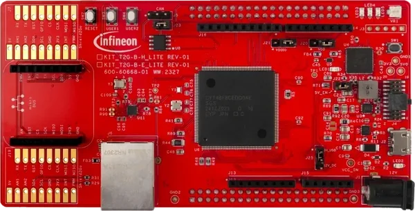

<!-- Copyright 2015-2026 Zephyr Project members and individual contributors. -->
<!-- SPDX-License-Identifier: Apache-2.0 -->
<!-- 中文翻译；编号、导航与译注为本地新增。 -->

<a id="kit_t2g_b_h_lite"></a>

# 第17章\_T2G Body High Lite评估套件（Evaluation Kit）

原文：[官方页面](https://docs.zephyrproject.org/latest/boards/infineon/kit_t2g_b_h_lite/doc/index.html)。读取日期：2026-10-16；来源摘要见[来源记录](../SOURCES.md)。

开发板概览（Board Overview）

<a id="id1"></a>

[](images/kit_t2g_b_h_lite.webp)

T2G Body High Lite评估套件（Evaluation Kit）

名称（Name）：

`kit_t2g_b_h_lite`

厂商（Vendor）：

[英飞凌科技（Infineon Technologies）](https://docs.zephyrproject.org/latest/boards/index.html#vendor=infineon)

状态（Status）：

维护中（Maintained）

架构（Architecture）：

[arm](https://docs.zephyrproject.org/latest/boards/index.html#arch=arm)

片上系统（SoC）：

[cyt4bf8cds](https://docs.zephyrproject.org/latest/boards/index.html#soc=cyt4bf8cds)

<a id="board-github-link"></a>

[浏览开发板源码（Browse Board Sources）](https://github.com/zephyrproject-rtos/zephyr/blob/main//boards/infineon/kit_t2g_b_h_lite/doc/index.rst/../..)<a id="overview"></a>

## 概述（Overview）

[KIT_T2G-B-H_LITE](https://www.infineon.com/cms/en/product/evaluation-boards/kit_t2g-b-h_lite/)是基于TRAVEO T2G Body High系列的评估套件，采用176针TEQFP封装的CYT4BF8CDS微控制器，包含两个Arm Cortex-M7内核及一个Arm Cortex-M0+内核，面向汽车车身电子及工业控制应用。

主要特性包括8 MB闪存、1 MB SRAM、CAN FD、以太网、两个512 Mb QSPI NOR闪存，以及丰富的可编程模拟和数字外设。

开发板支持Arduino、Shield2Go和MikroBUS排针，集成通过Micro-B USB连接的[KitProg3](https://github.com/Infineon/KitProg3)编程器／调试器。

KIT_T2G-B-H_LITE为多核开发板，提供三个构建目标：


- kit_t2g_b_h_lite/cyt4bf8cds/m0p — Cortex-M0+内核
- kit_t2g_b_h_lite/cyt4bf8cds/m7_0 — Cortex-M7内核0
- kit_t2g_b_h_lite/cyt4bf8cds/m7_1 — Cortex-M7内核1

<a id="hardware"></a>

## 硬件（Hardware）


- 片上系统（SoC）：TRAVEO T2G Body High (CYT4BF8CDS)
- CPU：两个350 MHz Arm Cortex-M7及一个100 MHz Arm Cortex-M0+
- 封装（Package）：176针TEQFP
- 闪存（Flash）：8 MB
- 静态随机存储器（SRAM）：1 MB
- 连接：CAN FD、带RJ45接口的以太网
- 外设：两个512 Mb QSPI NOR闪存
- 调试：板载KitProg3，支持SWD、USB-UART及USB-I2C
- 电源：可选3.3 V或5.0 V
- 连接器：Micro-B USB，用于编程和供电
- 扩展：Arduino、Shield2Go、MikroBUS排针
- 用户I/O：三个用户LED、两个用户按键、电位器（Potentiometer）

TRAVEO T2G Body High及KIT_T2G-B-H_LITE更多信息见：


- [T2G Body High SoC网站](https://www.infineon.com/products/microcontroller/32-bit-traveo-t2g-arm-cortex/for-body/t2g-cyt4bf)
- [KIT_T2G-B-H_LITE开发板网站](https://www.infineon.com/cms/en/product/evaluation-boards/kit_t2g-b-h_lite/)

<a id="kit-contents"></a>

### 套件内容（Kit Contents）


- TRAVEO T2G Body High Lite Evaluation Kit开发板
- USB Type-A转Micro-B线缆
- 快速入门指南（Quick Start Guide）

<a id="supported-features"></a>

### 支持的功能（Supported Features）

`kit_t2g_b_h_lite`开发板支持下表所列的硬件功能。

片上／板载（On-Chip / On-Board）

功能集成在片上系统（SoC）内／位于开发板上。

2 / 2

分别表示已启用／已禁用的实例数。点击数量标签，可查看开发板或SoC设备树源码（DTS）中该功能的第一个实例。

`vnd,foo`

与此功能匹配的设备树绑定兼容字符串（Compatible String）；点击链接可查看绑定文档。

<a id="kit_t2g_b_h_lite-hw-features"></a>

<a id="kit_t2g_b_h_lite-kit_t2g_b_h_lite/cyt4bf8cds/m0p-hw-features-section"></a>

#### `kit_t2g_b_h_lite/cyt4bf8cds/m0p`目标（Target）

<a id="kit_t2g_b_h_lite-kit_t2g_b_h_lite/cyt4bf8cds/m0p-hw-features-panel"></a>

<a id="kit_t2g_b_h_lite-kit_t2g_b_h_lite/cyt4bf8cds/m0p-hw-features-memory"></a>

该开发板目标的片上存储容量：16 KiB RAM、512 KiB Flash。

<a id="kit_t2g_b_h_lite-kit_t2g_b_h_lite/cyt4bf8cds/m0p-hw-features-table"></a>

<table>
<tr>
<th>类型（Type）</th>
<th>位置（Location）</th>
<th>说明（Description）</th>
<th>兼容字符串（Compatible）</th>
</tr>
<tr>
<td rowspan="1">中央处理器（CPU）</td>
<td>片上（On-Chip）</td>
<td>ARM Cortex-M0+处理器（CPU）（<a href="https://github.com/zephyrproject-rtos/zephyr/blob/main/dts/arm/infineon/cat1c/xmc7200/xmc7200_m0p.dtsi?plain=1#L15">已启用：1</a>）</td>
<td><a href="../cpu_arm_riscv_binding_reference/P017_arm_cortex-m0+.md#std-dtcompatible-arm-cortex-m0"><code>arm,cortex-m0+</code></a></td>
</tr>
<tr>
<td rowspan="1">ARM 架构（ARM Architecture）</td>
<td>片上（On-Chip）</td>
<td>英飞凌串行通信模块（SCB / Serial Communication Blocks）节点（<a href="https://github.com/zephyrproject-rtos/zephyr/blob/main/dts/arm/infineon/cat1c/xmc7200/xmc7200.dtsi?plain=1#L413">已禁用：9</a>）</td>
<td><a href="../arm_timing_ethosu_control_binding_reference/P011_infineon_scb.md#std-dtcompatible-infineon-scb"><code>infineon,scb</code></a></td>
</tr>
<tr>
<td rowspan="2">时钟控制（Clock Control）</td>
<td>片上（On-Chip）</td>
<td>通用固定频率时钟提供者（Fixed-Rate Clock Provider）（<a href="https://github.com/zephyrproject-rtos/zephyr/blob/main/dts/arm/infineon/cat1c/xmc7200/system_clocks.dtsi?plain=1#L13">已启用：7</a>）</td>
<td><a href="../hardware/P566_固定时钟绑定.md#dtbinding-fixed-clock"><code>fixed-clock</code></a></td>
</tr>
<tr>
<td>片上（On-Chip）</td>
<td>通用固定比例时钟提供器（Fixed Factor Clock Provider）（<a href="https://github.com/zephyrproject-rtos/zephyr/blob/main/dts/arm/infineon/cat1c/xmc7200/system_clocks.dtsi?plain=1#L69">已启用：12</a>；<a href="https://github.com/zephyrproject-rtos/zephyr/blob/main/dts/arm/infineon/cat1c/xmc7200/system_clocks.dtsi?plain=1#L101">已禁用：6</a>）</td>
<td><a href="../timer_reference/P110_固定比例时钟绑定.md#dtbinding-fixed-factor-clock"><code>fixed-factor-clock</code></a></td>
</tr>
<tr>
<td rowspan="1">计数器（Counter）</td>
<td>片上（On-Chip）</td>
<td>英飞凌计数器（Counters）（<a href="https://github.com/zephyrproject-rtos/zephyr/blob/main/dts/arm/infineon/cat1c/xmc7200/xmc7200.dtsi?plain=1#L521">已禁用：118</a>）</td>
<td><a href="../microchip_soc_counter_binding_reference/P001_infineon_counter.md#std-dtcompatible-infineon-counter"><code>infineon,counter</code></a></td>
</tr>
<tr>
<td rowspan="1">直接存储器访问（DMA）</td>
<td>片上（On-Chip）</td>
<td>英飞凌CAT1 DMA（<a href="https://github.com/zephyrproject-rtos/zephyr/blob/main/dts/arm/infineon/cat1c/xmc7200/xmc7200.dtsi?plain=1#L2409">已禁用：2</a>）</td>
<td><a href="../dma_binding_reference/P018_infineon_dma.md#std-dtcompatible-infineon-dma"><code>infineon,dma</code></a></td>
</tr>
<tr>
<td rowspan="1">闪存控制器（Flash Controller）</td>
<td>片上（On-Chip）</td>
<td>英飞凌CAT1闪存控制器（<a href="https://github.com/zephyrproject-rtos/zephyr/blob/main/dts/arm/infineon/cat1c/xmc7200/xmc7200.dtsi?plain=1#L11">已启用：1</a>）</td>
<td><a href="../flash_adi_microchip_nordic_binding_reference/P014_infineon_flash-controller.md#std-dtcompatible-infineon-flash-controller"><code>infineon,flash-controller</code></a></td>
</tr>
<tr>
<td rowspan="1">通用输入输出与接插件（GPIO &amp; Headers）</td>
<td>片上（On-Chip）</td>
<td>英飞凌GPIO端口（<a href="https://github.com/zephyrproject-rtos/zephyr/blob/main/dts/arm/infineon/cat1c/xmc7200/xmc7200.dtsi?plain=1#L105">已启用：2</a>；<a href="https://github.com/zephyrproject-rtos/zephyr/blob/main/dts/arm/infineon/cat1c/xmc7200/xmc7200.dtsi?plain=1#L55">已禁用：22</a>）</td>
<td><a href="../gpio_infineon_intel_ite_microchip_binding_reference/P001_infineon_gpio.md#std-dtcompatible-infineon-gpio"><code>infineon,gpio</code></a></td>
</tr>
<tr>
<td rowspan="1">输入（Input）</td>
<td>板载（On-Board）</td>
<td>一组绑定到 GPIO 的输入按键（GPIO-Bound Input Keys）（<a href="https://github.com/zephyrproject-rtos/zephyr/blob/main/boards/infineon/kit_t2g_b_h_lite/kit_t2g_b_h_lite_common.dtsi?plain=1#L40">已启用：1</a>）</td>
<td><a href="../hardware/P563_GPIO按键绑定.md#std-dtcompatible-gpio-keys"><code>gpio-keys</code></a></td>
</tr>
<tr>
<td rowspan="1">中断控制器（Interrupt Controller）</td>
<td>片上（On-Chip）</td>
<td>ARMv6-M嵌套向量中断控制器（NVIC / Nested Vectored Interrupt Controller）（<a href="https://github.com/zephyrproject-rtos/zephyr/blob/main/dts/arm/armv6-m.dtsi?plain=1#L13">已启用：1</a>）</td>
<td><a href="../arm_interrupt_timer_binding_reference/P001_ARMv6_M_NVIC.md#std-dtcompatible-arm-v6m-nvic"><code>arm,v6m-nvic</code></a></td>
</tr>
<tr>
<td rowspan="1">发光二极管（LED）</td>
<td>板载（On-Board）</td>
<td>一组由 GPIO 控制的 LED（GPIO-Controlled LEDs）（<a href="https://github.com/zephyrproject-rtos/zephyr/blob/main/boards/infineon/kit_t2g_b_h_lite/kit_t2g_b_h_lite_common.dtsi?plain=1#L21">已启用：1</a>）</td>
<td><a href="../hardware/P564_GPIO指示灯绑定.md#dtbinding-gpio-leds"><code>gpio-leds</code></a></td>
</tr>
<tr>
<td rowspan="1">存储技术设备（MTD）</td>
<td>片上（On-Chip）</td>
<td>闪存（Flash）节点（<a href="https://github.com/zephyrproject-rtos/zephyr/blob/main/dts/arm/infineon/cat1c/xmc7200/xmc7200.dtsi?plain=1#L17">已启用：4</a>；<a href="https://github.com/zephyrproject-rtos/zephyr/blob/main/dts/arm/infineon/cat1c/xmc7200/xmc7200.dtsi?plain=1#L24">已禁用：1</a>）</td>
<td><a href="../mtd_nxp_st_ti_partition_binding_reference/P013_soc-nv-flash.md#std-dtcompatible-soc-nv-flash"><code>soc-nv-flash</code></a></td>
</tr>
<tr>
<td rowspan="1">引脚控制（Pin Control）</td>
<td>片上（On-Chip）</td>
<td>英飞凌（Infineon）CAT1引脚控制容器（Pinctrl Container）（<a href="https://github.com/zephyrproject-rtos/zephyr/blob/main/dts/arm/infineon/cat1c/xmc7200/xmc7200.dtsi?plain=1#L43">已启用：1</a>）</td>
<td><a href="../pinctrl_infineon_nordic_nxp_binding_reference/P001_infineon_pinctrl.md#std-dtcompatible-infineon-pinctrl"><code>infineon,pinctrl</code></a></td>
</tr>
<tr>
<td rowspan="1">SD 主机控制器（SDHC）</td>
<td>片上（On-Chip）</td>
<td>英飞凌CAT1 SDHC／SDIO控制器（<a href="https://github.com/zephyrproject-rtos/zephyr/blob/main/dts/arm/infineon/cat1c/xmc7200/xmc7200.dtsi?plain=1#L2633">已禁用：1</a>）</td>
<td><a href="../sdhc_binding_reference/P008_infineon_sdhc-sdio.md#std-dtcompatible-infineon-sdhc-sdio"><code>infineon,sdhc-sdio</code></a></td>
</tr>
<tr>
<td rowspan="1">串行控制器（Serial Controller）</td>
<td>片上（On-Chip）</td>
<td>英飞凌CAT1 UART（<a href="https://github.com/zephyrproject-rtos/zephyr/blob/main/dts/arm/infineon/cat1c/xmc7200/xmc7200.dtsi?plain=1#L405">已启用：1</a>）</td>
<td><a href="../uart_espressif_infineon_microchip_binding_reference/P008_infineon_uart.md#std-dtcompatible-infineon-uart"><code>infineon,uart</code></a></td>
</tr>
<tr>
<td rowspan="1">静态随机存储器（SRAM）</td>
<td>片上（On-Chip）</td>
<td>通用片上静态随机存储器（SRAM）（<a href="https://github.com/zephyrproject-rtos/zephyr/blob/main/dts/arm/infineon/cat1c/xmc7200/xmc7200.dtsi?plain=1#L37">已启用：4</a>）</td>
<td><a href="../hardware/P567_内存映射SRAM绑定.md#dtbinding-mmio-sram"><code>mmio-sram</code></a></td>
</tr>
<tr>
<td rowspan="2">定时器（Timer）</td>
<td>片上（On-Chip）</td>
<td>英飞凌低功耗定时器（<a href="https://github.com/zephyrproject-rtos/zephyr/blob/main/dts/arm/infineon/cat1c/xmc7200/xmc7200.dtsi?plain=1#L500">已禁用：3</a>）</td>
<td><a href="../mcu_timer_binding_reference/P008_infineon_lp-timer.md#std-dtcompatible-infineon-lp-timer"><code>infineon,lp-timer</code></a></td>
</tr>
<tr>
<td>片上（On-Chip）</td>
<td>ARMv6-M系统节拍（System Tick）（<a href="https://github.com/zephyrproject-rtos/zephyr/blob/main/dts/arm/armv6-m.dtsi?plain=1#L21">已启用：1</a>）</td>
<td><a href="../arm_interrupt_timer_binding_reference/P005_ARMv6_M_SysTick.md#std-dtcompatible-arm-armv6m-systick"><code>arm,armv6m-systick</code></a></td>
</tr>
<tr>
<td rowspan="1">看门狗（Watchdog）</td>
<td>片上（On-Chip）</td>
<td>英飞凌CAT1看门狗（Watchdog）（<a href="https://github.com/zephyrproject-rtos/zephyr/blob/main/dts/arm/infineon/cat1c/xmc7200/xmc7200.dtsi?plain=1#L493">已禁用：1</a>）</td>
<td><a href="../soc_pmic_watchdog_binding_reference/P001_infineon_watchdog.md#std-dtcompatible-infineon-watchdog"><code>infineon,watchdog</code></a></td>
</tr>
</table>

<a id="kit_t2g_b_h_lite-kit_t2g_b_h_lite/cyt4bf8cds/m7_0-hw-features-section"></a>

#### `kit_t2g_b_h_lite/cyt4bf8cds/m7_0`目标（Target）

<a id="kit_t2g_b_h_lite-kit_t2g_b_h_lite/cyt4bf8cds/m7_0-hw-features-panel"></a>

<a id="kit_t2g_b_h_lite-kit_t2g_b_h_lite/cyt4bf8cds/m7_0-hw-features-memory"></a>

该开发板目标的片上存储容量：816 KiB RAM、2 MiB Flash。

<a id="kit_t2g_b_h_lite-kit_t2g_b_h_lite/cyt4bf8cds/m7_0-hw-features-table"></a>

<table>
<tr>
<th>类型（Type）</th>
<th>位置（Location）</th>
<th>说明（Description）</th>
<th>兼容字符串（Compatible）</th>
</tr>
<tr>
<td rowspan="1">中央处理器（CPU）</td>
<td>片上（On-Chip）</td>
<td>ARM Cortex-M7处理器（CPU）（<a href="https://github.com/zephyrproject-rtos/zephyr/blob/main/dts/arm/infineon/cat1c/xmc7200/xmc7200_m7.dtsi?plain=1#L15">已启用：1</a>）</td>
<td><a href="../cpu_cortex_xtensa_binding_reference/P005_arm_cortex-m7.md#std-dtcompatible-arm-cortex-m7"><code>arm,cortex-m7</code></a></td>
</tr>
<tr>
<td rowspan="1">ARM 架构（ARM Architecture）</td>
<td>片上（On-Chip）</td>
<td>英飞凌串行通信模块（SCB / Serial Communication Blocks）节点（<a href="https://github.com/zephyrproject-rtos/zephyr/blob/main/dts/arm/infineon/cat1c/xmc7200/xmc7200.dtsi?plain=1#L413">已禁用：9</a>）</td>
<td><a href="../arm_timing_ethosu_control_binding_reference/P011_infineon_scb.md#std-dtcompatible-infineon-scb"><code>infineon,scb</code></a></td>
</tr>
<tr>
<td rowspan="2">时钟控制（Clock Control）</td>
<td>片上（On-Chip）</td>
<td>通用固定频率时钟提供者（Fixed-Rate Clock Provider）（<a href="https://github.com/zephyrproject-rtos/zephyr/blob/main/dts/arm/infineon/cat1c/xmc7200/system_clocks.dtsi?plain=1#L13">已启用：7</a>）</td>
<td><a href="../hardware/P566_固定时钟绑定.md#dtbinding-fixed-clock"><code>fixed-clock</code></a></td>
</tr>
<tr>
<td>片上（On-Chip）</td>
<td>通用固定比例时钟提供器（Fixed Factor Clock Provider）（<a href="https://github.com/zephyrproject-rtos/zephyr/blob/main/dts/arm/infineon/cat1c/xmc7200/system_clocks.dtsi?plain=1#L69">已启用：12</a>；<a href="https://github.com/zephyrproject-rtos/zephyr/blob/main/dts/arm/infineon/cat1c/xmc7200/system_clocks.dtsi?plain=1#L101">已禁用：6</a>）</td>
<td><a href="../timer_reference/P110_固定比例时钟绑定.md#dtbinding-fixed-factor-clock"><code>fixed-factor-clock</code></a></td>
</tr>
<tr>
<td rowspan="1">计数器（Counter）</td>
<td>片上（On-Chip）</td>
<td>英飞凌计数器（Counters）（<a href="https://github.com/zephyrproject-rtos/zephyr/blob/main/dts/arm/infineon/cat1c/xmc7200/xmc7200.dtsi?plain=1#L521">已禁用：118</a>）</td>
<td><a href="../microchip_soc_counter_binding_reference/P001_infineon_counter.md#std-dtcompatible-infineon-counter"><code>infineon,counter</code></a></td>
</tr>
<tr>
<td rowspan="1">直接存储器访问（DMA）</td>
<td>片上（On-Chip）</td>
<td>英飞凌CAT1 DMA（<a href="https://github.com/zephyrproject-rtos/zephyr/blob/main/dts/arm/infineon/cat1c/xmc7200/xmc7200.dtsi?plain=1#L2409">已禁用：2</a>）</td>
<td><a href="../dma_binding_reference/P018_infineon_dma.md#std-dtcompatible-infineon-dma"><code>infineon,dma</code></a></td>
</tr>
<tr>
<td rowspan="1">闪存控制器（Flash Controller）</td>
<td>片上（On-Chip）</td>
<td>英飞凌CAT1闪存控制器（<a href="https://github.com/zephyrproject-rtos/zephyr/blob/main/dts/arm/infineon/cat1c/xmc7200/xmc7200.dtsi?plain=1#L11">已启用：1</a>）</td>
<td><a href="../flash_adi_microchip_nordic_binding_reference/P014_infineon_flash-controller.md#std-dtcompatible-infineon-flash-controller"><code>infineon,flash-controller</code></a></td>
</tr>
<tr>
<td rowspan="1">通用输入输出与接插件（GPIO &amp; Headers）</td>
<td>片上（On-Chip）</td>
<td>英飞凌GPIO端口（<a href="https://github.com/zephyrproject-rtos/zephyr/blob/main/dts/arm/infineon/cat1c/xmc7200/xmc7200.dtsi?plain=1#L105">已启用：2</a>；<a href="https://github.com/zephyrproject-rtos/zephyr/blob/main/dts/arm/infineon/cat1c/xmc7200/xmc7200.dtsi?plain=1#L55">已禁用：22</a>）</td>
<td><a href="../gpio_infineon_intel_ite_microchip_binding_reference/P001_infineon_gpio.md#std-dtcompatible-infineon-gpio"><code>infineon,gpio</code></a></td>
</tr>
<tr>
<td rowspan="1">输入（Input）</td>
<td>板载（On-Board）</td>
<td>一组绑定到 GPIO 的输入按键（GPIO-Bound Input Keys）（<a href="https://github.com/zephyrproject-rtos/zephyr/blob/main/boards/infineon/kit_t2g_b_h_lite/kit_t2g_b_h_lite_common.dtsi?plain=1#L40">已启用：1</a>）</td>
<td><a href="../hardware/P563_GPIO按键绑定.md#std-dtcompatible-gpio-keys"><code>gpio-keys</code></a></td>
</tr>
<tr>
<td rowspan="1">中断控制器（Interrupt Controller）</td>
<td>片上（On-Chip）</td>
<td>ARMv7-M 嵌套向量中断控制器（Nested Vectored Interrupt Controller，NVIC）（<a href="https://github.com/zephyrproject-rtos/zephyr/blob/main/dts/arm/armv7-m.dtsi?plain=1#L13">已启用：1</a>）</td>
<td><a href="../arm_interrupt_timer_binding_reference/P002_ARMv7_M_NVIC.md#std-dtcompatible-arm-v7m-nvic"><code>arm,v7m-nvic</code></a></td>
</tr>
<tr>
<td rowspan="1">发光二极管（LED）</td>
<td>板载（On-Board）</td>
<td>一组由 GPIO 控制的 LED（GPIO-Controlled LEDs）（<a href="https://github.com/zephyrproject-rtos/zephyr/blob/main/boards/infineon/kit_t2g_b_h_lite/kit_t2g_b_h_lite_common.dtsi?plain=1#L21">已启用：1</a>）</td>
<td><a href="../hardware/P564_GPIO指示灯绑定.md#dtbinding-gpio-leds"><code>gpio-leds</code></a></td>
</tr>
<tr>
<td rowspan="1">存储技术设备（MTD）</td>
<td>片上（On-Chip）</td>
<td>闪存（Flash）节点（<a href="https://github.com/zephyrproject-rtos/zephyr/blob/main/dts/arm/infineon/cat1c/xmc7200/xmc7200.dtsi?plain=1#L17">已启用：4</a>；<a href="https://github.com/zephyrproject-rtos/zephyr/blob/main/dts/arm/infineon/cat1c/xmc7200/xmc7200.dtsi?plain=1#L24">已禁用：1</a>）</td>
<td><a href="../mtd_nxp_st_ti_partition_binding_reference/P013_soc-nv-flash.md#std-dtcompatible-soc-nv-flash"><code>soc-nv-flash</code></a></td>
</tr>
<tr>
<td rowspan="1">引脚控制（Pin Control）</td>
<td>片上（On-Chip）</td>
<td>英飞凌（Infineon）CAT1引脚控制容器（Pinctrl Container）（<a href="https://github.com/zephyrproject-rtos/zephyr/blob/main/dts/arm/infineon/cat1c/xmc7200/xmc7200.dtsi?plain=1#L43">已启用：1</a>）</td>
<td><a href="../pinctrl_infineon_nordic_nxp_binding_reference/P001_infineon_pinctrl.md#std-dtcompatible-infineon-pinctrl"><code>infineon,pinctrl</code></a></td>
</tr>
<tr>
<td rowspan="1">SD 主机控制器（SDHC）</td>
<td>片上（On-Chip）</td>
<td>英飞凌CAT1 SDHC／SDIO控制器（<a href="https://github.com/zephyrproject-rtos/zephyr/blob/main/dts/arm/infineon/cat1c/xmc7200/xmc7200.dtsi?plain=1#L2633">已禁用：1</a>）</td>
<td><a href="../sdhc_binding_reference/P008_infineon_sdhc-sdio.md#std-dtcompatible-infineon-sdhc-sdio"><code>infineon,sdhc-sdio</code></a></td>
</tr>
<tr>
<td rowspan="1">串行控制器（Serial Controller）</td>
<td>片上（On-Chip）</td>
<td>英飞凌CAT1 UART（<a href="https://github.com/zephyrproject-rtos/zephyr/blob/main/dts/arm/infineon/cat1c/xmc7200/xmc7200.dtsi?plain=1#L405">已启用：1</a>）</td>
<td><a href="../uart_espressif_infineon_microchip_binding_reference/P008_infineon_uart.md#std-dtcompatible-infineon-uart"><code>infineon,uart</code></a></td>
</tr>
<tr>
<td rowspan="1">静态随机存储器（SRAM）</td>
<td>片上（On-Chip）</td>
<td>通用片上静态随机存储器（SRAM）（<a href="https://github.com/zephyrproject-rtos/zephyr/blob/main/dts/arm/infineon/cat1c/xmc7200/xmc7200.dtsi?plain=1#L37">已启用：4</a>）</td>
<td><a href="../hardware/P567_内存映射SRAM绑定.md#dtbinding-mmio-sram"><code>mmio-sram</code></a></td>
</tr>
<tr>
<td rowspan="2">定时器（Timer）</td>
<td>片上（On-Chip）</td>
<td>英飞凌低功耗定时器（<a href="https://github.com/zephyrproject-rtos/zephyr/blob/main/dts/arm/infineon/cat1c/xmc7200/xmc7200.dtsi?plain=1#L500">已禁用：3</a>）</td>
<td><a href="../mcu_timer_binding_reference/P008_infineon_lp-timer.md#std-dtcompatible-infineon-lp-timer"><code>infineon,lp-timer</code></a></td>
</tr>
<tr>
<td>片上（On-Chip）</td>
<td>ARMv7-M 系统节拍（System Tick）（<a href="https://github.com/zephyrproject-rtos/zephyr/blob/main/dts/arm/armv7-m.dtsi?plain=1#L21">已启用：1</a>）</td>
<td><a href="../arm_interrupt_timer_binding_reference/P006_ARMv7_M_SysTick.md#std-dtcompatible-arm-armv7m-systick"><code>arm,armv7m-systick</code></a></td>
</tr>
<tr>
<td rowspan="1">看门狗（Watchdog）</td>
<td>片上（On-Chip）</td>
<td>英飞凌CAT1看门狗（Watchdog）（<a href="https://github.com/zephyrproject-rtos/zephyr/blob/main/dts/arm/infineon/cat1c/xmc7200/xmc7200.dtsi?plain=1#L493">已禁用：1</a>）</td>
<td><a href="../soc_pmic_watchdog_binding_reference/P001_infineon_watchdog.md#std-dtcompatible-infineon-watchdog"><code>infineon,watchdog</code></a></td>
</tr>
</table>

<a id="kit_t2g_b_h_lite-kit_t2g_b_h_lite/cyt4bf8cds/m7_1-hw-features-section"></a>

#### `kit_t2g_b_h_lite/cyt4bf8cds/m7_1`目标（Target）

<a id="kit_t2g_b_h_lite-kit_t2g_b_h_lite/cyt4bf8cds/m7_1-hw-features-panel"></a>

<a id="kit_t2g_b_h_lite-kit_t2g_b_h_lite/cyt4bf8cds/m7_1-hw-features-memory"></a>

该开发板目标的片上存储容量：64 KiB RAM、5824 KiB Flash。

<a id="kit_t2g_b_h_lite-kit_t2g_b_h_lite/cyt4bf8cds/m7_1-hw-features-table"></a>

<table>
<tr>
<th>类型（Type）</th>
<th>位置（Location）</th>
<th>说明（Description）</th>
<th>兼容字符串（Compatible）</th>
</tr>
<tr>
<td rowspan="1">中央处理器（CPU）</td>
<td>片上（On-Chip）</td>
<td>ARM Cortex-M7处理器（CPU）（<a href="https://github.com/zephyrproject-rtos/zephyr/blob/main/dts/arm/infineon/cat1c/xmc7200/xmc7200_m7.dtsi?plain=1#L15">已启用：1</a>）</td>
<td><a href="../cpu_cortex_xtensa_binding_reference/P005_arm_cortex-m7.md#std-dtcompatible-arm-cortex-m7"><code>arm,cortex-m7</code></a></td>
</tr>
<tr>
<td rowspan="1">ARM 架构（ARM Architecture）</td>
<td>片上（On-Chip）</td>
<td>英飞凌串行通信模块（SCB / Serial Communication Blocks）节点（<a href="https://github.com/zephyrproject-rtos/zephyr/blob/main/dts/arm/infineon/cat1c/xmc7200/xmc7200.dtsi?plain=1#L413">已禁用：9</a>）</td>
<td><a href="../arm_timing_ethosu_control_binding_reference/P011_infineon_scb.md#std-dtcompatible-infineon-scb"><code>infineon,scb</code></a></td>
</tr>
<tr>
<td rowspan="2">时钟控制（Clock Control）</td>
<td>片上（On-Chip）</td>
<td>通用固定频率时钟提供者（Fixed-Rate Clock Provider）（<a href="https://github.com/zephyrproject-rtos/zephyr/blob/main/dts/arm/infineon/cat1c/xmc7200/system_clocks.dtsi?plain=1#L13">已启用：7</a>）</td>
<td><a href="../hardware/P566_固定时钟绑定.md#dtbinding-fixed-clock"><code>fixed-clock</code></a></td>
</tr>
<tr>
<td>片上（On-Chip）</td>
<td>通用固定比例时钟提供器（Fixed Factor Clock Provider）（<a href="https://github.com/zephyrproject-rtos/zephyr/blob/main/dts/arm/infineon/cat1c/xmc7200/system_clocks.dtsi?plain=1#L69">已启用：12</a>；<a href="https://github.com/zephyrproject-rtos/zephyr/blob/main/dts/arm/infineon/cat1c/xmc7200/system_clocks.dtsi?plain=1#L101">已禁用：6</a>）</td>
<td><a href="../timer_reference/P110_固定比例时钟绑定.md#dtbinding-fixed-factor-clock"><code>fixed-factor-clock</code></a></td>
</tr>
<tr>
<td rowspan="1">计数器（Counter）</td>
<td>片上（On-Chip）</td>
<td>英飞凌计数器（Counters）（<a href="https://github.com/zephyrproject-rtos/zephyr/blob/main/dts/arm/infineon/cat1c/xmc7200/xmc7200.dtsi?plain=1#L521">已禁用：118</a>）</td>
<td><a href="../microchip_soc_counter_binding_reference/P001_infineon_counter.md#std-dtcompatible-infineon-counter"><code>infineon,counter</code></a></td>
</tr>
<tr>
<td rowspan="1">直接存储器访问（DMA）</td>
<td>片上（On-Chip）</td>
<td>英飞凌CAT1 DMA（<a href="https://github.com/zephyrproject-rtos/zephyr/blob/main/dts/arm/infineon/cat1c/xmc7200/xmc7200.dtsi?plain=1#L2409">已禁用：2</a>）</td>
<td><a href="../dma_binding_reference/P018_infineon_dma.md#std-dtcompatible-infineon-dma"><code>infineon,dma</code></a></td>
</tr>
<tr>
<td rowspan="1">闪存控制器（Flash Controller）</td>
<td>片上（On-Chip）</td>
<td>英飞凌CAT1闪存控制器（<a href="https://github.com/zephyrproject-rtos/zephyr/blob/main/dts/arm/infineon/cat1c/xmc7200/xmc7200.dtsi?plain=1#L11">已启用：1</a>）</td>
<td><a href="../flash_adi_microchip_nordic_binding_reference/P014_infineon_flash-controller.md#std-dtcompatible-infineon-flash-controller"><code>infineon,flash-controller</code></a></td>
</tr>
<tr>
<td rowspan="1">通用输入输出与接插件（GPIO &amp; Headers）</td>
<td>片上（On-Chip）</td>
<td>英飞凌GPIO端口（<a href="https://github.com/zephyrproject-rtos/zephyr/blob/main/dts/arm/infineon/cat1c/xmc7200/xmc7200.dtsi?plain=1#L105">已启用：2</a>；<a href="https://github.com/zephyrproject-rtos/zephyr/blob/main/dts/arm/infineon/cat1c/xmc7200/xmc7200.dtsi?plain=1#L55">已禁用：22</a>）</td>
<td><a href="../gpio_infineon_intel_ite_microchip_binding_reference/P001_infineon_gpio.md#std-dtcompatible-infineon-gpio"><code>infineon,gpio</code></a></td>
</tr>
<tr>
<td rowspan="1">输入（Input）</td>
<td>板载（On-Board）</td>
<td>一组绑定到 GPIO 的输入按键（GPIO-Bound Input Keys）（<a href="https://github.com/zephyrproject-rtos/zephyr/blob/main/boards/infineon/kit_t2g_b_h_lite/kit_t2g_b_h_lite_common.dtsi?plain=1#L40">已启用：1</a>）</td>
<td><a href="../hardware/P563_GPIO按键绑定.md#std-dtcompatible-gpio-keys"><code>gpio-keys</code></a></td>
</tr>
<tr>
<td rowspan="1">中断控制器（Interrupt Controller）</td>
<td>片上（On-Chip）</td>
<td>ARMv7-M 嵌套向量中断控制器（Nested Vectored Interrupt Controller，NVIC）（<a href="https://github.com/zephyrproject-rtos/zephyr/blob/main/dts/arm/armv7-m.dtsi?plain=1#L13">已启用：1</a>）</td>
<td><a href="../arm_interrupt_timer_binding_reference/P002_ARMv7_M_NVIC.md#std-dtcompatible-arm-v7m-nvic"><code>arm,v7m-nvic</code></a></td>
</tr>
<tr>
<td rowspan="1">发光二极管（LED）</td>
<td>板载（On-Board）</td>
<td>一组由 GPIO 控制的 LED（GPIO-Controlled LEDs）（<a href="https://github.com/zephyrproject-rtos/zephyr/blob/main/boards/infineon/kit_t2g_b_h_lite/kit_t2g_b_h_lite_common.dtsi?plain=1#L21">已启用：1</a>）</td>
<td><a href="../hardware/P564_GPIO指示灯绑定.md#dtbinding-gpio-leds"><code>gpio-leds</code></a></td>
</tr>
<tr>
<td rowspan="1">存储技术设备（MTD）</td>
<td>片上（On-Chip）</td>
<td>闪存（Flash）节点（<a href="https://github.com/zephyrproject-rtos/zephyr/blob/main/dts/arm/infineon/cat1c/xmc7200/xmc7200.dtsi?plain=1#L17">已启用：4</a>；<a href="https://github.com/zephyrproject-rtos/zephyr/blob/main/dts/arm/infineon/cat1c/xmc7200/xmc7200.dtsi?plain=1#L24">已禁用：1</a>）</td>
<td><a href="../mtd_nxp_st_ti_partition_binding_reference/P013_soc-nv-flash.md#std-dtcompatible-soc-nv-flash"><code>soc-nv-flash</code></a></td>
</tr>
<tr>
<td rowspan="1">引脚控制（Pin Control）</td>
<td>片上（On-Chip）</td>
<td>英飞凌（Infineon）CAT1引脚控制容器（Pinctrl Container）（<a href="https://github.com/zephyrproject-rtos/zephyr/blob/main/dts/arm/infineon/cat1c/xmc7200/xmc7200.dtsi?plain=1#L43">已启用：1</a>）</td>
<td><a href="../pinctrl_infineon_nordic_nxp_binding_reference/P001_infineon_pinctrl.md#std-dtcompatible-infineon-pinctrl"><code>infineon,pinctrl</code></a></td>
</tr>
<tr>
<td rowspan="1">SD 主机控制器（SDHC）</td>
<td>片上（On-Chip）</td>
<td>英飞凌CAT1 SDHC／SDIO控制器（<a href="https://github.com/zephyrproject-rtos/zephyr/blob/main/dts/arm/infineon/cat1c/xmc7200/xmc7200.dtsi?plain=1#L2633">已禁用：1</a>）</td>
<td><a href="../sdhc_binding_reference/P008_infineon_sdhc-sdio.md#std-dtcompatible-infineon-sdhc-sdio"><code>infineon,sdhc-sdio</code></a></td>
</tr>
<tr>
<td rowspan="1">串行控制器（Serial Controller）</td>
<td>片上（On-Chip）</td>
<td>英飞凌CAT1 UART（<a href="https://github.com/zephyrproject-rtos/zephyr/blob/main/dts/arm/infineon/cat1c/xmc7200/xmc7200.dtsi?plain=1#L405">已启用：1</a>）</td>
<td><a href="../uart_espressif_infineon_microchip_binding_reference/P008_infineon_uart.md#std-dtcompatible-infineon-uart"><code>infineon,uart</code></a></td>
</tr>
<tr>
<td rowspan="1">静态随机存储器（SRAM）</td>
<td>片上（On-Chip）</td>
<td>通用片上静态随机存储器（SRAM）（<a href="https://github.com/zephyrproject-rtos/zephyr/blob/main/dts/arm/infineon/cat1c/xmc7200/xmc7200.dtsi?plain=1#L37">已启用：4</a>）</td>
<td><a href="../hardware/P567_内存映射SRAM绑定.md#dtbinding-mmio-sram"><code>mmio-sram</code></a></td>
</tr>
<tr>
<td rowspan="2">定时器（Timer）</td>
<td>片上（On-Chip）</td>
<td>英飞凌低功耗定时器（<a href="https://github.com/zephyrproject-rtos/zephyr/blob/main/dts/arm/infineon/cat1c/xmc7200/xmc7200.dtsi?plain=1#L500">已禁用：3</a>）</td>
<td><a href="../mcu_timer_binding_reference/P008_infineon_lp-timer.md#std-dtcompatible-infineon-lp-timer"><code>infineon,lp-timer</code></a></td>
</tr>
<tr>
<td>片上（On-Chip）</td>
<td>ARMv7-M 系统节拍（System Tick）（<a href="https://github.com/zephyrproject-rtos/zephyr/blob/main/dts/arm/armv7-m.dtsi?plain=1#L21">已启用：1</a>）</td>
<td><a href="../arm_interrupt_timer_binding_reference/P006_ARMv7_M_SysTick.md#std-dtcompatible-arm-armv7m-systick"><code>arm,armv7m-systick</code></a></td>
</tr>
<tr>
<td rowspan="1">看门狗（Watchdog）</td>
<td>片上（On-Chip）</td>
<td>英飞凌CAT1看门狗（Watchdog）（<a href="https://github.com/zephyrproject-rtos/zephyr/blob/main/dts/arm/infineon/cat1c/xmc7200/xmc7200.dtsi?plain=1#L493">已禁用：1</a>）</td>
<td><a href="../soc_pmic_watchdog_binding_reference/P001_infineon_watchdog.md#std-dtcompatible-infineon-watchdog"><code>infineon,watchdog</code></a></td>
</tr>
</table>

<a id="connections-and-ios"></a>

### 连接与输入输出（Connections and IOs）

<a id="leds"></a>

#### 发光二极管（LEDs）

<table>
<tr>
<th>名称（Name）</th>
<th>GPIO引脚（Pin）</th>
</tr>
<tr>
<td>LED0</td>
<td>P5.0（低电平有效 / active low）</td>
</tr>
<tr>
<td>LED1</td>
<td>P5.1（低电平有效 / active low）</td>
</tr>
<tr>
<td>LED2</td>
<td>P5.2（低电平有效 / active low）</td>
</tr>
</table>

<a id="push-buttons"></a>

#### 按键（Push Buttons）

<table>
<tr>
<th>名称（Name）</th>
<th>GPIO引脚（Pin）</th>
</tr>
<tr>
<td>SW1</td>
<td>P5.3，低电平有效（Active Low），上拉（Pull-Up）</td>
</tr>
<tr>
<td>SW2</td>
<td>P17.0，低电平有效（Active Low），上拉（Pull-Up）</td>
</tr>
</table>

<a id="default-zephyr-peripheral-mapping"></a>

#### Zephyr默认外设映射（Default Peripheral Mapping）

<table>
<tr>
<th>引脚（Pin）</th>
<th>功能（Function）</th>
<th>用途（Usage）</th>
</tr>
<tr>
<td>P0.1</td>
<td>SCB0 UART 发送（TX）</td>
<td>控制台发送（Console TX）</td>
</tr>
<tr>
<td>P0.0</td>
<td>SCB0 UART 接收（RX）</td>
<td>控制台接收（Console RX）</td>
</tr>
<tr>
<td>P0.2</td>
<td>SCB0 UART 请求发送（RTS）</td>
<td>控制台请求发送（RTS）</td>
</tr>
<tr>
<td>P0.3</td>
<td>SCB0 UART 允许发送（CTS）</td>
<td>控制台允许发送（CTS）</td>
</tr>
<tr>
<td>P5.0</td>
<td>通用输入输出（GPIO）</td>
<td>LED0</td>
</tr>
<tr>
<td>P5.1</td>
<td>通用输入输出（GPIO）</td>
<td>LED1</td>
</tr>
<tr>
<td>P5.2</td>
<td>通用输入输出（GPIO）</td>
<td>LED2</td>
</tr>
<tr>
<td>P5.3</td>
<td>通用输入输出（GPIO）</td>
<td>按键SW1</td>
</tr>
<tr>
<td>P17.0</td>
<td>通用输入输出（GPIO）</td>
<td>按键SW2</td>
</tr>
</table>

<a id="system-clock"></a>

### 系统时钟（System Clock）

TRAVEO T2G Body High使用外部晶体振荡器（ECO / External Crystal Oscillator）作为时钟源，时钟路径如下：


- 锁频环（FLL）：ECO → 100 MHz
- 锁相环（PLL）：ECO → 80 MHz
- CLK_HF0：200 MHz，系统时钟
- CLK_HF1：350 MHz，用于高性能外设

<a id="serial-port"></a>

### 串口（Serial Port）

TRAVEO T2G Body High有多个串行通信模块（SCB）接口。Zephyr控制台使用SCB0（uart0），通过KitProg3 USB-UART桥接器连接主机。

默认通信设置为115200、8N1。

<a id="building"></a>

## 构建（Building）

下面以[Hello World](../getting_started/P005_HelloWorld示例.md#hello_world)应用为例。

```text
# From the root of the zephyr repository
west build -b kit_t2g_b_h_lite/cyt4bf8cds/m0p samples/hello_world
```

第一个Cortex-M7内核的构建方式类似：

```text
# From the root of the zephyr repository
west build -b kit_t2g_b_h_lite/cyt4bf8cds/m7_0 samples/hello_world
```

第二个Cortex-M7内核的构建方式如下：

```text
# From the root of the zephyr repository
west build -b kit_t2g_b_h_lite/cyt4bf8cds/m7_1 samples/hello_world
```

注意（Note）

启动时仅启用Cortex-M0+内核。要启用第一个Cortex-M7内核，应在Cortex-M0+应用中加入`Cy_SysEnableCM7(CORE_CM7_0, CY_CORTEX_M7_0_APPL_ADDR);`；要启用第二个Cortex-M7内核，则加入`Cy_SysEnableCM7(CORE_CM7_1, CY_CORTEX_M7_1_APPL_ADDR);`。

<a id="programming-and-debugging"></a>

## 烧录与调试（Programming and Debugging）

`kit_t2g_b_h_lite`开发板支持下表所列的运行工具（Runners）及相关west命令。

<table>
<tr>
<th></th>
<th>烧录（flash）</th>
<th>调试（debug）</th>
<th>连接调试会话（attach）</th>
<th>实时传输（rtt）</th>
<th>调试服务器（debugserver）</th>
</tr>
<tr>
<td><a href="https://docs.zephyrproject.org/latest/develop/flash_debug/host-tools.html#runner-openocd">openocd</a></td>
<td>✅（默认 / default）</td>
<td>✅（默认 / default）</td>
<td>✅</td>
<td>✅</td>
<td>✅</td>
</tr>
</table>

[KIT_T2G-B-H_LITE](https://www.infineon.com/cms/en/product/evaluation-boards/kit_t2g-b-h_lite/)集成板载[KitProg3](https://github.com/Infineon/KitProg3)编程器／调试器，可编程及调试TRAVEO T2G Body High内核。

<a id="infineon-openocd-installation"></a>

### 英飞凌OpenOCD安装（Installation）

ModusToolbox编程工具包（Programming Tools）包含[英飞凌OpenOCD](https://github.com/Infineon/openocd/releases/latest)。也可下载适用于当前系统的英飞凌OpenOCD发行版，解压到选定位置，独立安装。（[ModusToolbox编程工具（Programming Tools）](https://softwaretools.infineon.com/tools/com.ifx.tb.tool.modustoolboxprogtools)）

注意（Note）

Linux需要为KitProg3设置设备访问权限，ModusToolbox编程工具安装过程会自动处理。独立安装OpenOCD时，可手动执行`openocd/udev_rules/install_rules.sh`脚本设置。

<a id="configuring-a-console"></a>

### 配置控制台（Configuring a Console）

使用USB线缆连接计算机与[KIT_T2G-B-H_LITE](https://www.infineon.com/cms/en/product/evaluation-boards/kit_t2g-b-h_lite/)的KitProg3 Micro-B USB连接器J2，选择minicom、PuTTY等串口终端，并使用以下设置：


- 速率（Speed）：115200波特率
- 数据位（Data）：8位
- 奇偶校验（Parity）：无（None）
- 停止位（Stop Bits）：1位

<a id="flashing"></a>

### 烧录（Flashing）

<a id="tab-0-V2luZG93cw=="></a>

<a id="tab-0-TGludXg="></a>

<a id="panel-0-V2luZG93cw=="></a>

**Windows**

一次性设置英飞凌OpenOCD路径：

```text
west config build.cmake-args -- "-DOPENOCD=path/to/infineon/openocd/bin/openocd.exe"
```

构建并烧录应用：

```text
west build -b kit_t2g_b_h_lite/cyt4bf8cds/m0p -p always samples/hello_world
west flash
```

<a id="panel-0-TGludXg="></a>

**Linux**

一次性设置英飞凌OpenOCD路径：

```text
west config build.cmake-args -- -DOPENOCD=path/to/infineon/openocd/bin/openocd
```

构建并烧录应用：

```text
west build -b kit_t2g_b_h_lite/cyt4bf8cds/m0p -p always samples/hello_world
west flash
```

控制台上应显示以下消息：

```text
*** Booting Zephyr OS build vX.Y.Z ***
Hello World! kit_t2g_b_h_lite
```

<a id="debugging"></a>

### 调试（Debugging）

```text
# From the root of the zephyr repository
west build -b kit_t2g_b_h_lite/cyt4bf8cds/m0p samples/hello_world
west debug
```

GDB控制台启动后，可设置断点（Breakpoints），并对TRAVEO T2G Body High内核执行标准GDB调试。

<a id="references"></a>

## 参考资料（References）

---

[上一章](P016_T2G_Body_High_Evaluation_Kit.md) · [返回大纲](大纲.md) · [全站翻译进度](../PROGRESS.md) · [下一章](P018_Kit_T2G-C2-D-6M_Lite.md)
