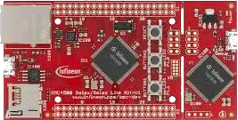

<!-- Copyright 2015-2026 Zephyr Project members and individual contributors. -->
<!-- SPDX-License-Identifier: Apache-2.0 -->
<!-- 中文翻译；编号、导航与译注为本地新增。 -->

<a id="xmc45_relax_kit"></a>

# 第20章\_XMC45-RELAX-KIT

原文：[官方页面](https://docs.zephyrproject.org/latest/boards/infineon/xmc45_relax_kit/doc/index.html)。读取日期：2026-10-16；来源摘要见[来源记录](../SOURCES.md)。

开发板概览（Board Overview）

<a id="id1"></a>

[](images/xmc45_relax_kit.webp)

XMC45-RELAX-KIT

名称（Name）：

`xmc45_relax_kit`

厂商（Vendor）：

[英飞凌科技（Infineon Technologies）](https://docs.zephyrproject.org/latest/boards/index.html#vendor=infineon)

状态（Status）：

维护中（Maintained）

架构（Architecture）：

[arm](https://docs.zephyrproject.org/latest/boards/index.html#arch=arm)

片上系统（SoC）：

[xmc4500](https://docs.zephyrproject.org/latest/boards/index.html#soc=xmc4500)

<a id="board-github-link"></a>

[浏览开发板源码（Browse Board Sources）](https://github.com/zephyrproject-rtos/zephyr/blob/main//boards/infineon/xmc45_relax_kit/doc/index.rst/../..)<a id="overview"></a>

## 概述（Overview）

[KIT_XMC45_RELAX_V1](https://www.infineon.com/cms/en/product/evaluation-boards/kit_xmc45_relax_v1/)是基于XMC 4500系列的评估套件，采用XMC4500微控制器，Arm Cortex-M4F内核最高120 MHz，面向工业及通用嵌入式应用。

主要特性包括1024 KB闪存、160 KB SRAM、以太网、CAN、丰富的串行接口，包括SPI、I2C、I2S、UART，以及支持UART虚拟串口（VCOM）的可拆卸板载SEGGER J-Link调试器。

<a id="hardware"></a>

## 硬件（Hardware）


- 片上系统（SoC）：XMC 4500
- CPU：Arm Cortex-M4F，120 MHz
- 闪存（Flash）：1024 KB
- 静态随机存储器（SRAM）：160 KB
- 连接：以太网、2路CAN、4路SPI、3路I2C、3路I2S、3路UART
- 外设：32 Mb QSPI闪存、microSD、17路12位ADC、2路DAC、31路PWM、RTC
- 调试：可拆卸J-Link调试器，提供SWD及UART虚拟串口（VCOM）
- 电源：USB供电，工作电压3.3 V
- 连接器：Micro-USB，用于调试及供电
- 扩展：两个80针排针x1及x2
- 振荡器：12 MHz及32.768 kHz晶体
- 用户I/O：两个用户LED

XMC 4500及KIT_XMC45_RELAX_V1更多信息见：


- [XMC4500 SoC网站](https://www.infineon.com/cms/en/product/microcontroller/32-bit-industrial-microcontroller-based-on-arm-cortex-m/32-bit-xmc4000-industrial-microcontroller-arm-cortex-m4/xmc4500/)
- [KIT_XMC45_RELAX_V1开发板网站](https://www.infineon.com/cms/en/product/evaluation-boards/kit_xmc45_relax_v1/)

<a id="kit-contents"></a>

### 套件内容（Kit Contents）


- XMC 4500 Relax Kit开发板

<a id="supported-features"></a>

### 支持的功能（Supported Features）

`xmc45_relax_kit`开发板支持下表所列的硬件功能。

片上／板载（On-Chip / On-Board）

功能集成在片上系统（SoC）内／位于开发板上。

2 / 2

分别表示已启用／已禁用的实例数。点击数量标签，可查看开发板或SoC设备树源码（DTS）中该功能的第一个实例。

`vnd,foo`

与此功能匹配的设备树绑定兼容字符串（Compatible String）；点击链接可查看绑定文档。

<a id="xmc45_relax_kit-hw-features"></a>

<a id="xmc45_relax_kit-xmc45_relax_kit/xmc4500-hw-features-section"></a>

#### `xmc45_relax_kit/xmc4500`目标（Target）

<a id="xmc45_relax_kit-xmc45_relax_kit/xmc4500-hw-features-panel"></a>

<a id="xmc45_relax_kit-xmc45_relax_kit/xmc4500-hw-features-memory"></a>

该开发板目标的片上存储容量：64 KiB RAM、1 MiB Flash。

<a id="xmc45_relax_kit-xmc45_relax_kit/xmc4500-hw-features-table"></a>

<table>
<tr>
<th>类型（Type）</th>
<th>位置（Location）</th>
<th>说明（Description）</th>
<th>兼容字符串（Compatible）</th>
</tr>
<tr>
<td rowspan="1">中央处理器（CPU）</td>
<td>片上（On-Chip）</td>
<td>ARM Cortex-M4F 处理器（CPU）（<a href="https://github.com/zephyrproject-rtos/zephyr/blob/main/dts/arm/infineon/cat3/xmc/xmc4xxx.dtsi?plain=1#L18">已启用：1</a>）</td>
<td><a href="../cpu_arm_riscv_binding_reference/P025_arm_cortex-m4f.md#std-dtcompatible-arm-cortex-m4f"><code>arm,cortex-m4f</code></a></td>
</tr>
<tr>
<td rowspan="1">模数转换器（ADC）</td>
<td>片上（On-Chip）</td>
<td>英飞凌XMC4XXX模数转换器（ADC），每个XMC4XXX ADC组对应一个Zephyr设备（<a href="https://github.com/zephyrproject-rtos/zephyr/blob/main/dts/arm/infineon/cat3/xmc/xmc4xxx.dtsi?plain=1#L157">已禁用：4</a>）</td>
<td><a href="../hardware/P883_InfineonXMC4xxx模数转换器绑定.md#dtbinding-infineon-xmc4xxx-adc"><code>infineon,xmc4xxx-adc</code></a></td>
</tr>
<tr>
<td rowspan="2">控制器局域网（CAN）</td>
<td>片上（On-Chip）</td>
<td>英飞凌XMC4xxx CAN（<a href="https://github.com/zephyrproject-rtos/zephyr/blob/main/dts/arm/infineon/cat3/xmc/xmc4xxx.dtsi?plain=1#L272">已启用：1</a>）</td>
<td><a href="../can_adi_atmel_nxp_binding_reference/P010_infineon_xmc4xxx-can.md#std-dtcompatible-infineon-xmc4xxx-can"><code>infineon,xmc4xxx-can</code></a></td>
</tr>
<tr>
<td>片上（On-Chip）</td>
<td>英飞凌XMC4xxx CAN节点（<a href="https://github.com/zephyrproject-rtos/zephyr/blob/main/dts/arm/infineon/cat3/xmc/xmc4xxx.dtsi?plain=1#L280">已禁用：3</a>）</td>
<td><a href="../can_adi_atmel_nxp_binding_reference/P009_infineon_xmc4xxx-can-node.md#std-dtcompatible-infineon-xmc4xxx-can-node"><code>infineon,xmc4xxx-can-node</code></a></td>
</tr>
<tr>
<td rowspan="1">时钟控制（Clock Control）</td>
<td>片上（On-Chip）</td>
<td>通用固定频率时钟提供者（Fixed-Rate Clock Provider）（<a href="https://github.com/zephyrproject-rtos/zephyr/blob/main/dts/arm/infineon/cat3/xmc/xmc4xxx.dtsi?plain=1#L39">已启用：1</a>）</td>
<td><a href="../hardware/P566_固定时钟绑定.md#dtbinding-fixed-clock"><code>fixed-clock</code></a></td>
</tr>
<tr>
<td rowspan="1">直接存储器访问（DMA）</td>
<td>片上（On-Chip）</td>
<td>XMC4xxx直接存储器访问（DMA）控制器（<a href="https://github.com/zephyrproject-rtos/zephyr/blob/main/dts/arm/infineon/cat3/xmc/xmc4xxx.dtsi?plain=1#L103">已禁用：2</a>）</td>
<td><a href="../intel_microchip_dma_binding_reference/P003_infineon_xmc4xxx-dma.md#std-dtcompatible-infineon-xmc4xxx-dma"><code>infineon,xmc4xxx-dma</code></a></td>
</tr>
<tr>
<td rowspan="4">以太网（Ethernet）</td>
<td>片上（On-Chip）</td>
<td>XMC 4XXX以太网（<a href="https://github.com/zephyrproject-rtos/zephyr/blob/main/dts/arm/infineon/cat3/xmc/xmc4xxx.dtsi?plain=1#L252">已启用：1</a>）</td>
<td><a href="../ethernet_mac_mdio_binding_reference/P009_infineon_xmc4xxx-ethernet.md#std-dtcompatible-infineon-xmc4xxx-ethernet"><code>infineon,xmc4xxx-ethernet</code></a></td>
</tr>
<tr>
<td>片上（On-Chip）</td>
<td>Synopsys DesignWare MAC 的管理数据输入输出控制器（MDIO Controller）（<a href="https://github.com/zephyrproject-rtos/zephyr/blob/main/dts/arm/infineon/cat3/xmc/xmc4xxx.dtsi?plain=1#L260">已启用：1</a>）</td>
<td><a href="../ethernet_mdio_microchip_binding_reference/P010_snps_dwmac-mdio.md#std-dtcompatible-snps-dwmac-mdio"><code>snps,dwmac-mdio</code></a></td>
</tr>
<tr>
<td>板载（On-Board）</td>
<td>通用媒体独立接口物理层（MII PHY）（<a href="https://github.com/zephyrproject-rtos/zephyr/blob/main/boards/infineon/xmc45_relax_kit/xmc45_relax_kit.dts?plain=1#L172">已启用：1</a>）</td>
<td><a href="../ethernet_nxp_phy_binding_reference/P019_ethernet-phy.md#std-dtcompatible-ethernet-phy"><code>ethernet-phy</code></a></td>
</tr>
<tr>
<td>片上（On-Chip）</td>
<td>Synopsys DesignWare MAC 精确时间协议时钟（Precision Time Protocol，PTP Clock）（<a href="https://github.com/zephyrproject-rtos/zephyr/blob/main/dts/arm/infineon/cat3/xmc/xmc4xxx.dtsi?plain=1#L267">已启用：1</a>）</td>
<td><a href="../ethernet_synopsys_st_xilinx_binding_reference/P006_snps_dwmac-ptp-clock.md#std-dtcompatible-snps-dwmac-ptp-clock"><code>snps,dwmac-ptp-clock</code></a></td>
</tr>
<tr>
<td rowspan="1">闪存控制器（Flash Controller）</td>
<td>片上（On-Chip）</td>
<td>XMC4XXX闪存控制器（Flash Controller）（<a href="https://github.com/zephyrproject-rtos/zephyr/blob/main/dts/arm/infineon/cat3/xmc/xmc4xxx.dtsi?plain=1#L24">已启用：1</a>）</td>
<td><a href="../flash_adi_microchip_nordic_binding_reference/P017_infineon_xmc4xxx-flash-controller.md#std-dtcompatible-infineon-xmc4xxx-flash-controller"><code>infineon,xmc4xxx-flash-controller</code></a></td>
</tr>
<tr>
<td rowspan="1">通用输入输出与接插件（GPIO &amp; Headers）</td>
<td>片上（On-Chip）</td>
<td>英飞凌XMC4XXX GPIO端口（<a href="https://github.com/zephyrproject-rtos/zephyr/blob/main/dts/arm/infineon/cat3/xmc/xmc4xxx.dtsi?plain=1#L70">已启用：1</a>；<a href="https://github.com/zephyrproject-rtos/zephyr/blob/main/dts/arm/infineon/cat3/xmc/xmc4xxx.dtsi?plain=1#L62">已禁用：7</a>）</td>
<td><a href="../gpio_infineon_intel_ite_microchip_binding_reference/P004_infineon_xmc4xxx-gpio.md#std-dtcompatible-infineon-xmc4xxx-gpio"><code>infineon,xmc4xxx-gpio</code></a></td>
</tr>
<tr>
<td rowspan="2">中断控制器（Interrupt Controller）</td>
<td>片上（On-Chip）</td>
<td>ARMv7-M 嵌套向量中断控制器（Nested Vectored Interrupt Controller，NVIC）（<a href="https://github.com/zephyrproject-rtos/zephyr/blob/main/dts/arm/armv7-m.dtsi?plain=1#L13">已启用：1</a>）</td>
<td><a href="../arm_interrupt_timer_binding_reference/P002_ARMv7_M_NVIC.md#std-dtcompatible-arm-v7m-nvic"><code>arm,v7m-nvic</code></a></td>
</tr>
<tr>
<td>片上（On-Chip）</td>
<td>英飞凌XMC4XXX系列中断控制器（Interrupt Controller）（<a href="https://github.com/zephyrproject-rtos/zephyr/blob/main/dts/arm/infineon/cat3/xmc/xmc4xxx.dtsi?plain=1#L46">已启用：1</a>）</td>
<td><a href="../infineon_microchip_interrupt_binding_reference/P004_infineon_xmc4xxx-intc.md#std-dtcompatible-infineon-xmc4xxx-intc"><code>infineon,xmc4xxx-intc</code></a></td>
</tr>
<tr>
<td rowspan="2">发光二极管（LED）</td>
<td>板载（On-Board）</td>
<td>一组由 GPIO 控制的 LED（GPIO-Controlled LEDs）（<a href="https://github.com/zephyrproject-rtos/zephyr/blob/main/boards/infineon/xmc45_relax_kit/xmc45_relax_kit.dts?plain=1#L29">已启用：1</a>）</td>
<td><a href="../hardware/P564_GPIO指示灯绑定.md#dtbinding-gpio-leds"><code>gpio-leds</code></a></td>
</tr>
<tr>
<td>板载（On-Board）</td>
<td>一组由脉宽调制（PWM）控制的LED（<a href="https://github.com/zephyrproject-rtos/zephyr/blob/main/boards/infineon/xmc45_relax_kit/xmc45_relax_kit.dts?plain=1#L42">已禁用：1</a>）</td>
<td><a href="../hardware/P565_PWM指示灯绑定.md#dtbinding-pwm-leds"><code>pwm-leds</code></a></td>
</tr>
<tr>
<td rowspan="1">存储技术设备（MTD）</td>
<td>片上（On-Chip）</td>
<td>XMC4XXX闪存（Flash）（<a href="https://github.com/zephyrproject-rtos/zephyr/blob/main/dts/arm/infineon/cat3/xmc/xmc4xxx.dtsi?plain=1#L31">已启用：1</a>）</td>
<td><a href="../mtd_atmel_bouffalo_binding_reference/P021_infineon_xmc4xxx-nv-flash.md#std-dtcompatible-infineon-xmc4xxx-nv-flash"><code>infineon,xmc4xxx-nv-flash</code></a></td>
</tr>
<tr>
<td rowspan="1">引脚控制（Pin Control）</td>
<td>片上（On-Chip）</td>
<td>英飞凌XMC4XXX引脚控制器（Pin Controller）（<a href="https://github.com/zephyrproject-rtos/zephyr/blob/main/dts/arm/infineon/cat3/xmc/xmc4xxx.dtsi?plain=1#L56">已启用：1</a>）</td>
<td><a href="../pinctrl_infineon_nordic_nxp_binding_reference/P002_infineon_xmc4xxx-pinctrl.md#std-dtcompatible-infineon-xmc4xxx-pinctrl"><code>infineon,xmc4xxx-pinctrl</code></a></td>
</tr>
<tr>
<td rowspan="2">脉宽调制（PWM）</td>
<td>片上（On-Chip）</td>
<td>英飞凌XMC4XXX PWM捕获比较单元4（Capture Compare Unit 4 / CCU4）模块（<a href="https://github.com/zephyrproject-rtos/zephyr/blob/main/dts/arm/infineon/cat3/xmc/xmc4xxx.dtsi?plain=1#L195">已禁用：4</a>）</td>
<td><a href="../pwm_adi_esp_infineon_binding_reference/P020_infineon_xmc4xxx-ccu4-pwm.md#std-dtcompatible-infineon-xmc4xxx-ccu4-pwm"><code>infineon,xmc4xxx-ccu4-pwm</code></a></td>
</tr>
<tr>
<td>片上（On-Chip）</td>
<td>英飞凌XMC4XXX PWM捕获比较单元8（Capture Compare Unit 8 / CCU8）模块（<a href="https://github.com/zephyrproject-rtos/zephyr/blob/main/dts/arm/infineon/cat3/xmc/xmc4xxx.dtsi?plain=1#L223">已禁用：2</a>）</td>
<td><a href="../pwm_intel_microchip_nxp_binding_reference/P001_infineon_xmc4xxx-ccu8-pwm.md#std-dtcompatible-infineon-xmc4xxx-ccu8-pwm"><code>infineon,xmc4xxx-ccu8-pwm</code></a></td>
</tr>
<tr>
<td rowspan="1">实时时钟（RTC）</td>
<td>片上（On-Chip）</td>
<td>英飞凌XMC4xxx系列实时时钟（RTC）设备（<a href="https://github.com/zephyrproject-rtos/zephyr/blob/main/dts/arm/infineon/cat3/xmc/xmc4xxx.dtsi?plain=1#L244">已启用：1</a>）</td>
<td><a href="../rtc_binding_reference/P008_infineon_xmc4xxx-rtc.md#std-dtcompatible-infineon-xmc4xxx-rtc"><code>infineon,xmc4xxx-rtc</code></a></td>
</tr>
<tr>
<td rowspan="1">传感器（Sensors）</td>
<td>片上（On-Chip）</td>
<td>英飞凌XMC4XXX芯片温度传感器（Die Temperature Sensor）（<a href="https://github.com/zephyrproject-rtos/zephyr/blob/main/dts/arm/infineon/cat3/xmc/xmc4xxx.dtsi?plain=1#L189">已禁用：1</a>）</td>
<td><a href="../sensor_espressif_honeywell_invensense_binding_reference/P018_infineon_xmc4xxx-temp.md#std-dtcompatible-infineon-xmc4xxx-temp"><code>infineon,xmc4xxx-temp</code></a></td>
</tr>
<tr>
<td rowspan="1">串行控制器（Serial Controller）</td>
<td>片上（On-Chip）</td>
<td>英飞凌XMC4XXX UART（<a href="https://github.com/zephyrproject-rtos/zephyr/blob/main/dts/arm/infineon/cat3/xmc/xmc4xxx.dtsi?plain=1#L139">已启用：1</a>）</td>
<td><a href="../uart_espressif_infineon_microchip_binding_reference/P009_infineon_xmc4xxx-uart.md#std-dtcompatible-infineon-xmc4xxx-uart"><code>infineon,xmc4xxx-uart</code></a></td>
</tr>
<tr>
<td rowspan="1">静态随机存储器（SRAM）</td>
<td>片上（On-Chip）</td>
<td>通用片上静态随机存储器（SRAM）（<a href="https://github.com/zephyrproject-rtos/zephyr/blob/main/dts/arm/infineon/cat3/xmc/xmc4500_F100x1024.dtsi?plain=1#L17">已启用：1</a>）</td>
<td><a href="../hardware/P567_内存映射SRAM绑定.md#dtbinding-mmio-sram"><code>mmio-sram</code></a></td>
</tr>
<tr>
<td rowspan="1">定时器（Timer）</td>
<td>片上（On-Chip）</td>
<td>ARMv7-M 系统节拍（System Tick）（<a href="https://github.com/zephyrproject-rtos/zephyr/blob/main/dts/arm/armv7-m.dtsi?plain=1#L21">已启用：1</a>）</td>
<td><a href="../arm_interrupt_timer_binding_reference/P006_ARMv7_M_SysTick.md#std-dtcompatible-arm-armv7m-systick"><code>arm,armv7m-systick</code></a></td>
</tr>
<tr>
<td rowspan="1">通用串行总线（USB）</td>
<td>片上（On-Chip）</td>
<td>英飞凌XMC4xxx兼容DWC2的控制器（<a href="https://github.com/zephyrproject-rtos/zephyr/blob/main/dts/arm/infineon/cat3/xmc/xmc4xxx.dtsi?plain=1#L302">已禁用：1</a>）</td>
<td><a href="../usb_controller_binding_reference/P013_infineon_xmc4xxx-usb.md#std-dtcompatible-infineon-xmc4xxx-usb"><code>infineon,xmc4xxx-usb</code></a></td>
</tr>
<tr>
<td rowspan="1">看门狗（Watchdog）</td>
<td>片上（On-Chip）</td>
<td>英飞凌XMC4xxx看门狗（Watchdog）（<a href="https://github.com/zephyrproject-rtos/zephyr/blob/main/dts/arm/infineon/cat3/xmc/xmc4xxx.dtsi?plain=1#L237">已禁用：1</a>）</td>
<td><a href="../soc_pmic_watchdog_binding_reference/P002_infineon_xmc4xxx-watchdog.md#std-dtcompatible-infineon-xmc4xxx-watchdog"><code>infineon,xmc4xxx-watchdog</code></a></td>
</tr>
</table>

板载12 MHz晶体使器件能够以最高120 MHz运行。

<a id="connections-and-ios"></a>

### 连接与输入输出（Connections and IOs）

<a id="leds"></a>

#### 发光二极管（LEDs）

<table>
<tr>
<th>名称（Name）</th>
<th>GPIO引脚（Pin）</th>
</tr>
<tr>
<td>LED1</td>
<td>P1.1（高电平有效 / active high）</td>
</tr>
<tr>
<td>LED2</td>
<td>P1.0（高电平有效 / active high）</td>
</tr>
</table>

<a id="default-zephyr-peripheral-mapping"></a>

#### Zephyr默认外设映射（Default Peripheral Mapping）

<table>
<tr>
<th>引脚（Pin）</th>
<th>功能（Function）</th>
<th>用途（Usage）</th>
</tr>
<tr>
<td>P0.1</td>
<td>USIC1CH1 UART发送（TX）</td>
<td>控制台发送（Console TX）</td>
</tr>
<tr>
<td>P0.0</td>
<td>USIC1CH1 UART接收（RX）</td>
<td>控制台接收（Console RX）</td>
</tr>
<tr>
<td>P1.1</td>
<td>通用输入输出（GPIO）</td>
<td>LED1</td>
</tr>
<tr>
<td>P1.0</td>
<td>通用输入输出（GPIO）</td>
<td>LED2</td>
</tr>
</table>

<a id="serial-port"></a>

### 串口（Serial Port）

XMC 4500 Relax Kit使用USIC1CH1接口输出Zephyr控制台信息。该UART通过J-Link虚拟串口（VCOM）连接主机。

默认通信设置为115200、8N1，发送／接收FIFO各16字节。

<a id="building"></a>

## 构建（Building）

下面以[Hello World](../getting_started/P005_HelloWorld示例.md#hello_world)应用为例。

```text
# From the root of the zephyr repository
west build -b xmc45_relax_kit samples/hello_world
```

<a id="programming-and-debugging"></a>

## 烧录与调试（Programming and Debugging）

`xmc45_relax_kit`开发板支持下表所列的运行工具（Runners）及相关west命令。

<table>
<tr>
<th></th>
<th>烧录（flash）</th>
<th>调试（debug）</th>
<th>连接调试会话（attach）</th>
<th>实时传输（rtt）</th>
<th>调试服务器（debugserver）</th>
<th>复位（reset）</th>
</tr>
<tr>
<td><a href="https://docs.zephyrproject.org/latest/develop/flash_debug/host-tools.html#runner-jlink">jlink</a></td>
<td>✅（默认 / default）</td>
<td>✅（默认 / default）</td>
<td>✅</td>
<td>✅</td>
<td>✅</td>
<td>✅</td>
</tr>
<tr>
<td><a href="https://docs.zephyrproject.org/latest/develop/flash_debug/host-tools.html#runner-openocd">openocd</a></td>
<td>✅</td>
<td>✅</td>
<td>✅</td>
<td>✅</td>
<td>✅</td>
<td></td>
</tr>
<tr>
<td><a href="https://docs.zephyrproject.org/latest/develop/flash_debug/host-tools.html#runner-pyocd">pyocd</a></td>
<td>✅</td>
<td>✅</td>
<td>✅</td>
<td>✅</td>
<td>✅</td>
<td>✅</td>
</tr>
</table>

[KIT_XMC45_RELAX_V1](https://www.infineon.com/cms/en/product/evaluation-boards/kit_xmc45_relax_v1/)集成可拆卸SEGGER J-Link调试器，通过USB提供编程、调试及UART虚拟串口（VCOM）通信。

<a id="segger-j-link-installation"></a>

### 安装SEGGER J-Link（Installation）

此板要求在主机上安装[SEGGER J-Link](https://www.segger.com/downloads/jlink/)软件。从[SEGGER J-Link](https://www.segger.com/downloads/jlink/)网站下载适用于当前操作系统的J-Link Software and Documentation Pack并安装。

<a id="configuring-a-console"></a>

### 配置控制台（Configuring a Console）

使用USB线缆连接计算机与[KIT_XMC45_RELAX_V1](https://www.infineon.com/cms/en/product/evaluation-boards/kit_xmc45_relax_v1/)的板载USB调试连接器X100，选择minicom、PuTTY等串口终端，并使用以下设置：


- 速率（Speed）：115200波特率
- 数据位（Data）：8位
- 奇偶校验（Parity）：无（None）
- 停止位（Stop Bits）：1位

<a id="flashing"></a>

### 烧录（Flashing）

使用`west flash`构建并烧录应用，默认采用J-Link运行工具（Runner）：

```text
west build -b xmc45_relax_kit -p always samples/hello_world
west flash
```

控制台上应显示以下消息：

```text
*** Booting Zephyr OS build vX.Y.Z ***
Hello World! xmc45_relax_kit
```

<a id="debugging"></a>

### 调试（Debugging）

```text
# From the root of the zephyr repository
west build -b xmc45_relax_kit samples/hello_world
west debug
```

GDB控制台启动后，可设置断点（Breakpoints），并对XMC 4500 Cortex-M4F内核执行标准GDB调试。

<a id="references"></a>

## 参考资料（References）

---

[上一章](P019_XMC7200_Evaluation_Kit.md) · [返回大纲](大纲.md) · [全站翻译进度](../PROGRESS.md) · [下一章](P021_XMC47-RELAX-KIT.md)
