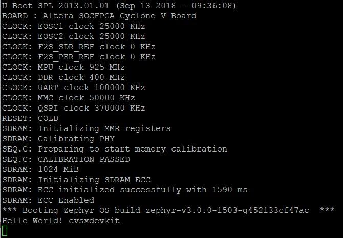
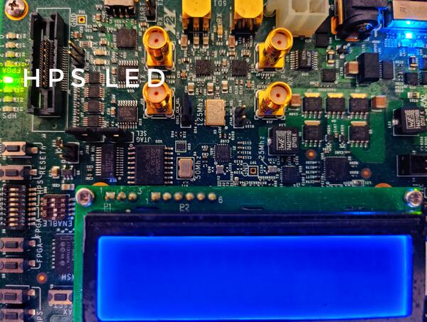

<!-- Copyright 2015-2026 Zephyr Project members and individual contributors. -->
<!-- SPDX-License-Identifier: Apache-2.0 -->
<!-- 中文翻译；编号、导航与译注为本地新增。 -->

<a id="intel-cyclone-v-soc-development-kit"></a>

<a id="cyclonev-socdk"></a>

# 第20章\_Intel Cyclone V SoC开发套件（Development Kit）

原文：[官方页面](https://docs.zephyrproject.org/latest/boards/intel/socfpga_std/cyclonev_socdk/doc/index.html)。读取日期：2026-10-16；来源摘要见[来源记录](../SOURCES.md)。

<a id="overview"></a>

## 概述（Overview）

Zephyr内核支持Intel Cyclone V SoC开发套件，使用其硬处理器系统（HPS / Hard Processor System）CPU。

<a id="id1"></a>


Intel Cyclone V SoC FPGA开发套件，图片来源：Intel

<a id="hardware"></a>

## 硬件（Hardware）

<a id="jumpers-and-dip-switch-settings"></a>

### 跳线及拨码开关设置（Jumpers and DIP Switches）

推荐开发板设置与Cyclone V SoC开发板的黄金系统参考设计（GSRD）相同。

板背面有两组开关，SW2尤其重要。首先按以下方式配置跳线：


- J5：断开（Open）
- J6：短接（Short）
- J7：短接（Short）
- J9：断开（Open）
- J13：短接（Short）
- J16：断开（Open）
- J26：短接1—2脚
- J27：短接2—3脚
- J28：短接1—2脚
- J29：短接2—3脚
- J30：短接1—2脚
- J31：断开（Open）

然后按以下方式配置开发板开关：


- SW1：全部OFF
- SW2：全部OFF
- SW3：ON-OFF-ON-OFF-ON-ON
- SW4：OFF-OFF-ON-ON

其他开关供用户使用，位置由具体应用决定。跳线和开关详情见开发套件用户手册。

<a id="necessary-software"></a>

### 所需软件（Necessary Software）

使用此设备需要Intel Quartus Prime SDK。Linux版Intel Quartus Prime Lite Edition可免费获取。（[Intel Quartus Prime精简版（Lite Edition）](https://www.intel.com/content/www/us/en/software-kit/684215/intel-quartus-prime-lite-edition-design-software-version-21-1-for-linux.html)）

为方便使用quartus_pgm等SDK工具，应将SDK提供的二进制文件目录加入PATH。以下为示例，按实际安装位置修改`ALTERA_BASE`：

```text
export QUARTUS_ROOTDIR=/opt/intelFPGA_lite/21.1
export PATH=$PATH:$QUARTUS_ROOTDIR/quartus/bin:$QUARTUS_ROOTDIR/programmer/bin
```

可能需要调整udev规则，以访问USB Blaster II外设，它是此设备内置的JTAG接口。

以下规则适用于Ubuntu：

```text
# For Altera USB-Blaster permissions.
SUBSYSTEM=="usb",\
ENV{DEVTYPE}=="usb_device",\
ATTR{idVendor}=="09fb",\
ATTR{idProduct}=="6010",\
MODE="0666",\
NAME="bus/usb/$env{BUSNUM}/$env{DEVNUM}",\
RUN+="/bin/chmod 0666 %c"
SUBSYSTEM=="usb",\
ENV{DEVTYPE}=="usb_device",\
ATTR{idVendor}=="09fb",\
ATTR{idProduct}=="6810",\
MODE="0666",\
NAME="bus/usb/$env{BUSNUM}/$env{DEVNUM}",\
RUN+="/bin/chmod 0666 %c"
```

可用SDK的jtagconfig工具测试连接，输出应类似：

```text
$ jtagconfig
1) USB-BlasterII [1-5]
  4ba00477   SOCVHPS
  02D020DD   5ZSEBA6(.|ES)/5CSEMA6/..
```

<a id="golden-reference-design"></a>

### 黄金参考设计（Golden Reference Design）

黄金系统参考设计（GSRD / Golden System Reference Design）提供一组基本硬件和软件系统组件，可作为各种用户定制设计的起点。

Zephyr对Cyclone V SoC开发套件的支持基于GSRD硬件，详见Intel Cyclone V SoC GSRD。（[Intel Cyclone V SoC黄金系统参考设计（GSRD）](https://rocketboards.org/foswiki/Documentation/CycloneVSoCGSRD)）

此版本使用的硬件基于Intel Quartus 21.1，硬件文件可从此处获取。（[here](https://releases.rocketboards.org/release/2018.05/gsrd/hw/cv_soc_devkit_ghrd.tar.gz)）

cv_soc_devkit_ghrd目录包含创建Intel Quartus项目所需的文件：


- `ghrd_top.v`：GSRD顶层Verilog硬件描述语言（HDL）文件
- `soc_system.qpf`：Quartus Prime项目文件（Project File）
- `soc_system.qsf`：Quartus Prime设置文件（Settings File）
- `soc_system.qsys`：Platform Designer文件，包含SoC系统
- `soc_system.sopcinfo`：SOPC信息文件，包含项目中实例化模块、参数名称及参数值的详情
- `soc_system_timing.sdc`：Synopsys设计约束（Design Constraint）文件
- `output_files/soc_system.sof`：FPGA配置文件

使用SDK的quartus_pgm工具及FPGA配置文件soc_system.sof，将此FPGA文件（.sof）烧录到器件：

```text
$ quartus_pgm -m jtag -o "p;path/to/soc_system.sof"
```

此系统由HPS Arm Cortex-A9组成。示例开放UART、定时器、USB、I2C及DDR内存。应确认计划使用的外设具有对应驱动支持。Cyclone V SoC Devkit GSRD的更多信息见RocketBoards，或查阅Cyclone V硬处理器系统技术参考手册。

<a id="console-output"></a>

### 控制台输出（Console Output）

<a id="uart"></a>

#### 16550 UART

默认内核将控制台输出发送到16550 UART。将工作站连接到开发板右上角Mini-USB接口J8／UART，设备会在`/dev`中显示为ttyUSB节点；然后使用minicom或PuTTY，关闭流控制并设为115200、8N1，即可监视输出。

<a id="programming-and-debugging"></a>

## 烧录与调试（Programming and Debugging）

<a id="flashing"></a>

### 烧录（Flashing）

<a id="flashing-kernel-into-the-board"></a>

#### 将内核烧录到开发板（Flashing Kernel）

cyclonev_socdk开发板配置支持常规flash目标。以下为[Hello World](../getting_started/P005_HelloWorld示例.md#hello_world)应用示例。

重要：烧录开发板前需要预加载程序（Preloader）。下载并解压[cv_soc_devkit_ghrd.tar.gz](https://releases.rocketboards.org/release/2018.05/gsrd/hw/cv_soc_devkit_ghrd.tar.gz)，将`cv_soc_devkit_ghrd/software/preloader/uboot-socfpga/spl/u-boot-spl`复制到[boards/intel/socfpga_std/cyclonev_socdk/support/](https://github.com/zephyrproject-rtos/zephyr/blob/main/boards/intel/socfpga_std/cyclonev_socdk/support/)。

```text
# From the root of the zephyr repository
west build -b cyclonev_socdk samples/hello_world
west flash
```

更多细节见[构建应用（Building an Application）](../application/P001_应用开发.md#build-an-application)及[运行应用（Run an Application）](https://docs.zephyrproject.org/latest/develop/application/index.html#application-run)。

该操作使用定制OpenOCD运行脚本[scripts/west_commands/runners/intel_cyclonev.py](https://github.com/zephyrproject-rtos/zephyr/blob/main/scripts/west_commands/runners/intel_cyclonev.py)，将Zephyr内核及CPU配置加载到开发板。完成后，内核立即通过GSRD预加载程序启动。使用OpenOCD及GDB调试器烧录应用需要多个辅助文件，主机必须已安装Zephyr SDK。以下文件应位于[boards/intel/socfpga_std/cyclonev_socdk/support/](https://github.com/zephyrproject-rtos/zephyr/blob/main/boards/intel/socfpga_std/cyclonev_socdk/support/)：


- `blaster_6810.hex`：USB-BlasterII固件
- `tmp_preloader_dl_cmd.txt`：加载预加载程序的GDB辅助文件
- `tmp_appli_dl_cmd.gdb`：加载zephyr.elf的GDB辅助文件
- `tmp_appli_debug_cmd.gdb`：调试时加载zephyr.elf的GDB辅助文件
- `openocd.cfg`：为OpenOCD引入配置文件
- `download_all.gdb`：加载预加载程序的GDB辅助文件
- `u-boot-spl`：Cyclone V SoC DevKit GSRD预加载程序，从GSRD归档cv_soc_devkit_ghrd.tar.gz复制而来

下图展示对Hello World示例设计执行west flash后的预期UART输出：

<a id="id2"></a>



west flash后的UART输出示例，图片来源：Intel

<a id="debugging"></a>

### 调试（Debugging）

Zephyr SDK包含可用于调试Cyclone V SoC开发套件的GDB服务器。原文说明，可调试已烧录到用户闪存（UFM / User Flash Memory）的运行中镜像，也可通过GDB经JTAG加载镜像。

<a id="debugging-with-flashed-image"></a>

#### 调试已烧录镜像（Debugging With Flashed Image）

可按通常方式调试应用，示例如下：

```text
# From the root of the zephyr repository
west build -b cyclonev_socdk samples/hello_world
west debug
```

应看到类似以下输出：

```text
-- west debug: rebuilding
ninja: no work to do.
-- west debug: using runner intel_cyclonev
-- runners.intel_cyclonev: OpenOCD GDB server running on port 3333; no thread info available
Open On-Chip Debugger 0.11.0+dev-00244-g7e3dbbbe2 (2021-11-18-07:14)
Licensed under GNU GPL v2
For bug reports, read http://openocd.org/doc/doxygen/bugs.html
Info : only one transport option; autoselect 'jtag'
cycv_dbginit
Info : Listening on port 6666 for tcl connections
Info : Listening on port 4444 for telnet connections
Info : Altera USB-Blaster II (uninitialized) found
Info : Loading firmware...
Info : Waiting for reenumerate...
Info : Waiting for reenumerate...
Info : Altera USB-Blaster II found (Firm. rev. = 1.39)
Info : This adapter doesn't support configurable speed
Info : JTAG tap: fpgasoc.fpga.tap tap/device found: 0x02d020dd (mfg: 0x06e (Altera), part: 0x2d02, ver: 0x0)
Info : JTAG tap: fpgasoc.cpu tap/device found: 0x4ba00477 (mfg: 0x23b (ARM Ltd), part: 0xba00, ver: 0x4)
Info : DAP transaction stalled (WAIT) - slowing down
Info : DAP transaction stalled (WAIT) - slowing down
Info : fpgasoc.cpu.0: hardware has 6 breakpoints, 4 watchpoints
Info : starting gdb server for fpgasoc.cpu.0 on 3333
Info : Listening on port 3333 for gdb connections
Info : accepting 'gdb' connection on tcp/3333
Info : fpgasoc.cpu.0 rev 0, partnum c09, arch f, variant 3, implementor 41
Info : fpgasoc.cpu.0: MPIDR level2 0, cluster 0, core 0, multi core, no SMT
target halted in ARM state due to debug-request, current mode: Supervisor
cpsr: 0x600001d3 pc: 0x00002fa4
MMU: disabled, D-Cache: disabled, I-Cache: enabled
warning: No executable has been specified and target does not support
determining executable automatically.  Try using the "file" command.
0x00002fa4 in ?? ()
Restoring section .text (0xffff0000 to 0xffff6f84)
Info : DAP transaction stalled (WAIT) - slowing down
Warn : keep_alive() was not invoked in the 1000 ms timelimit. GDB alive packet not sent! (1469 ms). Workaround: increase "set remotetimeout" in GDB
Restoring section .rodata (0xffff6f84 to 0xffff8af9)
Restoring section .data (0xffff8b00 to 0xffff99d4)
Info : DAP transaction stalled (WAIT) - slowing down
Hardware assisted breakpoint 1 at 0xffff147e
Info : fpgasoc.cpu.0 rev 0, partnum c09, arch f, variant 3, implementor 41
fpgasoc.cpu.0 rev 0, partnum c09, arch f, variant 3, implementor 41

Temporary breakpoint 1, 0xffff147e in spl_boot_device ()
[Inferior 1 (Remote target) detached]
Info : dropped 'gdb' connection
shutdown command invoked
Open On-Chip Debugger 0.11.0+dev-00244-g7e3dbbbe2 (2021-11-18-07:14)
Licensed under GNU GPL v2
For bug reports, read http://openocd.org/doc/doxygen/bugs.html
Info : only one transport option; autoselect 'jtag'
cycv_dbginit
Info : Listening on port 6666 for tcl connections
Info : Listening on port 4444 for telnet connections
Info : Altera USB-Blaster II found (Firm. rev. = 1.39)
Info : This adapter doesn't support configurable speed
Info : JTAG tap: fpgasoc.fpga.tap tap/device found: 0x02d020dd (mfg: 0x06e (Altera), part: 0x2d02, ver: 0x0)
Info : JTAG tap: fpgasoc.cpu tap/device found: 0x4ba00477 (mfg: 0x23b (ARM Ltd), part: 0xba00, ver: 0x4)
Info : DAP transaction stalled (WAIT) - slowing down
Info : DAP transaction stalled (WAIT) - slowing down
Info : fpgasoc.cpu.0: hardware has 6 breakpoints, 4 watchpoints
Info : fpgasoc.cpu.0 rev 0, partnum c09, arch f, variant 3, implementor 41
Info : fpgasoc.cpu.0: MPIDR level2 0, cluster 0, core 0, multi core, no SMT
Info : starting gdb server for fpgasoc.cpu.0 on 3333
Info : Listening on port 3333 for gdb connections
Info : accepting 'gdb' connection on tcp/3333
warning: No executable has been specified and target does not support
determining executable automatically.  Try using the "file" command.
0xffff147c in ?? ()
warning: /home/demo/zephyrproject/zephyr/boards/intel/socfpga_std/cyclonev_socdk/support/tmp_appli_debug_cmd.gdb: No such file or directory
[Inferior 1 (Remote target) detached]
Info : dropped 'gdb' connection
shutdown command invoked
Open On-Chip Debugger 0.11.0+dev-00244-g7e3dbbbe2 (2021-11-18-07:14)
Licensed under GNU GPL v2
For bug reports, read http://openocd.org/doc/doxygen/bugs.html
Info : only one transport option; autoselect 'jtag'
cycv_dbginit
Info : Listening on port 6666 for tcl connections
Info : Listening on port 4444 for telnet connections
Info : Altera USB-Blaster II found (Firm. rev. = 1.39)
Info : This adapter doesn't support configurable speed
Info : JTAG tap: fpgasoc.fpga.tap tap/device found: 0x02d020dd (mfg: 0x06e (Altera), part: 0x2d02, ver: 0x0)
Info : JTAG tap: fpgasoc.cpu tap/device found: 0x4ba00477 (mfg: 0x23b (ARM Ltd), part: 0xba00, ver: 0x4)
Info : DAP transaction stalled (WAIT) - slowing down
Info : DAP transaction stalled (WAIT) - slowing down
Info : fpgasoc.cpu.0: hardware has 6 breakpoints, 4 watchpoints
Reading symbols from /home/demo/zephyrproject/zephyr/build/zephyr/zephyr.elf...
Info : fpgasoc.cpu.0 rev 0, partnum c09, arch f, variant 3, implementor 41
Info : fpgasoc.cpu.0: MPIDR level2 0, cluster 0, core 0, multi core, no SMT
Info : starting gdb server for fpgasoc.cpu.0 on 3333
Info : Listening on port 3333 for gdb connections
Remote debugging using :3333
Info : accepting 'gdb' connection on tcp/3333
main () at /home/demo/zephyrproject/zephyr/samples/hello_world/src/main.c:11
11              printk("Hello World! %s\n", CONFIG_BOARD);
(gdb)
```

<a id="try-other-examples"></a>

### 尝试其他示例（Other Examples）

多种示例可下载到Cyclone V SoC FPGA开发套件。可尝试从芯片HPS侧让LED闪烁：

```text
# From the root of the zephyr repository
west build -b cyclonev_socdk samples/basic/blinky
west flash
```

<a id="id3"></a>



HPS LED0闪烁示例，图片来源：Intel

也可尝试向I2C总线连接的LCD显示屏写入字符：

```text
# From the root of the zephyr repository
west build -b cyclonev_socdk samples/drivers/lcd_cyclonev_socdk
west flash
```

<a id="references"></a>

## 参考资料（References）


- [Cyclone V硬处理器系统技术参考手册（Hard Processor System Technical Reference Manual）](https://www.intel.com/content/dam/www/programmable/us/en/pdfs/literature/hb/cyclone-v/cv_54001.pdf)
- [Cyclone V SoC开发套件及Intel SoC FPGA嵌入式开发套件（Embedded Development Suite）](https://www.intel.com/content/www/us/en/products/details/fpga/development-kits/cyclone/v-sx.html)
- [RocketBoards.org上的Cyclone V SoC GSRD](https://rocketboards.org/foswiki/Documentation/CycloneVSoCGSRD)
- [Intel FPGA软件下载中心（Software Download Center）](https://www.intel.com/content/www/us/en/collections/products/fpga/software/downloads.html)
- [嵌入式外设IP用户指南（Embedded Peripherals IP User Guide）](https://www.altera.com/content/dam/altera-www/global/en_US/pdfs/literature/ug/ug_embedded_ip.pdf)
- [Quartus II脚本参考手册（Scripting Reference Manual）](https://www.altera.com/content/dam/altera-www/global/en_US/pdfs/literature/manual/tclscriptrefmnl.pdf)

## 译注

原文要求先准备GSRD预加载程序；跳线、拨码顺序与支持文件逐项保留。用户闪存UFM的表述也沿用本页原文。

## 原文外链核对

2026-10-16核对并重试以下原文外链时未能确认可访问性，保留原始目标，不将访问失败解释为原文内容有误。

- [cv_soc_devkit_ghrd.tar.gz](https://releases.rocketboards.org/release/2018.05/gsrd/hw/cv_soc_devkit_ghrd.tar.gz)：HTTP Error 404: Not Found。
- [tclscriptrefmnl.pdf](https://www.altera.com/content/dam/altera-www/global/en_US/pdfs/literature/manual/tclscriptrefmnl.pdf)：HTTP Error 403: Forbidden。
- [ug_embedded_ip.pdf](https://www.altera.com/content/dam/altera-www/global/en_US/pdfs/literature/ug/ug_embedded_ip.pdf)：HTTP Error 403: Forbidden。
- [cv_54001.pdf](https://www.intel.com/content/dam/www/programmable/us/en/pdfs/literature/hb/cyclone-v/cv_54001.pdf)：HTTP Error 403: Forbidden。
- [downloads.html](https://www.intel.com/content/www/us/en/collections/products/fpga/software/downloads.html)：HTTP Error 403: Forbidden。
- [v-sx.html](https://www.intel.com/content/www/us/en/products/details/fpga/development-kits/cyclone/v-sx.html)：HTTP Error 403: Forbidden。
- [intel-quartus-prime-lite-edition-design-software-version-21-1-for-linux.html](https://www.intel.com/content/www/us/en/software-kit/684215/intel-quartus-prime-lite-edition-design-software-version-21-1-for-linux.html)：HTTP Error 403: Forbidden。

---

[上一章](P019_Agilex_SoC_Development_Kit.md) · [返回大纲](大纲.md) · [全站翻译进度](../PROGRESS.md) · [下一章](P021_Wildcat_Lake_CRB.md)
