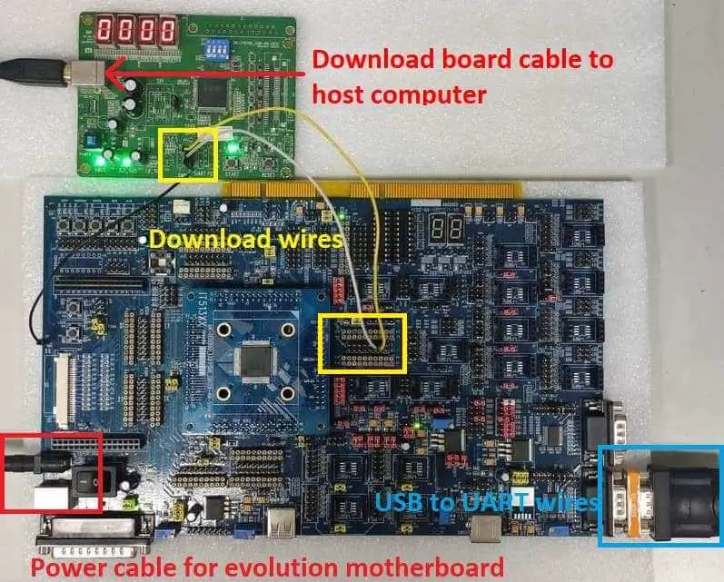

<!-- Copyright 2015-2026 Zephyr Project members and individual contributors. -->
<!-- SPDX-License-Identifier: Apache-2.0 -->
<!-- 中文翻译；编号、导航与译注为本地新增。 -->

<a id="it51xxx_evb"></a>

# 第23章\_IT51XXX系列（Series）

原文：[官方页面](https://docs.zephyrproject.org/latest/boards/ite/it51xxx_evb/doc/index.html)。读取日期：2026-10-16；来源摘要见[来源记录](../SOURCES.md)。

开发板概览（Board Overview）

<a id="id1"></a>

[](images/it51xxx_evb_and_debug_card.webp)

IT51XXX系列（Series）

名称（Name）：

`it51xxx_evb`

厂商（Vendor）：

[联阳半导体（ITE Tech. Inc.）](https://docs.zephyrproject.org/latest/boards/index.html#vendor=ite)

状态（Status）：

维护中（Maintained）

架构（Architecture）：

[riscv](https://docs.zephyrproject.org/latest/boards/index.html#arch=riscv)

片上系统（SoC）：

[it51526aw](https://docs.zephyrproject.org/latest/boards/index.html#soc=it51526aw)

<a id="board-github-link"></a>

[浏览开发板源码（Browse Board Sources）](https://github.com/zephyrproject-rtos/zephyr/blob/main//boards/ite/it51xxx_evb/doc/index.rst/../..)<a id="overview"></a>

## 概述（Overview）

IT51XXX是32位RISC-V微控制器，也是高度集成系统功能的嵌入式控制器（Embedded Controller），适合移动系统应用。下图为IT51526开发板，也称`it51xxx_evb/it51526aw`，及其调试卡。


<a id="id3"></a>

ITE的更多信息见[ITE网站](https://www.ite.com.tw/en) [注1](#id2)。

<a id="hardware"></a>

## 硬件（Hardware）

IT51XXX系列包含it51526、it51527等不同芯片型号，支持的硬件功能各异。IT51526的硬件特性如下：


- RISC-V RV32IMC指令集（Instruction Set）
- 4 KB指令缓存（Instruction Cache）
- 共128 KB SRAM
- 内置32.768 kHz时钟发生器（Clock Generator）
- 嵌入式闪存（Embedded Flash），512K／1024K字节e-flash
- eSPI、SPI、电池后备RAM（BRAM）、键盘控制器（KBC）、平台环境控制接口（PECI）及UART
- GPIO、PWM、ADC、中断控制器（INTC）、唤醒控制器（WUC）、定时器（Timer）、看门狗（Watchdog）、键盘扫描（KB Scan）及JTAG
- 支持3个电压比较器（Voltage Comparator）
- 支持密码引擎（Cryptographic Engine）
- 9个SMBus主机、3个目标端，共12个SMBus通道，兼容I2C
- I3C主机：支持两个I3C控制器，符合MIPI I3C v1.0规范
- 双线串行接口采用推挽（Push-Pull）方式，最高12.5 MHz
- 支持单数据率（SDR）、带内中断（IBI）及热加入（Hot-Join）
- I3C目标端：支持SDR，FIFO共用数据本地存储器（DLM）；支持推挽输出

<a id="supported-features"></a>

### 支持的功能（Supported Features）

`it51xxx_evb`开发板支持下表所列的硬件功能。

片上／板载（On-Chip / On-Board）

功能集成在片上系统（SoC）内／位于开发板上。

2 / 2

分别表示已启用／已禁用的实例数。点击数量标签，可查看开发板或SoC设备树源码（DTS）中该功能的第一个实例。

`vnd,foo`

与此功能匹配的设备树绑定兼容字符串（Compatible String）；点击链接可查看绑定文档。

<a id="it51xxx_evb-hw-features"></a>

<a id="it51xxx_evb-it51xxx_evb/it51526aw-hw-features-section"></a>

#### `it51xxx_evb/it51526aw`目标（Target）

<a id="it51xxx_evb-it51xxx_evb/it51526aw-hw-features-panel"></a>

<a id="it51xxx_evb-it51xxx_evb/it51526aw-hw-features-memory"></a>

该开发板目标的片上存储容量：128 KiB RAM、1 MiB Flash。

<a id="it51xxx_evb-it51xxx_evb/it51526aw-hw-features-table"></a>

<table>
<tr>
<th>类型（Type）</th>
<th>位置（Location）</th>
<th>说明（Description）</th>
<th>兼容字符串（Compatible）</th>
</tr>
<tr>
<td rowspan="1">中央处理器（CPU）</td>
<td>片上（On-Chip）</td>
<td>ITE IT8XXX2 RISC-V CPU（<a href="https://github.com/zephyrproject-rtos/zephyr/blob/main/dts/riscv/ite/it51xxx.dtsi?plain=1#L36">已启用：1</a>）</td>
<td><a href="../cpu_vendor_multiarc_binding_reference/P017_ite_riscv-ite.md#std-dtcompatible-ite-riscv-ite"><code>ite,riscv-ite</code></a></td>
</tr>
<tr>
<td rowspan="1">模数转换器（ADC）</td>
<td>片上（On-Chip）</td>
<td>ITE it51xxx模数转换器（ADC）（<a href="https://github.com/zephyrproject-rtos/zephyr/blob/main/dts/riscv/ite/it51xxx.dtsi?plain=1#L99">已启用：1</a>）</td>
<td><a href="../hardware/P890_ITEIT51xxx模数转换器绑定.md#dtbinding-ite-it51xxx-adc"><code>ite,it51xxx-adc</code></a></td>
</tr>
<tr>
<td rowspan="1">时钟控制（Clock Control）</td>
<td>片上（On-Chip）</td>
<td>ITE it51xxx EC时钟及电源管理控制器（ECPM / EC Clock and Power Management Controller）节点（<a href="https://github.com/zephyrproject-rtos/zephyr/blob/main/dts/riscv/ite/it51xxx.dtsi?plain=1#L1146">已启用：1</a>）</td>
<td><a href="../clock_esp_infineon_microchip_binding_reference/P013_ite_it51xxx-ecpm.md#std-dtcompatible-ite-it51xxx-ecpm"><code>ite,it51xxx-ecpm</code></a></td>
</tr>
<tr>
<td rowspan="1">比较器（Comparator）</td>
<td>片上（On-Chip）</td>
<td>ITE it51xxx电压比较器（Voltage Comparator）节点（<a href="https://github.com/zephyrproject-rtos/zephyr/blob/main/dts/riscv/ite/it51xxx.dtsi?plain=1#L119">已启用：1</a>；<a href="https://github.com/zephyrproject-rtos/zephyr/blob/main/dts/riscv/ite/it51xxx.dtsi?plain=1#L109">已禁用：2</a>）</td>
<td><a href="../hardware/P755_ITE电压比较器绑定.md#dtbinding-ite-it51xxx-vcmp"><code>ite,it51xxx-vcmp</code></a></td>
</tr>
<tr>
<td rowspan="1">计数器（Counter）</td>
<td>片上（On-Chip）</td>
<td>ITE IT51XXX计数器（Counter）（<a href="https://github.com/zephyrproject-rtos/zephyr/blob/main/dts/riscv/ite/it51xxx.dtsi?plain=1#L1218">已禁用：1</a>）</td>
<td><a href="../microchip_soc_counter_binding_reference/P005_ite_it51xxx-counter.md#std-dtcompatible-ite-it51xxx-counter"><code>ite,it51xxx-counter</code></a></td>
</tr>
<tr>
<td rowspan="1">密码学加速器（Cryptographic Accelerator）</td>
<td>片上（On-Chip）</td>
<td>ITE IT51XXX密码SHA加速器（Crypto SHA Accelerator）（<a href="https://github.com/zephyrproject-rtos/zephyr/blob/main/dts/riscv/ite/it51xxx.dtsi?plain=1#L1416">已启用：1</a>）</td>
<td><a href="../crypto_aes_sha_ccm_binding_reference/P014_ite_it51xxx-sha.md#std-dtcompatible-ite-it51xxx-sha"><code>ite,it51xxx-sha</code></a></td>
</tr>
<tr>
<td rowspan="1">增强型串行外设接口（ESPI）</td>
<td>片上（On-Chip）</td>
<td>ITE IT8XXX2 eSPI控制器（<a href="https://github.com/zephyrproject-rtos/zephyr/blob/main/dts/riscv/ite/it51xxx.dtsi?plain=1#L1245">已禁用：1</a>）</td>
<td><a href="../espi_binding_reference/P002_ite_it8xxx2-espi.md#std-dtcompatible-ite-it8xxx2-espi"><code>ite,it8xxx2-espi</code></a></td>
</tr>
<tr>
<td rowspan="2">闪存控制器（Flash Controller）</td>
<td>片上（On-Chip）</td>
<td>ITE IT8XXX2闪存（Flash Memory）（<a href="https://github.com/zephyrproject-rtos/zephyr/blob/main/dts/riscv/ite/it51xxx.dtsi?plain=1#L61">已启用：1</a>）</td>
<td><a href="../flash_adi_microchip_nordic_binding_reference/P020_ite_it8xxx2-flash-controller.md#std-dtcompatible-ite-it8xxx2-flash-controller"><code>ite,it8xxx2-flash-controller</code></a></td>
</tr>
<tr>
<td>片上（On-Chip）</td>
<td>ITE IT51XXX手动闪存1k（Manual Flash 1k / M1k）（<a href="https://github.com/zephyrproject-rtos/zephyr/blob/main/dts/riscv/ite/it51xxx.dtsi?plain=1#L79">已禁用：1</a>）</td>
<td><a href="../flash_adi_microchip_nordic_binding_reference/P019_ite_it51xxx-manual-flash-1k.md#std-dtcompatible-ite-it51xxx-manual-flash-1k"><code>ite,it51xxx-manual-flash-1k</code></a></td>
</tr>
<tr>
<td rowspan="1">通用输入输出与接插件（GPIO &amp; Headers）</td>
<td>片上（On-Chip）</td>
<td>此绑定提供it51xxx系列GPIO的基本描述（<a href="https://github.com/zephyrproject-rtos/zephyr/blob/main/dts/riscv/ite/it51xxx.dtsi?plain=1#L144">已启用：14</a>）</td>
<td><a href="../gpio_infineon_intel_ite_microchip_binding_reference/P007_ite_it51xxx-gpio.md#std-dtcompatible-ite-it51xxx-gpio"><code>ite,it51xxx-gpio</code></a></td>
</tr>
<tr>
<td rowspan="1">集成电路间总线（I2C）</td>
<td>片上（On-Chip）</td>
<td>ITE it51xxx I2C（<a href="https://github.com/zephyrproject-rtos/zephyr/blob/main/dts/riscv/ite/it51xxx.dtsi?plain=1#L993">已启用：1</a>；<a href="https://github.com/zephyrproject-rtos/zephyr/blob/main/dts/riscv/ite/it51xxx.dtsi?plain=1#L1010">已禁用：8</a>）</td>
<td><a href="../i2c_infineon_ite_nordic_binding_reference/P007_ite_it51xxx-i2c.md#std-dtcompatible-ite-it51xxx-i2c"><code>ite,it51xxx-i2c</code></a></td>
</tr>
<tr>
<td rowspan="2">改进型集成电路间总线（I3C）</td>
<td>片上（On-Chip）</td>
<td>IT51XXX I3C主机（I3CM）控制器（<a href="https://github.com/zephyrproject-rtos/zephyr/blob/main/dts/riscv/ite/it51xxx.dtsi?plain=1#L1370">已禁用：2</a>）</td>
<td><a href="../i3c_smbus_binding_reference/P003_ite_it51xxx-i3cm.md#std-dtcompatible-ite-it51xxx-i3cm"><code>ite,it51xxx-i3cm</code></a></td>
</tr>
<tr>
<td>片上（On-Chip）</td>
<td>IT51XXX I3C从机（I3CS）控制器（<a href="https://github.com/zephyrproject-rtos/zephyr/blob/main/dts/riscv/ite/it51xxx.dtsi?plain=1#L1392">已禁用：2</a>）</td>
<td><a href="../i3c_smbus_binding_reference/P004_ite_it51xxx-i3cs.md#std-dtcompatible-ite-it51xxx-i3cs"><code>ite,it51xxx-i3cs</code></a></td>
</tr>
<tr>
<td rowspan="1">输入（Input）</td>
<td>片上（On-Chip）</td>
<td>ITE it51xxx键盘矩阵控制器（Keyboard Matrix Controller）（<a href="https://github.com/zephyrproject-rtos/zephyr/blob/main/dts/riscv/ite/it51xxx.dtsi?plain=1#L1227">已启用：1</a>）</td>
<td><a href="../input_keyboard_optical_ctsu_binding_reference/P003_ite_it51xxx-kbd.md#std-dtcompatible-ite-it51xxx-kbd"><code>ite,it51xxx-kbd</code></a></td>
</tr>
<tr>
<td rowspan="3">中断控制器（Interrupt Controller）</td>
<td>片上（On-Chip）</td>
<td>ITE唤醒控制器（WUC / Wake-Up Controller）映射子节点（<a href="https://github.com/zephyrproject-rtos/zephyr/blob/main/dts/riscv/ite/it51xxx-wuc-map.dtsi?plain=1#L11">已启用：1</a>）</td>
<td><a href="../wakeup_interrupt_binding_reference/P002_ite_it51xxx-wuc-map.md#std-dtcompatible-ite-it51xxx-wuc-map"><code>ite,it51xxx-wuc-map</code></a></td>
</tr>
<tr>
<td>片上（On-Chip）</td>
<td>ITE唤醒控制器（WUC / Wake-Up Controller）（<a href="https://github.com/zephyrproject-rtos/zephyr/blob/main/dts/riscv/ite/it51xxx.dtsi?plain=1#L817">已启用：16</a>）</td>
<td><a href="../wakeup_interrupt_binding_reference/P003_ite_it51xxx-wuc.md#std-dtcompatible-ite-it51xxx-wuc"><code>ite,it51xxx-wuc</code></a></td>
</tr>
<tr>
<td>片上（On-Chip）</td>
<td>ITE中断控制器（Interrupt Controller）（<a href="https://github.com/zephyrproject-rtos/zephyr/blob/main/dts/riscv/ite/it51xxx.dtsi?plain=1#L1200">已启用：1</a>）</td>
<td><a href="../wakeup_interrupt_binding_reference/P001_ite_it51xxx-intc.md#std-dtcompatible-ite-it51xxx-intc"><code>ite,it51xxx-intc</code></a></td>
</tr>
<tr>
<td rowspan="1">发光二极管（LED）</td>
<td>板载（On-Board）</td>
<td>一组由 GPIO 控制的 LED（GPIO-Controlled LEDs）（<a href="https://github.com/zephyrproject-rtos/zephyr/blob/main/boards/ite/it51xxx_evb/it51xxx_evb_it51526aw.dts?plain=1#L33">已启用：1</a>）</td>
<td><a href="../hardware/P564_GPIO指示灯绑定.md#dtbinding-gpio-leds"><code>gpio-leds</code></a></td>
</tr>
<tr>
<td rowspan="2">存储器控制器（Memory Controller）</td>
<td>片上（On-Chip）</td>
<td>ITE IT8XXX2指令本地存储器（Instruction Local Memory）（<a href="https://github.com/zephyrproject-rtos/zephyr/blob/main/dts/riscv/ite/it51xxx.dtsi?plain=1#L94">已启用：1</a>）</td>
<td><a href="../memory_controller_hyperbus_smc_binding_reference/P011_ite_it8xxx2-ilm.md#std-dtcompatible-ite-it8xxx2-ilm"><code>ite,it8xxx2-ilm</code></a></td>
</tr>
<tr>
<td>片上（On-Chip）</td>
<td>ITE IT8XXX2电池后备RAM（Battery Backed RAM）节点（<a href="https://github.com/zephyrproject-rtos/zephyr/blob/main/dts/riscv/ite/it51xxx.dtsi?plain=1#L979">已启用：1</a>）</td>
<td><a href="../memory_controller_hyperbus_smc_binding_reference/P010_ite_it8xxx2-bbram.md#std-dtcompatible-ite-it8xxx2-bbram"><code>ite,it8xxx2-bbram</code></a></td>
</tr>
<tr>
<td rowspan="1">存储技术设备（MTD）</td>
<td>片上（On-Chip）</td>
<td>闪存（Flash）节点（<a href="https://github.com/zephyrproject-rtos/zephyr/blob/main/dts/riscv/ite/it51xxx.dtsi?plain=1#L68">已启用：1</a>）</td>
<td><a href="../mtd_nxp_st_ti_partition_binding_reference/P013_soc-nv-flash.md#std-dtcompatible-soc-nv-flash"><code>soc-nv-flash</code></a></td>
</tr>
<tr>
<td rowspan="2">引脚控制（Pin Control）</td>
<td>片上（On-Chip）</td>
<td>ITE IT8XXX2引脚控制器节点负责控制引脚功能选择及引脚属性（<a href="https://github.com/zephyrproject-rtos/zephyr/blob/main/dts/riscv/ite/it51xxx.dtsi?plain=1#L27">已启用：1</a>）</td>
<td><a href="../pinctrl_infineon_nordic_nxp_binding_reference/P004_ite_it8xxx2-pinctrl.md#std-dtcompatible-ite-it8xxx2-pinctrl"><code>ite,it8xxx2-pinctrl</code></a></td>
</tr>
<tr>
<td>片上（On-Chip）</td>
<td>ITE IT8XXX2引脚控制器（Pin Controller）（<a href="https://github.com/zephyrproject-rtos/zephyr/blob/main/dts/riscv/ite/it51xxx.dtsi?plain=1#L570">已启用：14</a>）</td>
<td><a href="../pinctrl_infineon_nordic_nxp_binding_reference/P003_ite_it8xxx2-pinctrl-func.md#std-dtcompatible-ite-it8xxx2-pinctrl-func"><code>ite,it8xxx2-pinctrl-func</code></a></td>
</tr>
<tr>
<td rowspan="1">PS/2 接口（PS/2）</td>
<td>片上（On-Chip）</td>
<td>IT51XXX PS/2控制器（<a href="https://github.com/zephyrproject-rtos/zephyr/blob/main/dts/riscv/ite/it51xxx.dtsi?plain=1#L1435">已禁用：1</a>）</td>
<td><a href="../lin_dali_mctp_sensor_bus_binding_reference/P011_ite_it51xxx-ps2.md#std-dtcompatible-ite-it51xxx-ps2"><code>ite,it51xxx-ps2</code></a></td>
</tr>
<tr>
<td rowspan="1">脉宽调制（PWM）</td>
<td>片上（On-Chip）</td>
<td>ITE it51xxx脉宽调制器（PWM / Pulse Width Modulator）节点（<a href="https://github.com/zephyrproject-rtos/zephyr/blob/main/dts/riscv/ite/it51xxx.dtsi?plain=1#L1280">已启用：3</a>；<a href="https://github.com/zephyrproject-rtos/zephyr/blob/main/dts/riscv/ite/it51xxx.dtsi?plain=1#L1298">已禁用：5</a>）</td>
<td><a href="../pwm_intel_microchip_nxp_binding_reference/P003_ite_it51xxx-pwm.md#std-dtcompatible-ite-it51xxx-pwm"><code>ite,it51xxx-pwm</code></a></td>
</tr>
<tr>
<td rowspan="1">实时时钟（RTC）</td>
<td>片上（On-Chip）</td>
<td>ITE实时时钟（RTC / Real Time Clock）（<a href="https://github.com/zephyrproject-rtos/zephyr/blob/main/dts/riscv/ite/it51xxx.dtsi?plain=1#L1444">已禁用：1</a>）</td>
<td><a href="../rtc_binding_reference/P009_ite_it8xxx2-rtc.md#std-dtcompatible-ite-it8xxx2-rtc"><code>ite,it8xxx2-rtc</code></a></td>
</tr>
<tr>
<td rowspan="2">串行控制器（Serial Controller）</td>
<td>片上（On-Chip）</td>
<td>ns16550通用异步收发器（UART）（<a href="https://github.com/zephyrproject-rtos/zephyr/blob/main/dts/riscv/ite/it51xxx.dtsi?plain=1#L1158">已启用：1</a>；<a href="https://github.com/zephyrproject-rtos/zephyr/blob/main/dts/riscv/ite/it51xxx.dtsi?plain=1#L1179">已禁用：1</a>）</td>
<td><a href="../uart_microchip_nordic_nxp_binding_reference/P005_ns16550.md#std-dtcompatible-ns16550"><code>ns16550</code></a></td>
</tr>
<tr>
<td>片上（On-Chip）</td>
<td>ITE IT51XXX UART节点（<a href="https://github.com/zephyrproject-rtos/zephyr/blob/main/dts/riscv/ite/it51xxx.dtsi?plain=1#L1169">已启用：1</a>；<a href="https://github.com/zephyrproject-rtos/zephyr/blob/main/dts/riscv/ite/it51xxx.dtsi?plain=1#L1190">已禁用：1</a>）</td>
<td><a href="../uart_espressif_infineon_microchip_binding_reference/P012_ite_it51xxx-uart.md#std-dtcompatible-ite-it51xxx-uart"><code>ite,it51xxx-uart</code></a></td>
</tr>
<tr>
<td rowspan="1">系统管理总线（SMbus）</td>
<td>片上（On-Chip）</td>
<td>ITE it51xxx SMBus控制器（<a href="https://github.com/zephyrproject-rtos/zephyr/blob/main/dts/riscv/ite/it51xxx.dtsi?plain=1#L1456">已禁用：9</a>）</td>
<td><a href="../i3c_smbus_binding_reference/P012_ite_it51xxx-smbus.md#std-dtcompatible-ite-it51xxx-smbus"><code>ite,it51xxx-smbus</code></a></td>
</tr>
<tr>
<td rowspan="1">串行外设接口（SPI）</td>
<td>片上（On-Chip）</td>
<td>IT51XXX SPI（<a href="https://github.com/zephyrproject-rtos/zephyr/blob/main/dts/riscv/ite/it51xxx.dtsi?plain=1#L1424">已禁用：1</a>）</td>
<td><a href="../spi_microchip_nordic_nxp_binding_reference/P001_ite_it51xxx-spi.md#std-dtcompatible-ite-it51xxx-spi"><code>ite,it51xxx-spi</code></a></td>
</tr>
<tr>
<td rowspan="1">静态随机存储器（SRAM）</td>
<td>片上（On-Chip）</td>
<td>通用片上静态随机存储器（SRAM）（<a href="https://github.com/zephyrproject-rtos/zephyr/blob/main/dts/riscv/ite/it51xxx.dtsi?plain=1#L89">已启用：1</a>）</td>
<td><a href="../hardware/P567_内存映射SRAM绑定.md#dtbinding-mmio-sram"><code>mmio-sram</code></a></td>
</tr>
<tr>
<td rowspan="1">转速计（Tachometer）</td>
<td>片上（On-Chip）</td>
<td>ITE it51xxx转速计（Tachometer）节点（<a href="https://github.com/zephyrproject-rtos/zephyr/blob/main/dts/riscv/ite/it51xxx.dtsi?plain=1#L1352">已启用：1</a>；<a href="https://github.com/zephyrproject-rtos/zephyr/blob/main/dts/riscv/ite/it51xxx.dtsi?plain=1#L1358">已禁用：2</a>）</td>
<td><a href="../auxdisplay_iio_tach_binding_reference/P015_ite_it51xxx-tach.md#std-dtcompatible-ite-it51xxx-tach"><code>ite,it51xxx-tach</code></a></td>
</tr>
<tr>
<td rowspan="1">定时器（Timer）</td>
<td>片上（On-Chip）</td>
<td>ITE it51xxx外部定时器（External Timer）（<a href="https://github.com/zephyrproject-rtos/zephyr/blob/main/dts/riscv/ite/it51xxx.dtsi?plain=1#L1208">已启用：1</a>）</td>
<td><a href="../mcu_timer_binding_reference/P010_ite_it51xxx-timer.md#std-dtcompatible-ite-it51xxx-timer"><code>ite,it51xxx-timer</code></a></td>
</tr>
<tr>
<td rowspan="1">通用串行总线（USB）</td>
<td>片上（On-Chip）</td>
<td>ITE IT51XXX设备模式USB（Device Mode）（<a href="https://github.com/zephyrproject-rtos/zephyr/blob/main/dts/riscv/ite/it51xxx.dtsi?plain=1#L1564">已禁用：1</a>）</td>
<td><a href="../usb_controller_binding_reference/P014_ite_it51xxx-usb.md#std-dtcompatible-ite-it51xxx-usb"><code>ite,it51xxx-usb</code></a></td>
</tr>
<tr>
<td rowspan="1">看门狗（Watchdog）</td>
<td>片上（On-Chip）</td>
<td>ITE看门狗定时器（Watchdog Timer）（<a href="https://github.com/zephyrproject-rtos/zephyr/blob/main/dts/riscv/ite/it51xxx.dtsi?plain=1#L1273">已启用：1</a>）</td>
<td><a href="../soc_pmic_watchdog_binding_reference/P005_ite_it51xxx-watchdog.md#std-dtcompatible-ite-it51xxx-watchdog"><code>ite,it51xxx-watchdog</code></a></td>
</tr>
</table>

<a id="programming-and-debugging-on-it51526"></a>

## 在it51526上编程和调试（Programming and Debugging）

<a id="id4"></a>

向设备上传应用需要ITE烧录工具及下载板（Download Board），可从[ITE网站](https://www.ite.com.tw/en) [注1](#id2) 获取。

<a id="wiring"></a>

### 接线（Wiring）


1. 通过USB线缆将下载板连接到主机。
2. 将it51xxx_evb连接到评估底板，原文称Evolution Motherboard。
3. 将下载板J5连接到评估底板J38，即GPC1和GPC2。
4. 将USB转UART线连接到评估底板的UART0连接器。

  

  注意（Note）

  接线时务必小心。使用独立导线将I2C引脚连接到it51xxx_evb的对应引脚，接线关系见下表。

  <table>
  <tr>
  <th>J5连接器（Connector）</th>
  <th>it51xxx_evb J38连接器</th>
  </tr>
  <tr>
  <td>2</td>
  <td>C1</td>
  </tr>
  <tr>
  <td>3</td>
  <td>C2</td>
  </tr>
  <tr>
  <td>4</td>
  <td>地（GND）</td>
  </tr>
  </table>

  USB转UART线应按下表连接到评估底板：

  <table>
  <tr>
  <th>USB转UART线缆</th>
  <th>评估底板UART0连接器</th>
  </tr>
  <tr>
  <td>通用串行总线（USB）</td>
  <td>UART0</td>
  </tr>
  </table>

<a id="building"></a>

### 构建（Building）


1. 按通常方式构建[Hello World](../getting_started/P005_HelloWorld示例.md#hello_world)应用，参见[Zephyr入门指南（Getting Started Guide）](../getting_started/P002_入门指南.md#getting-started)：

  ```text
  # From the root of the zephyr repository
  west build -b it51xxx_evb/it51526aw samples/hello_world
  ```
2. west会生成zephyr.bin文件。

<a id="flashing"></a>

### 烧录（Flashing）

<a id="windows"></a>

#### Windows

使用winflash工具，将Zephyr应用烧录到原文所称`it51xxx/it51526aw`开发板闪存。


1. <a id="id6"></a>

  具体流程见[烧录步骤（Flashing Steps）](P024_IT82XX2_series.md#flashing)[注2](#id5)。
2. 打开it51xxx_evb/it51526aw开发板开关，应看到开发板输出`Hello World! it51xxx_evb/it51526aw`。若未看到，可按复位键，随后应出现消息。

<a id="ubuntu"></a>

#### Ubuntu


1. 运行惯用的终端程序监听输出。Linux下串口应为`/dev/ttyUSB0`，保持终端打开。

  例如：

  ```text
  $ minicom -D /dev/ttyUSB0 -b 115200
  ```
2. 打开第二个终端窗口，使用Linux烧录工具烧录开发板。

  ```text
  $ sudo ~/itetool/ite -f build/zephyr/zephyr.bin
  ```

  注意（Note）

  ITE工具源码可从以下地址下载：[https://www.ite.com.tw/upload/2024_01_23/6_20240123162336wu55j1Rjm4.bz2](https://www.ite.com.tw/upload/2024_01_23/6_20240123162336wu55j1Rjm4.bz2)
3. 并排显示两个终端窗口。第一个窗口应出现`Hello World! it51xxx_evb/it51526aw`；若未出现，可按复位键，随后应显示消息。

<a id="debugging"></a>

### 调试（Debugging）

it51xxx_evb可通过USB转UART连接进行调试。在Ubuntu终端中使用minicom发送命令及读取消息。

<a id="troubleshooting"></a>

### 故障排查（Troubleshooting）


1. 若烧录工具报告失败，可重新插拔8390下载板，或给it51xxx_evb断电重启后再试。

<a id="references"></a>

### 参考资料（References）

<a id="id2"></a>

〔1〕 ([1](#id3),[2](#id4)) [https://www.ite.com.tw/en](https://www.ite.com.tw/en)

<a id="id5"></a>

〔[2](#id6)〕 [https://docs.zephyrproject.org/latest/boards/ite/it82xx2_evb/doc/index.html#flashing](P024_IT82XX2_series.md#flashing)

## 译注

原文部分烧录段目标写it51xxx/it51526aw，目标表和构建示例写it51xxx_evb/it51526aw，分别保留。原文Evolution Motherboard译为评估底板，并保留英文以对应实物资料。

---

[上一章](P022_ITE_Tech._Inc..md) · [返回大纲](大纲.md) · [全站翻译进度](../PROGRESS.md) · [下一章](P024_IT82XX2_series.md)
