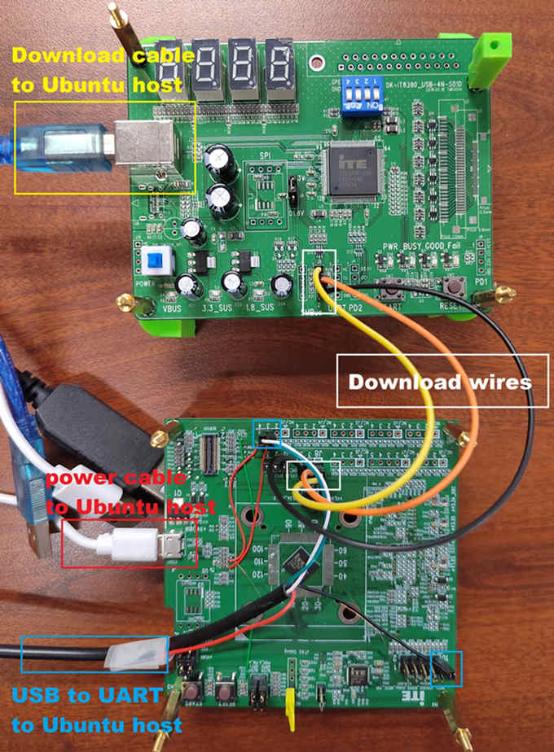
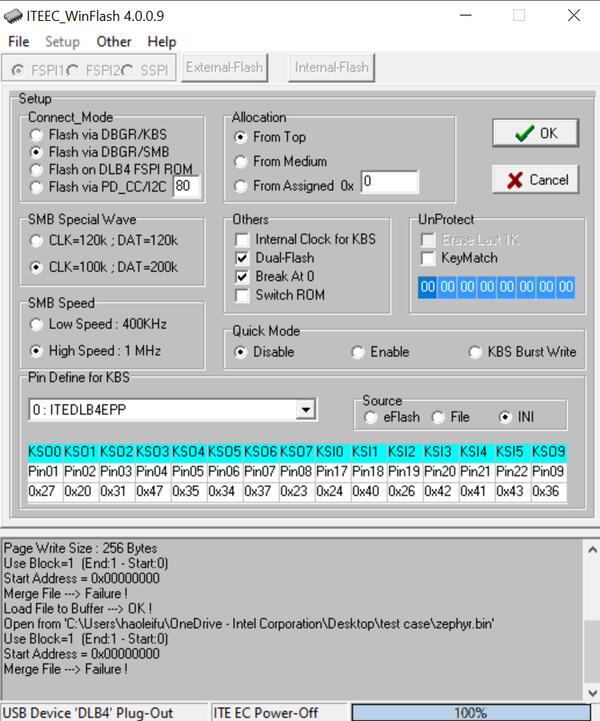
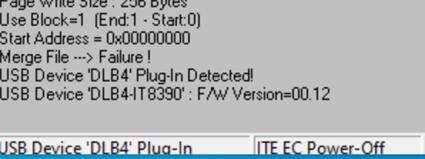
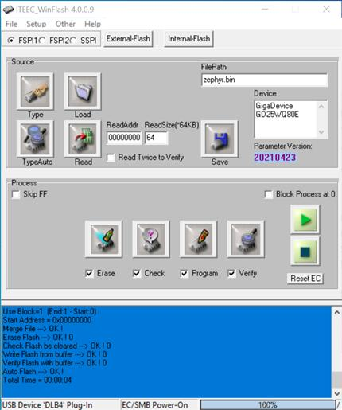
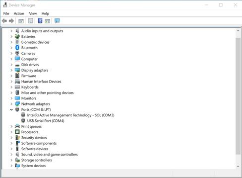

<!-- Copyright 2015-2026 Zephyr Project members and individual contributors. -->
<!-- SPDX-License-Identifier: Apache-2.0 -->
<!-- 中文翻译；编号、导航与译注为本地新增。 -->

<a id="it8xxx2_evb"></a>

# 第25章\_IT8XXX2系列（Series）

原文：[官方页面](https://docs.zephyrproject.org/latest/boards/ite/it8xxx2_evb/doc/index.html)。读取日期：2026-10-16；来源摘要见[来源记录](../SOURCES.md)。

开发板概览（Board Overview）

<a id="id1"></a>

[](images/it8xxx2_evb_wiring.jpg)

IT8XXX2系列（Series）

名称（Name）：

`it8xxx2_evb`

厂商（Vendor）：

[联阳半导体（ITE Tech. Inc.）](https://docs.zephyrproject.org/latest/boards/index.html#vendor=ite)

状态（Status）：

维护中（Maintained）

架构（Architecture）：

[riscv](https://docs.zephyrproject.org/latest/boards/index.html#arch=riscv)

片上系统（SoC）：

[it81302bx](https://docs.zephyrproject.org/latest/boards/index.html#soc=it81302bx)

<a id="board-github-link"></a>

[浏览开发板源码（Browse Board Sources）](https://github.com/zephyrproject-rtos/zephyr/blob/main//boards/ite/it8xxx2_evb/doc/index.rst/../..)<a id="overview"></a>

## 概述（Overview）

IT8XXX2是32位RISC-V微控制器，也是高度集成系统功能的嵌入式控制器，适合移动系统应用。下图为IT81302 MECC开发板，也称it8xxx2_evb，及其调试卡。


<a id="id3"></a>

ITE的更多信息见[ITE网站](https://www.ite.com.tw/en/product/cate2/IT81202) [注1](#id2)。

<a id="hardware"></a>

## 硬件（Hardware）

IT8XXX2系列包含it81302、it83202等不同芯片型号，支持的硬件功能各异。IT81302的硬件特性如下：


- RISC-V RV32IMAFC指令集（Instruction Set）
- 4 KB指令缓存（Instruction Cache）
- 共60 KB SDRAM，沿用原文存储器类型
- 内置32.768 kHz时钟发生器（Clock Generator）
- PWM、eSPI、低引脚数接口（LPC）、闪存（Flash）、UART、GPIO、定时器（Timer）、看门狗（Watchdog）、ADC及JTAG
- 6个SMBus通道，配有3个DMA控制器，兼容I2C
- SPI主机／从机（Master / Slave）
- USB Type-C配置通道（CC）逻辑
- USB供电协议（USB Power Delivery）
- 支持键盘扫描（KB Scan）

<a id="supported-features"></a>

### 支持的功能（Supported Features）

`it8xxx2_evb`开发板支持下表所列的硬件功能。

片上／板载（On-Chip / On-Board）

功能集成在片上系统（SoC）内／位于开发板上。

2 / 2

分别表示已启用／已禁用的实例数。点击数量标签，可查看开发板或SoC设备树源码（DTS）中该功能的第一个实例。

`vnd,foo`

与此功能匹配的设备树绑定兼容字符串（Compatible String）；点击链接可查看绑定文档。

<a id="it8xxx2_evb-hw-features"></a>

<a id="it8xxx2_evb-it8xxx2_evb/it81302bx-hw-features-section"></a>

#### `it8xxx2_evb/it81302bx`目标（Target）

<a id="it8xxx2_evb-it8xxx2_evb/it81302bx-hw-features-panel"></a>

<a id="it8xxx2_evb-it8xxx2_evb/it81302bx-hw-features-memory"></a>

该开发板目标的片上存储容量：60 KiB RAM、1 MiB Flash。

<a id="it8xxx2_evb-it8xxx2_evb/it81302bx-hw-features-table"></a>

<table>
<tr>
<th>类型（Type）</th>
<th>位置（Location）</th>
<th>说明（Description）</th>
<th>兼容字符串（Compatible）</th>
</tr>
<tr>
<td rowspan="1">中央处理器（CPU）</td>
<td>片上（On-Chip）</td>
<td>ITE IT8XXX2 RISC-V CPU（<a href="https://github.com/zephyrproject-rtos/zephyr/blob/main/dts/riscv/ite/it8xxx2.dtsi?plain=1#L32">已启用：1</a>）</td>
<td><a href="../cpu_vendor_multiarc_binding_reference/P017_ite_riscv-ite.md#std-dtcompatible-ite-riscv-ite"><code>ite,riscv-ite</code></a></td>
</tr>
<tr>
<td rowspan="1">模数转换器（ADC）</td>
<td>片上（On-Chip）</td>
<td>ITE it8xxx2模数转换器（ADC）（<a href="https://github.com/zephyrproject-rtos/zephyr/blob/main/dts/riscv/ite/it8xxx2.dtsi?plain=1#L475">已启用：1</a>）</td>
<td><a href="../hardware/P891_ITEIT8xxx2模数转换器绑定.md#dtbinding-ite-it8xxx2-adc"><code>ite,it8xxx2-adc</code></a></td>
</tr>
<tr>
<td rowspan="1">计数器（Counter）</td>
<td>片上（On-Chip）</td>
<td>ITE IT8XXX2计数器（Counter）（<a href="https://github.com/zephyrproject-rtos/zephyr/blob/main/dts/riscv/ite/it8xxx2.dtsi?plain=1#L166">已禁用：1</a>）</td>
<td><a href="../microchip_soc_counter_binding_reference/P006_ite_it8xxx2-counter.md#std-dtcompatible-ite-it8xxx2-counter"><code>ite,it8xxx2-counter</code></a></td>
</tr>
<tr>
<td rowspan="1">密码学加速器（Cryptographic Accelerator）</td>
<td>片上（On-Chip）</td>
<td>ITE IT8XXX2密码SHA加速器（Crypto SHA Accelerator）（<a href="https://github.com/zephyrproject-rtos/zephyr/blob/main/dts/riscv/ite/it81xx2.dtsi?plain=1#L623">已启用：1</a>）</td>
<td><a href="../crypto_aes_sha_ccm_binding_reference/P016_ite_it8xxx2-sha.md#std-dtcompatible-ite-it8xxx2-sha"><code>ite,it8xxx2-sha</code></a></td>
</tr>
<tr>
<td rowspan="1">增强型串行外设接口（ESPI）</td>
<td>片上（On-Chip）</td>
<td>ITE IT8XXX2 eSPI控制器（<a href="https://github.com/zephyrproject-rtos/zephyr/blob/main/dts/riscv/ite/it8xxx2.dtsi?plain=1#L437">已禁用：1</a>）</td>
<td><a href="../espi_binding_reference/P002_ite_it8xxx2-espi.md#std-dtcompatible-ite-it8xxx2-espi"><code>ite,it8xxx2-espi</code></a></td>
</tr>
<tr>
<td rowspan="1">闪存控制器（Flash Controller）</td>
<td>片上（On-Chip）</td>
<td>ITE IT8XXX2闪存（Flash Memory）（<a href="https://github.com/zephyrproject-rtos/zephyr/blob/main/dts/riscv/ite/it8xxx2.dtsi?plain=1#L63">已启用：1</a>）</td>
<td><a href="../flash_adi_microchip_nordic_binding_reference/P020_ite_it8xxx2-flash-controller.md#std-dtcompatible-ite-it8xxx2-flash-controller"><code>ite,it8xxx2-flash-controller</code></a></td>
</tr>
<tr>
<td rowspan="2">通用输入输出与接插件（GPIO &amp; Headers）</td>
<td>片上（On-Chip）</td>
<td>ITE IT8xxx2通用输入输出（GPIO）（<a href="https://github.com/zephyrproject-rtos/zephyr/blob/main/dts/riscv/ite/it8xxx2.dtsi?plain=1#L175">已启用：13</a>）</td>
<td><a href="../gpio_infineon_intel_ite_microchip_binding_reference/P010_ite_it8xxx2-gpio.md#std-dtcompatible-ite-it8xxx2-gpio"><code>ite,it8xxx2-gpio</code></a></td>
</tr>
<tr>
<td>片上（On-Chip）</td>
<td>ITE IT8xxx2键盘扫描（Kscan）引脚作为GPIO使用（<a href="https://github.com/zephyrproject-rtos/zephyr/blob/main/dts/riscv/ite/it81xx2.dtsi?plain=1#L21">已启用：3</a>）</td>
<td><a href="../gpio_infineon_intel_ite_microchip_binding_reference/P011_ite_it8xxx2-gpiokscan.md#std-dtcompatible-ite-it8xxx2-gpiokscan"><code>ite,it8xxx2-gpiokscan</code></a></td>
</tr>
<tr>
<td rowspan="2">集成电路间总线（I2C）</td>
<td>片上（On-Chip）</td>
<td>ITE it8xxx2 I2C（<a href="https://github.com/zephyrproject-rtos/zephyr/blob/main/dts/riscv/ite/it81xx2.dtsi?plain=1#L351">已启用：3</a>）</td>
<td><a href="../i2c_infineon_ite_nordic_binding_reference/P008_ite_it8xxx2-i2c.md#std-dtcompatible-ite-it8xxx2-i2c"><code>ite,it8xxx2-i2c</code></a></td>
</tr>
<tr>
<td>片上（On-Chip）</td>
<td>ITE增强型I2C（Enhanced I2C）（<a href="https://github.com/zephyrproject-rtos/zephyr/blob/main/dts/riscv/ite/it81xx2.dtsi?plain=1#L402">已启用：3</a>）</td>
<td><a href="../i2c_infineon_ite_nordic_binding_reference/P006_ite_enhance-i2c.md#std-dtcompatible-ite-enhance-i2c"><code>ite,enhance-i2c</code></a></td>
</tr>
<tr>
<td rowspan="1">输入（Input）</td>
<td>片上（On-Chip）</td>
<td>ITE it8xxx2键盘矩阵控制器（Keyboard Matrix Controller）（<a href="https://github.com/zephyrproject-rtos/zephyr/blob/main/dts/riscv/ite/it8xxx2.dtsi?plain=1#L716">已启用：1</a>）</td>
<td><a href="../input_keyboard_optical_ctsu_binding_reference/P005_ite_it8xxx2-kbd.md#std-dtcompatible-ite-it8xxx2-kbd"><code>ite,it8xxx2-kbd</code></a></td>
</tr>
<tr>
<td rowspan="3">中断控制器（Interrupt Controller）</td>
<td>片上（On-Chip）</td>
<td>ITE唤醒控制器（WUC / Wake-Up Controller）映射子节点（<a href="https://github.com/zephyrproject-rtos/zephyr/blob/main/dts/riscv/ite/it8xxx2-wuc-map.dtsi?plain=1#L11">已启用：1</a>）</td>
<td><a href="../wakeup_interrupt_binding_reference/P006_ite_it8xxx2-wuc-map.md#std-dtcompatible-ite-it8xxx2-wuc-map"><code>ite,it8xxx2-wuc-map</code></a></td>
</tr>
<tr>
<td>片上（On-Chip）</td>
<td>ITE唤醒控制器（WUC / Wake-Up Controller）（<a href="https://github.com/zephyrproject-rtos/zephyr/blob/main/dts/riscv/ite/it81xx2.dtsi?plain=1#L447">已启用：16</a>）</td>
<td><a href="../wakeup_interrupt_binding_reference/P007_ite_it8xxx2-wuc.md#std-dtcompatible-ite-it8xxx2-wuc"><code>ite,it8xxx2-wuc</code></a></td>
</tr>
<tr>
<td>片上（On-Chip）</td>
<td>ITE中断控制器（Interrupt Controller）（<a href="https://github.com/zephyrproject-rtos/zephyr/blob/main/dts/riscv/ite/it81xx2.dtsi?plain=1#L607">已启用：1</a>）</td>
<td><a href="../wakeup_interrupt_binding_reference/P005_ite_it8xxx2-intc.md#std-dtcompatible-ite-it8xxx2-intc"><code>ite,it8xxx2-intc</code></a></td>
</tr>
<tr>
<td rowspan="1">发光二极管（LED）</td>
<td>板载（On-Board）</td>
<td>一组由 GPIO 控制的 LED（GPIO-Controlled LEDs）（<a href="https://github.com/zephyrproject-rtos/zephyr/blob/main/boards/ite/it8xxx2_evb/it8xxx2_evb.dts?plain=1#L34">已启用：1</a>）</td>
<td><a href="../hardware/P564_GPIO指示灯绑定.md#dtbinding-gpio-leds"><code>gpio-leds</code></a></td>
</tr>
<tr>
<td rowspan="2">存储器控制器（Memory Controller）</td>
<td>片上（On-Chip）</td>
<td>ITE IT8XXX2电池后备RAM（Battery Backed RAM）节点（<a href="https://github.com/zephyrproject-rtos/zephyr/blob/main/dts/riscv/ite/it8xxx2.dtsi?plain=1#L55">已启用：1</a>）</td>
<td><a href="../memory_controller_hyperbus_smc_binding_reference/P010_ite_it8xxx2-bbram.md#std-dtcompatible-ite-it8xxx2-bbram"><code>ite,it8xxx2-bbram</code></a></td>
</tr>
<tr>
<td>片上（On-Chip）</td>
<td>ITE IT8XXX2指令本地存储器（Instruction Local Memory）（<a href="https://github.com/zephyrproject-rtos/zephyr/blob/main/dts/riscv/ite/it8xxx2.dtsi?plain=1#L86">已启用：1</a>）</td>
<td><a href="../memory_controller_hyperbus_smc_binding_reference/P011_ite_it8xxx2-ilm.md#std-dtcompatible-ite-it8xxx2-ilm"><code>ite,it8xxx2-ilm</code></a></td>
</tr>
<tr>
<td rowspan="1">存储技术设备（MTD）</td>
<td>片上（On-Chip）</td>
<td>闪存（Flash）节点（<a href="https://github.com/zephyrproject-rtos/zephyr/blob/main/dts/riscv/ite/it8xxx2.dtsi?plain=1#L70">已启用：1</a>）</td>
<td><a href="../mtd_nxp_st_ti_partition_binding_reference/P013_soc-nv-flash.md#std-dtcompatible-soc-nv-flash"><code>soc-nv-flash</code></a></td>
</tr>
<tr>
<td rowspan="1">平台环境控制接口（PECI）</td>
<td>片上（On-Chip）</td>
<td>ITE it8xxx2平台环境控制接口（PECI）（<a href="https://github.com/zephyrproject-rtos/zephyr/blob/main/dts/riscv/ite/it8xxx2.dtsi?plain=1#L706">已启用：1</a>）</td>
<td><a href="../lin_dali_mctp_sensor_bus_binding_reference/P003_ite_it8xxx2-peci.md#std-dtcompatible-ite-it8xxx2-peci"><code>ite,it8xxx2-peci</code></a></td>
</tr>
<tr>
<td rowspan="2">引脚控制（Pin Control）</td>
<td>片上（On-Chip）</td>
<td>ITE IT8XXX2引脚控制器（Pin Controller）（<a href="https://github.com/zephyrproject-rtos/zephyr/blob/main/dts/riscv/ite/it81xx2.dtsi?plain=1#L60">已启用：16</a>）</td>
<td><a href="../pinctrl_infineon_nordic_nxp_binding_reference/P003_ite_it8xxx2-pinctrl-func.md#std-dtcompatible-ite-it8xxx2-pinctrl-func"><code>ite,it8xxx2-pinctrl-func</code></a></td>
</tr>
<tr>
<td>片上（On-Chip）</td>
<td>ITE IT8XXX2引脚控制器节点负责控制引脚功能选择及引脚属性（<a href="https://github.com/zephyrproject-rtos/zephyr/blob/main/dts/riscv/ite/it81xx2.dtsi?plain=1#L10">已启用：1</a>）</td>
<td><a href="../pinctrl_infineon_nordic_nxp_binding_reference/P004_ite_it8xxx2-pinctrl.md#std-dtcompatible-ite-it8xxx2-pinctrl"><code>ite,it8xxx2-pinctrl</code></a></td>
</tr>
<tr>
<td rowspan="2">脉宽调制（PWM）</td>
<td>片上（On-Chip）</td>
<td>ITE it8xxx2 PWM预分频器（Prescaler）节点（<a href="https://github.com/zephyrproject-rtos/zephyr/blob/main/dts/riscv/ite/it8xxx2.dtsi?plain=1#L580">已启用：1</a>）</td>
<td><a href="../pwm_intel_microchip_nxp_binding_reference/P006_ite_it8xxx2-pwmprs.md#std-dtcompatible-ite-it8xxx2-pwmprs"><code>ite,it8xxx2-pwmprs</code></a></td>
</tr>
<tr>
<td>片上（On-Chip）</td>
<td>ITE it8xxx2脉宽调制器（PWM）节点（<a href="https://github.com/zephyrproject-rtos/zephyr/blob/main/dts/riscv/ite/it8xxx2.dtsi?plain=1#L585">已启用：2</a>；<a href="https://github.com/zephyrproject-rtos/zephyr/blob/main/dts/riscv/ite/it8xxx2.dtsi?plain=1#L597">已禁用：6</a>）</td>
<td><a href="../pwm_intel_microchip_nxp_binding_reference/P005_ite_it8xxx2-pwm.md#std-dtcompatible-ite-it8xxx2-pwm"><code>ite,it8xxx2-pwm</code></a></td>
</tr>
<tr>
<td rowspan="1">实时时钟（RTC）</td>
<td>片上（On-Chip）</td>
<td>ITE实时时钟（RTC / Real Time Clock）（<a href="https://github.com/zephyrproject-rtos/zephyr/blob/main/dts/riscv/ite/it8xxx2.dtsi?plain=1#L746">已禁用：1</a>）</td>
<td><a href="../rtc_binding_reference/P009_ite_it8xxx2-rtc.md#std-dtcompatible-ite-it8xxx2-rtc"><code>ite,it8xxx2-rtc</code></a></td>
</tr>
<tr>
<td rowspan="1">传感器（Sensors）</td>
<td>片上（On-Chip）</td>
<td>ITE it8xxx2电压比较器（Voltage Comparator）节点（<a href="https://github.com/zephyrproject-rtos/zephyr/blob/main/dts/riscv/ite/it8xxx2.dtsi?plain=1#L484">已启用：1</a>；<a href="https://github.com/zephyrproject-rtos/zephyr/blob/main/dts/riscv/ite/it8xxx2.dtsi?plain=1#L499">已禁用：5</a>）</td>
<td><a href="../sensor_liteon_maxim_temperature_binding_reference/P003_ite_it8xxx2-vcmp.md#std-dtcompatible-ite-it8xxx2-vcmp"><code>ite,it8xxx2-vcmp</code></a></td>
</tr>
<tr>
<td rowspan="2">串行控制器（Serial Controller）</td>
<td>片上（On-Chip）</td>
<td>ns16550通用异步收发器（UART）（<a href="https://github.com/zephyrproject-rtos/zephyr/blob/main/dts/riscv/ite/it8xxx2.dtsi?plain=1#L114">已启用：2</a>）</td>
<td><a href="../uart_microchip_nordic_nxp_binding_reference/P005_ns16550.md#std-dtcompatible-ns16550"><code>ns16550</code></a></td>
</tr>
<tr>
<td>片上（On-Chip）</td>
<td>ITE IT8XXX2 UART节点（<a href="https://github.com/zephyrproject-rtos/zephyr/blob/main/dts/riscv/ite/it8xxx2.dtsi?plain=1#L136">已启用：2</a>）</td>
<td><a href="../uart_espressif_infineon_microchip_binding_reference/P013_ite_it8xxx2-uart.md#std-dtcompatible-ite-it8xxx2-uart"><code>ite,it8xxx2-uart</code></a></td>
</tr>
<tr>
<td rowspan="1">串行主机接口（SHI）</td>
<td>片上（On-Chip）</td>
<td>ITE IT8XXX2串行主机接口（SHI / Serial Host Interface）（<a href="https://github.com/zephyrproject-rtos/zephyr/blob/main/dts/riscv/ite/it8xxx2.dtsi?plain=1#L465">已禁用：1</a>）</td>
<td><a href="../lin_dali_mctp_sensor_bus_binding_reference/P017_ite_it8xxx2-shi.md#std-dtcompatible-ite-it8xxx2-shi"><code>ite,it8xxx2-shi</code></a></td>
</tr>
<tr>
<td rowspan="1">串行外设接口（SPI）</td>
<td>片上（On-Chip）</td>
<td>IT8XXX2 SPI（<a href="https://github.com/zephyrproject-rtos/zephyr/blob/main/dts/riscv/ite/it81xx2.dtsi?plain=1#L629">已禁用：1</a>）</td>
<td><a href="../spi_microchip_nordic_nxp_binding_reference/P002_ite_it8xxx2-spi.md#std-dtcompatible-ite-it8xxx2-spi"><code>ite,it8xxx2-spi</code></a></td>
</tr>
<tr>
<td rowspan="1">静态随机存储器（SRAM）</td>
<td>片上（On-Chip）</td>
<td>通用片上静态随机存储器（SRAM）（<a href="https://github.com/zephyrproject-rtos/zephyr/blob/main/dts/riscv/ite/it8xxx2.dtsi?plain=1#L81">已启用：1</a>）</td>
<td><a href="../hardware/P567_内存映射SRAM绑定.md#dtbinding-mmio-sram"><code>mmio-sram</code></a></td>
</tr>
<tr>
<td rowspan="1">转速计（Tachometer）</td>
<td>片上（On-Chip）</td>
<td>ITE IT8xxx2转速计（Tachometer）（<a href="https://github.com/zephyrproject-rtos/zephyr/blob/main/dts/riscv/ite/it8xxx2.dtsi?plain=1#L681">已启用：1</a>；<a href="https://github.com/zephyrproject-rtos/zephyr/blob/main/dts/riscv/ite/it8xxx2.dtsi?plain=1#L691">已禁用：1</a>）</td>
<td><a href="../auxdisplay_iio_tach_binding_reference/P016_ite_it8xxx2-tach.md#std-dtcompatible-ite-it8xxx2-tach"><code>ite,it8xxx2-tach</code></a></td>
</tr>
<tr>
<td rowspan="1">定时器（Timer）</td>
<td>片上（On-Chip）</td>
<td>ITE外部定时器（Ext-Timer）（<a href="https://github.com/zephyrproject-rtos/zephyr/blob/main/dts/riscv/ite/it8xxx2.dtsi?plain=1#L154">已启用：1</a>）</td>
<td><a href="../mcu_timer_binding_reference/P011_ite_it8xxx2-timer.md#std-dtcompatible-ite-it8xxx2-timer"><code>ite,it8xxx2-timer</code></a></td>
</tr>
<tr>
<td rowspan="1">USB Type-C 接口（USB Type-C）</td>
<td>片上（On-Chip）</td>
<td>ITE it8xxx2 USB-C供电协议（Power Delivery）端口（<a href="https://github.com/zephyrproject-rtos/zephyr/blob/main/dts/riscv/ite/it8xxx2.dtsi?plain=1#L734">已禁用：2</a>）</td>
<td><a href="../usbc_tcpc_binding_reference/P006_ite_it8xxx2-usbpd.md#std-dtcompatible-ite-it8xxx2-usbpd"><code>ite,it8xxx2-usbpd</code></a></td>
</tr>
<tr>
<td rowspan="1">看门狗（Watchdog）</td>
<td>片上（On-Chip）</td>
<td>ITE看门狗定时器（Watchdog Timer）（<a href="https://github.com/zephyrproject-rtos/zephyr/blob/main/dts/riscv/ite/it81xx2.dtsi?plain=1#L615">已启用：1</a>）</td>
<td><a href="../soc_pmic_watchdog_binding_reference/P006_ite_it8xxx2-watchdog.md#std-dtcompatible-ite-it8xxx2-watchdog"><code>ite,it8xxx2-watchdog</code></a></td>
</tr>
</table>

<a id="hardware-reworks"></a>

## 硬件改装（Hardware Reworks）

使用it8xxx2_evb之前，需要进行一些硬件改装。改装指南见ITE网站：[https://www.ite.com.tw/upload/2024_01_15/6_20240115100309cgdjgcLzX3.pdf](https://www.ite.com.tw/upload/2024_01_15/6_20240115100309cgdjgcLzX3.pdf)

<a id="programming-and-debugging-on-it83202"></a>

## 在it83202上编程和调试（Programming and Debugging）

<a id="id4"></a>

向设备上传应用需要ITE烧录工具及下载板（Download Board），可从[ITE网站](https://www.ite.com.tw/en/product/cate2/IT81202) [注1](#id2) 获取。

<a id="wiring"></a>

### 接线（Wiring）


1. 通过USB线缆将下载板连接到主机。
2. 将it8xxx2_evb连接到主机或5 V／1 A USB电源。
3. 将下载板J5连接到it8xxx2_evb的J8。
4. 将USB转UART线连接到it8xxx2_evb。

  

  注意（Note）

  接线时务必小心。使用独立导线将I2C引脚连接到it8xxx2_evb的对应引脚，接线关系见下表。

  <table>
  <tr>
  <th>J5连接器（Connector）</th>
  <th>it8xxx2_evb J8连接器</th>
  </tr>
  <tr>
  <td>2</td>
  <td>1</td>
  </tr>
  <tr>
  <td>3</td>
  <td>3</td>
  </tr>
  <tr>
  <td>4</td>
  <td>5</td>
  </tr>
  </table>

  USB转UART线应按下表连接到it8xxx2_evb：

  <table>
  <tr>
  <th>USB转UART线缆</th>
  <th>it8xxx2_evb J5连接器</th>
  </tr>
  <tr>
  <td>接收（RX）</td>
  <td>J5.3</td>
  </tr>
  <tr>
  <td>发送（TX）</td>
  <td>J5.4</td>
  </tr>
  <tr>
  <td>地（GND）</td>
  <td>eSPI调试接口第10脚（eSPI Debug.10）</td>
  </tr>
  </table>

<a id="building"></a>

### 构建（Building）


1. 按通常方式构建[Hello World](../getting_started/P005_HelloWorld示例.md#hello_world)应用，参见[Zephyr入门指南（Getting Started Guide）](../getting_started/P002_入门指南.md#getting-started)：

  ```text
  # From the root of the zephyr repository
  west build -b it8xxx2_evb samples/hello_world
  ```
2. west会生成zephyr.bin文件。

<a id="flashing"></a>

### 烧录（Flashing）

<a id="windows"></a>

#### Windows

使用winflash工具，将Zephyr应用烧录到it8xxx2开发板闪存。


1. 打开winflash工具，并确认开关操作顺序正确：先打开下载板开关，再打开it8xxx2_evb开关，然后按下图配置winflash。

  > 
  >
  > 
2. 使用winflash将zephyr.bin烧录到ITE开发板。先点击Load选择zephyr.bin文件，再点击run，将镜像烧录到开发板。

  > 
3. 至此镜像已烧录到ITE开发板，上电即可运行。可用终端程序确认烧录是否成功。

  例如，在设备管理器中找到USB Serial Port（COM4），然后用终端程序连接，速率设为115200。

  > 
4. 打开it8xxx2_evb开发板开关，应看到开发板输出`Hello World! it8xxx2_evb`。若未看到，可按复位键，随后应出现消息。

<a id="ubuntu"></a>

#### Ubuntu


1. 运行惯用的终端程序监听输出。Linux下串口应为`/dev/ttyUSB0`，保持终端打开。

  例如：

  ```text
  $ minicom -D /dev/ttyUSB0 -b 115200
  ```
2. 打开第二个终端窗口，使用Linux烧录工具烧录开发板。

  ```text
  $ sudo ~/itetool/ite -f build/zephyr/zephyr.bin
  ```

  注意（Note）

  ITE工具源码可从以下地址下载：[https://www.ite.com.tw/upload/2024_01_23/6_20240123162336wu55j1Rjm4.bz2](https://www.ite.com.tw/upload/2024_01_23/6_20240123162336wu55j1Rjm4.bz2)
3. 并排显示两个终端窗口。第一个窗口应出现`Hello World! it8xxx2_evb`；若未出现，可按复位键，随后应显示消息。

<a id="debugging"></a>

### 调试（Debugging）

目前支持UART调试。

<a id="troubleshooting"></a>

### 故障排查（Troubleshooting）


1. 若烧录工具报告失败，可重新插拔8390下载板，或给it8xxx2_evb断电重启后再试。

<a id="references"></a>

### 参考资料（References）

<a id="id2"></a>

〔1〕 ([1](#id3),[2](#id4)) [https://www.ite.com.tw/en/product/cate2/IT81202](https://www.ite.com.tw/en/product/cate2/IT81202)

## 译注

原文概述为IT81302，编程调试标题为it83202；容量类型写60 KB SDRAM，均保留并标注。硬件改装为来源列出的前置要求。

---

[上一章](P024_IT82XX2_series.md) · [返回大纲](大纲.md) · [全站翻译进度](../PROGRESS.md)
