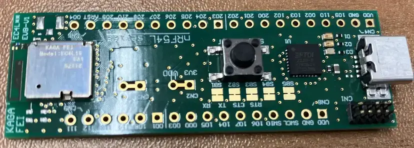

<!-- Copyright 2015-2026 Zephyr Project members and individual contributors. -->
<!-- SPDX-License-Identifier: Apache-2.0 -->
<!-- 中文翻译；编号、导航与译注为本地新增。 -->

<a id="ec4l15ba1"></a>

# 第6章\_`EC4L15BA1-EVB`

原文：[官方页面](https://docs.zephyrproject.org/latest/boards/kaga-fei/ec4l15ba1/doc/index.html)。读取日期：2026-10-16；来源摘要见[来源记录](../SOURCES.md)。

开发板概览（Board Overview）

<a id="id1"></a>

[](images/ec4l15ba1.webp)

`EC4L15BA1-EVB`

名称（Name）：

`ec4l15ba1`

厂商（Vendor）：

[KAGA FEI Co., Ltd.](https://docs.zephyrproject.org/latest/boards/index.html#vendor=kaga-fei)

状态（Status）：

当前未积极维护（Not Actively Maintained）

架构（Architecture）：

RISC-V、Arm架构（[riscv](https://docs.zephyrproject.org/latest/boards/index.html#arch=riscv), [arm](https://docs.zephyrproject.org/latest/boards/index.html#arch=arm)）

片上系统（SoC）：

[nrf54l15](https://docs.zephyrproject.org/latest/boards/index.html#soc=nrf54l15)

<a id="board-github-link"></a>

[浏览开发板源码（Browse Board Sources）](https://github.com/zephyrproject-rtos/zephyr/blob/main//boards/kaga-fei/ec4l15ba1/doc/index.rst/../..)<a id="overview"></a>

## 概述（Overview）

EC4L15BA1评估板基于EC4L15BA1模块，采用Nordic Semiconductor nRF54L15 SoC方案。模块引脚引出到2.54 mm排针，便于验证模块功能，以及连接其他外设和传感器，可用于早期软件开发。

注意（Note）

<a id="id3"></a>

<a id="id5"></a>

nRF54L15 SoC的更多信息见[nRF54L15网站](https://www.nordicsemi.com/Products/nRF54L15) [注1](#id2)。技术文档及SoC数据手册等资源见[nRF54L15文档](https://docs.nordicsemi.com/bundle/ncs-latest/page/nrf/app_dev/device_guides/nrf54l/index.html) [注2](#id4) 页面。

<a id="hardware"></a>

## 硬件（Hardware）

EC4L15BA1-EVB具有两个晶体振荡器：


- 32 MHz高频晶体振荡器（HFXO）
- 32.768 kHz低频晶体振荡器（LFXO）


- 基于EC4L15BA1构建的模块评估板（Module Evaluation Board）
- Nordic nRF54L15 SoC方案
- 面向蓝牙核心规范6.0（Bluetooth Core 6.0）
- 面向FCC、ISEC及Telec认证，沿用原文ISEC拼写
- 128 MHz Arm Cortex-M33处理器，支持TrustZone技术
- 128 MHz RISC-V协处理器，原文标注支持TrustZone技术
- 1.5 MB闪存（Flash Memory）及256 KB RAM
- 符合RoHS及REACH要求
- 29个GPIO
- 印制天线（Pattern Antenna）
- 接口：SPI、UART、I2C、I2S、PDM、PWM、ADC及NFC
- 高度灵活的多协议SoC，适用于低功耗蓝牙（Bluetooth Low Energy）、ANT+、Zigbee、Thread（802.15.4）及Matter超低功耗无线应用。

<a id="supported-features"></a>

### 支持的功能（Supported Features）

`ec4l15ba1`开发板支持下表所列的硬件功能。

片上／板载（On-Chip / On-Board）

功能集成在片上系统（SoC）内／位于开发板上。

2 / 2

分别表示已启用／已禁用的实例数。点击数量标签，可查看开发板或SoC设备树源码（DTS）中该功能的第一个实例。

`vnd,foo`

与此功能匹配的设备树绑定兼容字符串（Compatible String）；点击链接可查看绑定文档。

<a id="ec4l15ba1-hw-features"></a>

<a id="ec4l15ba1-ec4l15ba1/nrf54l15/cpuapp-hw-features-section"></a>

#### `ec4l15ba1/nrf54l15/cpuapp`目标（Target）

<a id="ec4l15ba1-ec4l15ba1/nrf54l15/cpuapp-hw-features-panel"></a>

<a id="ec4l15ba1-ec4l15ba1/nrf54l15/cpuapp-hw-features-memory"></a>

该开发板目标的片上存储容量：262048 B RAM、1524 KiB Flash。

<a id="ec4l15ba1-ec4l15ba1/nrf54l15/cpuapp-hw-features-table"></a>

<table>
<tr>
<th>类型（Type）</th>
<th>位置（Location）</th>
<th>说明（Description）</th>
<th>兼容字符串（Compatible）</th>
</tr>
<tr>
<td rowspan="1">中央处理器（CPU）</td>
<td>片上（On-Chip）</td>
<td>ARM Cortex-M33F处理器（CPU）（<a href="https://github.com/zephyrproject-rtos/zephyr/blob/main/dts/vendor/nordic/nrf54l_05_10_15.dtsi?plain=1#L26">已启用：1</a>）</td>
<td><a href="../cpu_arm_riscv_binding_reference/P023_arm_cortex-m33f.md#std-dtcompatible-arm-cortex-m33f"><code>arm,cortex-m33f</code></a></td>
</tr>
<tr>
<td rowspan="1">模数转换器（ADC）</td>
<td>片上（On-Chip）</td>
<td>Nordic Semiconductor nRF系列逐次逼近模数转换器（SAADC）节点（<a href="https://github.com/zephyrproject-rtos/zephyr/blob/main/dts/vendor/nordic/nrf54l_05_10_15.dtsi?plain=1#L528">已启用：1</a>）</td>
<td><a href="../hardware/P846_NordicNRF逐次逼近ADC绑定.md#dtbinding-nordic-nrf-saadc"><code>nordic,nrf-saadc</code></a></td>
</tr>
<tr>
<td rowspan="2">ARM 架构（ARM Architecture）</td>
<td>片上（On-Chip）</td>
<td>Nordic用户信息配置寄存器（UICR / User Information Configuration Registers）（<a href="https://github.com/zephyrproject-rtos/zephyr/blob/main/dts/vendor/nordic/nrf54l_05_10_15.dtsi?plain=1#L87">已启用：1</a>）</td>
<td><a href="../arm_nordic_nxp_control_binding_reference/P007_nordic_nrf-uicr.md#std-dtcompatible-nordic-nrf-uicr"><code>nordic,nrf-uicr</code></a></td>
</tr>
<tr>
<td>片上（On-Chip）</td>
<td>Nordic事件发生器单元（EGU / Event Generator Unit）（<a href="https://github.com/zephyrproject-rtos/zephyr/blob/main/dts/vendor/nordic/nrf54l_05_10_15.dtsi?plain=1#L249">已禁用：2</a>）</td>
<td><a href="../arm_timing_ethosu_control_binding_reference/P018_nordic_nrf-egu.md#std-dtcompatible-nordic-nrf-egu"><code>nordic,nrf-egu</code></a></td>
</tr>
<tr>
<td rowspan="1">音频（Audio）</td>
<td>片上（On-Chip）</td>
<td>Nordic脉冲密度调制接口（PDM / Pulse Density Modulation Interface）（<a href="https://github.com/zephyrproject-rtos/zephyr/blob/main/dts/vendor/nordic/nrf54l_05_10_15.dtsi?plain=1#L487">已禁用：2</a>）</td>
<td><a href="../audio_pdm_codec_binding_reference/P012_nordic_nrf-pdm.md#std-dtcompatible-nordic-nrf-pdm"><code>nordic,nrf-pdm</code></a></td>
</tr>
<tr>
<td rowspan="6">时钟控制（Clock Control）</td>
<td>片上（On-Chip）</td>
<td>通用固定频率时钟提供者（Fixed-Rate Clock Provider）（<a href="https://github.com/zephyrproject-rtos/zephyr/blob/main/dts/vendor/nordic/nrf54l_05_10_15.dtsi?plain=1#L54">已启用：2</a>）</td>
<td><a href="../hardware/P566_固定时钟绑定.md#dtbinding-fixed-clock"><code>fixed-clock</code></a></td>
</tr>
<tr>
<td>片上（On-Chip）</td>
<td>Nordic nRF低频晶体振荡器（nRF54L系列）（<a href="https://github.com/zephyrproject-rtos/zephyr/blob/main/dts/vendor/nordic/nrf54l_05_10_15.dtsi?plain=1#L60">已启用：1</a>）</td>
<td><a href="../clock_sam_nordic_binding_reference/P029_nordic_nrf54l-lfxo.md#std-dtcompatible-nordic-nrf54l-lfxo"><code>nordic,nrf54l-lfxo</code></a></td>
</tr>
<tr>
<td>片上（On-Chip）</td>
<td>Nordic nRF高频晶体振荡器（nRF54L系列）（<a href="https://github.com/zephyrproject-rtos/zephyr/blob/main/dts/vendor/nordic/nrf54l_05_10_15.dtsi?plain=1#L66">已启用：1</a>）</td>
<td><a href="../clock_sam_nordic_binding_reference/P028_nordic_nrf54l-hfxo.md#std-dtcompatible-nordic-nrf54l-hfxo"><code>nordic,nrf54l-hfxo</code></a></td>
</tr>
<tr>
<td>片上（On-Chip）</td>
<td>Nordic nRF时钟控制（Clock Control）节点（<a href="https://github.com/zephyrproject-rtos/zephyr/blob/main/dts/vendor/nordic/nrf54l_05_10_15.dtsi?plain=1#L657">已启用：1</a>）</td>
<td><a href="../clock_sam_nordic_binding_reference/P015_nordic_nrf-clock.md#std-dtcompatible-nordic-nrf-clock"><code>nordic,nrf-clock</code></a></td>
</tr>
<tr>
<td>片上（On-Chip）</td>
<td>Nordic nRF XO时钟控制节点（<a href="https://github.com/zephyrproject-rtos/zephyr/blob/main/dts/vendor/nordic/nrf54l_05_10_15.dtsi?plain=1#L663">已启用：1</a>）</td>
<td><a href="../clock_sam_nordic_binding_reference/P013_nordic_nrf-clock-xo.md#std-dtcompatible-nordic-nrf-clock-xo"><code>nordic,nrf-clock-xo</code></a></td>
</tr>
<tr>
<td>片上（On-Chip）</td>
<td>Nordic nRF低频时钟（LFCLK）控制节点（<a href="https://github.com/zephyrproject-rtos/zephyr/blob/main/dts/vendor/nordic/nrf54l_05_10_15.dtsi?plain=1#L670">已启用：1</a>）</td>
<td><a href="../clock_sam_nordic_binding_reference/P012_nordic_nrf-clock-lfclk.md#std-dtcompatible-nordic-nrf-clock-lfclk"><code>nordic,nrf-clock-lfclk</code></a></td>
</tr>
<tr>
<td rowspan="1">比较器（Comparator）</td>
<td>片上（On-Chip）</td>
<td>Nordic nRF模拟比较器（COMP / Analog Comparator）（<a href="https://github.com/zephyrproject-rtos/zephyr/blob/main/dts/vendor/nordic/nrf54l_05_10_15.dtsi?plain=1#L702">已禁用：1</a>）</td>
<td><a href="../hardware/P752_NordicnRF比较器绑定.md#dtbinding-nordic-nrf-comp"><code>nordic,nrf-comp</code></a></td>
</tr>
<tr>
<td rowspan="1">计数器（Counter）</td>
<td>片上（On-Chip）</td>
<td>Nordic nRF定时器（Timer）节点（<a href="https://github.com/zephyrproject-rtos/zephyr/blob/main/dts/vendor/nordic/nrf54l_05_10_15.dtsi?plain=1#L205">已禁用：7</a>）</td>
<td><a href="../microchip_soc_counter_binding_reference/P017_nordic_nrf-timer.md#std-dtcompatible-nordic-nrf-timer"><code>nordic,nrf-timer</code></a></td>
</tr>
<tr>
<td rowspan="1">调试（Debug）</td>
<td>片上（On-Chip）</td>
<td>ARMv8仪器跟踪宏单元（Instrumentation Trace Macrocell）（<a href="https://github.com/zephyrproject-rtos/zephyr/blob/main/dts/vendor/nordic/nrf54l_05_10_15.dtsi?plain=1#L34">已启用：1</a>）</td>
<td><a href="../debug_binding_reference/P002_ARMv8M_ITM调试绑定.md#std-dtcompatible-arm-armv8m-itm"><code>arm,armv8m-itm</code></a></td>
</tr>
<tr>
<td rowspan="1">闪存控制器（Flash Controller）</td>
<td>片上（On-Chip）</td>
<td>Nordic电阻式随机存储器控制器（RRAMC / Resistive Random Access Memory Controller）（<a href="https://github.com/zephyrproject-rtos/zephyr/blob/main/dts/vendor/nordic/nrf54l_05_10_15.dtsi?plain=1#L766">已启用：1</a>）</td>
<td><a href="../flash_nuvoton_nxp_renesas_binding_reference/P003_nordic_rram-controller.md#std-dtcompatible-nordic-rram-controller"><code>nordic,rram-controller</code></a></td>
</tr>
<tr>
<td rowspan="3">通用输入输出与接插件（GPIO &amp; Headers）</td>
<td>片上（On-Chip）</td>
<td>NRF5通用输入输出（GPIO）（<a href="https://github.com/zephyrproject-rtos/zephyr/blob/main/dts/vendor/nordic/nrf54l_05_10_15.dtsi?plain=1#L194">已启用：3</a>）</td>
<td><a href="../gpio_microchip_nordic_nuvoton_binding_reference/P016_nordic_nrf-gpio.md#std-dtcompatible-nordic-nrf-gpio"><code>nordic,nrf-gpio</code></a></td>
</tr>
<tr>
<td>片上（On-Chip）</td>
<td>NRF5 GPIO任务与事件（GPIOTE）（<a href="https://github.com/zephyrproject-rtos/zephyr/blob/main/dts/vendor/nordic/nrf54l_05_10_15.dtsi?plain=1#L562">已启用：2</a>）</td>
<td><a href="../gpio_microchip_nordic_nuvoton_binding_reference/P017_nordic_nrf-gpiote.md#std-dtcompatible-nordic-nrf-gpiote"><code>nordic,nrf-gpiote</code></a></td>
</tr>
<tr>
<td>板载（On-Board）</td>
<td>Nordic扩展板排针（Expansion Board Header）（<a href="https://github.com/zephyrproject-rtos/zephyr/blob/main/boards/kaga-fei/ec4l15ba1/ec4l15ba1_common.dtsi?plain=1#L94">已启用：1</a>）</td>
<td><a href="../gpio_microchip_nordic_nuvoton_binding_reference/P009_nordic_expansion-board-header.md#std-dtcompatible-nordic-expansion-board-header"><code>nordic,expansion-board-header</code></a></td>
</tr>
<tr>
<td rowspan="1">集成电路间总线（I2C）</td>
<td>片上（On-Chip）</td>
<td>Nordic nRF系列TWIM（带EasyDMA的TWI主机）（<a href="https://github.com/zephyrproject-rtos/zephyr/blob/main/dts/vendor/nordic/nrf54l_05_10_15.dtsi?plain=1#L310">已禁用：4</a>）</td>
<td><a href="../i2c_infineon_ite_nordic_binding_reference/P016_nordic_nrf-twim.md#std-dtcompatible-nordic-nrf-twim"><code>nordic,nrf-twim</code></a></td>
</tr>
<tr>
<td rowspan="1">集成电路间音频总线（I2S）</td>
<td>片上（On-Chip）</td>
<td>Nordic芯片间音频接口（I2S / Inter-IC Sound Interface）（<a href="https://github.com/zephyrproject-rtos/zephyr/blob/main/dts/vendor/nordic/nrf54l_05_10_15.dtsi?plain=1#L569">已禁用：1</a>）</td>
<td><a href="../i2s_binding_reference/P010_nordic_nrf-i2s.md#std-dtcompatible-nordic-nrf-i2s"><code>nordic,nrf-i2s</code></a></td>
</tr>
<tr>
<td rowspan="1">低速率无线个域网（IEEE 802.15.4）</td>
<td>片上（On-Chip）</td>
<td>Nordic nRF IEEE 802.15.4节点（<a href="https://github.com/zephyrproject-rtos/zephyr/blob/main/dts/vendor/nordic/nrf54l_05_10_15.dtsi?plain=1#L267">已启用：1</a>）</td>
<td><a href="../lora_ieee802154_binding_reference/P005_nordic_nrf-ieee802154.md#std-dtcompatible-nordic-nrf-ieee802154"><code>nordic,nrf-ieee802154</code></a></td>
</tr>
<tr>
<td rowspan="1">输入（Input）</td>
<td>板载（On-Board）</td>
<td>一组绑定到 GPIO 的输入按键（GPIO-Bound Input Keys）（<a href="https://github.com/zephyrproject-rtos/zephyr/blob/main/boards/kaga-fei/ec4l15ba1/ec4l15ba1_common.dtsi?plain=1#L49">已启用：1</a>）</td>
<td><a href="../hardware/P563_GPIO按键绑定.md#std-dtcompatible-gpio-keys"><code>gpio-keys</code></a></td>
</tr>
<tr>
<td rowspan="1">中断控制器（Interrupt Controller）</td>
<td>片上（On-Chip）</td>
<td>ARMv8-M嵌套向量中断控制器（NVIC / Nested Vectored Interrupt Controller）（<a href="https://github.com/zephyrproject-rtos/zephyr/blob/main/dts/vendor/nordic/nrf54l_05_10_15.dtsi?plain=1#L797">已启用：1</a>）</td>
<td><a href="../arm_interrupt_timer_binding_reference/P003_ARMv8_M_NVIC.md#std-dtcompatible-arm-v8m-nvic"><code>arm,v8m-nvic</code></a></td>
</tr>
<tr>
<td rowspan="2">发光二极管（LED）</td>
<td>板载（On-Board）</td>
<td>一组由 GPIO 控制的 LED（GPIO-Controlled LEDs）（<a href="https://github.com/zephyrproject-rtos/zephyr/blob/main/boards/kaga-fei/ec4l15ba1/ec4l15ba1_common.dtsi?plain=1#L11">已启用：1</a>）</td>
<td><a href="../hardware/P564_GPIO指示灯绑定.md#dtbinding-gpio-leds"><code>gpio-leds</code></a></td>
</tr>
<tr>
<td>板载（On-Board）</td>
<td>一组由脉宽调制（PWM）控制的LED（<a href="https://github.com/zephyrproject-rtos/zephyr/blob/main/boards/kaga-fei/ec4l15ba1/ec4l15ba1_common.dtsi?plain=1#L35">已启用：1</a>）</td>
<td><a href="../hardware/P565_PWM指示灯绑定.md#dtbinding-pwm-leds"><code>pwm-leds</code></a></td>
</tr>
<tr>
<td rowspan="2">邮箱（Mailbox）</td>
<td>片上（On-Chip）</td>
<td>Nordic VPR事件接口（VEVIF / VPR Event Interface），事件接收模式（EVENT RX MODE）（<a href="https://github.com/zephyrproject-rtos/zephyr/blob/main/dts/arm/nordic/nrf54l_05_10_15_cpuapp.dtsi?plain=1#L55">已禁用：1</a>）</td>
<td><a href="../intercore_reference/P043_NordicVEVIF事件接收绑定.md#dtbinding-nordic-nrf-vevif-event-rx"><code>nordic,nrf-vevif-event-rx</code></a></td>
</tr>
<tr>
<td>片上（On-Chip）</td>
<td>Nordic VPR事件接口（VEVIF），任务发送模式（TASK TX MODE）（<a href="https://github.com/zephyrproject-rtos/zephyr/blob/main/dts/arm/nordic/nrf54l_05_10_15_cpuapp.dtsi?plain=1#L65">已禁用：1</a>）</td>
<td><a href="../intercore_reference/P046_NordicVEVIF任务发送绑定.md#dtbinding-nordic-nrf-vevif-task-tx"><code>nordic,nrf-vevif-task-tx</code></a></td>
</tr>
<tr>
<td rowspan="4">其他绑定（Miscellaneous）</td>
<td>片上（On-Chip）</td>
<td>Nordic工厂信息配置寄存器（FICR / Factory Information Configuration Registers）（<a href="https://github.com/zephyrproject-rtos/zephyr/blob/main/dts/vendor/nordic/nrf54l_05_10_15.dtsi?plain=1#L96">已启用：1</a>）</td>
<td><a href="../misc_adi_nordic_binding_reference/P018_nordic_nrf-ficr.md#std-dtcompatible-nordic-nrf-ficr"><code>nordic,nrf-ficr</code></a></td>
</tr>
<tr>
<td>片上（On-Chip）</td>
<td>Nordic分布式可编程外设互连控制器（DPPIC / Distributed Programmable Peripheral Interconnect Controller）（<a href="https://github.com/zephyrproject-rtos/zephyr/blob/main/dts/vendor/nordic/nrf54l_05_10_15.dtsi?plain=1#L122">已启用：4</a>）</td>
<td><a href="../misc_adi_nordic_binding_reference/P017_nordic_nrf-dppic.md#std-dtcompatible-nordic-nrf-dppic"><code>nordic,nrf-dppic</code></a></td>
</tr>
<tr>
<td>片上（On-Chip）</td>
<td>Nordic可编程外设互连桥（PPIB / Programmable Peripheral Interconnect Bridge）（<a href="https://github.com/zephyrproject-rtos/zephyr/blob/main/dts/vendor/nordic/nrf54l_05_10_15.dtsi?plain=1#L130">已启用：8</a>）</td>
<td><a href="../misc_adi_nordic_binding_reference/P021_nordic_nrf-ppib.md#std-dtcompatible-nordic-nrf-ppib"><code>nordic,nrf-ppib</code></a></td>
</tr>
<tr>
<td>片上（On-Chip）</td>
<td>Nordic存储器权限控制器（MPC / Memory Privilege Controller）（<a href="https://github.com/zephyrproject-rtos/zephyr/blob/main/dts/vendor/nordic/nrf54l_05_10_15.dtsi?plain=1#L784">已启用：1</a>）</td>
<td><a href="../misc_adi_nordic_binding_reference/P019_nordic_nrf-mpc.md#std-dtcompatible-nordic-nrf-mpc"><code>nordic,nrf-mpc</code></a></td>
</tr>
<tr>
<td rowspan="2">存储技术设备（MTD）</td>
<td>板载（On-Board）</td>
<td>这些属性用于支持Zephyr的<code>spi-nor</code>闪存驱动通过Zephyr SPI API，使用基于M25P80的标准命令集控制串行闪存（Serial Flash Memory）。（<a href="https://github.com/zephyrproject-rtos/zephyr/blob/main/boards/kaga-fei/ec4l15ba1/ec4l15ba1_cpuapp_common.dtsi?plain=1#L130">已启用：1</a>）</td>
<td><a href="../mtd_microchip_nordic_nxp_binding_reference/P002_jedec_spi-nor.md#std-dtcompatible-jedec-spi-nor"><code>jedec,spi-nor</code></a></td>
</tr>
<tr>
<td>片上（On-Chip）</td>
<td>闪存（Flash）节点（<a href="https://github.com/zephyrproject-rtos/zephyr/blob/main/dts/vendor/nordic/nrf54l_05_10_15.dtsi?plain=1#L774">已启用：1</a>）</td>
<td><a href="../mtd_nxp_st_ti_partition_binding_reference/P013_soc-nv-flash.md#std-dtcompatible-soc-nv-flash"><code>soc-nv-flash</code></a></td>
</tr>
<tr>
<td rowspan="2">网络（Networking）</td>
<td>片上（On-Chip）</td>
<td>Nordic nRF系列无线电（RADIO）外设（<a href="https://github.com/zephyrproject-rtos/zephyr/blob/main/dts/vendor/nordic/nrf54l_05_10_15.dtsi?plain=1#L256">已启用：1</a>）</td>
<td><a href="../network_radio_frontend_binding_reference/P009_nordic_nrf-radio.md#std-dtcompatible-nordic-nrf-radio"><code>nordic,nrf-radio</code></a></td>
</tr>
<tr>
<td>片上（On-Chip）</td>
<td>Nordic nRF系列近场通信标签（NFCT / Near Field Communication Tag）（<a href="https://github.com/zephyrproject-rtos/zephyr/blob/main/dts/vendor/nordic/nrf54l_05_10_15.dtsi?plain=1#L537">已启用：1</a>）</td>
<td><a href="../network_radio_frontend_binding_reference/P007_nordic_nrf-nfct-v2.md#std-dtcompatible-nordic-nrf-nfct-v2"><code>nordic,nrf-nfct-v2</code></a></td>
</tr>
<tr>
<td rowspan="1">引脚控制（Pin Control）</td>
<td>片上（On-Chip）</td>
<td>Nordic nRF系列引脚控制器（Pin Controller）（<a href="https://github.com/zephyrproject-rtos/zephyr/blob/main/dts/vendor/nordic/nrf_common.dtsi?plain=1#L26">已启用：1</a>）</td>
<td><a href="../pinctrl_infineon_nordic_nxp_binding_reference/P009_nordic_nrf-pinctrl.md#std-dtcompatible-nordic-nrf-pinctrl"><code>nordic,nrf-pinctrl</code></a></td>
</tr>
<tr>
<td rowspan="1">电源管理（Power Management）</td>
<td>片上（On-Chip）</td>
<td>Nordic nRF电源控制（Power Control）节点（<a href="https://github.com/zephyrproject-rtos/zephyr/blob/main/dts/vendor/nordic/nrf54l_05_10_15.dtsi?plain=1#L676">已禁用：1</a>）</td>
<td><a href="../power_control_binding_reference/P008_nordic_nrf-power.md#std-dtcompatible-nordic-nrf-power"><code>nordic,nrf-power</code></a></td>
</tr>
<tr>
<td rowspan="1">脉宽调制（PWM）</td>
<td>片上（On-Chip）</td>
<td>nRF脉宽调制（PWM）（<a href="https://github.com/zephyrproject-rtos/zephyr/blob/main/dts/vendor/nordic/nrf54l_05_10_15.dtsi?plain=1#L501">已启用：1</a>；<a href="https://github.com/zephyrproject-rtos/zephyr/blob/main/dts/vendor/nordic/nrf54l_05_10_15.dtsi?plain=1#L510">已禁用：2</a>）</td>
<td><a href="../pwm_intel_microchip_nxp_binding_reference/P015_nordic_nrf-pwm.md#std-dtcompatible-nordic-nrf-pwm"><code>nordic,nrf-pwm</code></a></td>
</tr>
<tr>
<td rowspan="2">稳压器（Regulator）</td>
<td>片上（On-Chip）</td>
<td>nRF54L上的Nordic电压稳压器控制模块（REGULATORS）（<a href="https://github.com/zephyrproject-rtos/zephyr/blob/main/dts/vendor/nordic/nrf54l_05_10_15.dtsi?plain=1#L749">已启用：1</a>）</td>
<td><a href="../hardware/P642_nRF54L稳压器集合绑定.md#dtbinding-nordic-nrf54l-regulators"><code>nordic,nrf54l-regulators</code></a></td>
</tr>
<tr>
<td>片上（On-Chip）</td>
<td>Nordic nRF5X稳压器（Regulator，内核供电的固定级）（<a href="https://github.com/zephyrproject-rtos/zephyr/blob/main/dts/vendor/nordic/nrf54l_05_10_15.dtsi?plain=1#L756">已启用：1</a>）</td>
<td><a href="../hardware/P643_nRF5X稳压器绑定.md#dtbinding-nordic-nrf5x-regulator"><code>nordic,nrf5x-regulator</code></a></td>
</tr>
<tr>
<td rowspan="1">保持存储器（Retained Memory）</td>
<td>片上（On-Chip）</td>
<td>Nordic通用保持寄存器（GPREGRET / General Purpose Register Retention）设备（<a href="https://github.com/zephyrproject-rtos/zephyr/blob/main/dts/vendor/nordic/nrf54l_05_10_15.dtsi?plain=1#L685">已启用：1</a>；<a href="https://github.com/zephyrproject-rtos/zephyr/blob/main/dts/vendor/nordic/nrf54l_05_10_15.dtsi?plain=1#L693">已禁用：1</a>）</td>
<td><a href="../hardware/P627_Nordic通用保留寄存器绑定.md#dtbinding-nordic-nrf-gpregret"><code>nordic,nrf-gpregret</code></a></td>
</tr>
<tr>
<td rowspan="1">RISC-V 架构（RISC-V Architecture）</td>
<td>片上（On-Chip）</td>
<td>VPR协处理器（Coprocessor）（<a href="https://github.com/zephyrproject-rtos/zephyr/blob/main/dts/vendor/nordic/nrf54l_05_10_15.dtsi?plain=1#L174">已禁用：1</a>）</td>
<td><a href="../platform_rmt_openthread_binding_reference/P010_nordic_nrf-vpr-coprocessor.md#std-dtcompatible-nordic-nrf-vpr-coprocessor"><code>nordic,nrf-vpr-coprocessor</code></a></td>
</tr>
<tr>
<td rowspan="1">随机数生成器（RNG）</td>
<td>片上（On-Chip）</td>
<td>基于Nordic nRF CRACEN CTR_DRBG的随机数发生器（Random Number Generator）（<a href="https://github.com/zephyrproject-rtos/zephyr/blob/main/dts/arm/nordic/nrf54l_05_10_15_cpuapp.dtsi?plain=1#L28">已启用：1</a>）</td>
<td><a href="../rng_binding_reference/P013_nordic_nrf-cracen-ctrdrbg.md#std-dtcompatible-nordic-nrf-cracen-ctrdrbg"><code>nordic,nrf-cracen-ctrdrbg</code></a></td>
</tr>
<tr>
<td rowspan="2">传感器（Sensors）</td>
<td>片上（On-Chip）</td>
<td>Nordic nRF系列温度（TEMP）节点（<a href="https://github.com/zephyrproject-rtos/zephyr/blob/main/dts/vendor/nordic/nrf54l_05_10_15.dtsi?plain=1#L544">已启用：1</a>）</td>
<td><a href="../sensor_microchip_nordic_nxp_binding_reference/P023_nordic_nrf-temp.md#std-dtcompatible-nordic-nrf-temp"><code>nordic,nrf-temp</code></a></td>
</tr>
<tr>
<td>片上（On-Chip）</td>
<td>Nordic nRF正交解码器（QDEC / Quadrature Decoder）节点（<a href="https://github.com/zephyrproject-rtos/zephyr/blob/main/dts/vendor/nordic/nrf54l_05_10_15.dtsi?plain=1#L578">已禁用：2</a>）</td>
<td><a href="../sensor_microchip_nordic_nxp_binding_reference/P021_nordic_nrf-qdec.md#std-dtcompatible-nordic-nrf-qdec"><code>nordic,nrf-qdec</code></a></td>
</tr>
<tr>
<td rowspan="1">串行控制器（Serial Controller）</td>
<td>片上（On-Chip）</td>
<td>Nordic nRF系列UARTE（带EasyDMA的UART）（<a href="https://github.com/zephyrproject-rtos/zephyr/blob/main/dts/vendor/nordic/nrf54l_05_10_15.dtsi?plain=1#L341">已启用：1</a>；<a href="https://github.com/zephyrproject-rtos/zephyr/blob/main/dts/vendor/nordic/nrf54l_05_10_15.dtsi?plain=1#L164">已禁用：4</a>）</td>
<td><a href="../uart_microchip_nordic_nxp_binding_reference/P004_nordic_nrf-uarte.md#std-dtcompatible-nordic-nrf-uarte"><code>nordic,nrf-uarte</code></a></td>
</tr>
<tr>
<td rowspan="1">串行外设接口（SPI）</td>
<td>片上（On-Chip）</td>
<td>Nordic nRF系列SPIM（带EasyDMA的SPI控制器）（<a href="https://github.com/zephyrproject-rtos/zephyr/blob/main/dts/vendor/nordic/nrf54l_05_10_15.dtsi?plain=1#L144">已启用：1</a>；<a href="https://github.com/zephyrproject-rtos/zephyr/blob/main/dts/vendor/nordic/nrf54l_05_10_15.dtsi?plain=1#L322">已禁用：4</a>）</td>
<td><a href="../spi_microchip_nordic_nxp_binding_reference/P013_nordic_nrf-spim.md#std-dtcompatible-nordic-nrf-spim"><code>nordic,nrf-spim</code></a></td>
</tr>
<tr>
<td rowspan="1">静态随机存储器（SRAM）</td>
<td>片上（On-Chip）</td>
<td>通用片上静态随机存储器（SRAM）（<a href="https://github.com/zephyrproject-rtos/zephyr/blob/main/dts/vendor/nordic/nrf54l_05_10_15.dtsi?plain=1#L102">已启用：2</a>）</td>
<td><a href="../hardware/P567_内存映射SRAM绑定.md#dtbinding-mmio-sram"><code>mmio-sram</code></a></td>
</tr>
<tr>
<td rowspan="2">定时器（Timer）</td>
<td>片上（On-Chip）</td>
<td>Nordic全局实时时钟（GRTC / Global RTC）（<a href="https://github.com/zephyrproject-rtos/zephyr/blob/main/dts/vendor/nordic/nrf54l_05_10_15.dtsi?plain=1#L592">已启用：1</a>）</td>
<td><a href="../microchip_nordic_nxp_realtek_timer_binding_reference/P005_nordic_nrf-grtc.md#std-dtcompatible-nordic-nrf-grtc"><code>nordic,nrf-grtc</code></a></td>
</tr>
<tr>
<td>片上（On-Chip）</td>
<td>ARMv8-M系统节拍（System Tick）（<a href="https://github.com/zephyrproject-rtos/zephyr/blob/main/dts/vendor/nordic/nrf54l_05_10_15.dtsi?plain=1#L806">已禁用：1</a>）</td>
<td><a href="../arm_interrupt_timer_binding_reference/P007_ARMv8_M_SysTick.md#std-dtcompatible-arm-armv8m-systick"><code>arm,armv8m-systick</code></a></td>
</tr>
<tr>
<td rowspan="1">看门狗（Watchdog）</td>
<td>片上（On-Chip）</td>
<td>Nordic nRF系列看门狗定时器（WDT / Watchdog Timer）（<a href="https://github.com/zephyrproject-rtos/zephyr/blob/main/dts/vendor/nordic/nrf54l_05_10_15.dtsi?plain=1#L724">已启用：1</a>；<a href="https://github.com/zephyrproject-rtos/zephyr/blob/main/dts/vendor/nordic/nrf54l_05_10_15.dtsi?plain=1#L716">已禁用：1</a>）</td>
<td><a href="../nxp_nordic_nuvoton_watchdog_binding_reference/P002_nordic_nrf-wdt.md#std-dtcompatible-nordic-nrf-wdt"><code>nordic,nrf-wdt</code></a></td>
</tr>
</table>

<a id="ec4l15ba1-ec4l15ba1/nrf54l15/cpuapp/ns-hw-features-section"></a>

#### `ec4l15ba1/nrf54l15/cpuapp/ns`目标（Target）

<a id="ec4l15ba1-ec4l15ba1/nrf54l15/cpuapp/ns-hw-features-panel"></a>

<a id="ec4l15ba1-ec4l15ba1/nrf54l15/cpuapp/ns-hw-features-memory"></a>

该开发板目标的片上存储容量：128 KiB RAM、1524 KiB Flash。

<a id="ec4l15ba1-ec4l15ba1/nrf54l15/cpuapp/ns-hw-features-table"></a>

<table>
<tr>
<th>类型（Type）</th>
<th>位置（Location）</th>
<th>说明（Description）</th>
<th>兼容字符串（Compatible）</th>
</tr>
<tr>
<td rowspan="1">中央处理器（CPU）</td>
<td>片上（On-Chip）</td>
<td>ARM Cortex-M33F处理器（CPU）（<a href="https://github.com/zephyrproject-rtos/zephyr/blob/main/dts/vendor/nordic/nrf54l_05_10_15.dtsi?plain=1#L26">已启用：1</a>）</td>
<td><a href="../cpu_arm_riscv_binding_reference/P023_arm_cortex-m33f.md#std-dtcompatible-arm-cortex-m33f"><code>arm,cortex-m33f</code></a></td>
</tr>
<tr>
<td rowspan="1">模数转换器（ADC）</td>
<td>片上（On-Chip）</td>
<td>Nordic Semiconductor nRF系列逐次逼近模数转换器（SAADC）节点（<a href="https://github.com/zephyrproject-rtos/zephyr/blob/main/dts/vendor/nordic/nrf54l_05_10_15.dtsi?plain=1#L528">已启用：1</a>）</td>
<td><a href="../hardware/P846_NordicNRF逐次逼近ADC绑定.md#dtbinding-nordic-nrf-saadc"><code>nordic,nrf-saadc</code></a></td>
</tr>
<tr>
<td rowspan="1">ARM 架构（ARM Architecture）</td>
<td>片上（On-Chip）</td>
<td>Nordic事件发生器单元（EGU / Event Generator Unit）（<a href="https://github.com/zephyrproject-rtos/zephyr/blob/main/dts/vendor/nordic/nrf54l_05_10_15.dtsi?plain=1#L249">已禁用：2</a>）</td>
<td><a href="../arm_timing_ethosu_control_binding_reference/P018_nordic_nrf-egu.md#std-dtcompatible-nordic-nrf-egu"><code>nordic,nrf-egu</code></a></td>
</tr>
<tr>
<td rowspan="1">音频（Audio）</td>
<td>片上（On-Chip）</td>
<td>Nordic脉冲密度调制接口（PDM / Pulse Density Modulation Interface）（<a href="https://github.com/zephyrproject-rtos/zephyr/blob/main/dts/vendor/nordic/nrf54l_05_10_15.dtsi?plain=1#L487">已禁用：2</a>）</td>
<td><a href="../audio_pdm_codec_binding_reference/P012_nordic_nrf-pdm.md#std-dtcompatible-nordic-nrf-pdm"><code>nordic,nrf-pdm</code></a></td>
</tr>
<tr>
<td rowspan="6">时钟控制（Clock Control）</td>
<td>片上（On-Chip）</td>
<td>通用固定频率时钟提供者（Fixed-Rate Clock Provider）（<a href="https://github.com/zephyrproject-rtos/zephyr/blob/main/dts/vendor/nordic/nrf54l_05_10_15.dtsi?plain=1#L54">已启用：2</a>）</td>
<td><a href="../hardware/P566_固定时钟绑定.md#dtbinding-fixed-clock"><code>fixed-clock</code></a></td>
</tr>
<tr>
<td>片上（On-Chip）</td>
<td>Nordic nRF低频晶体振荡器（nRF54L系列）（<a href="https://github.com/zephyrproject-rtos/zephyr/blob/main/dts/vendor/nordic/nrf54l_05_10_15.dtsi?plain=1#L60">已启用：1</a>）</td>
<td><a href="../clock_sam_nordic_binding_reference/P029_nordic_nrf54l-lfxo.md#std-dtcompatible-nordic-nrf54l-lfxo"><code>nordic,nrf54l-lfxo</code></a></td>
</tr>
<tr>
<td>片上（On-Chip）</td>
<td>Nordic nRF高频晶体振荡器（nRF54L系列）（<a href="https://github.com/zephyrproject-rtos/zephyr/blob/main/dts/vendor/nordic/nrf54l_05_10_15.dtsi?plain=1#L66">已启用：1</a>）</td>
<td><a href="../clock_sam_nordic_binding_reference/P028_nordic_nrf54l-hfxo.md#std-dtcompatible-nordic-nrf54l-hfxo"><code>nordic,nrf54l-hfxo</code></a></td>
</tr>
<tr>
<td>片上（On-Chip）</td>
<td>Nordic nRF时钟控制（Clock Control）节点（<a href="https://github.com/zephyrproject-rtos/zephyr/blob/main/dts/vendor/nordic/nrf54l_05_10_15.dtsi?plain=1#L657">已启用：1</a>）</td>
<td><a href="../clock_sam_nordic_binding_reference/P015_nordic_nrf-clock.md#std-dtcompatible-nordic-nrf-clock"><code>nordic,nrf-clock</code></a></td>
</tr>
<tr>
<td>片上（On-Chip）</td>
<td>Nordic nRF XO时钟控制节点（<a href="https://github.com/zephyrproject-rtos/zephyr/blob/main/dts/vendor/nordic/nrf54l_05_10_15.dtsi?plain=1#L663">已启用：1</a>）</td>
<td><a href="../clock_sam_nordic_binding_reference/P013_nordic_nrf-clock-xo.md#std-dtcompatible-nordic-nrf-clock-xo"><code>nordic,nrf-clock-xo</code></a></td>
</tr>
<tr>
<td>片上（On-Chip）</td>
<td>Nordic nRF低频时钟（LFCLK）控制节点（<a href="https://github.com/zephyrproject-rtos/zephyr/blob/main/dts/vendor/nordic/nrf54l_05_10_15.dtsi?plain=1#L670">已启用：1</a>）</td>
<td><a href="../clock_sam_nordic_binding_reference/P012_nordic_nrf-clock-lfclk.md#std-dtcompatible-nordic-nrf-clock-lfclk"><code>nordic,nrf-clock-lfclk</code></a></td>
</tr>
<tr>
<td rowspan="1">比较器（Comparator）</td>
<td>片上（On-Chip）</td>
<td>Nordic nRF模拟比较器（COMP / Analog Comparator）（<a href="https://github.com/zephyrproject-rtos/zephyr/blob/main/dts/vendor/nordic/nrf54l_05_10_15.dtsi?plain=1#L702">已禁用：1</a>）</td>
<td><a href="../hardware/P752_NordicnRF比较器绑定.md#dtbinding-nordic-nrf-comp"><code>nordic,nrf-comp</code></a></td>
</tr>
<tr>
<td rowspan="1">计数器（Counter）</td>
<td>片上（On-Chip）</td>
<td>Nordic nRF定时器（Timer）节点（<a href="https://github.com/zephyrproject-rtos/zephyr/blob/main/dts/vendor/nordic/nrf54l_05_10_15.dtsi?plain=1#L205">已禁用：7</a>）</td>
<td><a href="../microchip_soc_counter_binding_reference/P017_nordic_nrf-timer.md#std-dtcompatible-nordic-nrf-timer"><code>nordic,nrf-timer</code></a></td>
</tr>
<tr>
<td rowspan="1">调试（Debug）</td>
<td>片上（On-Chip）</td>
<td>ARMv8仪器跟踪宏单元（Instrumentation Trace Macrocell）（<a href="https://github.com/zephyrproject-rtos/zephyr/blob/main/dts/vendor/nordic/nrf54l_05_10_15.dtsi?plain=1#L34">已启用：1</a>）</td>
<td><a href="../debug_binding_reference/P002_ARMv8M_ITM调试绑定.md#std-dtcompatible-arm-armv8m-itm"><code>arm,armv8m-itm</code></a></td>
</tr>
<tr>
<td rowspan="1">闪存控制器（Flash Controller）</td>
<td>片上（On-Chip）</td>
<td>Nordic电阻式随机存储器控制器（RRAMC / Resistive Random Access Memory Controller）（<a href="https://github.com/zephyrproject-rtos/zephyr/blob/main/dts/vendor/nordic/nrf54l_05_10_15.dtsi?plain=1#L766">已启用：1</a>）</td>
<td><a href="../flash_nuvoton_nxp_renesas_binding_reference/P003_nordic_rram-controller.md#std-dtcompatible-nordic-rram-controller"><code>nordic,rram-controller</code></a></td>
</tr>
<tr>
<td rowspan="3">通用输入输出与接插件（GPIO &amp; Headers）</td>
<td>片上（On-Chip）</td>
<td>NRF5通用输入输出（GPIO）（<a href="https://github.com/zephyrproject-rtos/zephyr/blob/main/dts/vendor/nordic/nrf54l_05_10_15.dtsi?plain=1#L194">已启用：3</a>）</td>
<td><a href="../gpio_microchip_nordic_nuvoton_binding_reference/P016_nordic_nrf-gpio.md#std-dtcompatible-nordic-nrf-gpio"><code>nordic,nrf-gpio</code></a></td>
</tr>
<tr>
<td>片上（On-Chip）</td>
<td>NRF5 GPIO任务与事件（GPIOTE）（<a href="https://github.com/zephyrproject-rtos/zephyr/blob/main/dts/vendor/nordic/nrf54l_05_10_15.dtsi?plain=1#L562">已启用：2</a>）</td>
<td><a href="../gpio_microchip_nordic_nuvoton_binding_reference/P017_nordic_nrf-gpiote.md#std-dtcompatible-nordic-nrf-gpiote"><code>nordic,nrf-gpiote</code></a></td>
</tr>
<tr>
<td>板载（On-Board）</td>
<td>Nordic扩展板排针（Expansion Board Header）（<a href="https://github.com/zephyrproject-rtos/zephyr/blob/main/boards/kaga-fei/ec4l15ba1/ec4l15ba1_common.dtsi?plain=1#L94">已启用：1</a>）</td>
<td><a href="../gpio_microchip_nordic_nuvoton_binding_reference/P009_nordic_expansion-board-header.md#std-dtcompatible-nordic-expansion-board-header"><code>nordic,expansion-board-header</code></a></td>
</tr>
<tr>
<td rowspan="1">集成电路间总线（I2C）</td>
<td>片上（On-Chip）</td>
<td>Nordic nRF系列TWIM（带EasyDMA的TWI主机）（<a href="https://github.com/zephyrproject-rtos/zephyr/blob/main/dts/vendor/nordic/nrf54l_05_10_15.dtsi?plain=1#L310">已禁用：4</a>）</td>
<td><a href="../i2c_infineon_ite_nordic_binding_reference/P016_nordic_nrf-twim.md#std-dtcompatible-nordic-nrf-twim"><code>nordic,nrf-twim</code></a></td>
</tr>
<tr>
<td rowspan="1">集成电路间音频总线（I2S）</td>
<td>片上（On-Chip）</td>
<td>Nordic芯片间音频接口（I2S / Inter-IC Sound Interface）（<a href="https://github.com/zephyrproject-rtos/zephyr/blob/main/dts/vendor/nordic/nrf54l_05_10_15.dtsi?plain=1#L569">已禁用：1</a>）</td>
<td><a href="../i2s_binding_reference/P010_nordic_nrf-i2s.md#std-dtcompatible-nordic-nrf-i2s"><code>nordic,nrf-i2s</code></a></td>
</tr>
<tr>
<td rowspan="1">低速率无线个域网（IEEE 802.15.4）</td>
<td>片上（On-Chip）</td>
<td>Nordic nRF IEEE 802.15.4节点（<a href="https://github.com/zephyrproject-rtos/zephyr/blob/main/dts/vendor/nordic/nrf54l_05_10_15.dtsi?plain=1#L267">已启用：1</a>）</td>
<td><a href="../lora_ieee802154_binding_reference/P005_nordic_nrf-ieee802154.md#std-dtcompatible-nordic-nrf-ieee802154"><code>nordic,nrf-ieee802154</code></a></td>
</tr>
<tr>
<td rowspan="1">输入（Input）</td>
<td>板载（On-Board）</td>
<td>一组绑定到 GPIO 的输入按键（GPIO-Bound Input Keys）（<a href="https://github.com/zephyrproject-rtos/zephyr/blob/main/boards/kaga-fei/ec4l15ba1/ec4l15ba1_common.dtsi?plain=1#L49">已启用：1</a>）</td>
<td><a href="../hardware/P563_GPIO按键绑定.md#std-dtcompatible-gpio-keys"><code>gpio-keys</code></a></td>
</tr>
<tr>
<td rowspan="1">中断控制器（Interrupt Controller）</td>
<td>片上（On-Chip）</td>
<td>ARMv8-M嵌套向量中断控制器（NVIC / Nested Vectored Interrupt Controller）（<a href="https://github.com/zephyrproject-rtos/zephyr/blob/main/dts/vendor/nordic/nrf54l_05_10_15.dtsi?plain=1#L797">已启用：1</a>）</td>
<td><a href="../arm_interrupt_timer_binding_reference/P003_ARMv8_M_NVIC.md#std-dtcompatible-arm-v8m-nvic"><code>arm,v8m-nvic</code></a></td>
</tr>
<tr>
<td rowspan="2">发光二极管（LED）</td>
<td>板载（On-Board）</td>
<td>一组由 GPIO 控制的 LED（GPIO-Controlled LEDs）（<a href="https://github.com/zephyrproject-rtos/zephyr/blob/main/boards/kaga-fei/ec4l15ba1/ec4l15ba1_common.dtsi?plain=1#L11">已启用：1</a>）</td>
<td><a href="../hardware/P564_GPIO指示灯绑定.md#dtbinding-gpio-leds"><code>gpio-leds</code></a></td>
</tr>
<tr>
<td>板载（On-Board）</td>
<td>一组由脉宽调制（PWM）控制的LED（<a href="https://github.com/zephyrproject-rtos/zephyr/blob/main/boards/kaga-fei/ec4l15ba1/ec4l15ba1_common.dtsi?plain=1#L35">已启用：1</a>）</td>
<td><a href="../hardware/P565_PWM指示灯绑定.md#dtbinding-pwm-leds"><code>pwm-leds</code></a></td>
</tr>
<tr>
<td rowspan="2">邮箱（Mailbox）</td>
<td>片上（On-Chip）</td>
<td>Nordic VPR事件接口（VEVIF / VPR Event Interface），事件接收模式（EVENT RX MODE）（<a href="https://github.com/zephyrproject-rtos/zephyr/blob/main/dts/arm/nordic/nrf54l_05_10_15_cpuapp.dtsi?plain=1#L55">已禁用：1</a>）</td>
<td><a href="../intercore_reference/P043_NordicVEVIF事件接收绑定.md#dtbinding-nordic-nrf-vevif-event-rx"><code>nordic,nrf-vevif-event-rx</code></a></td>
</tr>
<tr>
<td>片上（On-Chip）</td>
<td>Nordic VPR事件接口（VEVIF），任务发送模式（TASK TX MODE）（<a href="https://github.com/zephyrproject-rtos/zephyr/blob/main/dts/arm/nordic/nrf54l_05_10_15_cpuapp.dtsi?plain=1#L65">已禁用：1</a>）</td>
<td><a href="../intercore_reference/P046_NordicVEVIF任务发送绑定.md#dtbinding-nordic-nrf-vevif-task-tx"><code>nordic,nrf-vevif-task-tx</code></a></td>
</tr>
<tr>
<td rowspan="4">其他绑定（Miscellaneous）</td>
<td>片上（On-Chip）</td>
<td>Nordic工厂信息配置寄存器（FICR / Factory Information Configuration Registers）（<a href="https://github.com/zephyrproject-rtos/zephyr/blob/main/dts/vendor/nordic/nrf54l_05_10_15.dtsi?plain=1#L96">已启用：1</a>）</td>
<td><a href="../misc_adi_nordic_binding_reference/P018_nordic_nrf-ficr.md#std-dtcompatible-nordic-nrf-ficr"><code>nordic,nrf-ficr</code></a></td>
</tr>
<tr>
<td>片上（On-Chip）</td>
<td>Nordic分布式可编程外设互连控制器（DPPIC / Distributed Programmable Peripheral Interconnect Controller）（<a href="https://github.com/zephyrproject-rtos/zephyr/blob/main/dts/vendor/nordic/nrf54l_05_10_15.dtsi?plain=1#L122">已启用：4</a>）</td>
<td><a href="../misc_adi_nordic_binding_reference/P017_nordic_nrf-dppic.md#std-dtcompatible-nordic-nrf-dppic"><code>nordic,nrf-dppic</code></a></td>
</tr>
<tr>
<td>片上（On-Chip）</td>
<td>Nordic可编程外设互连桥（PPIB / Programmable Peripheral Interconnect Bridge）（<a href="https://github.com/zephyrproject-rtos/zephyr/blob/main/dts/vendor/nordic/nrf54l_05_10_15.dtsi?plain=1#L130">已启用：8</a>）</td>
<td><a href="../misc_adi_nordic_binding_reference/P021_nordic_nrf-ppib.md#std-dtcompatible-nordic-nrf-ppib"><code>nordic,nrf-ppib</code></a></td>
</tr>
<tr>
<td>片上（On-Chip）</td>
<td>Nordic存储器权限控制器（MPC / Memory Privilege Controller）（<a href="https://github.com/zephyrproject-rtos/zephyr/blob/main/dts/vendor/nordic/nrf54l_05_10_15.dtsi?plain=1#L784">已启用：1</a>）</td>
<td><a href="../misc_adi_nordic_binding_reference/P019_nordic_nrf-mpc.md#std-dtcompatible-nordic-nrf-mpc"><code>nordic,nrf-mpc</code></a></td>
</tr>
<tr>
<td rowspan="4">存储技术设备（MTD）</td>
<td>板载（On-Board）</td>
<td>这些属性用于支持Zephyr的<code>spi-nor</code>闪存驱动通过Zephyr SPI API，使用基于M25P80的标准命令集控制串行闪存（Serial Flash Memory）。（<a href="https://github.com/zephyrproject-rtos/zephyr/blob/main/boards/kaga-fei/ec4l15ba1/ec4l15ba1_cpuapp_common.dtsi?plain=1#L130">已启用：1</a>）</td>
<td><a href="../mtd_microchip_nordic_nxp_binding_reference/P002_jedec_spi-nor.md#std-dtcompatible-jedec-spi-nor"><code>jedec,spi-nor</code></a></td>
</tr>
<tr>
<td>片上（On-Chip）</td>
<td>闪存（Flash）节点（<a href="https://github.com/zephyrproject-rtos/zephyr/blob/main/dts/vendor/nordic/nrf54l_05_10_15.dtsi?plain=1#L774">已启用：1</a>）</td>
<td><a href="../mtd_nxp_st_ti_partition_binding_reference/P013_soc-nv-flash.md#std-dtcompatible-soc-nv-flash"><code>soc-nv-flash</code></a></td>
</tr>
<tr>
<td>片上（On-Chip）</td>
<td>在Nordic片上系统（SoC）的ARM TrustZone-M布局中标记安全闪存分区（Secure Flash Partitions）。（<a href="https://github.com/zephyrproject-rtos/zephyr/blob/main/dts/vendor/nordic/nrf54l15_cpuapp_ns_partition.dtsi?plain=1#L98">已启用：1</a>）</td>
<td><a href="../mtd_microchip_nordic_nxp_binding_reference/P014_nordic_tz-secure.md#std-dtcompatible-nordic-tz-secure"><code>nordic,tz-secure</code></a></td>
</tr>
<tr>
<td>片上（On-Chip）</td>
<td>在Nordic片上系统（SoC）的ARM TrustZone-M布局中标记非安全闪存分区（Non-secure Flash Partitions）。（<a href="https://github.com/zephyrproject-rtos/zephyr/blob/main/dts/vendor/nordic/nrf54l15_cpuapp_ns_partition.dtsi?plain=1#L106">已启用：1</a>）</td>
<td><a href="../mtd_microchip_nordic_nxp_binding_reference/P013_nordic_tz-nonsecure.md#std-dtcompatible-nordic-tz-nonsecure"><code>nordic,tz-nonsecure</code></a></td>
</tr>
<tr>
<td rowspan="2">网络（Networking）</td>
<td>片上（On-Chip）</td>
<td>Nordic nRF系列无线电（RADIO）外设（<a href="https://github.com/zephyrproject-rtos/zephyr/blob/main/dts/vendor/nordic/nrf54l_05_10_15.dtsi?plain=1#L256">已启用：1</a>）</td>
<td><a href="../network_radio_frontend_binding_reference/P009_nordic_nrf-radio.md#std-dtcompatible-nordic-nrf-radio"><code>nordic,nrf-radio</code></a></td>
</tr>
<tr>
<td>片上（On-Chip）</td>
<td>Nordic nRF系列近场通信标签（NFCT / Near Field Communication Tag）（<a href="https://github.com/zephyrproject-rtos/zephyr/blob/main/dts/vendor/nordic/nrf54l_05_10_15.dtsi?plain=1#L537">已启用：1</a>）</td>
<td><a href="../network_radio_frontend_binding_reference/P007_nordic_nrf-nfct-v2.md#std-dtcompatible-nordic-nrf-nfct-v2"><code>nordic,nrf-nfct-v2</code></a></td>
</tr>
<tr>
<td rowspan="1">引脚控制（Pin Control）</td>
<td>片上（On-Chip）</td>
<td>Nordic nRF系列引脚控制器（Pin Controller）（<a href="https://github.com/zephyrproject-rtos/zephyr/blob/main/dts/vendor/nordic/nrf_common.dtsi?plain=1#L26">已启用：1</a>）</td>
<td><a href="../pinctrl_infineon_nordic_nxp_binding_reference/P009_nordic_nrf-pinctrl.md#std-dtcompatible-nordic-nrf-pinctrl"><code>nordic,nrf-pinctrl</code></a></td>
</tr>
<tr>
<td rowspan="1">电源管理（Power Management）</td>
<td>片上（On-Chip）</td>
<td>Nordic nRF电源控制（Power Control）节点（<a href="https://github.com/zephyrproject-rtos/zephyr/blob/main/dts/vendor/nordic/nrf54l_05_10_15.dtsi?plain=1#L676">已禁用：1</a>）</td>
<td><a href="../power_control_binding_reference/P008_nordic_nrf-power.md#std-dtcompatible-nordic-nrf-power"><code>nordic,nrf-power</code></a></td>
</tr>
<tr>
<td rowspan="1">脉宽调制（PWM）</td>
<td>片上（On-Chip）</td>
<td>nRF脉宽调制（PWM）（<a href="https://github.com/zephyrproject-rtos/zephyr/blob/main/dts/vendor/nordic/nrf54l_05_10_15.dtsi?plain=1#L501">已启用：1</a>；<a href="https://github.com/zephyrproject-rtos/zephyr/blob/main/dts/vendor/nordic/nrf54l_05_10_15.dtsi?plain=1#L510">已禁用：2</a>）</td>
<td><a href="../pwm_intel_microchip_nxp_binding_reference/P015_nordic_nrf-pwm.md#std-dtcompatible-nordic-nrf-pwm"><code>nordic,nrf-pwm</code></a></td>
</tr>
<tr>
<td rowspan="2">稳压器（Regulator）</td>
<td>片上（On-Chip）</td>
<td>nRF54L上的Nordic电压稳压器控制模块（REGULATORS）（<a href="https://github.com/zephyrproject-rtos/zephyr/blob/main/dts/vendor/nordic/nrf54l_05_10_15.dtsi?plain=1#L749">已启用：1</a>）</td>
<td><a href="../hardware/P642_nRF54L稳压器集合绑定.md#dtbinding-nordic-nrf54l-regulators"><code>nordic,nrf54l-regulators</code></a></td>
</tr>
<tr>
<td>片上（On-Chip）</td>
<td>Nordic nRF5X稳压器（Regulator，内核供电的固定级）（<a href="https://github.com/zephyrproject-rtos/zephyr/blob/main/dts/vendor/nordic/nrf54l_05_10_15.dtsi?plain=1#L756">已启用：1</a>）</td>
<td><a href="../hardware/P643_nRF5X稳压器绑定.md#dtbinding-nordic-nrf5x-regulator"><code>nordic,nrf5x-regulator</code></a></td>
</tr>
<tr>
<td rowspan="1">保持存储器（Retained Memory）</td>
<td>片上（On-Chip）</td>
<td>Nordic通用保持寄存器（GPREGRET / General Purpose Register Retention）设备（<a href="https://github.com/zephyrproject-rtos/zephyr/blob/main/dts/vendor/nordic/nrf54l_05_10_15.dtsi?plain=1#L685">已启用：1</a>；<a href="https://github.com/zephyrproject-rtos/zephyr/blob/main/dts/vendor/nordic/nrf54l_05_10_15.dtsi?plain=1#L693">已禁用：1</a>）</td>
<td><a href="../hardware/P627_Nordic通用保留寄存器绑定.md#dtbinding-nordic-nrf-gpregret"><code>nordic,nrf-gpregret</code></a></td>
</tr>
<tr>
<td rowspan="1">RISC-V 架构（RISC-V Architecture）</td>
<td>片上（On-Chip）</td>
<td>VPR协处理器（Coprocessor）（<a href="https://github.com/zephyrproject-rtos/zephyr/blob/main/dts/vendor/nordic/nrf54l_05_10_15.dtsi?plain=1#L174">已禁用：1</a>）</td>
<td><a href="../platform_rmt_openthread_binding_reference/P010_nordic_nrf-vpr-coprocessor.md#std-dtcompatible-nordic-nrf-vpr-coprocessor"><code>nordic,nrf-vpr-coprocessor</code></a></td>
</tr>
<tr>
<td rowspan="2">传感器（Sensors）</td>
<td>片上（On-Chip）</td>
<td>Nordic nRF系列温度（TEMP）节点（<a href="https://github.com/zephyrproject-rtos/zephyr/blob/main/dts/vendor/nordic/nrf54l_05_10_15.dtsi?plain=1#L544">已启用：1</a>）</td>
<td><a href="../sensor_microchip_nordic_nxp_binding_reference/P023_nordic_nrf-temp.md#std-dtcompatible-nordic-nrf-temp"><code>nordic,nrf-temp</code></a></td>
</tr>
<tr>
<td>片上（On-Chip）</td>
<td>Nordic nRF正交解码器（QDEC / Quadrature Decoder）节点（<a href="https://github.com/zephyrproject-rtos/zephyr/blob/main/dts/vendor/nordic/nrf54l_05_10_15.dtsi?plain=1#L578">已禁用：2</a>）</td>
<td><a href="../sensor_microchip_nordic_nxp_binding_reference/P021_nordic_nrf-qdec.md#std-dtcompatible-nordic-nrf-qdec"><code>nordic,nrf-qdec</code></a></td>
</tr>
<tr>
<td rowspan="1">串行控制器（Serial Controller）</td>
<td>片上（On-Chip）</td>
<td>Nordic nRF系列UARTE（带EasyDMA的UART）（<a href="https://github.com/zephyrproject-rtos/zephyr/blob/main/dts/vendor/nordic/nrf54l_05_10_15.dtsi?plain=1#L341">已启用：1</a>；<a href="https://github.com/zephyrproject-rtos/zephyr/blob/main/dts/vendor/nordic/nrf54l_05_10_15.dtsi?plain=1#L164">已禁用：4</a>）</td>
<td><a href="../uart_microchip_nordic_nxp_binding_reference/P004_nordic_nrf-uarte.md#std-dtcompatible-nordic-nrf-uarte"><code>nordic,nrf-uarte</code></a></td>
</tr>
<tr>
<td rowspan="1">串行外设接口（SPI）</td>
<td>片上（On-Chip）</td>
<td>Nordic nRF系列SPIM（带EasyDMA的SPI控制器）（<a href="https://github.com/zephyrproject-rtos/zephyr/blob/main/dts/vendor/nordic/nrf54l_05_10_15.dtsi?plain=1#L144">已启用：1</a>；<a href="https://github.com/zephyrproject-rtos/zephyr/blob/main/dts/vendor/nordic/nrf54l_05_10_15.dtsi?plain=1#L322">已禁用：4</a>）</td>
<td><a href="../spi_microchip_nordic_nxp_binding_reference/P013_nordic_nrf-spim.md#std-dtcompatible-nordic-nrf-spim"><code>nordic,nrf-spim</code></a></td>
</tr>
<tr>
<td rowspan="1">静态随机存储器（SRAM）</td>
<td>片上（On-Chip）</td>
<td>通用片上静态随机存储器（SRAM）（<a href="https://github.com/zephyrproject-rtos/zephyr/blob/main/dts/vendor/nordic/nrf54l_05_10_15.dtsi?plain=1#L102">已启用：1</a>）</td>
<td><a href="../hardware/P567_内存映射SRAM绑定.md#dtbinding-mmio-sram"><code>mmio-sram</code></a></td>
</tr>
<tr>
<td rowspan="2">定时器（Timer）</td>
<td>片上（On-Chip）</td>
<td>Nordic全局实时时钟（GRTC / Global RTC）（<a href="https://github.com/zephyrproject-rtos/zephyr/blob/main/dts/vendor/nordic/nrf54l_05_10_15.dtsi?plain=1#L592">已启用：1</a>）</td>
<td><a href="../microchip_nordic_nxp_realtek_timer_binding_reference/P005_nordic_nrf-grtc.md#std-dtcompatible-nordic-nrf-grtc"><code>nordic,nrf-grtc</code></a></td>
</tr>
<tr>
<td>片上（On-Chip）</td>
<td>ARMv8-M系统节拍（System Tick）（<a href="https://github.com/zephyrproject-rtos/zephyr/blob/main/dts/vendor/nordic/nrf54l_05_10_15.dtsi?plain=1#L806">已禁用：1</a>）</td>
<td><a href="../arm_interrupt_timer_binding_reference/P007_ARMv8_M_SysTick.md#std-dtcompatible-arm-armv8m-systick"><code>arm,armv8m-systick</code></a></td>
</tr>
<tr>
<td rowspan="1">看门狗（Watchdog）</td>
<td>片上（On-Chip）</td>
<td>Nordic nRF系列看门狗定时器（WDT / Watchdog Timer）（<a href="https://github.com/zephyrproject-rtos/zephyr/blob/main/dts/vendor/nordic/nrf54l_05_10_15.dtsi?plain=1#L724">已启用：1</a>）</td>
<td><a href="../nxp_nordic_nuvoton_watchdog_binding_reference/P002_nordic_nrf-wdt.md#std-dtcompatible-nordic-nrf-wdt"><code>nordic,nrf-wdt</code></a></td>
</tr>
</table>

<a id="ec4l15ba1-ec4l15ba1/nrf54l15/cpuflpr/xip-hw-features-section"></a>

#### `ec4l15ba1/nrf54l15/cpuflpr/xip`目标（Target）

<a id="ec4l15ba1-ec4l15ba1/nrf54l15/cpuflpr/xip-hw-features-panel"></a>

<a id="ec4l15ba1-ec4l15ba1/nrf54l15/cpuflpr/xip-hw-features-memory"></a>

该开发板目标的片上存储容量：68 KiB RAM、96 KiB Flash。

<a id="ec4l15ba1-ec4l15ba1/nrf54l15/cpuflpr/xip-hw-features-table"></a>

<table>
<tr>
<th>类型（Type）</th>
<th>位置（Location）</th>
<th>说明（Description）</th>
<th>兼容字符串（Compatible）</th>
</tr>
<tr>
<td rowspan="1">中央处理器（CPU）</td>
<td>片上（On-Chip）</td>
<td>Nordic Semiconductor RISC-V VPR CPU（<a href="https://github.com/zephyrproject-rtos/zephyr/blob/main/dts/vendor/nordic/nrf54l_05_10_15.dtsi?plain=1#L41">已启用：1</a>）</td>
<td><a href="../cpu_vendor_multiarc_binding_reference/P022_nordic_vpr.md#std-dtcompatible-nordic-vpr"><code>nordic,vpr</code></a></td>
</tr>
<tr>
<td rowspan="1">模数转换器（ADC）</td>
<td>片上（On-Chip）</td>
<td>Nordic Semiconductor nRF系列逐次逼近模数转换器（SAADC）节点（<a href="https://github.com/zephyrproject-rtos/zephyr/blob/main/dts/vendor/nordic/nrf54l_05_10_15.dtsi?plain=1#L528">已禁用：1</a>）</td>
<td><a href="../hardware/P846_NordicNRF逐次逼近ADC绑定.md#dtbinding-nordic-nrf-saadc"><code>nordic,nrf-saadc</code></a></td>
</tr>
<tr>
<td rowspan="2">ARM 架构（ARM Architecture）</td>
<td>片上（On-Chip）</td>
<td>Nordic用户信息配置寄存器（UICR / User Information Configuration Registers）（<a href="https://github.com/zephyrproject-rtos/zephyr/blob/main/dts/vendor/nordic/nrf54l_05_10_15.dtsi?plain=1#L87">已启用：1</a>）</td>
<td><a href="../arm_nordic_nxp_control_binding_reference/P007_nordic_nrf-uicr.md#std-dtcompatible-nordic-nrf-uicr"><code>nordic,nrf-uicr</code></a></td>
</tr>
<tr>
<td>片上（On-Chip）</td>
<td>Nordic事件发生器单元（EGU / Event Generator Unit）（<a href="https://github.com/zephyrproject-rtos/zephyr/blob/main/dts/vendor/nordic/nrf54l_05_10_15.dtsi?plain=1#L249">已禁用：2</a>）</td>
<td><a href="../arm_timing_ethosu_control_binding_reference/P018_nordic_nrf-egu.md#std-dtcompatible-nordic-nrf-egu"><code>nordic,nrf-egu</code></a></td>
</tr>
<tr>
<td rowspan="1">音频（Audio）</td>
<td>片上（On-Chip）</td>
<td>Nordic脉冲密度调制接口（PDM / Pulse Density Modulation Interface）（<a href="https://github.com/zephyrproject-rtos/zephyr/blob/main/dts/vendor/nordic/nrf54l_05_10_15.dtsi?plain=1#L487">已禁用：2</a>）</td>
<td><a href="../audio_pdm_codec_binding_reference/P012_nordic_nrf-pdm.md#std-dtcompatible-nordic-nrf-pdm"><code>nordic,nrf-pdm</code></a></td>
</tr>
<tr>
<td rowspan="6">时钟控制（Clock Control）</td>
<td>片上（On-Chip）</td>
<td>通用固定频率时钟提供者（Fixed-Rate Clock Provider）（<a href="https://github.com/zephyrproject-rtos/zephyr/blob/main/dts/vendor/nordic/nrf54l_05_10_15.dtsi?plain=1#L54">已启用：2</a>）</td>
<td><a href="../hardware/P566_固定时钟绑定.md#dtbinding-fixed-clock"><code>fixed-clock</code></a></td>
</tr>
<tr>
<td>片上（On-Chip）</td>
<td>Nordic nRF低频晶体振荡器（nRF54L系列）（<a href="https://github.com/zephyrproject-rtos/zephyr/blob/main/dts/vendor/nordic/nrf54l_05_10_15.dtsi?plain=1#L60">已启用：1</a>）</td>
<td><a href="../clock_sam_nordic_binding_reference/P029_nordic_nrf54l-lfxo.md#std-dtcompatible-nordic-nrf54l-lfxo"><code>nordic,nrf54l-lfxo</code></a></td>
</tr>
<tr>
<td>片上（On-Chip）</td>
<td>Nordic nRF高频晶体振荡器（nRF54L系列）（<a href="https://github.com/zephyrproject-rtos/zephyr/blob/main/dts/vendor/nordic/nrf54l_05_10_15.dtsi?plain=1#L66">已启用：1</a>）</td>
<td><a href="../clock_sam_nordic_binding_reference/P028_nordic_nrf54l-hfxo.md#std-dtcompatible-nordic-nrf54l-hfxo"><code>nordic,nrf54l-hfxo</code></a></td>
</tr>
<tr>
<td>片上（On-Chip）</td>
<td>Nordic nRF时钟控制（Clock Control）节点（<a href="https://github.com/zephyrproject-rtos/zephyr/blob/main/dts/vendor/nordic/nrf54l_05_10_15.dtsi?plain=1#L657">已禁用：1</a>）</td>
<td><a href="../clock_sam_nordic_binding_reference/P015_nordic_nrf-clock.md#std-dtcompatible-nordic-nrf-clock"><code>nordic,nrf-clock</code></a></td>
</tr>
<tr>
<td>片上（On-Chip）</td>
<td>Nordic nRF XO时钟控制节点（<a href="https://github.com/zephyrproject-rtos/zephyr/blob/main/dts/vendor/nordic/nrf54l_05_10_15.dtsi?plain=1#L663">已禁用：1</a>）</td>
<td><a href="../clock_sam_nordic_binding_reference/P013_nordic_nrf-clock-xo.md#std-dtcompatible-nordic-nrf-clock-xo"><code>nordic,nrf-clock-xo</code></a></td>
</tr>
<tr>
<td>片上（On-Chip）</td>
<td>Nordic nRF低频时钟（LFCLK）控制节点（<a href="https://github.com/zephyrproject-rtos/zephyr/blob/main/dts/vendor/nordic/nrf54l_05_10_15.dtsi?plain=1#L670">已禁用：1</a>）</td>
<td><a href="../clock_sam_nordic_binding_reference/P012_nordic_nrf-clock-lfclk.md#std-dtcompatible-nordic-nrf-clock-lfclk"><code>nordic,nrf-clock-lfclk</code></a></td>
</tr>
<tr>
<td rowspan="1">比较器（Comparator）</td>
<td>片上（On-Chip）</td>
<td>Nordic nRF模拟比较器（COMP / Analog Comparator）（<a href="https://github.com/zephyrproject-rtos/zephyr/blob/main/dts/vendor/nordic/nrf54l_05_10_15.dtsi?plain=1#L702">已禁用：1</a>）</td>
<td><a href="../hardware/P752_NordicnRF比较器绑定.md#dtbinding-nordic-nrf-comp"><code>nordic,nrf-comp</code></a></td>
</tr>
<tr>
<td rowspan="1">计数器（Counter）</td>
<td>片上（On-Chip）</td>
<td>Nordic nRF定时器（Timer）节点（<a href="https://github.com/zephyrproject-rtos/zephyr/blob/main/dts/vendor/nordic/nrf54l_05_10_15.dtsi?plain=1#L205">已禁用：7</a>）</td>
<td><a href="../microchip_soc_counter_binding_reference/P017_nordic_nrf-timer.md#std-dtcompatible-nordic-nrf-timer"><code>nordic,nrf-timer</code></a></td>
</tr>
<tr>
<td rowspan="1">闪存控制器（Flash Controller）</td>
<td>片上（On-Chip）</td>
<td>Nordic电阻式随机存储器控制器（RRAMC / Resistive Random Access Memory Controller）（<a href="https://github.com/zephyrproject-rtos/zephyr/blob/main/dts/vendor/nordic/nrf54l_05_10_15.dtsi?plain=1#L766">已启用：1</a>）</td>
<td><a href="../flash_nuvoton_nxp_renesas_binding_reference/P003_nordic_rram-controller.md#std-dtcompatible-nordic-rram-controller"><code>nordic,rram-controller</code></a></td>
</tr>
<tr>
<td rowspan="3">通用输入输出与接插件（GPIO &amp; Headers）</td>
<td>片上（On-Chip）</td>
<td>NRF5通用输入输出（GPIO）（<a href="https://github.com/zephyrproject-rtos/zephyr/blob/main/dts/vendor/nordic/nrf54l_05_10_15.dtsi?plain=1#L194">已启用：3</a>）</td>
<td><a href="../gpio_microchip_nordic_nuvoton_binding_reference/P016_nordic_nrf-gpio.md#std-dtcompatible-nordic-nrf-gpio"><code>nordic,nrf-gpio</code></a></td>
</tr>
<tr>
<td>片上（On-Chip）</td>
<td>NRF5 GPIO任务与事件（GPIOTE）（<a href="https://github.com/zephyrproject-rtos/zephyr/blob/main/dts/vendor/nordic/nrf54l_05_10_15.dtsi?plain=1#L562">已启用：2</a>）</td>
<td><a href="../gpio_microchip_nordic_nuvoton_binding_reference/P017_nordic_nrf-gpiote.md#std-dtcompatible-nordic-nrf-gpiote"><code>nordic,nrf-gpiote</code></a></td>
</tr>
<tr>
<td>板载（On-Board）</td>
<td>Nordic扩展板排针（Expansion Board Header）（<a href="https://github.com/zephyrproject-rtos/zephyr/blob/main/boards/kaga-fei/ec4l15ba1/ec4l15ba1_common.dtsi?plain=1#L94">已启用：1</a>）</td>
<td><a href="../gpio_microchip_nordic_nuvoton_binding_reference/P009_nordic_expansion-board-header.md#std-dtcompatible-nordic-expansion-board-header"><code>nordic,expansion-board-header</code></a></td>
</tr>
<tr>
<td rowspan="1">集成电路间总线（I2C）</td>
<td>片上（On-Chip）</td>
<td>Nordic nRF系列TWIM（带EasyDMA的TWI主机）（<a href="https://github.com/zephyrproject-rtos/zephyr/blob/main/dts/vendor/nordic/nrf54l_05_10_15.dtsi?plain=1#L310">已禁用：4</a>）</td>
<td><a href="../i2c_infineon_ite_nordic_binding_reference/P016_nordic_nrf-twim.md#std-dtcompatible-nordic-nrf-twim"><code>nordic,nrf-twim</code></a></td>
</tr>
<tr>
<td rowspan="1">集成电路间音频总线（I2S）</td>
<td>片上（On-Chip）</td>
<td>Nordic芯片间音频接口（I2S / Inter-IC Sound Interface）（<a href="https://github.com/zephyrproject-rtos/zephyr/blob/main/dts/vendor/nordic/nrf54l_05_10_15.dtsi?plain=1#L569">已禁用：1</a>）</td>
<td><a href="../i2s_binding_reference/P010_nordic_nrf-i2s.md#std-dtcompatible-nordic-nrf-i2s"><code>nordic,nrf-i2s</code></a></td>
</tr>
<tr>
<td rowspan="1">低速率无线个域网（IEEE 802.15.4）</td>
<td>片上（On-Chip）</td>
<td>Nordic nRF IEEE 802.15.4节点（<a href="https://github.com/zephyrproject-rtos/zephyr/blob/main/dts/vendor/nordic/nrf54l_05_10_15.dtsi?plain=1#L267">已禁用：1</a>）</td>
<td><a href="../lora_ieee802154_binding_reference/P005_nordic_nrf-ieee802154.md#std-dtcompatible-nordic-nrf-ieee802154"><code>nordic,nrf-ieee802154</code></a></td>
</tr>
<tr>
<td rowspan="1">输入（Input）</td>
<td>板载（On-Board）</td>
<td>一组绑定到 GPIO 的输入按键（GPIO-Bound Input Keys）（<a href="https://github.com/zephyrproject-rtos/zephyr/blob/main/boards/kaga-fei/ec4l15ba1/ec4l15ba1_common.dtsi?plain=1#L49">已启用：1</a>）</td>
<td><a href="../hardware/P563_GPIO按键绑定.md#std-dtcompatible-gpio-keys"><code>gpio-keys</code></a></td>
</tr>
<tr>
<td rowspan="1">中断控制器（Interrupt Controller）</td>
<td>片上（On-Chip）</td>
<td>Nordic VPR内核本地中断控制器（CLIC）（<a href="https://github.com/zephyrproject-rtos/zephyr/blob/main/dts/vendor/nordic/nrf54l_05_10_15.dtsi?plain=1#L184">已启用：1</a>）</td>
<td><a href="../riscv_interrupt_binding_reference/P004_nordic_nrf-clic.md#std-dtcompatible-nordic-nrf-clic"><code>nordic,nrf-clic</code></a></td>
</tr>
<tr>
<td rowspan="2">发光二极管（LED）</td>
<td>板载（On-Board）</td>
<td>一组由 GPIO 控制的 LED（GPIO-Controlled LEDs）（<a href="https://github.com/zephyrproject-rtos/zephyr/blob/main/boards/kaga-fei/ec4l15ba1/ec4l15ba1_common.dtsi?plain=1#L11">已启用：1</a>）</td>
<td><a href="../hardware/P564_GPIO指示灯绑定.md#dtbinding-gpio-leds"><code>gpio-leds</code></a></td>
</tr>
<tr>
<td>板载（On-Board）</td>
<td>一组由脉宽调制（PWM）控制的LED（<a href="https://github.com/zephyrproject-rtos/zephyr/blob/main/boards/kaga-fei/ec4l15ba1/ec4l15ba1_common.dtsi?plain=1#L35">已启用：1</a>）</td>
<td><a href="../hardware/P565_PWM指示灯绑定.md#dtbinding-pwm-leds"><code>pwm-leds</code></a></td>
</tr>
<tr>
<td rowspan="2">邮箱（Mailbox）</td>
<td>片上（On-Chip）</td>
<td>Nordic VPR事件接口（VEVIF），任务接收模式（TASK RX MODE）（<a href="https://github.com/zephyrproject-rtos/zephyr/blob/main/dts/riscv/nordic/nrf54l_05_10_15_cpuflpr.dtsi?plain=1#L25">已启用：1</a>）</td>
<td><a href="../intercore_reference/P045_NordicVEVIF任务接收绑定.md#dtbinding-nordic-nrf-vevif-task-rx"><code>nordic,nrf-vevif-task-rx</code></a></td>
</tr>
<tr>
<td>片上（On-Chip）</td>
<td>Nordic VPR事件接口（VEVIF），事件发送模式（EVENT TX MODE）（<a href="https://github.com/zephyrproject-rtos/zephyr/blob/main/dts/riscv/nordic/nrf54l_05_10_15_cpuflpr.dtsi?plain=1#L43">已启用：1</a>）</td>
<td><a href="../intercore_reference/P044_NordicVEVIF事件发送绑定.md#dtbinding-nordic-nrf-vevif-event-tx"><code>nordic,nrf-vevif-event-tx</code></a></td>
</tr>
<tr>
<td rowspan="4">其他绑定（Miscellaneous）</td>
<td>片上（On-Chip）</td>
<td>Nordic工厂信息配置寄存器（FICR / Factory Information Configuration Registers）（<a href="https://github.com/zephyrproject-rtos/zephyr/blob/main/dts/vendor/nordic/nrf54l_05_10_15.dtsi?plain=1#L96">已启用：1</a>）</td>
<td><a href="../misc_adi_nordic_binding_reference/P018_nordic_nrf-ficr.md#std-dtcompatible-nordic-nrf-ficr"><code>nordic,nrf-ficr</code></a></td>
</tr>
<tr>
<td>片上（On-Chip）</td>
<td>Nordic分布式可编程外设互连控制器（DPPIC / Distributed Programmable Peripheral Interconnect Controller）（<a href="https://github.com/zephyrproject-rtos/zephyr/blob/main/dts/vendor/nordic/nrf54l_05_10_15.dtsi?plain=1#L122">已禁用：4</a>）</td>
<td><a href="../misc_adi_nordic_binding_reference/P017_nordic_nrf-dppic.md#std-dtcompatible-nordic-nrf-dppic"><code>nordic,nrf-dppic</code></a></td>
</tr>
<tr>
<td>片上（On-Chip）</td>
<td>Nordic可编程外设互连桥（PPIB / Programmable Peripheral Interconnect Bridge）（<a href="https://github.com/zephyrproject-rtos/zephyr/blob/main/dts/vendor/nordic/nrf54l_05_10_15.dtsi?plain=1#L130">已禁用：8</a>）</td>
<td><a href="../misc_adi_nordic_binding_reference/P021_nordic_nrf-ppib.md#std-dtcompatible-nordic-nrf-ppib"><code>nordic,nrf-ppib</code></a></td>
</tr>
<tr>
<td>片上（On-Chip）</td>
<td>Nordic存储器权限控制器（MPC / Memory Privilege Controller）（<a href="https://github.com/zephyrproject-rtos/zephyr/blob/main/dts/vendor/nordic/nrf54l_05_10_15.dtsi?plain=1#L784">已启用：1</a>）</td>
<td><a href="../misc_adi_nordic_binding_reference/P019_nordic_nrf-mpc.md#std-dtcompatible-nordic-nrf-mpc"><code>nordic,nrf-mpc</code></a></td>
</tr>
<tr>
<td rowspan="1">存储技术设备（MTD）</td>
<td>片上（On-Chip）</td>
<td>闪存（Flash）节点（<a href="https://github.com/zephyrproject-rtos/zephyr/blob/main/dts/vendor/nordic/nrf54l15_cpuflpr.dtsi?plain=1#L38">已启用：1</a>）</td>
<td><a href="../mtd_nxp_st_ti_partition_binding_reference/P013_soc-nv-flash.md#std-dtcompatible-soc-nv-flash"><code>soc-nv-flash</code></a></td>
</tr>
<tr>
<td rowspan="2">网络（Networking）</td>
<td>片上（On-Chip）</td>
<td>Nordic nRF系列无线电（RADIO）外设（<a href="https://github.com/zephyrproject-rtos/zephyr/blob/main/dts/vendor/nordic/nrf54l_05_10_15.dtsi?plain=1#L256">已禁用：1</a>）</td>
<td><a href="../network_radio_frontend_binding_reference/P009_nordic_nrf-radio.md#std-dtcompatible-nordic-nrf-radio"><code>nordic,nrf-radio</code></a></td>
</tr>
<tr>
<td>片上（On-Chip）</td>
<td>Nordic nRF系列近场通信标签（NFCT / Near Field Communication Tag）（<a href="https://github.com/zephyrproject-rtos/zephyr/blob/main/dts/vendor/nordic/nrf54l_05_10_15.dtsi?plain=1#L537">已禁用：1</a>）</td>
<td><a href="../network_radio_frontend_binding_reference/P007_nordic_nrf-nfct-v2.md#std-dtcompatible-nordic-nrf-nfct-v2"><code>nordic,nrf-nfct-v2</code></a></td>
</tr>
<tr>
<td rowspan="1">引脚控制（Pin Control）</td>
<td>片上（On-Chip）</td>
<td>Nordic nRF系列引脚控制器（Pin Controller）（<a href="https://github.com/zephyrproject-rtos/zephyr/blob/main/dts/vendor/nordic/nrf_common.dtsi?plain=1#L26">已启用：1</a>）</td>
<td><a href="../pinctrl_infineon_nordic_nxp_binding_reference/P009_nordic_nrf-pinctrl.md#std-dtcompatible-nordic-nrf-pinctrl"><code>nordic,nrf-pinctrl</code></a></td>
</tr>
<tr>
<td rowspan="1">电源管理（Power Management）</td>
<td>片上（On-Chip）</td>
<td>Nordic nRF电源控制（Power Control）节点（<a href="https://github.com/zephyrproject-rtos/zephyr/blob/main/dts/vendor/nordic/nrf54l_05_10_15.dtsi?plain=1#L676">已禁用：1</a>）</td>
<td><a href="../power_control_binding_reference/P008_nordic_nrf-power.md#std-dtcompatible-nordic-nrf-power"><code>nordic,nrf-power</code></a></td>
</tr>
<tr>
<td rowspan="1">脉宽调制（PWM）</td>
<td>片上（On-Chip）</td>
<td>nRF脉宽调制（PWM）（<a href="https://github.com/zephyrproject-rtos/zephyr/blob/main/dts/vendor/nordic/nrf54l_05_10_15.dtsi?plain=1#L501">已启用：1</a>；<a href="https://github.com/zephyrproject-rtos/zephyr/blob/main/dts/vendor/nordic/nrf54l_05_10_15.dtsi?plain=1#L510">已禁用：2</a>）</td>
<td><a href="../pwm_intel_microchip_nxp_binding_reference/P015_nordic_nrf-pwm.md#std-dtcompatible-nordic-nrf-pwm"><code>nordic,nrf-pwm</code></a></td>
</tr>
<tr>
<td rowspan="2">稳压器（Regulator）</td>
<td>片上（On-Chip）</td>
<td>nRF54L上的Nordic电压稳压器控制模块（REGULATORS）（<a href="https://github.com/zephyrproject-rtos/zephyr/blob/main/dts/vendor/nordic/nrf54l_05_10_15.dtsi?plain=1#L749">已禁用：1</a>）</td>
<td><a href="../hardware/P642_nRF54L稳压器集合绑定.md#dtbinding-nordic-nrf54l-regulators"><code>nordic,nrf54l-regulators</code></a></td>
</tr>
<tr>
<td>片上（On-Chip）</td>
<td>Nordic nRF5X稳压器（Regulator，内核供电的固定级）（<a href="https://github.com/zephyrproject-rtos/zephyr/blob/main/dts/vendor/nordic/nrf54l_05_10_15.dtsi?plain=1#L756">已禁用：1</a>）</td>
<td><a href="../hardware/P643_nRF5X稳压器绑定.md#dtbinding-nordic-nrf5x-regulator"><code>nordic,nrf5x-regulator</code></a></td>
</tr>
<tr>
<td rowspan="1">保持存储器（Retained Memory）</td>
<td>片上（On-Chip）</td>
<td>Nordic通用保持寄存器（GPREGRET / General Purpose Register Retention）设备（<a href="https://github.com/zephyrproject-rtos/zephyr/blob/main/dts/vendor/nordic/nrf54l_05_10_15.dtsi?plain=1#L685">已禁用：2</a>）</td>
<td><a href="../hardware/P627_Nordic通用保留寄存器绑定.md#dtbinding-nordic-nrf-gpregret"><code>nordic,nrf-gpregret</code></a></td>
</tr>
<tr>
<td rowspan="1">RISC-V 架构（RISC-V Architecture）</td>
<td>片上（On-Chip）</td>
<td>VPR协处理器（Coprocessor）（<a href="https://github.com/zephyrproject-rtos/zephyr/blob/main/dts/vendor/nordic/nrf54l_05_10_15.dtsi?plain=1#L174">已禁用：1</a>）</td>
<td><a href="../platform_rmt_openthread_binding_reference/P010_nordic_nrf-vpr-coprocessor.md#std-dtcompatible-nordic-nrf-vpr-coprocessor"><code>nordic,nrf-vpr-coprocessor</code></a></td>
</tr>
<tr>
<td rowspan="2">传感器（Sensors）</td>
<td>片上（On-Chip）</td>
<td>Nordic nRF系列温度（TEMP）节点（<a href="https://github.com/zephyrproject-rtos/zephyr/blob/main/dts/vendor/nordic/nrf54l_05_10_15.dtsi?plain=1#L544">已禁用：1</a>）</td>
<td><a href="../sensor_microchip_nordic_nxp_binding_reference/P023_nordic_nrf-temp.md#std-dtcompatible-nordic-nrf-temp"><code>nordic,nrf-temp</code></a></td>
</tr>
<tr>
<td>片上（On-Chip）</td>
<td>Nordic nRF正交解码器（QDEC / Quadrature Decoder）节点（<a href="https://github.com/zephyrproject-rtos/zephyr/blob/main/dts/vendor/nordic/nrf54l_05_10_15.dtsi?plain=1#L578">已禁用：2</a>）</td>
<td><a href="../sensor_microchip_nordic_nxp_binding_reference/P021_nordic_nrf-qdec.md#std-dtcompatible-nordic-nrf-qdec"><code>nordic,nrf-qdec</code></a></td>
</tr>
<tr>
<td rowspan="1">串行控制器（Serial Controller）</td>
<td>片上（On-Chip）</td>
<td>Nordic nRF系列UARTE（带EasyDMA的UART）（<a href="https://github.com/zephyrproject-rtos/zephyr/blob/main/dts/vendor/nordic/nrf54l_05_10_15.dtsi?plain=1#L648">已启用：1</a>；<a href="https://github.com/zephyrproject-rtos/zephyr/blob/main/dts/vendor/nordic/nrf54l_05_10_15.dtsi?plain=1#L164">已禁用：4</a>）</td>
<td><a href="../uart_microchip_nordic_nxp_binding_reference/P004_nordic_nrf-uarte.md#std-dtcompatible-nordic-nrf-uarte"><code>nordic,nrf-uarte</code></a></td>
</tr>
<tr>
<td rowspan="1">串行外设接口（SPI）</td>
<td>片上（On-Chip）</td>
<td>Nordic nRF系列SPIM（带EasyDMA的SPI控制器）（<a href="https://github.com/zephyrproject-rtos/zephyr/blob/main/dts/vendor/nordic/nrf54l_05_10_15.dtsi?plain=1#L144">已禁用：5</a>）</td>
<td><a href="../spi_microchip_nordic_nxp_binding_reference/P013_nordic_nrf-spim.md#std-dtcompatible-nordic-nrf-spim"><code>nordic,nrf-spim</code></a></td>
</tr>
<tr>
<td rowspan="1">静态随机存储器（SRAM）</td>
<td>片上（On-Chip）</td>
<td>通用片上静态随机存储器（SRAM）（<a href="https://github.com/zephyrproject-rtos/zephyr/blob/main/dts/vendor/nordic/nrf54l15_cpuflpr.dtsi?plain=1#L13">已启用：1</a>）</td>
<td><a href="../hardware/P567_内存映射SRAM绑定.md#dtbinding-mmio-sram"><code>mmio-sram</code></a></td>
</tr>
<tr>
<td rowspan="1">定时器（Timer）</td>
<td>片上（On-Chip）</td>
<td>Nordic全局实时时钟（GRTC / Global RTC）（<a href="https://github.com/zephyrproject-rtos/zephyr/blob/main/dts/vendor/nordic/nrf54l_05_10_15.dtsi?plain=1#L592">已启用：1</a>）</td>
<td><a href="../microchip_nordic_nxp_realtek_timer_binding_reference/P005_nordic_nrf-grtc.md#std-dtcompatible-nordic-nrf-grtc"><code>nordic,nrf-grtc</code></a></td>
</tr>
<tr>
<td rowspan="1">看门狗（Watchdog）</td>
<td>片上（On-Chip）</td>
<td>Nordic nRF系列看门狗定时器（WDT / Watchdog Timer）（<a href="https://github.com/zephyrproject-rtos/zephyr/blob/main/dts/vendor/nordic/nrf54l_05_10_15.dtsi?plain=1#L724">已启用：1</a>；<a href="https://github.com/zephyrproject-rtos/zephyr/blob/main/dts/vendor/nordic/nrf54l_05_10_15.dtsi?plain=1#L716">已禁用：1</a>）</td>
<td><a href="../nxp_nordic_nuvoton_watchdog_binding_reference/P002_nordic_nrf-wdt.md#std-dtcompatible-nordic-nrf-wdt"><code>nordic,nrf-wdt</code></a></td>
</tr>
</table>

<a id="connections-and-ios"></a>

### 连接与输入输出（Connections and IOs）

<a id="uart"></a>

#### 通用异步收发器（UART）


- 发送（TX）= P1.04
- 接收（RX）= P1.05
- 请求发送（RTS）= P1.06
- 允许发送（CTS）= P1.07

<a id="programming-and-debugging"></a>

## 烧录与调试（Programming and Debugging）

`ec4l15ba1`开发板支持下表所列的运行工具（Runners）及相关west命令。

<table>
<tr>
<th></th>
<th>烧录（flash）</th>
<th>调试（debug）</th>
<th>连接调试会话（attach）</th>
<th>实时传输（rtt）</th>
<th>复位（reset）</th>
<th>调试服务器（debugserver）</th>
</tr>
<tr>
<td><a href="https://docs.zephyrproject.org/latest/develop/flash_debug/host-tools.html#runner-jlink">jlink</a></td>
<td>✅</td>
<td>✅（默认 / default）</td>
<td>✅</td>
<td>✅</td>
<td>✅</td>
<td>✅</td>
</tr>
<tr>
<td>nrfutil</td>
<td>✅（默认 / default）</td>
<td></td>
<td></td>
<td></td>
<td></td>
<td></td>
</tr>
</table>

ec4l15ba1/nrf54l15/cpuapp目标的应用可按常规方式构建、烧录及调试，构建和运行详情见构建应用及运行应用。（[构建应用（Building an Application）](../application/P001_应用开发.md#build-an-application)；[运行应用（Run an Application）](https://docs.zephyrproject.org/latest/develop/application/index.html#application-run)）

注意（Note）

EC4L15BA1-EVB没有板载J-Link调试芯片，应将外部J-Link调试器连接到SWD连接器，再用SEGGER J-Link调试。

<a id="flashing"></a>

### 烧录（Flashing）

本节以[Hello World](../getting_started/P005_HelloWorld示例.md#hello_world)应用为例说明如何构建和烧录。

警告（Warning）

编程设备时，可能出现与下面类似的错误：

```text
ERROR: The operation attempted is unavailable due to readback protection in
ERROR: your device. Please use --recover to unlock the device.
```

启用读回保护（Readback Protection）时会出现此错误。要禁用保护，必须恢复（Recover）设备。

输入以下命令恢复内核：

```text
west flash --recover
```

`--recover`命令会擦除闪存，再向恢复后的闪存写入一个小型二进制程序，防止引脚复位或重新上电后再次自动启用读回保护。

按照[Nordic nRF5x Segger J-Link](../debugging/P005_Nordic_Segger_JLink.md#nordic-segger)页面安装并配置所需软件，更多信息见[烧录（Flashing）](../debugging/P005_Nordic_Segger_JLink.md#nordic-segger-flashing)。

按以下步骤为EC4L15BA1-EVB构建并烧录示例：

先通过EC4L15BA1-EVB的USB Mini-B连接器连接计算机，然后启动惯用的终端程序监听输出。

```text
$ minicom -D <tty_device> -b 115200
```

将`<tty_device>`替换为USB设备对应串口，例如Linux下的`/dev/ttyUSB0`。

接着运行以下命令构建示例：

```text
# From the root of the zephyr repository
west build -b ec4l15ba1/nrf54l15/cpuapp samples/hello_world
west flash
```

<a id="references"></a>

## 参考资料（References）

<a id="id2"></a>

〔[1](#id3)〕 [https://www.nordicsemi.com/Products/nRF54L15](https://www.nordicsemi.com/Products/nRF54L15)

<a id="id4"></a>

〔[2](#id5)〕 [https://docs.nordicsemi.com/bundle/ncs-latest/page/nrf/app_dev/device_guides/nrf54l/index.html](https://docs.nordicsemi.com/bundle/ncs-latest/page/nrf/app_dev/device_guides/nrf54l/index.html)

## 译注

原文写Intended for FCC, ISEC, Telec，未将计划认证表述改成已认证；ISEC拼写及RISC-V协处理器的TrustZone表述沿用来源。开发板没有板载J-Link调试芯片，需要外部探针。

## 原文外链核对

2026-10-16核对并重试以下原文外链时未能确认可访问性，保留原始目标，不将访问失败解释为原文内容有误。

- [index.html](https://docs.nordicsemi.com/bundle/ncs-latest/page/nrf/app_dev/device_guides/nrf54l/index.html)：HTTP Error 403: Forbidden。
- [nRF54L15](https://www.nordicsemi.com/Products/nRF54L15)：HTTP Error 403: Forbidden。

---

[上一章](P005_SkyStar_GD32F407VET6.md) · [返回大纲](大纲.md) · [全站翻译进度](../PROGRESS.md) · [下一章](P007_KAGA-FEI.md)
