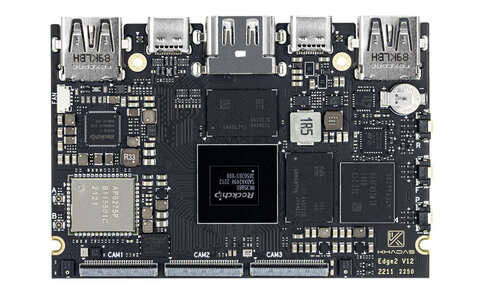

<!-- Copyright 2015-2026 Zephyr Project members and individual contributors. -->
<!-- SPDX-License-Identifier: Apache-2.0 -->
<!-- 中文翻译；编号、导航与译注为本地新增。 -->

<a id="khadas_edge2"></a>

# 第8章\_Edge2

原文：[官方页面](https://docs.zephyrproject.org/latest/boards/khadas/edge2/doc/index.html)。读取日期：2026-10-16；来源摘要见[来源记录](../SOURCES.md)。

开发板概览（Board Overview）

<a id="id1"></a>

[](images/khadas_edge2.jpg)

Edge2

名称（Name）：

`khadas_edge2`

厂商（Vendor）：

[Khadas](https://docs.zephyrproject.org/latest/boards/index.html#vendor=khadas)

状态（Status）：

当前未积极维护（Not Actively Maintained）

架构（Architecture）：

[arm64](https://docs.zephyrproject.org/latest/boards/index.html#arch=arm64)

片上系统（SoC）：

[rk3588s](https://docs.zephyrproject.org/latest/boards/index.html#soc=rk3588s)

<a id="board-github-link"></a>

[浏览开发板源码（Browse Board Sources）](https://github.com/zephyrproject-rtos/zephyr/blob/main//boards/khadas/edge2/doc/index.rst/../..)<a id="overview"></a>

## 概述（Overview）

参见[产品页面（Product Page）](https://www.khadas.com/edge2)。

<a id="hardware"></a>

## 硬件（Hardware）

参见[硬件详情（Hardware Details）](https://docs.khadas.com/products/sbc/edge2/hardware/start)。

<a id="supported-features"></a>

### 支持的功能（Supported Features）

`khadas_edge2`开发板支持下表所列的硬件功能。

片上／板载（On-Chip / On-Board）

功能集成在片上系统（SoC）内／位于开发板上。

2 / 2

分别表示已启用／已禁用的实例数。点击数量标签，可查看开发板或SoC设备树源码（DTS）中该功能的第一个实例。

`vnd,foo`

与此功能匹配的设备树绑定兼容字符串（Compatible String）；点击链接可查看绑定文档。

<a id="khadas_edge2-hw-features"></a>

<a id="khadas_edge2-khadas_edge2/rk3588s-hw-features-section"></a>

#### `khadas_edge2/rk3588s`目标（Target）

<a id="khadas_edge2-khadas_edge2/rk3588s-hw-features-panel"></a>

<a id="khadas_edge2-khadas_edge2/rk3588s-hw-features-memory"></a>

该开发板目标的片上存储容量：128 MiB RAM、N/A Flash。

<a id="khadas_edge2-khadas_edge2/rk3588s-hw-features-table"></a>

<table>
<tr>
<th>类型（Type）</th>
<th>位置（Location）</th>
<th>说明（Description）</th>
<th>兼容字符串（Compatible）</th>
</tr>
<tr>
<td rowspan="1">中央处理器（CPU）</td>
<td>片上（On-Chip）</td>
<td>Arm Cortex-A55 CPU（<a href="https://github.com/zephyrproject-rtos/zephyr/blob/main/dts/arm64/rockchip/rk3588s.dtsi?plain=1#L18">已启用：1</a>）</td>
<td><a href="../cpu_arm_riscv_binding_reference/P009_arm_cortex-a55.md#std-dtcompatible-arm-cortex-a55"><code>arm,cortex-a55</code></a></td>
</tr>
<tr>
<td rowspan="1">中断控制器（Interrupt Controller）</td>
<td>片上（On-Chip）</td>
<td>ARM通用中断控制器（GIC）v3（<a href="https://github.com/zephyrproject-rtos/zephyr/blob/main/dts/arm64/rockchip/rk3588s.dtsi?plain=1#L67">已启用：1</a>）</td>
<td><a href="../interrupt_fabric_binding_reference/P004_arm_gic-v3.md#std-dtcompatible-arm-gic-v3"><code>arm,gic-v3</code></a></td>
</tr>
<tr>
<td rowspan="1">串行控制器（Serial Controller）</td>
<td>片上（On-Chip）</td>
<td>ns16550通用异步收发器（UART）（<a href="https://github.com/zephyrproject-rtos/zephyr/blob/main/dts/arm64/rockchip/rk3588s.dtsi?plain=1#L94">已启用：1</a>）</td>
<td><a href="../uart_microchip_nordic_nxp_binding_reference/P005_ns16550.md#std-dtcompatible-ns16550"><code>ns16550</code></a></td>
</tr>
<tr>
<td rowspan="1">定时器（Timer）</td>
<td>片上（On-Chip）</td>
<td>每个内核独立的ARM架构定时器（Architected Timer）（<a href="https://github.com/zephyrproject-rtos/zephyr/blob/main/dts/arm64/rockchip/rk3588s.dtsi?plain=1#L81">已启用：1</a>）</td>
<td><a href="../arm_interrupt_timer_binding_reference/P010_ARMv8架构定时器.md#std-dtcompatible-arm-armv8-timer"><code>arm,armv8-timer</code></a></td>
</tr>
</table>

开发板具有多个串口，Zephyr使用uart2作为串行控制台。

<a id="programming-and-debugging"></a>

## 烧录与调试（Programming and Debugging）

`khadas_edge2`开发板支持下表所列的运行工具（Runners）及相关west命令。

<table>
<tr>
<th></th>
<th>烧录（flash）</th>
<th>调试（debug）</th>
</tr>
</table>

使用以下配置，在Khadas Edge2上运行基础Zephyr应用及内核测试。以[Hello World](../getting_started/P005_HelloWorld示例.md#hello_world)为例：


1. 非SMP模式，即不启用对称多处理（Non-SMP）

```text
# From the root of the zephyr repository
west build -b khadas_edge2 samples/hello_world
```

这会构建包含hello_world示例应用的镜像。

构建Zephyr镜像：

```text
mkimage -C none -A arm64 -O linux -a 0x10000000 -e 0x10000000 -d build/zephyr/zephyr.bin build/zephyr/zephyr.img
```

将镜像烧录到开发板。此处使用Rockchip烧录工具[rkdeveloptool](https://github.com/rockchip-linux/rkdeveloptool.git)，需要Khadas提供的次级程序加载器（[SPL](http://dl.khadas.com/products/edge2/firmware/boot/)）：

```text
rkdeveloptool db rk3588_spl_loader_*; rkdeveloptool wl 0x100000 zephyr.img; rkdeveloptool rd
```

扇区0x100000是任意选择的位置，远离U-Boot镜像。

使用U-Boot加载并运行Zephyr：

```text
mmc read ${pxefile_addr_r} 0x100000 0x1000; bootm start ${pxefile_addr_r}; bootm loados; bootm go
```

0x1000是镜像大小，以扇区数表示；必要时增大此值。

控制台应显示以下输出：

```text
*** Booting Zephyr OS build XXXXXXXXXXXX  ***
Hello World! khadas_edge2
```

<a id="flashing"></a>

### 烧录（Flashing）

可在U-Boot中从SD卡、eMMC、QSPI闪存或网络，将Zephyr镜像加载到DDR内存地址0x10000000。

<a id="references"></a>

### 参考资料（References）

[Edge2文档（Documentation）](https://docs.khadas.com/products/sbc/edge2/start)

## 译注

Non-SMP译为不启用对称多处理，不能据此推定采用非对称多处理架构。0x100000为原文任意选择的烧录扇区，0x1000为读取长度的扇区数，0x10000000为DDR加载地址，三者用途不同。

---

[上一章](P007_KAGA-FEI.md) · [返回大纲](大纲.md) · [全站翻译进度](../PROGRESS.md) · [下一章](P009_Edge-V.md)
