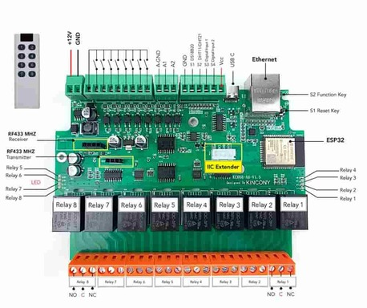

<!-- Copyright 2015-2026 Zephyr Project members and individual contributors. -->
<!-- SPDX-License-Identifier: Apache-2.0 -->
<!-- 中文翻译；编号、导航与译注为本地新增。 -->

<a id="kincony_kc868_a8"></a>

# 第13章\_KC868-A8

原文：[官方页面](https://docs.zephyrproject.org/latest/boards/kincony/kincony_kc868_a8/doc/index.html)。读取日期：2026-10-16；来源摘要见[来源记录](../SOURCES.md)。

开发板概览（Board Overview）

<a id="id1"></a>

[](images/kincony_kc868_a8.jpg)

KC868-A8

名称（Name）：

`kincony_kc868_a8`

厂商（Vendor）：

[KinCony Electronics Co., Ltd.](https://docs.zephyrproject.org/latest/boards/index.html#vendor=kincony)

状态（Status）：

当前未积极维护（Not Actively Maintained）

架构（Architecture）：

[xtensa](https://docs.zephyrproject.org/latest/boards/index.html#arch=xtensa)

片上系统（SoC）：

[esp32](https://docs.zephyrproject.org/latest/boards/index.html#soc=esp32)

<a id="board-github-link"></a>

[浏览开发板源码（Browse Board Sources）](https://github.com/zephyrproject-rtos/zephyr/blob/main//boards/kincony/kincony_kc868_a8/doc/index.rst/../..)<a id="overview"></a>

## 概述（Overview）

Kincony KC868-A8是一款家居自动化继电器模块，基于Espressif ESP32 ESP-WROOM-32模块，具备其Wi-Fi、蓝牙等功能。

<a id="hardware"></a>

## 硬件（Hardware）

其特性包括：


- 8路光电隔离数字输入，采用干接点（Dry Contact）
- 2路0—5 V模拟输入
- 8个220 V、10 A继电器，提供公共端（COM）、常开端（NO）及常闭端（NC）
- I2C连接器
- 模拟输入（Analog Inputs）
- LAN8720A以太网
- USB-C连接器，用于编程及烧录固件
- 复位（RESET）及下载（DOWNLOAD）按键
- 12 V直流供电

<a id="esp32-features"></a>

### ESP32特性（Features）


- 双核Xtensa LX6微处理器（Microprocessor），运行频率160或240 MHz
- 520 KB静态随机存储器（SRAM）
- 802.11b/g/n/e/i
- 蓝牙（Bluetooth）v4.2，支持基本速率／增强数据速率（BR/EDR）及低功耗蓝牙（BLE）
- 多种外设（Peripherals）：


  - 12位模数转换器（ADC），最多18个通道
  - 2个8位数模转换器（DAC）
  - 10个触摸传感器（Touch Sensors）
  - 4路串行外设接口（SPI）
  - 2路芯片间音频接口（I2S）
  - 2路I2C总线
  - 3路通用异步收发器（UART）
  - SD / SDIO / MMC主机（Host）
  - 从机接口（Slave，SDIO / SPI）
  - 以太网媒体访问控制器（Ethernet MAC）
  - CAN 2.0总线
  - 红外收发（IR RX/TX）
  - 电机脉宽调制（Motor PWM）
  - LED脉宽调制（PWM），最多16个通道
  - 霍尔效应传感器（Hall Effect Sensor）
  - 温度传感器（Temperature Sensor）。
- 密码学硬件加速（Cryptographic Hardware Acceleration）：RNG、ECC、RSA、SHA-2、AES。
- 深度睡眠电流（Deep-sleep Current）5 μA

<a id="asymmetric-multiprocessing-amp"></a>

### 非对称多处理（AMP / Asymmetric Multiprocessing）

采用ESP32或ESP32-S3片上系统（SoC）的开发板允许运行两个不同的应用。借助双核架构，各内核可以独立运行自定义任务，也可以通过OpenAMP框架交换数据。代码参考见[处理器间通信（IPC / Inter-Processor Communication）](../intercore_reference/P086_处理器间通信示例目录.md#inter-processor-communication-ipc)目录。

注意（Note）

**AMP与串口输出支持（AMP and Serial Output Support）**

在原文所述的Zephyr ESP32实现中，尚未为运行于APPCPU的应用实现对Zephyr管理的串口驱动的访问，例如`printk()`、日志（Logging）和控制台UART。因此，Zephyr提供的串口输出API仅可用于PROCPU。

作为替代办法，运行于APPCPU的应用可以使用ESP32 ROM函数，例如`ets_printf()`，输出诊断或调试信息。

<a id="id3"></a>

<a id="id5"></a>

更多信息见[ESP32数据手册（Datasheet）](https://www.espressif.com/sites/default/files/documentation/esp32_datasheet_en.pdf)[注1](#id2)或[ESP32技术参考手册（Technical Reference Manual）](https://www.espressif.com/sites/default/files/documentation/esp32_technical_reference_manual_en.pdf)[注2](#id4)。

<a id="system-requirements"></a>

## 系统要求（System Requirements）

<a id="binary-blobs"></a>

### 二进制组件（Binary Blobs）

Espressif 硬件抽象层（HAL）需要射频（RF）二进制组件才能工作。运行下面的命令获取这些文件。

```text
west blobs fetch hal_espressif
```

注意（Note）

建议在 `west update` 之后运行上述命令。

<a id="programming-and-debugging"></a>

## 烧录与调试（Programming and Debugging）

`kincony_kc868_a8`开发板支持下表所列的运行工具（Runners）及相关west命令。

<table>
<tr>
<th></th>
<th>烧录（flash）</th>
<th>调试（debug）</th>
<th>连接调试会话（attach）</th>
<th>实时传输（rtt）</th>
<th>调试服务器（debugserver）</th>
</tr>
<tr>
<td>esp32</td>
<td>✅（默认 / default）</td>
<td></td>
<td></td>
<td></td>
<td></td>
</tr>
<tr>
<td><a href="https://docs.zephyrproject.org/latest/develop/flash_debug/host-tools.html#runner-openocd">openocd</a></td>
<td>✅</td>
<td>✅（默认 / default）</td>
<td>✅</td>
<td>✅</td>
<td>✅</td>
</tr>
</table>

<a id="simple-boot"></a>

### 简单启动（Simple Boot）

可以通过单一二进制镜像加载开发板，无需第二阶段引导加载程序（2nd-Stage Bootloader）。构建应用时没有附加配置，默认使用此方式。

注意（Note）

简单启动不提供安全功能，也不提供空中更新（Over-the-Air，OTA）。

<a id="mcuboot-bootloader"></a>

### MCUboot 引导加载程序（MCUboot Bootloader）

也可选择 MCUboot；此时必须至少构建并烧录一次引导加载程序。

构建应用有两种选择：


1. 系统构建（Sysbuild）
2. 手动构建（Manual Build）

注意（Note）

在开发板默认配置文件加入下面一行即可选择 MCUboot 引导加载程序。

```text
CONFIG_BOOTLOADER_MCUBOOT=y
```

<a id="sysbuild"></a>

### 系统构建（Sysbuild）

Sysbuild 可以统一构建并烧录启动 ESP32 SoC 开发板所需的全部镜像。

使用 Sysbuild 构建示例应用的命令如下：

```text
west build -b <board> --sysbuild samples/hello_world
```

默认情况下，ESP32 Sysbuild 生成引导加载程序（MCUboot）与应用镜像；也可配置为生成其他类型的镜像。

Sysbuild 生成的构建目录结构与传统 Zephyr 构建不同，输出按域（Domain）子目录组织：

```text
build/
├── hello_world
│   └── zephyr
│       ├── zephyr.elf
│       └── zephyr.bin
├── mcuboot
│    └── zephyr
│       ├── zephyr.elf
│       └── zephyr.bin
└── domains.yaml
```

注意（Note）

使用 `--sysbuild` 时，每次执行全新构建（Pristine Build）都会重新构建并重新烧录引导加载程序。

系统构建的更多信息见 Sysbuild（System Build）文档。（[系统构建（Sysbuild / System Build）](../sysbuild/P001_系统构建.md#sysbuild)）

<a id="manual-build"></a>

### 手动构建（Manual Build）

开发期间通常希望尽可能快地构建和烧录，因此可采用传统构建方式，每次只构建一个镜像。

以下说明同时适用于手动构建与 Sysbuild，区别仅在构建目录结构。

注意（Note）

请记住，必须至少烧录一次 MCUboot 引导加载程序。

按通常方式构建并烧录应用，详见“构建应用”（[Building an Application](../application/P001_应用开发.md#build-an-application)）与“运行应用”（[Run an Application](https://docs.zephyrproject.org/latest/develop/application/index.html#application-run)）。

```text
# From the root of the zephyr repository
west build -b <board> samples/hello_world
```

常规 `flash` 目标适用于此开发板配置。下面以 [Hello World](../getting_started/P005_HelloWorld示例.md#hello_world) 应用为例。

```text
# From the root of the zephyr repository
west build -b <board> samples/hello_world
west flash
```

注意（Note）

对于提供内置 USB Serial/JTAG 控制器的目标，芯片在 `west flash` 后可能仍处于下载模式，直到重新断电上电才启动新镜像。遇到此情况，可在烧录时选择看门狗复位（Watchdog Reset），使芯片自行重新启动：

```text
west flash --reset-type watchdog-reset
```

<a id="faster-flashing"></a>

### 加快烧录（Faster Flashing）

`--esp-skip-flashed` 在设备上进行 MD5 校验；若闪存中的二进制文件与待烧录文件相同，就跳过写入，加快开发过程：

```text
west flash --esp-skip-flashed
```

`--esp-diff` 仅写入相对于上次烧录镜像发生变化的区域，可进一步加快重复烧录。它与本地缓存副本比较，而不读取设备；因此仅当自上次 `west flash` 以来，闪存未被其他工具、其他开发板或手动写操作修改时使用：

```text
west flash --esp-diff
```

可关闭进度输出，使日志更简洁，适合持续集成（CI）：

```text
west flash --esp-no-progress
```

使用以下命令打开串口监视器（Serial Monitor）：

```text
west espressif monitor
```

开发板自动复位并启动后，监视器应显示以下消息：

```text
***** Booting Zephyr OS vx.x.x-xxx-gxxxxxxxxxxxx *****
Hello World! <board>
```

<a id="board-variants-using-snippets"></a>

### 使用配置片段的开发板变型（Board Variants Using Snippets）

ESP32 开发板可搭配不同模块，组合不同的 SPI 闪存容量、伪静态随机存储器（PSRAM）容量及 PSRAM 模式。`snippets/espressif` 中的配置片段提供模块化方式，在构建时应用这些差异，无需复制开发板定义。

支持以下基于配置片段的变型：

<table>
<tr>
<th>配置片段名称（Snippet Name）</th>
<th>说明（Description）</th>
</tr>
<tr>
<td colspan="2">闪存容量（Flash Memory Size）</td>
</tr>
<tr>
<td><code>espressif-flash-4M</code></td>
<td>配备 4 MB 闪存的开发板。</td>
</tr>
<tr>
<td><code>espressif-flash-8M</code></td>
<td>配备 8 MB 闪存的开发板。</td>
</tr>
<tr>
<td><code>espressif-flash-16M</code></td>
<td>配备 16 MB 闪存的开发板。</td>
</tr>
<tr>
<td><code>espressif-flash-32M</code></td>
<td>配备 32 MB 闪存的开发板。</td>
</tr>
<tr>
<td><code>espressif-flash-64M</code></td>
<td>配备 64 MB 闪存的开发板。</td>
</tr>
<tr>
<td><code>espressif-flash-128M</code></td>
<td>配备 128 MB 闪存的开发板。</td>
</tr>
<tr>
<td colspan="2">PSRAM 容量（PSRAM Memory Size）</td>
</tr>
<tr>
<td><code>espressif-psram-2M</code></td>
<td>配备 2 MB PSRAM 的开发板。</td>
</tr>
<tr>
<td><code>espressif-psram-4M</code></td>
<td>配备 4 MB PSRAM 的开发板。</td>
</tr>
<tr>
<td><code>espressif-psram-8M</code></td>
<td>配备 8 MB PSRAM 的开发板。</td>
</tr>
<tr>
<td colspan="2">PSRAM 用途（PSRAM Utilization）</td>
</tr>
<tr>
<td><code>espressif-psram-reloc</code></td>
<td>将闪存内容重定位（Relocate）到 PSRAM。</td>
</tr>
<tr>
<td><code>espressif-psram-wifi</code></td>
<td>将 Wi-Fi 缓冲区放入 PSRAM。</td>
</tr>
</table>

应用开发板变型时，在 `west build` 中使用 `-S` 参数：

```text
west build -b <board> -S espressif-flash-32M -S espressif-psram-4M samples/hello_world
```

注意（Note）

这些配置片段只适用于具有所选 Flash／PSRAM 配置对应硬件支持的开发板。


- 未选择 FLASH 配置片段时，使用开发板默认闪存容量。
- 未选择 PSRAM 配置片段时，使用开发板默认 PSRAM 容量。

<a id="enabling-ethernet"></a>

## 启用以太网（Enabling Ethernet）

在Kconfig中启用以太网：

```text
CONFIG_NETWORKING=y
CONFIG_NET_L2_ETHERNET=y
CONFIG_MDIO=y
```

<a id="references"></a>

## 参考资料（References）

<a id="id2"></a>

〔[1](#id3)〕 [https://www.espressif.com/sites/default/files/documentation/esp32_datasheet_en.pdf](https://www.espressif.com/sites/default/files/documentation/esp32_datasheet_en.pdf)

<a id="id4"></a>

〔[2](#id5)〕 [https://www.espressif.com/sites/default/files/documentation/esp32_technical_reference_manual_en.pdf](https://www.espressif.com/sites/default/files/documentation/esp32_technical_reference_manual_en.pdf)

---

[上一章](P012_KC868-A32.md) · [返回大纲](大纲.md) · [全站翻译进度](../PROGRESS.md) · [下一章](P014_Kosagi.md)
