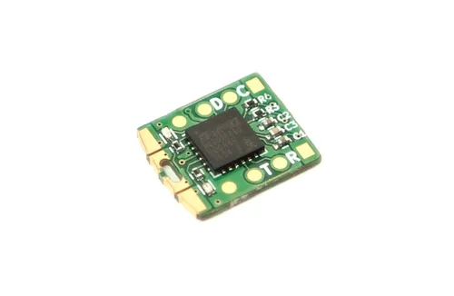

<!-- Copyright 2015-2026 Zephyr Project members and individual contributors. -->
<!-- SPDX-License-Identifier: Apache-2.0 -->
<!-- 中文翻译；编号、导航与译注为本地新增。 -->

<a id="tomu"></a>

# 第15章\_Tomu

原文：[官方页面](https://docs.zephyrproject.org/latest/boards/kosagi/tomu/doc/index.html)。读取日期：2026-10-16；来源摘要见[来源记录](../SOURCES.md)。

开发板概览（Board Overview）

<a id="id1"></a>

[](images/tomu.webp)

Tomu

名称（Name）：

`tomu`

厂商（Vendor）：

[Sutajio Ko-Usagi PTE Ltd.](https://docs.zephyrproject.org/latest/boards/index.html#vendor=kosagi)

状态（Status）：

当前未积极维护（Not Actively Maintained）

架构（Architecture）：

[arm](https://docs.zephyrproject.org/latest/boards/index.html#arch=arm)

片上系统（SoC）：

[efm32hg309f64](https://docs.zephyrproject.org/latest/boards/index.html#soc=efm32hg309f64)

<a id="board-github-link"></a>

[浏览开发板源码（Browse Board Sources）](https://github.com/zephyrproject-rtos/zephyr/blob/main//boards/kosagi/tomu/doc/index.rst/../..)<a id="overview"></a>

## 概述（Overview）

[Tomu](https://tomu.im)是一款可插入USB Type-A端口内部的微型开放硬件（Open Hardware）开发板，基于Silicon Labs EFM32HG309F64（Happy Gecko）微控制器，Arm Cortex-M0+最高24 MHz，提供64 KB闪存及8 KB SRAM。

<a id="supported-features"></a>

### 支持的功能（Supported Features）

`tomu`开发板支持下表所列的硬件功能。

片上／板载（On-Chip / On-Board）

功能集成在片上系统（SoC）内／位于开发板上。

2 / 2

分别表示已启用／已禁用的实例数。点击数量标签，可查看开发板或SoC设备树源码（DTS）中该功能的第一个实例。

`vnd,foo`

与此功能匹配的设备树绑定兼容字符串（Compatible String）；点击链接可查看绑定文档。

<a id="tomu-hw-features"></a>

<a id="tomu-tomu/efm32hg309f64-hw-features-section"></a>

#### `tomu/efm32hg309f64`目标（Target）

<a id="tomu-tomu/efm32hg309f64-hw-features-panel"></a>

<a id="tomu-tomu/efm32hg309f64-hw-features-memory"></a>

该开发板目标的片上存储容量：8 KiB RAM、N/A Flash。

<a id="tomu-tomu/efm32hg309f64-hw-features-table"></a>

<table>
<tr>
<th>类型（Type）</th>
<th>位置（Location）</th>
<th>说明（Description）</th>
<th>兼容字符串（Compatible）</th>
</tr>
<tr>
<td rowspan="1">中央处理器（CPU）</td>
<td>片上（On-Chip）</td>
<td>ARM Cortex-M0+处理器（CPU）（<a href="https://github.com/zephyrproject-rtos/zephyr/blob/main/dts/arm/silabs/efm32hg.dtsi?plain=1#L17">已启用：1</a>）</td>
<td><a href="../cpu_arm_riscv_binding_reference/P017_arm_cortex-m0+.md#std-dtcompatible-arm-cortex-m0"><code>arm,cortex-m0+</code></a></td>
</tr>
<tr>
<td rowspan="6">时钟控制（Clock Control）</td>
<td>片上（On-Chip）</td>
<td>Silabs Gecko时钟管理单元（Clock Management Unit）（<a href="https://github.com/zephyrproject-rtos/zephyr/blob/main/dts/arm/silabs/efm32hg.dtsi?plain=1#L76">已启用：1</a>）</td>
<td><a href="../clock_renesas_rockchip_sifli_silabs_binding_reference/P030_silabs_series0-cmu.md#std-dtcompatible-silabs-series0-cmu"><code>silabs,series0-cmu</code></a></td>
</tr>
<tr>
<td>片上（On-Chip）</td>
<td>Silicon Labs Series 0低频晶体振荡器（LFXO）（<a href="https://github.com/zephyrproject-rtos/zephyr/blob/main/dts/arm/silabs/efm32hg.dtsi?plain=1#L28">已禁用：1</a>）</td>
<td><a href="../clock_silabs_ti_xilinx_binding_reference/P003_silabs_series0-lfxo.md#std-dtcompatible-silabs-series0-lfxo"><code>silabs,series0-lfxo</code></a></td>
</tr>
<tr>
<td>片上（On-Chip）</td>
<td>Silicon Labs Series 0低频RC振荡器（LFRCO）（<a href="https://github.com/zephyrproject-rtos/zephyr/blob/main/dts/arm/silabs/efm32hg.dtsi?plain=1#L35">已禁用：1</a>）</td>
<td><a href="../clock_silabs_ti_xilinx_binding_reference/P002_silabs_series0-lfrco.md#std-dtcompatible-silabs-series0-lfrco"><code>silabs,series0-lfrco</code></a></td>
</tr>
<tr>
<td>片上（On-Chip）</td>
<td>Silicon Labs Series 0高频晶体振荡器（HFXO）（<a href="https://github.com/zephyrproject-rtos/zephyr/blob/main/dts/arm/silabs/efm32hg.dtsi?plain=1#L42">已禁用：1</a>）</td>
<td><a href="../clock_silabs_ti_xilinx_binding_reference/P001_silabs_series0-hfxo.md#std-dtcompatible-silabs-series0-hfxo"><code>silabs,series0-hfxo</code></a></td>
</tr>
<tr>
<td>片上（On-Chip）</td>
<td>通用固定频率时钟提供者（Fixed-Rate Clock Provider）（<a href="https://github.com/zephyrproject-rtos/zephyr/blob/main/dts/arm/silabs/efm32hg.dtsi?plain=1#L48">已启用：1</a>）</td>
<td><a href="../hardware/P566_固定时钟绑定.md#dtbinding-fixed-clock"><code>fixed-clock</code></a></td>
</tr>
<tr>
<td>片上（On-Chip）</td>
<td>通用固定比例时钟提供器（Fixed Factor Clock Provider）（<a href="https://github.com/zephyrproject-rtos/zephyr/blob/main/dts/arm/silabs/efm32hg.dtsi?plain=1#L68">已启用：1</a>；<a href="https://github.com/zephyrproject-rtos/zephyr/blob/main/dts/arm/silabs/efm32hg.dtsi?plain=1#L54">已禁用：2</a>）</td>
<td><a href="../timer_reference/P110_固定比例时钟绑定.md#dtbinding-fixed-factor-clock"><code>fixed-factor-clock</code></a></td>
</tr>
<tr>
<td rowspan="1">闪存控制器（Flash Controller）</td>
<td>片上（On-Chip）</td>
<td>Silicon Labs Gecko闪存控制器（Flash Controller）（<a href="https://github.com/zephyrproject-rtos/zephyr/blob/main/dts/arm/silabs/efm32hg.dtsi?plain=1#L85">已启用：1</a>）</td>
<td><a href="../flash_renesas_st_ti_binding_reference/P006_silabs_gecko-flash-controller.md#std-dtcompatible-silabs-gecko-flash-controller"><code>silabs,gecko-flash-controller</code></a></td>
</tr>
<tr>
<td rowspan="2">通用输入输出与接插件（GPIO &amp; Headers）</td>
<td>片上（On-Chip）</td>
<td>Silicon Labs Series 0—2 GPIO外设（<a href="https://github.com/zephyrproject-rtos/zephyr/blob/main/dts/arm/silabs/efm32hg.dtsi?plain=1#L146">已启用：1</a>）</td>
<td><a href="../gpio_silabs_st_connectors_binding_reference/P013_silabs_gecko-gpio.md#std-dtcompatible-silabs-gecko-gpio"><code>silabs,gecko-gpio</code></a></td>
</tr>
<tr>
<td>片上（On-Chip）</td>
<td>Silicon Labs Series 0—2 GPIO端口（<a href="https://github.com/zephyrproject-rtos/zephyr/blob/main/dts/arm/silabs/efm32hg.dtsi?plain=1#L156">已启用：2</a>；<a href="https://github.com/zephyrproject-rtos/zephyr/blob/main/dts/arm/silabs/efm32hg.dtsi?plain=1#L174">已禁用：4</a>）</td>
<td><a href="../gpio_silabs_st_connectors_binding_reference/P012_silabs_gecko-gpio-port.md#std-dtcompatible-silabs-gecko-gpio-port"><code>silabs,gecko-gpio-port</code></a></td>
</tr>
<tr>
<td rowspan="1">集成电路间总线（I2C）</td>
<td>片上（On-Chip）</td>
<td>Silicon Labs Series 0—2 I2C（<a href="https://github.com/zephyrproject-rtos/zephyr/blob/main/dts/arm/silabs/efm32hg.dtsi?plain=1#L129">已禁用：1</a>）</td>
<td><a href="../i2c_stm32_ti_mux_binding_reference/P004_silabs_gecko-i2c.md#std-dtcompatible-silabs-gecko-i2c"><code>silabs,gecko-i2c</code></a></td>
</tr>
<tr>
<td rowspan="1">中断控制器（Interrupt Controller）</td>
<td>片上（On-Chip）</td>
<td>ARMv6-M嵌套向量中断控制器（NVIC / Nested Vectored Interrupt Controller）（<a href="https://github.com/zephyrproject-rtos/zephyr/blob/main/dts/arm/armv6-m.dtsi?plain=1#L13">已启用：1</a>）</td>
<td><a href="../arm_interrupt_timer_binding_reference/P001_ARMv6_M_NVIC.md#std-dtcompatible-arm-v6m-nvic"><code>arm,v6m-nvic</code></a></td>
</tr>
<tr>
<td rowspan="1">发光二极管（LED）</td>
<td>板载（On-Board）</td>
<td>一组由 GPIO 控制的 LED（GPIO-Controlled LEDs）（<a href="https://github.com/zephyrproject-rtos/zephyr/blob/main/boards/kosagi/tomu/tomu.dts?plain=1#L27">已启用：1</a>）</td>
<td><a href="../hardware/P564_GPIO指示灯绑定.md#dtbinding-gpio-leds"><code>gpio-leds</code></a></td>
</tr>
<tr>
<td rowspan="1">存储技术设备（MTD）</td>
<td>片上（On-Chip）</td>
<td>闪存（Flash）节点（<a href="https://github.com/zephyrproject-rtos/zephyr/blob/main/dts/arm/silabs/efm32hg.dtsi?plain=1#L94">已启用：1</a>）</td>
<td><a href="../mtd_nxp_st_ti_partition_binding_reference/P013_soc-nv-flash.md#std-dtcompatible-soc-nv-flash"><code>soc-nv-flash</code></a></td>
</tr>
<tr>
<td rowspan="1">引脚控制（Pin Control）</td>
<td>片上（On-Chip）</td>
<td>Silabs Gecko引脚控制器（Pin Controller）（<a href="https://github.com/zephyrproject-rtos/zephyr/blob/main/dts/arm/silabs/efm32hg.dtsi?plain=1#L211">已启用：1</a>）</td>
<td><a href="../pinctrl_renesas_silabs_binding_reference/P025_silabs_gecko-pinctrl.md#std-dtcompatible-silabs-gecko-pinctrl"><code>silabs,gecko-pinctrl</code></a></td>
</tr>
<tr>
<td rowspan="2">串行控制器（Serial Controller）</td>
<td>片上（On-Chip）</td>
<td>Gecko通用同步／异步收发器（USART）（<a href="https://github.com/zephyrproject-rtos/zephyr/blob/main/dts/arm/silabs/efm32hg.dtsi?plain=1#L103">已禁用：2</a>）</td>
<td><a href="../uart_silabs_stm32_ti_binding_reference/P008_silabs_gecko-usart.md#std-dtcompatible-silabs-gecko-usart"><code>silabs,gecko-usart</code></a></td>
</tr>
<tr>
<td>片上（On-Chip）</td>
<td>Gecko低能耗UART（LEUART）（<a href="https://github.com/zephyrproject-rtos/zephyr/blob/main/dts/arm/silabs/efm32hg.dtsi?plain=1#L121">已禁用：1</a>）</td>
<td><a href="../uart_silabs_stm32_ti_binding_reference/P006_silabs_gecko-leuart.md#std-dtcompatible-silabs-gecko-leuart"><code>silabs,gecko-leuart</code></a></td>
</tr>
<tr>
<td rowspan="1">静态随机存储器（SRAM）</td>
<td>片上（On-Chip）</td>
<td>通用片上静态随机存储器（SRAM）（<a href="https://github.com/zephyrproject-rtos/zephyr/blob/main/dts/arm/silabs/efm32hg.dtsi?plain=1#L23">已启用：1</a>）</td>
<td><a href="../hardware/P567_内存映射SRAM绑定.md#dtbinding-mmio-sram"><code>mmio-sram</code></a></td>
</tr>
<tr>
<td rowspan="1">定时器（Timer）</td>
<td>片上（On-Chip）</td>
<td>ARMv6-M系统节拍（System Tick）（<a href="https://github.com/zephyrproject-rtos/zephyr/blob/main/dts/arm/armv6-m.dtsi?plain=1#L21">已启用：1</a>）</td>
<td><a href="../arm_interrupt_timer_binding_reference/P005_ARMv6_M_SysTick.md#std-dtcompatible-arm-armv6m-systick"><code>arm,armv6m-systick</code></a></td>
</tr>
<tr>
<td rowspan="1">看门狗（Watchdog）</td>
<td>片上（On-Chip）</td>
<td>Silicon Labs Series 0–2看门狗（WDOG）（<a href="https://github.com/zephyrproject-rtos/zephyr/blob/main/dts/arm/silabs/efm32hg.dtsi?plain=1#L139">已启用：1</a>）</td>
<td><a href="../realtek_renesas_silabs_watchdog_binding_reference/P011_silabs_gecko-wdog.md#std-dtcompatible-silabs-gecko-wdog"><code>silabs,gecko-wdog</code></a></td>
</tr>
</table>

<a id="programming-and-debugging"></a>

## 烧录与调试（Programming and Debugging）

`tomu`开发板支持下表所列的运行工具（Runners）及相关west命令。

<table>
<tr>
<th></th>
<th>烧录（flash）</th>
<th>调试（debug）</th>
</tr>
<tr>
<td><code>dfu-util</code></td>
<td>✅（默认 / default）</td>
<td></td>
</tr>
</table>

<a id="id3"></a>

Tomu出厂包含[Toboot](https://github.com/im-tomu/toboot) [注1](#id2) USB DFU引导加载程序，无需外部编程器，可通过USB使用dfu-util烧录。

<a id="flashing"></a>

### 烧录（Flashing）


1. 将Tomu插入USB端口，开发板应自动进入DFU引导加载程序模式，红色与绿色LED交替闪烁。
2. 构建并烧录应用：

  ```text
  # From the root of the zephyr repository
  west build -b tomu samples/basic/blinky
  west flash
  ```

<a id="references"></a>

## 参考资料（References）

<a id="id2"></a>

〔[1](#id3)〕 [https://github.com/im-tomu/toboot](https://github.com/im-tomu/toboot)

## 译注

芯片物理闪存64 KB与目标表Flash为N/A分别保留；板载Toboot通过USB DFU烧录。

---

[上一章](P014_Kosagi.md) · [返回大纲](大纲.md) · [全站翻译进度](../PROGRESS.md) · [下一章](P016_KWS_Computersysteme_Gmbh.md)
