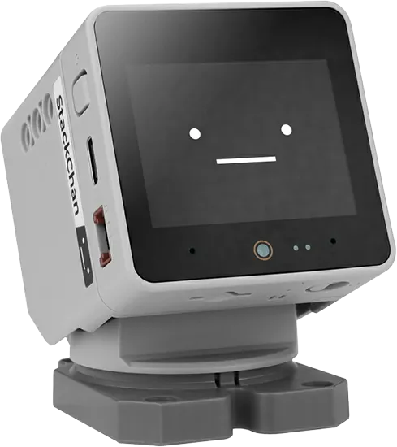

<!-- Copyright 2015-2026 Zephyr Project members and individual contributors. -->
<!-- SPDX-License-Identifier: Apache-2.0 -->
<!-- 中文翻译；编号、导航与译注为本地新增。 -->

<a id="m5stack_stackchan"></a>

# 第28章\_M5Stack StackChan

原文：[官方页面](https://docs.zephyrproject.org/latest/boards/m5stack/m5stack_stackchan/doc/index.html)。读取日期：2026-10-16；来源摘要见[来源记录](../SOURCES.md)。

开发板概览（Board Overview）

<a id="id1"></a>

[](images/m5stack_stackchan.webp)

M5Stack StackChan

名称（Name）：

`m5stack_stackchan`

厂商（Vendor）：

[M5Stack](https://docs.zephyrproject.org/latest/boards/index.html#vendor=m5stack)

状态（Status）：

维护中（Maintained）

架构（Architecture）：

[xtensa](https://docs.zephyrproject.org/latest/boards/index.html#arch=xtensa)

片上系统（SoC）：

[esp32s3](https://docs.zephyrproject.org/latest/boards/index.html#soc=esp32s3)

<a id="board-github-link"></a>

[浏览开发板源码（Browse Board Sources）](https://github.com/zephyrproject-rtos/zephyr/blob/main//boards/m5stack/m5stack_stackchan/doc/index.rst/../..)<a id="overview"></a>

## 概述（Overview）

<a id="id13"></a>

<a id="id17"></a>

M5Stack StackChan是一款桌面机器人，基于Shishikawa的开源Stack-chan项目。它由StackChan Core主机及机器人机身组成：主机是与M5Stack CoreS3共用设计的ESP32-S3控制器；机身包含电池、两个串行舵机、LED、触摸面板、红外及NFC。详见M5Stack StackChan文档 [注6](#id12) 和[StackChan Core文档](https://docs.m5stack.com/en/core/StackChan_Core) [注8](#id16)。（[M5Stack StackChan文档（Documentation）](https://docs.m5stack.com/en/StackChan)）

<a id="id15"></a>

图片由M5Stack提供，取自[M5Stack StackChan产品页面](https://shop.m5stack.com/products/stackchan-kawaii-co-created-open-source-ai-desktop-robot) [注7](#id14)。

<a id="hardware"></a>

## 硬件（Hardware）

StackChan Core主机（Main Unit）：


- ESP32-S3芯片：240 MHz双核Xtensa LX7处理器、Wi-Fi、OTG及CDC功能
- 8 MB四线PSRAM（Quad）
- 16 MB闪存（Flash）
- 2英寸320×240像素ILI9342C IPS LCD
- FT6336U电容多点触摸（Capacitive Multi-Touch）
- 1 W扬声器及AW88298
- 双麦克风及ES7210音频ADC
- BM8563实时时钟（RTC）
- AXP2101电源管理芯片（PMIC）
- AW9523B GPIO扩展器（Expander）
- 0.3 MP GC0308摄像头
- BMM150地磁传感器
- LTR-553ALS-WA接近传感器
- BMI270六轴IMU
- microSD卡槽（Card Slot）
- USB-C

机器人机身（Robot Body）：


- 550 mAh、3.7 V电池，带INA226电池监视器
- 两个SCS0009串行舵机，控制偏航／俯仰（Yaw / Pitch），连接UART1；GPIO6发送、GPIO7接收，1 Mbps半双工（Half-Duplex）
- PY32L020 I/O扩展器，用于舵机电源使能及12个RGB LED
- Si12T触摸面板，分为3个区域
- GPIO5连接红外发射器，GPIO10连接IRM56384红外接收器
- ST25R3916近场通信（NFC）
- 三个HY2.0-4P Grove端口：PORT.A为I2C，PORT.B为GPIO／ADC，PORT.C为UART

主机M-Bus透传到机器人机身，因此可在两者之间堆叠M-Bus模块，但模块不能使用机身已占用的引脚，详见下文。

<a id="grove-ports"></a>

### Grove端口（Ports）

<table>
<tr>
<th>端口（Port）</th>
<th>引脚（Pins）</th>
<th>Zephyr节点（Node）</th>
</tr>
<tr>
<td>PORT.A</td>
<td>GPIO1：SCL；GPIO2：SDA</td>
<td>i2c1，别名zephyr_i2c／grove_header</td>
</tr>
<tr>
<td>PORT.B</td>
<td>GPIO8、GPIO9</td>
<td>gpio0，也可用作ADC输入</td>
</tr>
<tr>
<td>PORT.C</td>
<td>GPIO17：TX；GPIO18：RX</td>
<td>uart2，别名grove_uart，默认禁用</td>
</tr>
</table>

UART1的GPIO6／GPIO7连接机身内部舵机，未引出到任何端口。Grove端口的5 V电源由bus_5v稳压器控制。

<a id="m-bus-pins-used-by-the-body"></a>

### 机身占用的M-Bus引脚（Pins Used by the Body）

<table>
<tr>
<th>引脚（Pins）</th>
<th>用途（Used For）</th>
</tr>
<tr>
<td>GPIO6、GPIO7</td>
<td>舵机总线（Servo Bus）：uart1</td>
</tr>
<tr>
<td>GPIO11、GPIO12</td>
<td>内部I2C总线i2c0：INA226位于0x41，ST25R3916位于0x50，Si12T位于0x68，PY32L020位于0x6F</td>
</tr>
<tr>
<td>GPIO5、GPIO10</td>
<td>红外发射器／接收器</td>
</tr>
<tr>
<td>GPIO17、GPIO18</td>
<td>PORT.C，uart2及m5stack_mbus_uart1</td>
</tr>
<tr>
<td>GPIO8、GPIO9</td>
<td>PORT.B</td>
</tr>
<tr>
<td>GPIO1、GPIO2</td>
<td>PORT.A，i2c1</td>
</tr>
<tr>
<td>5 V、电池电源（BAT）、地（GND）</td>
<td>电源（Power）</td>
</tr>
</table>

堆叠在主机及机身之间的模块不得驱动这些引脚。例如，使用GPIO6／GPIO7的模块会与舵机冲突。

<a id="esp32-s3-features"></a>

### ESP32-S3特性（Features）

ESP32-S3是基于低功耗微控制器（MCU）的片上系统（SoC），集成2.4 GHz Wi-Fi和低功耗蓝牙（Bluetooth® LE）。它由高性能双核微处理器（Xtensa® 32位LX7）、低功耗协处理器（Low-power Coprocessor）、Wi-Fi基带（Baseband）、Bluetooth LE基带、射频模块（RF Module）及大量外设组成。

ESP32-S3片上系统（SoC）包含以下特性：


- 双核32位Xtensa微处理器（Tensilica LX7），最高运行频率240 MHz
- 增加了用于人工智能加速（AI Acceleration）的向量指令（Vector Instructions）支持
- 512 KB静态随机存储器（SRAM）
- 384 KB只读存储器（ROM）
- Wi-Fi 802.11b/g/n
- 低功耗蓝牙（Bluetooth LE）5.0，支持远距离通信（Long Range），数据速率最高2 Mbps

数字接口（Digital Interfaces）：


- 45个可编程通用输入输出（GPIO）引脚
- 4路串行外设接口（SPI）
- 1路液晶显示接口（LCD），支持8至16位并行RGB、I8080和MOTO6800，以及RGB565、YUV422、YUV420和YUV411之间的转换
- 1路8至16位数字视频端口摄像头接口（DVP Camera Interface）
- 3路通用异步收发器（UART）
- 2路I2C总线
- 2路芯片间音频接口（I2S）
- 1个遥控收发器（RMT，TX/RX）
- 1个脉冲计数器（Pulse Counter）
- LED脉宽调制控制器（PWM Controller），最多8个通道
- 1路全速USB OTG（Full-speed USB OTG）
- 1个USB串口／JTAG控制器（USB Serial/JTAG Controller）
- 2个电机控制脉宽调制器（MCPWM）
- 1个SDIO主控制器（Host Controller），带2个插槽
- 通用直接存储器访问控制器（GDMA / General DMA Controller），具有5个发送通道和5个接收通道
- 1个TWAI®控制器，兼容ISO 11898-1，即CAN 2.0规范（CAN Specification 2.0）
- 可寻址RGB LED（Addressable RGB LED），由GPIO38驱动

模拟接口（Analog Interfaces）：


- 2个12位逐次逼近模数转换器（SAR ADC），最多20个通道
- 1个温度传感器（Temperature Sensor）
- 14个触摸感应输入输出引脚（Touch-sensing IOs）

定时器（Timers）：


- 4个54位通用定时器（General-purpose Timers）
- 1个52位系统定时器（System Timer）
- 3个看门狗定时器（Watchdog Timers）

低功耗（Low Power）：


- 电源管理单元（Power Management Unit），具有5种电源模式
- 超低功耗协处理器（ULP / Ultra-Low-Power Coprocessors）：ULP-RISC-V和ULP-FSM

安全（Security）：


- 安全启动（Secure Boot）
- 闪存加密（Flash Encryption）
- 4 Kbit一次性可编程存储器（OTP），用户最多可使用1792位
- 密码硬件加速（Cryptographic Hardware Acceleration）：AES-128/256、散列（Hash）、RSA、随机数发生器（RNG）、HMAC和数字签名（Digital Signature）

<a id="asymmetric-multiprocessing-amp"></a>

### 非对称多处理（AMP / Asymmetric Multiprocessing）

采用ESP32或ESP32-S3片上系统（SoC）的开发板允许运行两个不同的应用。借助双核架构，各内核可以独立运行自定义任务，也可以通过OpenAMP框架交换数据。代码参考见[处理器间通信（IPC / Inter-Processor Communication）](../intercore_reference/P086_处理器间通信示例目录.md#inter-processor-communication-ipc)目录。

注意（Note）

AMP与串口输出支持（AMP and Serial Output Support）

在原文所述的Zephyr ESP32实现中，尚未为运行于APPCPU的应用实现对Zephyr管理的串口驱动的访问，例如`printk()`、日志（Logging）和控制台UART。因此，Zephyr提供的串口输出API仅可用于PROCPU。

作为替代办法，运行于APPCPU的应用可以使用ESP32 ROM函数，例如`ets_printf()`，输出诊断或调试信息。

<a id="id3"></a>

<a id="id5"></a>

更多信息见[ESP32-S3数据手册（Datasheet）](https://www.espressif.com/sites/default/files/documentation/esp32-s3-wroom-1_wroom-1u_datasheet_en.pdf)[注1](#id2)或[ESP32-S3技术参考手册（Technical Reference Manual）](https://www.espressif.com/sites/default/files/documentation/esp32-s3_technical_reference_manual_en.pdf)[注2](#id4)。

<a id="supported-features"></a>

### 支持的功能（Supported Features）

`m5stack_stackchan`开发板支持下表所列的硬件功能。

片上／板载（On-Chip / On-Board）

功能集成在片上系统（SoC）内／位于开发板上。

2 / 2

分别表示已启用／已禁用的实例数。点击数量标签，可查看开发板或SoC设备树源码（DTS）中该功能的第一个实例。

`vnd,foo`

与此功能匹配的设备树绑定兼容字符串（Compatible String）；点击链接可查看绑定文档。

<a id="m5stack_stackchan-hw-features"></a>

<a id="m5stack_stackchan-m5stack_stackchan/esp32s3/appcpu-hw-features-section"></a>

#### `m5stack_stackchan/esp32s3/appcpu`目标（Target）

<a id="m5stack_stackchan-m5stack_stackchan/esp32s3/appcpu-hw-features-panel"></a>

<a id="m5stack_stackchan-m5stack_stackchan/esp32s3/appcpu-hw-features-memory"></a>

该开发板目标的片上存储容量：416 KiB RAM、16 MiB Flash。

<a id="m5stack_stackchan-m5stack_stackchan/esp32s3/appcpu-hw-features-table"></a>

<table>
<tr>
<th>类型（Type）</th>
<th>位置（Location）</th>
<th>说明（Description）</th>
<th>兼容字符串（Compatible）</th>
</tr>
<tr>
<td rowspan="1">中央处理器（CPU）</td>
<td>片上（On-Chip）</td>
<td>乐鑫（Espressif）Xtensa LX7处理器（CPU）（<a href="https://github.com/zephyrproject-rtos/zephyr/blob/main/dts/xtensa/espressif/esp32s3/esp32s3_common.dtsi?plain=1#L32">已启用：2</a>）</td>
<td><a href="../cpu_vendor_multiarc_binding_reference/P001_espressif_xtensa-lx7.md#std-dtcompatible-espressif-xtensa-lx7"><code>espressif,xtensa-lx7</code></a></td>
</tr>
<tr>
<td rowspan="1">模数转换器（ADC）</td>
<td>片上（On-Chip）</td>
<td>ESP32模数转换器（ADC）（<a href="https://github.com/zephyrproject-rtos/zephyr/blob/main/dts/xtensa/espressif/esp32s3/esp32s3_common.dtsi?plain=1#L381">已禁用：2</a>）</td>
<td><a href="../hardware/P889_ESP32模数转换器绑定.md#dtbinding-espressif-esp32-adc"><code>espressif,esp32-adc</code></a></td>
</tr>
<tr>
<td rowspan="1">蓝牙（Bluetooth）</td>
<td>片上（On-Chip）</td>
<td>乐鑫（Espressif）ESP32蓝牙主机控制器接口（Bluetooth HCI）（<a href="https://github.com/zephyrproject-rtos/zephyr/blob/main/dts/xtensa/espressif/esp32s3/esp32s3_common.dtsi?plain=1#L77">已禁用：1</a>）</td>
<td><a href="../bluetooth_vendor_hci_binding_reference/P004_espressif_esp32-bt-hci.md#std-dtcompatible-espressif-esp32-bt-hci"><code>espressif,esp32-bt-hci</code></a></td>
</tr>
<tr>
<td rowspan="1">控制器局域网（CAN）</td>
<td>片上（On-Chip）</td>
<td>ESP32双线汽车接口（TWAI / Two-Wire Automotive Interface）（<a href="https://github.com/zephyrproject-rtos/zephyr/blob/main/dts/xtensa/espressif/esp32s3/esp32s3_common.dtsi?plain=1#L401">已禁用：1</a>）</td>
<td><a href="../can_adi_atmel_nxp_binding_reference/P005_espressif_esp32-twai.md#std-dtcompatible-espressif-esp32-twai"><code>espressif,esp32-twai</code></a></td>
</tr>
<tr>
<td rowspan="1">时钟控制（Clock Control）</td>
<td>片上（On-Chip）</td>
<td>ESP32时钟模块（Clock Module，电源与时钟控制器模块 / Power &amp; Clock Controller Module）（<a href="https://github.com/zephyrproject-rtos/zephyr/blob/main/dts/xtensa/espressif/esp32s3/esp32s3_common.dtsi?plain=1#L88">已启用：1</a>）</td>
<td><a href="../clock_esp_infineon_microchip_binding_reference/P004_espressif_esp32-clock.md#std-dtcompatible-espressif-esp32-clock"><code>espressif,esp32-clock</code></a></td>
</tr>
<tr>
<td rowspan="3">计数器（Counter）</td>
<td>片上（On-Chip）</td>
<td>基于RTC主定时器（Main Timer）的ESP32计数器驱动（Counter Driver）（<a href="https://github.com/zephyrproject-rtos/zephyr/blob/main/dts/xtensa/espressif/esp32s3/esp32s3_common.dtsi?plain=1#L206">已禁用：1</a>）</td>
<td><a href="../counter_binding_reference/P016_espressif_esp32-rtc-timer.md#std-dtcompatible-espressif-esp32-rtc-timer"><code>espressif,esp32-rtc-timer</code></a></td>
</tr>
<tr>
<td>片上（On-Chip）</td>
<td>ESP32通用定时器（General-purpose Timers）（<a href="https://github.com/zephyrproject-rtos/zephyr/blob/main/dts/xtensa/espressif/esp32s3/esp32s3_common.dtsi?plain=1#L508">已启用：1</a>；<a href="https://github.com/zephyrproject-rtos/zephyr/blob/main/dts/xtensa/espressif/esp32s3/esp32s3_common.dtsi?plain=1#L460">已禁用：3</a>）</td>
<td><a href="../counter_binding_reference/P017_espressif_esp32-timer.md#std-dtcompatible-espressif-esp32-timer"><code>espressif,esp32-timer</code></a></td>
</tr>
<tr>
<td>片上（On-Chip）</td>
<td>ESP32计数器（Counters）（<a href="https://github.com/zephyrproject-rtos/zephyr/blob/main/dts/xtensa/espressif/esp32s3/esp32s3_common.dtsi?plain=1#L470">已禁用：4</a>）</td>
<td><a href="../counter_binding_reference/P015_espressif_esp32-counter.md#std-dtcompatible-espressif-esp32-counter"><code>espressif,esp32-counter</code></a></td>
</tr>
<tr>
<td rowspan="2">密码学加速器（Cryptographic Accelerator）</td>
<td>片上（On-Chip）</td>
<td>乐鑫（Espressif）ESP32 SHA硬件加速器（Hardware Accelerator）（<a href="https://github.com/zephyrproject-rtos/zephyr/blob/main/dts/xtensa/espressif/esp32s3/esp32s3_common.dtsi?plain=1#L638">已启用：1</a>）</td>
<td><a href="../crypto_aes_sha_ccm_binding_reference/P008_espressif_esp32-sha.md#std-dtcompatible-espressif-esp32-sha"><code>espressif,esp32-sha</code></a></td>
</tr>
<tr>
<td>片上（On-Chip）</td>
<td>乐鑫（Espressif）ESP32系列AES硬件加速器（Hardware Accelerator）（<a href="https://github.com/zephyrproject-rtos/zephyr/blob/main/dts/xtensa/espressif/esp32s3/esp32s3_common.dtsi?plain=1#L645">已启用：1</a>）</td>
<td><a href="../crypto_aes_sha_ccm_binding_reference/P007_espressif_esp32-aes.md#std-dtcompatible-espressif-esp32-aes"><code>espressif,esp32-aes</code></a></td>
</tr>
<tr>
<td rowspan="1">直接存储器访问（DMA）</td>
<td>片上（On-Chip）</td>
<td>ESP32通用直接存储器访问（GDMA / General Direct Memory Access）（<a href="https://github.com/zephyrproject-rtos/zephyr/blob/main/dts/xtensa/espressif/esp32s3/esp32s3_common.dtsi?plain=1#L585">已禁用：1</a>）</td>
<td><a href="../dma_binding_reference/P015_espressif_esp32-gdma.md#std-dtcompatible-espressif-esp32-gdma"><code>espressif,esp32-gdma</code></a></td>
</tr>
<tr>
<td rowspan="1">闪存控制器（Flash Controller）</td>
<td>片上（On-Chip）</td>
<td>ESP32闪存控制器（Flash Controller）（<a href="https://github.com/zephyrproject-rtos/zephyr/blob/main/dts/xtensa/espressif/esp32s3/esp32s3_common.dtsi?plain=1#L215">已启用：1</a>）</td>
<td><a href="../flash_adi_microchip_nordic_binding_reference/P012_espressif_esp32-flash-controller.md#std-dtcompatible-espressif-esp32-flash-controller"><code>espressif,esp32-flash-controller</code></a></td>
</tr>
<tr>
<td rowspan="1">通用输入输出与接插件（GPIO &amp; Headers）</td>
<td>片上（On-Chip）</td>
<td>ESP32通用输入输出控制器（GPIO Controller）（<a href="https://github.com/zephyrproject-rtos/zephyr/blob/main/dts/xtensa/espressif/esp32s3/esp32s3_common.dtsi?plain=1#L270">已启用：2</a>）</td>
<td><a href="../gpio_connectors_bflb_esp_binding_reference/P022_espressif_esp32-gpio.md#std-dtcompatible-espressif-esp32-gpio"><code>espressif,esp32-gpio</code></a></td>
</tr>
<tr>
<td rowspan="1">集成电路间总线（I2C）</td>
<td>片上（On-Chip）</td>
<td>ESP32 I2C控制器（<a href="https://github.com/zephyrproject-rtos/zephyr/blob/main/dts/xtensa/espressif/esp32s3/esp32s3_common.dtsi?plain=1#L304">已禁用：2</a>）</td>
<td><a href="../i2c_adi_atmel_esp_binding_reference/P018_espressif_esp32-i2c.md#std-dtcompatible-espressif-esp32-i2c"><code>espressif,esp32-i2c</code></a></td>
</tr>
<tr>
<td rowspan="1">集成电路间音频总线（I2S）</td>
<td>片上（On-Chip）</td>
<td>ESP32芯片间音频接口（I2S）（<a href="https://github.com/zephyrproject-rtos/zephyr/blob/main/dts/xtensa/espressif/esp32s3/esp32s3_common.dtsi?plain=1#L326">已禁用：2</a>）</td>
<td><a href="../i2s_binding_reference/P003_espressif_esp32-i2s.md#std-dtcompatible-espressif-esp32-i2s"><code>espressif,esp32-i2s</code></a></td>
</tr>
<tr>
<td rowspan="1">输入（Input）</td>
<td>片上（On-Chip）</td>
<td>ESP32触摸传感器输入（Touch Sensor Input）（<a href="https://github.com/zephyrproject-rtos/zephyr/blob/main/dts/xtensa/espressif/esp32s3/esp32s3_common.dtsi?plain=1#L296">已禁用：1</a>）</td>
<td><a href="../input_adc_touch_matrix_binding_reference/P013_espressif_esp32-touch.md#std-dtcompatible-espressif-esp32-touch"><code>espressif,esp32-touch</code></a></td>
</tr>
<tr>
<td rowspan="1">中断控制器（Interrupt Controller）</td>
<td>片上（On-Chip）</td>
<td>ESP32中断控制器（Interrupt Controller）（<a href="https://github.com/zephyrproject-rtos/zephyr/blob/main/dts/xtensa/espressif/esp32s3/esp32s3_common.dtsi?plain=1#L188">已启用：1</a>）</td>
<td><a href="../soc_interrupt_binding_reference/P005_espressif_esp32-intc.md#std-dtcompatible-espressif-esp32-intc"><code>espressif,esp32-intc</code></a></td>
</tr>
<tr>
<td rowspan="1">处理器间消息（IPM）</td>
<td>片上（On-Chip）</td>
<td>ESP32软件处理器间消息（Soft Interprocessor Message）（<a href="https://github.com/zephyrproject-rtos/zephyr/blob/main/dts/xtensa/espressif/esp32s3/esp32s3_common.dtsi?plain=1#L153">已启用：1</a>）</td>
<td><a href="../intercore_reference/P068_ESP32处理器间邮箱绑定.md#dtbinding-espressif-esp32-ipm"><code>espressif,esp32-ipm</code></a></td>
</tr>
<tr>
<td rowspan="1">邮箱（Mailbox）</td>
<td>片上（On-Chip）</td>
<td>ESP32软件邮箱（Soft Mailbox）（<a href="https://github.com/zephyrproject-rtos/zephyr/blob/main/dts/xtensa/espressif/esp32s3/esp32s3_common.dtsi?plain=1#L164">已禁用：1</a>）</td>
<td><a href="../intercore_reference/P037_ESP32邮箱绑定.md#dtbinding-espressif-mbox-esp32"><code>espressif,mbox-esp32</code></a></td>
</tr>
<tr>
<td rowspan="1">存储器控制器（Memory Controller）</td>
<td>片上（On-Chip）</td>
<td>ESP32伪静态随机存储器控制器（PSRAM Controller）（<a href="https://github.com/zephyrproject-rtos/zephyr/blob/main/dts/xtensa/espressif/esp32s3/esp32s3_common.dtsi?plain=1#L119">已启用：1</a>）</td>
<td><a href="../memory_controller_hyperbus_smc_binding_reference/P009_espressif_esp32-psram.md#std-dtcompatible-espressif-esp32-psram"><code>espressif,esp32-psram</code></a></td>
</tr>
<tr>
<td rowspan="1">MIPI 显示总线接口（MIPI-DBI）</td>
<td>片上（On-Chip）</td>
<td>ESP32 LCD-CAM显示接口（Display Interface）（<a href="https://github.com/zephyrproject-rtos/zephyr/blob/main/dts/xtensa/espressif/esp32s3/esp32s3_common.dtsi?plain=1#L424">已禁用：1</a>）</td>
<td><a href="../mipi_dbi_dsi_binding_reference/P002_espressif_esp32-lcd-cam-mipi-dbi.md#std-dtcompatible-espressif-esp32-lcd-cam-mipi-dbi"><code>espressif,esp32-lcd-cam-mipi-dbi</code></a></td>
</tr>
<tr>
<td rowspan="1">其他绑定（Miscellaneous）</td>
<td>片上（On-Chip）</td>
<td>ESP32 LCD-CAM控制器（Controller）（<a href="https://github.com/zephyrproject-rtos/zephyr/blob/main/dts/xtensa/espressif/esp32s3/esp32s3_common.dtsi?plain=1#L410">已启用：1</a>）</td>
<td><a href="../misc_adi_nordic_binding_reference/P007_espressif_esp32-lcd-cam.md#std-dtcompatible-espressif-esp32-lcd-cam"><code>espressif,esp32-lcd-cam</code></a></td>
</tr>
<tr>
<td rowspan="1">存储技术设备（MTD）</td>
<td>片上（On-Chip）</td>
<td>闪存（Flash）节点（<a href="https://github.com/zephyrproject-rtos/zephyr/blob/main/dts/xtensa/espressif/esp32s3/esp32s3_common.dtsi?plain=1#L222">已启用：1</a>）</td>
<td><a href="../mtd_nxp_st_ti_partition_binding_reference/P013_soc-nv-flash.md#std-dtcompatible-soc-nv-flash"><code>soc-nv-flash</code></a></td>
</tr>
<tr>
<td rowspan="1">引脚控制（Pin Control）</td>
<td>片上（On-Chip）</td>
<td>ESP32引脚控制器（Pin Controller）（<a href="https://github.com/zephyrproject-rtos/zephyr/blob/main/dts/xtensa/espressif/esp32s3/esp32s3_common.dtsi?plain=1#L83">已启用：1</a>）</td>
<td><a href="../pinctrl_adi_ambiq_arm_binding_reference/P022_espressif_esp32-pinctrl.md#std-dtcompatible-espressif-esp32-pinctrl"><code>espressif,esp32-pinctrl</code></a></td>
</tr>
<tr>
<td rowspan="1">脉冲输入输出（Pulse IO）</td>
<td>片上（On-Chip）</td>
<td>乐鑫遥控收发器（RMT / Remote Control Transceiver）pulse_io控制器（<a href="https://github.com/zephyrproject-rtos/zephyr/blob/main/dts/xtensa/espressif/esp32s3/esp32s3_common.dtsi?plain=1#L652">已禁用：1</a>）</td>
<td><a href="../platform_rmt_openthread_binding_reference/P008_espressif_esp32-rmt.md#std-dtcompatible-espressif-esp32-rmt"><code>espressif,esp32-rmt</code></a></td>
</tr>
<tr>
<td rowspan="2">脉宽调制（PWM）</td>
<td>片上（On-Chip）</td>
<td>ESP32 LED控制（LEDC / LED Control）（<a href="https://github.com/zephyrproject-rtos/zephyr/blob/main/dts/xtensa/espressif/esp32s3/esp32s3_common.dtsi?plain=1#L548">已禁用：1</a>）</td>
<td><a href="../pwm_adi_esp_infineon_binding_reference/P015_espressif_esp32-ledc.md#std-dtcompatible-espressif-esp32-ledc"><code>espressif,esp32-ledc</code></a></td>
</tr>
<tr>
<td>片上（On-Chip）</td>
<td>ESP32电机控制脉宽调制器（MCPWM / Motor Control Pulse Width Modulator）（<a href="https://github.com/zephyrproject-rtos/zephyr/blob/main/dts/xtensa/espressif/esp32s3/esp32s3_common.dtsi?plain=1#L556">已禁用：2</a>）</td>
<td><a href="../pwm_adi_esp_infineon_binding_reference/P016_espressif_esp32-mcpwm.md#std-dtcompatible-espressif-esp32-mcpwm"><code>espressif,esp32-mcpwm</code></a></td>
</tr>
<tr>
<td rowspan="1">随机数生成器（RNG）</td>
<td>片上（On-Chip）</td>
<td>ESP32真随机数发生器（TRNG / True Random Number Generator）（<a href="https://github.com/zephyrproject-rtos/zephyr/blob/main/dts/xtensa/espressif/esp32s3/esp32s3_common.dtsi?plain=1#L541">已启用：1</a>）</td>
<td><a href="../rng_binding_reference/P007_espressif_esp32-trng.md#std-dtcompatible-espressif-esp32-trng"><code>espressif,esp32-trng</code></a></td>
</tr>
<tr>
<td rowspan="2">SD 主机控制器（SDHC）</td>
<td>片上（On-Chip）</td>
<td>ESP32安全数字主机控制器（SDHC）（<a href="https://github.com/zephyrproject-rtos/zephyr/blob/main/dts/xtensa/espressif/esp32s3/esp32s3_common.dtsi?plain=1#L616">已启用：1</a>）</td>
<td><a href="../sdhc_binding_reference/P007_espressif_esp32-sdhc.md#std-dtcompatible-espressif-esp32-sdhc"><code>espressif,esp32-sdhc</code></a></td>
</tr>
<tr>
<td>片上（On-Chip）</td>
<td>ESP32 SDHC控制器插槽（Slot）（<a href="https://github.com/zephyrproject-rtos/zephyr/blob/main/dts/xtensa/espressif/esp32s3/esp32s3_common.dtsi?plain=1#L625">已禁用：2</a>）</td>
<td><a href="../sdhc_binding_reference/P006_espressif_esp32-sdhc-slot.md#std-dtcompatible-espressif-esp32-sdhc-slot"><code>espressif,esp32-sdhc-slot</code></a></td>
</tr>
<tr>
<td rowspan="2">传感器（Sensors）</td>
<td>片上（On-Chip）</td>
<td>ESP32内部温度传感器（Internal Temperature Sensor）（<a href="https://github.com/zephyrproject-rtos/zephyr/blob/main/dts/xtensa/espressif/esp32s3/esp32s3_common.dtsi?plain=1#L374">已禁用：1</a>）</td>
<td><a href="../sensor_espressif_honeywell_invensense_binding_reference/P001_espressif_esp32-temp.md#std-dtcompatible-espressif-esp32-temp"><code>espressif,esp32-temp</code></a></td>
</tr>
<tr>
<td>片上（On-Chip）</td>
<td>ESP32脉冲计数器（PCNT / Pulse Counter）（<a href="https://github.com/zephyrproject-rtos/zephyr/blob/main/dts/xtensa/espressif/esp32s3/esp32s3_common.dtsi?plain=1#L576">已禁用：1</a>）</td>
<td><a href="../sensor_bosch_broadcom_espressif_binding_reference/P030_espressif_esp32-pcnt.md#std-dtcompatible-espressif-esp32-pcnt"><code>espressif,esp32-pcnt</code></a></td>
</tr>
<tr>
<td rowspan="2">串行控制器（Serial Controller）</td>
<td>片上（On-Chip）</td>
<td>ESP32通用异步收发器（UART）（<a href="https://github.com/zephyrproject-rtos/zephyr/blob/main/dts/xtensa/espressif/esp32s3/esp32s3_common.dtsi?plain=1#L232">已禁用：3</a>）</td>
<td><a href="../uart_espressif_infineon_microchip_binding_reference/P002_espressif_esp32-uart.md#std-dtcompatible-espressif-esp32-uart"><code>espressif,esp32-uart</code></a></td>
</tr>
<tr>
<td>片上（On-Chip）</td>
<td>ESP32通用异步收发器（UART）（<a href="https://github.com/zephyrproject-rtos/zephyr/blob/main/dts/xtensa/espressif/esp32s3/esp32s3_common.dtsi?plain=1#L432">已禁用：1</a>）</td>
<td><a href="../uart_espressif_infineon_microchip_binding_reference/P003_espressif_esp32-usb-serial.md#std-dtcompatible-espressif-esp32-usb-serial"><code>espressif,esp32-usb-serial</code></a></td>
</tr>
<tr>
<td rowspan="1">串行外设接口（SPI）</td>
<td>片上（On-Chip）</td>
<td>ESP32串行外设接口控制器（SPI Controller）（<a href="https://github.com/zephyrproject-rtos/zephyr/blob/main/dts/xtensa/espressif/esp32s3/esp32s3_common.dtsi?plain=1#L354">已禁用：2</a>）</td>
<td><a href="../spi_adi_atmel_esp_binding_reference/P014_espressif_esp32-spi.md#std-dtcompatible-espressif-esp32-spi"><code>espressif,esp32-spi</code></a></td>
</tr>
<tr>
<td rowspan="1">静态随机存储器（SRAM）</td>
<td>片上（On-Chip）</td>
<td>通用片上静态随机存储器（SRAM）（<a href="https://github.com/zephyrproject-rtos/zephyr/blob/main/dts/xtensa/espressif/esp32s3/esp32s3_common.dtsi?plain=1#L143">已启用：2</a>）</td>
<td><a href="../hardware/P567_内存映射SRAM绑定.md#dtbinding-mmio-sram"><code>mmio-sram</code></a></td>
</tr>
<tr>
<td rowspan="1">通用串行总线（USB）</td>
<td>片上（On-Chip）</td>
<td>乐鑫USB OTG全速控制器（Full-speed Controller），兼容DWC2，带内部全速／低速物理层（FS/LS PHY）（<a href="https://github.com/zephyrproject-rtos/zephyr/blob/main/dts/xtensa/espressif/esp32s3/esp32s3_common.dtsi?plain=1#L441">已禁用：1</a>）</td>
<td><a href="../usb_controller_binding_reference/P010_espressif_esp32-usb-otg-fs.md#std-dtcompatible-espressif-esp32-usb-otg-fs"><code>espressif,esp32-usb-otg-fs</code></a></td>
</tr>
<tr>
<td rowspan="1">视频（Video）</td>
<td>片上（On-Chip）</td>
<td>ESP32 LCD-CAM摄像头接口（Camera Interface）（<a href="https://github.com/zephyrproject-rtos/zephyr/blob/main/dts/xtensa/espressif/esp32s3/esp32s3_common.dtsi?plain=1#L419">已禁用：1</a>）</td>
<td><a href="../video_camera_endpoint_binding_reference/P003_espressif_esp32-lcd-cam-dvp.md#std-dtcompatible-espressif-esp32-lcd-cam-dvp"><code>espressif,esp32-lcd-cam-dvp</code></a></td>
</tr>
<tr>
<td rowspan="2">看门狗（Watchdog）</td>
<td>片上（On-Chip）</td>
<td>ESP32 XT看门狗定时器（Watchdog Timer）（<a href="https://github.com/zephyrproject-rtos/zephyr/blob/main/dts/xtensa/espressif/esp32s3/esp32s3_common.dtsi?plain=1#L197">已禁用：1</a>）</td>
<td><a href="../watchdog_binding_reference/P014_espressif_esp32-xt-wdt.md#std-dtcompatible-espressif-esp32-xt-wdt"><code>espressif,esp32-xt-wdt</code></a></td>
</tr>
<tr>
<td>片上（On-Chip）</td>
<td>ESP32看门狗（Watchdog）（<a href="https://github.com/zephyrproject-rtos/zephyr/blob/main/dts/xtensa/espressif/esp32s3/esp32s3_common.dtsi?plain=1#L523">已禁用：2</a>）</td>
<td><a href="../watchdog_binding_reference/P013_espressif_esp32-watchdog.md#std-dtcompatible-espressif-esp32-watchdog"><code>espressif,esp32-watchdog</code></a></td>
</tr>
<tr>
<td rowspan="1">无线局域网（Wi-Fi）</td>
<td>片上（On-Chip）</td>
<td>ESP32片上系统（SoC）Wi-Fi（<a href="https://github.com/zephyrproject-rtos/zephyr/blob/main/dts/xtensa/espressif/esp32s3/esp32s3_common.dtsi?plain=1#L72">已禁用：1</a>）</td>
<td><a href="../wifi_esp_hosted_airoc_binding_reference/P009_espressif_esp32-wifi.md#std-dtcompatible-espressif-esp32-wifi"><code>espressif,esp32-wifi</code></a></td>
</tr>
</table>

<a id="m5stack_stackchan-m5stack_stackchan/esp32s3/procpu-hw-features-section"></a>

#### `m5stack_stackchan/esp32s3/procpu`目标（Target）

<a id="m5stack_stackchan-m5stack_stackchan/esp32s3/procpu-hw-features-panel"></a>

<a id="m5stack_stackchan-m5stack_stackchan/esp32s3/procpu-hw-features-memory"></a>

该开发板目标的片上存储容量：416 KiB RAM、16 MiB Flash。

<a id="m5stack_stackchan-m5stack_stackchan/esp32s3/procpu-hw-features-table"></a>

<table>
<tr>
<th>类型（Type）</th>
<th>位置（Location）</th>
<th>说明（Description）</th>
<th>兼容字符串（Compatible）</th>
</tr>
<tr>
<td rowspan="1">中央处理器（CPU）</td>
<td>片上（On-Chip）</td>
<td>乐鑫（Espressif）Xtensa LX7处理器（CPU）（<a href="https://github.com/zephyrproject-rtos/zephyr/blob/main/dts/xtensa/espressif/esp32s3/esp32s3_common.dtsi?plain=1#L32">已启用：2</a>）</td>
<td><a href="../cpu_vendor_multiarc_binding_reference/P001_espressif_xtensa-lx7.md#std-dtcompatible-espressif-xtensa-lx7"><code>espressif,xtensa-lx7</code></a></td>
</tr>
<tr>
<td rowspan="1">模数转换器（ADC）</td>
<td>片上（On-Chip）</td>
<td>ESP32模数转换器（ADC）（<a href="https://github.com/zephyrproject-rtos/zephyr/blob/main/dts/xtensa/espressif/esp32s3/esp32s3_common.dtsi?plain=1#L381">已禁用：2</a>）</td>
<td><a href="../hardware/P889_ESP32模数转换器绑定.md#dtbinding-espressif-esp32-adc"><code>espressif,esp32-adc</code></a></td>
</tr>
<tr>
<td rowspan="1">音频（Audio）</td>
<td>板载（On-Board）</td>
<td>Awinic AW88298智能音频功率放大器（Smart Audio Power Amplifier）（<a href="https://github.com/zephyrproject-rtos/zephyr/blob/main/boards/m5stack/m5stack_stackchan/../m5stack_cores3/m5stack_cores3_procpu_common.dtsi?plain=1#L222">已禁用：1</a>）</td>
<td><a href="../audio_pdm_codec_binding_reference/P002_awinic_aw88298.md#std-dtcompatible-awinic-aw88298"><code>awinic,aw88298</code></a></td>
</tr>
<tr>
<td rowspan="1">蓝牙（Bluetooth）</td>
<td>片上（On-Chip）</td>
<td>乐鑫（Espressif）ESP32蓝牙主机控制器接口（Bluetooth HCI）（<a href="https://github.com/zephyrproject-rtos/zephyr/blob/main/dts/xtensa/espressif/esp32s3/esp32s3_common.dtsi?plain=1#L77">已启用：1</a>）</td>
<td><a href="../bluetooth_vendor_hci_binding_reference/P004_espressif_esp32-bt-hci.md#std-dtcompatible-espressif-esp32-bt-hci"><code>espressif,esp32-bt-hci</code></a></td>
</tr>
<tr>
<td rowspan="1">控制器局域网（CAN）</td>
<td>片上（On-Chip）</td>
<td>ESP32双线汽车接口（TWAI / Two-Wire Automotive Interface）（<a href="https://github.com/zephyrproject-rtos/zephyr/blob/main/dts/xtensa/espressif/esp32s3/esp32s3_common.dtsi?plain=1#L401">已禁用：1</a>）</td>
<td><a href="../can_adi_atmel_nxp_binding_reference/P005_espressif_esp32-twai.md#std-dtcompatible-espressif-esp32-twai"><code>espressif,esp32-twai</code></a></td>
</tr>
<tr>
<td rowspan="1">充电器（Charger）</td>
<td>板载（On-Board）</td>
<td>AXP2101电源管理单元（PMU）多功能器件（MFD）的充电器部分（<a href="https://github.com/zephyrproject-rtos/zephyr/blob/main/boards/m5stack/m5stack_stackchan/../m5stack_cores3/m5stack_cores3_procpu_common.dtsi?plain=1#L204">已启用：1</a>）</td>
<td><a href="../charger_binding_reference/P018_x-powers_axp2101-charger.md#std-dtcompatible-x-powers-axp2101-charger"><code>x-powers,axp2101-charger</code></a></td>
</tr>
<tr>
<td rowspan="1">时钟控制（Clock Control）</td>
<td>片上（On-Chip）</td>
<td>ESP32时钟模块（Clock Module，电源与时钟控制器模块 / Power &amp; Clock Controller Module）（<a href="https://github.com/zephyrproject-rtos/zephyr/blob/main/dts/xtensa/espressif/esp32s3/esp32s3_common.dtsi?plain=1#L88">已启用：1</a>）</td>
<td><a href="../clock_esp_infineon_microchip_binding_reference/P004_espressif_esp32-clock.md#std-dtcompatible-espressif-esp32-clock"><code>espressif,esp32-clock</code></a></td>
</tr>
<tr>
<td rowspan="3">计数器（Counter）</td>
<td>片上（On-Chip）</td>
<td>基于RTC主定时器（Main Timer）的ESP32计数器驱动（Counter Driver）（<a href="https://github.com/zephyrproject-rtos/zephyr/blob/main/dts/xtensa/espressif/esp32s3/esp32s3_common.dtsi?plain=1#L206">已禁用：1</a>）</td>
<td><a href="../counter_binding_reference/P016_espressif_esp32-rtc-timer.md#std-dtcompatible-espressif-esp32-rtc-timer"><code>espressif,esp32-rtc-timer</code></a></td>
</tr>
<tr>
<td>片上（On-Chip）</td>
<td>ESP32通用定时器（General-purpose Timers）（<a href="https://github.com/zephyrproject-rtos/zephyr/blob/main/dts/xtensa/espressif/esp32s3/esp32s3_common.dtsi?plain=1#L508">已启用：1</a>；<a href="https://github.com/zephyrproject-rtos/zephyr/blob/main/dts/xtensa/espressif/esp32s3/esp32s3_common.dtsi?plain=1#L460">已禁用：3</a>）</td>
<td><a href="../counter_binding_reference/P017_espressif_esp32-timer.md#std-dtcompatible-espressif-esp32-timer"><code>espressif,esp32-timer</code></a></td>
</tr>
<tr>
<td>片上（On-Chip）</td>
<td>ESP32计数器（Counters）（<a href="https://github.com/zephyrproject-rtos/zephyr/blob/main/dts/xtensa/espressif/esp32s3/esp32s3_common.dtsi?plain=1#L470">已禁用：4</a>）</td>
<td><a href="../counter_binding_reference/P015_espressif_esp32-counter.md#std-dtcompatible-espressif-esp32-counter"><code>espressif,esp32-counter</code></a></td>
</tr>
<tr>
<td rowspan="2">密码学加速器（Cryptographic Accelerator）</td>
<td>片上（On-Chip）</td>
<td>乐鑫（Espressif）ESP32 SHA硬件加速器（Hardware Accelerator）（<a href="https://github.com/zephyrproject-rtos/zephyr/blob/main/dts/xtensa/espressif/esp32s3/esp32s3_common.dtsi?plain=1#L638">已启用：1</a>）</td>
<td><a href="../crypto_aes_sha_ccm_binding_reference/P008_espressif_esp32-sha.md#std-dtcompatible-espressif-esp32-sha"><code>espressif,esp32-sha</code></a></td>
</tr>
<tr>
<td>片上（On-Chip）</td>
<td>乐鑫（Espressif）ESP32系列AES硬件加速器（Hardware Accelerator）（<a href="https://github.com/zephyrproject-rtos/zephyr/blob/main/dts/xtensa/espressif/esp32s3/esp32s3_common.dtsi?plain=1#L645">已启用：1</a>）</td>
<td><a href="../crypto_aes_sha_ccm_binding_reference/P007_espressif_esp32-aes.md#std-dtcompatible-espressif-esp32-aes"><code>espressif,esp32-aes</code></a></td>
</tr>
<tr>
<td rowspan="1">显示（Display）</td>
<td>板载（On-Board）</td>
<td>奕力（Ilitek）ILI9342C显示控制器（<a href="https://github.com/zephyrproject-rtos/zephyr/blob/main/boards/m5stack/m5stack_stackchan/../m5stack_cores3/m5stack_cores3_procpu_common.dtsi?plain=1#L49">已启用：1</a>）</td>
<td><a href="../display_ilitek_matrix_nxp_binding_reference/P005_ilitek_ili9342c.md#std-dtcompatible-ilitek-ili9342c"><code>ilitek,ili9342c</code></a></td>
</tr>
<tr>
<td rowspan="1">直接存储器访问（DMA）</td>
<td>片上（On-Chip）</td>
<td>ESP32通用直接存储器访问（GDMA / General Direct Memory Access）（<a href="https://github.com/zephyrproject-rtos/zephyr/blob/main/dts/xtensa/espressif/esp32s3/esp32s3_common.dtsi?plain=1#L585">已禁用：1</a>）</td>
<td><a href="../dma_binding_reference/P015_espressif_esp32-gdma.md#std-dtcompatible-espressif-esp32-gdma"><code>espressif,esp32-gdma</code></a></td>
</tr>
<tr>
<td rowspan="1">闪存控制器（Flash Controller）</td>
<td>片上（On-Chip）</td>
<td>ESP32闪存控制器（Flash Controller）（<a href="https://github.com/zephyrproject-rtos/zephyr/blob/main/dts/xtensa/espressif/esp32s3/esp32s3_common.dtsi?plain=1#L215">已启用：1</a>）</td>
<td><a href="../flash_adi_microchip_nordic_binding_reference/P012_espressif_esp32-flash-controller.md#std-dtcompatible-espressif-esp32-flash-controller"><code>espressif,esp32-flash-controller</code></a></td>
</tr>
<tr>
<td rowspan="1">电量计（Fuel Gauge）</td>
<td>板载（On-Board）</td>
<td>X-Powers AXP2101电量计（Fuel Gauge）（<a href="https://github.com/zephyrproject-rtos/zephyr/blob/main/boards/m5stack/m5stack_stackchan/../m5stack_cores3/m5stack_cores3_procpu_common.dtsi?plain=1#L217">已启用：1</a>）</td>
<td><a href="../fuel_gauge_binding_reference/P011_x-powers_axp2101-fuel-gauge.md#std-dtcompatible-x-powers-axp2101-fuel-gauge"><code>x-powers,axp2101-fuel-gauge</code></a></td>
</tr>
<tr>
<td rowspan="4">通用输入输出与接插件（GPIO &amp; Headers）</td>
<td>片上（On-Chip）</td>
<td>ESP32通用输入输出控制器（GPIO Controller）（<a href="https://github.com/zephyrproject-rtos/zephyr/blob/main/dts/xtensa/espressif/esp32s3/esp32s3_common.dtsi?plain=1#L270">已启用：2</a>）</td>
<td><a href="../gpio_connectors_bflb_esp_binding_reference/P022_espressif_esp32-gpio.md#std-dtcompatible-espressif-esp32-gpio"><code>espressif,esp32-gpio</code></a></td>
</tr>
<tr>
<td>板载（On-Board）</td>
<td>AW9523B GPIO控制器（<a href="https://github.com/zephyrproject-rtos/zephyr/blob/main/boards/m5stack/m5stack_stackchan/../m5stack_cores3/m5stack_cores3_procpu_common.dtsi?plain=1#L241">已启用：1</a>）</td>
<td><a href="../gpio_connectors_bflb_esp_binding_reference/P004_awinic_aw9523b-gpio.md#std-dtcompatible-awinic-aw9523b-gpio"><code>awinic,aw9523b-gpio</code></a></td>
</tr>
<tr>
<td>板载（On-Board）</td>
<td>通过M5Stack M-Bus排针引出的GPIO（<a href="https://github.com/zephyrproject-rtos/zephyr/blob/main/boards/m5stack/m5stack_stackchan/../m5stack_cores3/m5stack_mbus_connectors.dtsi?plain=1#L7">已启用：1</a>）</td>
<td><a href="../gpio_infineon_intel_ite_microchip_binding_reference/P017_m5stack_mbus-header.md#std-dtcompatible-m5stack-mbus-header"><code>m5stack,mbus-header</code></a></td>
</tr>
<tr>
<td>板载（On-Board）</td>
<td>通过Grove四针排针引出的GPIO（<a href="https://github.com/zephyrproject-rtos/zephyr/blob/main/boards/m5stack/m5stack_stackchan/../m5stack_cores3/grove_connectors.dtsi?plain=1#L7">已启用：1</a>）</td>
<td><a href="../gpio_connectors_bflb_esp_binding_reference/P029_grove-header.md#std-dtcompatible-grove-header"><code>grove-header</code></a></td>
</tr>
<tr>
<td rowspan="1">集成电路间总线（I2C）</td>
<td>片上（On-Chip）</td>
<td>ESP32 I2C控制器（<a href="https://github.com/zephyrproject-rtos/zephyr/blob/main/dts/xtensa/espressif/esp32s3/esp32s3_common.dtsi?plain=1#L304">已启用：2</a>）</td>
<td><a href="../i2c_adi_atmel_esp_binding_reference/P018_espressif_esp32-i2c.md#std-dtcompatible-espressif-esp32-i2c"><code>espressif,esp32-i2c</code></a></td>
</tr>
<tr>
<td rowspan="1">集成电路间音频总线（I2S）</td>
<td>片上（On-Chip）</td>
<td>ESP32芯片间音频接口（I2S）（<a href="https://github.com/zephyrproject-rtos/zephyr/blob/main/dts/xtensa/espressif/esp32s3/esp32s3_common.dtsi?plain=1#L326">已禁用：2</a>）</td>
<td><a href="../i2s_binding_reference/P003_espressif_esp32-i2s.md#std-dtcompatible-espressif-esp32-i2s"><code>espressif,esp32-i2s</code></a></td>
</tr>
<tr>
<td rowspan="2">输入（Input）</td>
<td>片上（On-Chip）</td>
<td>ESP32触摸传感器输入（Touch Sensor Input）（<a href="https://github.com/zephyrproject-rtos/zephyr/blob/main/dts/xtensa/espressif/esp32s3/esp32s3_common.dtsi?plain=1#L296">已禁用：1</a>）</td>
<td><a href="../input_adc_touch_matrix_binding_reference/P013_espressif_esp32-touch.md#std-dtcompatible-espressif-esp32-touch"><code>espressif,esp32-touch</code></a></td>
</tr>
<tr>
<td>板载（On-Board）</td>
<td>FT3267/FT5XX6/FT6XX6电容式触摸面板（Capacitive Touch Panels）（<a href="https://github.com/zephyrproject-rtos/zephyr/blob/main/boards/m5stack/m5stack_stackchan/../m5stack_cores3/m5stack_cores3_procpu_common.dtsi?plain=1#L250">已启用：1</a>）</td>
<td><a href="../input_adc_touch_matrix_binding_reference/P014_focaltech_ft5336.md#std-dtcompatible-focaltech-ft5336"><code>focaltech,ft5336</code></a></td>
</tr>
<tr>
<td rowspan="1">中断控制器（Interrupt Controller）</td>
<td>片上（On-Chip）</td>
<td>ESP32中断控制器（Interrupt Controller）（<a href="https://github.com/zephyrproject-rtos/zephyr/blob/main/dts/xtensa/espressif/esp32s3/esp32s3_common.dtsi?plain=1#L188">已启用：1</a>）</td>
<td><a href="../soc_interrupt_binding_reference/P005_espressif_esp32-intc.md#std-dtcompatible-espressif-esp32-intc"><code>espressif,esp32-intc</code></a></td>
</tr>
<tr>
<td rowspan="1">处理器间消息（IPM）</td>
<td>片上（On-Chip）</td>
<td>ESP32软件处理器间消息（Soft Interprocessor Message）（<a href="https://github.com/zephyrproject-rtos/zephyr/blob/main/dts/xtensa/espressif/esp32s3/esp32s3_common.dtsi?plain=1#L153">已禁用：1</a>）</td>
<td><a href="../intercore_reference/P068_ESP32处理器间邮箱绑定.md#dtbinding-espressif-esp32-ipm"><code>espressif,esp32-ipm</code></a></td>
</tr>
<tr>
<td rowspan="1">发光二极管（LED）</td>
<td>板载（On-Board）</td>
<td>AXP2101 LED控制器（<a href="https://github.com/zephyrproject-rtos/zephyr/blob/main/boards/m5stack/m5stack_stackchan/../m5stack_cores3/m5stack_cores3_procpu_common.dtsi?plain=1#L211">已启用：1</a>）</td>
<td><a href="../led_sct_ti_xpowers_binding_reference/P019_x-powers_axp2101-led.md#std-dtcompatible-x-powers-axp2101-led"><code>x-powers,axp2101-led</code></a></td>
</tr>
<tr>
<td rowspan="1">邮箱（Mailbox）</td>
<td>片上（On-Chip）</td>
<td>ESP32软件邮箱（Soft Mailbox）（<a href="https://github.com/zephyrproject-rtos/zephyr/blob/main/dts/xtensa/espressif/esp32s3/esp32s3_common.dtsi?plain=1#L164">已禁用：1</a>）</td>
<td><a href="../intercore_reference/P037_ESP32邮箱绑定.md#dtbinding-espressif-mbox-esp32"><code>espressif,mbox-esp32</code></a></td>
</tr>
<tr>
<td rowspan="1">存储器控制器（Memory Controller）</td>
<td>片上（On-Chip）</td>
<td>ESP32伪静态随机存储器控制器（PSRAM Controller）（<a href="https://github.com/zephyrproject-rtos/zephyr/blob/main/dts/xtensa/espressif/esp32s3/esp32s3_common.dtsi?plain=1#L119">已启用：1</a>）</td>
<td><a href="../memory_controller_hyperbus_smc_binding_reference/P009_espressif_esp32-psram.md#std-dtcompatible-espressif-esp32-psram"><code>espressif,esp32-psram</code></a></td>
</tr>
<tr>
<td rowspan="2">多功能设备（Multi-Function Device）</td>
<td>板载（On-Board）</td>
<td>X-Powers AXP2101（<a href="https://github.com/zephyrproject-rtos/zephyr/blob/main/boards/m5stack/m5stack_stackchan/../m5stack_cores3/m5stack_cores3_procpu_common.dtsi?plain=1#L130">已启用：1</a>）</td>
<td><a href="../hardware/P692_AXP2101多功能设备绑定.md#dtbinding-x-powers-axp2101"><code>x-powers,axp2101</code></a></td>
</tr>
<tr>
<td>板载（On-Board）</td>
<td>Awinic AW9523B 16路多功能LED驱动器及GPIO控制器（<a href="https://github.com/zephyrproject-rtos/zephyr/blob/main/boards/m5stack/m5stack_stackchan/../m5stack_cores3/m5stack_cores3_procpu_common.dtsi?plain=1#L236">已启用：1</a>）</td>
<td><a href="../hardware/P698_AW9523B多功能设备绑定.md#dtbinding-awinic-aw9523b"><code>awinic,aw9523b</code></a></td>
</tr>
<tr>
<td rowspan="1">MIPI 显示总线接口（MIPI-DBI）</td>
<td>片上（On-Chip）</td>
<td>ESP32 LCD-CAM显示接口（Display Interface）（<a href="https://github.com/zephyrproject-rtos/zephyr/blob/main/dts/xtensa/espressif/esp32s3/esp32s3_common.dtsi?plain=1#L424">已禁用：1</a>）</td>
<td><a href="../mipi_dbi_dsi_binding_reference/P002_espressif_esp32-lcd-cam-mipi-dbi.md#std-dtcompatible-espressif-esp32-lcd-cam-mipi-dbi"><code>espressif,esp32-lcd-cam-mipi-dbi</code></a></td>
</tr>
<tr>
<td rowspan="1">其他绑定（Miscellaneous）</td>
<td>片上（On-Chip）</td>
<td>ESP32 LCD-CAM控制器（Controller）（<a href="https://github.com/zephyrproject-rtos/zephyr/blob/main/dts/xtensa/espressif/esp32s3/esp32s3_common.dtsi?plain=1#L410">已启用：1</a>）</td>
<td><a href="../misc_adi_nordic_binding_reference/P007_espressif_esp32-lcd-cam.md#std-dtcompatible-espressif-esp32-lcd-cam"><code>espressif,esp32-lcd-cam</code></a></td>
</tr>
<tr>
<td rowspan="1">存储技术设备（MTD）</td>
<td>片上（On-Chip）</td>
<td>闪存（Flash）节点（<a href="https://github.com/zephyrproject-rtos/zephyr/blob/main/dts/xtensa/espressif/esp32s3/esp32s3_common.dtsi?plain=1#L222">已启用：1</a>）</td>
<td><a href="../mtd_nxp_st_ti_partition_binding_reference/P013_soc-nv-flash.md#std-dtcompatible-soc-nv-flash"><code>soc-nv-flash</code></a></td>
</tr>
<tr>
<td rowspan="1">引脚控制（Pin Control）</td>
<td>片上（On-Chip）</td>
<td>ESP32引脚控制器（Pin Controller）（<a href="https://github.com/zephyrproject-rtos/zephyr/blob/main/dts/xtensa/espressif/esp32s3/esp32s3_common.dtsi?plain=1#L83">已启用：1</a>）</td>
<td><a href="../pinctrl_adi_ambiq_arm_binding_reference/P022_espressif_esp32-pinctrl.md#std-dtcompatible-espressif-esp32-pinctrl"><code>espressif,esp32-pinctrl</code></a></td>
</tr>
<tr>
<td rowspan="1">脉冲输入输出（Pulse IO）</td>
<td>片上（On-Chip）</td>
<td>乐鑫遥控收发器（RMT / Remote Control Transceiver）pulse_io控制器（<a href="https://github.com/zephyrproject-rtos/zephyr/blob/main/dts/xtensa/espressif/esp32s3/esp32s3_common.dtsi?plain=1#L652">已禁用：1</a>）</td>
<td><a href="../platform_rmt_openthread_binding_reference/P008_espressif_esp32-rmt.md#std-dtcompatible-espressif-esp32-rmt"><code>espressif,esp32-rmt</code></a></td>
</tr>
<tr>
<td rowspan="2">脉宽调制（PWM）</td>
<td>片上（On-Chip）</td>
<td>ESP32 LED控制（LEDC / LED Control）（<a href="https://github.com/zephyrproject-rtos/zephyr/blob/main/dts/xtensa/espressif/esp32s3/esp32s3_common.dtsi?plain=1#L548">已禁用：1</a>）</td>
<td><a href="../pwm_adi_esp_infineon_binding_reference/P015_espressif_esp32-ledc.md#std-dtcompatible-espressif-esp32-ledc"><code>espressif,esp32-ledc</code></a></td>
</tr>
<tr>
<td>片上（On-Chip）</td>
<td>ESP32电机控制脉宽调制器（MCPWM / Motor Control Pulse Width Modulator）（<a href="https://github.com/zephyrproject-rtos/zephyr/blob/main/dts/xtensa/espressif/esp32s3/esp32s3_common.dtsi?plain=1#L556">已禁用：2</a>）</td>
<td><a href="../pwm_adi_esp_infineon_binding_reference/P016_espressif_esp32-mcpwm.md#std-dtcompatible-espressif-esp32-mcpwm"><code>espressif,esp32-mcpwm</code></a></td>
</tr>
<tr>
<td rowspan="2">稳压器（Regulator）</td>
<td>板载（On-Board）</td>
<td>AXP2101电源管理芯片（PMIC）（<a href="https://github.com/zephyrproject-rtos/zephyr/blob/main/boards/m5stack/m5stack_stackchan/../m5stack_cores3/m5stack_cores3_procpu_common.dtsi?plain=1#L135">已启用：1</a>）</td>
<td><a href="../hardware/P680_AXP2101稳压器绑定.md#dtbinding-x-powers-axp2101-regulator"><code>x-powers,axp2101-regulator</code></a></td>
</tr>
<tr>
<td>板载（On-Board）</td>
<td>固定电压稳压器（Fixed Voltage Regulators）（<a href="https://github.com/zephyrproject-rtos/zephyr/blob/main/boards/m5stack/m5stack_stackchan/../m5stack_cores3/m5stack_cores3_procpu_common.dtsi?plain=1#L62">已启用：3</a>）</td>
<td><a href="../hardware/P635_固定稳压器设备树绑定.md#dtbinding-regulator-fixed"><code>regulator-fixed</code></a></td>
</tr>
<tr>
<td rowspan="1">随机数生成器（RNG）</td>
<td>片上（On-Chip）</td>
<td>ESP32真随机数发生器（TRNG / True Random Number Generator）（<a href="https://github.com/zephyrproject-rtos/zephyr/blob/main/dts/xtensa/espressif/esp32s3/esp32s3_common.dtsi?plain=1#L541">已启用：1</a>）</td>
<td><a href="../rng_binding_reference/P007_espressif_esp32-trng.md#std-dtcompatible-espressif-esp32-trng"><code>espressif,esp32-trng</code></a></td>
</tr>
<tr>
<td rowspan="1">实时时钟（RTC）</td>
<td>板载（On-Board）</td>
<td>NXP PCF8563实时时钟（RTC）（<a href="https://github.com/zephyrproject-rtos/zephyr/blob/main/boards/m5stack/m5stack_stackchan/../m5stack_cores3/m5stack_cores3_procpu_common.dtsi?plain=1#L230">已启用：1</a>）</td>
<td><a href="../microchip_microcrystal_nxp_rtc_binding_reference/P017_nxp_pcf8563.md#std-dtcompatible-nxp-pcf8563"><code>nxp,pcf8563</code></a></td>
</tr>
<tr>
<td rowspan="2">SD 主机控制器（SDHC）</td>
<td>片上（On-Chip）</td>
<td>ESP32安全数字主机控制器（SDHC）（<a href="https://github.com/zephyrproject-rtos/zephyr/blob/main/dts/xtensa/espressif/esp32s3/esp32s3_common.dtsi?plain=1#L616">已启用：1</a>）</td>
<td><a href="../sdhc_binding_reference/P007_espressif_esp32-sdhc.md#std-dtcompatible-espressif-esp32-sdhc"><code>espressif,esp32-sdhc</code></a></td>
</tr>
<tr>
<td>片上（On-Chip）</td>
<td>ESP32 SDHC控制器插槽（Slot）（<a href="https://github.com/zephyrproject-rtos/zephyr/blob/main/dts/xtensa/espressif/esp32s3/esp32s3_common.dtsi?plain=1#L625">已禁用：2</a>）</td>
<td><a href="../sdhc_binding_reference/P006_espressif_esp32-sdhc-slot.md#std-dtcompatible-espressif-esp32-sdhc-slot"><code>espressif,esp32-sdhc-slot</code></a></td>
</tr>
<tr>
<td rowspan="6">传感器（Sensors）</td>
<td>板载（On-Board）</td>
<td>BMI270惯性测量单元（IMU / Inertial Measurement Unit）（<a href="https://github.com/zephyrproject-rtos/zephyr/blob/main/boards/m5stack/m5stack_stackchan/../m5stack_cores3/m5stack_cores3_procpu.dts?plain=1#L24">已启用：1</a>）</td>
<td><a href="../compatible_binding_reference/P016_bosch_bmi270.md#std-dtcompatible-bosch-bmi270"><code>bosch,bmi270</code></a></td>
</tr>
<tr>
<td>板载（On-Board）</td>
<td>Bosch BMM150地磁传感器（Geomagnetic Sensor）（<a href="https://github.com/zephyrproject-rtos/zephyr/blob/main/boards/m5stack/m5stack_stackchan/../m5stack_cores3/m5stack_cores3_procpu.dts?plain=1#L29">已启用：1</a>）</td>
<td><a href="../compatible_binding_reference/P018_bosch_bmm150.md#std-dtcompatible-bosch-bmm150"><code>bosch,bmm150</code></a></td>
</tr>
<tr>
<td>板载（On-Board）</td>
<td>LiteOn LTR-553数字环境光及接近传感器（Ambient Light and Proximity Sensor）（<a href="https://github.com/zephyrproject-rtos/zephyr/blob/main/boards/m5stack/m5stack_stackchan/../m5stack_cores3/m5stack_cores3_procpu.dts?plain=1#L35">已启用：1</a>）</td>
<td><a href="../sensor_liteon_maxim_temperature_binding_reference/P006_liteon_ltr553.md#std-dtcompatible-liteon-ltr553"><code>liteon,ltr553</code></a></td>
</tr>
<tr>
<td>板载（On-Board）</td>
<td>TI INA226双向电流及功率监视器（Bidirectional Current and Power Monitor）（<a href="https://github.com/zephyrproject-rtos/zephyr/blob/main/boards/m5stack/m5stack_stackchan/m5stack_stackchan_procpu.dts?plain=1#L55">已启用：1</a>）</td>
<td><a href="../sensor_st_ti_power_capacitance_binding_reference/P021_ti_ina226.md#std-dtcompatible-ti-ina226"><code>ti,ina226</code></a></td>
</tr>
<tr>
<td>片上（On-Chip）</td>
<td>ESP32内部温度传感器（Internal Temperature Sensor）（<a href="https://github.com/zephyrproject-rtos/zephyr/blob/main/dts/xtensa/espressif/esp32s3/esp32s3_common.dtsi?plain=1#L374">已禁用：1</a>）</td>
<td><a href="../sensor_espressif_honeywell_invensense_binding_reference/P001_espressif_esp32-temp.md#std-dtcompatible-espressif-esp32-temp"><code>espressif,esp32-temp</code></a></td>
</tr>
<tr>
<td>片上（On-Chip）</td>
<td>ESP32脉冲计数器（PCNT / Pulse Counter）（<a href="https://github.com/zephyrproject-rtos/zephyr/blob/main/dts/xtensa/espressif/esp32s3/esp32s3_common.dtsi?plain=1#L576">已禁用：1</a>）</td>
<td><a href="../sensor_bosch_broadcom_espressif_binding_reference/P030_espressif_esp32-pcnt.md#std-dtcompatible-espressif-esp32-pcnt"><code>espressif,esp32-pcnt</code></a></td>
</tr>
<tr>
<td rowspan="2">串行控制器（Serial Controller）</td>
<td>片上（On-Chip）</td>
<td>ESP32通用异步收发器（UART）（<a href="https://github.com/zephyrproject-rtos/zephyr/blob/main/dts/xtensa/espressif/esp32s3/esp32s3_common.dtsi?plain=1#L232">已启用：2</a>；<a href="https://github.com/zephyrproject-rtos/zephyr/blob/main/dts/xtensa/espressif/esp32s3/esp32s3_common.dtsi?plain=1#L250">已禁用：1</a>）</td>
<td><a href="../uart_espressif_infineon_microchip_binding_reference/P002_espressif_esp32-uart.md#std-dtcompatible-espressif-esp32-uart"><code>espressif,esp32-uart</code></a></td>
</tr>
<tr>
<td>片上（On-Chip）</td>
<td>ESP32通用异步收发器（UART）（<a href="https://github.com/zephyrproject-rtos/zephyr/blob/main/dts/xtensa/espressif/esp32s3/esp32s3_common.dtsi?plain=1#L432">已启用：1</a>）</td>
<td><a href="../uart_espressif_infineon_microchip_binding_reference/P003_espressif_esp32-usb-serial.md#std-dtcompatible-espressif-esp32-usb-serial"><code>espressif,esp32-usb-serial</code></a></td>
</tr>
<tr>
<td rowspan="1">串行外设接口（SPI）</td>
<td>片上（On-Chip）</td>
<td>ESP32串行外设接口控制器（SPI Controller）（<a href="https://github.com/zephyrproject-rtos/zephyr/blob/main/dts/xtensa/espressif/esp32s3/esp32s3_common.dtsi?plain=1#L354">已启用：1</a>；<a href="https://github.com/zephyrproject-rtos/zephyr/blob/main/dts/xtensa/espressif/esp32s3/esp32s3_common.dtsi?plain=1#L364">已禁用：1</a>）</td>
<td><a href="../spi_adi_atmel_esp_binding_reference/P014_espressif_esp32-spi.md#std-dtcompatible-espressif-esp32-spi"><code>espressif,esp32-spi</code></a></td>
</tr>
<tr>
<td rowspan="1">静态随机存储器（SRAM）</td>
<td>片上（On-Chip）</td>
<td>通用片上静态随机存储器（SRAM）（<a href="https://github.com/zephyrproject-rtos/zephyr/blob/main/dts/xtensa/espressif/esp32s3/esp32s3_common.dtsi?plain=1#L143">已启用：2</a>）</td>
<td><a href="../hardware/P567_内存映射SRAM绑定.md#dtbinding-mmio-sram"><code>mmio-sram</code></a></td>
</tr>
<tr>
<td rowspan="1">通用串行总线（USB）</td>
<td>片上（On-Chip）</td>
<td>乐鑫USB OTG全速控制器（Full-speed Controller），兼容DWC2，带内部全速／低速物理层（FS/LS PHY）（<a href="https://github.com/zephyrproject-rtos/zephyr/blob/main/dts/xtensa/espressif/esp32s3/esp32s3_common.dtsi?plain=1#L441">已禁用：1</a>）</td>
<td><a href="../usb_controller_binding_reference/P010_espressif_esp32-usb-otg-fs.md#std-dtcompatible-espressif-esp32-usb-otg-fs"><code>espressif,esp32-usb-otg-fs</code></a></td>
</tr>
<tr>
<td rowspan="1">视频（Video）</td>
<td>片上（On-Chip）</td>
<td>ESP32 LCD-CAM摄像头接口（Camera Interface）（<a href="https://github.com/zephyrproject-rtos/zephyr/blob/main/dts/xtensa/espressif/esp32s3/esp32s3_common.dtsi?plain=1#L419">已禁用：1</a>）</td>
<td><a href="../video_camera_endpoint_binding_reference/P003_espressif_esp32-lcd-cam-dvp.md#std-dtcompatible-espressif-esp32-lcd-cam-dvp"><code>espressif,esp32-lcd-cam-dvp</code></a></td>
</tr>
<tr>
<td rowspan="2">看门狗（Watchdog）</td>
<td>片上（On-Chip）</td>
<td>ESP32 XT看门狗定时器（Watchdog Timer）（<a href="https://github.com/zephyrproject-rtos/zephyr/blob/main/dts/xtensa/espressif/esp32s3/esp32s3_common.dtsi?plain=1#L197">已禁用：1</a>）</td>
<td><a href="../watchdog_binding_reference/P014_espressif_esp32-xt-wdt.md#std-dtcompatible-espressif-esp32-xt-wdt"><code>espressif,esp32-xt-wdt</code></a></td>
</tr>
<tr>
<td>片上（On-Chip）</td>
<td>ESP32看门狗（Watchdog）（<a href="https://github.com/zephyrproject-rtos/zephyr/blob/main/dts/xtensa/espressif/esp32s3/esp32s3_common.dtsi?plain=1#L523">已启用：1</a>；<a href="https://github.com/zephyrproject-rtos/zephyr/blob/main/dts/xtensa/espressif/esp32s3/esp32s3_common.dtsi?plain=1#L532">已禁用：1</a>）</td>
<td><a href="../watchdog_binding_reference/P013_espressif_esp32-watchdog.md#std-dtcompatible-espressif-esp32-watchdog"><code>espressif,esp32-watchdog</code></a></td>
</tr>
<tr>
<td rowspan="1">无线局域网（Wi-Fi）</td>
<td>片上（On-Chip）</td>
<td>ESP32片上系统（SoC）Wi-Fi（<a href="https://github.com/zephyrproject-rtos/zephyr/blob/main/dts/xtensa/espressif/esp32s3/esp32s3_common.dtsi?plain=1#L72">已启用：1</a>）</td>
<td><a href="../wifi_esp_hosted_airoc_binding_reference/P009_espressif_esp32-wifi.md#std-dtcompatible-espressif-esp32-wifi"><code>espressif,esp32-wifi</code></a></td>
</tr>
</table>

<a id="system-requirements"></a>

## 系统要求（System Requirements）

<a id="binary-blobs"></a>

### 二进制组件（Binary Blobs）

Espressif 硬件抽象层（HAL）需要射频（RF）二进制组件才能工作。运行下面的命令获取这些文件。

```text
west blobs fetch hal_espressif
```

注意（Note）

建议在 `west update` 之后运行上述命令。

<a id="programming-and-debugging"></a>

## 烧录与调试（Programming and Debugging）

`m5stack_stackchan`开发板支持下表所列的运行工具（Runners）及相关west命令。

<table>
<tr>
<th></th>
<th>烧录（flash）</th>
<th>调试（debug）</th>
<th>连接调试会话（attach）</th>
<th>实时传输（rtt）</th>
<th>调试服务器（debugserver）</th>
</tr>
<tr>
<td>esp32</td>
<td>✅（默认 / default）</td>
<td></td>
<td></td>
<td></td>
<td></td>
</tr>
<tr>
<td><a href="https://docs.zephyrproject.org/latest/develop/flash_debug/host-tools.html#runner-openocd">openocd</a></td>
<td>✅</td>
<td>✅（默认 / default）</td>
<td>✅</td>
<td>✅</td>
<td>✅</td>
</tr>
</table>

<a id="simple-boot"></a>

### 简单启动（Simple Boot）

可以通过单一二进制镜像加载开发板，无需第二阶段引导加载程序（2nd-Stage Bootloader）。构建应用时没有附加配置，默认使用此方式。

注意（Note）

简单启动不提供安全功能，也不提供空中更新（Over-the-Air，OTA）。

<a id="mcuboot-bootloader"></a>

### MCUboot 引导加载程序（MCUboot Bootloader）

也可选择 MCUboot；此时必须至少构建并烧录一次引导加载程序。

构建应用有两种选择：


1. 系统构建（Sysbuild）
2. 手动构建（Manual Build）

注意（Note）

在开发板默认配置文件加入下面一行即可选择 MCUboot 引导加载程序。

```text
CONFIG_BOOTLOADER_MCUBOOT=y
```

<a id="sysbuild"></a>

### 系统构建（Sysbuild）

Sysbuild 可以统一构建并烧录启动 ESP32 SoC 开发板所需的全部镜像。

使用 Sysbuild 构建示例应用的命令如下：

```text
west build -b <board> --sysbuild samples/hello_world
```

默认情况下，ESP32 Sysbuild 生成引导加载程序（MCUboot）与应用镜像；也可配置为生成其他类型的镜像。

Sysbuild 生成的构建目录结构与传统 Zephyr 构建不同，输出按域（Domain）子目录组织：

```text
build/
├── hello_world
│   └── zephyr
│       ├── zephyr.elf
│       └── zephyr.bin
├── mcuboot
│    └── zephyr
│       ├── zephyr.elf
│       └── zephyr.bin
└── domains.yaml
```

注意（Note）

使用 `--sysbuild` 时，每次执行全新构建（Pristine Build）都会重新构建并重新烧录引导加载程序。

系统构建的更多信息见 Sysbuild（System Build）文档。（[系统构建（Sysbuild / System Build）](../sysbuild/P001_系统构建.md#sysbuild)）

<a id="manual-build"></a>

### 手动构建（Manual Build）

开发期间通常希望尽可能快地构建和烧录，因此可采用传统构建方式，每次只构建一个镜像。

以下说明同时适用于手动构建与 Sysbuild，区别仅在构建目录结构。

注意（Note）

请记住，必须至少烧录一次 MCUboot 引导加载程序。

按通常方式构建并烧录应用，详见“构建应用”（[Building an Application](../application/P001_应用开发.md#build-an-application)）与“运行应用”（[Run an Application](https://docs.zephyrproject.org/latest/develop/application/index.html#application-run)）。

```text
# From the root of the zephyr repository
west build -b <board> samples/hello_world
```

常规 `flash` 目标适用于此开发板配置。下面以 [Hello World](../getting_started/P005_HelloWorld示例.md#hello_world) 应用为例。

```text
# From the root of the zephyr repository
west build -b <board> samples/hello_world
west flash
```

注意（Note）

对于提供内置 USB Serial/JTAG 控制器的目标，芯片在 `west flash` 后可能仍处于下载模式，直到重新断电上电才启动新镜像。遇到此情况，可在烧录时选择看门狗复位（Watchdog Reset），使芯片自行重新启动：

```text
west flash --reset-type watchdog-reset
```

<a id="faster-flashing"></a>

### 加快烧录（Faster Flashing）

`--esp-skip-flashed` 在设备上进行 MD5 校验；若闪存中的二进制文件与待烧录文件相同，就跳过写入，加快开发过程：

```text
west flash --esp-skip-flashed
```

`--esp-diff` 仅写入相对于上次烧录镜像发生变化的区域，可进一步加快重复烧录。它与本地缓存副本比较，而不读取设备；因此仅当自上次 `west flash` 以来，闪存未被其他工具、其他开发板或手动写操作修改时使用：

```text
west flash --esp-diff
```

可关闭进度输出，使日志更简洁，适合持续集成（CI）：

```text
west flash --esp-no-progress
```

使用以下命令打开串口监视器（Serial Monitor）：

```text
west espressif monitor
```

开发板自动复位并启动后，监视器应显示以下消息：

```text
***** Booting Zephyr OS vx.x.x-xxx-gxxxxxxxxxxxx *****
Hello World! <board>
```

<a id="board-variants-using-snippets"></a>

### 使用配置片段的开发板变型（Board Variants Using Snippets）

ESP32 开发板可搭配不同模块，组合不同的 SPI 闪存容量、伪静态随机存储器（PSRAM）容量及 PSRAM 模式。`snippets/espressif` 中的配置片段提供模块化方式，在构建时应用这些差异，无需复制开发板定义。

支持以下基于配置片段的变型：

<table>
<tr>
<th>配置片段名称（Snippet Name）</th>
<th>说明（Description）</th>
</tr>
<tr>
<td colspan="2">闪存容量（Flash Memory Size）</td>
</tr>
<tr>
<td><code>espressif-flash-4M</code></td>
<td>配备 4 MB 闪存的开发板。</td>
</tr>
<tr>
<td><code>espressif-flash-8M</code></td>
<td>配备 8 MB 闪存的开发板。</td>
</tr>
<tr>
<td><code>espressif-flash-16M</code></td>
<td>配备 16 MB 闪存的开发板。</td>
</tr>
<tr>
<td><code>espressif-flash-32M</code></td>
<td>配备 32 MB 闪存的开发板。</td>
</tr>
<tr>
<td><code>espressif-flash-64M</code></td>
<td>配备 64 MB 闪存的开发板。</td>
</tr>
<tr>
<td><code>espressif-flash-128M</code></td>
<td>配备 128 MB 闪存的开发板。</td>
</tr>
<tr>
<td colspan="2">PSRAM 容量（PSRAM Memory Size）</td>
</tr>
<tr>
<td><code>espressif-psram-2M</code></td>
<td>配备 2 MB PSRAM 的开发板。</td>
</tr>
<tr>
<td><code>espressif-psram-4M</code></td>
<td>配备 4 MB PSRAM 的开发板。</td>
</tr>
<tr>
<td><code>espressif-psram-8M</code></td>
<td>配备 8 MB PSRAM 的开发板。</td>
</tr>
<tr>
<td colspan="2">PSRAM 用途（PSRAM Utilization）</td>
</tr>
<tr>
<td><code>espressif-psram-reloc</code></td>
<td>将闪存内容重定位（Relocate）到 PSRAM。</td>
</tr>
<tr>
<td><code>espressif-psram-wifi</code></td>
<td>将 Wi-Fi 缓冲区放入 PSRAM。</td>
</tr>
</table>

应用开发板变型时，在 `west build` 中使用 `-S` 参数：

```text
west build -b <board> -S espressif-flash-32M -S espressif-psram-4M samples/hello_world
```

注意（Note）

这些配置片段只适用于具有所选 Flash／PSRAM 配置对应硬件支持的开发板。


- 未选择 FLASH 配置片段时，使用开发板默认闪存容量。
- 未选择 PSRAM 配置片段时，使用开发板默认 PSRAM 容量。

此板没有连接GPIO的LED，因此不适用[Blinky](../getting_started/P004_LED闪烁示例.md#blinky)。led0别名指向AXP2101状态LED，需通过LED API驱动。启用`CONFIG_LED_SHELL=y`后，可在Shell执行`led on led 0`测试。

<a id="debugging"></a>

### 调试（Debugging）

<a id="openocd-debugging"></a>

### OpenOCD 调试（OpenOCD Debugging）

<a id="id7"></a>

Espressif 芯片需要带 ESP32 专用补丁的自定义 OpenOCD 构建版本。请从 [OpenOCD for ESP32](https://github.com/espressif/openocd-esp32/releases) [注3](#id6) 下载最新发行版。

<a id="id11"></a>

详细的 JTAG 设置步骤见 ESP32 JTAG 调试文档 [注5](#id10)。（[ESP32的JTAG调试（JTAG Debugging）](https://docs.espressif.com/projects/esp-idf/en/latest/esp32/api-guides/jtag-debugging/index.html)）

<a id="zephyr-thread-awareness"></a>

#### Zephyr 线程感知（Zephyr Thread Awareness）

OpenOCD 支持 Zephyr RTOS 线程感知，使 GDB 能够：


- 使用 `info threads` 列出全部线程。
- 显示线程名称、优先级和状态。
- 在线程上下文（Thread Contexts）之间切换。
- 显示任意线程的调用栈回溯（Backtrace）。

要求（Requirements）：


- <a id="id9"></a>

  [OpenOCD ESP32 v0.12.0-esp32-20251215](https://github.com/espressif/openocd-esp32/releases/tag/v0.12.0-esp32-20251215) [注4](#id8) 或更高版本。
- 使用 `CONFIG_DEBUG_THREAD_INFO=y` 构建。

示例（Example）：

```text
# From the root of the zephyr repository
west build -b <board> samples/hello_world -- -DCONFIG_DEBUG_THREAD_INFO=y -DOPENOCD=<path/to/bin/openocd> -DOPENOCD_DEFAULT_PATH=<path/to/openocd/share/openocd/scripts>
west debug
```

<a id="using-a-custom-openocd"></a>

#### 使用自定义 OpenOCD（Using a Custom OpenOCD）

Zephyr SDK 自带 OpenOCD，但该版本可能不支持 ESP32。要使用 Espressif OpenOCD，需在构建时指定其路径：

```text
# From the root of the zephyr repository
west build -b <board> samples/hello_world -- -DOPENOCD=/path/to/openocd -DOPENOCD_DEFAULT_PATH=/path/to/openocd/scripts
west debug
```

<a id="references"></a>

## 参考资料（References）

<a id="id2"></a>

〔[1](#id3)〕 [https://www.espressif.com/sites/default/files/documentation/esp32-s3-wroom-1_wroom-1u_datasheet_en.pdf](https://www.espressif.com/sites/default/files/documentation/esp32-s3-wroom-1_wroom-1u_datasheet_en.pdf)

<a id="id4"></a>

〔[2](#id5)〕 [https://www.espressif.com/sites/default/files/documentation/esp32-s3_technical_reference_manual_en.pdf](https://www.espressif.com/sites/default/files/documentation/esp32-s3_technical_reference_manual_en.pdf)

<a id="id6"></a>

〔[3](#id7)〕 [https://github.com/espressif/openocd-esp32/releases](https://github.com/espressif/openocd-esp32/releases)

<a id="id8"></a>

〔[4](#id9)〕 [https://github.com/espressif/openocd-esp32/releases/tag/v0.12.0-esp32-20251215](https://github.com/espressif/openocd-esp32/releases/tag/v0.12.0-esp32-20251215)

<a id="id10"></a>

〔[5](#id11)〕 [https://docs.espressif.com/projects/esp-idf/en/latest/esp32/api-guides/jtag-debugging/index.html](https://docs.espressif.com/projects/esp-idf/en/latest/esp32/api-guides/jtag-debugging/index.html)

<a id="id12"></a>

〔[6](#id13)〕 [https://docs.m5stack.com/en/StackChan](https://docs.m5stack.com/en/StackChan)

<a id="id14"></a>

〔[7](#id15)〕 [https://shop.m5stack.com/products/stackchan-kawaii-co-created-open-source-ai-desktop-robot](https://shop.m5stack.com/products/stackchan-kawaii-co-created-open-source-ai-desktop-robot)

<a id="id16"></a>

〔[8](#id17)〕 [https://docs.m5stack.com/en/core/StackChan_Core](https://docs.m5stack.com/en/core/StackChan_Core)

## 译注

UART1由机身舵机占用，PORT.C使用UART2；堆叠模块不得驱动机身占用引脚。led0为AXP2101状态LED，需LED API或LED Shell，不能按GPIO Blinky使用。

---

[上一章](P027_PaperColor.md) · [返回大纲](大纲.md) · [全站翻译进度](../PROGRESS.md) · [下一章](P029_StampS3.md)
