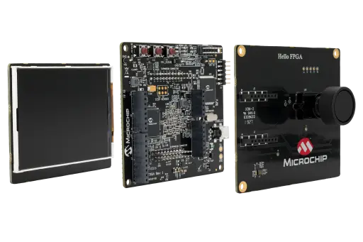

<!-- Copyright 2015-2026 Zephyr Project members and individual contributors. -->
<!-- SPDX-License-Identifier: Apache-2.0 -->
<!-- 中文翻译；编号、导航与译注为本地新增。 -->

<a id="m2s_hello_fpga_kit"></a>

# 第7章\_Microchip M2S Hello FPGA套件（Kit）

原文：[官方页面](https://docs.zephyrproject.org/latest/boards/microchip/m2s_hello_fpga_kit/doc/index.html)。读取日期：2026-10-16；来源摘要见[来源记录](../SOURCES.md)。

开发板概览（Board Overview）

<a id="id1"></a>

[](images/m2s_hello_fpga_kit.webp)

Microchip M2S Hello FPGA套件（Kit）

名称（Name）：

`m2s_hello_fpga_kit`

厂商（Vendor）：

[微芯科技（Microchip Technology Inc.）](https://docs.zephyrproject.org/latest/boards/index.html#vendor=microchip)

状态（Status）：

维护中（Maintained）

架构（Architecture）：

[arm](https://docs.zephyrproject.org/latest/boards/index.html#arch=arm)

片上系统（SoC）：

[m2s010](https://docs.zephyrproject.org/latest/boards/index.html#soc=m2s010)

<a id="board-github-link"></a>

[浏览开发板源码（Browse Board Sources）](https://github.com/zephyrproject-rtos/zephyr/blob/main//boards/microchip/m2s_hello_fpga_kit/doc/index.rst/../..)

<a id="overview"></a>

## 概述（Overview）

Microchip M2S Hello FPGA Kit是低成本、紧凑的入门级FPGA平台，面向初级到中级FPGA用户。它支持图像处理、信号处理及人工智能演示，并可在设计运行时测量实时FPGA内核功耗。闪存冻结模式（Flash Freeze）可冻结设计并保持I/O状态，适用于低功耗应用。套件还提供Arduino及mikroBUS连接器，方便原型开发和扩展。

此移植的Zephyr开发板目标为m2s_hello_fpga_kit/m2s010。

参考资料见官方Microchip M2S Hello FPGA Kit产品页，以及Microchip发布的相关用户指南和原理图。（[Microchip M2S Hello FPGA Kit产品页面](https://www.microchip.com/en-us/development-tool/m2s-hello-fpga-kit)）

<a id="programming-and-debugging"></a>

## 编程与调试（Programming and Debugging）

`m2s_hello_fpga_kit`开发板支持下表所列的运行工具（Runners）及相关west命令。

<table>
<tr>
<th></th>
<th>烧录（flash）</th>
<th>调试（debug）</th>
<th>连接调试会话（attach）</th>
<th>实时传输（rtt）</th>
<th>调试服务器（debugserver）</th>
</tr>
<tr>
<td><a href="https://docs.zephyrproject.org/latest/develop/flash_debug/host-tools.html#runner-openocd">openocd</a></td>
<td>✅（默认 / default）</td>
<td>✅（默认 / default）</td>
<td>✅</td>
<td>✅</td>
<td>✅</td>
</tr>
</table>

<a id="building"></a>

### 构建（Building）

m2s_hello_fpga_kit/m2s010目标应用可按通常方式构建：

```text
west build -b m2s_hello_fpga_kit/m2s010
```

<a id="clock-configuration"></a>

### 时钟配置（Clock Configuration）

当前SmartFusion2移植不会由Zephyr编程微控制器子系统（MSS）时钟树。实际CPU及外设时钟必须预先在SmartFusion2硬件设计中配置，例如在生成开发板镜像所用的MSS／Libero配置中设置。

Zephyr中软件可见的CPU频率来自设备树CPU节点：


- `&cpu0 { clock-frequency = <...>; }`

该数值用于推导：


- `CONFIG_SYS_CLOCK_HW_CYCLES_PER_SEC`
- SmartFusion2 SoC移植使用的SystemCoreClock变量

SmartFusion2专用时钟控制器节点目前用于UART时钟，其余外设仍使用各自设备树频率属性。硬件时钟配置改变后，必须同步更新设备树，使其匹配真实硬件。例如，可通过应用设备树覆盖文件修改CPU及外设时钟描述值：

```text
&cpu0 {
   clock-frequency = <80000000>;
};

&clkc {
   clock-frequencies = <80000000 40000000>;
};
```

设备树中的数值必须描述真实硬件时钟。只修改Zephyr中的这些数值，并不会重新编程SmartFusion2时钟硬件。

<a id="flashing"></a>

### 烧录（Flashing）

开发板使用board.cmake及support/openocd.cfg中的OpenOCD运行配置。主机具备该套件所需CMSIS-DAP／OpenOCD环境后，通常执行：

```text
west flash --runner openocd
west debug --runner openocd
```

<a id="helpful-documentation"></a>

## 参考文档（Helpful Documentation）

扩展开发板支持或向上游提交时，以下Microchip文档很有帮助。

<a id="board-documentation"></a>

### 开发板文档（Board Documentation）


- [Hello FPGA Kit快速入门卡（Quickstart Card）](https://ww1.microchip.com/downloads/aemDocuments/documents/FPGA/ProductDocuments/UserGuides/qs-guide/Hello_FPGA-Kit_QuickStart_card.pdf)

<a id="soc-documentation"></a>

### SoC文档（Documentation）


- [IGLOO 2 FPGA及SmartFusion 2 SoC FPGA数据手册，DS00004750](https://ww1.microchip.com/downloads/aemDocuments/documents/FPGA/ProductDocuments/DataSheets/IGLOO-2-FPGA-And-SmartFusion-2-SoC-FPGA-Data-Sheet-DS00004750.pdf)
- [SmartFusion2及IGLOO2编程用户指南，UG0451](https://ww1.microchip.com/downloads/aemdocuments/documents/FPGA/ProductDocuments/SoC/microsemi_smartfusion2_igloo2_programming_user_guide_ug0451_v9.pdf)

快速入门指南适用于开发板初次启动、连接器概览及套件内容。器件数据手册更适合作为封装选项、存储器容量、硬IP清单及电气能力的总体参考。编程指南则适合查阅闪存编程、器件配置流程、启动／编程模式及调试设置。

## 原文外链核对

2026-10-16核对并重试以下原文外链时未能确认可访问性，保留原始目标，不将访问失败解释为原文内容有误。

- [m2s-hello-fpga-kit](https://www.microchip.com/en-us/development-tool/m2s-hello-fpga-kit)：HTTP Error 403: Forbidden。

---

[上一章](P006_Microchip_M2S010_MKR_Kit.md) · [返回大纲](大纲.md) · [全站翻译进度](../PROGRESS.md) · [下一章](P008_MEC1501_Modular_card_ASSY6885.md)
