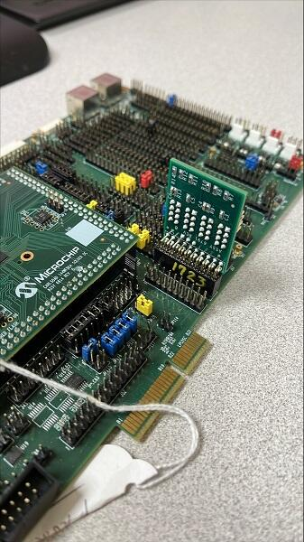
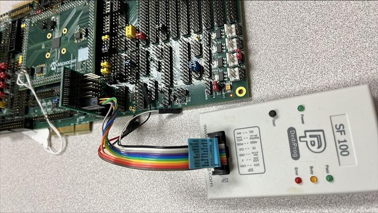
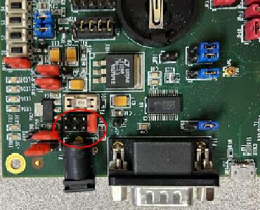
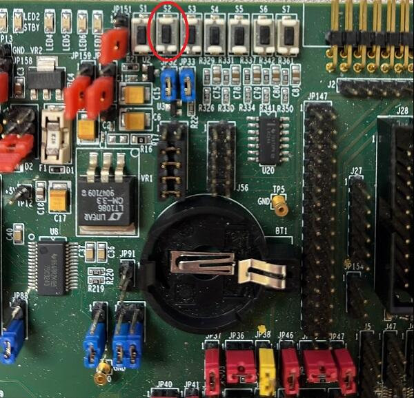

<!-- Copyright 2015-2026 Zephyr Project members and individual contributors. -->
<!-- SPDX-License-Identifier: Apache-2.0 -->
<!-- 中文翻译；编号、导航与译注为本地新增。 -->

<a id="mec172xevb_assy6906"></a>

# 第10章\_MEC172xEVB ASSY6906

原文：[官方页面](https://docs.zephyrproject.org/latest/boards/microchip/mec172xevb_assy6906/doc/index.html)。读取日期：2026-10-16；来源摘要见[来源记录](../SOURCES.md)。

开发板概览（Board Overview）

<a id="id1"></a>

[](images/mec172xevb_assy6906.jpg)

MEC172xEVB ASSY6906

名称（Name）：

`mec172xevb_assy6906`

厂商（Vendor）：

[微芯科技（Microchip Technology Inc.）](https://docs.zephyrproject.org/latest/boards/index.html#vendor=microchip)

状态（Status）：

维护中（Maintained）

架构（Architecture）：

[arm](https://docs.zephyrproject.org/latest/boards/index.html#arch=arm)

片上系统（SoC）：

[mec172x_nsz](https://docs.zephyrproject.org/latest/boards/index.html#soc=mec172x_nsz)

<a id="board-github-link"></a>

[浏览开发板源码（Browse Board Sources）](https://github.com/zephyrproject-rtos/zephyr/blob/main//boards/microchip/mec172xevb_assy6906/doc/index.rst/../..)<a id="overview"></a>

## 概述（Overview）

MEC172xEVB_ASSY6906套件用于评估Microchip MEC172X系列微控制器，需要配合MEC172x 144WFBGA SOLDER DC ASSY 6914 CPU板运行。MEC172x与MEC152x SPI镜像格式互不兼容。

<a id="hardware"></a>

## 硬件（Hardware）


- MEC172x Arm Cortex-M4处理器
- 416 KB RAM及128 KB启动ROM
- 键盘接口（Keyboard Interface）
- ADC与GPIO排针（Headers）
- UART0及UART1
- FAN0、FAN1及FAN2排针
- 风扇脉宽调制接口（FAN PWM）
- JTAG／SWD、ETM及MCHP Trace跟踪端口
- PECI接口3.0
- I2C电压转换器（Voltage Translator）
- 10组SMBus排针
- VCI接口
- 1个硬件驱动PS/2端口
- eSPI排针
- 2个SPI NOR芯片插座
- 复位及VCC_PWRDGD按键
- 一个外部PCA9555 I/O端口，I2C地址可通过跳线选择
- 一个外部LTC2489 ΔΣ模数转换器（Delta-Sigma ADC），I2C地址可通过跳线选择
- 通过跳线选择供电来源：+5 V、内径2.1 mm／外径5.5 mm圆形电源插座，或USB Micro-A连接器

<a id="id3"></a>

SoC更多信息见MEC172x参考手册 [注1](#id2)。（[MEC172x参考手册（Reference Manual）](https://github.com/MicrochipTech/CPGZephyrDocs/blob/master/MEC172x/MEC172x-Data-Sheet.pdf)）

<a id="supported-features"></a>

### 支持的功能（Supported Features）

`mec172xevb_assy6906`开发板支持下表所列的硬件功能。

片上／板载（On-Chip / On-Board）

功能集成在片上系统（SoC）内／位于开发板上。

2 / 2

分别表示已启用／已禁用的实例数。点击数量标签，可查看开发板或SoC设备树源码（DTS）中该功能的第一个实例。

`vnd,foo`

与此功能匹配的设备树绑定兼容字符串（Compatible String）；点击链接可查看绑定文档。

<a id="mec172xevb_assy6906-hw-features"></a>

<a id="mec172xevb_assy6906-mec172xevb_assy6906/mec172x_nsz-hw-features-section"></a>

#### `mec172xevb_assy6906/mec172x_nsz`目标（Target）

<a id="mec172xevb_assy6906-mec172xevb_assy6906/mec172x_nsz-hw-features-panel"></a>

<a id="mec172xevb_assy6906-mec172xevb_assy6906/mec172x_nsz-hw-features-memory"></a>

该开发板目标的片上存储容量：64 KiB RAM、352 KiB Flash。

<a id="mec172xevb_assy6906-mec172xevb_assy6906/mec172x_nsz-hw-features-table"></a>

<table>
<tr>
<th>类型（Type）</th>
<th>位置（Location）</th>
<th>说明（Description）</th>
<th>兼容字符串（Compatible）</th>
</tr>
<tr>
<td rowspan="1">中央处理器（CPU）</td>
<td>片上（On-Chip）</td>
<td>ARM Cortex-M4 处理器（CPU）（<a href="https://github.com/zephyrproject-rtos/zephyr/blob/main/dts/arm/microchip/mec/mec172xnsz.dtsi?plain=1#L25">已启用：1</a>）</td>
<td><a href="../cpu_arm_riscv_binding_reference/P024_arm_cortex-m4.md#std-dtcompatible-arm-cortex-m4"><code>arm,cortex-m4</code></a></td>
</tr>
<tr>
<td rowspan="1">模数转换器（ADC）</td>
<td>片上（On-Chip）</td>
<td>Microchip XEC模数转换器（ADC）（<a href="https://github.com/zephyrproject-rtos/zephyr/blob/main/dts/arm/microchip/mec/mec172x_common.dtsi?plain=1#L709">已启用：1</a>）</td>
<td><a href="../hardware/P860_MicrochipXEC模数转换器绑定.md#dtbinding-microchip-xec-adc"><code>microchip,xec-adc</code></a></td>
</tr>
<tr>
<td rowspan="1">时钟控制（Clock Control）</td>
<td>片上（On-Chip）</td>
<td>Microchip XEC电源、时钟、复位及VBAT寄存器（PCR）（<a href="https://github.com/zephyrproject-rtos/zephyr/blob/main/dts/arm/microchip/mec/mec172x_common.dtsi?plain=1#L11">已启用：1</a>）</td>
<td><a href="../clock_esp_infineon_microchip_binding_reference/P021_microchip_xec-pcr.md#std-dtcompatible-microchip-xec-pcr"><code>microchip,xec-pcr</code></a></td>
</tr>
<tr>
<td rowspan="1">密码学加速器（Cryptographic Accelerator）</td>
<td>片上（On-Chip）</td>
<td>Microchip XEC对称密码AES／哈希（Hash）加速器（<a href="https://github.com/zephyrproject-rtos/zephyr/blob/main/dts/arm/microchip/mec/mec172x_common.dtsi?plain=1#L1084">已禁用：1</a>）</td>
<td><a href="../crypto_aes_sha_ccm_binding_reference/P019_microchip_xec-symcr.md#std-dtcompatible-microchip-xec-symcr"><code>microchip,xec-symcr</code></a></td>
</tr>
<tr>
<td rowspan="1">直接存储器访问（DMA）</td>
<td>片上（On-Chip）</td>
<td>Microchip XEC DMA控制器（<a href="https://github.com/zephyrproject-rtos/zephyr/blob/main/dts/arm/microchip/mec/mec172x_common.dtsi?plain=1#L480">已禁用：1</a>）</td>
<td><a href="../intel_microchip_dma_binding_reference/P016_microchip_xec-dmac.md#std-dtcompatible-microchip-xec-dmac"><code>microchip,xec-dmac</code></a></td>
</tr>
<tr>
<td rowspan="4">增强型串行外设接口（ESPI）</td>
<td>片上（On-Chip）</td>
<td>Microchip eSPI V2控制器（<a href="https://github.com/zephyrproject-rtos/zephyr/blob/main/dts/arm/microchip/mec/mec172x_common.dtsi?plain=1#L884">已启用：1</a>）</td>
<td><a href="../espi_binding_reference/P006_microchip_xec-espi-v2.md#std-dtcompatible-microchip-xec-espi-v2"><code>microchip,xec-espi-v2</code></a></td>
</tr>
<tr>
<td>片上（On-Chip）</td>
<td>Microchip eSPI TAF第2版控制器（<a href="https://github.com/zephyrproject-rtos/zephyr/blob/main/dts/arm/microchip/mec/mec172x_common.dtsi?plain=1#L915">已禁用：1</a>）</td>
<td><a href="../espi_binding_reference/P004_microchip_xec-espi-saf-v2.md#std-dtcompatible-microchip-xec-espi-saf-v2"><code>microchip,xec-espi-saf-v2</code></a></td>
</tr>
<tr>
<td>片上（On-Chip）</td>
<td>Microchip XEC eSPI主机设备（Host Devices）（<a href="https://github.com/zephyrproject-rtos/zephyr/blob/main/dts/arm/microchip/mec/mec172x_common.dtsi?plain=1#L938">已启用：5</a>；<a href="https://github.com/zephyrproject-rtos/zephyr/blob/main/dts/arm/microchip/mec/mec172x_common.dtsi?plain=1#L928">已禁用：9</a>）</td>
<td><a href="../espi_binding_reference/P003_microchip_xec-espi-host-dev.md#std-dtcompatible-microchip-xec-espi-host-dev"><code>microchip,xec-espi-host-dev</code></a></td>
</tr>
<tr>
<td>片上（On-Chip）</td>
<td>Microchip XEC eSPI虚拟线（Virtual Wire）路由（<a href="https://github.com/zephyrproject-rtos/zephyr/blob/main/dts/arm/microchip/mec/mec172x/mec172x-vw-routing.dtsi?plain=1#L11">已启用：1</a>）</td>
<td><a href="../espi_binding_reference/P007_microchip_xec-espi-vw-routing.md#std-dtcompatible-microchip-xec-espi-vw-routing"><code>microchip,xec-espi-vw-routing</code></a></td>
</tr>
<tr>
<td rowspan="2">通用输入输出与接插件（GPIO &amp; Headers）</td>
<td>片上（On-Chip）</td>
<td>Microchip CEC／MEC通用输入输出（GPIO）（<a href="https://github.com/zephyrproject-rtos/zephyr/blob/main/dts/arm/microchip/mec/mec172x_common.dtsi?plain=1#L244">已启用：6</a>）</td>
<td><a href="../gpio_microchip_nordic_nuvoton_binding_reference/P004_microchip_xec-gpio.md#std-dtcompatible-microchip-xec-gpio"><code>microchip,xec-gpio</code></a></td>
</tr>
<tr>
<td>板载（On-Board）</td>
<td>PCA95xx系列I2C GPIO扩展器（Expander）（<a href="https://github.com/zephyrproject-rtos/zephyr/blob/main/boards/microchip/mec172xevb_assy6906/mec172xevb_assy6906.dts?plain=1#L150">已启用：1</a>）</td>
<td><a href="../gpio_nxp_expanders_binding_reference/P015_nxp_pca95xx.md#std-dtcompatible-nxp-pca95xx"><code>nxp,pca95xx</code></a></td>
</tr>
<tr>
<td rowspan="1">集成电路间总线（I2C）</td>
<td>片上（On-Chip）</td>
<td>Microchip I2C／SMBus V2控制器（<a href="https://github.com/zephyrproject-rtos/zephyr/blob/main/dts/arm/microchip/mec/mec172x_common.dtsi?plain=1#L506">已启用：3</a>；<a href="https://github.com/zephyrproject-rtos/zephyr/blob/main/dts/arm/microchip/mec/mec172x_common.dtsi?plain=1#L542">已禁用：2</a>）</td>
<td><a href="../i2c_infineon_ite_nordic_binding_reference/P013_microchip_xec-i2c-v2.md#std-dtcompatible-microchip-xec-i2c-v2"><code>microchip,xec-i2c-v2</code></a></td>
</tr>
<tr>
<td rowspan="1">输入（Input）</td>
<td>片上（On-Chip）</td>
<td>Microchip XEC键盘矩阵控制器（Keyboard Matrix Controller）（<a href="https://github.com/zephyrproject-rtos/zephyr/blob/main/dts/arm/microchip/mec/mec172x_common.dtsi?plain=1#L722">已启用：1</a>）</td>
<td><a href="../input_keyboard_optical_ctsu_binding_reference/P007_microchip_xec-kbd.md#std-dtcompatible-microchip-xec-kbd"><code>microchip,xec-kbd</code></a></td>
</tr>
<tr>
<td rowspan="3">中断控制器（Interrupt Controller）</td>
<td>片上（On-Chip）</td>
<td>ARMv7-M 嵌套向量中断控制器（Nested Vectored Interrupt Controller，NVIC）（<a href="https://github.com/zephyrproject-rtos/zephyr/blob/main/dts/arm/armv7-m.dtsi?plain=1#L13">已启用：1</a>）</td>
<td><a href="../arm_interrupt_timer_binding_reference/P002_ARMv7_M_NVIC.md#std-dtcompatible-arm-v7m-nvic"><code>arm,v7m-nvic</code></a></td>
</tr>
<tr>
<td>片上（On-Chip）</td>
<td>Microchip XEC系列外部中断聚合控制器（External Interrupt Aggregator Controller）（<a href="https://github.com/zephyrproject-rtos/zephyr/blob/main/dts/arm/microchip/mec/mec172x_common.dtsi?plain=1#L31">已启用：1</a>）</td>
<td><a href="../infineon_microchip_interrupt_binding_reference/P010_microchip_xec-ecia.md#std-dtcompatible-microchip-xec-ecia"><code>microchip,xec-ecia</code></a></td>
</tr>
<tr>
<td>片上（On-Chip）</td>
<td>Microchip XEC系列外部中断聚合GIRQ（<a href="https://github.com/zephyrproject-rtos/zephyr/blob/main/dts/arm/microchip/mec/mec172x_common.dtsi?plain=1#L41">已禁用：19</a>）</td>
<td><a href="../infineon_microchip_interrupt_binding_reference/P009_microchip_xec-ecia-girq.md#std-dtcompatible-microchip-xec-ecia-girq"><code>microchip,xec-ecia-girq</code></a></td>
</tr>
<tr>
<td rowspan="1">发光二极管（LED）</td>
<td>板载（On-Board）</td>
<td>一组由 GPIO 控制的 LED（GPIO-Controlled LEDs）（<a href="https://github.com/zephyrproject-rtos/zephyr/blob/main/boards/microchip/mec172xevb_assy6906/mec172xevb_assy6906.dts?plain=1#L34">已启用：1</a>）</td>
<td><a href="../hardware/P564_GPIO指示灯绑定.md#dtbinding-gpio-leds"><code>gpio-leds</code></a></td>
</tr>
<tr>
<td rowspan="1">存储器控制器（Memory Controller）</td>
<td>片上（On-Chip）</td>
<td>Microchip XEC系列电池后备RAM（Battery Backed RAM）节点（<a href="https://github.com/zephyrproject-rtos/zephyr/blob/main/dts/arm/microchip/mec/mec172x_common.dtsi?plain=1#L466">已启用：1</a>）</td>
<td><a href="../memory_controller_hyperbus_smc_binding_reference/P012_microchip_xec-bbram.md#std-dtcompatible-microchip-xec-bbram"><code>microchip,xec-bbram</code></a></td>
</tr>
<tr>
<td rowspan="1">存储技术设备（MTD）</td>
<td>片上（On-Chip）</td>
<td>Microchip片上EEPROM（<a href="https://github.com/zephyrproject-rtos/zephyr/blob/main/dts/arm/microchip/mec/mec172xnsz.dtsi?plain=1#L60">已禁用：1</a>）</td>
<td><a href="../mtd_microchip_nordic_nxp_binding_reference/P005_microchip_xec-eeprom.md#std-dtcompatible-microchip-xec-eeprom"><code>microchip,xec-eeprom</code></a></td>
</tr>
<tr>
<td rowspan="1">平台环境控制接口（PECI）</td>
<td>片上（On-Chip）</td>
<td>Microchip XEC平台环境控制接口（PECI）控制器（<a href="https://github.com/zephyrproject-rtos/zephyr/blob/main/dts/arm/microchip/mec/mec172x_common.dtsi?plain=1#L731">已启用：1</a>）</td>
<td><a href="../lin_dali_mctp_sensor_bus_binding_reference/P004_microchip_xec-peci.md#std-dtcompatible-microchip-xec-peci"><code>microchip,xec-peci</code></a></td>
</tr>
<tr>
<td rowspan="1">引脚控制（Pin Control）</td>
<td>片上（On-Chip）</td>
<td>Microchip XEC引脚控制器（Pin Controller）（<a href="https://github.com/zephyrproject-rtos/zephyr/blob/main/dts/arm/microchip/mec/mec172x_common.dtsi?plain=1#L238">已启用：1</a>）</td>
<td><a href="../pinctrl_infineon_nordic_nxp_binding_reference/P008_microchip_xec-pinctrl.md#std-dtcompatible-microchip-xec-pinctrl"><code>microchip,xec-pinctrl</code></a></td>
</tr>
<tr>
<td rowspan="1">PS/2 接口（PS/2）</td>
<td>片上（On-Chip）</td>
<td>Microchip XEC PS/2控制器（<a href="https://github.com/zephyrproject-rtos/zephyr/blob/main/dts/arm/microchip/mec/mec172x_common.dtsi?plain=1#L566">已启用：1</a>）</td>
<td><a href="../lin_dali_mctp_sensor_bus_binding_reference/P012_microchip_xec-ps2.md#std-dtcompatible-microchip-xec-ps2"><code>microchip,xec-ps2</code></a></td>
</tr>
<tr>
<td rowspan="1">脉宽调制（PWM）</td>
<td>片上（On-Chip）</td>
<td>Microchip XEC脉宽调制（PWM）（<a href="https://github.com/zephyrproject-rtos/zephyr/blob/main/dts/arm/microchip/mec/mec172x_common.dtsi?plain=1#L577">已启用：1</a>；<a href="https://github.com/zephyrproject-rtos/zephyr/blob/main/dts/arm/microchip/mec/mec172x_common.dtsi?plain=1#L585">已禁用：8</a>）</td>
<td><a href="../pwm_intel_microchip_nxp_binding_reference/P012_microchip_xec-pwm.md#std-dtcompatible-microchip-xec-pwm"><code>microchip,xec-pwm</code></a></td>
</tr>
<tr>
<td rowspan="3">实时时钟（RTC）</td>
<td>片上（On-Chip）</td>
<td>Microchip XEC基础定时器（Basic Timer）（<a href="https://github.com/zephyrproject-rtos/zephyr/blob/main/dts/arm/microchip/mec/mec172x_common.dtsi?plain=1#L322">已禁用：6</a>）</td>
<td><a href="../microchip_microcrystal_nxp_rtc_binding_reference/P004_microchip_xec-timer.md#std-dtcompatible-microchip-xec-timer"><code>microchip,xec-timer</code></a></td>
</tr>
<tr>
<td>片上（On-Chip）</td>
<td>Microchip XEC休眠定时器（Hibernation Timer），位于32 kHz时钟域的16位递减计数定时器（<a href="https://github.com/zephyrproject-rtos/zephyr/blob/main/dts/arm/microchip/mec/mec172x_common.dtsi?plain=1#L442">已禁用：2</a>）</td>
<td><a href="../microchip_microcrystal_nxp_rtc_binding_reference/P002_microchip_xec-hibtimer.md#std-dtcompatible-microchip-xec-hibtimer"><code>microchip,xec-hibtimer</code></a></td>
</tr>
<tr>
<td>片上（On-Chip）</td>
<td>Microchip XEC实时时钟定时器（RTC Timer）（<a href="https://github.com/zephyrproject-rtos/zephyr/blob/main/dts/arm/microchip/mec/mec172x_common.dtsi?plain=1#L1050">已禁用：1</a>）</td>
<td><a href="../microchip_microcrystal_nxp_rtc_binding_reference/P003_microchip_xec-rtc.md#std-dtcompatible-microchip-xec-rtc"><code>microchip,xec-rtc</code></a></td>
</tr>
<tr>
<td rowspan="1">串行控制器（Serial Controller）</td>
<td>片上（On-Chip）</td>
<td>Microchip XEC UART（<a href="https://github.com/zephyrproject-rtos/zephyr/blob/main/dts/arm/microchip/mec/mec172x_common.dtsi?plain=1#L872">已启用：1</a>；<a href="https://github.com/zephyrproject-rtos/zephyr/blob/main/dts/arm/microchip/mec/mec172x_common.dtsi?plain=1#L860">已禁用：1</a>）</td>
<td><a href="../uart_microchip_nordic_nxp_binding_reference/P001_microchip_xec-uart.md#std-dtcompatible-microchip-xec-uart"><code>microchip,xec-uart</code></a></td>
</tr>
<tr>
<td rowspan="1">串行外设接口（SPI）</td>
<td>片上（On-Chip）</td>
<td>带本地DMA的Microchip XEC QMSPI控制器（<a href="https://github.com/zephyrproject-rtos/zephyr/blob/main/dts/arm/microchip/mec/mec172x_common.dtsi?plain=1#L741">已启用：1</a>）</td>
<td><a href="../spi_microchip_nordic_nxp_binding_reference/P010_microchip_xec-qmspi-ldma.md#std-dtcompatible-microchip-xec-qmspi-ldma"><code>microchip,xec-qmspi-ldma</code></a></td>
</tr>
<tr>
<td rowspan="1">静态随机存储器（SRAM）</td>
<td>片上（On-Chip）</td>
<td>通用片上静态随机存储器（SRAM）（<a href="https://github.com/zephyrproject-rtos/zephyr/blob/main/dts/arm/microchip/mec/mec172xnsz.dtsi?plain=1#L52">已启用：1</a>）</td>
<td><a href="../hardware/P567_内存映射SRAM绑定.md#dtbinding-mmio-sram"><code>mmio-sram</code></a></td>
</tr>
<tr>
<td rowspan="1">转速计（Tachometer）</td>
<td>片上（On-Chip）</td>
<td>Microchip XEC转速计控制器（Tachometer Controller）（<a href="https://github.com/zephyrproject-rtos/zephyr/blob/main/dts/arm/microchip/mec/mec172x_common.dtsi?plain=1#L649">已启用：1</a>；<a href="https://github.com/zephyrproject-rtos/zephyr/blob/main/dts/arm/microchip/mec/mec172x_common.dtsi?plain=1#L660">已禁用：3</a>）</td>
<td><a href="../auxdisplay_iio_tach_binding_reference/P017_microchip_xec-tach.md#std-dtcompatible-microchip-xec-tach"><code>microchip,xec-tach</code></a></td>
</tr>
<tr>
<td rowspan="2">定时器（Timer）</td>
<td>片上（On-Chip）</td>
<td>ARMv7-M 系统节拍（System Tick）（<a href="https://github.com/zephyrproject-rtos/zephyr/blob/main/dts/arm/armv7-m.dtsi?plain=1#L21">已禁用：1</a>）</td>
<td><a href="../arm_interrupt_timer_binding_reference/P006_ARMv7_M_SysTick.md#std-dtcompatible-arm-armv7m-systick"><code>arm,armv7m-systick</code></a></td>
</tr>
<tr>
<td>片上（On-Chip）</td>
<td>Microchip XEC实时操作系统定时器（RTOS Timer）（<a href="https://github.com/zephyrproject-rtos/zephyr/blob/main/dts/arm/microchip/mec/mec172x_common.dtsi?plain=1#L313">已启用：1</a>）</td>
<td><a href="../microchip_nordic_nxp_realtek_timer_binding_reference/P004_microchip_xec-rtos-timer.md#std-dtcompatible-microchip-xec-rtos-timer"><code>microchip,xec-rtos-timer</code></a></td>
</tr>
<tr>
<td rowspan="1">看门狗（Watchdog）</td>
<td>片上（On-Chip）</td>
<td>Microchip XEC看门狗定时器（Watchdog Timer）（<a href="https://github.com/zephyrproject-rtos/zephyr/blob/main/dts/arm/microchip/mec/mec172x_common.dtsi?plain=1#L305">已启用：1</a>）</td>
<td><a href="../soc_pmic_watchdog_binding_reference/P011_microchip_xec-watchdog.md#std-dtcompatible-microchip-xec-watchdog"><code>microchip,xec-watchdog</code></a></td>
</tr>
</table>

<a id="connections-and-ios"></a>

### 连接与输入输出（Connections and IOs）

此评估板套件由以下硬件模块组成：


- <a id="id5"></a>

  MEC172x EVB ASSY 6906 Rev A，参见[MEC172x EVB原理图](https://github.com/MicrochipTech/CPGZephyrDocs/blob/master/MEC172x/MEC172X-EVB-Assy_6906-A1p0-SCH.pdf) [注2](#id4)
- <a id="id7"></a>

  搭载MEC172x芯片的MEC172x 144WFBGA SOLDER DC ASSY 6914，参见[MEC172x子卡原理图](https://github.com/MicrochipTech/CPGZephyrDocs/blob/master/MEC172x/MEC172X-144WFBGA-Socket-DC-Assy6914-Rev-A-SCH.pdf) [注3](#id6)
- <a id="id9"></a>

  SPI DONGLE ASSY 6791，参见SPI适配板原理图 [注4](#id8)（[SPI适配板原理图（Dongle Schematic）](https://github.com/MicrochipTech/CPGZephyrDocs/blob/master/MEC1501/SPI%20Dongles%20and%20Aardvark%20Interposer%20Assy%206791%20Rev%20A1p1%20-%20SCH.pdf)）

<a id="system-clock"></a>

### 系统时钟（System Clock）

MEC1723 MCU使用96 MHz内部振荡器及片上PLL，最终生成12 MHz EC时钟。详见文末数据手册第4章“4.0 POWER, CLOCKS, and RESETS”中的处理器时钟控制寄存器。

<a id="serial-port"></a>

### 串口（Serial Port）

UART1用于串行日志。

<a id="jumper-settings"></a>

## 跳线设置（Jumper Settings）

按以下跳线设置即可演示此板，高级用户可根据需要采用其他配置。

<a id="jumper-setting-for-mec172x-evb-assy-6906-rev-a1p0"></a>

### MEC172x EVB Assy 6906 Rev A1p0跳线设置

<a id="power-related-jumpers"></a>

#### 电源相关跳线（Power-Related Jumpers）

若通过+5 V电源适配器供电，将其连接到P1圆形插座，外径5.5 mm、内径2.1 mm，并短接JP30的5—6脚。

若通过Micro-USB Type-A／B连接器P2供电，短接JP30的7—8脚。

注意（Note）

JP30只需安装一个跳线帽。

<table>
<tr>
<th>JP31</th>
<th>JP158</th>
<th>JP159</th>
<th>JP40</th>
<th>JP42</th>
</tr>
<tr>
<td>2-3</td>
<td>2-3</td>
<td>2-3</td>
<td>1-2</td>
<td>1-2</td>
</tr>
</table>

<table>
<tr>
<th>JP36</th>
<th>JP37</th>
<th>JP38</th>
<th>JP39</th>
<th>JP41</th>
<th>JP43</th>
<th>JP44</th>
</tr>
<tr>
<td>1-2</td>
<td>1-2</td>
<td>1-2</td>
<td>1-2</td>
<td>1-2</td>
<td>1-2</td>
<td>1-2</td>
</tr>
</table>

<table>
<tr>
<th>JP45</th>
<th>JP46</th>
<th>JP47</th>
<th>JP50</th>
<th>JP51</th>
<th>JP52</th>
<th>JP55</th>
<th>JP56</th>
<th>JP57</th>
</tr>
<tr>
<td>1-2</td>
<td>1-2</td>
<td>1-2</td>
<td>1-2</td>
<td>1-2</td>
<td>1-2</td>
<td>1-2</td>
<td>1-2</td>
<td>1-2</td>
</tr>
</table>

<table>
<tr>
<th>JP59</th>
<th>JP60</th>
<th>JP61</th>
<th>JP62</th>
<th>JP63</th>
<th>JP65</th>
<th>JP66</th>
</tr>
<tr>
<td>1-2</td>
<td>1-2</td>
<td>1-2</td>
<td>1-2</td>
<td>1-2</td>
<td>1-2</td>
<td>1-2</td>
</tr>
</table>

这些跳线配置VCC电源良好信号（Power Good）及nRESET_IN。

<table>
<tr>
<th>JP32：VCC Power Good</th>
<th>JP33：nRESET_IN</th>
</tr>
<tr>
<td>1-2</td>
<td>1-2</td>
</tr>
</table>

<a id="boot-rom-straps"></a>

#### 启动ROM配置引脚（Boot-ROM Straps）

这些跳线配置MEC172x启动ROM配置引脚。

<table>
<tr>
<th>JP1：CR_STRAP</th>
<th>JP2：JTAG_STRAP</th>
<th>JP3：CMP_STRAP</th>
<th>JP7：BSS_STRAP</th>
<th>JP160：UART_BSTRAP</th>
</tr>
<tr>
<td>1-2</td>
<td>2-3</td>
<td>2-3</td>
<td>1-2</td>
<td>1-2</td>
</tr>
</table>

JP7的1—2脚短接，将SHD SPI CS0#上拉到VTR2。MEC172x启动ROM采样此信号，高电平时从共享SPI加载代码。

<a id="peripheral-routing-jumpers"></a>

#### 外设连接跳线（Peripheral Routing Jumpers）

下表各列分别说明如何启用UART0、UART1、共享SPI及SWD。

<table>
<tr>
<th colspan="7">UART0，连接器P11</th>
</tr>
<tr>
<th>JP13</th>
<th>JP17</th>
<th>JP19</th>
<th>JP22</th>
<th>JP88</th>
<th>JP89</th>
<th>JP93</th>
</tr>
<tr>
<td>2-3</td>
<td>2-3</td>
<td>1-2</td>
<td>1-2</td>
<td>2-3</td>
<td>2-3</td>
<td>1-3</td>
</tr>
<tr>
<td>5-6</td>
<td>5-6</td>
<td>4-5</td>
<td>4-5</td>
<td></td>
<td></td>
<td>2-4</td>
</tr>
<tr>
<td>8-9</td>
<td>8-9</td>
<td></td>
<td></td>
<td></td>
<td></td>
<td></td>
</tr>
<tr>
<td>11-12</td>
<td>11-12</td>
<td></td>
<td></td>
<td></td>
<td></td>
<td></td>
</tr>
<tr>
<td>14-15</td>
<td>14-15</td>
<td></td>
<td></td>
<td></td>
<td></td>
<td></td>
</tr>
<tr>
<td>17-18</td>
<td>17-18</td>
<td></td>
<td></td>
<td></td>
<td></td>
<td></td>
</tr>
<tr>
<td></td>
<td>20-21</td>
<td></td>
<td></td>
<td></td>
<td></td>
<td></td>
</tr>
<tr>
<td></td>
<td>23-24</td>
<td></td>
<td></td>
<td></td>
<td></td>
<td></td>
</tr>
</table>

<table>
<tr>
<th colspan="14">UART1</th>
</tr>
<tr>
<th colspan="7">连接器P12</th>
<th colspan="7">连接器P2</th>
</tr>
<tr>
<th>JP11</th>
<th>JP14</th>
<th>JP19</th>
<th>JP24</th>
<th>JP90</th>
<th>JP94</th>
<th>JP157</th>
<th colspan="2">JP11</th>
<th>JP19</th>
<th>JP24</th>
<th>JP90</th>
<th>JP94</th>
<th>JP157</th>
</tr>
<tr>
<td>1-2</td>
<td>1-2</td>
<td>20-21</td>
<td>2-3</td>
<td>2-3</td>
<td>1-3</td>
<td>1-2</td>
<td colspan="2">1-2</td>
<td>11-12</td>
<td>5-6</td>
<td>2-3</td>
<td>1-3</td>
<td>1-3</td>
</tr>
<tr>
<td>4-5</td>
<td></td>
<td></td>
<td>5-6</td>
<td></td>
<td>2-4</td>
<td>4-5</td>
<td colspan="2">4-5</td>
<td></td>
<td>8-9</td>
<td></td>
<td>2-4</td>
<td>4-6</td>
</tr>
<tr>
<td>8-9</td>
<td></td>
<td></td>
<td>8-9</td>
<td></td>
<td></td>
<td>7-8</td>
<td colspan="2"></td>
<td></td>
<td>17-18</td>
<td></td>
<td></td>
<td>7-9</td>
</tr>
<tr>
<td></td>
<td></td>
<td></td>
<td>11-12</td>
<td></td>
<td></td>
<td>10-11</td>
<td colspan="2"></td>
<td></td>
<td>23-24</td>
<td></td>
<td></td>
<td>10-12</td>
</tr>
<tr>
<td></td>
<td></td>
<td></td>
<td>14-15</td>
<td></td>
<td></td>
<td></td>
<td colspan="2"></td>
<td></td>
<td></td>
<td></td>
<td></td>
<td></td>
</tr>
<tr>
<td></td>
<td></td>
<td></td>
<td>17-18</td>
<td></td>
<td></td>
<td></td>
<td colspan="2"></td>
<td></td>
<td></td>
<td></td>
<td></td>
<td></td>
</tr>
</table>

注意：Hello World示例通过UART1的P12输出。

<table>
<tr>
<th colspan="3">SHD_SPI</th>
<th>SWD</th>
<th>LED4-5</th>
</tr>
<tr>
<th>JP23</th>
<th>JP25</th>
<th>JP156</th>
<th><code>J18</code></th>
<th>JP21</th>
</tr>
<tr>
<td>2-3</td>
<td>1-2</td>
<td>1-2</td>
<td>8-9</td>
<td>4-5</td>
</tr>
<tr>
<td>8-9</td>
<td></td>
<td></td>
<td>11-12</td>
<td>16-17</td>
</tr>
<tr>
<td>14-15</td>
<td></td>
<td></td>
<td></td>
<td></td>
</tr>
<tr>
<td>17-18</td>
<td></td>
<td></td>
<td></td>
<td></td>
</tr>
</table>

<a id="jumper-settings-for-mec172x-144wfbga-socket-dc-assy-6914-rev-a0p1"></a>

### MEC172x 144WFBGA Socket DC Assy 6914 Rev A0p1跳线设置

上述配置针对底板。ASSY 6914 MEC172x CPU板支持可选外部32 kHz时钟源，板载32 kHz晶体振荡器，也可配置为从XTAL2／32KHZ_IN输入占空比50%的外部32 kHz时钟。固件必须设置MEC172x时钟使能寄存器，使所选外部时钟源匹配跳线；若使用芯片内部振荡器，32K跳线状态无关紧要。子卡JP1用于观察测试时钟输出。详见文末原理图。

<a id="parallel-32khz-crystal-configuration"></a>

#### 并联32 kHz晶体配置（Parallel Crystal Configuration）

<table>
<tr>
<th><code>JP1</code></th>
<th>JP2</th>
</tr>
<tr>
<td>1-2</td>
<td>2-3</td>
</tr>
</table>

<a id="external-32khz-50-duty-cycle-configuration"></a>

#### 外部32 kHz、50%占空比时钟配置

<table>
<tr>
<th>JP2</th>
<th>JP3</th>
</tr>
<tr>
<td>未连接（NC）</td>
<td>1-2</td>
</tr>
</table>

注意：底板JP121的3—4脚也需安装跳线。

<a id="programming-and-debugging"></a>

## 烧录与调试（Programming and Debugging）

`mec172xevb_assy6906`开发板支持下表所列的运行工具（Runners）及相关west命令。

<table>
<tr>
<th></th>
<th>烧录（flash）</th>
<th>调试（debug）</th>
</tr>
<tr>
<td>dediprog</td>
<td>✅（默认 / default）</td>
<td></td>
</tr>
<tr>
<td>misc-flasher</td>
<td>✅</td>
<td></td>
</tr>
</table>

<a id="setup"></a>

### 设置（Setup）


1. 若使用Dediprog SF100编程器，先完成其设置。

  <a id="id15"></a>

  Windows版本见[SF100产品页面](https://www.dediprog.com/product/SF100) [注7](#id14)。

  <a id="id13"></a>

  <a id="id17"></a>

  Linux版本源码见[SF100 Linux GitHub](https://github.com/DediProgSW/SF100Linux) [注6](#id12)，按[SF100 Linux手册](https://www.dediprog.com/download/save/727.pdf) [注8](#id16) 完成设置。将SF100Linux目录的60-dediprog.rules复制到原文所列`/etc/udev/rules.s`或`rules.d`目录，然后执行以下命令重启服务：

  ```text
  $ udevadm control --reload
  ```

  将dpcmd所在目录加入PATH；Linux工具名为dpcmd，Windows为dpcmd.exe。
2. <a id="id11"></a>

  克隆[MEC172x SPI Image Gen](https://github.com/MicrochipTech/CPGZephyrDocs/tree/master/MEC172x/SPI_image_gen) [注5](#id10) 仓库，或下载该目录中的文件。
3. 将镜像生成工具加入PATH，或设置MEC172X_SPI_GEN环境变量，使Zephyr能够找到它，例如：

  ```text
  export MEC172X_SPI_GEN=<path to tool>/mec172x_spi_gen_lin_x86_64
  ```

  Linux和Windows工具文件名不同。
4. 默认MEC172X_SPI_CFG文件为`${BOARD_DIR}/support`中的spi_cfg.txt。必要时可指定自定义SPI镜像配置文件覆盖默认配置。

  ```text
  export MEC172X_SPI_CFG=custom_spi_cfg.txt
  ```

<a id="wiring"></a>

### 接线（Wiring）


1. 将SPI Dongle ASSY 6791连接到EVB的J34。

  
2. 将编程器连接到Assy6791的J6排针，以烧录SPI NOR芯片U3。确认偏移为0x0，可使用Dediprog SF100或类似SPI芯片编程工具。

  

  注意（Note）

  注意，Dediprog排针上的SPI MISO／MOSI信号相互交换。应使用独立导线连接Dediprog与Assy6791 SPI板，接线关系见下表。

  <table>
  <tr>
  <th>Dediprog连接器</th>
  <th>Assy6791 J6连接器</th>
  </tr>
  <tr>
  <td>电源（VCC）</td>
  <td>1</td>
  </tr>
  <tr>
  <td>地（GND）</td>
  <td>2</td>
  </tr>
  <tr>
  <td>片选（CS）</td>
  <td>3</td>
  </tr>
  <tr>
  <td>时钟（CLK）</td>
  <td>4</td>
  </tr>
  <tr>
  <td>主机输入从机输出（MISO）</td>
  <td>6</td>
  </tr>
  <tr>
  <td>主机输出从机输入（MOSI）</td>
  <td>5</td>
  </tr>
  </table>
3. 通过RS232线缆，将原文所称MEC17xxEVB_ASSY_6906的UART1连接主机。
4. 通过Micro-USB线缆供电，并短接JP30的7—8脚选择此供电方式。

  

<a id="building"></a>

### 构建（Building）


1. 按通常方式构建[Hello World](../getting_started/P005_HelloWorld示例.md#hello_world)应用。
2. 构建系统能找到镜像生成工具时，会生成spi_image.bin，可用它烧录SPI芯片。

<a id="flashing"></a>

### 烧录（Flashing）


1. 运行惯用的终端程序监听输出。Linux下串口应为`/dev/ttyUSB0`，保持终端打开。

  例如：

  ```text
  $ minicom -D /dev/ttyUSB0 -o
  ```

  `-o`选项让`minicom`不发送调制解调器初始化字符串（Modem Initialization String）。连接参数应配置如下：


  - 速率（Speed）：115200波特率
  - 数据位（Data）：8位
  - 奇偶校验（Parity）：无（None）
  - 停止位（Stop Bits）：1位
2. 在第二个终端中用west烧录开发板，同时并排显示两个终端。

  ```text
  $ west flash
  ```

  注意（Note）

  west进程启动时按住复位键S2，直至整个west过程成功结束后再松开。

  

  注意（Note）

  若不想每次按住复位键，可在west flash编程期间断开SPI Dongle ASSY 6791与EVB的连接，完成后重新接到J34并给EVB供电，效果相同。
3. 第一个终端应显示`Hello World! mec172xevb_assy6906`。若未显示，可按复位键，随后应出现消息。

<a id="debugging"></a>

### 调试（Debugging）

此板提供Cortex ETM端口，可通过单一物理连接进行跟踪及调试；另有仅供JTAG会话使用的插座。

<a id="troubleshooting"></a>

### 故障排查（Troubleshooting）


1. 若未看到应用运行，确认LED1及LED2均已亮；若任一未亮，重新检查电源跳线。
2. 若Dediprog无法编程此板，可断开Assy6791与Assy6906主板连接后重试。
3. 若Dediprog无法检测板载闪存，按住开发板复位键后重试。

<a id="pca9555-enabling"></a>

### 启用PCA9555（Enabling）


1. 要启用PCA9555PW并测试mec172xevb_assy6906的I2C，需要额外设置：

  原文说明，NXP PCA95xx连接I2C00，该端口与用于串行日志的UART2 RS232转TTL转换器共用，因此UART2与I2C00不能同时使用。需按下列跳线设置改用I2C01；此处UART2名称沿用原文。

  > <table>
  > <tr>
  > <th>引脚1（Pin 1）</th>
  > <th>引脚2（Pin 2）</th>
  > <th>备注（Comment）</th>
  > </tr>
  > <tr>
  > <td>JP49.1</td>
  > <td>JP49.2</td>
  > <td>将PCA9555 VCC连接到+3.3V_STBY</td>
  > </tr>
  > <tr>
  > <td>JP53.1</td>
  > <td>JP53.2</td>
  > <td>选择原文所列地址0100b，即0x26，数值关系按来源保留</td>
  > </tr>
  > <tr>
  > <td>JP12.13</td>
  > <td>JP12.14</td>
  > <td>将CPU的I2C01_SDA连接到J20</td>
  > </tr>
  > <tr>
  > <td>JP12.4</td>
  > <td>JP12.5</td>
  > <td>将CPU的I2C01_SCL连接到J20</td>
  > </tr>
  > <tr>
  > <td>JP77.7</td>
  > <td>JP77.8</td>
  > <td>I2C01_SDA外部上拉</td>
  > </tr>
  > <tr>
  > <td>JP77.9</td>
  > <td>JP77.10</td>
  > <td>I2C01_SCL外部上拉</td>
  > </tr>
  > <tr>
  > <td>JP58.1</td>
  > <td>JP20.1</td>
  > <td>将NXP PCA9555 SCL连接到I2C01</td>
  > </tr>
  > <tr>
  > <td>JP58.3</td>
  > <td>JP20.3</td>
  > <td>将NXP PCA9555 SDA连接到I2C01</td>
  > </tr>
  > </table>

<a id="references"></a>

## 参考资料（References）

<a id="id2"></a>

〔[1](#id3)〕 [https://github.com/MicrochipTech/CPGZephyrDocs/blob/master/MEC172x/MEC172x-Data-Sheet.pdf](https://github.com/MicrochipTech/CPGZephyrDocs/blob/master/MEC172x/MEC172x-Data-Sheet.pdf)

<a id="id4"></a>

〔[2](#id5)〕 [https://github.com/MicrochipTech/CPGZephyrDocs/blob/master/MEC172x/MEC172X-EVB-Assy_6906-A1p0-SCH.pdf](https://github.com/MicrochipTech/CPGZephyrDocs/blob/master/MEC172x/MEC172X-EVB-Assy_6906-A1p0-SCH.pdf)

<a id="id6"></a>

〔[3](#id7)〕 [https://github.com/MicrochipTech/CPGZephyrDocs/blob/master/MEC172x/MEC172X-144WFBGA-Socket-DC-Assy6914-Rev-A-SCH.pdf](https://github.com/MicrochipTech/CPGZephyrDocs/blob/master/MEC172x/MEC172X-144WFBGA-Socket-DC-Assy6914-Rev-A-SCH.pdf)

<a id="id8"></a>

〔[4](#id9)〕 [https://github.com/MicrochipTech/CPGZephyrDocs/blob/master/MEC1501/SPI%20Dongles%20and%20Aardvark%20Interposer%20Assy%206791%20Rev%20A1p1%20-%20SCH.pdf](https://github.com/MicrochipTech/CPGZephyrDocs/blob/master/MEC1501/SPI%20Dongles%20and%20Aardvark%20Interposer%20Assy%206791%20Rev%20A1p1%20-%20SCH.pdf)

<a id="id10"></a>

〔[5](#id11)〕 [https://github.com/MicrochipTech/CPGZephyrDocs/tree/master/MEC172x/SPI_image_gen](https://github.com/MicrochipTech/CPGZephyrDocs/tree/master/MEC172x/SPI_image_gen)

<a id="id12"></a>

〔[6](#id13)〕 [https://github.com/DediProgSW/SF100Linux](https://github.com/DediProgSW/SF100Linux)

<a id="id14"></a>

〔[7](#id15)〕 [https://www.dediprog.com/product/SF100](https://www.dediprog.com/product/SF100)

<a id="id16"></a>

〔[8](#id17)〕 [https://www.dediprog.com/download/save/727.pdf](https://www.dediprog.com/download/save/727.pdf)

## 译注

MEC172x与MEC152x镜像格式互不兼容。Hello World使用UART1，但I2C冲突段仍称UART2；PCA9555地址段将0100b与0x26关联，均按原文保留并提示核实。烧录时持续按住复位，或按原文断开SPI适配板。

---

[上一章](P009_MEC15xxEVB_ASSY6853.md) · [返回大纲](大纲.md) · [全站翻译进度](../PROGRESS.md) · [下一章](P011_MEC172x_Modular_Card_ASSY6930_Rev._B.md)
