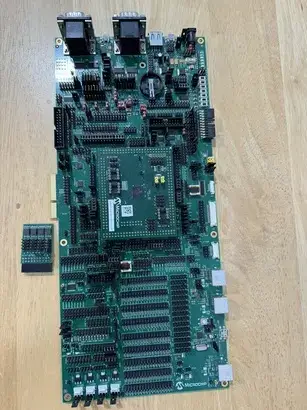
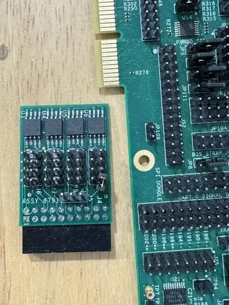

<!-- Copyright 2015-2026 Zephyr Project members and individual contributors. -->
<!-- SPDX-License-Identifier: Apache-2.0 -->
<!-- 中文翻译；编号、导航与译注为本地新增。 -->

<a id="mec_assy6941"></a>

# 第12章\_MEC17xxEVB ASSY6941

原文：[官方页面](https://docs.zephyrproject.org/latest/boards/microchip/mec_assy6941/doc/index.html)。读取日期：2026-10-16；来源摘要见[来源记录](../SOURCES.md)。

开发板概览（Board Overview）

<a id="id1"></a>

[](images/mec_assy6941_evb.webp)

MEC17xxEVB ASSY6941

名称（Name）：

`mec_assy6941`

厂商（Vendor）：

[微芯科技（Microchip Technology Inc.）](https://docs.zephyrproject.org/latest/boards/index.html#vendor=microchip)

状态（Status）：

维护中（Maintained）

架构（Architecture）：

[arm](https://docs.zephyrproject.org/latest/boards/index.html#arch=arm)

片上系统（SoC）：

[mec1753_qlj](https://docs.zephyrproject.org/latest/boards/index.html#soc=mec1753_qlj)、[mec1753_qsz](https://docs.zephyrproject.org/latest/boards/index.html#soc=mec1753_qsz)、[mec1743_qlj](https://docs.zephyrproject.org/latest/boards/index.html#soc=mec1743_qlj)、[mec1653b_nsz](https://docs.zephyrproject.org/latest/boards/index.html#soc=mec1653b_nsz)、[mec1743_qsz](https://docs.zephyrproject.org/latest/boards/index.html#soc=mec1743_qsz)

<a id="board-github-link"></a>

[浏览开发板源码（Browse Board Sources）](https://github.com/zephyrproject-rtos/zephyr/blob/main//boards/microchip/mec_assy6941/doc/index.rst/../..)<a id="overview"></a>

## 概述（Overview）

MEC5 Assembly 6941 EVB套件用于评估Microchip MEC174x及MEC175x系列微控制器，需要配套CPU子卡：MEC1743-QLJ或MEC1753-QLJ使用DC 176WFBGA DC ASSY 6949，176引脚封装；MEC1743-QSZ、MEC1753-QSZ或MEC1653B-NSZ使用DC 176WFBGA DC ASSY 6946，144引脚封装。子卡名称中的176WFBGA及所列144引脚封装均按原文保留。

<a id="hardware"></a>

## 硬件（Hardware）


- MEC174x-QLJ／QSZ或MEC175x-QLJ／QSZ ARM Cortex-M4F处理器
- 共480 KB SRAM，其中代码416 KB、数据64 KB；另有128 KB启动ROM
- MEC1653B-NSZ ARM Cortex-M4处理器，不含浮点单元（FPU）
- 共416 KB SRAM，其中代码352 KB、数据64 KB；另有支持后量子密码（PQC）的128 KB启动ROM
- 键盘接口（Keyboard Interface）
- ADC与GPIO排针（Headers）
- 4个DB9 UART连接器
- FAN0、FAN1及FAN2排针
- 风扇脉宽调制接口（FAN PWM）
- JTAG／SWD、ETM及MCHP Trace跟踪端口
- PECI接口3.0
- I2C电压转换器（Voltage Translator）
- 10组SMBus排针
- VCI接口
- 2个硬件驱动PS/2端口
- eSPI排针
- 2个SPI NOR芯片插座
- 复位及VCC_PWRDGD按键
- 一个外部PCA9555 I/O端口，I2C地址可通过跳线选择
- 一个外部LTC2489 ΔΣ模数转换器（Delta-Sigma ADC），I2C地址可通过跳线选择
- 通过跳线选择供电来源：+5 V、内径2.1 mm／外径5.5 mm圆形电源插座，或USB Micro-A连接器
- MEC175x／MEC165xB各有一个I3C主控制器（Host Controller）和一个I3C次控制器（Secondary Controller），各控制器均有多个端口。

<a id="id3"></a>

<a id="id5"></a>

<a id="id7"></a>

MEC174x更多信息见MEC174x产品简介 [注1](#id2)；MEC175x见MEC175x产品简介 [注2](#id4)；MEC165xB见MEC165xB产品简介 [注3](#id6)。（[MEC174x产品简介（Data Brief）](https://github.com/MicrochipTech/CPGZephyrDocs/blob/main/MEC174x/MEC174x_DataBrief.pdf)；[MEC175x产品简介（Data Brief）](https://github.com/MicrochipTech/CPGZephyrDocs/blob/main/MEC175x/MEC175x_DataBrief.pdf)；[MEC165xB产品简介（Data Brief）](https://github.com/MicrochipTech/CPGZephyrDocs/blob/main/MEC165xB/MEC165xB_DataBrief.pdf)）

<a id="supported-features"></a>

### 支持的功能（Supported Features）

`mec_assy6941`开发板支持下表所列的硬件功能。

片上／板载（On-Chip / On-Board）

功能集成在片上系统（SoC）内／位于开发板上。

2 / 2

分别表示已启用／已禁用的实例数。点击数量标签，可查看开发板或SoC设备树源码（DTS）中该功能的第一个实例。

`vnd,foo`

与此功能匹配的设备树绑定兼容字符串（Compatible String）；点击链接可查看绑定文档。

<a id="mec_assy6941-hw-features"></a>

<a id="mec_assy6941-mec_assy6941/mec1653b_nsz-hw-features-section"></a>

#### `mec_assy6941/mec1653b_nsz`目标（Target）

<a id="mec_assy6941-mec_assy6941/mec1653b_nsz-hw-features-panel"></a>

<a id="mec_assy6941-mec_assy6941/mec1653b_nsz-hw-features-memory"></a>

该开发板目标的片上存储容量：62 KiB RAM、352 KiB Flash。

<a id="mec_assy6941-mec_assy6941/mec1653b_nsz-hw-features-table"></a>

<table>
<tr>
<th>类型（Type）</th>
<th>位置（Location）</th>
<th>说明（Description）</th>
<th>兼容字符串（Compatible）</th>
</tr>
<tr>
<td rowspan="1">中央处理器（CPU）</td>
<td>片上（On-Chip）</td>
<td>ARM Cortex-M4 处理器（CPU）（<a href="https://github.com/zephyrproject-rtos/zephyr/blob/main/dts/arm/microchip/mec/mec5.dtsi?plain=1#L28">已启用：1</a>）</td>
<td><a href="../cpu_arm_riscv_binding_reference/P024_arm_cortex-m4.md#std-dtcompatible-arm-cortex-m4"><code>arm,cortex-m4</code></a></td>
</tr>
<tr>
<td rowspan="1">时钟控制（Clock Control）</td>
<td>片上（On-Chip）</td>
<td>Microchip XEC电源、时钟、复位及VBAT寄存器（PCR）（<a href="https://github.com/zephyrproject-rtos/zephyr/blob/main/dts/arm/microchip/mec/mec5.dtsi?plain=1#L42">已启用：1</a>）</td>
<td><a href="../clock_esp_infineon_microchip_binding_reference/P021_microchip_xec-pcr.md#std-dtcompatible-microchip-xec-pcr"><code>microchip,xec-pcr</code></a></td>
</tr>
<tr>
<td rowspan="1">密码学加速器（Cryptographic Accelerator）</td>
<td>片上（On-Chip）</td>
<td>Microchip XEC对称密码AES／哈希（Hash）加速器（<a href="https://github.com/zephyrproject-rtos/zephyr/blob/main/dts/arm/microchip/mec/mec5.dtsi?plain=1#L894">已禁用：1</a>）</td>
<td><a href="../crypto_aes_sha_ccm_binding_reference/P019_microchip_xec-symcr.md#std-dtcompatible-microchip-xec-symcr"><code>microchip,xec-symcr</code></a></td>
</tr>
<tr>
<td rowspan="1">直接存储器访问（DMA）</td>
<td>片上（On-Chip）</td>
<td>Microchip XEC DMA控制器（<a href="https://github.com/zephyrproject-rtos/zephyr/blob/main/dts/arm/microchip/mec/mec5/mec5_dma_chan20.dtsi?plain=1#L8">已禁用：1</a>）</td>
<td><a href="../intel_microchip_dma_binding_reference/P016_microchip_xec-dmac.md#std-dtcompatible-microchip-xec-dmac"><code>microchip,xec-dmac</code></a></td>
</tr>
<tr>
<td rowspan="4">增强型串行外设接口（ESPI）</td>
<td>片上（On-Chip）</td>
<td>Microchip eSPI V2控制器（<a href="https://github.com/zephyrproject-rtos/zephyr/blob/main/dts/arm/microchip/mec/mec5.dtsi?plain=1#L694">已禁用：1</a>）</td>
<td><a href="../espi_binding_reference/P006_microchip_xec-espi-v2.md#std-dtcompatible-microchip-xec-espi-v2"><code>microchip,xec-espi-v2</code></a></td>
</tr>
<tr>
<td>片上（On-Chip）</td>
<td>Microchip eSPI TAF第2版控制器（<a href="https://github.com/zephyrproject-rtos/zephyr/blob/main/dts/arm/microchip/mec/mec5.dtsi?plain=1#L722">已禁用：1</a>）</td>
<td><a href="../espi_binding_reference/P004_microchip_xec-espi-saf-v2.md#std-dtcompatible-microchip-xec-espi-saf-v2"><code>microchip,xec-espi-saf-v2</code></a></td>
</tr>
<tr>
<td>片上（On-Chip）</td>
<td>Microchip XEC eSPI主机设备（Host Devices）（<a href="https://github.com/zephyrproject-rtos/zephyr/blob/main/dts/arm/microchip/mec/mec5.dtsi?plain=1#L739">已禁用：15</a>）</td>
<td><a href="../espi_binding_reference/P003_microchip_xec-espi-host-dev.md#std-dtcompatible-microchip-xec-espi-host-dev"><code>microchip,xec-espi-host-dev</code></a></td>
</tr>
<tr>
<td>片上（On-Chip）</td>
<td>Microchip XEC eSPI虚拟线（Virtual Wire）路由（<a href="https://github.com/zephyrproject-rtos/zephyr/blob/main/dts/arm/microchip/mec/mec5/mec5-vw-routing.dtsi?plain=1#L11">已启用：1</a>）</td>
<td><a href="../espi_binding_reference/P007_microchip_xec-espi-vw-routing.md#std-dtcompatible-microchip-xec-espi-vw-routing"><code>microchip,xec-espi-vw-routing</code></a></td>
</tr>
<tr>
<td rowspan="1">通用输入输出与接插件（GPIO &amp; Headers）</td>
<td>片上（On-Chip）</td>
<td>Microchip CEC／MEC通用输入输出（GPIO）（<a href="https://github.com/zephyrproject-rtos/zephyr/blob/main/dts/arm/microchip/mec/mec5.dtsi?plain=1#L190">已启用：6</a>）</td>
<td><a href="../gpio_microchip_nordic_nuvoton_binding_reference/P004_microchip_xec-gpio.md#std-dtcompatible-microchip-xec-gpio"><code>microchip,xec-gpio</code></a></td>
</tr>
<tr>
<td rowspan="1">改进型集成电路间总线（I3C）</td>
<td>片上（On-Chip）</td>
<td>Microchip XEC I3C控制器（<a href="https://github.com/zephyrproject-rtos/zephyr/blob/main/dts/arm/microchip/mec/mec5/mec5_i3c.dtsi?plain=1#L10">已禁用：2</a>）</td>
<td><a href="../i3c_smbus_binding_reference/P005_microchip_xec-i3c.md#std-dtcompatible-microchip-xec-i3c"><code>microchip,xec-i3c</code></a></td>
</tr>
<tr>
<td rowspan="1">输入（Input）</td>
<td>片上（On-Chip）</td>
<td>Microchip XEC键盘矩阵控制器（Keyboard Matrix Controller）（<a href="https://github.com/zephyrproject-rtos/zephyr/blob/main/dts/arm/microchip/mec/mec5_mec1653bnsz.dtsi?plain=1#L35">已禁用：1</a>）</td>
<td><a href="../input_keyboard_optical_ctsu_binding_reference/P007_microchip_xec-kbd.md#std-dtcompatible-microchip-xec-kbd"><code>microchip,xec-kbd</code></a></td>
</tr>
<tr>
<td rowspan="1">中断控制器（Interrupt Controller）</td>
<td>片上（On-Chip）</td>
<td>ARMv7-M 嵌套向量中断控制器（Nested Vectored Interrupt Controller，NVIC）（<a href="https://github.com/zephyrproject-rtos/zephyr/blob/main/dts/arm/armv7-m.dtsi?plain=1#L13">已启用：1</a>）</td>
<td><a href="../arm_interrupt_timer_binding_reference/P002_ARMv7_M_NVIC.md#std-dtcompatible-arm-v7m-nvic"><code>arm,v7m-nvic</code></a></td>
</tr>
<tr>
<td rowspan="1">存储器控制器（Memory Controller）</td>
<td>片上（On-Chip）</td>
<td>Microchip XEC系列电池后备RAM（Battery Backed RAM）节点（<a href="https://github.com/zephyrproject-rtos/zephyr/blob/main/dts/arm/microchip/mec/mec5.dtsi?plain=1#L434">已禁用：1</a>）</td>
<td><a href="../memory_controller_hyperbus_smc_binding_reference/P012_microchip_xec-bbram.md#std-dtcompatible-microchip-xec-bbram"><code>microchip,xec-bbram</code></a></td>
</tr>
<tr>
<td rowspan="1">存储技术设备（MTD）</td>
<td>片上（On-Chip）</td>
<td>Microchip片上EEPROM（<a href="https://github.com/zephyrproject-rtos/zephyr/blob/main/dts/arm/microchip/mec/mec5/mec5_eeprom_8kb.dtsi?plain=1#L8">已禁用：1</a>）</td>
<td><a href="../mtd_microchip_nordic_nxp_binding_reference/P005_microchip_xec-eeprom.md#std-dtcompatible-microchip-xec-eeprom"><code>microchip,xec-eeprom</code></a></td>
</tr>
<tr>
<td rowspan="1">引脚控制（Pin Control）</td>
<td>片上（On-Chip）</td>
<td>Microchip XEC引脚控制器（Pin Controller）（<a href="https://github.com/zephyrproject-rtos/zephyr/blob/main/dts/arm/microchip/mec/mec5.dtsi?plain=1#L184">已启用：1</a>）</td>
<td><a href="../pinctrl_infineon_nordic_nxp_binding_reference/P008_microchip_xec-pinctrl.md#std-dtcompatible-microchip-xec-pinctrl"><code>microchip,xec-pinctrl</code></a></td>
</tr>
<tr>
<td rowspan="3">实时时钟（RTC）</td>
<td>片上（On-Chip）</td>
<td>Microchip XEC基础定时器（Basic Timer）（<a href="https://github.com/zephyrproject-rtos/zephyr/blob/main/dts/arm/microchip/mec/mec5.dtsi?plain=1#L287">已禁用：6</a>）</td>
<td><a href="../microchip_microcrystal_nxp_rtc_binding_reference/P004_microchip_xec-timer.md#std-dtcompatible-microchip-xec-timer"><code>microchip,xec-timer</code></a></td>
</tr>
<tr>
<td>片上（On-Chip）</td>
<td>Microchip XEC休眠定时器（Hibernation Timer），位于32 kHz时钟域的16位递减计数定时器（<a href="https://github.com/zephyrproject-rtos/zephyr/blob/main/dts/arm/microchip/mec/mec5.dtsi?plain=1#L398">已禁用：2</a>）</td>
<td><a href="../microchip_microcrystal_nxp_rtc_binding_reference/P002_microchip_xec-hibtimer.md#std-dtcompatible-microchip-xec-hibtimer"><code>microchip,xec-hibtimer</code></a></td>
</tr>
<tr>
<td>片上（On-Chip）</td>
<td>Microchip XEC实时时钟定时器（RTC Timer）（<a href="https://github.com/zephyrproject-rtos/zephyr/blob/main/dts/arm/microchip/mec/mec5.dtsi?plain=1#L422">已禁用：1</a>）</td>
<td><a href="../microchip_microcrystal_nxp_rtc_binding_reference/P003_microchip_xec-rtc.md#std-dtcompatible-microchip-xec-rtc"><code>microchip,xec-rtc</code></a></td>
</tr>
<tr>
<td rowspan="1">串行控制器（Serial Controller）</td>
<td>片上（On-Chip）</td>
<td>Microchip XEC UART（<a href="https://github.com/zephyrproject-rtos/zephyr/blob/main/dts/arm/microchip/mec/mec5.dtsi?plain=1#L260">已启用：1</a>）</td>
<td><a href="../uart_microchip_nordic_nxp_binding_reference/P001_microchip_xec-uart.md#std-dtcompatible-microchip-xec-uart"><code>microchip,xec-uart</code></a></td>
</tr>
<tr>
<td rowspan="1">静态随机存储器（SRAM）</td>
<td>片上（On-Chip）</td>
<td>通用片上静态随机存储器（SRAM）（<a href="https://github.com/zephyrproject-rtos/zephyr/blob/main/dts/arm/microchip/mec/mec5_mec1653bnsz.dtsi?plain=1#L16">已启用：1</a>）</td>
<td><a href="../hardware/P567_内存映射SRAM绑定.md#dtbinding-mmio-sram"><code>mmio-sram</code></a></td>
</tr>
<tr>
<td rowspan="2">定时器（Timer）</td>
<td>片上（On-Chip）</td>
<td>ARMv7-M 系统节拍（System Tick）（<a href="https://github.com/zephyrproject-rtos/zephyr/blob/main/dts/arm/armv7-m.dtsi?plain=1#L21">已禁用：1</a>）</td>
<td><a href="../arm_interrupt_timer_binding_reference/P006_ARMv7_M_SysTick.md#std-dtcompatible-arm-armv7m-systick"><code>arm,armv7m-systick</code></a></td>
</tr>
<tr>
<td>片上（On-Chip）</td>
<td>Microchip XEC实时操作系统定时器（RTOS Timer）（<a href="https://github.com/zephyrproject-rtos/zephyr/blob/main/dts/arm/microchip/mec/mec5.dtsi?plain=1#L277">已启用：1</a>）</td>
<td><a href="../microchip_nordic_nxp_realtek_timer_binding_reference/P004_microchip_xec-rtos-timer.md#std-dtcompatible-microchip-xec-rtos-timer"><code>microchip,xec-rtos-timer</code></a></td>
</tr>
<tr>
<td rowspan="1">看门狗（Watchdog）</td>
<td>片上（On-Chip）</td>
<td>Microchip XEC看门狗定时器（Watchdog Timer）（<a href="https://github.com/zephyrproject-rtos/zephyr/blob/main/dts/arm/microchip/mec/mec5.dtsi?plain=1#L269">已启用：1</a>）</td>
<td><a href="../soc_pmic_watchdog_binding_reference/P011_microchip_xec-watchdog.md#std-dtcompatible-microchip-xec-watchdog"><code>microchip,xec-watchdog</code></a></td>
</tr>
</table>

<a id="mec_assy6941-mec_assy6941/mec1743_qlj-hw-features-section"></a>

#### `mec_assy6941/mec1743_qlj`目标（Target）

<a id="mec_assy6941-mec_assy6941/mec1743_qlj-hw-features-panel"></a>

<a id="mec_assy6941-mec_assy6941/mec1743_qlj-hw-features-memory"></a>

该开发板目标的片上存储容量：62 KiB RAM、416 KiB Flash。

<a id="mec_assy6941-mec_assy6941/mec1743_qlj-hw-features-table"></a>

<table>
<tr>
<th>类型（Type）</th>
<th>位置（Location）</th>
<th>说明（Description）</th>
<th>兼容字符串（Compatible）</th>
</tr>
<tr>
<td rowspan="1">中央处理器（CPU）</td>
<td>片上（On-Chip）</td>
<td>ARM Cortex-M4 处理器（CPU）（<a href="https://github.com/zephyrproject-rtos/zephyr/blob/main/dts/arm/microchip/mec/mec5.dtsi?plain=1#L28">已启用：1</a>）</td>
<td><a href="../cpu_arm_riscv_binding_reference/P024_arm_cortex-m4.md#std-dtcompatible-arm-cortex-m4"><code>arm,cortex-m4</code></a></td>
</tr>
<tr>
<td rowspan="1">时钟控制（Clock Control）</td>
<td>片上（On-Chip）</td>
<td>Microchip XEC电源、时钟、复位及VBAT寄存器（PCR）（<a href="https://github.com/zephyrproject-rtos/zephyr/blob/main/dts/arm/microchip/mec/mec5.dtsi?plain=1#L42">已启用：1</a>）</td>
<td><a href="../clock_esp_infineon_microchip_binding_reference/P021_microchip_xec-pcr.md#std-dtcompatible-microchip-xec-pcr"><code>microchip,xec-pcr</code></a></td>
</tr>
<tr>
<td rowspan="1">密码学加速器（Cryptographic Accelerator）</td>
<td>片上（On-Chip）</td>
<td>Microchip XEC对称密码AES／哈希（Hash）加速器（<a href="https://github.com/zephyrproject-rtos/zephyr/blob/main/dts/arm/microchip/mec/mec5.dtsi?plain=1#L894">已禁用：1</a>）</td>
<td><a href="../crypto_aes_sha_ccm_binding_reference/P019_microchip_xec-symcr.md#std-dtcompatible-microchip-xec-symcr"><code>microchip,xec-symcr</code></a></td>
</tr>
<tr>
<td rowspan="1">直接存储器访问（DMA）</td>
<td>片上（On-Chip）</td>
<td>Microchip XEC DMA控制器（<a href="https://github.com/zephyrproject-rtos/zephyr/blob/main/dts/arm/microchip/mec/mec5/mec5_dma_chan16.dtsi?plain=1#L8">已禁用：1</a>）</td>
<td><a href="../intel_microchip_dma_binding_reference/P016_microchip_xec-dmac.md#std-dtcompatible-microchip-xec-dmac"><code>microchip,xec-dmac</code></a></td>
</tr>
<tr>
<td rowspan="4">增强型串行外设接口（ESPI）</td>
<td>片上（On-Chip）</td>
<td>Microchip eSPI V2控制器（<a href="https://github.com/zephyrproject-rtos/zephyr/blob/main/dts/arm/microchip/mec/mec5.dtsi?plain=1#L694">已禁用：1</a>）</td>
<td><a href="../espi_binding_reference/P006_microchip_xec-espi-v2.md#std-dtcompatible-microchip-xec-espi-v2"><code>microchip,xec-espi-v2</code></a></td>
</tr>
<tr>
<td>片上（On-Chip）</td>
<td>Microchip eSPI TAF第2版控制器（<a href="https://github.com/zephyrproject-rtos/zephyr/blob/main/dts/arm/microchip/mec/mec5.dtsi?plain=1#L722">已禁用：1</a>）</td>
<td><a href="../espi_binding_reference/P004_microchip_xec-espi-saf-v2.md#std-dtcompatible-microchip-xec-espi-saf-v2"><code>microchip,xec-espi-saf-v2</code></a></td>
</tr>
<tr>
<td>片上（On-Chip）</td>
<td>Microchip XEC eSPI主机设备（Host Devices）（<a href="https://github.com/zephyrproject-rtos/zephyr/blob/main/dts/arm/microchip/mec/mec5.dtsi?plain=1#L739">已禁用：15</a>）</td>
<td><a href="../espi_binding_reference/P003_microchip_xec-espi-host-dev.md#std-dtcompatible-microchip-xec-espi-host-dev"><code>microchip,xec-espi-host-dev</code></a></td>
</tr>
<tr>
<td>片上（On-Chip）</td>
<td>Microchip XEC eSPI虚拟线（Virtual Wire）路由（<a href="https://github.com/zephyrproject-rtos/zephyr/blob/main/dts/arm/microchip/mec/mec5/mec5-vw-routing.dtsi?plain=1#L11">已启用：1</a>）</td>
<td><a href="../espi_binding_reference/P007_microchip_xec-espi-vw-routing.md#std-dtcompatible-microchip-xec-espi-vw-routing"><code>microchip,xec-espi-vw-routing</code></a></td>
</tr>
<tr>
<td rowspan="1">通用输入输出与接插件（GPIO &amp; Headers）</td>
<td>片上（On-Chip）</td>
<td>Microchip CEC／MEC通用输入输出（GPIO）（<a href="https://github.com/zephyrproject-rtos/zephyr/blob/main/dts/arm/microchip/mec/mec5.dtsi?plain=1#L190">已启用：6</a>）</td>
<td><a href="../gpio_microchip_nordic_nuvoton_binding_reference/P004_microchip_xec-gpio.md#std-dtcompatible-microchip-xec-gpio"><code>microchip,xec-gpio</code></a></td>
</tr>
<tr>
<td rowspan="1">输入（Input）</td>
<td>片上（On-Chip）</td>
<td>Microchip XEC键盘矩阵控制器（Keyboard Matrix Controller）（<a href="https://github.com/zephyrproject-rtos/zephyr/blob/main/dts/arm/microchip/mec/mec5_mec1743qlj.dtsi?plain=1#L38">已禁用：1</a>）</td>
<td><a href="../input_keyboard_optical_ctsu_binding_reference/P007_microchip_xec-kbd.md#std-dtcompatible-microchip-xec-kbd"><code>microchip,xec-kbd</code></a></td>
</tr>
<tr>
<td rowspan="1">中断控制器（Interrupt Controller）</td>
<td>片上（On-Chip）</td>
<td>ARMv7-M 嵌套向量中断控制器（Nested Vectored Interrupt Controller，NVIC）（<a href="https://github.com/zephyrproject-rtos/zephyr/blob/main/dts/arm/armv7-m.dtsi?plain=1#L13">已启用：1</a>）</td>
<td><a href="../arm_interrupt_timer_binding_reference/P002_ARMv7_M_NVIC.md#std-dtcompatible-arm-v7m-nvic"><code>arm,v7m-nvic</code></a></td>
</tr>
<tr>
<td rowspan="1">存储器控制器（Memory Controller）</td>
<td>片上（On-Chip）</td>
<td>Microchip XEC系列电池后备RAM（Battery Backed RAM）节点（<a href="https://github.com/zephyrproject-rtos/zephyr/blob/main/dts/arm/microchip/mec/mec5.dtsi?plain=1#L434">已禁用：1</a>）</td>
<td><a href="../memory_controller_hyperbus_smc_binding_reference/P012_microchip_xec-bbram.md#std-dtcompatible-microchip-xec-bbram"><code>microchip,xec-bbram</code></a></td>
</tr>
<tr>
<td rowspan="1">存储技术设备（MTD）</td>
<td>片上（On-Chip）</td>
<td>Microchip片上EEPROM（<a href="https://github.com/zephyrproject-rtos/zephyr/blob/main/dts/arm/microchip/mec/mec5/mec5_eeprom_8kb.dtsi?plain=1#L8">已禁用：1</a>）</td>
<td><a href="../mtd_microchip_nordic_nxp_binding_reference/P005_microchip_xec-eeprom.md#std-dtcompatible-microchip-xec-eeprom"><code>microchip,xec-eeprom</code></a></td>
</tr>
<tr>
<td rowspan="1">引脚控制（Pin Control）</td>
<td>片上（On-Chip）</td>
<td>Microchip XEC引脚控制器（Pin Controller）（<a href="https://github.com/zephyrproject-rtos/zephyr/blob/main/dts/arm/microchip/mec/mec5.dtsi?plain=1#L184">已启用：1</a>）</td>
<td><a href="../pinctrl_infineon_nordic_nxp_binding_reference/P008_microchip_xec-pinctrl.md#std-dtcompatible-microchip-xec-pinctrl"><code>microchip,xec-pinctrl</code></a></td>
</tr>
<tr>
<td rowspan="3">实时时钟（RTC）</td>
<td>片上（On-Chip）</td>
<td>Microchip XEC基础定时器（Basic Timer）（<a href="https://github.com/zephyrproject-rtos/zephyr/blob/main/dts/arm/microchip/mec/mec5.dtsi?plain=1#L287">已禁用：6</a>）</td>
<td><a href="../microchip_microcrystal_nxp_rtc_binding_reference/P004_microchip_xec-timer.md#std-dtcompatible-microchip-xec-timer"><code>microchip,xec-timer</code></a></td>
</tr>
<tr>
<td>片上（On-Chip）</td>
<td>Microchip XEC休眠定时器（Hibernation Timer），位于32 kHz时钟域的16位递减计数定时器（<a href="https://github.com/zephyrproject-rtos/zephyr/blob/main/dts/arm/microchip/mec/mec5.dtsi?plain=1#L398">已禁用：2</a>）</td>
<td><a href="../microchip_microcrystal_nxp_rtc_binding_reference/P002_microchip_xec-hibtimer.md#std-dtcompatible-microchip-xec-hibtimer"><code>microchip,xec-hibtimer</code></a></td>
</tr>
<tr>
<td>片上（On-Chip）</td>
<td>Microchip XEC实时时钟定时器（RTC Timer）（<a href="https://github.com/zephyrproject-rtos/zephyr/blob/main/dts/arm/microchip/mec/mec5.dtsi?plain=1#L422">已禁用：1</a>）</td>
<td><a href="../microchip_microcrystal_nxp_rtc_binding_reference/P003_microchip_xec-rtc.md#std-dtcompatible-microchip-xec-rtc"><code>microchip,xec-rtc</code></a></td>
</tr>
<tr>
<td rowspan="1">串行控制器（Serial Controller）</td>
<td>片上（On-Chip）</td>
<td>Microchip XEC UART（<a href="https://github.com/zephyrproject-rtos/zephyr/blob/main/dts/arm/microchip/mec/mec5.dtsi?plain=1#L260">已启用：1</a>）</td>
<td><a href="../uart_microchip_nordic_nxp_binding_reference/P001_microchip_xec-uart.md#std-dtcompatible-microchip-xec-uart"><code>microchip,xec-uart</code></a></td>
</tr>
<tr>
<td rowspan="1">静态随机存储器（SRAM）</td>
<td>片上（On-Chip）</td>
<td>通用片上静态随机存储器（SRAM）（<a href="https://github.com/zephyrproject-rtos/zephyr/blob/main/dts/arm/microchip/mec/mec5_mec1743qlj.dtsi?plain=1#L16">已启用：1</a>）</td>
<td><a href="../hardware/P567_内存映射SRAM绑定.md#dtbinding-mmio-sram"><code>mmio-sram</code></a></td>
</tr>
<tr>
<td rowspan="2">定时器（Timer）</td>
<td>片上（On-Chip）</td>
<td>ARMv7-M 系统节拍（System Tick）（<a href="https://github.com/zephyrproject-rtos/zephyr/blob/main/dts/arm/armv7-m.dtsi?plain=1#L21">已禁用：1</a>）</td>
<td><a href="../arm_interrupt_timer_binding_reference/P006_ARMv7_M_SysTick.md#std-dtcompatible-arm-armv7m-systick"><code>arm,armv7m-systick</code></a></td>
</tr>
<tr>
<td>片上（On-Chip）</td>
<td>Microchip XEC实时操作系统定时器（RTOS Timer）（<a href="https://github.com/zephyrproject-rtos/zephyr/blob/main/dts/arm/microchip/mec/mec5.dtsi?plain=1#L277">已启用：1</a>）</td>
<td><a href="../microchip_nordic_nxp_realtek_timer_binding_reference/P004_microchip_xec-rtos-timer.md#std-dtcompatible-microchip-xec-rtos-timer"><code>microchip,xec-rtos-timer</code></a></td>
</tr>
<tr>
<td rowspan="1">看门狗（Watchdog）</td>
<td>片上（On-Chip）</td>
<td>Microchip XEC看门狗定时器（Watchdog Timer）（<a href="https://github.com/zephyrproject-rtos/zephyr/blob/main/dts/arm/microchip/mec/mec5.dtsi?plain=1#L269">已启用：1</a>）</td>
<td><a href="../soc_pmic_watchdog_binding_reference/P011_microchip_xec-watchdog.md#std-dtcompatible-microchip-xec-watchdog"><code>microchip,xec-watchdog</code></a></td>
</tr>
</table>

<a id="mec_assy6941-mec_assy6941/mec1743_qsz-hw-features-section"></a>

#### `mec_assy6941/mec1743_qsz`目标（Target）

<a id="mec_assy6941-mec_assy6941/mec1743_qsz-hw-features-panel"></a>

<a id="mec_assy6941-mec_assy6941/mec1743_qsz-hw-features-memory"></a>

该开发板目标的片上存储容量：62 KiB RAM、416 KiB Flash。

<a id="mec_assy6941-mec_assy6941/mec1743_qsz-hw-features-table"></a>

<table>
<tr>
<th>类型（Type）</th>
<th>位置（Location）</th>
<th>说明（Description）</th>
<th>兼容字符串（Compatible）</th>
</tr>
<tr>
<td rowspan="1">中央处理器（CPU）</td>
<td>片上（On-Chip）</td>
<td>ARM Cortex-M4 处理器（CPU）（<a href="https://github.com/zephyrproject-rtos/zephyr/blob/main/dts/arm/microchip/mec/mec5.dtsi?plain=1#L28">已启用：1</a>）</td>
<td><a href="../cpu_arm_riscv_binding_reference/P024_arm_cortex-m4.md#std-dtcompatible-arm-cortex-m4"><code>arm,cortex-m4</code></a></td>
</tr>
<tr>
<td rowspan="1">时钟控制（Clock Control）</td>
<td>片上（On-Chip）</td>
<td>Microchip XEC电源、时钟、复位及VBAT寄存器（PCR）（<a href="https://github.com/zephyrproject-rtos/zephyr/blob/main/dts/arm/microchip/mec/mec5.dtsi?plain=1#L42">已启用：1</a>）</td>
<td><a href="../clock_esp_infineon_microchip_binding_reference/P021_microchip_xec-pcr.md#std-dtcompatible-microchip-xec-pcr"><code>microchip,xec-pcr</code></a></td>
</tr>
<tr>
<td rowspan="1">密码学加速器（Cryptographic Accelerator）</td>
<td>片上（On-Chip）</td>
<td>Microchip XEC对称密码AES／哈希（Hash）加速器（<a href="https://github.com/zephyrproject-rtos/zephyr/blob/main/dts/arm/microchip/mec/mec5.dtsi?plain=1#L894">已禁用：1</a>）</td>
<td><a href="../crypto_aes_sha_ccm_binding_reference/P019_microchip_xec-symcr.md#std-dtcompatible-microchip-xec-symcr"><code>microchip,xec-symcr</code></a></td>
</tr>
<tr>
<td rowspan="1">直接存储器访问（DMA）</td>
<td>片上（On-Chip）</td>
<td>Microchip XEC DMA控制器（<a href="https://github.com/zephyrproject-rtos/zephyr/blob/main/dts/arm/microchip/mec/mec5/mec5_dma_chan16.dtsi?plain=1#L8">已禁用：1</a>）</td>
<td><a href="../intel_microchip_dma_binding_reference/P016_microchip_xec-dmac.md#std-dtcompatible-microchip-xec-dmac"><code>microchip,xec-dmac</code></a></td>
</tr>
<tr>
<td rowspan="4">增强型串行外设接口（ESPI）</td>
<td>片上（On-Chip）</td>
<td>Microchip eSPI V2控制器（<a href="https://github.com/zephyrproject-rtos/zephyr/blob/main/dts/arm/microchip/mec/mec5.dtsi?plain=1#L694">已禁用：1</a>）</td>
<td><a href="../espi_binding_reference/P006_microchip_xec-espi-v2.md#std-dtcompatible-microchip-xec-espi-v2"><code>microchip,xec-espi-v2</code></a></td>
</tr>
<tr>
<td>片上（On-Chip）</td>
<td>Microchip eSPI TAF第2版控制器（<a href="https://github.com/zephyrproject-rtos/zephyr/blob/main/dts/arm/microchip/mec/mec5.dtsi?plain=1#L722">已禁用：1</a>）</td>
<td><a href="../espi_binding_reference/P004_microchip_xec-espi-saf-v2.md#std-dtcompatible-microchip-xec-espi-saf-v2"><code>microchip,xec-espi-saf-v2</code></a></td>
</tr>
<tr>
<td>片上（On-Chip）</td>
<td>Microchip XEC eSPI主机设备（Host Devices）（<a href="https://github.com/zephyrproject-rtos/zephyr/blob/main/dts/arm/microchip/mec/mec5.dtsi?plain=1#L739">已禁用：15</a>）</td>
<td><a href="../espi_binding_reference/P003_microchip_xec-espi-host-dev.md#std-dtcompatible-microchip-xec-espi-host-dev"><code>microchip,xec-espi-host-dev</code></a></td>
</tr>
<tr>
<td>片上（On-Chip）</td>
<td>Microchip XEC eSPI虚拟线（Virtual Wire）路由（<a href="https://github.com/zephyrproject-rtos/zephyr/blob/main/dts/arm/microchip/mec/mec5/mec5-vw-routing.dtsi?plain=1#L11">已启用：1</a>）</td>
<td><a href="../espi_binding_reference/P007_microchip_xec-espi-vw-routing.md#std-dtcompatible-microchip-xec-espi-vw-routing"><code>microchip,xec-espi-vw-routing</code></a></td>
</tr>
<tr>
<td rowspan="1">通用输入输出与接插件（GPIO &amp; Headers）</td>
<td>片上（On-Chip）</td>
<td>Microchip CEC／MEC通用输入输出（GPIO）（<a href="https://github.com/zephyrproject-rtos/zephyr/blob/main/dts/arm/microchip/mec/mec5.dtsi?plain=1#L190">已启用：6</a>）</td>
<td><a href="../gpio_microchip_nordic_nuvoton_binding_reference/P004_microchip_xec-gpio.md#std-dtcompatible-microchip-xec-gpio"><code>microchip,xec-gpio</code></a></td>
</tr>
<tr>
<td rowspan="1">输入（Input）</td>
<td>片上（On-Chip）</td>
<td>Microchip XEC键盘矩阵控制器（Keyboard Matrix Controller）（<a href="https://github.com/zephyrproject-rtos/zephyr/blob/main/dts/arm/microchip/mec/mec5_mec1743qlj.dtsi?plain=1#L38">已禁用：1</a>）</td>
<td><a href="../input_keyboard_optical_ctsu_binding_reference/P007_microchip_xec-kbd.md#std-dtcompatible-microchip-xec-kbd"><code>microchip,xec-kbd</code></a></td>
</tr>
<tr>
<td rowspan="1">中断控制器（Interrupt Controller）</td>
<td>片上（On-Chip）</td>
<td>ARMv7-M 嵌套向量中断控制器（Nested Vectored Interrupt Controller，NVIC）（<a href="https://github.com/zephyrproject-rtos/zephyr/blob/main/dts/arm/armv7-m.dtsi?plain=1#L13">已启用：1</a>）</td>
<td><a href="../arm_interrupt_timer_binding_reference/P002_ARMv7_M_NVIC.md#std-dtcompatible-arm-v7m-nvic"><code>arm,v7m-nvic</code></a></td>
</tr>
<tr>
<td rowspan="1">存储器控制器（Memory Controller）</td>
<td>片上（On-Chip）</td>
<td>Microchip XEC系列电池后备RAM（Battery Backed RAM）节点（<a href="https://github.com/zephyrproject-rtos/zephyr/blob/main/dts/arm/microchip/mec/mec5.dtsi?plain=1#L434">已禁用：1</a>）</td>
<td><a href="../memory_controller_hyperbus_smc_binding_reference/P012_microchip_xec-bbram.md#std-dtcompatible-microchip-xec-bbram"><code>microchip,xec-bbram</code></a></td>
</tr>
<tr>
<td rowspan="1">存储技术设备（MTD）</td>
<td>片上（On-Chip）</td>
<td>Microchip片上EEPROM（<a href="https://github.com/zephyrproject-rtos/zephyr/blob/main/dts/arm/microchip/mec/mec5/mec5_eeprom_8kb.dtsi?plain=1#L8">已禁用：1</a>）</td>
<td><a href="../mtd_microchip_nordic_nxp_binding_reference/P005_microchip_xec-eeprom.md#std-dtcompatible-microchip-xec-eeprom"><code>microchip,xec-eeprom</code></a></td>
</tr>
<tr>
<td rowspan="1">引脚控制（Pin Control）</td>
<td>片上（On-Chip）</td>
<td>Microchip XEC引脚控制器（Pin Controller）（<a href="https://github.com/zephyrproject-rtos/zephyr/blob/main/dts/arm/microchip/mec/mec5.dtsi?plain=1#L184">已启用：1</a>）</td>
<td><a href="../pinctrl_infineon_nordic_nxp_binding_reference/P008_microchip_xec-pinctrl.md#std-dtcompatible-microchip-xec-pinctrl"><code>microchip,xec-pinctrl</code></a></td>
</tr>
<tr>
<td rowspan="3">实时时钟（RTC）</td>
<td>片上（On-Chip）</td>
<td>Microchip XEC基础定时器（Basic Timer）（<a href="https://github.com/zephyrproject-rtos/zephyr/blob/main/dts/arm/microchip/mec/mec5.dtsi?plain=1#L287">已禁用：6</a>）</td>
<td><a href="../microchip_microcrystal_nxp_rtc_binding_reference/P004_microchip_xec-timer.md#std-dtcompatible-microchip-xec-timer"><code>microchip,xec-timer</code></a></td>
</tr>
<tr>
<td>片上（On-Chip）</td>
<td>Microchip XEC休眠定时器（Hibernation Timer），位于32 kHz时钟域的16位递减计数定时器（<a href="https://github.com/zephyrproject-rtos/zephyr/blob/main/dts/arm/microchip/mec/mec5.dtsi?plain=1#L398">已禁用：2</a>）</td>
<td><a href="../microchip_microcrystal_nxp_rtc_binding_reference/P002_microchip_xec-hibtimer.md#std-dtcompatible-microchip-xec-hibtimer"><code>microchip,xec-hibtimer</code></a></td>
</tr>
<tr>
<td>片上（On-Chip）</td>
<td>Microchip XEC实时时钟定时器（RTC Timer）（<a href="https://github.com/zephyrproject-rtos/zephyr/blob/main/dts/arm/microchip/mec/mec5.dtsi?plain=1#L422">已禁用：1</a>）</td>
<td><a href="../microchip_microcrystal_nxp_rtc_binding_reference/P003_microchip_xec-rtc.md#std-dtcompatible-microchip-xec-rtc"><code>microchip,xec-rtc</code></a></td>
</tr>
<tr>
<td rowspan="1">串行控制器（Serial Controller）</td>
<td>片上（On-Chip）</td>
<td>Microchip XEC UART（<a href="https://github.com/zephyrproject-rtos/zephyr/blob/main/dts/arm/microchip/mec/mec5.dtsi?plain=1#L260">已启用：1</a>）</td>
<td><a href="../uart_microchip_nordic_nxp_binding_reference/P001_microchip_xec-uart.md#std-dtcompatible-microchip-xec-uart"><code>microchip,xec-uart</code></a></td>
</tr>
<tr>
<td rowspan="1">静态随机存储器（SRAM）</td>
<td>片上（On-Chip）</td>
<td>通用片上静态随机存储器（SRAM）（<a href="https://github.com/zephyrproject-rtos/zephyr/blob/main/dts/arm/microchip/mec/mec5_mec1743qlj.dtsi?plain=1#L16">已启用：1</a>）</td>
<td><a href="../hardware/P567_内存映射SRAM绑定.md#dtbinding-mmio-sram"><code>mmio-sram</code></a></td>
</tr>
<tr>
<td rowspan="2">定时器（Timer）</td>
<td>片上（On-Chip）</td>
<td>ARMv7-M 系统节拍（System Tick）（<a href="https://github.com/zephyrproject-rtos/zephyr/blob/main/dts/arm/armv7-m.dtsi?plain=1#L21">已禁用：1</a>）</td>
<td><a href="../arm_interrupt_timer_binding_reference/P006_ARMv7_M_SysTick.md#std-dtcompatible-arm-armv7m-systick"><code>arm,armv7m-systick</code></a></td>
</tr>
<tr>
<td>片上（On-Chip）</td>
<td>Microchip XEC实时操作系统定时器（RTOS Timer）（<a href="https://github.com/zephyrproject-rtos/zephyr/blob/main/dts/arm/microchip/mec/mec5.dtsi?plain=1#L277">已启用：1</a>）</td>
<td><a href="../microchip_nordic_nxp_realtek_timer_binding_reference/P004_microchip_xec-rtos-timer.md#std-dtcompatible-microchip-xec-rtos-timer"><code>microchip,xec-rtos-timer</code></a></td>
</tr>
<tr>
<td rowspan="1">看门狗（Watchdog）</td>
<td>片上（On-Chip）</td>
<td>Microchip XEC看门狗定时器（Watchdog Timer）（<a href="https://github.com/zephyrproject-rtos/zephyr/blob/main/dts/arm/microchip/mec/mec5.dtsi?plain=1#L269">已启用：1</a>）</td>
<td><a href="../soc_pmic_watchdog_binding_reference/P011_microchip_xec-watchdog.md#std-dtcompatible-microchip-xec-watchdog"><code>microchip,xec-watchdog</code></a></td>
</tr>
</table>

<a id="mec_assy6941-mec_assy6941/mec1753_qlj-hw-features-section"></a>

#### `mec_assy6941/mec1753_qlj`目标（Target）

<a id="mec_assy6941-mec_assy6941/mec1753_qlj-hw-features-panel"></a>

<a id="mec_assy6941-mec_assy6941/mec1753_qlj-hw-features-memory"></a>

该开发板目标的片上存储容量：62 KiB RAM、416 KiB Flash。

<a id="mec_assy6941-mec_assy6941/mec1753_qlj-hw-features-table"></a>

<table>
<tr>
<th>类型（Type）</th>
<th>位置（Location）</th>
<th>说明（Description）</th>
<th>兼容字符串（Compatible）</th>
</tr>
<tr>
<td rowspan="1">中央处理器（CPU）</td>
<td>片上（On-Chip）</td>
<td>ARM Cortex-M4 处理器（CPU）（<a href="https://github.com/zephyrproject-rtos/zephyr/blob/main/dts/arm/microchip/mec/mec5.dtsi?plain=1#L28">已启用：1</a>）</td>
<td><a href="../cpu_arm_riscv_binding_reference/P024_arm_cortex-m4.md#std-dtcompatible-arm-cortex-m4"><code>arm,cortex-m4</code></a></td>
</tr>
<tr>
<td rowspan="1">时钟控制（Clock Control）</td>
<td>片上（On-Chip）</td>
<td>Microchip XEC电源、时钟、复位及VBAT寄存器（PCR）（<a href="https://github.com/zephyrproject-rtos/zephyr/blob/main/dts/arm/microchip/mec/mec5.dtsi?plain=1#L42">已启用：1</a>）</td>
<td><a href="../clock_esp_infineon_microchip_binding_reference/P021_microchip_xec-pcr.md#std-dtcompatible-microchip-xec-pcr"><code>microchip,xec-pcr</code></a></td>
</tr>
<tr>
<td rowspan="1">密码学加速器（Cryptographic Accelerator）</td>
<td>片上（On-Chip）</td>
<td>Microchip XEC对称密码AES／哈希（Hash）加速器（<a href="https://github.com/zephyrproject-rtos/zephyr/blob/main/dts/arm/microchip/mec/mec5.dtsi?plain=1#L894">已禁用：1</a>）</td>
<td><a href="../crypto_aes_sha_ccm_binding_reference/P019_microchip_xec-symcr.md#std-dtcompatible-microchip-xec-symcr"><code>microchip,xec-symcr</code></a></td>
</tr>
<tr>
<td rowspan="1">直接存储器访问（DMA）</td>
<td>片上（On-Chip）</td>
<td>Microchip XEC DMA控制器（<a href="https://github.com/zephyrproject-rtos/zephyr/blob/main/dts/arm/microchip/mec/mec5/mec5_dma_chan20.dtsi?plain=1#L8">已禁用：1</a>）</td>
<td><a href="../intel_microchip_dma_binding_reference/P016_microchip_xec-dmac.md#std-dtcompatible-microchip-xec-dmac"><code>microchip,xec-dmac</code></a></td>
</tr>
<tr>
<td rowspan="4">增强型串行外设接口（ESPI）</td>
<td>片上（On-Chip）</td>
<td>Microchip eSPI V2控制器（<a href="https://github.com/zephyrproject-rtos/zephyr/blob/main/dts/arm/microchip/mec/mec5.dtsi?plain=1#L694">已禁用：1</a>）</td>
<td><a href="../espi_binding_reference/P006_microchip_xec-espi-v2.md#std-dtcompatible-microchip-xec-espi-v2"><code>microchip,xec-espi-v2</code></a></td>
</tr>
<tr>
<td>片上（On-Chip）</td>
<td>Microchip eSPI TAF第2版控制器（<a href="https://github.com/zephyrproject-rtos/zephyr/blob/main/dts/arm/microchip/mec/mec5.dtsi?plain=1#L722">已禁用：1</a>）</td>
<td><a href="../espi_binding_reference/P004_microchip_xec-espi-saf-v2.md#std-dtcompatible-microchip-xec-espi-saf-v2"><code>microchip,xec-espi-saf-v2</code></a></td>
</tr>
<tr>
<td>片上（On-Chip）</td>
<td>Microchip XEC eSPI主机设备（Host Devices）（<a href="https://github.com/zephyrproject-rtos/zephyr/blob/main/dts/arm/microchip/mec/mec5.dtsi?plain=1#L739">已禁用：15</a>）</td>
<td><a href="../espi_binding_reference/P003_microchip_xec-espi-host-dev.md#std-dtcompatible-microchip-xec-espi-host-dev"><code>microchip,xec-espi-host-dev</code></a></td>
</tr>
<tr>
<td>片上（On-Chip）</td>
<td>Microchip XEC eSPI虚拟线（Virtual Wire）路由（<a href="https://github.com/zephyrproject-rtos/zephyr/blob/main/dts/arm/microchip/mec/mec5/mec5-vw-routing.dtsi?plain=1#L11">已启用：1</a>）</td>
<td><a href="../espi_binding_reference/P007_microchip_xec-espi-vw-routing.md#std-dtcompatible-microchip-xec-espi-vw-routing"><code>microchip,xec-espi-vw-routing</code></a></td>
</tr>
<tr>
<td rowspan="1">通用输入输出与接插件（GPIO &amp; Headers）</td>
<td>片上（On-Chip）</td>
<td>Microchip CEC／MEC通用输入输出（GPIO）（<a href="https://github.com/zephyrproject-rtos/zephyr/blob/main/dts/arm/microchip/mec/mec5.dtsi?plain=1#L190">已启用：6</a>）</td>
<td><a href="../gpio_microchip_nordic_nuvoton_binding_reference/P004_microchip_xec-gpio.md#std-dtcompatible-microchip-xec-gpio"><code>microchip,xec-gpio</code></a></td>
</tr>
<tr>
<td rowspan="1">改进型集成电路间总线（I3C）</td>
<td>片上（On-Chip）</td>
<td>Microchip XEC I3C控制器（<a href="https://github.com/zephyrproject-rtos/zephyr/blob/main/dts/arm/microchip/mec/mec5/mec5_i3c.dtsi?plain=1#L10">已禁用：2</a>）</td>
<td><a href="../i3c_smbus_binding_reference/P005_microchip_xec-i3c.md#std-dtcompatible-microchip-xec-i3c"><code>microchip,xec-i3c</code></a></td>
</tr>
<tr>
<td rowspan="1">输入（Input）</td>
<td>片上（On-Chip）</td>
<td>Microchip XEC键盘矩阵控制器（Keyboard Matrix Controller）（<a href="https://github.com/zephyrproject-rtos/zephyr/blob/main/dts/arm/microchip/mec/mec5_mec1753qlj.dtsi?plain=1#L39">已禁用：1</a>）</td>
<td><a href="../input_keyboard_optical_ctsu_binding_reference/P007_microchip_xec-kbd.md#std-dtcompatible-microchip-xec-kbd"><code>microchip,xec-kbd</code></a></td>
</tr>
<tr>
<td rowspan="1">中断控制器（Interrupt Controller）</td>
<td>片上（On-Chip）</td>
<td>ARMv7-M 嵌套向量中断控制器（Nested Vectored Interrupt Controller，NVIC）（<a href="https://github.com/zephyrproject-rtos/zephyr/blob/main/dts/arm/armv7-m.dtsi?plain=1#L13">已启用：1</a>）</td>
<td><a href="../arm_interrupt_timer_binding_reference/P002_ARMv7_M_NVIC.md#std-dtcompatible-arm-v7m-nvic"><code>arm,v7m-nvic</code></a></td>
</tr>
<tr>
<td rowspan="1">存储器控制器（Memory Controller）</td>
<td>片上（On-Chip）</td>
<td>Microchip XEC系列电池后备RAM（Battery Backed RAM）节点（<a href="https://github.com/zephyrproject-rtos/zephyr/blob/main/dts/arm/microchip/mec/mec5.dtsi?plain=1#L434">已禁用：1</a>）</td>
<td><a href="../memory_controller_hyperbus_smc_binding_reference/P012_microchip_xec-bbram.md#std-dtcompatible-microchip-xec-bbram"><code>microchip,xec-bbram</code></a></td>
</tr>
<tr>
<td rowspan="1">存储技术设备（MTD）</td>
<td>片上（On-Chip）</td>
<td>Microchip片上EEPROM（<a href="https://github.com/zephyrproject-rtos/zephyr/blob/main/dts/arm/microchip/mec/mec5/mec5_eeprom_8kb.dtsi?plain=1#L8">已禁用：1</a>）</td>
<td><a href="../mtd_microchip_nordic_nxp_binding_reference/P005_microchip_xec-eeprom.md#std-dtcompatible-microchip-xec-eeprom"><code>microchip,xec-eeprom</code></a></td>
</tr>
<tr>
<td rowspan="1">引脚控制（Pin Control）</td>
<td>片上（On-Chip）</td>
<td>Microchip XEC引脚控制器（Pin Controller）（<a href="https://github.com/zephyrproject-rtos/zephyr/blob/main/dts/arm/microchip/mec/mec5.dtsi?plain=1#L184">已启用：1</a>）</td>
<td><a href="../pinctrl_infineon_nordic_nxp_binding_reference/P008_microchip_xec-pinctrl.md#std-dtcompatible-microchip-xec-pinctrl"><code>microchip,xec-pinctrl</code></a></td>
</tr>
<tr>
<td rowspan="3">实时时钟（RTC）</td>
<td>片上（On-Chip）</td>
<td>Microchip XEC基础定时器（Basic Timer）（<a href="https://github.com/zephyrproject-rtos/zephyr/blob/main/dts/arm/microchip/mec/mec5.dtsi?plain=1#L287">已禁用：6</a>）</td>
<td><a href="../microchip_microcrystal_nxp_rtc_binding_reference/P004_microchip_xec-timer.md#std-dtcompatible-microchip-xec-timer"><code>microchip,xec-timer</code></a></td>
</tr>
<tr>
<td>片上（On-Chip）</td>
<td>Microchip XEC休眠定时器（Hibernation Timer），位于32 kHz时钟域的16位递减计数定时器（<a href="https://github.com/zephyrproject-rtos/zephyr/blob/main/dts/arm/microchip/mec/mec5.dtsi?plain=1#L398">已禁用：2</a>）</td>
<td><a href="../microchip_microcrystal_nxp_rtc_binding_reference/P002_microchip_xec-hibtimer.md#std-dtcompatible-microchip-xec-hibtimer"><code>microchip,xec-hibtimer</code></a></td>
</tr>
<tr>
<td>片上（On-Chip）</td>
<td>Microchip XEC实时时钟定时器（RTC Timer）（<a href="https://github.com/zephyrproject-rtos/zephyr/blob/main/dts/arm/microchip/mec/mec5.dtsi?plain=1#L422">已禁用：1</a>）</td>
<td><a href="../microchip_microcrystal_nxp_rtc_binding_reference/P003_microchip_xec-rtc.md#std-dtcompatible-microchip-xec-rtc"><code>microchip,xec-rtc</code></a></td>
</tr>
<tr>
<td rowspan="1">串行控制器（Serial Controller）</td>
<td>片上（On-Chip）</td>
<td>Microchip XEC UART（<a href="https://github.com/zephyrproject-rtos/zephyr/blob/main/dts/arm/microchip/mec/mec5.dtsi?plain=1#L260">已启用：1</a>）</td>
<td><a href="../uart_microchip_nordic_nxp_binding_reference/P001_microchip_xec-uart.md#std-dtcompatible-microchip-xec-uart"><code>microchip,xec-uart</code></a></td>
</tr>
<tr>
<td rowspan="1">静态随机存储器（SRAM）</td>
<td>片上（On-Chip）</td>
<td>通用片上静态随机存储器（SRAM）（<a href="https://github.com/zephyrproject-rtos/zephyr/blob/main/dts/arm/microchip/mec/mec5_mec1753qlj.dtsi?plain=1#L16">已启用：1</a>）</td>
<td><a href="../hardware/P567_内存映射SRAM绑定.md#dtbinding-mmio-sram"><code>mmio-sram</code></a></td>
</tr>
<tr>
<td rowspan="2">定时器（Timer）</td>
<td>片上（On-Chip）</td>
<td>ARMv7-M 系统节拍（System Tick）（<a href="https://github.com/zephyrproject-rtos/zephyr/blob/main/dts/arm/armv7-m.dtsi?plain=1#L21">已禁用：1</a>）</td>
<td><a href="../arm_interrupt_timer_binding_reference/P006_ARMv7_M_SysTick.md#std-dtcompatible-arm-armv7m-systick"><code>arm,armv7m-systick</code></a></td>
</tr>
<tr>
<td>片上（On-Chip）</td>
<td>Microchip XEC实时操作系统定时器（RTOS Timer）（<a href="https://github.com/zephyrproject-rtos/zephyr/blob/main/dts/arm/microchip/mec/mec5.dtsi?plain=1#L277">已启用：1</a>）</td>
<td><a href="../microchip_nordic_nxp_realtek_timer_binding_reference/P004_microchip_xec-rtos-timer.md#std-dtcompatible-microchip-xec-rtos-timer"><code>microchip,xec-rtos-timer</code></a></td>
</tr>
<tr>
<td rowspan="1">看门狗（Watchdog）</td>
<td>片上（On-Chip）</td>
<td>Microchip XEC看门狗定时器（Watchdog Timer）（<a href="https://github.com/zephyrproject-rtos/zephyr/blob/main/dts/arm/microchip/mec/mec5.dtsi?plain=1#L269">已启用：1</a>）</td>
<td><a href="../soc_pmic_watchdog_binding_reference/P011_microchip_xec-watchdog.md#std-dtcompatible-microchip-xec-watchdog"><code>microchip,xec-watchdog</code></a></td>
</tr>
</table>

<a id="mec_assy6941-mec_assy6941/mec1753_qsz-hw-features-section"></a>

#### `mec_assy6941/mec1753_qsz`目标（Target）

<a id="mec_assy6941-mec_assy6941/mec1753_qsz-hw-features-panel"></a>

<a id="mec_assy6941-mec_assy6941/mec1753_qsz-hw-features-memory"></a>

该开发板目标的片上存储容量：62 KiB RAM、416 KiB Flash。

<a id="mec_assy6941-mec_assy6941/mec1753_qsz-hw-features-table"></a>

<table>
<tr>
<th>类型（Type）</th>
<th>位置（Location）</th>
<th>说明（Description）</th>
<th>兼容字符串（Compatible）</th>
</tr>
<tr>
<td rowspan="1">中央处理器（CPU）</td>
<td>片上（On-Chip）</td>
<td>ARM Cortex-M4 处理器（CPU）（<a href="https://github.com/zephyrproject-rtos/zephyr/blob/main/dts/arm/microchip/mec/mec5.dtsi?plain=1#L28">已启用：1</a>）</td>
<td><a href="../cpu_arm_riscv_binding_reference/P024_arm_cortex-m4.md#std-dtcompatible-arm-cortex-m4"><code>arm,cortex-m4</code></a></td>
</tr>
<tr>
<td rowspan="1">时钟控制（Clock Control）</td>
<td>片上（On-Chip）</td>
<td>Microchip XEC电源、时钟、复位及VBAT寄存器（PCR）（<a href="https://github.com/zephyrproject-rtos/zephyr/blob/main/dts/arm/microchip/mec/mec5.dtsi?plain=1#L42">已启用：1</a>）</td>
<td><a href="../clock_esp_infineon_microchip_binding_reference/P021_microchip_xec-pcr.md#std-dtcompatible-microchip-xec-pcr"><code>microchip,xec-pcr</code></a></td>
</tr>
<tr>
<td rowspan="1">密码学加速器（Cryptographic Accelerator）</td>
<td>片上（On-Chip）</td>
<td>Microchip XEC对称密码AES／哈希（Hash）加速器（<a href="https://github.com/zephyrproject-rtos/zephyr/blob/main/dts/arm/microchip/mec/mec5.dtsi?plain=1#L894">已禁用：1</a>）</td>
<td><a href="../crypto_aes_sha_ccm_binding_reference/P019_microchip_xec-symcr.md#std-dtcompatible-microchip-xec-symcr"><code>microchip,xec-symcr</code></a></td>
</tr>
<tr>
<td rowspan="1">直接存储器访问（DMA）</td>
<td>片上（On-Chip）</td>
<td>Microchip XEC DMA控制器（<a href="https://github.com/zephyrproject-rtos/zephyr/blob/main/dts/arm/microchip/mec/mec5/mec5_dma_chan20.dtsi?plain=1#L8">已禁用：1</a>）</td>
<td><a href="../intel_microchip_dma_binding_reference/P016_microchip_xec-dmac.md#std-dtcompatible-microchip-xec-dmac"><code>microchip,xec-dmac</code></a></td>
</tr>
<tr>
<td rowspan="4">增强型串行外设接口（ESPI）</td>
<td>片上（On-Chip）</td>
<td>Microchip eSPI V2控制器（<a href="https://github.com/zephyrproject-rtos/zephyr/blob/main/dts/arm/microchip/mec/mec5.dtsi?plain=1#L694">已禁用：1</a>）</td>
<td><a href="../espi_binding_reference/P006_microchip_xec-espi-v2.md#std-dtcompatible-microchip-xec-espi-v2"><code>microchip,xec-espi-v2</code></a></td>
</tr>
<tr>
<td>片上（On-Chip）</td>
<td>Microchip eSPI TAF第2版控制器（<a href="https://github.com/zephyrproject-rtos/zephyr/blob/main/dts/arm/microchip/mec/mec5.dtsi?plain=1#L722">已禁用：1</a>）</td>
<td><a href="../espi_binding_reference/P004_microchip_xec-espi-saf-v2.md#std-dtcompatible-microchip-xec-espi-saf-v2"><code>microchip,xec-espi-saf-v2</code></a></td>
</tr>
<tr>
<td>片上（On-Chip）</td>
<td>Microchip XEC eSPI主机设备（Host Devices）（<a href="https://github.com/zephyrproject-rtos/zephyr/blob/main/dts/arm/microchip/mec/mec5.dtsi?plain=1#L739">已禁用：15</a>）</td>
<td><a href="../espi_binding_reference/P003_microchip_xec-espi-host-dev.md#std-dtcompatible-microchip-xec-espi-host-dev"><code>microchip,xec-espi-host-dev</code></a></td>
</tr>
<tr>
<td>片上（On-Chip）</td>
<td>Microchip XEC eSPI虚拟线（Virtual Wire）路由（<a href="https://github.com/zephyrproject-rtos/zephyr/blob/main/dts/arm/microchip/mec/mec5/mec5-vw-routing.dtsi?plain=1#L11">已启用：1</a>）</td>
<td><a href="../espi_binding_reference/P007_microchip_xec-espi-vw-routing.md#std-dtcompatible-microchip-xec-espi-vw-routing"><code>microchip,xec-espi-vw-routing</code></a></td>
</tr>
<tr>
<td rowspan="1">通用输入输出与接插件（GPIO &amp; Headers）</td>
<td>片上（On-Chip）</td>
<td>Microchip CEC／MEC通用输入输出（GPIO）（<a href="https://github.com/zephyrproject-rtos/zephyr/blob/main/dts/arm/microchip/mec/mec5.dtsi?plain=1#L190">已启用：6</a>）</td>
<td><a href="../gpio_microchip_nordic_nuvoton_binding_reference/P004_microchip_xec-gpio.md#std-dtcompatible-microchip-xec-gpio"><code>microchip,xec-gpio</code></a></td>
</tr>
<tr>
<td rowspan="1">改进型集成电路间总线（I3C）</td>
<td>片上（On-Chip）</td>
<td>Microchip XEC I3C控制器（<a href="https://github.com/zephyrproject-rtos/zephyr/blob/main/dts/arm/microchip/mec/mec5/mec5_i3c.dtsi?plain=1#L10">已禁用：2</a>）</td>
<td><a href="../i3c_smbus_binding_reference/P005_microchip_xec-i3c.md#std-dtcompatible-microchip-xec-i3c"><code>microchip,xec-i3c</code></a></td>
</tr>
<tr>
<td rowspan="1">输入（Input）</td>
<td>片上（On-Chip）</td>
<td>Microchip XEC键盘矩阵控制器（Keyboard Matrix Controller）（<a href="https://github.com/zephyrproject-rtos/zephyr/blob/main/dts/arm/microchip/mec/mec5_mec1753qsz.dtsi?plain=1#L38">已禁用：1</a>）</td>
<td><a href="../input_keyboard_optical_ctsu_binding_reference/P007_microchip_xec-kbd.md#std-dtcompatible-microchip-xec-kbd"><code>microchip,xec-kbd</code></a></td>
</tr>
<tr>
<td rowspan="1">中断控制器（Interrupt Controller）</td>
<td>片上（On-Chip）</td>
<td>ARMv7-M 嵌套向量中断控制器（Nested Vectored Interrupt Controller，NVIC）（<a href="https://github.com/zephyrproject-rtos/zephyr/blob/main/dts/arm/armv7-m.dtsi?plain=1#L13">已启用：1</a>）</td>
<td><a href="../arm_interrupt_timer_binding_reference/P002_ARMv7_M_NVIC.md#std-dtcompatible-arm-v7m-nvic"><code>arm,v7m-nvic</code></a></td>
</tr>
<tr>
<td rowspan="1">存储器控制器（Memory Controller）</td>
<td>片上（On-Chip）</td>
<td>Microchip XEC系列电池后备RAM（Battery Backed RAM）节点（<a href="https://github.com/zephyrproject-rtos/zephyr/blob/main/dts/arm/microchip/mec/mec5.dtsi?plain=1#L434">已禁用：1</a>）</td>
<td><a href="../memory_controller_hyperbus_smc_binding_reference/P012_microchip_xec-bbram.md#std-dtcompatible-microchip-xec-bbram"><code>microchip,xec-bbram</code></a></td>
</tr>
<tr>
<td rowspan="1">存储技术设备（MTD）</td>
<td>片上（On-Chip）</td>
<td>Microchip片上EEPROM（<a href="https://github.com/zephyrproject-rtos/zephyr/blob/main/dts/arm/microchip/mec/mec5/mec5_eeprom_8kb.dtsi?plain=1#L8">已禁用：1</a>）</td>
<td><a href="../mtd_microchip_nordic_nxp_binding_reference/P005_microchip_xec-eeprom.md#std-dtcompatible-microchip-xec-eeprom"><code>microchip,xec-eeprom</code></a></td>
</tr>
<tr>
<td rowspan="1">引脚控制（Pin Control）</td>
<td>片上（On-Chip）</td>
<td>Microchip XEC引脚控制器（Pin Controller）（<a href="https://github.com/zephyrproject-rtos/zephyr/blob/main/dts/arm/microchip/mec/mec5.dtsi?plain=1#L184">已启用：1</a>）</td>
<td><a href="../pinctrl_infineon_nordic_nxp_binding_reference/P008_microchip_xec-pinctrl.md#std-dtcompatible-microchip-xec-pinctrl"><code>microchip,xec-pinctrl</code></a></td>
</tr>
<tr>
<td rowspan="3">实时时钟（RTC）</td>
<td>片上（On-Chip）</td>
<td>Microchip XEC基础定时器（Basic Timer）（<a href="https://github.com/zephyrproject-rtos/zephyr/blob/main/dts/arm/microchip/mec/mec5.dtsi?plain=1#L287">已禁用：6</a>）</td>
<td><a href="../microchip_microcrystal_nxp_rtc_binding_reference/P004_microchip_xec-timer.md#std-dtcompatible-microchip-xec-timer"><code>microchip,xec-timer</code></a></td>
</tr>
<tr>
<td>片上（On-Chip）</td>
<td>Microchip XEC休眠定时器（Hibernation Timer），位于32 kHz时钟域的16位递减计数定时器（<a href="https://github.com/zephyrproject-rtos/zephyr/blob/main/dts/arm/microchip/mec/mec5.dtsi?plain=1#L398">已禁用：2</a>）</td>
<td><a href="../microchip_microcrystal_nxp_rtc_binding_reference/P002_microchip_xec-hibtimer.md#std-dtcompatible-microchip-xec-hibtimer"><code>microchip,xec-hibtimer</code></a></td>
</tr>
<tr>
<td>片上（On-Chip）</td>
<td>Microchip XEC实时时钟定时器（RTC Timer）（<a href="https://github.com/zephyrproject-rtos/zephyr/blob/main/dts/arm/microchip/mec/mec5.dtsi?plain=1#L422">已禁用：1</a>）</td>
<td><a href="../microchip_microcrystal_nxp_rtc_binding_reference/P003_microchip_xec-rtc.md#std-dtcompatible-microchip-xec-rtc"><code>microchip,xec-rtc</code></a></td>
</tr>
<tr>
<td rowspan="1">串行控制器（Serial Controller）</td>
<td>片上（On-Chip）</td>
<td>Microchip XEC UART（<a href="https://github.com/zephyrproject-rtos/zephyr/blob/main/dts/arm/microchip/mec/mec5.dtsi?plain=1#L260">已启用：1</a>）</td>
<td><a href="../uart_microchip_nordic_nxp_binding_reference/P001_microchip_xec-uart.md#std-dtcompatible-microchip-xec-uart"><code>microchip,xec-uart</code></a></td>
</tr>
<tr>
<td rowspan="1">静态随机存储器（SRAM）</td>
<td>片上（On-Chip）</td>
<td>通用片上静态随机存储器（SRAM）（<a href="https://github.com/zephyrproject-rtos/zephyr/blob/main/dts/arm/microchip/mec/mec5_mec1753qsz.dtsi?plain=1#L16">已启用：1</a>）</td>
<td><a href="../hardware/P567_内存映射SRAM绑定.md#dtbinding-mmio-sram"><code>mmio-sram</code></a></td>
</tr>
<tr>
<td rowspan="2">定时器（Timer）</td>
<td>片上（On-Chip）</td>
<td>ARMv7-M 系统节拍（System Tick）（<a href="https://github.com/zephyrproject-rtos/zephyr/blob/main/dts/arm/armv7-m.dtsi?plain=1#L21">已禁用：1</a>）</td>
<td><a href="../arm_interrupt_timer_binding_reference/P006_ARMv7_M_SysTick.md#std-dtcompatible-arm-armv7m-systick"><code>arm,armv7m-systick</code></a></td>
</tr>
<tr>
<td>片上（On-Chip）</td>
<td>Microchip XEC实时操作系统定时器（RTOS Timer）（<a href="https://github.com/zephyrproject-rtos/zephyr/blob/main/dts/arm/microchip/mec/mec5.dtsi?plain=1#L277">已启用：1</a>）</td>
<td><a href="../microchip_nordic_nxp_realtek_timer_binding_reference/P004_microchip_xec-rtos-timer.md#std-dtcompatible-microchip-xec-rtos-timer"><code>microchip,xec-rtos-timer</code></a></td>
</tr>
<tr>
<td rowspan="1">看门狗（Watchdog）</td>
<td>片上（On-Chip）</td>
<td>Microchip XEC看门狗定时器（Watchdog Timer）（<a href="https://github.com/zephyrproject-rtos/zephyr/blob/main/dts/arm/microchip/mec/mec5.dtsi?plain=1#L269">已启用：1</a>）</td>
<td><a href="../soc_pmic_watchdog_binding_reference/P011_microchip_xec-watchdog.md#std-dtcompatible-microchip-xec-watchdog"><code>microchip,xec-watchdog</code></a></td>
</tr>
</table>

<a id="connections-and-ios"></a>

### 连接与输入输出（Connections and IOs）

此评估板套件由以下硬件模块组成：


- MEC174x EVB ASSY 6941 Rev B
- 搭载MEC1743Q-LJ或MEC1753Q-LJ芯片的MEC174x 176WFBGA SOLDER DC ASSY 6942
- SPI DONGLE ASSY 6791

<a id="system-clock"></a>

### 系统时钟（System Clock）

MEC174x／MEC175x MCU使用96 MHz内部振荡器及片上PLL，最终生成96 MHz EC时钟。详见文末数据手册第4章“4.0 POWER, CLOCKS, and RESETS”中的处理器时钟控制寄存器。

<a id="serial-port"></a>

### 串口（Serial Port）

UART1用于串行日志。

<a id="jumper-settings"></a>

## 跳线设置（Jumper Settings）

按以下跳线设置即可演示此板，高级用户可根据需要采用其他配置。

<a id="jumper-settings-for-evb-assy-6941-rev-b"></a>

### EVB Assy 6941 Rev B跳线设置

<a id="power-related-jumpers"></a>

#### 电源相关跳线（Power-Related Jumpers）

若使用+5 V电源适配器，连接P1圆形电源插座，外径5.5 mm、内径2.1 mm，并短接J1的5—6脚。

若通过主机USB Micro-A／B连接器J62供电，将跳线移至J1的9—10脚，同时短接J59的1—2脚及J61的1—2脚。

注意（Note）

J1只需安装一个跳线帽。

以下电源跳线必须短接：

> - JP42的1—2脚、JP43的1—2脚、JP45的1—2脚、JP47的1—2脚、JP48的1—2脚
> - JP50的1—2脚、JP53的1—2脚、JP56的1—2脚、JP58的1—2脚、JP60的1—2脚
> - JP62的1—2脚、JP65的1—2脚、JP66的1—2脚、JP68的1—2脚

以下电源轨选择板上+3.3V_STBY：

> - JP161的1—2脚：VBAT_CHIP电源轨
> - J67的1—2脚：VCHIP_VTR_REG电源轨
> - JP157的1—2脚：VCHIP_VTR_PLL电源轨
> - JP158的1—2脚：VCHIP_VTR_ANALOG电源轨
> - JP159的1—2脚：VCHIP_VTR1电源轨

VCHIP_VTR2电源轨可选择+3.3 V或+1.8 V，这会影响VTR2上的引脚。注意，QSPI共享端口引脚由VTR2电源轨供电。以下设置只能选一项：

> - J68的1—2脚：VTR2连接+3.3V_STBY
> - J68的3—4脚：VTR2连接+1.8V_STBY

正常运行时，VCHIP_VTR3电源轨连接+1.8 V。


- JP160的1—2脚：VTR3连接+1.8V_STBY

VCC_PWRGD跳线选择：VCC_PWRGD经4.75 kΩ电阻上拉到VTR1，并连接可将其接地的开关S1及复位发生器U2。

> - `JP17 3x7 19-20`
> - `JP19 3x6 8-9`
> - `JP36 1-2`
> - `JP34 1-2`

nRESET_IN跳线选择：nRESET_IN经4.75 kΩ电阻上拉到VTR1，并连接可将其接地的开关S2及复位发生器U3。

> - `JP37 1-2`
> - `JP35 1-2`

<a id="boot-rom-straps"></a>

#### 启动ROM配置引脚（Boot-ROM Straps）

这些跳线配置MEC174x／MEC175x启动ROM配置引脚（Boot-ROM Straps）。

> - JP1的1—2脚：UART_BSTRAP，正常启动
> - JP2的1—2脚：CR_STRAP，正常启动
> - JP3的2—3脚：JTAG_STRAP，不将JTAG／SWD接口保持在复位状态
> - JP4的2—3脚：CMP_STRAP，GPIO207可作为GPIO使用
> - JP5的1—2脚：PWRGD_STRAP
> - JP7的1—2脚：BSS_STRAP，若OTP中已启用，则选择eSPI CAF而非G3
> - JP8的1—2脚：默认BSS_STRAP，从共享SPI加载
> - JP6的1—2脚：VTR2_STRAP
> - JP9的1—2脚：CRISIS_RECOVERY_STRAP

<a id="peripheral-routing-jumpers"></a>

#### 外设连接跳线（Peripheral Routing Jumpers）

UART0连接P19A DB9上层插座

> - JP89不装跳线：RS-232收发器U8不处于复位状态。
> - JP21的2—3脚、8—9脚：从GPIO选择UART0_TX及UART0_RX。
> - JP22的1—2脚、4—5脚：将UART0_TX及UART0_RX连接U8。

UART1连接P19B DB9下层插座

> - JP90不装跳线：RS-232收发器U9不处于复位状态。
> - JP91的1—2脚、4—5脚：将UART1_TX及UART1_RX连接U9。
> - JP24的2—3脚、5—6脚：从GPIO选择UART1_TX及UART1_RX。

共享SPI连接J18的2×10排针。

> - JP18的14—15脚：选择SHD_nCS0。
> - JP18的17—18脚：选择SHD_CLK。
> - JP18的2—3脚：选择SHD_IO0。
> - JP18的5—6脚：选择SHD_IO1。
> - JP18的8—9脚：选择SHD_IO2（nWP）。
> - JP18的11—12脚：选择SHD_IO3（nHOLD）。

用于访问SPI适配板闪存U7的第二路片选。


- JP18的20—12脚：选择SHD_nCS1。原文为20—12，针脚编号需结合原理图核实。

JTAG／SWD使用J29的ARM JTAG 2×10排针。

> - JP80的1—2脚不装跳线。安装该跳线会将JTAG／SWD接口保持在复位状态。
> - JP12的2—3脚：选择JTAG_TDO或SWO。
> - JP12的5—6脚：选择JTAG_TDI；ARM SWD不需要此信号。
> - JP12的8—9脚：选择JTAG_TMS或SWDIO。
> - JP12的11—12脚：选择JTAG_CLK或SWCLK。

注意：ARM SWD是双引脚接口，使用JTAG_TMS作为双向I/O，并使用JTAG_CLK。ARM串行线输出跟踪（Serial Wire Output Trace）位于第三个引脚JTAG_TDO。可选配置如下：

> 1. 四引脚JTAG，或SWD加SWO：连接上述全部4个JP12跳线。
> 2. 双引脚SWD加SWO：连接JP12上对应JTAG_TDO、JTAG_TMS及JTAG_CLK的跳线；JTAG_TDI可作为GPIO145。
> 3. 仅双引脚SWD：连接JP12上对应JTAG_TMS及JTAG_CLK的跳线；JTAG_TDI和JTAG_TDO分别可作为GPIO145和GPIO146。

<a id="user-button-and-led"></a>

#### 用户按键与LED（User Button and LED）

[Button](../basic_samples/P003_按钮输入.md#button)示例使用GPIO106作为用户按键输入，并使用GPIO156驱动LED。用以下跳线连接信号：

> - JP19的1—2脚：将GPIO106复用到JP71.3，作为按键输入。
> - JP149的1—2脚：将GPIO156连接LED7，作为LED输出。

<a id="jumper-settings-for-mec174x-mec175x-176wfbga-socket-dc-assy-6942-rev-a0p1"></a>

### MEC174x／MEC175x 176WFBGA Socket DC Assy 6942 Rev A0p1跳线设置

上述配置针对底板。ASSY 6942 MEC174x／MEC175x CPU板支持可选的外部32 kHz时钟源，并包含32 kHz晶体振荡器；也可配置为从XTAL2／32KHZ_IN引脚输入占空比50%的外部32 kHz时钟。固件必须设置MEC174x／MEC175x时钟使能寄存器，使所选外部时钟源匹配跳线设置。使用内部振荡器时，32K跳线状态无关紧要。子卡JP1用于示波器观察测试时钟输出。详见文末原理图。

<a id="parallel-32khz-crystal-configuration"></a>

#### 并联32 kHz晶体配置（Parallel Crystal Configuration）

JP1为1×2，短接（ON）；JP2为1×3，短接2—3脚

<a id="external-32khz-50-duty-cycle-configuration"></a>

#### 外部32 kHz、50%占空比时钟配置

JP1为1×2，不连接（NC）；JP2为1×3，短接1—2脚

注意：底板JP117的3—4脚将32 kHz振荡器U15的输出连接到子卡。

<a id="building"></a>

### 构建（Building）


1. 按通常方式构建hello_world应用。原文此处的代码示例引用标记未正确渲染。
2. 构建系统能找到镜像生成工具时，会生成spi_image.bin，可用它烧录SPI芯片。

<a id="programming-and-debugging"></a>

### 烧录与调试（Programming and Debugging）

<a id="setup"></a>

### 设置（Setup）


1. 以下示例说明如何烧录Assy6791 SPI适配板上的闪存。
2. 示例使用基于FTDI FT232H的低成本USB转GPIO设备。

  <a id="id13"></a>

  这里使用[AdaFruit FT232H](https://www.adafruit.com/product/2264) [注6](#id12)，支持5 V及3.3 V器件。

  Linux flashrom工具支持将FT232H USB转GPIO设备用作SPI编程器。

  ```text
  $ sudo /usr/sbin/flashrom -V -p ft2232_spi:type=232H,divisor=30 -w spi_image.bin
  ```
3. <a id="id9"></a>

  <a id="id11"></a>

  克隆[MEC174x SPI Image Gen](https://github.com/MicrochipTech/CPGZephyrDocs/tree/main/MEC174x/SPI_image_gen) [注4](#id8) 或[MEC175x SPI Image Gen](https://github.com/MicrochipTech/CPGZephyrDocs/tree/main/MEC175x/SPI_image_gen) [注5](#id10) 仓库，或下载相应目录内的文件。
4. 将镜像生成工具加入PATH，或设置MEC5_SPI_GEN环境变量，使Zephyr能够找到它，例如：

  ```text
  export MEC5_SPI_GEN=<path to tool>/mec174x_spi_gen_linux_x86_64
  or
  export MEC5_SPI_GEN=<path to tool>/mec175x_spi_gen_linux_x86_64
  ```
5. 默认配置文件为`${BOARD_DIR}/support`下的mec174x_spi_cfg.txt或mec175x_spi_cfg.txt。必要时可指定自定义SPI镜像配置文件覆盖默认值。

  ```text
  export MEC5_SPI_CFG=custom_spi_cfg.txt
  ```

<a id="wiring"></a>

### 接线（Wiring）


1. 将SPI Dongle ASSY 6791连接到EVB的J18。

  
2. 重要：暂时移除JP87跳线，隔离SPI适配板与EVB电源轨，避免SPI编程器向EVB反向供电（Back Driving）。
3. 将编程器连接到Assy6791的J6排针，以烧录SPI NOR芯片U3。

  注意（Note）

  AdaFruit FT232H板支持+5 V及+3.3 V SPI闪存器件，分别提供+3V及+5V引脚。应将正确电压的电源轨连接到Assy6791闪存适配板的J6-1电源脚。建议烧录时将适配板从EVB移除；若连接到未供电的EVB，SPI编程器会向全部元件反向供电。也可移除EVB的JP87跳线，断开VTR1／VTR2与J18的2×10排针连接，避免反向供电。

  <table>
  <tr>
  <th>AdaFruit连接器</th>
  <th>Assy6791 J6连接器</th>
  </tr>
  <tr>
  <td>3 V或5 V</td>
  <td>1</td>
  </tr>
  <tr>
  <td>地（GND）</td>
  <td>2</td>
  </tr>
  <tr>
  <td>D3</td>
  <td>3</td>
  </tr>
  <tr>
  <td>D0</td>
  <td>4</td>
  </tr>
  <tr>
  <td>D2</td>
  <td>6</td>
  </tr>
  <tr>
  <td>D1</td>
  <td>5</td>
  </tr>
  </table>
4. AdaFruit FT232H带USB Type-C连接器。用合适的USB线缆连接开发主机后，FT232H板及Assy6791适配板即获得供电。

<a id="flashing"></a>

### 烧录（Flashing）


1. 运行常用终端程序。
2. 烧录Zephyr构建期间由Microchip SPI镜像生成器创建的SPI镜像。flashrom传给Linux FT232驱动的divisor选项用于分频60 MHz SPI时钟。将-w选项改为-r可读取当前SPI镜像。

  ```text
  $ sudo /usr/sbin/flashrom -V -p ft2232_spi:type=232H,divisor=30 -w spi_image.bin
  ```
3. flashrom完成后，拔下USB线缆，切断AdaFruit FT232H编程器供电；断开FT232H与Assy6791的连接，再装回EVB的JP87跳线。

给EVB上电。


1. 第一个终端应显示`Hello World! <board name>`。若未显示，按复位键后应出现消息。

<a id="debugging"></a>

### 调试（Debugging）

此板提供Cortex ETM端口，可通过单一物理连接进行跟踪及调试；另有仅供JTAG会话使用的插座。

<a id="troubleshooting"></a>

### 故障排查（Troubleshooting）


1. 若未看到应用运行，确认LED1及LED2均已亮；若任一未亮，重新检查电源跳线。
2. 若怀疑SPI镜像未成功烧录，将SPI适配板从EVB移除后重新烧录。

<a id="pca9555-enabling"></a>

### 启用PCA9555（Enabling）


1. 要启用PCA9555PW并测试mec172xevb_assy6906的I2C，需要额外设置：

  原文说明，NXP PCA95xx连接I2C00，该端口与用于串行日志的UART2 RS232转TTL转换器共用，因此UART2与I2C00不能同时使用。需按下列跳线设置改用I2C01；此处UART2名称沿用原文。

  > <table>
  > <tr>
  > <th>引脚1（Pin 1）</th>
  > <th>引脚2（Pin 2）</th>
  > <th>备注（Comment）</th>
  > </tr>
  > <tr>
  > <td>JP49.1</td>
  > <td>JP49.2</td>
  > <td>将PCA9555 VCC连接到+3.3V_STBY</td>
  > </tr>
  > <tr>
  > <td>JP53.1</td>
  > <td>JP53.2</td>
  > <td>选择原文所列地址0100b，即0x26，数值关系按来源保留</td>
  > </tr>
  > <tr>
  > <td>JP12.13</td>
  > <td>JP12.14</td>
  > <td>将CPU的I2C01_SDA连接到J20</td>
  > </tr>
  > <tr>
  > <td>JP12.4</td>
  > <td>JP12.5</td>
  > <td>将CPU的I2C01_SCL连接到J20</td>
  > </tr>
  > <tr>
  > <td>JP77.7</td>
  > <td>JP77.8</td>
  > <td>I2C01_SDA外部上拉</td>
  > </tr>
  > <tr>
  > <td>JP77.9</td>
  > <td>JP77.10</td>
  > <td>I2C01_SCL外部上拉</td>
  > </tr>
  > <tr>
  > <td>JP58.1</td>
  > <td>JP20.1</td>
  > <td>将NXP PCA9555 SCL连接到I2C01</td>
  > </tr>
  > <tr>
  > <td>JP58.3</td>
  > <td>JP20.3</td>
  > <td>将NXP PCA9555 SDA连接到I2C01</td>
  > </tr>
  > </table>

<a id="references"></a>

## 参考资料（References）

<a id="id2"></a>

〔[1](#id3)〕 [https://github.com/MicrochipTech/CPGZephyrDocs/blob/main/MEC174x/MEC174x_DataBrief.pdf](https://github.com/MicrochipTech/CPGZephyrDocs/blob/main/MEC174x/MEC174x_DataBrief.pdf)

<a id="id4"></a>

〔[2](#id5)〕 [https://github.com/MicrochipTech/CPGZephyrDocs/blob/main/MEC175x/MEC175x_DataBrief.pdf](https://github.com/MicrochipTech/CPGZephyrDocs/blob/main/MEC175x/MEC175x_DataBrief.pdf)

<a id="id6"></a>

〔[3](#id7)〕 [https://github.com/MicrochipTech/CPGZephyrDocs/blob/main/MEC165xB/MEC165xB_DataBrief.pdf](https://github.com/MicrochipTech/CPGZephyrDocs/blob/main/MEC165xB/MEC165xB_DataBrief.pdf)

<a id="id8"></a>

〔[4](#id9)〕 [https://github.com/MicrochipTech/CPGZephyrDocs/tree/main/MEC174x/SPI_image_gen](https://github.com/MicrochipTech/CPGZephyrDocs/tree/main/MEC174x/SPI_image_gen)

<a id="id10"></a>

〔[5](#id11)〕 [https://github.com/MicrochipTech/CPGZephyrDocs/tree/main/MEC175x/SPI_image_gen](https://github.com/MicrochipTech/CPGZephyrDocs/tree/main/MEC175x/SPI_image_gen)

<a id="id12"></a>

〔[6](#id13)〕 [https://www.adafruit.com/product/2264](https://www.adafruit.com/product/2264)

## 译注

子卡编号及封装在概述与硬件清单之间存在差异；JP18第二片选原文为20—12，均保留并提示结合原理图核实。编程前断开JP87或移除SPI适配板，避免编程器反向供电；完成断电及接线恢复后再给EVB上电。

---

[上一章](P011_MEC172x_Modular_Card_ASSY6930_Rev._B.md) · [返回大纲](大纲.md) · [全站翻译进度](../PROGRESS.md) · [下一章](P013_PolarFire_SoC_Icicle_Kit.md)
