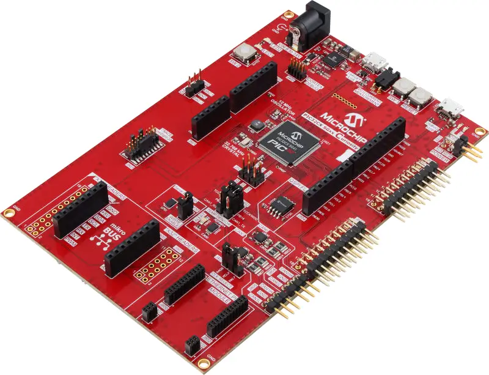

<!-- Copyright 2015-2026 Zephyr Project members and individual contributors. -->
<!-- SPDX-License-Identifier: Apache-2.0 -->
<!-- 中文翻译；编号、导航与译注为本地新增。 -->

<a id="pic32cx_sg61_cult"></a>

# 第22章\_PIC32CX SG61 Curiosity Ultra

原文：[官方页面](https://docs.zephyrproject.org/latest/boards/microchip/pic32c/pic32cx_sg61_cult/doc/index.html)。读取日期：2026-10-16；来源摘要见[来源记录](../SOURCES.md)。

开发板概览（Board Overview）

<a id="id1"></a>

[](images/pic32cx_sg61_cult.webp)

PIC32CX SG61 Curiosity Ultra

名称（Name）：

`pic32cx_sg61_cult`

厂商（Vendor）：

[微芯科技（Microchip Technology Inc.）](https://docs.zephyrproject.org/latest/boards/index.html#vendor=microchip)

状态（Status）：

维护中（Maintained）

架构（Architecture）：

[arm](https://docs.zephyrproject.org/latest/boards/index.html#arch=arm)

片上系统（SoC）：

[pic32cx1025sg61128](https://docs.zephyrproject.org/latest/boards/index.html#soc=pic32cx1025sg61128)

<a id="board-github-link"></a>

[浏览开发板源码（Browse Board Sources）](https://github.com/zephyrproject-rtos/zephyr/blob/main//boards/microchip/pic32c/pic32cx_sg61_cult/doc/index.rst/../..)<a id="overview"></a>

## 概述（Overview）

PIC32CX SG61 Curiosity Ultra评估套件用于评估Microchip PIC32CX SG60／SG61微控制器，料号EV09H35A。套件帮助用户开始使用PIC32CX SG60／SG61外设，并了解如何将器件集成到自己的设计。

<a id="hardware"></a>

## 硬件（Hardware）


- 128引脚TQFP封装的PIC32CX SG61微控制器
- 32.768 kHz晶体振荡器（Crystal Oscillator）
- 12 MHz晶体振荡器（Crystal Oscillator）
- 1024 KiB闪存及256 KiB RAM
- 两个黄色用户LED
- 一个绿色开发板电源LED
- 一个机械式用户按键
- 1个复位按键（Reset Button）
- USB接口，可作主机（Host）或设备（Device）
- 一个带驱动屏蔽（Driven Shield）的触摸按键
- 虚拟COM端口（CDC）
- 通过串行线调试（SWD）对板上PIC32CX SG60／SG61编程及调试
- Arduino Uno连接器

<a id="supported-features"></a>

### 支持的功能（Supported Features）

`pic32cx_sg61_cult`开发板支持下表所列的硬件功能。

片上／板载（On-Chip / On-Board）

功能集成在片上系统（SoC）内／位于开发板上。

2 / 2

分别表示已启用／已禁用的实例数。点击数量标签，可查看开发板或SoC设备树源码（DTS）中该功能的第一个实例。

`vnd,foo`

与此功能匹配的设备树绑定兼容字符串（Compatible String）；点击链接可查看绑定文档。

<a id="pic32cx_sg61_cult-hw-features"></a>

<a id="pic32cx_sg61_cult-pic32cx_sg61_cult/pic32cx1025sg61128-hw-features-section"></a>

#### `pic32cx_sg61_cult/pic32cx1025sg61128`目标（Target）

<a id="pic32cx_sg61_cult-pic32cx_sg61_cult/pic32cx1025sg61128-hw-features-panel"></a>

<a id="pic32cx_sg61_cult-pic32cx_sg61_cult/pic32cx1025sg61128-hw-features-memory"></a>

此开发板目标可用存储器：256 KiB RAM、1 MiB 闪存。

<a id="pic32cx_sg61_cult-pic32cx_sg61_cult/pic32cx1025sg61128-hw-features-table"></a>

<table>
<tr>
<th>类型（Type）</th>
<th>位置（Location）</th>
<th>说明（Description）</th>
<th>兼容字符串（Compatible）</th>
</tr>
<tr>
<td rowspan="1">中央处理器（CPU）</td>
<td>片上（On-Chip）</td>
<td>ARM Cortex-M4F 处理器（CPU）（<a href="https://github.com/zephyrproject-rtos/zephyr/blob/main/dts/arm/microchip/pic32c/pic32cx_sg/common/pic32cx_sg.dtsi?plain=1#L21">已启用：1</a>）</td>
<td><a href="../cpu_arm_riscv_binding_reference/P025_arm_cortex-m4f.md#std-dtcompatible-arm-cortex-m4f"><code>arm,cortex-m4f</code></a></td>
</tr>
<tr>
<td rowspan="1">模数转换器（ADC）</td>
<td>片上（On-Chip）</td>
<td>Microchip ADC G1驱动（<a href="https://github.com/zephyrproject-rtos/zephyr/blob/main/dts/arm/microchip/pic32c/pic32cx_sg/common/pic32cx_sg.dtsi?plain=1#L469">已启用：2</a>）</td>
<td><a href="../hardware/P859_MicrochipG1模数转换器绑定.md#dtbinding-microchip-adc-g1"><code>microchip,adc-g1</code></a></td>
</tr>
<tr>
<td rowspan="1">ARM 架构（ARM Architecture）</td>
<td>片上（On-Chip）</td>
<td>Microchip SERCOM模块（<a href="https://github.com/zephyrproject-rtos/zephyr/blob/main/dts/arm/microchip/pic32c/pic32cx_sg/common/pic32cx_sg.dtsi?plain=1#L174">已禁用：5</a>）</td>
<td><a href="../arm_timing_ethosu_control_binding_reference/P013_microchip_sercom-g1.md#std-dtcompatible-microchip-sercom-g1"><code>microchip,sercom-g1</code></a></td>
</tr>
<tr>
<td rowspan="10">时钟控制（Clock Control）</td>
<td>片上（On-Chip）</td>
<td>Microchip SAM_D5x_E5x SoC系列时钟（<a href="https://github.com/zephyrproject-rtos/zephyr/blob/main/dts/arm/microchip/pic32c/pic32cx_sg/common/pic32cx_sg.dtsi?plain=1#L49">已启用：1</a>）</td>
<td><a href="../clock_microchip_pic32_sam_binding_reference/P022_microchip_sam-d5x-e5x-clock.md#std-dtcompatible-microchip-sam-d5x-e5x-clock"><code>microchip,sam-d5x-e5x-clock</code></a></td>
</tr>
<tr>
<td>片上（On-Chip）</td>
<td>SAM_D5x_E5x晶体振荡器（XOSC）（<a href="https://github.com/zephyrproject-rtos/zephyr/blob/main/dts/arm/microchip/pic32c/pic32cx_sg/common/pic32cx_sg.dtsi?plain=1#L61">已启用：1</a>）</td>
<td><a href="../clock_sam_nordic_binding_reference/P005_microchip_sam-d5x-e5x-xosc.md#std-dtcompatible-microchip-sam-d5x-e5x-xosc"><code>microchip,sam-d5x-e5x-xosc</code></a></td>
</tr>
<tr>
<td>片上（On-Chip）</td>
<td>SAM_D5x_E5x内部振荡器（OSC48M）（<a href="https://github.com/zephyrproject-rtos/zephyr/blob/main/dts/arm/microchip/pic32c/pic32cx_sg/common/pic32cx_sg.dtsi?plain=1#L65">已启用：1</a>）</td>
<td><a href="../clock_microchip_pic32_sam_binding_reference/P023_microchip_sam-d5x-e5x-dfll.md#std-dtcompatible-microchip-sam-d5x-e5x-dfll"><code>microchip,sam-d5x-e5x-dfll</code></a></td>
</tr>
<tr>
<td>片上（On-Chip）</td>
<td>SAM_D5x_E5x FDPLL时钟（<a href="https://github.com/zephyrproject-rtos/zephyr/blob/main/dts/arm/microchip/pic32c/pic32cx_sg/common/pic32cx_sg.dtsi?plain=1#L69">已启用：1</a>）</td>
<td><a href="../clock_microchip_pic32_sam_binding_reference/P024_microchip_sam-d5x-e5x-fdpll.md#std-dtcompatible-microchip-sam-d5x-e5x-fdpll"><code>microchip,sam-d5x-e5x-fdpll</code></a></td>
</tr>
<tr>
<td>片上（On-Chip）</td>
<td>SAM_D5x_E5x RTC时钟（<a href="https://github.com/zephyrproject-rtos/zephyr/blob/main/dts/arm/microchip/pic32c/pic32cx_sg/common/pic32cx_sg.dtsi?plain=1#L73">已启用：1</a>）</td>
<td><a href="../clock_sam_nordic_binding_reference/P004_microchip_sam-d5x-e5x-rtc.md#std-dtcompatible-microchip-sam-d5x-e5x-rtc"><code>microchip,sam-d5x-e5x-rtc</code></a></td>
</tr>
<tr>
<td>片上（On-Chip）</td>
<td>SAM_D5x_E5x外部晶体振荡器（XOSC32K）（<a href="https://github.com/zephyrproject-rtos/zephyr/blob/main/dts/arm/microchip/pic32c/pic32cx_sg/common/pic32cx_sg.dtsi?plain=1#L78">已启用：1</a>）</td>
<td><a href="../clock_sam_nordic_binding_reference/P006_microchip_sam-d5x-e5x-xosc32k.md#std-dtcompatible-microchip-sam-d5x-e5x-xosc32k"><code>microchip,sam-d5x-e5x-xosc32k</code></a></td>
</tr>
<tr>
<td>片上（On-Chip）</td>
<td>SAM_D5x_E5x通用时钟发生器（Generic Clock Generator）（<a href="https://github.com/zephyrproject-rtos/zephyr/blob/main/dts/arm/microchip/pic32c/pic32cx_sg/common/pic32cx_sg.dtsi?plain=1#L82">已启用：1</a>）</td>
<td><a href="../clock_microchip_pic32_sam_binding_reference/P025_microchip_sam-d5x-e5x-gclkgen.md#std-dtcompatible-microchip-sam-d5x-e5x-gclkgen"><code>microchip,sam-d5x-e5x-gclkgen</code></a></td>
</tr>
<tr>
<td>片上（On-Chip）</td>
<td>SAM_D5x_E5x通用时钟外设（<a href="https://github.com/zephyrproject-rtos/zephyr/blob/main/dts/arm/microchip/pic32c/pic32cx_sg/common/pic32cx_sg.dtsi?plain=1#L86">已启用：1</a>）</td>
<td><a href="../clock_sam_nordic_binding_reference/P001_microchip_sam-d5x-e5x-gclkperiph.md#std-dtcompatible-microchip-sam-d5x-e5x-gclkperiph"><code>microchip,sam-d5x-e5x-gclkperiph</code></a></td>
</tr>
<tr>
<td>片上（On-Chip）</td>
<td>SAM_D5x_E5x CPU主时钟（<a href="https://github.com/zephyrproject-rtos/zephyr/blob/main/dts/arm/microchip/pic32c/pic32cx_sg/common/pic32cx_sg.dtsi?plain=1#L91">已启用：1</a>）</td>
<td><a href="../clock_sam_nordic_binding_reference/P002_microchip_sam-d5x-e5x-mclkcpu.md#std-dtcompatible-microchip-sam-d5x-e5x-mclkcpu"><code>microchip,sam-d5x-e5x-mclkcpu</code></a></td>
</tr>
<tr>
<td>片上（On-Chip）</td>
<td>SAM_D5x_E5x MCLK外设（<a href="https://github.com/zephyrproject-rtos/zephyr/blob/main/dts/arm/microchip/pic32c/pic32cx_sg/common/pic32cx_sg.dtsi?plain=1#L96">已启用：1</a>）</td>
<td><a href="../clock_sam_nordic_binding_reference/P003_microchip_sam-d5x-e5x-mclkperiph.md#std-dtcompatible-microchip-sam-d5x-e5x-mclkperiph"><code>microchip,sam-d5x-e5x-mclkperiph</code></a></td>
</tr>
<tr>
<td rowspan="1">比较器（Comparator）</td>
<td>片上（On-Chip）</td>
<td>Microchip G1模拟比较器（Analog Comparator）（<a href="https://github.com/zephyrproject-rtos/zephyr/blob/main/dts/arm/microchip/pic32c/pic32cx_sg/common/pic32cx_sg.dtsi?plain=1#L389">已禁用：1</a>）</td>
<td><a href="../hardware/P756_Microchip模拟比较器通道绑定.md#dtbinding-microchip-ac-g1-comparator"><code>microchip,ac-g1-comparator</code></a></td>
</tr>
<tr>
<td rowspan="4">计数器（Counter）</td>
<td>片上（On-Chip）</td>
<td>Microchip TC（<a href="https://github.com/zephyrproject-rtos/zephyr/blob/main/dts/arm/microchip/pic32c/pic32cx_sg/common/pic32cx_sg.dtsi?plain=1#L185">已启用：1</a>）</td>
<td><a href="../microchip_soc_counter_binding_reference/P009_microchip_tc-g1-counter.md#std-dtcompatible-microchip-tc-g1-counter"><code>microchip,tc-g1-counter</code></a></td>
</tr>
<tr>
<td>片上（On-Chip）</td>
<td>Microchip TC G1外设（<a href="https://github.com/zephyrproject-rtos/zephyr/blob/main/dts/arm/microchip/pic32c/pic32cx_sg/common/pic32cx_sg.dtsi?plain=1#L199">已禁用：6</a>）</td>
<td><a href="../microchip_soc_counter_binding_reference/P010_microchip_tc-g1.md#std-dtcompatible-microchip-tc-g1"><code>microchip,tc-g1</code></a></td>
</tr>
<tr>
<td>片上（On-Chip）</td>
<td>Microchip TCC G1计数器外设（<a href="https://github.com/zephyrproject-rtos/zephyr/blob/main/dts/arm/microchip/pic32c/pic32cx_sg/common/pic32cx_sg.dtsi?plain=1#L319">已启用：1</a>）</td>
<td><a href="../microchip_soc_counter_binding_reference/P012_microchip_tcc-g1-counter.md#std-dtcompatible-microchip-tcc-g1-counter"><code>microchip,tcc-g1-counter</code></a></td>
</tr>
<tr>
<td>片上（On-Chip）</td>
<td>Microchip TCC G1定时器／计数器外设（<a href="https://github.com/zephyrproject-rtos/zephyr/blob/main/dts/arm/microchip/pic32c/pic32cx_sg/common/pic32cx_sg.dtsi?plain=1#L377">已禁用：3</a>）</td>
<td><a href="../microchip_soc_counter_binding_reference/P013_microchip_tcc-g1.md#std-dtcompatible-microchip-tcc-g1"><code>microchip,tcc-g1</code></a></td>
</tr>
<tr>
<td rowspan="1">数模转换器（DAC）</td>
<td>片上（On-Chip）</td>
<td>Microchip G1 DAC（<a href="https://github.com/zephyrproject-rtos/zephyr/blob/main/dts/arm/microchip/pic32c/pic32cx_sg/common/pic32cx_sg.dtsi?plain=1#L505">已启用：1</a>）</td>
<td><a href="../hardware/P776_MicrochipG1数模转换器绑定.md#dtbinding-microchip-dac-g1"><code>microchip,dac-g1</code></a></td>
</tr>
<tr>
<td rowspan="1">直接存储器访问（DMA）</td>
<td>片上（On-Chip）</td>
<td>Microchip G1 DMA控制器（<a href="https://github.com/zephyrproject-rtos/zephyr/blob/main/dts/arm/microchip/pic32c/pic32cx_sg/common/pic32cx_sg.dtsi?plain=1#L273">已启用：1</a>）</td>
<td><a href="../intel_microchip_dma_binding_reference/P013_microchip_dmac-g1-dma.md#std-dtcompatible-microchip-dmac-g1-dma"><code>microchip,dmac-g1-dma</code></a></td>
</tr>
<tr>
<td rowspan="3">以太网（Ethernet）</td>
<td>片上（On-Chip）</td>
<td>Microchip G1 GMAC以太网控制器（<a href="https://github.com/zephyrproject-rtos/zephyr/blob/main/dts/arm/microchip/pic32c/pic32cx_sg/common/pic32cx_sg.dtsi?plain=1#L358">已启用：1</a>）</td>
<td><a href="../ethernet_mdio_microchip_binding_reference/P016_microchip_gmac-g1-eth.md#std-dtcompatible-microchip-gmac-g1-eth"><code>microchip,gmac-g1-eth</code></a></td>
</tr>
<tr>
<td>片上（On-Chip）</td>
<td>Microchip G1 GMAC MDIO控制器（<a href="https://github.com/zephyrproject-rtos/zephyr/blob/main/dts/arm/microchip/pic32c/pic32cx_sg/common/pic32cx_sg.dtsi?plain=1#L369">已启用：1</a>）</td>
<td><a href="../ethernet_mac_mdio_binding_reference/P020_microchip_gmac-g1-mdio.md#std-dtcompatible-microchip-gmac-g1-mdio"><code>microchip,gmac-g1-mdio</code></a></td>
</tr>
<tr>
<td>板载（On-Board）</td>
<td>通用媒体独立接口物理层（MII PHY）（<a href="https://github.com/zephyrproject-rtos/zephyr/blob/main/boards/microchip/pic32c/pic32cx_sg61_cult/pic32cx_sg61_cult.dts?plain=1#L396">已启用：1</a>）</td>
<td><a href="../ethernet_nxp_phy_binding_reference/P019_ethernet-phy.md#std-dtcompatible-ethernet-phy"><code>ethernet-phy</code></a></td>
</tr>
<tr>
<td rowspan="1">闪存控制器（Flash Controller）</td>
<td>片上（On-Chip）</td>
<td>Microchip NVMCTRL（<a href="https://github.com/zephyrproject-rtos/zephyr/blob/main/dts/arm/microchip/pic32c/pic32cx_sg/common/pic32cx_sg.dtsi?plain=1#L212">已启用：1</a>）</td>
<td><a href="../flash_adi_microchip_nordic_binding_reference/P022_microchip_nvmctrl-g1-flash.md#std-dtcompatible-microchip-nvmctrl-g1-flash"><code>microchip,nvmctrl-g1-flash</code></a></td>
</tr>
<tr>
<td rowspan="1">通用输入输出与接插件（GPIO &amp; Headers）</td>
<td>片上（On-Chip）</td>
<td>Microchip Port G1 GPIO（<a href="https://github.com/zephyrproject-rtos/zephyr/blob/main/dts/arm/microchip/pic32c/pic32cx_sg/common/pic32cx_sg.dtsi?plain=1#L254">已启用：4</a>）</td>
<td><a href="../gpio_microchip_nordic_nuvoton_binding_reference/P001_microchip_port-g1-gpio.md#std-dtcompatible-microchip-port-g1-gpio"><code>microchip,port-g1-gpio</code></a></td>
</tr>
<tr>
<td rowspan="1">硬件信息（Hardware Information）</td>
<td>片上（On-Chip）</td>
<td>Microchip G1硬件信息（hwinfo）驱动（<a href="https://github.com/zephyrproject-rtos/zephyr/blob/main/dts/arm/microchip/pic32c/pic32cx_sg/common/pic32cx_sg.dtsi?plain=1#L36">已启用：1</a>）</td>
<td><a href="../hwinfo_binding_reference/P005_microchip_hwinfo-g1.md#std-dtcompatible-microchip-hwinfo-g1"><code>microchip,hwinfo-g1</code></a></td>
</tr>
<tr>
<td rowspan="1">集成电路间总线（I2C）</td>
<td>片上（On-Chip）</td>
<td>Microchip SERCOM G1 I2C驱动（<a href="https://github.com/zephyrproject-rtos/zephyr/blob/main/dts/arm/microchip/pic32c/pic32cx_sg/common/pic32cx_sg_128.dtsi?plain=1#L13">已启用：1</a>）</td>
<td><a href="../i2c_infineon_ite_nordic_binding_reference/P012_microchip_sercom-g1-i2c.md#std-dtcompatible-microchip-sercom-g1-i2c"><code>microchip,sercom-g1-i2c</code></a></td>
</tr>
<tr>
<td rowspan="1">输入（Input）</td>
<td>板载（On-Board）</td>
<td>一组绑定到 GPIO 的输入按键（GPIO-Bound Input Keys）（<a href="https://github.com/zephyrproject-rtos/zephyr/blob/main/boards/microchip/pic32c/pic32cx_sg61_cult/pic32cx_sg61_cult.dts?plain=1#L60">已启用：1</a>）</td>
<td><a href="../hardware/P563_GPIO按键绑定.md#std-dtcompatible-gpio-keys"><code>gpio-keys</code></a></td>
</tr>
<tr>
<td rowspan="2">中断控制器（Interrupt Controller）</td>
<td>片上（On-Chip）</td>
<td>ARMv7-M 嵌套向量中断控制器（Nested Vectored Interrupt Controller，NVIC）（<a href="https://github.com/zephyrproject-rtos/zephyr/blob/main/dts/arm/armv7-m.dtsi?plain=1#L13">已启用：1</a>）</td>
<td><a href="../arm_interrupt_timer_binding_reference/P002_ARMv7_M_NVIC.md#std-dtcompatible-arm-v7m-nvic"><code>arm,v7m-nvic</code></a></td>
</tr>
<tr>
<td>片上（On-Chip）</td>
<td>Microchip EIC G1设备（<a href="https://github.com/zephyrproject-rtos/zephyr/blob/main/dts/arm/microchip/pic32c/pic32cx_sg/common/pic32cx_sg.dtsi?plain=1#L134">已启用：1</a>）</td>
<td><a href="../infineon_microchip_interrupt_binding_reference/P007_microchip_eic-g1-intc.md#std-dtcompatible-microchip-eic-g1-intc"><code>microchip,eic-g1-intc</code></a></td>
</tr>
<tr>
<td rowspan="2">发光二极管（LED）</td>
<td>板载（On-Board）</td>
<td>一组由 GPIO 控制的 LED（GPIO-Controlled LEDs）（<a href="https://github.com/zephyrproject-rtos/zephyr/blob/main/boards/microchip/pic32c/pic32cx_sg61_cult/pic32cx_sg61_cult.dts?plain=1#L37">已启用：1</a>）</td>
<td><a href="../hardware/P564_GPIO指示灯绑定.md#dtbinding-gpio-leds"><code>gpio-leds</code></a></td>
</tr>
<tr>
<td>板载（On-Board）</td>
<td>一组由脉宽调制（PWM）控制的LED（<a href="https://github.com/zephyrproject-rtos/zephyr/blob/main/boards/microchip/pic32c/pic32cx_sg61_cult/pic32cx_sg61_cult.dts?plain=1#L51">已启用：1</a>）</td>
<td><a href="../hardware/P565_PWM指示灯绑定.md#dtbinding-pwm-leds"><code>pwm-leds</code></a></td>
</tr>
<tr>
<td rowspan="1">内存管理单元／内存保护单元（MMU / MPU）</td>
<td>片上（On-Chip）</td>
<td>ARMv7-M存储器保护单元（MPU / Memory Protection Unit）（<a href="https://github.com/zephyrproject-rtos/zephyr/blob/main/dts/arm/microchip/pic32c/pic32cx_sg/common/pic32cx_sg.dtsi?plain=1#L28">已启用：1</a>）</td>
<td><a href="../memory_protection_binding_reference/P005_arm_armv7m-mpu.md#std-dtcompatible-arm-armv7m-mpu"><code>arm,armv7m-mpu</code></a></td>
</tr>
<tr>
<td rowspan="2">存储技术设备（MTD）</td>
<td>片上（On-Chip）</td>
<td>闪存（Flash）节点（<a href="https://github.com/zephyrproject-rtos/zephyr/blob/main/dts/arm/microchip/pic32c/pic32cx_sg/common/pic32cx_sg.dtsi?plain=1#L225">已启用：2</a>）</td>
<td><a href="../mtd_nxp_st_ti_partition_binding_reference/P013_soc-nv-flash.md#std-dtcompatible-soc-nv-flash"><code>soc-nv-flash</code></a></td>
</tr>
<tr>
<td>板载（On-Board）</td>
<td>兼容Atmel AT24系列的I2C电可擦除可编程只读存储器（EEPROM）（<a href="https://github.com/zephyrproject-rtos/zephyr/blob/main/boards/microchip/pic32c/pic32cx_sg61_cult/pic32cx_sg61_cult.dts?plain=1#L298">已启用：2</a>）</td>
<td><a href="../mtd_atmel_bouffalo_binding_reference/P004_atmel_at24.md#std-dtcompatible-atmel-at24"><code>atmel,at24</code></a></td>
</tr>
<tr>
<td rowspan="1">非易失存储器（NVMEM）</td>
<td>板载（On-Board）</td>
<td>非易失存储器固定布局（Fixed Layout for Non-Volatile Memory）（<a href="https://github.com/zephyrproject-rtos/zephyr/blob/main/boards/microchip/pic32c/pic32cx_sg61_cult/pic32cx_sg61_cult.dts?plain=1#L315">已启用：1</a>）</td>
<td><a href="../memory_protection_binding_reference/P009_fixed-layout.md#std-dtcompatible-fixed-layout"><code>fixed-layout</code></a></td>
</tr>
<tr>
<td rowspan="1">引脚控制（Pin Control）</td>
<td>片上（On-Chip）</td>
<td>Microchip PORT引脚控制（Pinctrl）容器节点（<a href="https://github.com/zephyrproject-rtos/zephyr/blob/main/dts/arm/microchip/pic32c/pic32cx_sg/common/pic32cx_sg.dtsi?plain=1#L247">已启用：1</a>）</td>
<td><a href="../pinctrl_infineon_nordic_nxp_binding_reference/P006_microchip_port-g1-pinctrl.md#std-dtcompatible-microchip-port-g1-pinctrl"><code>microchip,port-g1-pinctrl</code></a></td>
</tr>
<tr>
<td rowspan="2">脉宽调制（PWM）</td>
<td>片上（On-Chip）</td>
<td>Microchip G1 TCC PWM驱动（<a href="https://github.com/zephyrproject-rtos/zephyr/blob/main/dts/arm/microchip/pic32c/pic32cx_sg/common/pic32cx_sg.dtsi?plain=1#L307">已启用：1</a>）</td>
<td><a href="../pwm_intel_microchip_nxp_binding_reference/P011_microchip_tcc-g1-pwm.md#std-dtcompatible-microchip-tcc-g1-pwm"><code>microchip,tcc-g1-pwm</code></a></td>
</tr>
<tr>
<td>片上（On-Chip）</td>
<td>Microchip PWM TC G1驱动（<a href="https://github.com/zephyrproject-rtos/zephyr/blob/main/dts/arm/microchip/pic32c/pic32cx_sg/common/pic32cx_sg.dtsi?plain=1#L425">已启用：1</a>）</td>
<td><a href="../pwm_intel_microchip_nxp_binding_reference/P010_microchip_tc-g1-pwm.md#std-dtcompatible-microchip-tc-g1-pwm"><code>microchip,tc-g1-pwm</code></a></td>
</tr>
<tr>
<td rowspan="1">复位控制器（Reset Controller）</td>
<td>片上（On-Chip）</td>
<td>Microchip RSTC复位（Reset）驱动（<a href="https://github.com/zephyrproject-rtos/zephyr/blob/main/dts/arm/microchip/pic32c/pic32cx_sg/common/pic32cx_sg.dtsi?plain=1#L102">已启用：1</a>）</td>
<td><a href="../reset_controller_binding_reference/P006_microchip_rstc-g1-reset.md#std-dtcompatible-microchip-rstc-g1-reset"><code>microchip,rstc-g1-reset</code></a></td>
</tr>
<tr>
<td rowspan="1">随机数生成器（RNG）</td>
<td>片上（On-Chip）</td>
<td>Microchip TRNG G1熵（Entropy）驱动（<a href="https://github.com/zephyrproject-rtos/zephyr/blob/main/dts/arm/microchip/pic32c/pic32cx_sg/common/pic32cx_sg.dtsi?plain=1#L437">已启用：1</a>）</td>
<td><a href="../rng_binding_reference/P010_microchip_trng-g1-entropy.md#std-dtcompatible-microchip-trng-g1-entropy"><code>microchip,trng-g1-entropy</code></a></td>
</tr>
<tr>
<td rowspan="1">实时时钟（RTC）</td>
<td>片上（On-Chip）</td>
<td>Microchip G1 RTC驱动（<a href="https://github.com/zephyrproject-rtos/zephyr/blob/main/dts/arm/microchip/pic32c/pic32cx_sg/common/pic32cx_sg.dtsi?plain=1#L121">已启用：1</a>）</td>
<td><a href="../rtc_binding_reference/P015_microchip_rtc-g1.md#std-dtcompatible-microchip-rtc-g1"><code>microchip,rtc-g1</code></a></td>
</tr>
<tr>
<td rowspan="1">串行控制器（Serial Controller）</td>
<td>片上（On-Chip）</td>
<td>Microchip SERCOM UART控制器（<a href="https://github.com/zephyrproject-rtos/zephyr/blob/main/dts/arm/microchip/pic32c/pic32cx_sg/common/pic32cx_sg.dtsi?plain=1#L447">已启用：1</a>）</td>
<td><a href="../uart_espressif_infineon_microchip_binding_reference/P019_microchip_sercom-g1-uart.md#std-dtcompatible-microchip-sercom-g1-uart"><code>microchip,sercom-g1-uart</code></a></td>
</tr>
<tr>
<td rowspan="1">串行外设接口（SPI）</td>
<td>片上（On-Chip）</td>
<td>Microchip SERCOM SPI（<a href="https://github.com/zephyrproject-rtos/zephyr/blob/main/dts/arm/microchip/pic32c/pic32cx_sg/common/pic32cx_sg.dtsi?plain=1#L163">已禁用：1</a>）</td>
<td><a href="../spi_microchip_nordic_nxp_binding_reference/P009_microchip_sercom-g1-spi.md#std-dtcompatible-microchip-sercom-g1-spi"><code>microchip,sercom-g1-spi</code></a></td>
</tr>
<tr>
<td rowspan="1">静态随机存储器（SRAM）</td>
<td>片上（On-Chip）</td>
<td>通用片上静态随机存储器（SRAM）（<a href="https://github.com/zephyrproject-rtos/zephyr/blob/main/dts/arm/microchip/pic32c/pic32cx_sg/common/pic32cx_sg.dtsi?plain=1#L44">已启用：1</a>）</td>
<td><a href="../hardware/P567_内存映射SRAM绑定.md#dtbinding-mmio-sram"><code>mmio-sram</code></a></td>
</tr>
<tr>
<td rowspan="1">定时器（Timer）</td>
<td>片上（On-Chip）</td>
<td>ARMv7-M 系统节拍（System Tick）（<a href="https://github.com/zephyrproject-rtos/zephyr/blob/main/dts/arm/armv7-m.dtsi?plain=1#L21">已启用：1</a>）</td>
<td><a href="../arm_interrupt_timer_binding_reference/P006_ARMv7_M_SysTick.md#std-dtcompatible-arm-armv7m-systick"><code>arm,armv7m-systick</code></a></td>
</tr>
<tr>
<td rowspan="1">看门狗（Watchdog）</td>
<td>片上（On-Chip）</td>
<td>Microchip G1看门狗（Watchdog）驱动（<a href="https://github.com/zephyrproject-rtos/zephyr/blob/main/dts/arm/microchip/pic32c/pic32cx_sg/common/pic32cx_sg.dtsi?plain=1#L107">已禁用：1</a>）</td>
<td><a href="../soc_pmic_watchdog_binding_reference/P010_microchip_wdt-g1.md#std-dtcompatible-microchip-wdt-g1"><code>microchip,wdt-g1</code></a></td>
</tr>
</table>

<a id="connections-and-ios"></a>

### 连接与输入输出（Connections and IOs）

PIC32CX SG61 Curiosity Ultra用户指南提供开发板连接详情。（[PIC32CX SG61 Curiosity Ultra用户指南（User Guide）](https://ww1.microchip.com/downloads/aemDocuments/documents/MCU32/ProductDocuments/UserGuides/PIC32CX-SG41-SG61-Curiosity-Ultra-User-Guide-DS70005520.pdf)）

<a id="programming-debugging"></a>

## 编程与调试（Programming & Debugging）

`pic32cx_sg61_cult`开发板支持下表所列的运行工具（Runners）及相关west命令。

<table>
<tr>
<th></th>
<th>烧录（flash）</th>
<th>调试（debug）</th>
<th>连接调试会话（attach）</th>
<th>实时传输（rtt）</th>
<th>复位（reset）</th>
<th>调试服务器（debugserver）</th>
</tr>
<tr>
<td><a href="https://docs.zephyrproject.org/latest/develop/flash_debug/host-tools.html#runner-jlink"><code>jlink</code></a></td>
<td>✅</td>
<td>✅（默认 / default）</td>
<td>✅</td>
<td>✅</td>
<td>✅</td>
<td>✅</td>
</tr>
<tr>
<td>mplab_ipe</td>
<td>✅（默认 / default）</td>
<td></td>
<td></td>
<td></td>
<td></td>
<td></td>
</tr>
</table>

<a id="flash-using-mplab-ipe"></a>

### 使用MPLAB IPE烧录（Flash）

使用MPLAB IPE烧录的方法见“使用Microchip MPLAB IPE烧录”。（[使用Microchip MPLAB IPE烧录（Flashing）](P001_Flashing_with_Microchip_MPLAB_IPE.md#microchip-mplab-ipe-flashing)）

<a id="flash-using-j-link"></a>

### 使用J-Link烧录（Flash Using J-Link）

使用J-Link调试器烧录开发板时，请按以下步骤操作：


1. 安装J-Link软件（Install J-Link Software）


  - 从Segger下载并安装[J-Link软件](https://www.segger.com/downloads/jlink)工具。
  - 确认已安装的J-Link可执行文件，例如JLink及JLinkGDBServer，已加入系统PATH。
2. 连接开发板（Connect the Board）


  - 将J32调试探针连接到开发板的CORTEX DEBUG排针。（[J32调试探针（Debug Probe）](https://www.microchip.com/en-us/development-tool/dv164232)）
  - 通过USB将J32调试探针另一端连接到主机PC。
  - 将开发板DEBUG USB端口连接主机，为开发板供电。
3. 构建应用（Build the Application）

  可用west工具构建Blinky等Zephyr示例应用。从Zephyr工作区执行以下命令：

  ```text
  west build -b pic32cx_sg61_cult -p -s samples/basic/blinky
  ```

  这将为pic32cx_sg61_cult开发板构建Blinky应用。
4. 烧录设备（Flash the Device）

  构建完成后，用以下命令烧录固件：

  ```text
  west flash
  ```

  默认使用jlink运行工具（Runner）将应用烧录到开发板。
5. 观察结果（Observe the Result）

  烧录后LED1应开始闪烁，表明应用成功运行。

<a id="references"></a>

## 参考资料（References）

PIC32CX SG61产品页面：

[https://www.microchip.com/en-us/product/PIC32CX1025SG61128](https://www.microchip.com/en-us/product/PIC32CX1025SG61128)

PIC32CX SG61 Curiosity Ultra评估套件页面：

[https://www.microchip.com/en-us/development-tool/ev09h35a](https://www.microchip.com/en-us/development-tool/ev09h35a)

## 原文外链核对

2026-10-16核对并重试以下原文外链时未能确认可访问性，保留原始目标，不将访问失败解释为原文内容有误。

- [dv164232](https://www.microchip.com/en-us/development-tool/dv164232)：HTTP Error 403: Forbidden。
- [ev09h35a](https://www.microchip.com/en-us/development-tool/ev09h35a)：HTTP Error 403: Forbidden。
- [PIC32CX1025SG61128](https://www.microchip.com/en-us/product/PIC32CX1025SG61128)：HTTP Error 403: Forbidden。

---

[上一章](P021_PIC32CX_SG41_Curiosity_Ultra.md) · [返回大纲](大纲.md) · [全站翻译进度](../PROGRESS.md) · [下一章](P023_PIC32CZ_CA80_Curiosity_Ultra.md)
