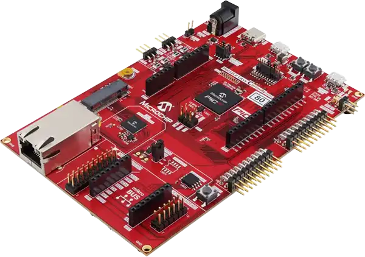

<!-- Copyright 2015-2026 Zephyr Project members and individual contributors. -->
<!-- SPDX-License-Identifier: Apache-2.0 -->
<!-- 中文翻译；编号、导航与译注为本地新增。 -->

<a id="pic32cz_ca80_cult"></a>

# 第23章\_PIC32CZ CA80 Curiosity Ultra

原文：[官方页面](https://docs.zephyrproject.org/latest/boards/microchip/pic32c/pic32cz_ca80_cult/doc/index.html)。读取日期：2026-10-16；来源摘要见[来源记录](../SOURCES.md)。

开发板概览（Board Overview）

<a id="id1"></a>

[](images/pic32cz_ca80_cult.webp)

PIC32CZ CA80 Curiosity Ultra

名称（Name）：

`pic32cz_ca80_cult`

厂商（Vendor）：

[微芯科技（Microchip Technology Inc.）](https://docs.zephyrproject.org/latest/boards/index.html#vendor=microchip)

状态（Status）：

维护中（Maintained）

架构（Architecture）：

[arm](https://docs.zephyrproject.org/latest/boards/index.html#arch=arm)

片上系统（SoC）：

[pic32cz8110ca80208](https://docs.zephyrproject.org/latest/boards/index.html#soc=pic32cz8110ca80208)

<a id="board-github-link"></a>

[浏览开发板源码（Browse Board Sources）](https://github.com/zephyrproject-rtos/zephyr/blob/main//boards/microchip/pic32c/pic32cz_ca80_cult/doc/index.rst/../..)<a id="overview"></a>

## 概述（Overview）

PIC32CZ CA80 Curiosity Ultra开发板用于评估Microchip PIC32CZ CA80微控制器，料号EV51S73A。开发板帮助用户开始使用PIC32CZ CA80外设，并了解如何将器件集成到自己的设计。

<a id="hardware"></a>

## 硬件（Hardware）


- 208引脚TFBGA封装的PIC32CZ8110 CA80微控制器
- 32.768 kHz晶体振荡器（Crystal Oscillator）
- 8M闪存及1M RAM，单位按原文保留
- 兼容Xplained Pro扩展的接口
- 两个黄色用户LED
- 两个机械用户按键
- 1个复位按键（Reset Button）
- 虚拟COM端口（VCOM）
- 通过串行线调试（SWD）对板上PIC32CZ CA80编程及调试
- 兼容Arduino Uno R3的接口
- MikroBus插座
- 板载温度传感器
- 图形接口（Graphics Interface）
- 千兆以太网（G-bit Ethernet）
- 两个高速USB接口，Type-C及Micro-A／B

<a id="supported-features"></a>

### 支持的功能（Supported Features）

`pic32cz_ca80_cult`开发板支持下表所列的硬件功能。

片上／板载（On-Chip / On-Board）

功能集成在片上系统（SoC）内／位于开发板上。

2 / 2

分别表示已启用／已禁用的实例数。点击数量标签，可查看开发板或SoC设备树源码（DTS）中该功能的第一个实例。

`vnd,foo`

与此功能匹配的设备树绑定兼容字符串（Compatible String）；点击链接可查看绑定文档。

<a id="pic32cz_ca80_cult-hw-features"></a>

<a id="pic32cz_ca80_cult-pic32cz_ca80_cult/pic32cz8110ca80208-hw-features-section"></a>

#### `pic32cz_ca80_cult/pic32cz8110ca80208`目标（Target）

<a id="pic32cz_ca80_cult-pic32cz_ca80_cult/pic32cz8110ca80208-hw-features-panel"></a>

<a id="pic32cz_ca80_cult-pic32cz_ca80_cult/pic32cz8110ca80208-hw-features-memory"></a>

该开发板目标的片上存储容量：1 MiB RAM、72 MiB Flash。

<a id="pic32cz_ca80_cult-pic32cz_ca80_cult/pic32cz8110ca80208-hw-features-table"></a>

<table>
<tr>
<th>类型（Type）</th>
<th>位置（Location）</th>
<th>说明（Description）</th>
<th>兼容字符串（Compatible）</th>
</tr>
<tr>
<td rowspan="1">中央处理器（CPU）</td>
<td>片上（On-Chip）</td>
<td>ARM Cortex-M7处理器（CPU）（<a href="https://github.com/zephyrproject-rtos/zephyr/blob/main/dts/arm/microchip/pic32c/pic32cz_ca/common/pic32cz_ca.dtsi?plain=1#L20">已启用：1</a>）</td>
<td><a href="../cpu_cortex_xtensa_binding_reference/P005_arm_cortex-m7.md#std-dtcompatible-arm-cortex-m7"><code>arm,cortex-m7</code></a></td>
</tr>
<tr>
<td rowspan="1">ARM 架构（ARM Architecture）</td>
<td>片上（On-Chip）</td>
<td>Microchip SERCOM模块（<a href="https://github.com/zephyrproject-rtos/zephyr/blob/main/dts/arm/microchip/pic32c/pic32cz_ca/common/pic32cz_ca.dtsi?plain=1#L221">已禁用：7</a>）</td>
<td><a href="../arm_timing_ethosu_control_binding_reference/P013_microchip_sercom-g1.md#std-dtcompatible-microchip-sercom-g1"><code>microchip,sercom-g1</code></a></td>
</tr>
<tr>
<td rowspan="10">时钟控制（Clock Control）</td>
<td>片上（On-Chip）</td>
<td>Microchip PIC32CZ_CA SoC系列时钟（<a href="https://github.com/zephyrproject-rtos/zephyr/blob/main/dts/arm/microchip/pic32c/pic32cz_ca/common/pic32cz_ca.dtsi?plain=1#L68">已启用：1</a>）</td>
<td><a href="../clock_microchip_pic32_sam_binding_reference/P012_microchip_pic32cz-ca-clock.md#std-dtcompatible-microchip-pic32cz-ca-clock"><code>microchip,pic32cz-ca-clock</code></a></td>
</tr>
<tr>
<td>片上（On-Chip）</td>
<td>PIC32CZ_CA晶体振荡器（XOSC）（<a href="https://github.com/zephyrproject-rtos/zephyr/blob/main/dts/arm/microchip/pic32c/pic32cz_ca/common/pic32cz_ca.dtsi?plain=1#L79">已启用：1</a>）</td>
<td><a href="../clock_microchip_pic32_sam_binding_reference/P020_microchip_pic32cz-ca-xosc.md#std-dtcompatible-microchip-pic32cz-ca-xosc"><code>microchip,pic32cz-ca-xosc</code></a></td>
</tr>
<tr>
<td>片上（On-Chip）</td>
<td>PIC32CZ_CA内部振荡器（OSC48M）（<a href="https://github.com/zephyrproject-rtos/zephyr/blob/main/dts/arm/microchip/pic32c/pic32cz_ca/common/pic32cz_ca.dtsi?plain=1#L83">已启用：1</a>）</td>
<td><a href="../clock_microchip_pic32_sam_binding_reference/P013_microchip_pic32cz-ca-dfll48m.md#std-dtcompatible-microchip-pic32cz-ca-dfll48m"><code>microchip,pic32cz-ca-dfll48m</code></a></td>
</tr>
<tr>
<td>片上（On-Chip）</td>
<td>PIC32CZ_CA DPLL时钟（<a href="https://github.com/zephyrproject-rtos/zephyr/blob/main/dts/arm/microchip/pic32c/pic32cz_ca/common/pic32cz_ca.dtsi?plain=1#L87">已启用：1</a>）</td>
<td><a href="../clock_microchip_pic32_sam_binding_reference/P014_microchip_pic32cz-ca-dpll.md#std-dtcompatible-microchip-pic32cz-ca-dpll"><code>microchip,pic32cz-ca-dpll</code></a></td>
</tr>
<tr>
<td>片上（On-Chip）</td>
<td>PIC32CZ_CA RTC时钟（<a href="https://github.com/zephyrproject-rtos/zephyr/blob/main/dts/arm/microchip/pic32c/pic32cz_ca/common/pic32cz_ca.dtsi?plain=1#L99">已启用：1</a>）</td>
<td><a href="../clock_microchip_pic32_sam_binding_reference/P019_microchip_pic32cz-ca-rtc.md#std-dtcompatible-microchip-pic32cz-ca-rtc"><code>microchip,pic32cz-ca-rtc</code></a></td>
</tr>
<tr>
<td>片上（On-Chip）</td>
<td>PIC32CZ_CA外部晶体振荡器（XOSC32K）（<a href="https://github.com/zephyrproject-rtos/zephyr/blob/main/dts/arm/microchip/pic32c/pic32cz_ca/common/pic32cz_ca.dtsi?plain=1#L104">已启用：1</a>）</td>
<td><a href="../clock_microchip_pic32_sam_binding_reference/P021_microchip_pic32cz-ca-xosc32k.md#std-dtcompatible-microchip-pic32cz-ca-xosc32k"><code>microchip,pic32cz-ca-xosc32k</code></a></td>
</tr>
<tr>
<td>片上（On-Chip）</td>
<td>PIC32CZ_CA通用时钟发生器（Generic Clock Generator）（<a href="https://github.com/zephyrproject-rtos/zephyr/blob/main/dts/arm/microchip/pic32c/pic32cz_ca/common/pic32cz_ca.dtsi?plain=1#L108">已启用：1</a>）</td>
<td><a href="../clock_microchip_pic32_sam_binding_reference/P015_microchip_pic32cz-ca-gclkgen.md#std-dtcompatible-microchip-pic32cz-ca-gclkgen"><code>microchip,pic32cz-ca-gclkgen</code></a></td>
</tr>
<tr>
<td>片上（On-Chip）</td>
<td>PIC32CZ_CA通用时钟外设（<a href="https://github.com/zephyrproject-rtos/zephyr/blob/main/dts/arm/microchip/pic32c/pic32cz_ca/common/pic32cz_ca.dtsi?plain=1#L112">已启用：1</a>）</td>
<td><a href="../clock_microchip_pic32_sam_binding_reference/P016_microchip_pic32cz-ca-gclkperiph.md#std-dtcompatible-microchip-pic32cz-ca-gclkperiph"><code>microchip,pic32cz-ca-gclkperiph</code></a></td>
</tr>
<tr>
<td>片上（On-Chip）</td>
<td>PIC32CZ_CA主时钟域（Main Clock Domains）（<a href="https://github.com/zephyrproject-rtos/zephyr/blob/main/dts/arm/microchip/pic32c/pic32cz_ca/common/pic32cz_ca.dtsi?plain=1#L117">已启用：1</a>）</td>
<td><a href="../clock_microchip_pic32_sam_binding_reference/P017_microchip_pic32cz-ca-mclkdomain.md#std-dtcompatible-microchip-pic32cz-ca-mclkdomain"><code>microchip,pic32cz-ca-mclkdomain</code></a></td>
</tr>
<tr>
<td>片上（On-Chip）</td>
<td>PIC32CZ_CA MCLK外设（<a href="https://github.com/zephyrproject-rtos/zephyr/blob/main/dts/arm/microchip/pic32c/pic32cz_ca/common/pic32cz_ca.dtsi?plain=1#L121">已启用：1</a>）</td>
<td><a href="../clock_microchip_pic32_sam_binding_reference/P018_microchip_pic32cz-ca-mclkperiph.md#std-dtcompatible-microchip-pic32cz-ca-mclkperiph"><code>microchip,pic32cz-ca-mclkperiph</code></a></td>
</tr>
<tr>
<td rowspan="1">直接存储器访问（DMA）</td>
<td>片上（On-Chip）</td>
<td>Microchip G3 DMA控制器（<a href="https://github.com/zephyrproject-rtos/zephyr/blob/main/dts/arm/microchip/pic32c/pic32cz_ca/common/pic32cz_ca.dtsi?plain=1#L198">已启用：1</a>）</td>
<td><a href="../intel_microchip_dma_binding_reference/P015_microchip_dmac-g3-dma.md#std-dtcompatible-microchip-dmac-g3-dma"><code>microchip,dmac-g3-dma</code></a></td>
</tr>
<tr>
<td rowspan="1">闪存控制器（Flash Controller）</td>
<td>片上（On-Chip）</td>
<td>Microchip闪存控制器（Flash Controller）（<a href="https://github.com/zephyrproject-rtos/zephyr/blob/main/dts/arm/microchip/pic32c/pic32cz_ca/common/pic32cz_ca.dtsi?plain=1#L39">已启用：1</a>）</td>
<td><a href="../flash_adi_microchip_nordic_binding_reference/P024_microchip_nvmctrl-g3.md#std-dtcompatible-microchip-nvmctrl-g3"><code>microchip,nvmctrl-g3</code></a></td>
</tr>
<tr>
<td rowspan="1">通用输入输出与接插件（GPIO &amp; Headers）</td>
<td>片上（On-Chip）</td>
<td>Microchip Port G1 GPIO（<a href="https://github.com/zephyrproject-rtos/zephyr/blob/main/dts/arm/microchip/pic32c/pic32cz_ca/common/pic32cz_ca.dtsi?plain=1#L170">已启用：2</a>；<a href="https://github.com/zephyrproject-rtos/zephyr/blob/main/dts/arm/microchip/pic32c/pic32cz_ca/common/pic32cz_ca.dtsi?plain=1#L161">已禁用：5</a>）</td>
<td><a href="../gpio_microchip_nordic_nuvoton_binding_reference/P001_microchip_port-g1-gpio.md#std-dtcompatible-microchip-port-g1-gpio"><code>microchip,port-g1-gpio</code></a></td>
</tr>
<tr>
<td rowspan="1">集成电路间总线（I2C）</td>
<td>片上（On-Chip）</td>
<td>Microchip SERCOM G1 I2C驱动（<a href="https://github.com/zephyrproject-rtos/zephyr/blob/main/dts/arm/microchip/pic32c/pic32cz_ca/common/pic32cz_ca_208.dtsi?plain=1#L33">已启用：1</a>）</td>
<td><a href="../i2c_infineon_ite_nordic_binding_reference/P012_microchip_sercom-g1-i2c.md#std-dtcompatible-microchip-sercom-g1-i2c"><code>microchip,sercom-g1-i2c</code></a></td>
</tr>
<tr>
<td rowspan="1">输入（Input）</td>
<td>板载（On-Board）</td>
<td>一组绑定到 GPIO 的输入按键（GPIO-Bound Input Keys）（<a href="https://github.com/zephyrproject-rtos/zephyr/blob/main/boards/microchip/pic32c/pic32cz_ca80_cult/pic32cz_ca80_cult.dts?plain=1#L48">已启用：1</a>）</td>
<td><a href="../hardware/P563_GPIO按键绑定.md#std-dtcompatible-gpio-keys"><code>gpio-keys</code></a></td>
</tr>
<tr>
<td rowspan="1">中断控制器（Interrupt Controller）</td>
<td>片上（On-Chip）</td>
<td>ARMv7-M 嵌套向量中断控制器（Nested Vectored Interrupt Controller，NVIC）（<a href="https://github.com/zephyrproject-rtos/zephyr/blob/main/dts/arm/armv7-m.dtsi?plain=1#L13">已启用：1</a>）</td>
<td><a href="../arm_interrupt_timer_binding_reference/P002_ARMv7_M_NVIC.md#std-dtcompatible-arm-v7m-nvic"><code>arm,v7m-nvic</code></a></td>
</tr>
<tr>
<td rowspan="1">发光二极管（LED）</td>
<td>板载（On-Board）</td>
<td>一组由 GPIO 控制的 LED（GPIO-Controlled LEDs）（<a href="https://github.com/zephyrproject-rtos/zephyr/blob/main/boards/microchip/pic32c/pic32cz_ca80_cult/pic32cz_ca80_cult.dts?plain=1#L34">已启用：1</a>）</td>
<td><a href="../hardware/P564_GPIO指示灯绑定.md#dtbinding-gpio-leds"><code>gpio-leds</code></a></td>
</tr>
<tr>
<td rowspan="1">内存管理单元／内存保护单元（MMU / MPU）</td>
<td>片上（On-Chip）</td>
<td>ARMv7-M存储器保护单元（MPU / Memory Protection Unit）（<a href="https://github.com/zephyrproject-rtos/zephyr/blob/main/dts/arm/microchip/pic32c/pic32cz_ca/common/pic32cz_ca.dtsi?plain=1#L27">已启用：1</a>）</td>
<td><a href="../memory_protection_binding_reference/P005_arm_armv7m-mpu.md#std-dtcompatible-arm-armv7m-mpu"><code>arm,armv7m-mpu</code></a></td>
</tr>
<tr>
<td rowspan="2">存储技术设备（MTD）</td>
<td>片上（On-Chip）</td>
<td>Microchip NVMCTRL G3闪存（<a href="https://github.com/zephyrproject-rtos/zephyr/blob/main/dts/arm/microchip/pic32c/pic32cz_ca/common/pic32cz_ca.dtsi?plain=1#L56">已启用：1</a>）</td>
<td><a href="../mtd_microchip_nordic_nxp_binding_reference/P004_microchip_flash-g3.md#std-dtcompatible-microchip-flash-g3"><code>microchip,flash-g3</code></a></td>
</tr>
<tr>
<td>板载（On-Board）</td>
<td>兼容Atmel AT24系列的I2C电可擦除可编程只读存储器（EEPROM）（<a href="https://github.com/zephyrproject-rtos/zephyr/blob/main/boards/microchip/pic32c/pic32cz_ca80_cult/pic32cz_ca80_cult.dts?plain=1#L252">已启用：1</a>）</td>
<td><a href="../mtd_atmel_bouffalo_binding_reference/P004_atmel_at24.md#std-dtcompatible-atmel-at24"><code>atmel,at24</code></a></td>
</tr>
<tr>
<td rowspan="1">引脚控制（Pin Control）</td>
<td>片上（On-Chip）</td>
<td>Microchip PORT引脚控制（Pinctrl）容器节点（<a href="https://github.com/zephyrproject-rtos/zephyr/blob/main/dts/arm/microchip/pic32c/pic32cz_ca/common/pic32cz_ca.dtsi?plain=1#L155">已启用：1</a>）</td>
<td><a href="../pinctrl_infineon_nordic_nxp_binding_reference/P006_microchip_port-g1-pinctrl.md#std-dtcompatible-microchip-port-g1-pinctrl"><code>microchip,port-g1-pinctrl</code></a></td>
</tr>
<tr>
<td rowspan="1">实时时钟（RTC）</td>
<td>片上（On-Chip）</td>
<td>Microchip G1 RTC驱动（<a href="https://github.com/zephyrproject-rtos/zephyr/blob/main/dts/arm/microchip/pic32c/pic32cz_ca/common/pic32cz_ca.dtsi?plain=1#L141">已启用：1</a>）</td>
<td><a href="../rtc_binding_reference/P015_microchip_rtc-g1.md#std-dtcompatible-microchip-rtc-g1"><code>microchip,rtc-g1</code></a></td>
</tr>
<tr>
<td rowspan="1">串行控制器（Serial Controller）</td>
<td>片上（On-Chip）</td>
<td>Microchip SERCOM UART控制器（<a href="https://github.com/zephyrproject-rtos/zephyr/blob/main/dts/arm/microchip/pic32c/pic32cz_ca/common/pic32cz_ca.dtsi?plain=1#L243">已启用：1</a>）</td>
<td><a href="../uart_espressif_infineon_microchip_binding_reference/P019_microchip_sercom-g1-uart.md#std-dtcompatible-microchip-sercom-g1-uart"><code>microchip,sercom-g1-uart</code></a></td>
</tr>
<tr>
<td rowspan="1">串行外设接口（SPI）</td>
<td>片上（On-Chip）</td>
<td>Microchip SERCOM SPI（<a href="https://github.com/zephyrproject-rtos/zephyr/blob/main/dts/arm/microchip/pic32c/pic32cz_ca/common/pic32cz_ca.dtsi?plain=1#L210">已启用：1</a>）</td>
<td><a href="../spi_microchip_nordic_nxp_binding_reference/P009_microchip_sercom-g1-spi.md#std-dtcompatible-microchip-sercom-g1-spi"><code>microchip,sercom-g1-spi</code></a></td>
</tr>
<tr>
<td rowspan="1">静态随机存储器（SRAM）</td>
<td>片上（On-Chip）</td>
<td>通用片上静态随机存储器（SRAM）（<a href="https://github.com/zephyrproject-rtos/zephyr/blob/main/dts/arm/microchip/pic32c/pic32cz_ca/common/pic32cz_ca.dtsi?plain=1#L35">已启用：1</a>）</td>
<td><a href="../hardware/P567_内存映射SRAM绑定.md#dtbinding-mmio-sram"><code>mmio-sram</code></a></td>
</tr>
<tr>
<td rowspan="1">定时器（Timer）</td>
<td>片上（On-Chip）</td>
<td>ARMv7-M 系统节拍（System Tick）（<a href="https://github.com/zephyrproject-rtos/zephyr/blob/main/dts/arm/armv7-m.dtsi?plain=1#L21">已启用：1</a>）</td>
<td><a href="../arm_interrupt_timer_binding_reference/P006_ARMv7_M_SysTick.md#std-dtcompatible-arm-armv7m-systick"><code>arm,armv7m-systick</code></a></td>
</tr>
<tr>
<td rowspan="1">看门狗（Watchdog）</td>
<td>片上（On-Chip）</td>
<td>Microchip G1看门狗（Watchdog）驱动（<a href="https://github.com/zephyrproject-rtos/zephyr/blob/main/dts/arm/microchip/pic32c/pic32cz_ca/common/pic32cz_ca.dtsi?plain=1#L127">已禁用：1</a>）</td>
<td><a href="../soc_pmic_watchdog_binding_reference/P010_microchip_wdt-g1.md#std-dtcompatible-microchip-wdt-g1"><code>microchip,wdt-g1</code></a></td>
</tr>
</table>

<a id="connections-and-ios"></a>

### 连接与输入输出（Connections and IOs）

PIC32CZ CA80 Curiosity Ultra用户指南提供开发板连接详情。（[PIC32CZ CA80 Curiosity Ultra用户指南（User Guide）](https://ww1.microchip.com/downloads/aemDocuments/documents/MCU32/ProductDocuments/UserGuides/PIC32CZ-CA80-CA90-Curiosity-Ultra-User-Guide-DS70005522.pdf)）

<a id="programming-debugging"></a>

## 编程与调试（Programming & Debugging）

`pic32cz_ca80_cult`开发板支持下表所列的运行工具（Runners）及相关west命令。

<table>
<tr>
<th></th>
<th>烧录（flash）</th>
<th>调试（debug）</th>
<th>连接调试会话（attach）</th>
<th>实时传输（rtt）</th>
<th>复位（reset）</th>
<th>调试服务器（debugserver）</th>
</tr>
<tr>
<td><a href="https://docs.zephyrproject.org/latest/develop/flash_debug/host-tools.html#runner-jlink"><code>jlink</code></a></td>
<td>✅（默认 / default）</td>
<td>✅（默认 / default）</td>
<td>✅</td>
<td>✅</td>
<td>✅</td>
<td>✅</td>
</tr>
<tr>
<td>mplab_ipe</td>
<td>✅</td>
<td></td>
<td></td>
<td></td>
<td></td>
<td></td>
</tr>
</table>

<a id="flash-using-mplab-ipe"></a>

### 使用MPLAB IPE烧录（Flash）

使用MPLAB IPE烧录的方法见“使用Microchip MPLAB IPE烧录”。（[使用Microchip MPLAB IPE烧录（Flashing）](P001_Flashing_with_Microchip_MPLAB_IPE.md#microchip-mplab-ipe-flashing)）

<a id="flash-using-j-link"></a>

### 使用J-Link烧录（Flash Using J-Link）

使用J-Link调试器烧录开发板时，请按以下步骤操作：


1. 安装J-Link软件（Install J-Link Software）


  - 从Segger下载并安装[J-Link软件](https://www.segger.com/downloads/jlink)工具。
  - 确认已安装的J-Link可执行文件，例如JLink及JLinkGDBServer，已加入系统PATH。
2. 连接开发板（Connect the Board）


  - 将J32调试探针连接到开发板的CORTEX DEBUG排针。（[J32调试探针（Debug Probe）](https://www.microchip.com/en-us/development-tool/dv164232)）
  - 通过USB将J32调试探针另一端连接到主机PC。
  - 将开发板DEBUG USB端口连接主机，为开发板供电。
3. 构建应用（Build the Application）

  可用west工具构建Blinky等Zephyr示例应用。从Zephyr工作区执行以下命令：

  ```text
  west build -b pic32cz_ca80_cult -p -s samples/basic/blinky
  ```

  这将为pic32cz_ca80_cult开发板构建Blinky应用。
4. 烧录设备（Flash the Device）

  构建完成后，用以下命令烧录固件：

  ```text
  west flash
  ```

  默认使用jlink运行工具（Runner）将应用烧录到开发板。
5. 观察结果（Observe the Result）

  烧录后LED0应开始闪烁，表明应用成功运行。

<a id="references"></a>

## 参考资料（References）

PIC32CZ CA80产品页面：

[https://www.microchip.com/en-us/product/PIC32CZ8110CA80208](https://www.microchip.com/en-us/product/PIC32CZ8110CA80208)

PIC32CZ CA80 Curiosity Ultra开发板页面：

[https://www.microchip.com/en-us/development-tool/ev51s73a](https://www.microchip.com/en-us/development-tool/ev51s73a)

## 译注

原文硬件概述为8M闪存及1M RAM，自动生成目标表列72 MiB闪存，分别保留，不合并为单个物理容量。

## 原文外链核对

2026-10-16核对并重试以下原文外链时未能确认可访问性，保留原始目标，不将访问失败解释为原文内容有误。

- [dv164232](https://www.microchip.com/en-us/development-tool/dv164232)：HTTP Error 403: Forbidden。
- [ev51s73a](https://www.microchip.com/en-us/development-tool/ev51s73a)：HTTP Error 403: Forbidden。
- [PIC32CZ8110CA80208](https://www.microchip.com/en-us/product/PIC32CZ8110CA80208)：HTTP Error 403: Forbidden。

---

[上一章](P022_PIC32CX_SG61_Curiosity_Ultra.md) · [返回大纲](大纲.md) · [全站翻译进度](../PROGRESS.md) · [下一章](P024_PIC32CZ_CA90_Curiosity_Ultra.md)
