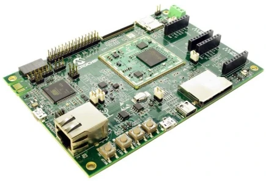

<!-- Copyright 2015-2026 Zephyr Project members and individual contributors. -->
<!-- SPDX-License-Identifier: Apache-2.0 -->
<!-- 中文翻译；编号、导航与译注为本地新增。 -->

# 第28章\_SAMA5D27 SOM1 Kit1

原文：[官方页面](https://docs.zephyrproject.org/latest/boards/microchip/sam/sama5d27_som1_ek1/doc/index.html)。读取日期：2026-10-16；来源摘要见[来源记录](../SOURCES.md)。

开发板概览（Board Overview）

SAMA5D27 SOM1 Kit1

名称（Name）：

`sama5d27_som1_ek1`

厂商（Vendor）：

[微芯科技（Microchip Technology Inc.）](https://docs.zephyrproject.org/latest/boards/index.html#vendor=microchip)

状态（Status）：

维护中（Maintained）

架构（Architecture）：

[arm](https://docs.zephyrproject.org/latest/boards/index.html#arch=arm)

片上系统（SoC）：

[sama5d27som1](https://docs.zephyrproject.org/latest/boards/index.html#soc=sama5d27som1)

[浏览开发板源码（Browse Board Sources）](https://github.com/zephyrproject-rtos/zephyr/blob/main//boards/microchip/sam/sama5d27_som1_ek1/doc/index.rst/../..)

## 概述（Overview）

ATSAMA5D27-SOM1-EK1是用于基于SAMA5D2的系统级封装（SiP）及SAMA5D27-SOM1系统模块（System On Module）的快速原型与评估平台。套件由焊接ATSAMA5D27-SOM1模块的底板组成；模块使用ATSAMA5D27C-D1G-CU SiP，内嵌1 Gbit、即128 MB DDR2 DRAM。SOM还集成电源管理芯片（PMIC）、QSPI存储器、10/100 Mbps以太网PHY及带MAC地址的串行EEPROM，并提供128个通用GPIO。开发板具有丰富外设、用户接口及扩展选项，包括两个支持MIKROE Click boards™的mikroBUS™ Click接口排针和一个PMOD™接口。Linux发行版及软件包可帮助开始开发。

## 硬件（Hardware）

- 焊接的SAMA5D27 SOM1模块：包含内嵌1 Gbit DDR2 SDRAM的SAMA5D27-D1G-CU SiP、QSPI存储器、10/100 Mbps以太网控制器及128个GPIO引脚
- 一个QSPI闪存焊盘，未安装器件
- 一个CryptoAuthentication™器件ATECC608
- 一个USB主机接口，使用Type-C连接器
- 一个USB设备接口，使用Micro-AB连接器
- 一个USB HSIC接口，2引脚排针未安装
- 一个以太网接口，使用RJ45连接器
- 一个CAN接口，使用ATA6561
- 一个24位RGB LCD接口，使用50引脚FPC连接器
- 一个12位ISC接口，使用2×15公头连接器
- 一个标准SD卡接口，带3.3 V／1.8 V电源切换
- 一个microSD卡接口
- 一个J-Link-OB及J-Link-CDC，基于内嵌J-Link固件的Microchip SAM3U微控制器
- 一个JTAG接口
- 一个RGB红绿蓝LED
- 四个按钮开关：上电（Power ON）、复位（Reset）、唤醒（Wakeup）及用户自定义（User Free）
- 一个防篡改（Tamper）连接器，10引脚公头
- 一个Pmod连接器，6引脚母座
- 两个mikroBUS接口，使用2×8引脚母座
- 通过USB A和／或USB J-Link-OB提供5 V直流电源
- 用于节能的超级电容（SuperCap）

### 支持的功能（Supported Features）

`sama5d27_som1_ek1`开发板支持下表所列的硬件功能。

片上／板载（On-Chip / On-Board）

功能集成在片上系统（SoC）内／位于开发板上。

2 / 2

分别表示已启用／已禁用的实例数。点击数量标签，可查看开发板或SoC设备树源码（DTS）中该功能的第一个实例。

`vnd,foo`

与此功能匹配的设备树绑定兼容字符串（Compatible String）；点击链接可查看绑定文档。

#### `sama5d27_som1_ek1/sama5d27som1`目标（Target）

该开发板目标的片上存储容量：128 MiB RAM、N/A Flash。

<table>
<tr>
<th>类型（Type）</th>
<th>位置（Location）</th>
<th>说明（Description）</th>
<th>兼容字符串（Compatible）</th>
</tr>
<tr>
<td rowspan="3">时钟控制（Clock Control）</td>
<td>片上（On-Chip）</td>
<td>Microchip电源管理控制器（PMC / Power Management Controller）（<a href="https://github.com/zephyrproject-rtos/zephyr/blob/main/dts/arm/microchip/sam/sama5/sama5d2/sama5d2.dtsi?plain=1#L65">已启用：1</a>）</td>
<td><a href="../clock_esp_infineon_microchip_binding_reference/P019_microchip_sam-pmc.md#std-dtcompatible-microchip-sam-pmc"><code>microchip,sam-pmc</code></a></td>
</tr>
<tr>
<td>片上（On-Chip）</td>
<td>Microchip SCKC（<a href="https://github.com/zephyrproject-rtos/zephyr/blob/main/dts/arm/microchip/sam/sama5/sama5d2/sama5d2.dtsi?plain=1#L71">已启用：1</a>）</td>
<td><a href="../clock_esp_infineon_microchip_binding_reference/P020_microchip_sama7g5-sckc.md#std-dtcompatible-microchip-sama7g5-sckc"><code>microchip,sama7g5-sckc</code></a></td>
</tr>
<tr>
<td>片上（On-Chip）</td>
<td>通用固定频率时钟提供者（Fixed-Rate Clock Provider）（<a href="https://github.com/zephyrproject-rtos/zephyr/blob/main/dts/arm/microchip/sam/sama5/sama5d2/sama5d2.dtsi?plain=1#L29">已启用：2</a>）</td>
<td><a href="../hardware/P566_固定时钟绑定.md#dtbinding-fixed-clock"><code>fixed-clock</code></a></td>
</tr>
<tr>
<td rowspan="1">中断控制器（Interrupt Controller）</td>
<td>片上（On-Chip）</td>
<td>Microchip G1 AIC控制器（<a href="https://github.com/zephyrproject-rtos/zephyr/blob/main/dts/arm/microchip/sam/sama5/sama5d2/sama5d2.dtsi?plain=1#L93">已启用：1</a>）</td>
<td><a href="../infineon_microchip_interrupt_binding_reference/P005_microchip_aic-g1-intc.md#std-dtcompatible-microchip-aic-g1-intc"><code>microchip,aic-g1-intc</code></a></td>
</tr>
<tr>
<td rowspan="1">实时时钟（RTC）</td>
<td>片上（On-Chip）</td>
<td>Microchip RTC G2控制器（<a href="https://github.com/zephyrproject-rtos/zephyr/blob/main/dts/arm/microchip/sam/sama5/sama5d2/sama5d2.dtsi?plain=1#L78">已启用：1</a>）</td>
<td><a href="../rtc_binding_reference/P016_microchip_rtc-g2.md#std-dtcompatible-microchip-rtc-g2"><code>microchip,rtc-g2</code></a></td>
</tr>
<tr>
<td rowspan="1">串行控制器（Serial Controller）</td>
<td>片上（On-Chip）</td>
<td>Microchip UART G1控制器（<a href="https://github.com/zephyrproject-rtos/zephyr/blob/main/dts/arm/microchip/sam/sama5/sama5d2/sama5d2.dtsi?plain=1#L46">已启用：1</a>）</td>
<td><a href="../uart_espressif_infineon_microchip_binding_reference/P020_microchip_uart-g1.md#std-dtcompatible-microchip-uart-g1"><code>microchip,uart-g1</code></a></td>
</tr>
<tr>
<td rowspan="1">静态随机存储器（SRAM）</td>
<td>片上（On-Chip）</td>
<td>通用片上静态随机存储器（SRAM）（<a href="https://github.com/zephyrproject-rtos/zephyr/blob/main/dts/arm/microchip/sam/sama5/sama5d2/sama5d2.dtsi?plain=1#L41">已启用：1</a>）</td>
<td><a href="../hardware/P567_内存映射SRAM绑定.md#dtbinding-mmio-sram"><code>mmio-sram</code></a></td>
</tr>
<tr>
<td rowspan="1">系统控制器（System Controller）</td>
<td>片上（On-Chip）</td>
<td>系统控制器寄存器读写（System Controller Registers R/W）（<a href="https://github.com/zephyrproject-rtos/zephyr/blob/main/dts/arm/microchip/sam/sama5/sama5d2/sama5d2.dtsi?plain=1#L88">已启用：1</a>）</td>
<td><a href="../edac_syscon_binding_reference/P008_syscon.md#std-dtcompatible-syscon"><code>syscon</code></a></td>
</tr>
<tr>
<td rowspan="1">定时器（Timer）</td>
<td>片上（On-Chip）</td>
<td>Microchip G1 PIT（<a href="https://github.com/zephyrproject-rtos/zephyr/blob/main/dts/arm/microchip/sam/sama5/sama5d2/sama5d2.dtsi?plain=1#L55">已启用：1</a>）</td>
<td><a href="../microchip_nordic_nxp_realtek_timer_binding_reference/P001_microchip_pit-g1-timer.md#std-dtcompatible-microchip-pit-g1-timer"><code>microchip,pit-g1-timer</code></a></td>
</tr>
</table>

### 连接与输入输出（Connections and IOs）

SAMA5D27-SOM1-EK1用户指南提供开发板连接详情。（[SAMA5D27-SOM1-EK1用户指南（User Guide）](https://ww1.microchip.com/downloads/aemDocuments/documents/MPU32/ProductDocuments/UserGuides/SAMA5D27-SOM1-Kit1-User%27s-Guide-DS50002667.pdf)）

## 参考资料（References）

SAMA5D2系列页面：

[https://www.microchip.com/en-us/products/microprocessors/32-bit-mpus/sama5/sama5d2-series](https://www.microchip.com/en-us/products/microprocessors/32-bit-mpus/sama5/sama5d2-series)

SAMA5D27-SOM1产品页面：

[https://www.microchip.com/en-us/product/ATSAMA5D27-SOM1](https://www.microchip.com/en-us/product/ATSAMA5D27-SOM1)

SAMA5D27 SOM1 Kit1页面：

[https://www.microchip.com/en-us/development-tool/ATSAMA5D27-SOM1-EK1](https://www.microchip.com/en-us/development-tool/ATSAMA5D27-SOM1-EK1)

## 原文外链核对

2026-10-16核对并重试以下原文外链时未能确认可访问性，保留原始目标，不将访问失败解释为原文内容有误。

- [ATSAMA5D27-SOM1-EK1](https://www.microchip.com/en-us/development-tool/ATSAMA5D27-SOM1-EK1)：HTTP Error 403: Forbidden。
- [ATSAMA5D27-SOM1](https://www.microchip.com/en-us/product/ATSAMA5D27-SOM1)：HTTP Error 403: Forbidden。
- [sama5d2-series](https://www.microchip.com/en-us/products/microprocessors/32-bit-mpus/sama5/sama5d2-series)：HTTP Error 403: Forbidden。

---

[上一章](P027_SAM_E54_Xplained_Pro.md) · [返回大纲](大纲.md) · [全站翻译进度](../PROGRESS.md) · [下一章](P029_SAMA7D65_Curiosity_Kit.md)
