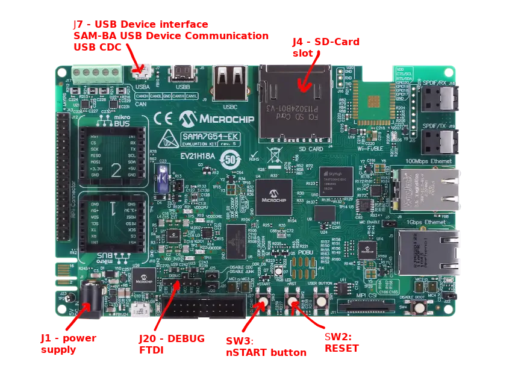

<!-- Copyright 2015-2026 Zephyr Project members and individual contributors. -->
<!-- SPDX-License-Identifier: Apache-2.0 -->
<!-- 中文翻译；编号、导航与译注为本地新增。 -->

# 第30章\_SAMA7G54评估套件

原文：[官方页面](https://docs.zephyrproject.org/latest/boards/microchip/sam/sama7g54_ek/doc/index.html)。读取日期：2026-10-16；来源摘要见[来源记录](../SOURCES.md)。

开发板概览（Board Overview）

SAMA7G54评估套件

名称（Name）：

`sama7g54_ek`

厂商（Vendor）：

[微芯科技（Microchip Technology Inc.）](https://docs.zephyrproject.org/latest/boards/index.html#vendor=microchip)

状态（Status）：

维护中（Maintained）

架构（Architecture）：

[arm](https://docs.zephyrproject.org/latest/boards/index.html#arch=arm)

片上系统（SoC）：

[sama7g54](https://docs.zephyrproject.org/latest/boards/index.html#soc=sama7g54)

[浏览开发板源码（Browse Board Sources）](https://github.com/zephyrproject-rtos/zephyr/blob/main//boards/microchip/sam/sama7g54_ek/doc/index.rst/../..)

## 概述（Overview）

SAMA7G54-EK评估套件用于评估SAMA7G54微处理器（MPU）及进行原型开发。SAMA7G54基于Arm Cortex-A7，最高运行频率1 GHz，支持最多2 GBytes的16位DDR2、DDR3、DDR3L、LPDDR2或LPDDR3，并支持八线／四线SPI、NAND及e.MMC闪存。

SAMA7G54集成完整的成像与音频子系统，提供12位并行及MIPI-CSI2摄像头接口，支持最高8 Mp和720p @ 60 fps；提供最多4路I2S、一个SPDIF发送器与接收器，以及4立体声通道音频采样率转换器。器件还提供双以太网，一个千兆端口和一个10/100端口，以及6路CAN-FD和3路高速USB；安全功能包括安全启动、安全密钥存储及AES、SHA、RSA、ECC高性能密码加速器。

SAMA7G54-EK板提供连接器和扩展排针，便于定制及快速使用先进嵌入式功能，包括MIKROE Click boards™、Raspberry Pi扩展排针和MIPI CSI摄像头。

## 硬件（Hardware）

- SAMA7G54-V/4HB微处理器
- Raspberry Pi CSI摄像头接口
- 一个16位、4 Gb DDR3L
- 一个32 Gb e.MMC
- 1 Gb八线SPI闪存（Octal SPI Flash）
- 两个带EUI-48™ MAC ID的EEPROM
- 一个SD卡插槽
- 三个高速USB端口（HS USB）
- 两个CAN接口
- 两个以太网端口，分别为千兆及10/100
- ATWILC3000 Wi-Fi／蓝牙模块焊盘，未安装器件
- S/PDIF接收及发送端口
- 四个数字麦克风端口
- 40引脚Raspberry Pi扩展排针
- 两个mikroBUS™连接器
- USB供电

### 支持的功能（Supported Features）

`sama7g54_ek`开发板支持下表所列的硬件功能。

片上／板载（On-Chip / On-Board）

功能集成在片上系统（SoC）内／位于开发板上。

2 / 2

分别表示已启用／已禁用的实例数。点击数量标签，可查看开发板或SoC设备树源码（DTS）中该功能的第一个实例。

`vnd,foo`

与此功能匹配的设备树绑定兼容字符串（Compatible String）；点击链接可查看绑定文档。

#### `sama7g54_ek/sama7g54`目标（Target）

该开发板目标的片上存储容量：512 MiB RAM、N/A Flash。

<table>
<tr>
<th>类型（Type）</th>
<th>位置（Location）</th>
<th>说明（Description）</th>
<th>兼容字符串（Compatible）</th>
</tr>
<tr>
<td rowspan="1">中央处理器（CPU）</td>
<td>片上（On-Chip）</td>
<td>Arm Cortex-A7 CPU（<a href="https://github.com/zephyrproject-rtos/zephyr/blob/main/dts/arm/microchip/sam/sama7/sama7g5/sama7g5.dtsi?plain=1#L22">已启用：1</a>）</td>
<td><a href="../cpu_arm_riscv_binding_reference/P011_arm_cortex-a7.md#std-dtcompatible-arm-cortex-a7"><code>arm,cortex-a7</code></a></td>
</tr>
<tr>
<td rowspan="1">控制器局域网（CAN）</td>
<td>片上（On-Chip）</td>
<td>针对Atmel SAM定制的Bosch m_can CAN灵活数据速率控制器（CAN FD）（<a href="https://github.com/zephyrproject-rtos/zephyr/blob/main/dts/arm/microchip/sam/sama7/sama7g5/sama7g5.dtsi?plain=1#L195">已启用：2</a>；<a href="https://github.com/zephyrproject-rtos/zephyr/blob/main/dts/arm/microchip/sam/sama7/sama7g5/sama7g5.dtsi?plain=1#L223">已禁用：4</a>）</td>
<td><a href="../can_adi_atmel_nxp_binding_reference/P002_atmel_sam-can.md#std-dtcompatible-atmel-sam-can"><code>atmel,sam-can</code></a></td>
</tr>
<tr>
<td rowspan="3">时钟控制（Clock Control）</td>
<td>片上（On-Chip）</td>
<td>Microchip电源管理控制器（PMC / Power Management Controller）（<a href="https://github.com/zephyrproject-rtos/zephyr/blob/main/dts/arm/microchip/sam/sama7/sama7g5/sama7g5.dtsi?plain=1#L138">已启用：1</a>）</td>
<td><a href="../clock_esp_infineon_microchip_binding_reference/P019_microchip_sam-pmc.md#std-dtcompatible-microchip-sam-pmc"><code>microchip,sam-pmc</code></a></td>
</tr>
<tr>
<td>片上（On-Chip）</td>
<td>Microchip SCKC（<a href="https://github.com/zephyrproject-rtos/zephyr/blob/main/dts/arm/microchip/sam/sama7/sama7g5/sama7g5.dtsi?plain=1#L146">已启用：1</a>）</td>
<td><a href="../clock_esp_infineon_microchip_binding_reference/P020_microchip_sama7g5-sckc.md#std-dtcompatible-microchip-sama7g5-sckc"><code>microchip,sama7g5-sckc</code></a></td>
</tr>
<tr>
<td>片上（On-Chip）</td>
<td>通用固定频率时钟提供者（Fixed-Rate Clock Provider）（<a href="https://github.com/zephyrproject-rtos/zephyr/blob/main/dts/arm/microchip/sam/sama7/sama7g5/sama7g5.dtsi?plain=1#L30">已启用：3</a>）</td>
<td><a href="../hardware/P566_固定时钟绑定.md#dtbinding-fixed-clock"><code>fixed-clock</code></a></td>
</tr>
<tr>
<td rowspan="2">计数器（Counter）</td>
<td>片上（On-Chip）</td>
<td>Microchip SAM定时器／计数器（Timer Counter）（<a href="https://github.com/zephyrproject-rtos/zephyr/blob/main/dts/arm/microchip/sam/sama7/sama7g5/sama7g5.dtsi?plain=1#L726">已启用：1</a>；<a href="https://github.com/zephyrproject-rtos/zephyr/blob/main/dts/arm/microchip/sam/sama7/sama7g5/sama7g5.dtsi?plain=1#L167">已禁用：5</a>）</td>
<td><a href="../microchip_soc_counter_binding_reference/P011_microchip_tc-g2-counter.md#std-dtcompatible-microchip-tc-g2-counter"><code>microchip,tc-g2-counter</code></a></td>
</tr>
<tr>
<td>片上（On-Chip）</td>
<td>Microchip PIT64B（<a href="https://github.com/zephyrproject-rtos/zephyr/blob/main/dts/arm/microchip/sam/sama7/sama7g5/sama7g5.dtsi?plain=1#L333">已启用：1</a>；<a href="https://github.com/zephyrproject-rtos/zephyr/blob/main/dts/arm/microchip/sam/sama7/sama7g5/sama7g5.dtsi?plain=1#L343">已禁用：4</a>）</td>
<td><a href="../microchip_soc_counter_binding_reference/P008_microchip_sam-pit64b-counter.md#std-dtcompatible-microchip-sam-pit64b-counter"><code>microchip,sam-pit64b-counter</code></a></td>
</tr>
<tr>
<td rowspan="2">密码学加速器（Cryptographic Accelerator）</td>
<td>片上（On-Chip）</td>
<td>Microchip AES G1加速器（<a href="https://github.com/zephyrproject-rtos/zephyr/blob/main/dts/arm/microchip/sam/sama7/sama7g5/sama7g5.dtsi?plain=1#L353">已启用：1</a>）</td>
<td><a href="../crypto_aes_sha_ccm_binding_reference/P017_microchip_aes-g1.md#std-dtcompatible-microchip-aes-g1"><code>microchip,aes-g1</code></a></td>
</tr>
<tr>
<td>片上（On-Chip）</td>
<td>Microchip G1 SHA控制器驱动（<a href="https://github.com/zephyrproject-rtos/zephyr/blob/main/dts/arm/microchip/sam/sama7/sama7g5/sama7g5.dtsi?plain=1#L360">已启用：1</a>）</td>
<td><a href="../crypto_aes_sha_ccm_binding_reference/P018_microchip_sha-g1-crypto.md#std-dtcompatible-microchip-sha-g1-crypto"><code>microchip,sha-g1-crypto</code></a></td>
</tr>
<tr>
<td rowspan="1">直接存储器访问（DMA）</td>
<td>片上（On-Chip）</td>
<td>Atmel SAM扩展DMA控制器（XDMAC）（<a href="https://github.com/zephyrproject-rtos/zephyr/blob/main/dts/arm/microchip/sam/sama7/sama7g5/sama7g5.dtsi?plain=1#L279">已启用：3</a>）</td>
<td><a href="../dma_binding_reference/P010_atmel_sam-xdmac.md#std-dtcompatible-atmel-sam-xdmac"><code>atmel,sam-xdmac</code></a></td>
</tr>
<tr>
<td rowspan="5">以太网（Ethernet）</td>
<td>片上（On-Chip）</td>
<td>Microchip SAM以太网控制器（Ethernet Controller）（<a href="https://github.com/zephyrproject-rtos/zephyr/blob/main/dts/arm/microchip/sam/sama7/sama7g5/sama7g5.dtsi?plain=1#L636">已启用：2</a>）</td>
<td><a href="../ethernet_mdio_microchip_binding_reference/P019_microchip_sam-ethernet-controller.md#std-dtcompatible-microchip-sam-ethernet-controller"><code>microchip,sam-ethernet-controller</code></a></td>
</tr>
<tr>
<td>片上（On-Chip）</td>
<td>Atmel SAM系列千兆媒体访问控制器以太网（GMAC Ethernet）（<a href="https://github.com/zephyrproject-rtos/zephyr/blob/main/dts/arm/microchip/sam/sama7/sama7g5/sama7g5.dtsi?plain=1#L642">已启用：2</a>）</td>
<td><a href="../ethernet_mac_mdio_binding_reference/P004_atmel_sam-gmac.md#std-dtcompatible-atmel-sam-gmac"><code>atmel,sam-gmac</code></a></td>
</tr>
<tr>
<td>片上（On-Chip）</td>
<td>Atmel SAM系列管理数据输入输出（MDIO）驱动节点（<a href="https://github.com/zephyrproject-rtos/zephyr/blob/main/dts/arm/microchip/sam/sama7/sama7g5/sama7g5.dtsi?plain=1#L656">已启用：2</a>）</td>
<td><a href="../ethernet_mac_mdio_binding_reference/P016_atmel_sam-mdio.md#std-dtcompatible-atmel-sam-mdio"><code>atmel,sam-mdio</code></a></td>
</tr>
<tr>
<td>板载（On-Board）</td>
<td>Microchip KSZ9131以太网PHY设备（<a href="https://github.com/zephyrproject-rtos/zephyr/blob/main/boards/microchip/sam/sama7g54_ek/sama7g54_ek.dts?plain=1#L282">已启用：1</a>）</td>
<td><a href="../ethernet_phy_renesas_rockchip_binding_reference/P002_microchip_ksz9131.md#std-dtcompatible-microchip-ksz9131"><code>microchip,ksz9131</code></a></td>
</tr>
<tr>
<td>板载（On-Board）</td>
<td>Microchip KSZ8081以太网PHY设备（<a href="https://github.com/zephyrproject-rtos/zephyr/blob/main/boards/microchip/sam/sama7g54_ek/sama7g54_ek.dts?plain=1#L309">已启用：1</a>）</td>
<td><a href="../ethernet_phy_renesas_rockchip_binding_reference/P001_microchip_ksz8081.md#std-dtcompatible-microchip-ksz8081"><code>microchip,ksz8081</code></a></td>
</tr>
<tr>
<td rowspan="2">通用输入输出与接插件（GPIO &amp; Headers）</td>
<td>片上（On-Chip）</td>
<td>SAM PIO4 GPIO端口（<a href="https://github.com/zephyrproject-rtos/zephyr/blob/main/dts/arm/microchip/sam/sama7/sama7g5/sama7g5.dtsi?plain=1#L86">已启用：5</a>）</td>
<td><a href="../gpio_microchip_nordic_nuvoton_binding_reference/P002_microchip_sam-pio4.md#std-dtcompatible-microchip-sam-pio4"><code>microchip,sam-pio4</code></a></td>
</tr>
<tr>
<td>板载（On-Board）</td>
<td>通过Mikro BUS排针引出的GPIO引脚（<a href="https://github.com/zephyrproject-rtos/zephyr/blob/main/boards/microchip/sam/sama7g54_ek/sama7g54_ek.dts?plain=1#L87">已启用：2</a>）</td>
<td><a href="../gpio_microchip_nordic_nuvoton_binding_reference/P006_mikro-bus.md#std-dtcompatible-mikro-bus"><code>mikro-bus</code></a></td>
</tr>
<tr>
<td rowspan="1">硬件信息（Hardware Information）</td>
<td>片上（On-Chip）</td>
<td>Microchip G1硬件信息（hwinfo）驱动（<a href="https://github.com/zephyrproject-rtos/zephyr/blob/main/dts/arm/microchip/sam/sama7/sama7g5/sama7g5.dtsi?plain=1#L896">已启用：1</a>）</td>
<td><a href="../hwinfo_binding_reference/P005_microchip_hwinfo-g1.md#std-dtcompatible-microchip-hwinfo-g1"><code>microchip,hwinfo-g1</code></a></td>
</tr>
<tr>
<td rowspan="1">集成电路间总线（I2C）</td>
<td>片上（On-Chip）</td>
<td>Atmel SAM系列I2C双线接口（TWI）（<a href="https://github.com/zephyrproject-rtos/zephyr/blob/main/dts/arm/microchip/sam/sama7/sama7g5/sama7g5.dtsi?plain=1#L762">已启用：1</a>；<a href="https://github.com/zephyrproject-rtos/zephyr/blob/main/dts/arm/microchip/sam/sama7/sama7g5/sama7g5.dtsi?plain=1#L375">已禁用：11</a>）</td>
<td><a href="../i2c_adi_atmel_esp_binding_reference/P008_atmel_sam-i2c-twi.md#std-dtcompatible-atmel-sam-i2c-twi"><code>atmel,sam-i2c-twi</code></a></td>
</tr>
<tr>
<td rowspan="1">输入（Input）</td>
<td>板载（On-Board）</td>
<td>一组绑定到 GPIO 的输入按键（GPIO-Bound Input Keys）（<a href="https://github.com/zephyrproject-rtos/zephyr/blob/main/boards/microchip/sam/sama7g54_ek/sama7g54_ek.dts?plain=1#L76">已启用：1</a>）</td>
<td><a href="../hardware/P563_GPIO按键绑定.md#std-dtcompatible-gpio-keys"><code>gpio-keys</code></a></td>
</tr>
<tr>
<td rowspan="1">中断控制器（Interrupt Controller）</td>
<td>片上（On-Chip）</td>
<td>ARM通用中断控制器（GIC）v2（<a href="https://github.com/zephyrproject-rtos/zephyr/blob/main/dts/arm/microchip/sam/sama7/sama7g5/sama7g5.dtsi?plain=1#L904">已启用：1</a>）</td>
<td><a href="../interrupt_fabric_binding_reference/P003_arm_gic-v2.md#std-dtcompatible-arm-gic-v2"><code>arm,gic-v2</code></a></td>
</tr>
<tr>
<td rowspan="2">发光二极管（LED）</td>
<td>板载（On-Board）</td>
<td>一组由 GPIO 控制的 LED（GPIO-Controlled LEDs）（<a href="https://github.com/zephyrproject-rtos/zephyr/blob/main/boards/microchip/sam/sama7g54_ek/sama7g54_ek.dts?plain=1#L56">已启用：1</a>）</td>
<td><a href="../hardware/P564_GPIO指示灯绑定.md#dtbinding-gpio-leds"><code>gpio-leds</code></a></td>
</tr>
<tr>
<td>板载（On-Board）</td>
<td>一组由脉宽调制（PWM）控制的LED（<a href="https://github.com/zephyrproject-rtos/zephyr/blob/main/boards/microchip/sam/sama7g54_ek/sama7g54_ek.dts?plain=1#L123">已禁用：1</a>）</td>
<td><a href="../hardware/P565_PWM指示灯绑定.md#dtbinding-pwm-leds"><code>pwm-leds</code></a></td>
</tr>
<tr>
<td rowspan="1">多功能设备（Multi-Function Device）</td>
<td>片上（On-Chip）</td>
<td>Microchip Flexcom灵活串行通信单元（Flexible Serial Communication Unit）（<a href="https://github.com/zephyrproject-rtos/zephyr/blob/main/dts/arm/microchip/sam/sama7/sama7g5/sama7g5.dtsi?plain=1#L457">已启用：4</a>；<a href="https://github.com/zephyrproject-rtos/zephyr/blob/main/dts/arm/microchip/sam/sama7/sama7g5/sama7g5.dtsi?plain=1#L367">已禁用：8</a>）</td>
<td><a href="../hardware/P701_SAM灵活通信接口绑定.md#dtbinding-microchip-sam-flexcom"><code>microchip,sam-flexcom</code></a></td>
</tr>
<tr>
<td rowspan="2">存储技术设备（MTD）</td>
<td>板载（On-Board）</td>
<td>兼容Atmel AT24系列的I2C电可擦除可编程只读存储器（EEPROM）（<a href="https://github.com/zephyrproject-rtos/zephyr/blob/main/boards/microchip/sam/sama7g54_ek/sama7g54_ek.dts?plain=1#L188">已启用：2</a>）</td>
<td><a href="../mtd_atmel_bouffalo_binding_reference/P004_atmel_at24.md#std-dtcompatible-atmel-at24"><code>atmel,at24</code></a></td>
</tr>
<tr>
<td>板载（On-Board）</td>
<td>这些属性用于支持Zephyr的<code>spi-nor</code>闪存驱动通过Zephyr SPI API，使用基于M25P80的标准命令集控制串行闪存（Serial Flash Memory）。（<a href="https://github.com/zephyrproject-rtos/zephyr/blob/main/boards/microchip/sam/sama7g54_ek/sama7g54_ek.dts?plain=1#L253">已启用：1</a>）</td>
<td><a href="../mtd_microchip_nordic_nxp_binding_reference/P002_jedec_spi-nor.md#std-dtcompatible-jedec-spi-nor"><code>jedec,spi-nor</code></a></td>
</tr>
<tr>
<td rowspan="1">非易失存储器（NVMEM）</td>
<td>板载（On-Board）</td>
<td>非易失存储器固定布局（Fixed Layout for Non-Volatile Memory）（<a href="https://github.com/zephyrproject-rtos/zephyr/blob/main/boards/microchip/sam/sama7g54_ek/sama7g54_ek.dts?plain=1#L197">已启用：2</a>）</td>
<td><a href="../memory_protection_binding_reference/P009_fixed-layout.md#std-dtcompatible-fixed-layout"><code>fixed-layout</code></a></td>
</tr>
<tr>
<td rowspan="1">物理层（PHY）</td>
<td>板载（On-Board）</td>
<td>由简单GPIO控制的CAN收发器（Transceiver）（<a href="https://github.com/zephyrproject-rtos/zephyr/blob/main/boards/microchip/sam/sama7g54_ek/sama7g54_ek.dts?plain=1#L136">已启用：2</a>）</td>
<td><a href="../phy_binding_reference/P001_can-transceiver-gpio.md#std-dtcompatible-can-transceiver-gpio"><code>can-transceiver-gpio</code></a></td>
</tr>
<tr>
<td rowspan="1">引脚控制（Pin Control）</td>
<td>片上（On-Chip）</td>
<td>Microchip SAMA7G5引脚控制（Pinctrl）容器节点（<a href="https://github.com/zephyrproject-rtos/zephyr/blob/main/dts/arm/microchip/sam/sama7/sama7g5/sama7g5.dtsi?plain=1#L79">已启用：1</a>）</td>
<td><a href="../pinctrl_infineon_nordic_nxp_binding_reference/P007_microchip_sama7g5-pinctrl.md#std-dtcompatible-microchip-sama7g5-pinctrl"><code>microchip,sama7g5-pinctrl</code></a></td>
</tr>
<tr>
<td rowspan="1">脉宽调制（PWM）</td>
<td>片上（On-Chip）</td>
<td>Atmel SAM脉宽调制（PWM）（<a href="https://github.com/zephyrproject-rtos/zephyr/blob/main/dts/arm/microchip/sam/sama7/sama7g5/sama7g5.dtsi?plain=1#L312">已禁用：1</a>）</td>
<td><a href="../pwm_adi_esp_infineon_binding_reference/P007_atmel_sam-pwm.md#std-dtcompatible-atmel-sam-pwm"><code>atmel,sam-pwm</code></a></td>
</tr>
<tr>
<td rowspan="1">随机数生成器（RNG）</td>
<td>片上（On-Chip）</td>
<td>Atmel SAM随机数发生器（RNG）（<a href="https://github.com/zephyrproject-rtos/zephyr/blob/main/dts/arm/microchip/sam/sama7/sama7g5/sama7g5.dtsi?plain=1#L507">已启用：1</a>）</td>
<td><a href="../rng_binding_reference/P004_atmel_sam-trng.md#std-dtcompatible-atmel-sam-trng"><code>atmel,sam-trng</code></a></td>
</tr>
<tr>
<td rowspan="1">实时时钟（RTC）</td>
<td>片上（On-Chip）</td>
<td>Atmel SAM系列实时时钟（RTC）设备（<a href="https://github.com/zephyrproject-rtos/zephyr/blob/main/dts/arm/microchip/sam/sama7/sama7g5/sama7g5.dtsi?plain=1#L153">已启用：1</a>）</td>
<td><a href="../rtc_binding_reference/P004_atmel_sam-rtc.md#std-dtcompatible-atmel-sam-rtc"><code>atmel,sam-rtc</code></a></td>
</tr>
<tr>
<td rowspan="1">SD 主机控制器（SDHC）</td>
<td>片上（On-Chip）</td>
<td>Microchip SAM SDMMC SD主机控制器（<a href="https://github.com/zephyrproject-rtos/zephyr/blob/main/dts/arm/microchip/sam/sama7/sama7g5/sama7g5.dtsi?plain=1#L290">已启用：2</a>）</td>
<td><a href="../sdhc_binding_reference/P011_microchip_sama7g5-sdmmc.md#std-dtcompatible-microchip-sama7g5-sdmmc"><code>microchip,sama7g5-sdmmc</code></a></td>
</tr>
<tr>
<td rowspan="1">串行控制器（Serial Controller）</td>
<td>片上（On-Chip）</td>
<td>Atmel SAM系列通用同步／异步收发器（USART）（<a href="https://github.com/zephyrproject-rtos/zephyr/blob/main/dts/arm/microchip/sam/sama7/sama7g5/sama7g5.dtsi?plain=1#L477">已启用：1</a>；<a href="https://github.com/zephyrproject-rtos/zephyr/blob/main/dts/arm/microchip/sam/sama7/sama7g5/sama7g5.dtsi?plain=1#L387">已禁用：11</a>）</td>
<td><a href="../uart_adi_arm_atmel_binding_reference/P011_atmel_sam-usart.md#std-dtcompatible-atmel-sam-usart"><code>atmel,sam-usart</code></a></td>
</tr>
<tr>
<td rowspan="1">串行外设接口（SPI）</td>
<td>片上（On-Chip）</td>
<td>Microchip FLEXCOM SPI（<a href="https://github.com/zephyrproject-rtos/zephyr/blob/main/dts/arm/microchip/sam/sama7/sama7g5/sama7g5.dtsi?plain=1#L864">已启用：1</a>）</td>
<td><a href="../spi_microchip_nordic_nxp_binding_reference/P006_microchip_flexcom-g1-spi.md#std-dtcompatible-microchip-flexcom-g1-spi"><code>microchip,flexcom-g1-spi</code></a></td>
</tr>
<tr>
<td rowspan="1">静态随机存储器（SRAM）</td>
<td>片上（On-Chip）</td>
<td>通用片上静态随机存储器（SRAM）（<a href="https://github.com/zephyrproject-rtos/zephyr/blob/main/dts/arm/microchip/sam/sama7/sama7g5/sama7g5.dtsi?plain=1#L48">已启用：1</a>）</td>
<td><a href="../hardware/P567_内存映射SRAM绑定.md#dtbinding-mmio-sram"><code>mmio-sram</code></a></td>
</tr>
<tr>
<td rowspan="1">定时器（Timer）</td>
<td>片上（On-Chip）</td>
<td>Microchip SAM 64位周期性间隔定时器（PIT64B / Periodic Interval Timer）（<a href="https://github.com/zephyrproject-rtos/zephyr/blob/main/dts/arm/microchip/sam/sama7/sama7g5/sama7g5.dtsi?plain=1#L324">已启用：1</a>）</td>
<td><a href="../microchip_nordic_nxp_realtek_timer_binding_reference/P002_microchip_sam-pit64b.md#std-dtcompatible-microchip-sam-pit64b"><code>microchip,sam-pit64b</code></a></td>
</tr>
<tr>
<td rowspan="1">通用串行总线（USB）</td>
<td>片上（On-Chip）</td>
<td>Microchip G1 USB设备高速端口（UDPHS / USB Device High Speed Port）（<a href="https://github.com/zephyrproject-rtos/zephyr/blob/main/dts/arm/microchip/sam/sama7/sama7g5/sama7g5.dtsi?plain=1#L53">已启用：1</a>；<a href="https://github.com/zephyrproject-rtos/zephyr/blob/main/dts/arm/microchip/sam/sama7/sama7g5/sama7g5.dtsi?plain=1#L66">已禁用：1</a>）</td>
<td><a href="../usb_controller_binding_reference/P017_microchip_udphs-g1-udc.md#std-dtcompatible-microchip-udphs-g1-udc"><code>microchip,udphs-g1-udc</code></a></td>
</tr>
</table>

### 连接与输入输出（Connections and IOs）

SAMA7G54-EK用户指南提供开发板连接详情。（[SAMA7G54-EK用户指南（User Guide）](https://ww1.microchip.com/downloads/aemDocuments/documents/MPU32/ProductDocuments/UserGuides/SAMA7G54-EK-User%27s-Guide-DS50003273.pdf)）

## 编程（Programming）

### 前提条件（Prerequisite）

在SAMA7G54-EK上运行Zephyr之前，必须先运行Microchip MPU的第二阶段引导加载程序[at91bootstrap](https://developerhelp.microchip.com/xwiki/bin/view/products/mcu-mpu/32bit-mpu/at91bootstrap/)。它负责初始化外设及存储器控制器、下载Zephyr并跳转到入口点。

### 加载固件（Loading the Firmware）

使用sama7g5eksd_zephyr_defconfig配置编译引导加载程序后，可将Zephyr二进制文件zephyr.bin复制到SD卡，由引导加载程序在SAMA7G54-EK板上加载运行。

## 参考资料（References）

SAMA7G54产品页面：

[https://www.microchip.com/en-us/product/sama7g54](https://www.microchip.com/en-us/product/sama7g54)

SAMA7G54评估套件页面：

[https://www.microchip.com/en-us/development-tool/EV21H18A](https://www.microchip.com/en-us/development-tool/EV21H18A)

## 译注

必须先运行at91bootstrap，使用sama7g5eksd_zephyr_defconfig，再从SD卡加载zephyr.bin。SoC能力与开发板实际引出的接口数量分别保留。

## 原文外链核对

2026-10-16核对并重试以下原文外链时未能确认可访问性，保留原始目标，不将访问失败解释为原文内容有误。

- ：The read operation timed out。
- [EV21H18A](https://www.microchip.com/en-us/development-tool/EV21H18A)：HTTP Error 403: Forbidden。
- [sama7g54](https://www.microchip.com/en-us/product/sama7g54)：HTTP Error 403: Forbidden。

---

[上一章](P029_SAMA7D65_Curiosity_Kit.md) · [返回大纲](大纲.md) · [全站翻译进度](../PROGRESS.md)
