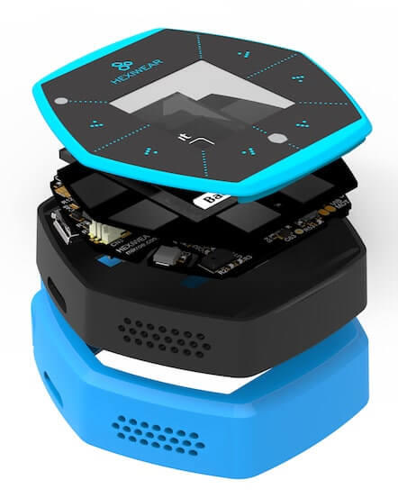

<!-- Copyright 2015-2026 Zephyr Project members and individual contributors. -->
<!-- SPDX-License-Identifier: Apache-2.0 -->
<!-- 中文翻译；编号、导航与译注为本地新增。 -->

<a id="hexiwear"></a>

# 第3章\_Hexiwear

原文：[官方页面](https://docs.zephyrproject.org/latest/boards/mikroe/hexiwear/doc/index.html)。读取日期：2026-10-16；来源摘要见[来源记录](../SOURCES.md)。

开发板概览（Board Overview）

<a id="id12"></a>

[](images/hexiwear_k64.jpg)

Hexiwear

名称（Name）：

`hexiwear`

厂商（Vendor）：

[MikroElektronika d.o.o.](https://docs.zephyrproject.org/latest/boards/index.html#vendor=mikroe)

状态（Status）：

当前未积极维护（Not Actively Maintained）

架构（Architecture）：

[arm](https://docs.zephyrproject.org/latest/boards/index.html#arch=arm)

片上系统（SoC）：

[mkw40z4](https://docs.zephyrproject.org/latest/boards/index.html#soc=mkw40z4)、[mk64f12](https://docs.zephyrproject.org/latest/boards/index.html#soc=mk64f12)

<a id="board-github-link"></a>

[浏览开发板源码（Browse Board Sources）](https://github.com/zephyrproject-rtos/zephyr/blob/main//boards/mikroe/hexiwear/doc/index.rst/../..)## Hexiwear

<a id="overview"></a>

### 概述（Overview）

Hexiwear使用基于ARM Cortex-M4内核的Kinetis K64微控制器，另由Kinetis KW40Z无线MCU提供低功耗蓝牙（Bluetooth Low Energy）连接。Hexiwear还集成多种传感器，以及由1.1英寸、96×96像素全彩OLED显示屏和6个带触觉反馈的电容按键构成的用户界面。


- 采用醒目的智能手表外形，搭载高性能低功耗Kinetis K6x MCU及6个板载传感器。
- 面向可穿戴应用，板载可充电电池、OLED屏，以及光学心率、加速度、磁场和陀螺仪等传感器。
- 面向物联网末端节点（IoT End Node）应用，板载温度、压力、湿度及环境光传感器。
- 可通过Click扩展板灵活添加所需传感器，原文称可再选近200种传感器。



<a id="hardware"></a>

### 硬件（Hardware）


- 主MCU：NXP Kinetis K64x，ARM Cortex-M4，120 MHz，1M闪存及256K SRAM
- 无线MCU：NXP Kinetis KW4x，ARM Cortex-M0+，支持低功耗蓝牙及802.15.4无线电
- 六轴组合加速度计及磁力计：NXP FXOS8700
- 三轴陀螺仪：NXP FXAS21002
- 绝对压力传感器（Absolute Pressure Sensor）：NXP MPL3115
- 锂离子／锂聚合物电池充电器：NXP MC34671
- 光学心率传感器：Maxim MAX30101
- 环境光、湿度及温度传感器
- 1.1英寸全彩OLED显示屏
- 触觉反馈引擎（Haptic Feedback Engine）
- 190 mAh、2C Li-Po电池
- 电容触摸接口（Capacitive Touch Interface）
- RGB发光二极管（LED）

K64F SoC及Hexiwear开发板的更多信息：


- [K64F网站](https://www.nxp.com/products/processors-and-microcontrollers/arm-based-processors-and-mcus/kinetis-cortex-m-mcus/k-seriesperformancem4/k6x-ethernet/kinetis-k64-120-mhz-256kb-sram-microcontrollers-mcus-based-on-arm-cortex-m4-core:K64_120)
- [K64F数据手册（Datasheet）](https://www.nxp.com/docs/en/data-sheet/K64P144M120SF5.pdf)
- [K64F参考手册（Reference Manual）](https://www.nxp.com/docs/en/reference-manual/K64P144M120SF5RM.pdf)
- [Hexiwear网站](https://www.mikroe.com/hexiwear)
- [Hexiwear产品简介（Fact Sheet）](https://www.nxp.com/docs/en/fact-sheet/HEXIWEAR-FS.pdf)
- [Hexiwear原理图（Schematics）](http://cdn-docs.mikroe.com/images/c/c0/Sch_Hexiwear_MainBoard_v106c.pdf)

<a id="supported-features"></a>

#### 支持的功能（Supported Features）

`hexiwear`开发板支持下表所列的硬件功能。

片上／板载（On-Chip / On-Board）

功能集成在片上系统（SoC）内／位于开发板上。

2 / 2

分别表示已启用／已禁用的实例数。点击数量标签，可查看开发板或SoC设备树源码（DTS）中该功能的第一个实例。

`vnd,foo`

与此功能匹配的设备树绑定兼容字符串（Compatible String）；点击链接可查看绑定文档。

<a id="hexiwear-hw-features"></a>

<a id="hexiwear-hexiwear/mk64f12-hw-features-section"></a>

##### `hexiwear/mk64f12`目标（Target）

<a id="hexiwear-hexiwear/mk64f12-hw-features-panel"></a>

<a id="hexiwear-hexiwear/mk64f12-hw-features-memory"></a>

该开发板目标的片上存储容量：192 KiB RAM、1 MiB Flash。

<a id="hexiwear-hexiwear/mk64f12-hw-features-table"></a>

<table>
<tr>
<th>类型（Type）</th>
<th>位置（Location）</th>
<th>说明（Description）</th>
<th>兼容字符串（Compatible）</th>
</tr>
<tr>
<td rowspan="1">中央处理器（CPU）</td>
<td>片上（On-Chip）</td>
<td>ARM Cortex-M4F 处理器（CPU）（<a href="https://github.com/zephyrproject-rtos/zephyr/blob/main/dts/arm/nxp/kinetis/k6x/nxp_k6x.dtsi?plain=1#L30">已启用：1</a>）</td>
<td><a href="../cpu_arm_riscv_binding_reference/P025_arm_cortex-m4f.md#std-dtcompatible-arm-cortex-m4f"><code>arm,cortex-m4f</code></a></td>
</tr>
<tr>
<td rowspan="1">模数转换器（ADC）</td>
<td>片上（On-Chip）</td>
<td>Kinetis ADC16（<a href="https://github.com/zephyrproject-rtos/zephyr/blob/main/dts/arm/nxp/kinetis/k6x/nxp_k6x.dtsi?plain=1#L436">已启用：2</a>）</td>
<td><a href="../hardware/P850_NXPKinetisADC16绑定.md#dtbinding-nxp-kinetis-adc16"><code>nxp,kinetis-adc16</code></a></td>
</tr>
<tr>
<td rowspan="1">控制器局域网（CAN）</td>
<td>片上（On-Chip）</td>
<td>NXP FlexCAN控制器（<a href="https://github.com/zephyrproject-rtos/zephyr/blob/main/dts/arm/nxp/kinetis/k6x/nxp_k6x.dtsi?plain=1#L528">已禁用：1</a>）</td>
<td><a href="../can_adi_atmel_nxp_binding_reference/P017_nxp_flexcan.md#std-dtcompatible-nxp-flexcan"><code>nxp,flexcan</code></a></td>
</tr>
<tr>
<td rowspan="3">时钟控制（Clock Control）</td>
<td>片上（On-Chip）</td>
<td>NXP Kinetis多用途时钟发生器（MCG）IP节点（<a href="https://github.com/zephyrproject-rtos/zephyr/blob/main/dts/arm/nxp/kinetis/k6x/nxp_k6x.dtsi?plain=1#L93">已启用：1</a>）</td>
<td><a href="../clock_nxp_pico_realtek_renesas_binding_reference/P003_nxp_kinetis-mcg.md#std-dtcompatible-nxp-kinetis-mcg"><code>nxp,kinetis-mcg</code></a></td>
</tr>
<tr>
<td>片上（On-Chip）</td>
<td>Kinetis系统集成模块（SIM）IP节点（<a href="https://github.com/zephyrproject-rtos/zephyr/blob/main/dts/arm/nxp/kinetis/k6x/nxp_k6x.dtsi?plain=1#L120">已启用：1</a>）</td>
<td><a href="../clock_nxp_pico_realtek_renesas_binding_reference/P006_nxp_kinetis-sim.md#std-dtcompatible-nxp-kinetis-sim"><code>nxp,kinetis-sim</code></a></td>
</tr>
<tr>
<td>片上（On-Chip）</td>
<td>通用固定比例时钟提供器（Fixed Factor Clock Provider）（<a href="https://github.com/zephyrproject-rtos/zephyr/blob/main/dts/arm/nxp/kinetis/k6x/nxp_k6x.dtsi?plain=1#L125">已启用：4</a>）</td>
<td><a href="../timer_reference/P110_固定比例时钟绑定.md#dtbinding-fixed-factor-clock"><code>fixed-factor-clock</code></a></td>
</tr>
<tr>
<td rowspan="2">计数器（Counter）</td>
<td>片上（On-Chip）</td>
<td>NXP周期中断定时器（PIT / Periodic Interrupt Timer）（<a href="https://github.com/zephyrproject-rtos/zephyr/blob/main/dts/arm/nxp/kinetis/k6x/nxp_k6x.dtsi?plain=1#L562">已禁用：1</a>）</td>
<td><a href="../nxp_nuvoton_counter_binding_reference/P017_nxp_pit.md#std-dtcompatible-nxp-pit"><code>nxp,pit</code></a></td>
</tr>
<tr>
<td>片上（On-Chip）</td>
<td>周期中断定时器节点的子节点，用于表示单个定时器通道（<a href="https://github.com/zephyrproject-rtos/zephyr/blob/main/dts/arm/nxp/kinetis/k6x/nxp_k6x.dtsi?plain=1#L571">已禁用：4</a>）</td>
<td><a href="../nxp_nuvoton_counter_binding_reference/P016_nxp_pit-channel.md#std-dtcompatible-nxp-pit-channel"><code>nxp,pit-channel</code></a></td>
</tr>
<tr>
<td rowspan="1">数模转换器（DAC）</td>
<td>片上（On-Chip）</td>
<td>NXP Kinetis MCUX DAC（<a href="https://github.com/zephyrproject-rtos/zephyr/blob/main/dts/arm/nxp/kinetis/k6x/nxp_k6x.dtsi?plain=1#L462">已禁用：2</a>）</td>
<td><a href="../hardware/P768_NXPKinetis数模转换器绑定.md#dtbinding-nxp-kinetis-dac"><code>nxp,kinetis-dac</code></a></td>
</tr>
<tr>
<td rowspan="1">直接存储器访问（DMA）</td>
<td>片上（On-Chip）</td>
<td>NXP MCUX增强型DMA（EDMA）控制器（<a href="https://github.com/zephyrproject-rtos/zephyr/blob/main/dts/arm/nxp/kinetis/k6x/nxp_k6x.dtsi?plain=1#L542">已禁用：1</a>）</td>
<td><a href="../nxp_realtek_renesas_dma_binding_reference/P004_nxp_mcux-edma.md#std-dtcompatible-nxp-mcux-edma"><code>nxp,mcux-edma</code></a></td>
</tr>
<tr>
<td rowspan="4">以太网（Ethernet）</td>
<td>片上（On-Chip）</td>
<td>NXP ENET以太网IP模块（<a href="https://github.com/zephyrproject-rtos/zephyr/blob/main/dts/arm/nxp/kinetis/k6x/nxp_k6x.dtsi?plain=1#L489">已启用：1</a>）</td>
<td><a href="../ethernet_nxp_phy_binding_reference/P004_nxp_enet.md#std-dtcompatible-nxp-enet"><code>nxp,enet</code></a></td>
</tr>
<tr>
<td>片上（On-Chip）</td>
<td>NXP ENET MAC／二层（L2）设备（<a href="https://github.com/zephyrproject-rtos/zephyr/blob/main/dts/arm/nxp/kinetis/k6x/nxp_k6x.dtsi?plain=1#L494">已禁用：1</a>）</td>
<td><a href="../ethernet_nxp_phy_binding_reference/P001_nxp_enet-mac.md#std-dtcompatible-nxp-enet-mac"><code>nxp,enet-mac</code></a></td>
</tr>
<tr>
<td>片上（On-Chip）</td>
<td>NXP ENET管理数据输入输出（MDIO）功能（<a href="https://github.com/zephyrproject-rtos/zephyr/blob/main/dts/arm/nxp/kinetis/k6x/nxp_k6x.dtsi?plain=1#L504">已禁用：1</a>）</td>
<td><a href="../ethernet_mdio_microchip_binding_reference/P002_nxp_enet-mdio.md#std-dtcompatible-nxp-enet-mdio"><code>nxp,enet-mdio</code></a></td>
</tr>
<tr>
<td>片上（On-Chip）</td>
<td>NXP ENET精确时间协议（PTP / Precision Time Protocol）时钟（<a href="https://github.com/zephyrproject-rtos/zephyr/blob/main/dts/arm/nxp/kinetis/k6x/nxp_k6x.dtsi?plain=1#L511">已禁用：1</a>）</td>
<td><a href="../ethernet_nxp_phy_binding_reference/P002_nxp_enet-ptp-clock.md#std-dtcompatible-nxp-enet-ptp-clock"><code>nxp,enet-ptp-clock</code></a></td>
</tr>
<tr>
<td rowspan="1">闪存控制器（Flash Controller）</td>
<td>片上（On-Chip）</td>
<td>NXP Kinetis闪存模块E（FTFE）（<a href="https://github.com/zephyrproject-rtos/zephyr/blob/main/dts/arm/nxp/kinetis/k6x/nxp_k6x.dtsi?plain=1#L154">已启用：1</a>）</td>
<td><a href="../flash_nuvoton_nxp_renesas_binding_reference/P016_nxp_kinetis-ftfe.md#std-dtcompatible-nxp-kinetis-ftfe"><code>nxp,kinetis-ftfe</code></a></td>
</tr>
<tr>
<td rowspan="1">通用输入输出与接插件（GPIO &amp; Headers）</td>
<td>片上（On-Chip）</td>
<td>Kinetis GPIO（<a href="https://github.com/zephyrproject-rtos/zephyr/blob/main/dts/arm/nxp/kinetis/k6x/nxp_k6x.dtsi?plain=1#L299">已启用：5</a>）</td>
<td><a href="../gpio_nxp_expanders_binding_reference/P002_nxp_kinetis-gpio.md#std-dtcompatible-nxp-kinetis-gpio"><code>nxp,kinetis-gpio</code></a></td>
</tr>
<tr>
<td rowspan="1">硬件信息（Hardware Information）</td>
<td>片上（On-Chip）</td>
<td>NXP RCM获取复位原因标志（Reset Cause Flags）（<a href="https://github.com/zephyrproject-rtos/zephyr/blob/main/dts/arm/nxp/kinetis/k6x/nxp_k6x.dtsi?plain=1#L115">已启用：1</a>）</td>
<td><a href="../hwinfo_binding_reference/P012_nxp_rcm-hwinfo.md#std-dtcompatible-nxp-rcm-hwinfo"><code>nxp,rcm-hwinfo</code></a></td>
</tr>
<tr>
<td rowspan="1">集成电路间总线（I2C）</td>
<td>片上（On-Chip）</td>
<td>Kinetis I2C（<a href="https://github.com/zephyrproject-rtos/zephyr/blob/main/dts/arm/nxp/kinetis/k6x/nxp_k6x.dtsi?plain=1#L176">已启用：2</a>；<a href="https://github.com/zephyrproject-rtos/zephyr/blob/main/dts/arm/nxp/kinetis/k6x/nxp_k6x.dtsi?plain=1#L198">已禁用：1</a>）</td>
<td><a href="../i2c_nxp_pico_renesas_binding_reference/P002_nxp_kinetis-i2c.md#std-dtcompatible-nxp-kinetis-i2c"><code>nxp,kinetis-i2c</code></a></td>
</tr>
<tr>
<td rowspan="1">中断控制器（Interrupt Controller）</td>
<td>片上（On-Chip）</td>
<td>ARMv7-M 嵌套向量中断控制器（Nested Vectored Interrupt Controller，NVIC）（<a href="https://github.com/zephyrproject-rtos/zephyr/blob/main/dts/arm/armv7-m.dtsi?plain=1#L13">已启用：1</a>）</td>
<td><a href="../arm_interrupt_timer_binding_reference/P002_ARMv7_M_NVIC.md#std-dtcompatible-arm-v7m-nvic"><code>arm,v7m-nvic</code></a></td>
</tr>
<tr>
<td rowspan="2">发光二极管（LED）</td>
<td>板载（On-Board）</td>
<td>一组由 GPIO 控制的 LED（GPIO-Controlled LEDs）（<a href="https://github.com/zephyrproject-rtos/zephyr/blob/main/boards/mikroe/hexiwear/hexiwear_mk64f12.dts?plain=1#L40">已启用：1</a>）</td>
<td><a href="../hardware/P564_GPIO指示灯绑定.md#dtbinding-gpio-leds"><code>gpio-leds</code></a></td>
</tr>
<tr>
<td>板载（On-Board）</td>
<td>一组由脉宽调制（PWM）控制的LED（<a href="https://github.com/zephyrproject-rtos/zephyr/blob/main/boards/mikroe/hexiwear/hexiwear_mk64f12.dts?plain=1#L59">已启用：1</a>）</td>
<td><a href="../hardware/P565_PWM指示灯绑定.md#dtbinding-pwm-leds"><code>pwm-leds</code></a></td>
</tr>
<tr>
<td rowspan="1">存储技术设备（MTD）</td>
<td>片上（On-Chip）</td>
<td>闪存（Flash）节点（<a href="https://github.com/zephyrproject-rtos/zephyr/blob/main/dts/arm/nxp/kinetis/k6x/nxp_k6x.dtsi?plain=1#L165">已启用：1</a>）</td>
<td><a href="../mtd_nxp_st_ti_partition_binding_reference/P013_soc-nv-flash.md#std-dtcompatible-soc-nv-flash"><code>soc-nv-flash</code></a></td>
</tr>
<tr>
<td rowspan="2">引脚控制（Pin Control）</td>
<td>片上（On-Chip）</td>
<td>NXP PORT引脚控制器（Pin Controller）（<a href="https://github.com/zephyrproject-rtos/zephyr/blob/main/dts/arm/nxp/kinetis/k6x/nxp_k6x.dtsi?plain=1#L269">已启用：5</a>）</td>
<td><a href="../pinctrl_nxp_pico_binding_reference/P017_nxp_port-pinmux.md#std-dtcompatible-nxp-port-pinmux"><code>nxp,port-pinmux</code></a></td>
</tr>
<tr>
<td>片上（On-Chip）</td>
<td>NXP PORT引脚控制器（Pin Controller）（<a href="https://github.com/zephyrproject-rtos/zephyr/blob/main/dts/arm/nxp/kinetis/k6x/nxp_k6x.dtsi?plain=1#L80">已启用：1</a>）</td>
<td><a href="../pinctrl_nxp_pico_binding_reference/P016_nxp_port-pinctrl.md#std-dtcompatible-nxp-port-pinctrl"><code>nxp,port-pinctrl</code></a></td>
</tr>
<tr>
<td rowspan="1">脉宽调制（PWM）</td>
<td>片上（On-Chip）</td>
<td>NXP FlexTimer模块（FTM）PWM控制器（<a href="https://github.com/zephyrproject-rtos/zephyr/blob/main/dts/arm/nxp/kinetis/k6x/nxp_k6x.dtsi?plain=1#L427">已启用：1</a>）</td>
<td><a href="../pwm_nxp_renesas_binding_reference/P004_nxp_ftm-pwm.md#std-dtcompatible-nxp-ftm-pwm"><code>nxp,ftm-pwm</code></a></td>
</tr>
<tr>
<td rowspan="1">稳压器（Regulator）</td>
<td>板载（On-Board）</td>
<td>固定电压稳压器（Fixed Voltage Regulators）（<a href="https://github.com/zephyrproject-rtos/zephyr/blob/main/boards/mikroe/hexiwear/hexiwear_mk64f12.dts?plain=1#L75">已启用：3</a>）</td>
<td><a href="../hardware/P635_固定稳压器设备树绑定.md#dtbinding-regulator-fixed"><code>regulator-fixed</code></a></td>
</tr>
<tr>
<td rowspan="1">随机数生成器（RNG）</td>
<td>片上（On-Chip）</td>
<td>Kinetis随机数发生器加速器（RNGA / Random Number Generator Accelerator）（<a href="https://github.com/zephyrproject-rtos/zephyr/blob/main/dts/arm/nxp/kinetis/k6x/nxp_k6x.dtsi?plain=1#L521">已启用：1</a>）</td>
<td><a href="../rng_binding_reference/P019_nxp_kinetis-rnga.md#std-dtcompatible-nxp-kinetis-rnga"><code>nxp,kinetis-rnga</code></a></td>
</tr>
<tr>
<td rowspan="1">实时时钟（RTC）</td>
<td>片上（On-Chip）</td>
<td>NXP实时时钟（RTC / Real Time Clock）（<a href="https://github.com/zephyrproject-rtos/zephyr/blob/main/dts/arm/nxp/kinetis/k6x/nxp_k6x.dtsi?plain=1#L106">已启用：1</a>）</td>
<td><a href="../soc_rtc_binding_reference/P002_nxp_rtc.md#std-dtcompatible-nxp-rtc"><code>nxp,rtc</code></a></td>
</tr>
<tr>
<td rowspan="4">传感器（Sensors）</td>
<td>板载（On-Board）</td>
<td>MAX30101心率及脉搏血氧传感器（Pulse Oximeter）（<a href="https://github.com/zephyrproject-rtos/zephyr/blob/main/boards/mikroe/hexiwear/hexiwear_mk64f12.dts?plain=1#L132">已禁用：1</a>）</td>
<td><a href="../sensor_liteon_maxim_temperature_binding_reference/P017_maxim_max30101.md#std-dtcompatible-maxim-max30101"><code>maxim,max30101</code></a></td>
</tr>
<tr>
<td>板载（On-Board）</td>
<td>FXOS8700六轴加速度计／磁力计传感器（<a href="https://github.com/zephyrproject-rtos/zephyr/blob/main/boards/mikroe/hexiwear/hexiwear_mk64f12.dts?plain=1#L145">已启用：1</a>）</td>
<td><a href="../compatible_binding_reference/P052_nxp_fxos8700.md#std-dtcompatible-nxp-fxos8700"><code>nxp,fxos8700</code></a></td>
</tr>
<tr>
<td>板载（On-Board）</td>
<td>FXAS21002三轴陀螺仪传感器（<a href="https://github.com/zephyrproject-rtos/zephyr/blob/main/boards/mikroe/hexiwear/hexiwear_mk64f12.dts?plain=1#L152">已启用：1</a>）</td>
<td><a href="../compatible_binding_reference/P050_nxp_fxas21002.md#std-dtcompatible-nxp-fxas21002"><code>nxp,fxas21002</code></a></td>
</tr>
<tr>
<td>片上（On-Chip）</td>
<td>NXP Kinetis温度传感器（<a href="https://github.com/zephyrproject-rtos/zephyr/blob/main/dts/arm/nxp/kinetis/k6x/nxp_k6x.dtsi?plain=1#L57">已禁用：2</a>）</td>
<td><a href="../sensor_nxp_qdec_optical_binding_reference/P004_nxp_kinetis-temperature.md#std-dtcompatible-nxp-kinetis-temperature"><code>nxp,kinetis-temperature</code></a></td>
</tr>
<tr>
<td rowspan="1">串行控制器（Serial Controller）</td>
<td>片上（On-Chip）</td>
<td>Kinetis UART（<a href="https://github.com/zephyrproject-rtos/zephyr/blob/main/dts/arm/nxp/kinetis/k6x/nxp_k6x.dtsi?plain=1#L209">已启用：2</a>；<a href="https://github.com/zephyrproject-rtos/zephyr/blob/main/dts/arm/nxp/kinetis/k6x/nxp_k6x.dtsi?plain=1#L219">已禁用：4</a>）</td>
<td><a href="../uart_microchip_nordic_nxp_binding_reference/P013_nxp_kinetis-uart.md#std-dtcompatible-nxp-kinetis-uart"><code>nxp,kinetis-uart</code></a></td>
</tr>
<tr>
<td rowspan="1">串行外设接口（SPI）</td>
<td>片上（On-Chip）</td>
<td>NXP DSPI控制器（<a href="https://github.com/zephyrproject-rtos/zephyr/blob/main/dts/arm/nxp/kinetis/k6x/nxp_k6x.dtsi?plain=1#L349">已禁用：3</a>）</td>
<td><a href="../spi_microchip_nordic_nxp_binding_reference/P018_nxp_dspi.md#std-dtcompatible-nxp-dspi"><code>nxp,dspi</code></a></td>
</tr>
<tr>
<td rowspan="1">静态随机存储器（SRAM）</td>
<td>片上（On-Chip）</td>
<td>通用片上静态随机存储器（SRAM）（<a href="https://github.com/zephyrproject-rtos/zephyr/blob/main/dts/arm/nxp/kinetis/k6x/nxp_k6x.dtsi?plain=1#L52">已启用：1</a>）</td>
<td><a href="../hardware/P567_内存映射SRAM绑定.md#dtbinding-mmio-sram"><code>mmio-sram</code></a></td>
</tr>
<tr>
<td rowspan="2">定时器（Timer）</td>
<td>片上（On-Chip）</td>
<td>ARMv7-M 系统节拍（System Tick）（<a href="https://github.com/zephyrproject-rtos/zephyr/blob/main/dts/arm/armv7-m.dtsi?plain=1#L21">已启用：1</a>）</td>
<td><a href="../arm_interrupt_timer_binding_reference/P006_ARMv7_M_SysTick.md#std-dtcompatible-arm-armv7m-systick"><code>arm,armv7m-systick</code></a></td>
</tr>
<tr>
<td>片上（On-Chip）</td>
<td>NXP FlexTimer模块（FTM）（<a href="https://github.com/zephyrproject-rtos/zephyr/blob/main/dts/arm/nxp/kinetis/k6x/nxp_k6x.dtsi?plain=1#L400">已禁用：3</a>）</td>
<td><a href="../microchip_nordic_nxp_realtek_timer_binding_reference/P006_nxp_ftm.md#std-dtcompatible-nxp-ftm"><code>nxp,ftm</code></a></td>
</tr>
<tr>
<td rowspan="1">通用串行总线（USB）</td>
<td>片上（On-Chip）</td>
<td>设备模式下的NPX Kinetis USBFSOTG控制器，厂商缩写NPX按原文保留（<a href="https://github.com/zephyrproject-rtos/zephyr/blob/main/dts/arm/nxp/kinetis/k6x/nxp_k6x.dtsi?plain=1#L480">已禁用：1</a>）</td>
<td><a href="../usb_soc_binding_reference/P007_nxp_kinetis-usbd.md#std-dtcompatible-nxp-kinetis-usbd"><code>nxp,kinetis-usbd</code></a></td>
</tr>
<tr>
<td rowspan="1">看门狗（Watchdog）</td>
<td>片上（On-Chip）</td>
<td>Kinetis看门狗（Watchdog）（<a href="https://github.com/zephyrproject-rtos/zephyr/blob/main/dts/arm/nxp/kinetis/k6x/nxp_k6x.dtsi?plain=1#L393">已启用：1</a>）</td>
<td><a href="../nxp_nordic_nuvoton_watchdog_binding_reference/P010_nxp_kinetis-wdog.md#std-dtcompatible-nxp-kinetis-wdog"><code>nxp,kinetis-wdog</code></a></td>
</tr>
</table>

<a id="hexiwear-hexiwear/mkw40z4-hw-features-section"></a>

##### `hexiwear/mkw40z4`目标（Target）

<a id="hexiwear-hexiwear/mkw40z4-hw-features-panel"></a>

<a id="hexiwear-hexiwear/mkw40z4-hw-features-memory"></a>

该开发板目标的片上存储容量：16 KiB RAM、512 KiB Flash。

<a id="hexiwear-hexiwear/mkw40z4-hw-features-table"></a>

<table>
<tr>
<th>类型（Type）</th>
<th>位置（Location）</th>
<th>说明（Description）</th>
<th>兼容字符串（Compatible）</th>
</tr>
<tr>
<td rowspan="1">中央处理器（CPU）</td>
<td>片上（On-Chip）</td>
<td>ARM Cortex-M0+处理器（CPU）（<a href="https://github.com/zephyrproject-rtos/zephyr/blob/main/dts/arm/nxp/kinetis/kwx/nxp_kw40z.dtsi?plain=1#L26">已启用：1</a>）</td>
<td><a href="../cpu_arm_riscv_binding_reference/P017_arm_cortex-m0+.md#std-dtcompatible-arm-cortex-m0"><code>arm,cortex-m0+</code></a></td>
</tr>
<tr>
<td rowspan="1">模数转换器（ADC）</td>
<td>片上（On-Chip）</td>
<td>Kinetis ADC16（<a href="https://github.com/zephyrproject-rtos/zephyr/blob/main/dts/arm/nxp/kinetis/kwx/nxp_kw40z.dtsi?plain=1#L228">已启用：1</a>）</td>
<td><a href="../hardware/P850_NXPKinetisADC16绑定.md#dtbinding-nxp-kinetis-adc16"><code>nxp,kinetis-adc16</code></a></td>
</tr>
<tr>
<td rowspan="3">时钟控制（Clock Control）</td>
<td>片上（On-Chip）</td>
<td>NXP Kinetis多用途时钟发生器（MCG）IP节点（<a href="https://github.com/zephyrproject-rtos/zephyr/blob/main/dts/arm/nxp/kinetis/kwx/nxp_kw40z.dtsi?plain=1#L45">已启用：1</a>）</td>
<td><a href="../clock_nxp_pico_realtek_renesas_binding_reference/P003_nxp_kinetis-mcg.md#std-dtcompatible-nxp-kinetis-mcg"><code>nxp,kinetis-mcg</code></a></td>
</tr>
<tr>
<td>片上（On-Chip）</td>
<td>Kinetis系统集成模块（SIM）IP节点（<a href="https://github.com/zephyrproject-rtos/zephyr/blob/main/dts/arm/nxp/kinetis/kwx/nxp_kw40z.dtsi?plain=1#L68">已启用：1</a>）</td>
<td><a href="../clock_nxp_pico_realtek_renesas_binding_reference/P006_nxp_kinetis-sim.md#std-dtcompatible-nxp-kinetis-sim"><code>nxp,kinetis-sim</code></a></td>
</tr>
<tr>
<td>片上（On-Chip）</td>
<td>通用固定比例时钟提供器（Fixed Factor Clock Provider）（<a href="https://github.com/zephyrproject-rtos/zephyr/blob/main/dts/arm/nxp/kinetis/kwx/nxp_kw40z.dtsi?plain=1#L73">已启用：2</a>）</td>
<td><a href="../timer_reference/P110_固定比例时钟绑定.md#dtbinding-fixed-factor-clock"><code>fixed-factor-clock</code></a></td>
</tr>
<tr>
<td rowspan="1">闪存控制器（Flash Controller）</td>
<td>片上（On-Chip）</td>
<td>NXP Kinetis闪存模块A（FTFA）（<a href="https://github.com/zephyrproject-rtos/zephyr/blob/main/dts/arm/nxp/kinetis/kwx/nxp_kw40z.dtsi?plain=1#L88">已禁用：1</a>）</td>
<td><a href="../flash_nuvoton_nxp_renesas_binding_reference/P014_nxp_kinetis-ftfa.md#std-dtcompatible-nxp-kinetis-ftfa"><code>nxp,kinetis-ftfa</code></a></td>
</tr>
<tr>
<td rowspan="1">通用输入输出与接插件（GPIO &amp; Headers）</td>
<td>片上（On-Chip）</td>
<td>Kinetis GPIO（<a href="https://github.com/zephyrproject-rtos/zephyr/blob/main/dts/arm/nxp/kinetis/kwx/nxp_kw40z.dtsi?plain=1#L154">已启用：2</a>；<a href="https://github.com/zephyrproject-rtos/zephyr/blob/main/dts/arm/nxp/kinetis/kwx/nxp_kw40z.dtsi?plain=1#L164">已禁用：1</a>）</td>
<td><a href="../gpio_nxp_expanders_binding_reference/P002_nxp_kinetis-gpio.md#std-dtcompatible-nxp-kinetis-gpio"><code>nxp,kinetis-gpio</code></a></td>
</tr>
<tr>
<td rowspan="1">硬件信息（Hardware Information）</td>
<td>片上（On-Chip）</td>
<td>NXP RCM获取复位原因标志（Reset Cause Flags）（<a href="https://github.com/zephyrproject-rtos/zephyr/blob/main/dts/arm/nxp/kinetis/kwx/nxp_kw40z.dtsi?plain=1#L63">已启用：1</a>）</td>
<td><a href="../hwinfo_binding_reference/P012_nxp_rcm-hwinfo.md#std-dtcompatible-nxp-rcm-hwinfo"><code>nxp,rcm-hwinfo</code></a></td>
</tr>
<tr>
<td rowspan="1">集成电路间总线（I2C）</td>
<td>片上（On-Chip）</td>
<td>Kinetis I2C（<a href="https://github.com/zephyrproject-rtos/zephyr/blob/main/dts/arm/nxp/kinetis/kwx/nxp_kw40z.dtsi?plain=1#L105">已禁用：2</a>）</td>
<td><a href="../i2c_nxp_pico_renesas_binding_reference/P002_nxp_kinetis-i2c.md#std-dtcompatible-nxp-kinetis-i2c"><code>nxp,kinetis-i2c</code></a></td>
</tr>
<tr>
<td rowspan="1">中断控制器（Interrupt Controller）</td>
<td>片上（On-Chip）</td>
<td>ARMv6-M嵌套向量中断控制器（NVIC / Nested Vectored Interrupt Controller）（<a href="https://github.com/zephyrproject-rtos/zephyr/blob/main/dts/arm/armv6-m.dtsi?plain=1#L13">已启用：1</a>）</td>
<td><a href="../arm_interrupt_timer_binding_reference/P001_ARMv6_M_NVIC.md#std-dtcompatible-arm-v6m-nvic"><code>arm,v6m-nvic</code></a></td>
</tr>
<tr>
<td rowspan="1">存储技术设备（MTD）</td>
<td>片上（On-Chip）</td>
<td>闪存（Flash）节点（<a href="https://github.com/zephyrproject-rtos/zephyr/blob/main/dts/arm/nxp/kinetis/kwx/nxp_kw40z.dtsi?plain=1#L97">已启用：1</a>）</td>
<td><a href="../mtd_nxp_st_ti_partition_binding_reference/P013_soc-nv-flash.md#std-dtcompatible-soc-nv-flash"><code>soc-nv-flash</code></a></td>
</tr>
<tr>
<td rowspan="2">引脚控制（Pin Control）</td>
<td>片上（On-Chip）</td>
<td>NXP PORT引脚控制器（Pin Controller）（<a href="https://github.com/zephyrproject-rtos/zephyr/blob/main/dts/arm/nxp/kinetis/kwx/nxp_kw40z.dtsi?plain=1#L136">已启用：3</a>）</td>
<td><a href="../pinctrl_nxp_pico_binding_reference/P017_nxp_port-pinmux.md#std-dtcompatible-nxp-port-pinmux"><code>nxp,port-pinmux</code></a></td>
</tr>
<tr>
<td>片上（On-Chip）</td>
<td>NXP PORT引脚控制器（Pin Controller）（<a href="https://github.com/zephyrproject-rtos/zephyr/blob/main/dts/arm/nxp/kinetis/kwx/nxp_kw40z.dtsi?plain=1#L39">已启用：1</a>）</td>
<td><a href="../pinctrl_nxp_pico_binding_reference/P016_nxp_port-pinctrl.md#std-dtcompatible-nxp-port-pinctrl"><code>nxp,port-pinctrl</code></a></td>
</tr>
<tr>
<td rowspan="1">随机数生成器（RNG）</td>
<td>片上（On-Chip）</td>
<td>Kinetis真随机数发生器（TRNG / True Random Number Generator）（<a href="https://github.com/zephyrproject-rtos/zephyr/blob/main/dts/arm/nxp/kinetis/kwx/nxp_kw40z.dtsi?plain=1#L236">已启用：1</a>）</td>
<td><a href="../rng_binding_reference/P020_nxp_kinetis-trng.md#std-dtcompatible-nxp-kinetis-trng"><code>nxp,kinetis-trng</code></a></td>
</tr>
<tr>
<td rowspan="1">串行控制器（Serial Controller）</td>
<td>片上（On-Chip）</td>
<td>NXP低功耗UART（LPUART）（<a href="https://github.com/zephyrproject-rtos/zephyr/blob/main/dts/arm/nxp/kinetis/kwx/nxp_kw40z.dtsi?plain=1#L127">已启用：1</a>）</td>
<td><a href="../uart_microchip_nordic_nxp_binding_reference/P017_nxp_lpuart.md#std-dtcompatible-nxp-lpuart"><code>nxp,lpuart</code></a></td>
</tr>
<tr>
<td rowspan="1">串行外设接口（SPI）</td>
<td>片上（On-Chip）</td>
<td>NXP DSPI控制器（<a href="https://github.com/zephyrproject-rtos/zephyr/blob/main/dts/arm/nxp/kinetis/kwx/nxp_kw40z.dtsi?plain=1#L183">已禁用：2</a>）</td>
<td><a href="../spi_microchip_nordic_nxp_binding_reference/P018_nxp_dspi.md#std-dtcompatible-nxp-dspi"><code>nxp,dspi</code></a></td>
</tr>
<tr>
<td rowspan="1">静态随机存储器（SRAM）</td>
<td>片上（On-Chip）</td>
<td>通用片上静态随机存储器（SRAM）（<a href="https://github.com/zephyrproject-rtos/zephyr/blob/main/dts/arm/nxp/kinetis/kwx/nxp_kw40z.dtsi?plain=1#L33">已启用：1</a>）</td>
<td><a href="../hardware/P567_内存映射SRAM绑定.md#dtbinding-mmio-sram"><code>mmio-sram</code></a></td>
</tr>
<tr>
<td rowspan="1">定时器（Timer）</td>
<td>片上（On-Chip）</td>
<td>ARMv6-M系统节拍（System Tick）（<a href="https://github.com/zephyrproject-rtos/zephyr/blob/main/dts/arm/armv6-m.dtsi?plain=1#L21">已启用：1</a>）</td>
<td><a href="../arm_interrupt_timer_binding_reference/P005_ARMv6_M_SysTick.md#std-dtcompatible-arm-armv6m-systick"><code>arm,armv6m-systick</code></a></td>
</tr>
</table>

<a id="connections-and-ios"></a>

#### 连接与输入输出（Connections and IOs）

K64F SoC具有5对引脚复用／GPIO控制器（Pinmux/GPIO Controllers）。

<table>
<tr>
<th>名称（Name）</th>
<th>功能（Function）</th>
<th>用途（Usage）</th>
</tr>
<tr>
<td>PTA29</td>
<td>通用输入输出（GPIO）</td>
<td>LDO_EN</td>
</tr>
<tr>
<td>PTB0</td>
<td>I2C0_SCL</td>
<td>I2C／MAX30101</td>
</tr>
<tr>
<td>PTB1</td>
<td>I2C0_SDA</td>
<td>I2C／MAX30101</td>
</tr>
<tr>
<td>PTB12</td>
<td>通用输入输出（GPIO）</td>
<td>3V3B使能（EN）</td>
</tr>
<tr>
<td>PTB16</td>
<td>UART0_RX</td>
<td>UART控制台（UART Console）</td>
</tr>
<tr>
<td>PTB17</td>
<td>UART0_TX</td>
<td>UART控制台（UART Console）</td>
</tr>
<tr>
<td>PTC8</td>
<td>GPIO／PWM</td>
<td>红色LED（Red LED）</td>
</tr>
<tr>
<td>PTC9</td>
<td>GPIO／PWM</td>
<td>绿色LED（Green LED）</td>
</tr>
<tr>
<td>PTC10</td>
<td>I2C1_SCL</td>
<td><code>I2C / FXOS8700 / FXAS21002</code></td>
</tr>
<tr>
<td>PTC11</td>
<td>I2C1_SDA</td>
<td><code>I2C / FXOS8700 / FXAS21002</code></td>
</tr>
<tr>
<td>PTC14</td>
<td>通用输入输出（GPIO）</td>
<td>电池检测使能（Battery Sense Enable）</td>
</tr>
<tr>
<td>PTC18</td>
<td>通用输入输出（GPIO）</td>
<td>FXAS21002 INT2</td>
</tr>
<tr>
<td>PTD0</td>
<td>GPIO／PWM</td>
<td>蓝色LED（Blue LED）</td>
</tr>
<tr>
<td>PTD13</td>
<td>通用输入输出（GPIO）</td>
<td>FXOS8700 INT2</td>
</tr>
<tr>
<td>PTE24</td>
<td>UART4_RX</td>
<td>UART蓝牙HCI</td>
</tr>
<tr>
<td>PTE25</td>
<td>UART4_TX</td>
<td>UART蓝牙HCI</td>
</tr>
</table>

注意（Note）

要启用电池检测，需在设备树中启用en_bat_sens稳压器。同样，要启用连接到1V8或3V3电源轨的传感器等设备，需在设备树中启用en_ldo和en_3v3b稳压器。

<a id="system-clock"></a>

#### 系统时钟（System Clock）

K64F SoC使用板载12 MHz外部振荡器及片上PLL，生成120 MHz系统时钟。

<a id="serial-port"></a>

#### 串口（Serial Port）

K64F SoC有6个UART，其中一个用于控制台，另一个用于蓝牙HCI，其余未使用。

<a id="programming-and-debugging"></a>

### 烧录与调试（Programming and Debugging）

按通常方式构建并烧录应用，详见“构建应用”（[Building an Application](../application/P001_应用开发.md#build-an-application)）与“运行应用”（[Run an Application](https://docs.zephyrproject.org/latest/develop/application/index.html#application-run)）。

<a id="configuring-a-debug-probe"></a>

#### 配置调试探针（Configuring a Debug Probe）

开发板烧录和调试都使用调试探针。原文称默认使用OpenSDA DAPLink板载调试探针；由于KW40Z控制台需要Segger RTT，建议将开发板重新配置为OpenSDA J-Link板载调试探针。（[OpenSDA DAPLink板载调试探针（Onboard Debug Probe）](https://docs.zephyrproject.org/latest/develop/flash_debug/probes.html#opensda-daplink-onboard-debug-probe)；[OpenSDA J-Link板载调试探针（Onboard Debug Probe）](https://docs.zephyrproject.org/latest/develop/flash_debug/probes.html#opensda-jlink-onboard-debug-probe)）

注意（Note）

K64与KW40Z通过开关共享OpenSDA，因此一次只能对一个SoC进行烧录、调试或打开控制台。

<a id="option-1-opensda-jlink-onboard-debug-probe-recommended"></a>

##### 选项1：OpenSDA J-Link板载调试探针，推荐（[OpenSDA J-Link板载调试探针（Onboard Debug Probe）](https://docs.zephyrproject.org/latest/develop/flash_debug/probes.html#opensda-jlink-onboard-debug-probe)）

安装J-Link调试主机工具（Debug Host Tools），并确保工具位于搜索路径中。（[J-Link主机调试工具（Debug Host Tools）](https://docs.zephyrproject.org/latest/develop/flash_debug/host-tools.html#jlink-debug-host-tools)）

按OpenSDA J-Link板载调试探针的说明，写入适用于V2.1引导加载程序的OpenSDA J-Link通用固件。确认SW1和SW2打开、SW3和SW4关闭，使K64F SWD信号连接到OpenSDA微控制器。（[OpenSDA J-Link板载调试探针（Onboard Debug Probe）](https://docs.zephyrproject.org/latest/develop/flash_debug/probes.html#opensda-jlink-onboard-debug-probe)；[适用于V2.1引导加载程序的OpenSDA J-Link通用固件（Generic Firmware）](https://www.segger.com/downloads/jlink/OpenSDA_V2_1)）

<a id="option-2-opensda-daplink-onboard-debug-probe"></a>

##### 选项2：OpenSDA DAPLink板载调试探针（[OpenSDA DAPLink板载调试探针（Onboard Debug Probe）](https://docs.zephyrproject.org/latest/develop/flash_debug/probes.html#opensda-daplink-onboard-debug-probe)）

安装pyOCD调试主机工具，并确保工具位于搜索路径中。（[pyOCD调试主机工具（Debug Host Tools）](https://docs.zephyrproject.org/latest/develop/flash_debug/host-tools.html#pyocd-debug-host-tools)）

按OpenSDA DAPLink板载调试探针的说明，写入OpenSDA DAPLink Hexiwear固件。确认SW1和SW2打开、SW3和SW4关闭，使K64F SWD信号连接到OpenSDA微控制器。（[OpenSDA DAPLink板载调试探针（Onboard Debug Probe）](https://docs.zephyrproject.org/latest/develop/flash_debug/probes.html#opensda-daplink-onboard-debug-probe)；[OpenSDA DAPLink Hexiwear固件（Firmware）](https://github.com/MikroElektronika/HEXIWEAR/blob/master/HW/HEXIWEAR_DockingStation/HEXIWEAR_DockingStation_DAPLINK_FW.bin)）

调用west build时添加-DBOARD_FLASH_RUNNER=pyocd及-DBOARD_DEBUG_RUNNER=pyocd，将默认运行工具（Runner）从J-Link改为pyOCD：

```text
# From the root of the zephyr repository
west build -b hexiwear/mk64f12 samples/hello_world -- -DBOARD_FLASH_RUNNER=pyocd -DBOARD_DEBUG_RUNNER=pyocd
```

<a id="configuring-a-console"></a>

#### 配置控制台（Configuring a Console）

无论选择哪种调试探针，串行控制台都使用OpenSDA微控制器作为USB转串口适配器。

用USB线缆将PC连接到CN1。

在串口终端中使用以下设置，例如minicom或PuTTY：


- 速率（Speed）：115200波特率
- 数据位（Data）：8位
- 奇偶校验（Parity）：无（None）
- 停止位（Stop Bits）：1位

<a id="flashing"></a>

#### 烧录（Flashing）

下面以[Hello World](../getting_started/P005_HelloWorld示例.md#hello_world)应用为例。

```text
# From the root of the zephyr repository
west build -b hexiwear/mk64f12 samples/hello_world
west flash
```

打开串口终端并按T4复位开发板，终端应显示以下消息：

```text
***** Booting Zephyr OS v1.14.0-rc1 *****
Hello World! hexiwear
```

<a id="debugging"></a>

#### 调试（Debugging）

下面以[Hello World](../getting_started/P005_HelloWorld示例.md#hello_world)应用为例。

```text
# From the root of the zephyr repository
west build -b hexiwear/mk64f12 samples/hello_world
west debug
```

打开串口终端，在调试器中单步运行应用，应能在终端中看到以下消息：

```text
***** Booting Zephyr OS v1.14.0-rc1 *****
Hello World! hexiwear
```

<a id="using-bluetooth"></a>

### 使用蓝牙（Bluetooth）

<a id="configure-the-kw40z-as-a-bluetooth-controller"></a>

#### 将KW40Z配置为蓝牙控制器（Bluetooth Controller）

将KW40Z配置为蓝牙控制器后，K64即可运行Zephyr蓝牙主机（Bluetooth Host）应用。


1. 下载并安装[KW40Z Connectivity Software](https://www.nxp.com/webapp/Download?colCode=KW40Z-CONNECTIVITY-SOFTWARE&appType=license&location=null&fpsp=1&WT_TYPE=Protocol%20Stacks&WT_VENDOR=FREESCALE&WT_FILE_FORMAT=exe&WT_ASSET=Downloads&fileExt=.exe&Parent_nodeId=1432854896956716810497&Parent_pageType=product)，其中包含KW40Z蓝牙控制器应用。
2. 将tools/binaries/BLE_HCI_Modem.bin烧录到KW40Z。

随后即可在K64上构建及运行Zephyr蓝牙主机示例应用。每次向K64烧录新的主机应用时，无需重复此控制器配置步骤。

<a id="peripheral-heart-rate-sensor"></a>

#### 外设心率传感器（Peripheral Heart Rate Sensor）

进入Zephyr的samples/bluetooth/peripheral_hr示例，构建并烧录到Hexiwear K64。确认底座的OpenSDA开关已配置为K64。

```text
# From the root of the zephyr repository
west build -b hexiwear/mk64f12 samples/bluetooth/peripheral_hr
west flash
```

使用底座按键复位KW40Z和K64。

在智能手机上安装Kinetis BLE Toolbox：


- [iOS版Kinetis BLE Toolbox](https://itunes.apple.com/us/app/kinetis-ble-toolbox/id1049036961?mt=8)
- [Android版Kinetis BLE Toolbox](https://play.google.com/store/apps/details?id=com.freescale.kinetisbletoolbox)

打开应用，点击心率（Heart Rate）功能，应看到Zephyr Heartrate Sensor设备。点击设备后可查看心率曲线，数据每秒更新一次。

<a id="hexiwear-kw40z"></a>

## Hexiwear KW40Z

<a id="id1"></a>

### 概述（Overview）

KW40Z是板上的第二个SoC，通过支持BLE及802.15.4的多模式无线电提供无线连接。

KW40Z SoC更多信息：


- [KW40Z网站](https://www.nxp.com/products/processors-and-microcontrollers/arm-based-processors-and-mcus/kinetis-cortex-m-mcus/w-serieswireless-conn.m0-plus-m4/kinetis-kw40z-2.4-ghz-dual-mode-ble-and-802.15.4-wireless-radio-microcontroller-mcu-based-on-arm-cortex-m0-plus-core:KW40Z)
- [KW40Z数据手册（Datasheet）](https://www.nxp.com/docs/en/data-sheet/MKW40Z160.pdf)
- [KW40Z参考手册（Reference Manual）](https://www.nxp.com/webapp/Download?colCode=MKW40Z160RM)

<a id="id2"></a>

#### 支持的功能（Supported Features）

`hexiwear`开发板支持下表所列的硬件功能。

片上／板载（On-Chip / On-Board）

功能集成在片上系统（SoC）内／位于开发板上。

2 / 2

分别表示已启用／已禁用的实例数。点击数量标签，可查看开发板或SoC设备树源码（DTS）中该功能的第一个实例。

`vnd,foo`

与此功能匹配的设备树绑定兼容字符串（Compatible String）；点击链接可查看绑定文档。

##### `hexiwear/mk64f12`目标（Target）

该开发板目标的片上存储容量：192 KiB RAM、1 MiB Flash。

<table>
<tr>
<th>类型（Type）</th>
<th>位置（Location）</th>
<th>说明（Description）</th>
<th>兼容字符串（Compatible）</th>
</tr>
<tr>
<td rowspan="1">中央处理器（CPU）</td>
<td>片上（On-Chip）</td>
<td>ARM Cortex-M4F 处理器（CPU）（<a href="https://github.com/zephyrproject-rtos/zephyr/blob/main/dts/arm/nxp/kinetis/k6x/nxp_k6x.dtsi?plain=1#L30">已启用：1</a>）</td>
<td><a href="../cpu_arm_riscv_binding_reference/P025_arm_cortex-m4f.md#std-dtcompatible-arm-cortex-m4f"><code>arm,cortex-m4f</code></a></td>
</tr>
<tr>
<td rowspan="1">模数转换器（ADC）</td>
<td>片上（On-Chip）</td>
<td>Kinetis ADC16（<a href="https://github.com/zephyrproject-rtos/zephyr/blob/main/dts/arm/nxp/kinetis/k6x/nxp_k6x.dtsi?plain=1#L436">已启用：2</a>）</td>
<td><a href="../hardware/P850_NXPKinetisADC16绑定.md#dtbinding-nxp-kinetis-adc16"><code>nxp,kinetis-adc16</code></a></td>
</tr>
<tr>
<td rowspan="1">控制器局域网（CAN）</td>
<td>片上（On-Chip）</td>
<td>NXP FlexCAN控制器（<a href="https://github.com/zephyrproject-rtos/zephyr/blob/main/dts/arm/nxp/kinetis/k6x/nxp_k6x.dtsi?plain=1#L528">已禁用：1</a>）</td>
<td><a href="../can_adi_atmel_nxp_binding_reference/P017_nxp_flexcan.md#std-dtcompatible-nxp-flexcan"><code>nxp,flexcan</code></a></td>
</tr>
<tr>
<td rowspan="3">时钟控制（Clock Control）</td>
<td>片上（On-Chip）</td>
<td>NXP Kinetis多用途时钟发生器（MCG）IP节点（<a href="https://github.com/zephyrproject-rtos/zephyr/blob/main/dts/arm/nxp/kinetis/k6x/nxp_k6x.dtsi?plain=1#L93">已启用：1</a>）</td>
<td><a href="../clock_nxp_pico_realtek_renesas_binding_reference/P003_nxp_kinetis-mcg.md#std-dtcompatible-nxp-kinetis-mcg"><code>nxp,kinetis-mcg</code></a></td>
</tr>
<tr>
<td>片上（On-Chip）</td>
<td>Kinetis系统集成模块（SIM）IP节点（<a href="https://github.com/zephyrproject-rtos/zephyr/blob/main/dts/arm/nxp/kinetis/k6x/nxp_k6x.dtsi?plain=1#L120">已启用：1</a>）</td>
<td><a href="../clock_nxp_pico_realtek_renesas_binding_reference/P006_nxp_kinetis-sim.md#std-dtcompatible-nxp-kinetis-sim"><code>nxp,kinetis-sim</code></a></td>
</tr>
<tr>
<td>片上（On-Chip）</td>
<td>通用固定比例时钟提供器（Fixed Factor Clock Provider）（<a href="https://github.com/zephyrproject-rtos/zephyr/blob/main/dts/arm/nxp/kinetis/k6x/nxp_k6x.dtsi?plain=1#L125">已启用：4</a>）</td>
<td><a href="../timer_reference/P110_固定比例时钟绑定.md#dtbinding-fixed-factor-clock"><code>fixed-factor-clock</code></a></td>
</tr>
<tr>
<td rowspan="2">计数器（Counter）</td>
<td>片上（On-Chip）</td>
<td>NXP周期中断定时器（PIT / Periodic Interrupt Timer）（<a href="https://github.com/zephyrproject-rtos/zephyr/blob/main/dts/arm/nxp/kinetis/k6x/nxp_k6x.dtsi?plain=1#L562">已禁用：1</a>）</td>
<td><a href="../nxp_nuvoton_counter_binding_reference/P017_nxp_pit.md#std-dtcompatible-nxp-pit"><code>nxp,pit</code></a></td>
</tr>
<tr>
<td>片上（On-Chip）</td>
<td>周期中断定时器节点的子节点，用于表示单个定时器通道（<a href="https://github.com/zephyrproject-rtos/zephyr/blob/main/dts/arm/nxp/kinetis/k6x/nxp_k6x.dtsi?plain=1#L571">已禁用：4</a>）</td>
<td><a href="../nxp_nuvoton_counter_binding_reference/P016_nxp_pit-channel.md#std-dtcompatible-nxp-pit-channel"><code>nxp,pit-channel</code></a></td>
</tr>
<tr>
<td rowspan="1">数模转换器（DAC）</td>
<td>片上（On-Chip）</td>
<td>NXP Kinetis MCUX DAC（<a href="https://github.com/zephyrproject-rtos/zephyr/blob/main/dts/arm/nxp/kinetis/k6x/nxp_k6x.dtsi?plain=1#L462">已禁用：2</a>）</td>
<td><a href="../hardware/P768_NXPKinetis数模转换器绑定.md#dtbinding-nxp-kinetis-dac"><code>nxp,kinetis-dac</code></a></td>
</tr>
<tr>
<td rowspan="1">直接存储器访问（DMA）</td>
<td>片上（On-Chip）</td>
<td>NXP MCUX增强型DMA（EDMA）控制器（<a href="https://github.com/zephyrproject-rtos/zephyr/blob/main/dts/arm/nxp/kinetis/k6x/nxp_k6x.dtsi?plain=1#L542">已禁用：1</a>）</td>
<td><a href="../nxp_realtek_renesas_dma_binding_reference/P004_nxp_mcux-edma.md#std-dtcompatible-nxp-mcux-edma"><code>nxp,mcux-edma</code></a></td>
</tr>
<tr>
<td rowspan="4">以太网（Ethernet）</td>
<td>片上（On-Chip）</td>
<td>NXP ENET以太网IP模块（<a href="https://github.com/zephyrproject-rtos/zephyr/blob/main/dts/arm/nxp/kinetis/k6x/nxp_k6x.dtsi?plain=1#L489">已启用：1</a>）</td>
<td><a href="../ethernet_nxp_phy_binding_reference/P004_nxp_enet.md#std-dtcompatible-nxp-enet"><code>nxp,enet</code></a></td>
</tr>
<tr>
<td>片上（On-Chip）</td>
<td>NXP ENET MAC／二层（L2）设备（<a href="https://github.com/zephyrproject-rtos/zephyr/blob/main/dts/arm/nxp/kinetis/k6x/nxp_k6x.dtsi?plain=1#L494">已禁用：1</a>）</td>
<td><a href="../ethernet_nxp_phy_binding_reference/P001_nxp_enet-mac.md#std-dtcompatible-nxp-enet-mac"><code>nxp,enet-mac</code></a></td>
</tr>
<tr>
<td>片上（On-Chip）</td>
<td>NXP ENET管理数据输入输出（MDIO）功能（<a href="https://github.com/zephyrproject-rtos/zephyr/blob/main/dts/arm/nxp/kinetis/k6x/nxp_k6x.dtsi?plain=1#L504">已禁用：1</a>）</td>
<td><a href="../ethernet_mdio_microchip_binding_reference/P002_nxp_enet-mdio.md#std-dtcompatible-nxp-enet-mdio"><code>nxp,enet-mdio</code></a></td>
</tr>
<tr>
<td>片上（On-Chip）</td>
<td>NXP ENET精确时间协议（PTP / Precision Time Protocol）时钟（<a href="https://github.com/zephyrproject-rtos/zephyr/blob/main/dts/arm/nxp/kinetis/k6x/nxp_k6x.dtsi?plain=1#L511">已禁用：1</a>）</td>
<td><a href="../ethernet_nxp_phy_binding_reference/P002_nxp_enet-ptp-clock.md#std-dtcompatible-nxp-enet-ptp-clock"><code>nxp,enet-ptp-clock</code></a></td>
</tr>
<tr>
<td rowspan="1">闪存控制器（Flash Controller）</td>
<td>片上（On-Chip）</td>
<td>NXP Kinetis闪存模块E（FTFE）（<a href="https://github.com/zephyrproject-rtos/zephyr/blob/main/dts/arm/nxp/kinetis/k6x/nxp_k6x.dtsi?plain=1#L154">已启用：1</a>）</td>
<td><a href="../flash_nuvoton_nxp_renesas_binding_reference/P016_nxp_kinetis-ftfe.md#std-dtcompatible-nxp-kinetis-ftfe"><code>nxp,kinetis-ftfe</code></a></td>
</tr>
<tr>
<td rowspan="1">通用输入输出与接插件（GPIO &amp; Headers）</td>
<td>片上（On-Chip）</td>
<td>Kinetis GPIO（<a href="https://github.com/zephyrproject-rtos/zephyr/blob/main/dts/arm/nxp/kinetis/k6x/nxp_k6x.dtsi?plain=1#L299">已启用：5</a>）</td>
<td><a href="../gpio_nxp_expanders_binding_reference/P002_nxp_kinetis-gpio.md#std-dtcompatible-nxp-kinetis-gpio"><code>nxp,kinetis-gpio</code></a></td>
</tr>
<tr>
<td rowspan="1">硬件信息（Hardware Information）</td>
<td>片上（On-Chip）</td>
<td>NXP RCM获取复位原因标志（Reset Cause Flags）（<a href="https://github.com/zephyrproject-rtos/zephyr/blob/main/dts/arm/nxp/kinetis/k6x/nxp_k6x.dtsi?plain=1#L115">已启用：1</a>）</td>
<td><a href="../hwinfo_binding_reference/P012_nxp_rcm-hwinfo.md#std-dtcompatible-nxp-rcm-hwinfo"><code>nxp,rcm-hwinfo</code></a></td>
</tr>
<tr>
<td rowspan="1">集成电路间总线（I2C）</td>
<td>片上（On-Chip）</td>
<td>Kinetis I2C（<a href="https://github.com/zephyrproject-rtos/zephyr/blob/main/dts/arm/nxp/kinetis/k6x/nxp_k6x.dtsi?plain=1#L176">已启用：2</a>；<a href="https://github.com/zephyrproject-rtos/zephyr/blob/main/dts/arm/nxp/kinetis/k6x/nxp_k6x.dtsi?plain=1#L198">已禁用：1</a>）</td>
<td><a href="../i2c_nxp_pico_renesas_binding_reference/P002_nxp_kinetis-i2c.md#std-dtcompatible-nxp-kinetis-i2c"><code>nxp,kinetis-i2c</code></a></td>
</tr>
<tr>
<td rowspan="1">中断控制器（Interrupt Controller）</td>
<td>片上（On-Chip）</td>
<td>ARMv7-M 嵌套向量中断控制器（Nested Vectored Interrupt Controller，NVIC）（<a href="https://github.com/zephyrproject-rtos/zephyr/blob/main/dts/arm/armv7-m.dtsi?plain=1#L13">已启用：1</a>）</td>
<td><a href="../arm_interrupt_timer_binding_reference/P002_ARMv7_M_NVIC.md#std-dtcompatible-arm-v7m-nvic"><code>arm,v7m-nvic</code></a></td>
</tr>
<tr>
<td rowspan="2">发光二极管（LED）</td>
<td>板载（On-Board）</td>
<td>一组由 GPIO 控制的 LED（GPIO-Controlled LEDs）（<a href="https://github.com/zephyrproject-rtos/zephyr/blob/main/boards/mikroe/hexiwear/hexiwear_mk64f12.dts?plain=1#L40">已启用：1</a>）</td>
<td><a href="../hardware/P564_GPIO指示灯绑定.md#dtbinding-gpio-leds"><code>gpio-leds</code></a></td>
</tr>
<tr>
<td>板载（On-Board）</td>
<td>一组由脉宽调制（PWM）控制的LED（<a href="https://github.com/zephyrproject-rtos/zephyr/blob/main/boards/mikroe/hexiwear/hexiwear_mk64f12.dts?plain=1#L59">已启用：1</a>）</td>
<td><a href="../hardware/P565_PWM指示灯绑定.md#dtbinding-pwm-leds"><code>pwm-leds</code></a></td>
</tr>
<tr>
<td rowspan="1">存储技术设备（MTD）</td>
<td>片上（On-Chip）</td>
<td>闪存（Flash）节点（<a href="https://github.com/zephyrproject-rtos/zephyr/blob/main/dts/arm/nxp/kinetis/k6x/nxp_k6x.dtsi?plain=1#L165">已启用：1</a>）</td>
<td><a href="../mtd_nxp_st_ti_partition_binding_reference/P013_soc-nv-flash.md#std-dtcompatible-soc-nv-flash"><code>soc-nv-flash</code></a></td>
</tr>
<tr>
<td rowspan="2">引脚控制（Pin Control）</td>
<td>片上（On-Chip）</td>
<td>NXP PORT引脚控制器（Pin Controller）（<a href="https://github.com/zephyrproject-rtos/zephyr/blob/main/dts/arm/nxp/kinetis/k6x/nxp_k6x.dtsi?plain=1#L269">已启用：5</a>）</td>
<td><a href="../pinctrl_nxp_pico_binding_reference/P017_nxp_port-pinmux.md#std-dtcompatible-nxp-port-pinmux"><code>nxp,port-pinmux</code></a></td>
</tr>
<tr>
<td>片上（On-Chip）</td>
<td>NXP PORT引脚控制器（Pin Controller）（<a href="https://github.com/zephyrproject-rtos/zephyr/blob/main/dts/arm/nxp/kinetis/k6x/nxp_k6x.dtsi?plain=1#L80">已启用：1</a>）</td>
<td><a href="../pinctrl_nxp_pico_binding_reference/P016_nxp_port-pinctrl.md#std-dtcompatible-nxp-port-pinctrl"><code>nxp,port-pinctrl</code></a></td>
</tr>
<tr>
<td rowspan="1">脉宽调制（PWM）</td>
<td>片上（On-Chip）</td>
<td>NXP FlexTimer模块（FTM）PWM控制器（<a href="https://github.com/zephyrproject-rtos/zephyr/blob/main/dts/arm/nxp/kinetis/k6x/nxp_k6x.dtsi?plain=1#L427">已启用：1</a>）</td>
<td><a href="../pwm_nxp_renesas_binding_reference/P004_nxp_ftm-pwm.md#std-dtcompatible-nxp-ftm-pwm"><code>nxp,ftm-pwm</code></a></td>
</tr>
<tr>
<td rowspan="1">稳压器（Regulator）</td>
<td>板载（On-Board）</td>
<td>固定电压稳压器（Fixed Voltage Regulators）（<a href="https://github.com/zephyrproject-rtos/zephyr/blob/main/boards/mikroe/hexiwear/hexiwear_mk64f12.dts?plain=1#L75">已启用：3</a>）</td>
<td><a href="../hardware/P635_固定稳压器设备树绑定.md#dtbinding-regulator-fixed"><code>regulator-fixed</code></a></td>
</tr>
<tr>
<td rowspan="1">随机数生成器（RNG）</td>
<td>片上（On-Chip）</td>
<td>Kinetis随机数发生器加速器（RNGA / Random Number Generator Accelerator）（<a href="https://github.com/zephyrproject-rtos/zephyr/blob/main/dts/arm/nxp/kinetis/k6x/nxp_k6x.dtsi?plain=1#L521">已启用：1</a>）</td>
<td><a href="../rng_binding_reference/P019_nxp_kinetis-rnga.md#std-dtcompatible-nxp-kinetis-rnga"><code>nxp,kinetis-rnga</code></a></td>
</tr>
<tr>
<td rowspan="1">实时时钟（RTC）</td>
<td>片上（On-Chip）</td>
<td>NXP实时时钟（RTC / Real Time Clock）（<a href="https://github.com/zephyrproject-rtos/zephyr/blob/main/dts/arm/nxp/kinetis/k6x/nxp_k6x.dtsi?plain=1#L106">已启用：1</a>）</td>
<td><a href="../soc_rtc_binding_reference/P002_nxp_rtc.md#std-dtcompatible-nxp-rtc"><code>nxp,rtc</code></a></td>
</tr>
<tr>
<td rowspan="4">传感器（Sensors）</td>
<td>板载（On-Board）</td>
<td>MAX30101心率及脉搏血氧传感器（Pulse Oximeter）（<a href="https://github.com/zephyrproject-rtos/zephyr/blob/main/boards/mikroe/hexiwear/hexiwear_mk64f12.dts?plain=1#L132">已禁用：1</a>）</td>
<td><a href="../sensor_liteon_maxim_temperature_binding_reference/P017_maxim_max30101.md#std-dtcompatible-maxim-max30101"><code>maxim,max30101</code></a></td>
</tr>
<tr>
<td>板载（On-Board）</td>
<td>FXOS8700六轴加速度计／磁力计传感器（<a href="https://github.com/zephyrproject-rtos/zephyr/blob/main/boards/mikroe/hexiwear/hexiwear_mk64f12.dts?plain=1#L145">已启用：1</a>）</td>
<td><a href="../compatible_binding_reference/P052_nxp_fxos8700.md#std-dtcompatible-nxp-fxos8700"><code>nxp,fxos8700</code></a></td>
</tr>
<tr>
<td>板载（On-Board）</td>
<td>FXAS21002三轴陀螺仪传感器（<a href="https://github.com/zephyrproject-rtos/zephyr/blob/main/boards/mikroe/hexiwear/hexiwear_mk64f12.dts?plain=1#L152">已启用：1</a>）</td>
<td><a href="../compatible_binding_reference/P050_nxp_fxas21002.md#std-dtcompatible-nxp-fxas21002"><code>nxp,fxas21002</code></a></td>
</tr>
<tr>
<td>片上（On-Chip）</td>
<td>NXP Kinetis温度传感器（<a href="https://github.com/zephyrproject-rtos/zephyr/blob/main/dts/arm/nxp/kinetis/k6x/nxp_k6x.dtsi?plain=1#L57">已禁用：2</a>）</td>
<td><a href="../sensor_nxp_qdec_optical_binding_reference/P004_nxp_kinetis-temperature.md#std-dtcompatible-nxp-kinetis-temperature"><code>nxp,kinetis-temperature</code></a></td>
</tr>
<tr>
<td rowspan="1">串行控制器（Serial Controller）</td>
<td>片上（On-Chip）</td>
<td>Kinetis UART（<a href="https://github.com/zephyrproject-rtos/zephyr/blob/main/dts/arm/nxp/kinetis/k6x/nxp_k6x.dtsi?plain=1#L209">已启用：2</a>；<a href="https://github.com/zephyrproject-rtos/zephyr/blob/main/dts/arm/nxp/kinetis/k6x/nxp_k6x.dtsi?plain=1#L219">已禁用：4</a>）</td>
<td><a href="../uart_microchip_nordic_nxp_binding_reference/P013_nxp_kinetis-uart.md#std-dtcompatible-nxp-kinetis-uart"><code>nxp,kinetis-uart</code></a></td>
</tr>
<tr>
<td rowspan="1">串行外设接口（SPI）</td>
<td>片上（On-Chip）</td>
<td>NXP DSPI控制器（<a href="https://github.com/zephyrproject-rtos/zephyr/blob/main/dts/arm/nxp/kinetis/k6x/nxp_k6x.dtsi?plain=1#L349">已禁用：3</a>）</td>
<td><a href="../spi_microchip_nordic_nxp_binding_reference/P018_nxp_dspi.md#std-dtcompatible-nxp-dspi"><code>nxp,dspi</code></a></td>
</tr>
<tr>
<td rowspan="1">静态随机存储器（SRAM）</td>
<td>片上（On-Chip）</td>
<td>通用片上静态随机存储器（SRAM）（<a href="https://github.com/zephyrproject-rtos/zephyr/blob/main/dts/arm/nxp/kinetis/k6x/nxp_k6x.dtsi?plain=1#L52">已启用：1</a>）</td>
<td><a href="../hardware/P567_内存映射SRAM绑定.md#dtbinding-mmio-sram"><code>mmio-sram</code></a></td>
</tr>
<tr>
<td rowspan="2">定时器（Timer）</td>
<td>片上（On-Chip）</td>
<td>ARMv7-M 系统节拍（System Tick）（<a href="https://github.com/zephyrproject-rtos/zephyr/blob/main/dts/arm/armv7-m.dtsi?plain=1#L21">已启用：1</a>）</td>
<td><a href="../arm_interrupt_timer_binding_reference/P006_ARMv7_M_SysTick.md#std-dtcompatible-arm-armv7m-systick"><code>arm,armv7m-systick</code></a></td>
</tr>
<tr>
<td>片上（On-Chip）</td>
<td>NXP FlexTimer模块（FTM）（<a href="https://github.com/zephyrproject-rtos/zephyr/blob/main/dts/arm/nxp/kinetis/k6x/nxp_k6x.dtsi?plain=1#L400">已禁用：3</a>）</td>
<td><a href="../microchip_nordic_nxp_realtek_timer_binding_reference/P006_nxp_ftm.md#std-dtcompatible-nxp-ftm"><code>nxp,ftm</code></a></td>
</tr>
<tr>
<td rowspan="1">通用串行总线（USB）</td>
<td>片上（On-Chip）</td>
<td>设备模式下的NPX Kinetis USBFSOTG控制器，厂商缩写NPX按原文保留（<a href="https://github.com/zephyrproject-rtos/zephyr/blob/main/dts/arm/nxp/kinetis/k6x/nxp_k6x.dtsi?plain=1#L480">已禁用：1</a>）</td>
<td><a href="../usb_soc_binding_reference/P007_nxp_kinetis-usbd.md#std-dtcompatible-nxp-kinetis-usbd"><code>nxp,kinetis-usbd</code></a></td>
</tr>
<tr>
<td rowspan="1">看门狗（Watchdog）</td>
<td>片上（On-Chip）</td>
<td>Kinetis看门狗（Watchdog）（<a href="https://github.com/zephyrproject-rtos/zephyr/blob/main/dts/arm/nxp/kinetis/k6x/nxp_k6x.dtsi?plain=1#L393">已启用：1</a>）</td>
<td><a href="../nxp_nordic_nuvoton_watchdog_binding_reference/P010_nxp_kinetis-wdog.md#std-dtcompatible-nxp-kinetis-wdog"><code>nxp,kinetis-wdog</code></a></td>
</tr>
</table>

##### `hexiwear/mkw40z4`目标（Target）

该开发板目标的片上存储容量：16 KiB RAM、512 KiB Flash。

<table>
<tr>
<th>类型（Type）</th>
<th>位置（Location）</th>
<th>说明（Description）</th>
<th>兼容字符串（Compatible）</th>
</tr>
<tr>
<td rowspan="1">中央处理器（CPU）</td>
<td>片上（On-Chip）</td>
<td>ARM Cortex-M0+处理器（CPU）（<a href="https://github.com/zephyrproject-rtos/zephyr/blob/main/dts/arm/nxp/kinetis/kwx/nxp_kw40z.dtsi?plain=1#L26">已启用：1</a>）</td>
<td><a href="../cpu_arm_riscv_binding_reference/P017_arm_cortex-m0+.md#std-dtcompatible-arm-cortex-m0"><code>arm,cortex-m0+</code></a></td>
</tr>
<tr>
<td rowspan="1">模数转换器（ADC）</td>
<td>片上（On-Chip）</td>
<td>Kinetis ADC16（<a href="https://github.com/zephyrproject-rtos/zephyr/blob/main/dts/arm/nxp/kinetis/kwx/nxp_kw40z.dtsi?plain=1#L228">已启用：1</a>）</td>
<td><a href="../hardware/P850_NXPKinetisADC16绑定.md#dtbinding-nxp-kinetis-adc16"><code>nxp,kinetis-adc16</code></a></td>
</tr>
<tr>
<td rowspan="3">时钟控制（Clock Control）</td>
<td>片上（On-Chip）</td>
<td>NXP Kinetis多用途时钟发生器（MCG）IP节点（<a href="https://github.com/zephyrproject-rtos/zephyr/blob/main/dts/arm/nxp/kinetis/kwx/nxp_kw40z.dtsi?plain=1#L45">已启用：1</a>）</td>
<td><a href="../clock_nxp_pico_realtek_renesas_binding_reference/P003_nxp_kinetis-mcg.md#std-dtcompatible-nxp-kinetis-mcg"><code>nxp,kinetis-mcg</code></a></td>
</tr>
<tr>
<td>片上（On-Chip）</td>
<td>Kinetis系统集成模块（SIM）IP节点（<a href="https://github.com/zephyrproject-rtos/zephyr/blob/main/dts/arm/nxp/kinetis/kwx/nxp_kw40z.dtsi?plain=1#L68">已启用：1</a>）</td>
<td><a href="../clock_nxp_pico_realtek_renesas_binding_reference/P006_nxp_kinetis-sim.md#std-dtcompatible-nxp-kinetis-sim"><code>nxp,kinetis-sim</code></a></td>
</tr>
<tr>
<td>片上（On-Chip）</td>
<td>通用固定比例时钟提供器（Fixed Factor Clock Provider）（<a href="https://github.com/zephyrproject-rtos/zephyr/blob/main/dts/arm/nxp/kinetis/kwx/nxp_kw40z.dtsi?plain=1#L73">已启用：2</a>）</td>
<td><a href="../timer_reference/P110_固定比例时钟绑定.md#dtbinding-fixed-factor-clock"><code>fixed-factor-clock</code></a></td>
</tr>
<tr>
<td rowspan="1">闪存控制器（Flash Controller）</td>
<td>片上（On-Chip）</td>
<td>NXP Kinetis闪存模块A（FTFA）（<a href="https://github.com/zephyrproject-rtos/zephyr/blob/main/dts/arm/nxp/kinetis/kwx/nxp_kw40z.dtsi?plain=1#L88">已禁用：1</a>）</td>
<td><a href="../flash_nuvoton_nxp_renesas_binding_reference/P014_nxp_kinetis-ftfa.md#std-dtcompatible-nxp-kinetis-ftfa"><code>nxp,kinetis-ftfa</code></a></td>
</tr>
<tr>
<td rowspan="1">通用输入输出与接插件（GPIO &amp; Headers）</td>
<td>片上（On-Chip）</td>
<td>Kinetis GPIO（<a href="https://github.com/zephyrproject-rtos/zephyr/blob/main/dts/arm/nxp/kinetis/kwx/nxp_kw40z.dtsi?plain=1#L154">已启用：2</a>；<a href="https://github.com/zephyrproject-rtos/zephyr/blob/main/dts/arm/nxp/kinetis/kwx/nxp_kw40z.dtsi?plain=1#L164">已禁用：1</a>）</td>
<td><a href="../gpio_nxp_expanders_binding_reference/P002_nxp_kinetis-gpio.md#std-dtcompatible-nxp-kinetis-gpio"><code>nxp,kinetis-gpio</code></a></td>
</tr>
<tr>
<td rowspan="1">硬件信息（Hardware Information）</td>
<td>片上（On-Chip）</td>
<td>NXP RCM获取复位原因标志（Reset Cause Flags）（<a href="https://github.com/zephyrproject-rtos/zephyr/blob/main/dts/arm/nxp/kinetis/kwx/nxp_kw40z.dtsi?plain=1#L63">已启用：1</a>）</td>
<td><a href="../hwinfo_binding_reference/P012_nxp_rcm-hwinfo.md#std-dtcompatible-nxp-rcm-hwinfo"><code>nxp,rcm-hwinfo</code></a></td>
</tr>
<tr>
<td rowspan="1">集成电路间总线（I2C）</td>
<td>片上（On-Chip）</td>
<td>Kinetis I2C（<a href="https://github.com/zephyrproject-rtos/zephyr/blob/main/dts/arm/nxp/kinetis/kwx/nxp_kw40z.dtsi?plain=1#L105">已禁用：2</a>）</td>
<td><a href="../i2c_nxp_pico_renesas_binding_reference/P002_nxp_kinetis-i2c.md#std-dtcompatible-nxp-kinetis-i2c"><code>nxp,kinetis-i2c</code></a></td>
</tr>
<tr>
<td rowspan="1">中断控制器（Interrupt Controller）</td>
<td>片上（On-Chip）</td>
<td>ARMv6-M嵌套向量中断控制器（NVIC / Nested Vectored Interrupt Controller）（<a href="https://github.com/zephyrproject-rtos/zephyr/blob/main/dts/arm/armv6-m.dtsi?plain=1#L13">已启用：1</a>）</td>
<td><a href="../arm_interrupt_timer_binding_reference/P001_ARMv6_M_NVIC.md#std-dtcompatible-arm-v6m-nvic"><code>arm,v6m-nvic</code></a></td>
</tr>
<tr>
<td rowspan="1">存储技术设备（MTD）</td>
<td>片上（On-Chip）</td>
<td>闪存（Flash）节点（<a href="https://github.com/zephyrproject-rtos/zephyr/blob/main/dts/arm/nxp/kinetis/kwx/nxp_kw40z.dtsi?plain=1#L97">已启用：1</a>）</td>
<td><a href="../mtd_nxp_st_ti_partition_binding_reference/P013_soc-nv-flash.md#std-dtcompatible-soc-nv-flash"><code>soc-nv-flash</code></a></td>
</tr>
<tr>
<td rowspan="2">引脚控制（Pin Control）</td>
<td>片上（On-Chip）</td>
<td>NXP PORT引脚控制器（Pin Controller）（<a href="https://github.com/zephyrproject-rtos/zephyr/blob/main/dts/arm/nxp/kinetis/kwx/nxp_kw40z.dtsi?plain=1#L136">已启用：3</a>）</td>
<td><a href="../pinctrl_nxp_pico_binding_reference/P017_nxp_port-pinmux.md#std-dtcompatible-nxp-port-pinmux"><code>nxp,port-pinmux</code></a></td>
</tr>
<tr>
<td>片上（On-Chip）</td>
<td>NXP PORT引脚控制器（Pin Controller）（<a href="https://github.com/zephyrproject-rtos/zephyr/blob/main/dts/arm/nxp/kinetis/kwx/nxp_kw40z.dtsi?plain=1#L39">已启用：1</a>）</td>
<td><a href="../pinctrl_nxp_pico_binding_reference/P016_nxp_port-pinctrl.md#std-dtcompatible-nxp-port-pinctrl"><code>nxp,port-pinctrl</code></a></td>
</tr>
<tr>
<td rowspan="1">随机数生成器（RNG）</td>
<td>片上（On-Chip）</td>
<td>Kinetis真随机数发生器（TRNG / True Random Number Generator）（<a href="https://github.com/zephyrproject-rtos/zephyr/blob/main/dts/arm/nxp/kinetis/kwx/nxp_kw40z.dtsi?plain=1#L236">已启用：1</a>）</td>
<td><a href="../rng_binding_reference/P020_nxp_kinetis-trng.md#std-dtcompatible-nxp-kinetis-trng"><code>nxp,kinetis-trng</code></a></td>
</tr>
<tr>
<td rowspan="1">串行控制器（Serial Controller）</td>
<td>片上（On-Chip）</td>
<td>NXP低功耗UART（LPUART）（<a href="https://github.com/zephyrproject-rtos/zephyr/blob/main/dts/arm/nxp/kinetis/kwx/nxp_kw40z.dtsi?plain=1#L127">已启用：1</a>）</td>
<td><a href="../uart_microchip_nordic_nxp_binding_reference/P017_nxp_lpuart.md#std-dtcompatible-nxp-lpuart"><code>nxp,lpuart</code></a></td>
</tr>
<tr>
<td rowspan="1">串行外设接口（SPI）</td>
<td>片上（On-Chip）</td>
<td>NXP DSPI控制器（<a href="https://github.com/zephyrproject-rtos/zephyr/blob/main/dts/arm/nxp/kinetis/kwx/nxp_kw40z.dtsi?plain=1#L183">已禁用：2</a>）</td>
<td><a href="../spi_microchip_nordic_nxp_binding_reference/P018_nxp_dspi.md#std-dtcompatible-nxp-dspi"><code>nxp,dspi</code></a></td>
</tr>
<tr>
<td rowspan="1">静态随机存储器（SRAM）</td>
<td>片上（On-Chip）</td>
<td>通用片上静态随机存储器（SRAM）（<a href="https://github.com/zephyrproject-rtos/zephyr/blob/main/dts/arm/nxp/kinetis/kwx/nxp_kw40z.dtsi?plain=1#L33">已启用：1</a>）</td>
<td><a href="../hardware/P567_内存映射SRAM绑定.md#dtbinding-mmio-sram"><code>mmio-sram</code></a></td>
</tr>
<tr>
<td rowspan="1">定时器（Timer）</td>
<td>片上（On-Chip）</td>
<td>ARMv6-M系统节拍（System Tick）（<a href="https://github.com/zephyrproject-rtos/zephyr/blob/main/dts/arm/armv6-m.dtsi?plain=1#L21">已启用：1</a>）</td>
<td><a href="../arm_interrupt_timer_binding_reference/P005_ARMv6_M_SysTick.md#std-dtcompatible-arm-armv6m-systick"><code>arm,armv6m-systick</code></a></td>
</tr>
</table>

<a id="id3"></a>

#### 连接与输入输出（Connections and IOs）

KW40Z SoC具有3对引脚复用／GPIO控制器，但hexiwear/mkw40z4开发板目前只启用PORTC／GPIOC。

<table>
<tr>
<th>名称（Name）</th>
<th>功能（Function）</th>
<th>用途（Usage）</th>
</tr>
<tr>
<td>PTB1</td>
<td>模数转换器（ADC）</td>
<td>ADC0通道1</td>
</tr>
<tr>
<td>PTC6</td>
<td>UART0_RX</td>
<td>UART蓝牙HCI</td>
</tr>
<tr>
<td>PTC7</td>
<td>UART0_TX</td>
<td>UART蓝牙HCI</td>
</tr>
</table>

<a id="id4"></a>

#### 系统时钟（System Clock）

KW40Z SoC使用板载32 MHz外部振荡器及片上频率锁定环（FLL），生成40 MHz系统时钟。

<a id="id5"></a>

#### 串口（Serial Port）

KW40Z SoC只有一个UART，用于蓝牙HCI，因此没有可用于控制台的UART。

<a id="id6"></a>

### 烧录与调试（Programming and Debugging）

按通常方式构建并烧录应用，详见“构建应用”（[Building an Application](../application/P001_应用开发.md#build-an-application)）与“运行应用”（[Run an Application](https://docs.zephyrproject.org/latest/develop/application/index.html#application-run)）。

<a id="id7"></a>

#### 配置调试探针（Configuring a Debug Probe）

烧录和调试开发板都使用调试探针。原文称默认使用OpenSDA DAPLink板载调试探针，但控制台需要Segger RTT，因此必须重新配置为下列调试探针之一。（[OpenSDA DAPLink板载调试探针（Onboard Debug Probe）](https://docs.zephyrproject.org/latest/develop/flash_debug/probes.html#opensda-daplink-onboard-debug-probe)）

<a id="opensda-jlink-onboard-debug-probe"></a>

##### [OpenSDA J-Link板载调试探针（Onboard Debug Probe）](https://docs.zephyrproject.org/latest/develop/flash_debug/probes.html#opensda-jlink-onboard-debug-probe)

安装J-Link调试主机工具（Debug Host Tools），并确保工具位于搜索路径中。（[J-Link主机调试工具（Debug Host Tools）](https://docs.zephyrproject.org/latest/develop/flash_debug/host-tools.html#jlink-debug-host-tools)）

按OpenSDA J-Link板载调试探针说明，写入适用于V2.1引导加载程序的OpenSDA J-Link通用固件。确认SW1和SW2关闭、SW3和SW4打开，使KW40Z SWD信号连接到OpenSDA微控制器。（[OpenSDA J-Link板载调试探针（Onboard Debug Probe）](https://docs.zephyrproject.org/latest/develop/flash_debug/probes.html#opensda-jlink-onboard-debug-probe)；[适用于V2.1引导加载程序的OpenSDA J-Link通用固件（Generic Firmware）](https://www.segger.com/downloads/jlink/OpenSDA_V2_1)）

<a id="id8"></a>

#### 配置控制台（Configuring a Console）

控制台通过[Segger RTT](https://www.segger.com/products/debug-probes/j-link/technology/about-real-time-transfer/)提供。

用USB线缆将PC连接到CN1。

启动调试会话后，运行telnet：

```text
$ telnet localhost 19021
Trying 127.0.0.1...
Connected to localhost.
Escape character is '^]'.
SEGGER J-Link V6.44 - Real time terminal output
J-Link OpenSDA 2 compiled Feb 28 2017 19:27:57 V1.0, SN=621000000
Process: JLinkGDBServerCLExe
```

<a id="id9"></a>

#### 烧录（Flashing）

下面以[Hello World](../getting_started/P005_HelloWorld示例.md#hello_world)应用为例。

```text
# From the root of the zephyr repository
west build -b hexiwear/mkw40z4 samples/hello_world
west flash
```

Segger RTT控制台仅在调试会话期间可用。使用attach启动会话：

```text
# From the root of the zephyr repository
west build -b hexiwear/mkw40z4 samples/hello_world
west attach
```

按前述方式运行telnet，终端应显示以下消息：

```text
***** Booting Zephyr OS v1.14.0-rc1 *****
Hello World! hexiwear
```

<a id="id10"></a>

#### 调试（Debugging）

下面以[Hello World](../getting_started/P005_HelloWorld示例.md#hello_world)应用为例。

```text
# From the root of the zephyr repository
west build -b hexiwear/mkw40z4 samples/hello_world
west debug
```

按前述方式运行telnet，在调试器中单步执行应用，终端应显示以下消息：

```text
***** Booting Zephyr OS v1.14.0-rc1 *****
Hello World! hexiwear
```

## 译注

K64与KW40Z共享OpenSDA，一次只能连接一个SoC；两者开关组合相反。KW40Z UART供蓝牙HCI使用，控制台依赖调试会话中的Segger RTT。原文一处称默认DAPLink，另一处称默认J-Link，均保留上下文；en_bat_sens、en_ldo及en_3v3b需要按用途在设备树启用。

## 原文外链核对

2026-10-16核对并重试以下原文外链时未能确认可访问性，保留原始目标，不将访问失败解释为原文内容有误。

- [id1049036961?mt=8](https://itunes.apple.com/us/app/kinetis-ble-toolbox/id1049036961?mt=8)：HTTP Error 404: Not Found。
- [details?id=com.freescale.kinetisbletoolbox](https://play.google.com/store/apps/details?id=com.freescale.kinetisbletoolbox)：HTTP Error 404: Not Found。
- [hexiwear](https://www.mikroe.com/hexiwear)：HTTP Error 403: Forbidden。
- [K64P144M120SF5.pdf](https://www.nxp.com/docs/en/data-sheet/K64P144M120SF5.pdf)：HTTP Error 404: Not Found。
- [MKW40Z160.pdf](https://www.nxp.com/docs/en/data-sheet/MKW40Z160.pdf)：HTTP Error 404: Not Found。
- [HEXIWEAR-FS.pdf](https://www.nxp.com/docs/en/fact-sheet/HEXIWEAR-FS.pdf)：HTTP Error 404: Not Found。
- [K64P144M120SF5RM.pdf](https://www.nxp.com/docs/en/reference-manual/K64P144M120SF5RM.pdf)：HTTP Error 404: Not Found。
- [kinetis-k64-120-mhz-256kb-sram-microcontrollers-mcus-based-on-arm-cortex-m4-core:K64_120](https://www.nxp.com/products/processors-and-microcontrollers/arm-based-processors-and-mcus/kinetis-cortex-m-mcus/k-seriesperformancem4/k6x-ethernet/kinetis-k64-120-mhz-256kb-sram-microcontrollers-mcus-based-on-arm-cortex-m4-core:K64_120)：HTTP Error 404: Not Found。
- [kinetis-kw40z-2.4-ghz-dual-mode-ble-and-802.15.4-wireless-radio-microcontroller-mcu-based-on-arm-cortex-m0-plus-core:KW40Z](https://www.nxp.com/products/processors-and-microcontrollers/arm-based-processors-and-mcus/kinetis-cortex-m-mcus/w-serieswireless-conn.m0-plus-m4/kinetis-kw40z-2.4-ghz-dual-mode-ble-and-802.15.4-wireless-radio-microcontroller-mcu-based-on-arm-cortex-m0-plus-core:KW40Z)：HTTP Error 404: Not Found。
- [Download?colCode=KW40Z-CONNECTIVITY-SOFTWARE&appType=license&location=null&fpsp=1&WT_TYPE=Protocol%20Stacks&WT_VENDOR=FREESCALE&WT_FILE_FORMAT=exe&WT_ASSET=Downloads&fileExt=.exe&Parent_nodeId=1432854896956716810497&Parent_pageType=product](https://www.nxp.com/webapp/Download?colCode=KW40Z-CONNECTIVITY-SOFTWARE&appType=license&location=null&fpsp=1&WT_TYPE=Protocol%20Stacks&WT_VENDOR=FREESCALE&WT_FILE_FORMAT=exe&WT_ASSET=Downloads&fileExt=.exe&Parent_nodeId=1432854896956716810497&Parent_pageType=product)：HTTP Error 404: Not Found。
- [Download?colCode=MKW40Z160RM](https://www.nxp.com/webapp/Download?colCode=MKW40Z160RM)：HTTP Error 404: Not Found。

---

[上一章](P002_Clicker_RA4M1.md) · [返回大纲](大纲.md) · [全站翻译进度](../PROGRESS.md) · [下一章](P004_MikroElektronika_d.o.o..md)
