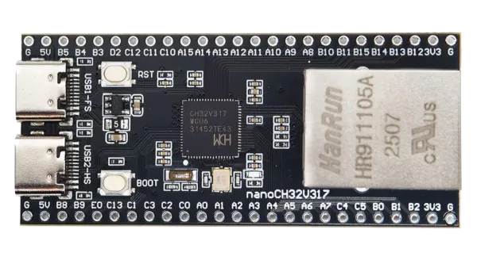

<!-- Copyright 2015-2026 Zephyr Project members and individual contributors. -->
<!-- SPDX-License-Identifier: Apache-2.0 -->
<!-- 中文翻译；编号、导航与译注为本地新增。 -->

<a id="nano_ch32v317"></a>

# 第9章\_MuseLab nanoCH32V317

原文：[官方页面](https://docs.zephyrproject.org/latest/boards/muselab/nano_ch32v317/doc/index.html)。读取日期：2026-10-16；来源摘要见[来源记录](../SOURCES.md)。

开发板概览（Board Overview）

<a id="id1"></a>

[](images/nano_ch32v317.webp)

MuseLab nanoCH32V317

名称（Name）：

`nano_ch32v317`

厂商（Vendor）：

[MuseLab Electronics](https://docs.zephyrproject.org/latest/boards/index.html#vendor=muselab)

状态（Status）：

当前未积极维护（Not Actively Maintained）

架构（Architecture）：

[riscv](https://docs.zephyrproject.org/latest/boards/index.html#arch=riscv)

片上系统（SoC）：

[ch32v317](https://docs.zephyrproject.org/latest/boards/index.html#soc=ch32v317)

<a id="board-github-link"></a>

[浏览开发板源码（Browse Board Sources）](https://github.com/zephyrproject-rtos/zephyr/blob/main//boards/muselab/nano_ch32v317/doc/index.rst/../..)<a id="overview"></a>

## 概述（Overview）

MuseLab nanoCH32V317是搭载基于RISC-V的CH32V317WCU6 SoC的开发板。

开发板带有复位按键、启动按键、一个用户LED、两个USB端口及一个以太网插座。

<a id="hardware"></a>

## 硬件（Hardware）

MuseLab nanoCH32V317的青稞（QingKe）V4F 32位RISC-V处理器由外部晶体提供时钟，运行于144 MHz。

芯片的突出特性是集成支持100BASE-TX以太网的MAC及PHY。

<a id="id3"></a>

<a id="id11"></a>

[WCH的CH32V31x网页](https://www.wch-ic.com/downloads/CH32V20x_30xDS0_PDF.html) [注1](#id2) 提供处理器信息及数据手册；开发板原理图见[nanoCH32V317 Git仓库](https://github.com/wuxx/nanoCH32V317) [注5](#id10)。

警告（Warning）

开发板没有USB VBUS二极管，因此不能同时由USB和外部电源供电！

<a id="supported-features"></a>

### 支持的功能（Supported Features）

`nano_ch32v317`开发板支持下表所列的硬件功能。

片上／板载（On-Chip / On-Board）

功能集成在片上系统（SoC）内／位于开发板上。

2 / 2

分别表示已启用／已禁用的实例数。点击数量标签，可查看开发板或SoC设备树源码（DTS）中该功能的第一个实例。

`vnd,foo`

与此功能匹配的设备树绑定兼容字符串（Compatible String）；点击链接可查看绑定文档。

<a id="nano_ch32v317-hw-features"></a>

<a id="nano_ch32v317-nano_ch32v317/ch32v317-hw-features-section"></a>

#### `nano_ch32v317/ch32v317`目标（Target）

<a id="nano_ch32v317-nano_ch32v317/ch32v317-hw-features-panel"></a>

<a id="nano_ch32v317-nano_ch32v317/ch32v317-hw-features-memory"></a>

该开发板目标的片上存储容量：32 KiB RAM、480 KiB Flash。

<a id="nano_ch32v317-nano_ch32v317/ch32v317-hw-features-table"></a>

<table>
<tr>
<th>类型（Type）</th>
<th>位置（Location）</th>
<th>说明（Description）</th>
<th>兼容字符串（Compatible）</th>
</tr>
<tr>
<td rowspan="1">中央处理器（CPU）</td>
<td>片上（On-Chip）</td>
<td>WCH青稞（QingKe）V4F RISC-V MCU（<a href="https://github.com/zephyrproject-rtos/zephyr/blob/main/dts/riscv/wch/qingke-v4f.dtsi?plain=1#L23">已启用：1</a>）</td>
<td><a href="../cpu_vendor_multiarc_binding_reference/P053_wch_qingke-v4f.md#std-dtcompatible-wch-qingke-v4f"><code>wch,qingke-v4f</code></a></td>
</tr>
<tr>
<td rowspan="5">时钟控制（Clock Control）</td>
<td>片上（On-Chip）</td>
<td>WCH CH32V00x复位及时钟控制（RCC）（<a href="https://github.com/zephyrproject-rtos/zephyr/blob/main/dts/riscv/wch/common/ch32v20x_30x_common.dtsi?plain=1#L177">已启用：1</a>）</td>
<td><a href="../timer_reference/P185_WCH复位与时钟控制绑定.md#dtbinding-wch-rcc"><code>wch,rcc</code></a></td>
</tr>
<tr>
<td>片上（On-Chip）</td>
<td>WCH CH32V00x高速外部时钟（HSE）（<a href="https://github.com/zephyrproject-rtos/zephyr/blob/main/dts/riscv/wch/common/ch32v20x_30x_common.dtsi?plain=1#L21">已启用：1</a>）</td>
<td><a href="../timer_reference/P186_CH32V00x高速外部时钟绑定.md#dtbinding-wch-ch32v00x-hse-clock"><code>wch,ch32v00x-hse-clock</code></a></td>
</tr>
<tr>
<td>片上（On-Chip）</td>
<td>WCH CH32V00x高速内部时钟（HSI）（<a href="https://github.com/zephyrproject-rtos/zephyr/blob/main/dts/riscv/wch/common/ch32v20x_30x_common.dtsi?plain=1#L28">已禁用：1</a>）</td>
<td><a href="../timer_reference/P187_CH32V00x高速内部时钟绑定.md#dtbinding-wch-ch32v00x-hsi-clock"><code>wch,ch32v00x-hsi-clock</code></a></td>
</tr>
<tr>
<td>片上（On-Chip）</td>
<td>通用固定频率时钟提供者（Fixed-Rate Clock Provider）（<a href="https://github.com/zephyrproject-rtos/zephyr/blob/main/dts/riscv/wch/common/ch32v20x_30x_common.dtsi?plain=1#L35">已禁用：1</a>）</td>
<td><a href="../hardware/P566_固定时钟绑定.md#dtbinding-fixed-clock"><code>fixed-clock</code></a></td>
</tr>
<tr>
<td>片上（On-Chip）</td>
<td>WCH CH32V20x／30x PLL（<a href="https://github.com/zephyrproject-rtos/zephyr/blob/main/dts/riscv/wch/common/ch32v20x_30x_common.dtsi?plain=1#L42">已启用：1</a>）</td>
<td><a href="https://docs.zephyrproject.org/latest/build/dts/api/bindings/clock/wch%2Cch32v20x_30x-pll-clock.html#std-dtcompatible-wch-ch32v20x_30x-pll-clock"><code>wch,ch32v20x_30x-pll-clock</code></a></td>
</tr>
<tr>
<td rowspan="2">计数器（Counter）</td>
<td>片上（On-Chip）</td>
<td>用于PWM的WCH高级控制定时器（ADTM / Advanced-control Timer）（<a href="https://github.com/zephyrproject-rtos/zephyr/blob/main/dts/riscv/wch/common/ch32v20x_30x_common.dtsi?plain=1#L217">已禁用：1</a>）</td>
<td><a href="../stm32_ti_xilinx_counter_binding_reference/P012_wch_adtm.md#std-dtcompatible-wch-adtm"><code>wch,adtm</code></a></td>
</tr>
<tr>
<td>片上（On-Chip）</td>
<td>WCH通用定时器（GPTM / General-purpose Timer）（<a href="https://github.com/zephyrproject-rtos/zephyr/blob/main/dts/riscv/wch/common/ch32v20x_30x_common.dtsi?plain=1#L236">已禁用：3</a>）</td>
<td><a href="../stm32_ti_xilinx_counter_binding_reference/P013_wch_gptm.md#std-dtcompatible-wch-gptm"><code>wch,gptm</code></a></td>
</tr>
<tr>
<td rowspan="1">直接存储器访问（DMA）</td>
<td>片上（On-Chip）</td>
<td>WCH DMA控制器（<a href="https://github.com/zephyrproject-rtos/zephyr/blob/main/dts/riscv/wch/common/ch32v20x_30x_common.dtsi?plain=1#L196">已启用：2</a>）</td>
<td><a href="../stm32_ti_xilinx_dma_binding_reference/P015_wch_wch-dma.md#std-dtcompatible-wch-wch-dma"><code>wch,wch-dma</code></a></td>
</tr>
<tr>
<td rowspan="3">以太网（Ethernet）</td>
<td>片上（On-Chip）</td>
<td>WCH CH32系列MCU以太网MAC控制器（<a href="https://github.com/zephyrproject-rtos/zephyr/blob/main/dts/riscv/wch/ch32v317/ch32v317.dtsi?plain=1#L12">已启用：1</a>）</td>
<td><a href="../ethernet_synopsys_st_xilinx_binding_reference/P016_wch_ethernet.md#std-dtcompatible-wch-ethernet"><code>wch,ethernet</code></a></td>
</tr>
<tr>
<td>片上（On-Chip）</td>
<td>Synopsys DesignWare MAC 的管理数据输入输出控制器（MDIO Controller）（<a href="https://github.com/zephyrproject-rtos/zephyr/blob/main/dts/riscv/wch/ch32v317/ch32v317.dtsi?plain=1#L27">已启用：1</a>）</td>
<td><a href="../ethernet_mdio_microchip_binding_reference/P010_snps_dwmac-mdio.md#std-dtcompatible-snps-dwmac-mdio"><code>snps,dwmac-mdio</code></a></td>
</tr>
<tr>
<td>板载（On-Board）</td>
<td>通用媒体独立接口物理层（MII PHY）（<a href="https://github.com/zephyrproject-rtos/zephyr/blob/main/boards/muselab/nano_ch32v317/nano_ch32v317_common.dtsi?plain=1#L109">已启用：1</a>）</td>
<td><a href="../ethernet_nxp_phy_binding_reference/P019_ethernet-phy.md#std-dtcompatible-ethernet-phy"><code>ethernet-phy</code></a></td>
</tr>
<tr>
<td rowspan="1">闪存控制器（Flash Controller）</td>
<td>片上（On-Chip）</td>
<td>WCH CH32V系列闪存控制器（<a href="https://github.com/zephyrproject-rtos/zephyr/blob/main/dts/riscv/wch/common/ch32v20x_30x_common.dtsi?plain=1#L55">已启用：1</a>）</td>
<td><a href="../flash_renesas_st_ti_binding_reference/P034_wch_ch32v-flash-controller.md#std-dtcompatible-wch-ch32v-flash-controller"><code>wch,ch32v-flash-controller</code></a></td>
</tr>
<tr>
<td rowspan="1">通用输入输出与接插件（GPIO &amp; Headers）</td>
<td>片上（On-Chip）</td>
<td>WCH CH32V00x通用输入／输出（GPIO）（<a href="https://github.com/zephyrproject-rtos/zephyr/blob/main/dts/riscv/wch/common/ch32v20x_30x_common.dtsi?plain=1#L108">已启用：5</a>）</td>
<td><a href="../gpio_ti_xilinx_sdl_binding_reference/P024_wch_gpio.md#std-dtcompatible-wch-gpio"><code>wch,gpio</code></a></td>
</tr>
<tr>
<td rowspan="1">硬件信息（Hardware Information）</td>
<td>片上（On-Chip）</td>
<td>WCH CH32V电子签名（ESIG / Electronic Signature）（<a href="https://github.com/zephyrproject-rtos/zephyr/blob/main/dts/riscv/wch/common/ch32v20x_30x_common.dtsi?plain=1#L293">已启用：1</a>）</td>
<td><a href="../hwinfo_binding_reference/P015_wch_esig.md#std-dtcompatible-wch-esig"><code>wch,esig</code></a></td>
</tr>
<tr>
<td rowspan="1">集成电路间总线（I2C）</td>
<td>片上（On-Chip）</td>
<td>WCH I2C控制器（<a href="https://github.com/zephyrproject-rtos/zephyr/blob/main/dts/riscv/wch/common/ch32v20x_30x_common.dtsi?plain=1#L166">已禁用：2</a>）</td>
<td><a href="../i2c_stm32_ti_mux_binding_reference/P017_wch_i2c.md#std-dtcompatible-wch-i2c"><code>wch,i2c</code></a></td>
</tr>
<tr>
<td rowspan="2">中断控制器（Interrupt Controller）</td>
<td>片上（On-Chip）</td>
<td>WCH CH32V00x可编程快速中断控制器（PFIC）（<a href="https://github.com/zephyrproject-rtos/zephyr/blob/main/dts/riscv/wch/qingke-v4f.dtsi?plain=1#L39">已启用：1</a>）</td>
<td><a href="../mcu_external_interrupt_binding_reference/P006_wch_pfic.md#std-dtcompatible-wch-pfic"><code>wch,pfic</code></a></td>
</tr>
<tr>
<td>片上（On-Chip）</td>
<td>WCH CH32V003／20x／30x外部中断及事件控制器（EXTI）（<a href="https://github.com/zephyrproject-rtos/zephyr/blob/main/dts/riscv/wch/common/ch32v20x_30x_common.dtsi?plain=1#L86">已禁用：1</a>）</td>
<td><a href="../mcu_external_interrupt_binding_reference/P005_wch_exti.md#std-dtcompatible-wch-exti"><code>wch,exti</code></a></td>
</tr>
<tr>
<td rowspan="2">发光二极管（LED）</td>
<td>板载（On-Board）</td>
<td>一组由 GPIO 控制的 LED（GPIO-Controlled LEDs）（<a href="https://github.com/zephyrproject-rtos/zephyr/blob/main/boards/muselab/nano_ch32v317/nano_ch32v317_common.dtsi?plain=1#L23">已启用：1</a>）</td>
<td><a href="../hardware/P564_GPIO指示灯绑定.md#dtbinding-gpio-leds"><code>gpio-leds</code></a></td>
</tr>
<tr>
<td>板载（On-Board）</td>
<td>一组由脉宽调制（PWM）控制的LED（<a href="https://github.com/zephyrproject-rtos/zephyr/blob/main/boards/muselab/nano_ch32v317/nano_ch32v317_common.dtsi?plain=1#L32">已禁用：1</a>）</td>
<td><a href="../hardware/P565_PWM指示灯绑定.md#dtbinding-pwm-leds"><code>pwm-leds</code></a></td>
</tr>
<tr>
<td rowspan="1">存储技术设备（MTD）</td>
<td>片上（On-Chip）</td>
<td>闪存（Flash）节点（<a href="https://github.com/zephyrproject-rtos/zephyr/blob/main/dts/riscv/wch/common/ch32v20x_30x_common.dtsi?plain=1#L64">已启用：1</a>）</td>
<td><a href="../mtd_nxp_st_ti_partition_binding_reference/P013_soc-nv-flash.md#std-dtcompatible-soc-nv-flash"><code>soc-nv-flash</code></a></td>
</tr>
<tr>
<td rowspan="1">引脚控制（Pin Control）</td>
<td>片上（On-Chip）</td>
<td>WCH CH32V20x／30x复用功能I/O（AFIO）（<a href="https://github.com/zephyrproject-rtos/zephyr/blob/main/dts/riscv/wch/common/ch32v20x_30x_common.dtsi?plain=1#L101">已启用：1</a>）</td>
<td><a href="../pinctrl_stm32_ti_xilinx_binding_reference/P017_wch_20x_30x-afio.md#std-dtcompatible-wch-20x_30x-afio"><code>wch,20x_30x-afio</code></a></td>
</tr>
<tr>
<td rowspan="2">脉宽调制（PWM）</td>
<td>片上（On-Chip）</td>
<td>用于PWM的WCH高级控制定时器（ADTM / Advanced-control Timer）（<a href="https://github.com/zephyrproject-rtos/zephyr/blob/main/dts/riscv/wch/common/ch32v20x_30x_common.dtsi?plain=1#L228">已禁用：1</a>）</td>
<td><a href="../pwm_stm32_ti_generic_binding_reference/P018_wch_adtm-pwm.md#std-dtcompatible-wch-adtm-pwm"><code>wch,adtm-pwm</code></a></td>
</tr>
<tr>
<td>片上（On-Chip）</td>
<td>用于PWM的WCH通用定时器（GPTM）（<a href="https://github.com/zephyrproject-rtos/zephyr/blob/main/dts/riscv/wch/common/ch32v20x_30x_common.dtsi?plain=1#L247">已禁用：3</a>）</td>
<td><a href="../pwm_stm32_ti_generic_binding_reference/P019_wch_gptm-pwm.md#std-dtcompatible-wch-gptm-pwm"><code>wch,gptm-pwm</code></a></td>
</tr>
<tr>
<td rowspan="1">复位控制器（Reset Controller）</td>
<td>片上（On-Chip）</td>
<td>CH32复位及时钟控制（RCC）的复位控制器（<a href="https://github.com/zephyrproject-rtos/zephyr/blob/main/dts/riscv/wch/common/ch32v20x_30x_common.dtsi?plain=1#L183">已启用：1</a>）</td>
<td><a href="../reset_controller_binding_reference/P019_wch_ch32-rcc-rctl.md#std-dtcompatible-wch-ch32-rcc-rctl"><code>wch,ch32-rcc-rctl</code></a></td>
</tr>
<tr>
<td rowspan="1">随机数生成器（RNG）</td>
<td>片上（On-Chip）</td>
<td>WCH CH32随机数发生器（RNG / Random Number Generator）（<a href="https://github.com/zephyrproject-rtos/zephyr/blob/main/dts/riscv/wch/common/ch32v20x_30x_common.dtsi?plain=1#L189">已启用：1</a>）</td>
<td><a href="../soc_rng_binding_reference/P020_wch_rng.md#std-dtcompatible-wch-rng"><code>wch,rng</code></a></td>
</tr>
<tr>
<td rowspan="2">串行控制器（Serial Controller）</td>
<td>片上（On-Chip）</td>
<td>WCH SDI控制台（<a href="https://github.com/zephyrproject-rtos/zephyr/blob/main/dts/riscv/wch/qingke-v4f.dtsi?plain=1#L56">已启用：1</a>）</td>
<td><a href="../uart_ti_wch_virtual_binding_reference/P006_wch_sdi-console.md#std-dtcompatible-wch-sdi-console"><code>wch,sdi-console</code></a></td>
</tr>
<tr>
<td>片上（On-Chip）</td>
<td>WCH CH32V00x UART（<a href="https://github.com/zephyrproject-rtos/zephyr/blob/main/dts/riscv/wch/common/ch32v20x_30x_common.dtsi?plain=1#L145">已启用：1</a>；<a href="https://github.com/zephyrproject-rtos/zephyr/blob/main/dts/riscv/wch/ch32v317/ch32v317.dtsi?plain=1#L46">已禁用：7</a>）</td>
<td><a href="../uart_ti_wch_virtual_binding_reference/P007_wch_usart.md#std-dtcompatible-wch-usart"><code>wch,usart</code></a></td>
</tr>
<tr>
<td rowspan="1">串行外设接口（SPI）</td>
<td>片上（On-Chip）</td>
<td>WCH SPI（<a href="https://github.com/zephyrproject-rtos/zephyr/blob/main/dts/riscv/wch/common/ch32v20x_30x_common.dtsi?plain=1#L155">已禁用：3</a>）</td>
<td><a href="../spi_stm32_ti_xilinx_binding_reference/P019_wch_spi.md#std-dtcompatible-wch-spi"><code>wch,spi</code></a></td>
</tr>
<tr>
<td rowspan="1">静态随机存储器（SRAM）</td>
<td>片上（On-Chip）</td>
<td>通用片上静态随机存储器（SRAM）（<a href="https://github.com/zephyrproject-rtos/zephyr/blob/main/dts/riscv/wch/common/ch32v20x_30x_common.dtsi?plain=1#L51">已启用：1</a>）</td>
<td><a href="../hardware/P567_内存映射SRAM绑定.md#dtbinding-mmio-sram"><code>mmio-sram</code></a></td>
</tr>
<tr>
<td rowspan="1">定时器（Timer）</td>
<td>片上（On-Chip）</td>
<td>WCH CH32V00x系统节拍（Systick）（<a href="https://github.com/zephyrproject-rtos/zephyr/blob/main/dts/riscv/wch/qingke-v4f.dtsi?plain=1#L48">已启用：1</a>）</td>
<td><a href="../system_timer_binding_reference/P014_wch_systick.md#std-dtcompatible-wch-systick"><code>wch,systick</code></a></td>
</tr>
<tr>
<td rowspan="1">看门狗（Watchdog）</td>
<td>片上（On-Chip）</td>
<td>WCH独立看门狗（IWDG / Independent Watchdog）（<a href="https://github.com/zephyrproject-rtos/zephyr/blob/main/dts/riscv/wch/common/ch32v20x_30x_common.dtsi?plain=1#L80">已禁用：1</a>）</td>
<td><a href="../stm32_ti_xilinx_watchdog_binding_reference/P009_wch_iwdg.md#std-dtcompatible-wch-iwdg"><code>wch,iwdg</code></a></td>
</tr>
</table>

<a id="nano_ch32v317-nano_ch32v317/ch32v317/ram_128k-hw-features-section"></a>

#### `nano_ch32v317/ch32v317/ram_128k`目标（Target）

<a id="nano_ch32v317-nano_ch32v317/ch32v317/ram_128k-hw-features-panel"></a>

<a id="nano_ch32v317-nano_ch32v317/ch32v317/ram_128k-hw-features-memory"></a>

该开发板目标的片上存储容量：128 KiB RAM、480 KiB Flash。

<a id="nano_ch32v317-nano_ch32v317/ch32v317/ram_128k-hw-features-table"></a>

<table>
<tr>
<th>类型（Type）</th>
<th>位置（Location）</th>
<th>说明（Description）</th>
<th>兼容字符串（Compatible）</th>
</tr>
<tr>
<td rowspan="1">中央处理器（CPU）</td>
<td>片上（On-Chip）</td>
<td>WCH青稞（QingKe）V4F RISC-V MCU（<a href="https://github.com/zephyrproject-rtos/zephyr/blob/main/dts/riscv/wch/qingke-v4f.dtsi?plain=1#L23">已启用：1</a>）</td>
<td><a href="../cpu_vendor_multiarc_binding_reference/P053_wch_qingke-v4f.md#std-dtcompatible-wch-qingke-v4f"><code>wch,qingke-v4f</code></a></td>
</tr>
<tr>
<td rowspan="5">时钟控制（Clock Control）</td>
<td>片上（On-Chip）</td>
<td>WCH CH32V00x复位及时钟控制（RCC）（<a href="https://github.com/zephyrproject-rtos/zephyr/blob/main/dts/riscv/wch/common/ch32v20x_30x_common.dtsi?plain=1#L177">已启用：1</a>）</td>
<td><a href="../timer_reference/P185_WCH复位与时钟控制绑定.md#dtbinding-wch-rcc"><code>wch,rcc</code></a></td>
</tr>
<tr>
<td>片上（On-Chip）</td>
<td>WCH CH32V00x高速外部时钟（HSE）（<a href="https://github.com/zephyrproject-rtos/zephyr/blob/main/dts/riscv/wch/common/ch32v20x_30x_common.dtsi?plain=1#L21">已启用：1</a>）</td>
<td><a href="../timer_reference/P186_CH32V00x高速外部时钟绑定.md#dtbinding-wch-ch32v00x-hse-clock"><code>wch,ch32v00x-hse-clock</code></a></td>
</tr>
<tr>
<td>片上（On-Chip）</td>
<td>WCH CH32V00x高速内部时钟（HSI）（<a href="https://github.com/zephyrproject-rtos/zephyr/blob/main/dts/riscv/wch/common/ch32v20x_30x_common.dtsi?plain=1#L28">已禁用：1</a>）</td>
<td><a href="../timer_reference/P187_CH32V00x高速内部时钟绑定.md#dtbinding-wch-ch32v00x-hsi-clock"><code>wch,ch32v00x-hsi-clock</code></a></td>
</tr>
<tr>
<td>片上（On-Chip）</td>
<td>通用固定频率时钟提供者（Fixed-Rate Clock Provider）（<a href="https://github.com/zephyrproject-rtos/zephyr/blob/main/dts/riscv/wch/common/ch32v20x_30x_common.dtsi?plain=1#L35">已禁用：1</a>）</td>
<td><a href="../hardware/P566_固定时钟绑定.md#dtbinding-fixed-clock"><code>fixed-clock</code></a></td>
</tr>
<tr>
<td>片上（On-Chip）</td>
<td>WCH CH32V20x／30x PLL（<a href="https://github.com/zephyrproject-rtos/zephyr/blob/main/dts/riscv/wch/common/ch32v20x_30x_common.dtsi?plain=1#L42">已启用：1</a>）</td>
<td><a href="https://docs.zephyrproject.org/latest/build/dts/api/bindings/clock/wch%2Cch32v20x_30x-pll-clock.html#std-dtcompatible-wch-ch32v20x_30x-pll-clock"><code>wch,ch32v20x_30x-pll-clock</code></a></td>
</tr>
<tr>
<td rowspan="2">计数器（Counter）</td>
<td>片上（On-Chip）</td>
<td>用于PWM的WCH高级控制定时器（ADTM / Advanced-control Timer）（<a href="https://github.com/zephyrproject-rtos/zephyr/blob/main/dts/riscv/wch/common/ch32v20x_30x_common.dtsi?plain=1#L217">已禁用：1</a>）</td>
<td><a href="../stm32_ti_xilinx_counter_binding_reference/P012_wch_adtm.md#std-dtcompatible-wch-adtm"><code>wch,adtm</code></a></td>
</tr>
<tr>
<td>片上（On-Chip）</td>
<td>WCH通用定时器（GPTM / General-purpose Timer）（<a href="https://github.com/zephyrproject-rtos/zephyr/blob/main/dts/riscv/wch/common/ch32v20x_30x_common.dtsi?plain=1#L236">已禁用：3</a>）</td>
<td><a href="../stm32_ti_xilinx_counter_binding_reference/P013_wch_gptm.md#std-dtcompatible-wch-gptm"><code>wch,gptm</code></a></td>
</tr>
<tr>
<td rowspan="1">直接存储器访问（DMA）</td>
<td>片上（On-Chip）</td>
<td>WCH DMA控制器（<a href="https://github.com/zephyrproject-rtos/zephyr/blob/main/dts/riscv/wch/common/ch32v20x_30x_common.dtsi?plain=1#L196">已启用：2</a>）</td>
<td><a href="../stm32_ti_xilinx_dma_binding_reference/P015_wch_wch-dma.md#std-dtcompatible-wch-wch-dma"><code>wch,wch-dma</code></a></td>
</tr>
<tr>
<td rowspan="3">以太网（Ethernet）</td>
<td>片上（On-Chip）</td>
<td>WCH CH32系列MCU以太网MAC控制器（<a href="https://github.com/zephyrproject-rtos/zephyr/blob/main/dts/riscv/wch/ch32v317/ch32v317.dtsi?plain=1#L12">已启用：1</a>）</td>
<td><a href="../ethernet_synopsys_st_xilinx_binding_reference/P016_wch_ethernet.md#std-dtcompatible-wch-ethernet"><code>wch,ethernet</code></a></td>
</tr>
<tr>
<td>片上（On-Chip）</td>
<td>Synopsys DesignWare MAC 的管理数据输入输出控制器（MDIO Controller）（<a href="https://github.com/zephyrproject-rtos/zephyr/blob/main/dts/riscv/wch/ch32v317/ch32v317.dtsi?plain=1#L27">已启用：1</a>）</td>
<td><a href="../ethernet_mdio_microchip_binding_reference/P010_snps_dwmac-mdio.md#std-dtcompatible-snps-dwmac-mdio"><code>snps,dwmac-mdio</code></a></td>
</tr>
<tr>
<td>板载（On-Board）</td>
<td>通用媒体独立接口物理层（MII PHY）（<a href="https://github.com/zephyrproject-rtos/zephyr/blob/main/boards/muselab/nano_ch32v317/nano_ch32v317_common.dtsi?plain=1#L109">已启用：1</a>）</td>
<td><a href="../ethernet_nxp_phy_binding_reference/P019_ethernet-phy.md#std-dtcompatible-ethernet-phy"><code>ethernet-phy</code></a></td>
</tr>
<tr>
<td rowspan="1">闪存控制器（Flash Controller）</td>
<td>片上（On-Chip）</td>
<td>WCH CH32V系列闪存控制器（<a href="https://github.com/zephyrproject-rtos/zephyr/blob/main/dts/riscv/wch/common/ch32v20x_30x_common.dtsi?plain=1#L55">已启用：1</a>）</td>
<td><a href="../flash_renesas_st_ti_binding_reference/P034_wch_ch32v-flash-controller.md#std-dtcompatible-wch-ch32v-flash-controller"><code>wch,ch32v-flash-controller</code></a></td>
</tr>
<tr>
<td rowspan="1">通用输入输出与接插件（GPIO &amp; Headers）</td>
<td>片上（On-Chip）</td>
<td>WCH CH32V00x通用输入／输出（GPIO）（<a href="https://github.com/zephyrproject-rtos/zephyr/blob/main/dts/riscv/wch/common/ch32v20x_30x_common.dtsi?plain=1#L108">已启用：5</a>）</td>
<td><a href="../gpio_ti_xilinx_sdl_binding_reference/P024_wch_gpio.md#std-dtcompatible-wch-gpio"><code>wch,gpio</code></a></td>
</tr>
<tr>
<td rowspan="1">硬件信息（Hardware Information）</td>
<td>片上（On-Chip）</td>
<td>WCH CH32V电子签名（ESIG / Electronic Signature）（<a href="https://github.com/zephyrproject-rtos/zephyr/blob/main/dts/riscv/wch/common/ch32v20x_30x_common.dtsi?plain=1#L293">已启用：1</a>）</td>
<td><a href="../hwinfo_binding_reference/P015_wch_esig.md#std-dtcompatible-wch-esig"><code>wch,esig</code></a></td>
</tr>
<tr>
<td rowspan="1">集成电路间总线（I2C）</td>
<td>片上（On-Chip）</td>
<td>WCH I2C控制器（<a href="https://github.com/zephyrproject-rtos/zephyr/blob/main/dts/riscv/wch/common/ch32v20x_30x_common.dtsi?plain=1#L166">已禁用：2</a>）</td>
<td><a href="../i2c_stm32_ti_mux_binding_reference/P017_wch_i2c.md#std-dtcompatible-wch-i2c"><code>wch,i2c</code></a></td>
</tr>
<tr>
<td rowspan="2">中断控制器（Interrupt Controller）</td>
<td>片上（On-Chip）</td>
<td>WCH CH32V00x可编程快速中断控制器（PFIC）（<a href="https://github.com/zephyrproject-rtos/zephyr/blob/main/dts/riscv/wch/qingke-v4f.dtsi?plain=1#L39">已启用：1</a>）</td>
<td><a href="../mcu_external_interrupt_binding_reference/P006_wch_pfic.md#std-dtcompatible-wch-pfic"><code>wch,pfic</code></a></td>
</tr>
<tr>
<td>片上（On-Chip）</td>
<td>WCH CH32V003／20x／30x外部中断及事件控制器（EXTI）（<a href="https://github.com/zephyrproject-rtos/zephyr/blob/main/dts/riscv/wch/common/ch32v20x_30x_common.dtsi?plain=1#L86">已禁用：1</a>）</td>
<td><a href="../mcu_external_interrupt_binding_reference/P005_wch_exti.md#std-dtcompatible-wch-exti"><code>wch,exti</code></a></td>
</tr>
<tr>
<td rowspan="2">发光二极管（LED）</td>
<td>板载（On-Board）</td>
<td>一组由 GPIO 控制的 LED（GPIO-Controlled LEDs）（<a href="https://github.com/zephyrproject-rtos/zephyr/blob/main/boards/muselab/nano_ch32v317/nano_ch32v317_common.dtsi?plain=1#L23">已启用：1</a>）</td>
<td><a href="../hardware/P564_GPIO指示灯绑定.md#dtbinding-gpio-leds"><code>gpio-leds</code></a></td>
</tr>
<tr>
<td>板载（On-Board）</td>
<td>一组由脉宽调制（PWM）控制的LED（<a href="https://github.com/zephyrproject-rtos/zephyr/blob/main/boards/muselab/nano_ch32v317/nano_ch32v317_common.dtsi?plain=1#L32">已禁用：1</a>）</td>
<td><a href="../hardware/P565_PWM指示灯绑定.md#dtbinding-pwm-leds"><code>pwm-leds</code></a></td>
</tr>
<tr>
<td rowspan="1">存储技术设备（MTD）</td>
<td>片上（On-Chip）</td>
<td>闪存（Flash）节点（<a href="https://github.com/zephyrproject-rtos/zephyr/blob/main/dts/riscv/wch/common/ch32v20x_30x_common.dtsi?plain=1#L64">已启用：1</a>）</td>
<td><a href="../mtd_nxp_st_ti_partition_binding_reference/P013_soc-nv-flash.md#std-dtcompatible-soc-nv-flash"><code>soc-nv-flash</code></a></td>
</tr>
<tr>
<td rowspan="1">引脚控制（Pin Control）</td>
<td>片上（On-Chip）</td>
<td>WCH CH32V20x／30x复用功能I/O（AFIO）（<a href="https://github.com/zephyrproject-rtos/zephyr/blob/main/dts/riscv/wch/common/ch32v20x_30x_common.dtsi?plain=1#L101">已启用：1</a>）</td>
<td><a href="../pinctrl_stm32_ti_xilinx_binding_reference/P017_wch_20x_30x-afio.md#std-dtcompatible-wch-20x_30x-afio"><code>wch,20x_30x-afio</code></a></td>
</tr>
<tr>
<td rowspan="2">脉宽调制（PWM）</td>
<td>片上（On-Chip）</td>
<td>用于PWM的WCH高级控制定时器（ADTM / Advanced-control Timer）（<a href="https://github.com/zephyrproject-rtos/zephyr/blob/main/dts/riscv/wch/common/ch32v20x_30x_common.dtsi?plain=1#L228">已禁用：1</a>）</td>
<td><a href="../pwm_stm32_ti_generic_binding_reference/P018_wch_adtm-pwm.md#std-dtcompatible-wch-adtm-pwm"><code>wch,adtm-pwm</code></a></td>
</tr>
<tr>
<td>片上（On-Chip）</td>
<td>用于PWM的WCH通用定时器（GPTM）（<a href="https://github.com/zephyrproject-rtos/zephyr/blob/main/dts/riscv/wch/common/ch32v20x_30x_common.dtsi?plain=1#L247">已禁用：3</a>）</td>
<td><a href="../pwm_stm32_ti_generic_binding_reference/P019_wch_gptm-pwm.md#std-dtcompatible-wch-gptm-pwm"><code>wch,gptm-pwm</code></a></td>
</tr>
<tr>
<td rowspan="1">复位控制器（Reset Controller）</td>
<td>片上（On-Chip）</td>
<td>CH32复位及时钟控制（RCC）的复位控制器（<a href="https://github.com/zephyrproject-rtos/zephyr/blob/main/dts/riscv/wch/common/ch32v20x_30x_common.dtsi?plain=1#L183">已启用：1</a>）</td>
<td><a href="../reset_controller_binding_reference/P019_wch_ch32-rcc-rctl.md#std-dtcompatible-wch-ch32-rcc-rctl"><code>wch,ch32-rcc-rctl</code></a></td>
</tr>
<tr>
<td rowspan="1">随机数生成器（RNG）</td>
<td>片上（On-Chip）</td>
<td>WCH CH32随机数发生器（RNG / Random Number Generator）（<a href="https://github.com/zephyrproject-rtos/zephyr/blob/main/dts/riscv/wch/common/ch32v20x_30x_common.dtsi?plain=1#L189">已启用：1</a>）</td>
<td><a href="../soc_rng_binding_reference/P020_wch_rng.md#std-dtcompatible-wch-rng"><code>wch,rng</code></a></td>
</tr>
<tr>
<td rowspan="2">串行控制器（Serial Controller）</td>
<td>片上（On-Chip）</td>
<td>WCH SDI控制台（<a href="https://github.com/zephyrproject-rtos/zephyr/blob/main/dts/riscv/wch/qingke-v4f.dtsi?plain=1#L56">已启用：1</a>）</td>
<td><a href="../uart_ti_wch_virtual_binding_reference/P006_wch_sdi-console.md#std-dtcompatible-wch-sdi-console"><code>wch,sdi-console</code></a></td>
</tr>
<tr>
<td>片上（On-Chip）</td>
<td>WCH CH32V00x UART（<a href="https://github.com/zephyrproject-rtos/zephyr/blob/main/dts/riscv/wch/common/ch32v20x_30x_common.dtsi?plain=1#L145">已启用：1</a>；<a href="https://github.com/zephyrproject-rtos/zephyr/blob/main/dts/riscv/wch/ch32v317/ch32v317.dtsi?plain=1#L46">已禁用：7</a>）</td>
<td><a href="../uart_ti_wch_virtual_binding_reference/P007_wch_usart.md#std-dtcompatible-wch-usart"><code>wch,usart</code></a></td>
</tr>
<tr>
<td rowspan="1">串行外设接口（SPI）</td>
<td>片上（On-Chip）</td>
<td>WCH SPI（<a href="https://github.com/zephyrproject-rtos/zephyr/blob/main/dts/riscv/wch/common/ch32v20x_30x_common.dtsi?plain=1#L155">已禁用：3</a>）</td>
<td><a href="../spi_stm32_ti_xilinx_binding_reference/P019_wch_spi.md#std-dtcompatible-wch-spi"><code>wch,spi</code></a></td>
</tr>
<tr>
<td rowspan="1">静态随机存储器（SRAM）</td>
<td>片上（On-Chip）</td>
<td>通用片上静态随机存储器（SRAM）（<a href="https://github.com/zephyrproject-rtos/zephyr/blob/main/dts/riscv/wch/common/ch32v20x_30x_common.dtsi?plain=1#L51">已启用：1</a>）</td>
<td><a href="../hardware/P567_内存映射SRAM绑定.md#dtbinding-mmio-sram"><code>mmio-sram</code></a></td>
</tr>
<tr>
<td rowspan="1">定时器（Timer）</td>
<td>片上（On-Chip）</td>
<td>WCH CH32V00x系统节拍（Systick）（<a href="https://github.com/zephyrproject-rtos/zephyr/blob/main/dts/riscv/wch/qingke-v4f.dtsi?plain=1#L48">已启用：1</a>）</td>
<td><a href="../system_timer_binding_reference/P014_wch_systick.md#std-dtcompatible-wch-systick"><code>wch,systick</code></a></td>
</tr>
<tr>
<td rowspan="1">看门狗（Watchdog）</td>
<td>片上（On-Chip）</td>
<td>WCH独立看门狗（IWDG / Independent Watchdog）（<a href="https://github.com/zephyrproject-rtos/zephyr/blob/main/dts/riscv/wch/common/ch32v20x_30x_common.dtsi?plain=1#L80">已禁用：1</a>）</td>
<td><a href="../stm32_ti_xilinx_watchdog_binding_reference/P009_wch_iwdg.md#std-dtcompatible-wch-iwdg"><code>wch,iwdg</code></a></td>
</tr>
</table>

<a id="nano_ch32v317-nano_ch32v317/ch32v317/ram_192k-hw-features-section"></a>

#### `nano_ch32v317/ch32v317/ram_192k`目标（Target）

<a id="nano_ch32v317-nano_ch32v317/ch32v317/ram_192k-hw-features-panel"></a>

<a id="nano_ch32v317-nano_ch32v317/ch32v317/ram_192k-hw-features-memory"></a>

该开发板目标的片上存储容量：192 KiB RAM、480 KiB Flash。

<a id="nano_ch32v317-nano_ch32v317/ch32v317/ram_192k-hw-features-table"></a>

<table>
<tr>
<th>类型（Type）</th>
<th>位置（Location）</th>
<th>说明（Description）</th>
<th>兼容字符串（Compatible）</th>
</tr>
<tr>
<td rowspan="1">中央处理器（CPU）</td>
<td>片上（On-Chip）</td>
<td>WCH青稞（QingKe）V4F RISC-V MCU（<a href="https://github.com/zephyrproject-rtos/zephyr/blob/main/dts/riscv/wch/qingke-v4f.dtsi?plain=1#L23">已启用：1</a>）</td>
<td><a href="../cpu_vendor_multiarc_binding_reference/P053_wch_qingke-v4f.md#std-dtcompatible-wch-qingke-v4f"><code>wch,qingke-v4f</code></a></td>
</tr>
<tr>
<td rowspan="5">时钟控制（Clock Control）</td>
<td>片上（On-Chip）</td>
<td>WCH CH32V00x复位及时钟控制（RCC）（<a href="https://github.com/zephyrproject-rtos/zephyr/blob/main/dts/riscv/wch/common/ch32v20x_30x_common.dtsi?plain=1#L177">已启用：1</a>）</td>
<td><a href="../timer_reference/P185_WCH复位与时钟控制绑定.md#dtbinding-wch-rcc"><code>wch,rcc</code></a></td>
</tr>
<tr>
<td>片上（On-Chip）</td>
<td>WCH CH32V00x高速外部时钟（HSE）（<a href="https://github.com/zephyrproject-rtos/zephyr/blob/main/dts/riscv/wch/common/ch32v20x_30x_common.dtsi?plain=1#L21">已启用：1</a>）</td>
<td><a href="../timer_reference/P186_CH32V00x高速外部时钟绑定.md#dtbinding-wch-ch32v00x-hse-clock"><code>wch,ch32v00x-hse-clock</code></a></td>
</tr>
<tr>
<td>片上（On-Chip）</td>
<td>WCH CH32V00x高速内部时钟（HSI）（<a href="https://github.com/zephyrproject-rtos/zephyr/blob/main/dts/riscv/wch/common/ch32v20x_30x_common.dtsi?plain=1#L28">已禁用：1</a>）</td>
<td><a href="../timer_reference/P187_CH32V00x高速内部时钟绑定.md#dtbinding-wch-ch32v00x-hsi-clock"><code>wch,ch32v00x-hsi-clock</code></a></td>
</tr>
<tr>
<td>片上（On-Chip）</td>
<td>通用固定频率时钟提供者（Fixed-Rate Clock Provider）（<a href="https://github.com/zephyrproject-rtos/zephyr/blob/main/dts/riscv/wch/common/ch32v20x_30x_common.dtsi?plain=1#L35">已禁用：1</a>）</td>
<td><a href="../hardware/P566_固定时钟绑定.md#dtbinding-fixed-clock"><code>fixed-clock</code></a></td>
</tr>
<tr>
<td>片上（On-Chip）</td>
<td>WCH CH32V20x／30x PLL（<a href="https://github.com/zephyrproject-rtos/zephyr/blob/main/dts/riscv/wch/common/ch32v20x_30x_common.dtsi?plain=1#L42">已启用：1</a>）</td>
<td><a href="https://docs.zephyrproject.org/latest/build/dts/api/bindings/clock/wch%2Cch32v20x_30x-pll-clock.html#std-dtcompatible-wch-ch32v20x_30x-pll-clock"><code>wch,ch32v20x_30x-pll-clock</code></a></td>
</tr>
<tr>
<td rowspan="2">计数器（Counter）</td>
<td>片上（On-Chip）</td>
<td>用于PWM的WCH高级控制定时器（ADTM / Advanced-control Timer）（<a href="https://github.com/zephyrproject-rtos/zephyr/blob/main/dts/riscv/wch/common/ch32v20x_30x_common.dtsi?plain=1#L217">已禁用：1</a>）</td>
<td><a href="../stm32_ti_xilinx_counter_binding_reference/P012_wch_adtm.md#std-dtcompatible-wch-adtm"><code>wch,adtm</code></a></td>
</tr>
<tr>
<td>片上（On-Chip）</td>
<td>WCH通用定时器（GPTM / General-purpose Timer）（<a href="https://github.com/zephyrproject-rtos/zephyr/blob/main/dts/riscv/wch/common/ch32v20x_30x_common.dtsi?plain=1#L236">已禁用：3</a>）</td>
<td><a href="../stm32_ti_xilinx_counter_binding_reference/P013_wch_gptm.md#std-dtcompatible-wch-gptm"><code>wch,gptm</code></a></td>
</tr>
<tr>
<td rowspan="1">直接存储器访问（DMA）</td>
<td>片上（On-Chip）</td>
<td>WCH DMA控制器（<a href="https://github.com/zephyrproject-rtos/zephyr/blob/main/dts/riscv/wch/common/ch32v20x_30x_common.dtsi?plain=1#L196">已启用：2</a>）</td>
<td><a href="../stm32_ti_xilinx_dma_binding_reference/P015_wch_wch-dma.md#std-dtcompatible-wch-wch-dma"><code>wch,wch-dma</code></a></td>
</tr>
<tr>
<td rowspan="3">以太网（Ethernet）</td>
<td>片上（On-Chip）</td>
<td>WCH CH32系列MCU以太网MAC控制器（<a href="https://github.com/zephyrproject-rtos/zephyr/blob/main/dts/riscv/wch/ch32v317/ch32v317.dtsi?plain=1#L12">已启用：1</a>）</td>
<td><a href="../ethernet_synopsys_st_xilinx_binding_reference/P016_wch_ethernet.md#std-dtcompatible-wch-ethernet"><code>wch,ethernet</code></a></td>
</tr>
<tr>
<td>片上（On-Chip）</td>
<td>Synopsys DesignWare MAC 的管理数据输入输出控制器（MDIO Controller）（<a href="https://github.com/zephyrproject-rtos/zephyr/blob/main/dts/riscv/wch/ch32v317/ch32v317.dtsi?plain=1#L27">已启用：1</a>）</td>
<td><a href="../ethernet_mdio_microchip_binding_reference/P010_snps_dwmac-mdio.md#std-dtcompatible-snps-dwmac-mdio"><code>snps,dwmac-mdio</code></a></td>
</tr>
<tr>
<td>板载（On-Board）</td>
<td>通用媒体独立接口物理层（MII PHY）（<a href="https://github.com/zephyrproject-rtos/zephyr/blob/main/boards/muselab/nano_ch32v317/nano_ch32v317_common.dtsi?plain=1#L109">已启用：1</a>）</td>
<td><a href="../ethernet_nxp_phy_binding_reference/P019_ethernet-phy.md#std-dtcompatible-ethernet-phy"><code>ethernet-phy</code></a></td>
</tr>
<tr>
<td rowspan="1">闪存控制器（Flash Controller）</td>
<td>片上（On-Chip）</td>
<td>WCH CH32V系列闪存控制器（<a href="https://github.com/zephyrproject-rtos/zephyr/blob/main/dts/riscv/wch/common/ch32v20x_30x_common.dtsi?plain=1#L55">已启用：1</a>）</td>
<td><a href="../flash_renesas_st_ti_binding_reference/P034_wch_ch32v-flash-controller.md#std-dtcompatible-wch-ch32v-flash-controller"><code>wch,ch32v-flash-controller</code></a></td>
</tr>
<tr>
<td rowspan="1">通用输入输出与接插件（GPIO &amp; Headers）</td>
<td>片上（On-Chip）</td>
<td>WCH CH32V00x通用输入／输出（GPIO）（<a href="https://github.com/zephyrproject-rtos/zephyr/blob/main/dts/riscv/wch/common/ch32v20x_30x_common.dtsi?plain=1#L108">已启用：5</a>）</td>
<td><a href="../gpio_ti_xilinx_sdl_binding_reference/P024_wch_gpio.md#std-dtcompatible-wch-gpio"><code>wch,gpio</code></a></td>
</tr>
<tr>
<td rowspan="1">硬件信息（Hardware Information）</td>
<td>片上（On-Chip）</td>
<td>WCH CH32V电子签名（ESIG / Electronic Signature）（<a href="https://github.com/zephyrproject-rtos/zephyr/blob/main/dts/riscv/wch/common/ch32v20x_30x_common.dtsi?plain=1#L293">已启用：1</a>）</td>
<td><a href="../hwinfo_binding_reference/P015_wch_esig.md#std-dtcompatible-wch-esig"><code>wch,esig</code></a></td>
</tr>
<tr>
<td rowspan="1">集成电路间总线（I2C）</td>
<td>片上（On-Chip）</td>
<td>WCH I2C控制器（<a href="https://github.com/zephyrproject-rtos/zephyr/blob/main/dts/riscv/wch/common/ch32v20x_30x_common.dtsi?plain=1#L166">已禁用：2</a>）</td>
<td><a href="../i2c_stm32_ti_mux_binding_reference/P017_wch_i2c.md#std-dtcompatible-wch-i2c"><code>wch,i2c</code></a></td>
</tr>
<tr>
<td rowspan="2">中断控制器（Interrupt Controller）</td>
<td>片上（On-Chip）</td>
<td>WCH CH32V00x可编程快速中断控制器（PFIC）（<a href="https://github.com/zephyrproject-rtos/zephyr/blob/main/dts/riscv/wch/qingke-v4f.dtsi?plain=1#L39">已启用：1</a>）</td>
<td><a href="../mcu_external_interrupt_binding_reference/P006_wch_pfic.md#std-dtcompatible-wch-pfic"><code>wch,pfic</code></a></td>
</tr>
<tr>
<td>片上（On-Chip）</td>
<td>WCH CH32V003／20x／30x外部中断及事件控制器（EXTI）（<a href="https://github.com/zephyrproject-rtos/zephyr/blob/main/dts/riscv/wch/common/ch32v20x_30x_common.dtsi?plain=1#L86">已禁用：1</a>）</td>
<td><a href="../mcu_external_interrupt_binding_reference/P005_wch_exti.md#std-dtcompatible-wch-exti"><code>wch,exti</code></a></td>
</tr>
<tr>
<td rowspan="2">发光二极管（LED）</td>
<td>板载（On-Board）</td>
<td>一组由 GPIO 控制的 LED（GPIO-Controlled LEDs）（<a href="https://github.com/zephyrproject-rtos/zephyr/blob/main/boards/muselab/nano_ch32v317/nano_ch32v317_common.dtsi?plain=1#L23">已启用：1</a>）</td>
<td><a href="../hardware/P564_GPIO指示灯绑定.md#dtbinding-gpio-leds"><code>gpio-leds</code></a></td>
</tr>
<tr>
<td>板载（On-Board）</td>
<td>一组由脉宽调制（PWM）控制的LED（<a href="https://github.com/zephyrproject-rtos/zephyr/blob/main/boards/muselab/nano_ch32v317/nano_ch32v317_common.dtsi?plain=1#L32">已禁用：1</a>）</td>
<td><a href="../hardware/P565_PWM指示灯绑定.md#dtbinding-pwm-leds"><code>pwm-leds</code></a></td>
</tr>
<tr>
<td rowspan="1">存储技术设备（MTD）</td>
<td>片上（On-Chip）</td>
<td>闪存（Flash）节点（<a href="https://github.com/zephyrproject-rtos/zephyr/blob/main/dts/riscv/wch/common/ch32v20x_30x_common.dtsi?plain=1#L64">已启用：1</a>）</td>
<td><a href="../mtd_nxp_st_ti_partition_binding_reference/P013_soc-nv-flash.md#std-dtcompatible-soc-nv-flash"><code>soc-nv-flash</code></a></td>
</tr>
<tr>
<td rowspan="1">引脚控制（Pin Control）</td>
<td>片上（On-Chip）</td>
<td>WCH CH32V20x／30x复用功能I/O（AFIO）（<a href="https://github.com/zephyrproject-rtos/zephyr/blob/main/dts/riscv/wch/common/ch32v20x_30x_common.dtsi?plain=1#L101">已启用：1</a>）</td>
<td><a href="../pinctrl_stm32_ti_xilinx_binding_reference/P017_wch_20x_30x-afio.md#std-dtcompatible-wch-20x_30x-afio"><code>wch,20x_30x-afio</code></a></td>
</tr>
<tr>
<td rowspan="2">脉宽调制（PWM）</td>
<td>片上（On-Chip）</td>
<td>用于PWM的WCH高级控制定时器（ADTM / Advanced-control Timer）（<a href="https://github.com/zephyrproject-rtos/zephyr/blob/main/dts/riscv/wch/common/ch32v20x_30x_common.dtsi?plain=1#L228">已禁用：1</a>）</td>
<td><a href="../pwm_stm32_ti_generic_binding_reference/P018_wch_adtm-pwm.md#std-dtcompatible-wch-adtm-pwm"><code>wch,adtm-pwm</code></a></td>
</tr>
<tr>
<td>片上（On-Chip）</td>
<td>用于PWM的WCH通用定时器（GPTM）（<a href="https://github.com/zephyrproject-rtos/zephyr/blob/main/dts/riscv/wch/common/ch32v20x_30x_common.dtsi?plain=1#L247">已禁用：3</a>）</td>
<td><a href="../pwm_stm32_ti_generic_binding_reference/P019_wch_gptm-pwm.md#std-dtcompatible-wch-gptm-pwm"><code>wch,gptm-pwm</code></a></td>
</tr>
<tr>
<td rowspan="1">复位控制器（Reset Controller）</td>
<td>片上（On-Chip）</td>
<td>CH32复位及时钟控制（RCC）的复位控制器（<a href="https://github.com/zephyrproject-rtos/zephyr/blob/main/dts/riscv/wch/common/ch32v20x_30x_common.dtsi?plain=1#L183">已启用：1</a>）</td>
<td><a href="../reset_controller_binding_reference/P019_wch_ch32-rcc-rctl.md#std-dtcompatible-wch-ch32-rcc-rctl"><code>wch,ch32-rcc-rctl</code></a></td>
</tr>
<tr>
<td rowspan="1">随机数生成器（RNG）</td>
<td>片上（On-Chip）</td>
<td>WCH CH32随机数发生器（RNG / Random Number Generator）（<a href="https://github.com/zephyrproject-rtos/zephyr/blob/main/dts/riscv/wch/common/ch32v20x_30x_common.dtsi?plain=1#L189">已启用：1</a>）</td>
<td><a href="../soc_rng_binding_reference/P020_wch_rng.md#std-dtcompatible-wch-rng"><code>wch,rng</code></a></td>
</tr>
<tr>
<td rowspan="2">串行控制器（Serial Controller）</td>
<td>片上（On-Chip）</td>
<td>WCH SDI控制台（<a href="https://github.com/zephyrproject-rtos/zephyr/blob/main/dts/riscv/wch/qingke-v4f.dtsi?plain=1#L56">已启用：1</a>）</td>
<td><a href="../uart_ti_wch_virtual_binding_reference/P006_wch_sdi-console.md#std-dtcompatible-wch-sdi-console"><code>wch,sdi-console</code></a></td>
</tr>
<tr>
<td>片上（On-Chip）</td>
<td>WCH CH32V00x UART（<a href="https://github.com/zephyrproject-rtos/zephyr/blob/main/dts/riscv/wch/common/ch32v20x_30x_common.dtsi?plain=1#L145">已启用：1</a>；<a href="https://github.com/zephyrproject-rtos/zephyr/blob/main/dts/riscv/wch/ch32v317/ch32v317.dtsi?plain=1#L46">已禁用：7</a>）</td>
<td><a href="../uart_ti_wch_virtual_binding_reference/P007_wch_usart.md#std-dtcompatible-wch-usart"><code>wch,usart</code></a></td>
</tr>
<tr>
<td rowspan="1">串行外设接口（SPI）</td>
<td>片上（On-Chip）</td>
<td>WCH SPI（<a href="https://github.com/zephyrproject-rtos/zephyr/blob/main/dts/riscv/wch/common/ch32v20x_30x_common.dtsi?plain=1#L155">已禁用：3</a>）</td>
<td><a href="../spi_stm32_ti_xilinx_binding_reference/P019_wch_spi.md#std-dtcompatible-wch-spi"><code>wch,spi</code></a></td>
</tr>
<tr>
<td rowspan="1">静态随机存储器（SRAM）</td>
<td>片上（On-Chip）</td>
<td>通用片上静态随机存储器（SRAM）（<a href="https://github.com/zephyrproject-rtos/zephyr/blob/main/dts/riscv/wch/common/ch32v20x_30x_common.dtsi?plain=1#L51">已启用：1</a>）</td>
<td><a href="../hardware/P567_内存映射SRAM绑定.md#dtbinding-mmio-sram"><code>mmio-sram</code></a></td>
</tr>
<tr>
<td rowspan="1">定时器（Timer）</td>
<td>片上（On-Chip）</td>
<td>WCH CH32V00x系统节拍（Systick）（<a href="https://github.com/zephyrproject-rtos/zephyr/blob/main/dts/riscv/wch/qingke-v4f.dtsi?plain=1#L48">已启用：1</a>）</td>
<td><a href="../system_timer_binding_reference/P014_wch_systick.md#std-dtcompatible-wch-systick"><code>wch,systick</code></a></td>
</tr>
<tr>
<td rowspan="1">看门狗（Watchdog）</td>
<td>片上（On-Chip）</td>
<td>WCH独立看门狗（IWDG / Independent Watchdog）（<a href="https://github.com/zephyrproject-rtos/zephyr/blob/main/dts/riscv/wch/common/ch32v20x_30x_common.dtsi?plain=1#L80">已禁用：1</a>）</td>
<td><a href="../stm32_ti_xilinx_watchdog_binding_reference/P009_wch_iwdg.md#std-dtcompatible-wch-iwdg"><code>wch,iwdg</code></a></td>
</tr>
</table>

<a id="nano_ch32v317-nano_ch32v317/ch32v317/ram_64k-hw-features-section"></a>

#### `nano_ch32v317/ch32v317/ram_64k`目标（Target）

<a id="nano_ch32v317-nano_ch32v317/ch32v317/ram_64k-hw-features-panel"></a>

<a id="nano_ch32v317-nano_ch32v317/ch32v317/ram_64k-hw-features-memory"></a>

该开发板目标的片上存储容量：64 KiB RAM、480 KiB Flash。

<a id="nano_ch32v317-nano_ch32v317/ch32v317/ram_64k-hw-features-table"></a>

<table>
<tr>
<th>类型（Type）</th>
<th>位置（Location）</th>
<th>说明（Description）</th>
<th>兼容字符串（Compatible）</th>
</tr>
<tr>
<td rowspan="1">中央处理器（CPU）</td>
<td>片上（On-Chip）</td>
<td>WCH青稞（QingKe）V4F RISC-V MCU（<a href="https://github.com/zephyrproject-rtos/zephyr/blob/main/dts/riscv/wch/qingke-v4f.dtsi?plain=1#L23">已启用：1</a>）</td>
<td><a href="../cpu_vendor_multiarc_binding_reference/P053_wch_qingke-v4f.md#std-dtcompatible-wch-qingke-v4f"><code>wch,qingke-v4f</code></a></td>
</tr>
<tr>
<td rowspan="5">时钟控制（Clock Control）</td>
<td>片上（On-Chip）</td>
<td>WCH CH32V00x复位及时钟控制（RCC）（<a href="https://github.com/zephyrproject-rtos/zephyr/blob/main/dts/riscv/wch/common/ch32v20x_30x_common.dtsi?plain=1#L177">已启用：1</a>）</td>
<td><a href="../timer_reference/P185_WCH复位与时钟控制绑定.md#dtbinding-wch-rcc"><code>wch,rcc</code></a></td>
</tr>
<tr>
<td>片上（On-Chip）</td>
<td>WCH CH32V00x高速外部时钟（HSE）（<a href="https://github.com/zephyrproject-rtos/zephyr/blob/main/dts/riscv/wch/common/ch32v20x_30x_common.dtsi?plain=1#L21">已启用：1</a>）</td>
<td><a href="../timer_reference/P186_CH32V00x高速外部时钟绑定.md#dtbinding-wch-ch32v00x-hse-clock"><code>wch,ch32v00x-hse-clock</code></a></td>
</tr>
<tr>
<td>片上（On-Chip）</td>
<td>WCH CH32V00x高速内部时钟（HSI）（<a href="https://github.com/zephyrproject-rtos/zephyr/blob/main/dts/riscv/wch/common/ch32v20x_30x_common.dtsi?plain=1#L28">已禁用：1</a>）</td>
<td><a href="../timer_reference/P187_CH32V00x高速内部时钟绑定.md#dtbinding-wch-ch32v00x-hsi-clock"><code>wch,ch32v00x-hsi-clock</code></a></td>
</tr>
<tr>
<td>片上（On-Chip）</td>
<td>通用固定频率时钟提供者（Fixed-Rate Clock Provider）（<a href="https://github.com/zephyrproject-rtos/zephyr/blob/main/dts/riscv/wch/common/ch32v20x_30x_common.dtsi?plain=1#L35">已禁用：1</a>）</td>
<td><a href="../hardware/P566_固定时钟绑定.md#dtbinding-fixed-clock"><code>fixed-clock</code></a></td>
</tr>
<tr>
<td>片上（On-Chip）</td>
<td>WCH CH32V20x／30x PLL（<a href="https://github.com/zephyrproject-rtos/zephyr/blob/main/dts/riscv/wch/common/ch32v20x_30x_common.dtsi?plain=1#L42">已启用：1</a>）</td>
<td><a href="https://docs.zephyrproject.org/latest/build/dts/api/bindings/clock/wch%2Cch32v20x_30x-pll-clock.html#std-dtcompatible-wch-ch32v20x_30x-pll-clock"><code>wch,ch32v20x_30x-pll-clock</code></a></td>
</tr>
<tr>
<td rowspan="2">计数器（Counter）</td>
<td>片上（On-Chip）</td>
<td>用于PWM的WCH高级控制定时器（ADTM / Advanced-control Timer）（<a href="https://github.com/zephyrproject-rtos/zephyr/blob/main/dts/riscv/wch/common/ch32v20x_30x_common.dtsi?plain=1#L217">已禁用：1</a>）</td>
<td><a href="../stm32_ti_xilinx_counter_binding_reference/P012_wch_adtm.md#std-dtcompatible-wch-adtm"><code>wch,adtm</code></a></td>
</tr>
<tr>
<td>片上（On-Chip）</td>
<td>WCH通用定时器（GPTM / General-purpose Timer）（<a href="https://github.com/zephyrproject-rtos/zephyr/blob/main/dts/riscv/wch/common/ch32v20x_30x_common.dtsi?plain=1#L236">已禁用：3</a>）</td>
<td><a href="../stm32_ti_xilinx_counter_binding_reference/P013_wch_gptm.md#std-dtcompatible-wch-gptm"><code>wch,gptm</code></a></td>
</tr>
<tr>
<td rowspan="1">直接存储器访问（DMA）</td>
<td>片上（On-Chip）</td>
<td>WCH DMA控制器（<a href="https://github.com/zephyrproject-rtos/zephyr/blob/main/dts/riscv/wch/common/ch32v20x_30x_common.dtsi?plain=1#L196">已启用：2</a>）</td>
<td><a href="../stm32_ti_xilinx_dma_binding_reference/P015_wch_wch-dma.md#std-dtcompatible-wch-wch-dma"><code>wch,wch-dma</code></a></td>
</tr>
<tr>
<td rowspan="3">以太网（Ethernet）</td>
<td>片上（On-Chip）</td>
<td>WCH CH32系列MCU以太网MAC控制器（<a href="https://github.com/zephyrproject-rtos/zephyr/blob/main/dts/riscv/wch/ch32v317/ch32v317.dtsi?plain=1#L12">已启用：1</a>）</td>
<td><a href="../ethernet_synopsys_st_xilinx_binding_reference/P016_wch_ethernet.md#std-dtcompatible-wch-ethernet"><code>wch,ethernet</code></a></td>
</tr>
<tr>
<td>片上（On-Chip）</td>
<td>Synopsys DesignWare MAC 的管理数据输入输出控制器（MDIO Controller）（<a href="https://github.com/zephyrproject-rtos/zephyr/blob/main/dts/riscv/wch/ch32v317/ch32v317.dtsi?plain=1#L27">已启用：1</a>）</td>
<td><a href="../ethernet_mdio_microchip_binding_reference/P010_snps_dwmac-mdio.md#std-dtcompatible-snps-dwmac-mdio"><code>snps,dwmac-mdio</code></a></td>
</tr>
<tr>
<td>板载（On-Board）</td>
<td>通用媒体独立接口物理层（MII PHY）（<a href="https://github.com/zephyrproject-rtos/zephyr/blob/main/boards/muselab/nano_ch32v317/nano_ch32v317_common.dtsi?plain=1#L109">已启用：1</a>）</td>
<td><a href="../ethernet_nxp_phy_binding_reference/P019_ethernet-phy.md#std-dtcompatible-ethernet-phy"><code>ethernet-phy</code></a></td>
</tr>
<tr>
<td rowspan="1">闪存控制器（Flash Controller）</td>
<td>片上（On-Chip）</td>
<td>WCH CH32V系列闪存控制器（<a href="https://github.com/zephyrproject-rtos/zephyr/blob/main/dts/riscv/wch/common/ch32v20x_30x_common.dtsi?plain=1#L55">已启用：1</a>）</td>
<td><a href="../flash_renesas_st_ti_binding_reference/P034_wch_ch32v-flash-controller.md#std-dtcompatible-wch-ch32v-flash-controller"><code>wch,ch32v-flash-controller</code></a></td>
</tr>
<tr>
<td rowspan="1">通用输入输出与接插件（GPIO &amp; Headers）</td>
<td>片上（On-Chip）</td>
<td>WCH CH32V00x通用输入／输出（GPIO）（<a href="https://github.com/zephyrproject-rtos/zephyr/blob/main/dts/riscv/wch/common/ch32v20x_30x_common.dtsi?plain=1#L108">已启用：5</a>）</td>
<td><a href="../gpio_ti_xilinx_sdl_binding_reference/P024_wch_gpio.md#std-dtcompatible-wch-gpio"><code>wch,gpio</code></a></td>
</tr>
<tr>
<td rowspan="1">硬件信息（Hardware Information）</td>
<td>片上（On-Chip）</td>
<td>WCH CH32V电子签名（ESIG / Electronic Signature）（<a href="https://github.com/zephyrproject-rtos/zephyr/blob/main/dts/riscv/wch/common/ch32v20x_30x_common.dtsi?plain=1#L293">已启用：1</a>）</td>
<td><a href="../hwinfo_binding_reference/P015_wch_esig.md#std-dtcompatible-wch-esig"><code>wch,esig</code></a></td>
</tr>
<tr>
<td rowspan="1">集成电路间总线（I2C）</td>
<td>片上（On-Chip）</td>
<td>WCH I2C控制器（<a href="https://github.com/zephyrproject-rtos/zephyr/blob/main/dts/riscv/wch/common/ch32v20x_30x_common.dtsi?plain=1#L166">已禁用：2</a>）</td>
<td><a href="../i2c_stm32_ti_mux_binding_reference/P017_wch_i2c.md#std-dtcompatible-wch-i2c"><code>wch,i2c</code></a></td>
</tr>
<tr>
<td rowspan="2">中断控制器（Interrupt Controller）</td>
<td>片上（On-Chip）</td>
<td>WCH CH32V00x可编程快速中断控制器（PFIC）（<a href="https://github.com/zephyrproject-rtos/zephyr/blob/main/dts/riscv/wch/qingke-v4f.dtsi?plain=1#L39">已启用：1</a>）</td>
<td><a href="../mcu_external_interrupt_binding_reference/P006_wch_pfic.md#std-dtcompatible-wch-pfic"><code>wch,pfic</code></a></td>
</tr>
<tr>
<td>片上（On-Chip）</td>
<td>WCH CH32V003／20x／30x外部中断及事件控制器（EXTI）（<a href="https://github.com/zephyrproject-rtos/zephyr/blob/main/dts/riscv/wch/common/ch32v20x_30x_common.dtsi?plain=1#L86">已禁用：1</a>）</td>
<td><a href="../mcu_external_interrupt_binding_reference/P005_wch_exti.md#std-dtcompatible-wch-exti"><code>wch,exti</code></a></td>
</tr>
<tr>
<td rowspan="2">发光二极管（LED）</td>
<td>板载（On-Board）</td>
<td>一组由 GPIO 控制的 LED（GPIO-Controlled LEDs）（<a href="https://github.com/zephyrproject-rtos/zephyr/blob/main/boards/muselab/nano_ch32v317/nano_ch32v317_common.dtsi?plain=1#L23">已启用：1</a>）</td>
<td><a href="../hardware/P564_GPIO指示灯绑定.md#dtbinding-gpio-leds"><code>gpio-leds</code></a></td>
</tr>
<tr>
<td>板载（On-Board）</td>
<td>一组由脉宽调制（PWM）控制的LED（<a href="https://github.com/zephyrproject-rtos/zephyr/blob/main/boards/muselab/nano_ch32v317/nano_ch32v317_common.dtsi?plain=1#L32">已禁用：1</a>）</td>
<td><a href="../hardware/P565_PWM指示灯绑定.md#dtbinding-pwm-leds"><code>pwm-leds</code></a></td>
</tr>
<tr>
<td rowspan="1">存储技术设备（MTD）</td>
<td>片上（On-Chip）</td>
<td>闪存（Flash）节点（<a href="https://github.com/zephyrproject-rtos/zephyr/blob/main/dts/riscv/wch/common/ch32v20x_30x_common.dtsi?plain=1#L64">已启用：1</a>）</td>
<td><a href="../mtd_nxp_st_ti_partition_binding_reference/P013_soc-nv-flash.md#std-dtcompatible-soc-nv-flash"><code>soc-nv-flash</code></a></td>
</tr>
<tr>
<td rowspan="1">引脚控制（Pin Control）</td>
<td>片上（On-Chip）</td>
<td>WCH CH32V20x／30x复用功能I/O（AFIO）（<a href="https://github.com/zephyrproject-rtos/zephyr/blob/main/dts/riscv/wch/common/ch32v20x_30x_common.dtsi?plain=1#L101">已启用：1</a>）</td>
<td><a href="../pinctrl_stm32_ti_xilinx_binding_reference/P017_wch_20x_30x-afio.md#std-dtcompatible-wch-20x_30x-afio"><code>wch,20x_30x-afio</code></a></td>
</tr>
<tr>
<td rowspan="2">脉宽调制（PWM）</td>
<td>片上（On-Chip）</td>
<td>用于PWM的WCH高级控制定时器（ADTM / Advanced-control Timer）（<a href="https://github.com/zephyrproject-rtos/zephyr/blob/main/dts/riscv/wch/common/ch32v20x_30x_common.dtsi?plain=1#L228">已禁用：1</a>）</td>
<td><a href="../pwm_stm32_ti_generic_binding_reference/P018_wch_adtm-pwm.md#std-dtcompatible-wch-adtm-pwm"><code>wch,adtm-pwm</code></a></td>
</tr>
<tr>
<td>片上（On-Chip）</td>
<td>用于PWM的WCH通用定时器（GPTM）（<a href="https://github.com/zephyrproject-rtos/zephyr/blob/main/dts/riscv/wch/common/ch32v20x_30x_common.dtsi?plain=1#L247">已禁用：3</a>）</td>
<td><a href="../pwm_stm32_ti_generic_binding_reference/P019_wch_gptm-pwm.md#std-dtcompatible-wch-gptm-pwm"><code>wch,gptm-pwm</code></a></td>
</tr>
<tr>
<td rowspan="1">复位控制器（Reset Controller）</td>
<td>片上（On-Chip）</td>
<td>CH32复位及时钟控制（RCC）的复位控制器（<a href="https://github.com/zephyrproject-rtos/zephyr/blob/main/dts/riscv/wch/common/ch32v20x_30x_common.dtsi?plain=1#L183">已启用：1</a>）</td>
<td><a href="../reset_controller_binding_reference/P019_wch_ch32-rcc-rctl.md#std-dtcompatible-wch-ch32-rcc-rctl"><code>wch,ch32-rcc-rctl</code></a></td>
</tr>
<tr>
<td rowspan="1">随机数生成器（RNG）</td>
<td>片上（On-Chip）</td>
<td>WCH CH32随机数发生器（RNG / Random Number Generator）（<a href="https://github.com/zephyrproject-rtos/zephyr/blob/main/dts/riscv/wch/common/ch32v20x_30x_common.dtsi?plain=1#L189">已启用：1</a>）</td>
<td><a href="../soc_rng_binding_reference/P020_wch_rng.md#std-dtcompatible-wch-rng"><code>wch,rng</code></a></td>
</tr>
<tr>
<td rowspan="2">串行控制器（Serial Controller）</td>
<td>片上（On-Chip）</td>
<td>WCH SDI控制台（<a href="https://github.com/zephyrproject-rtos/zephyr/blob/main/dts/riscv/wch/qingke-v4f.dtsi?plain=1#L56">已启用：1</a>）</td>
<td><a href="../uart_ti_wch_virtual_binding_reference/P006_wch_sdi-console.md#std-dtcompatible-wch-sdi-console"><code>wch,sdi-console</code></a></td>
</tr>
<tr>
<td>片上（On-Chip）</td>
<td>WCH CH32V00x UART（<a href="https://github.com/zephyrproject-rtos/zephyr/blob/main/dts/riscv/wch/common/ch32v20x_30x_common.dtsi?plain=1#L145">已启用：1</a>；<a href="https://github.com/zephyrproject-rtos/zephyr/blob/main/dts/riscv/wch/ch32v317/ch32v317.dtsi?plain=1#L46">已禁用：7</a>）</td>
<td><a href="../uart_ti_wch_virtual_binding_reference/P007_wch_usart.md#std-dtcompatible-wch-usart"><code>wch,usart</code></a></td>
</tr>
<tr>
<td rowspan="1">串行外设接口（SPI）</td>
<td>片上（On-Chip）</td>
<td>WCH SPI（<a href="https://github.com/zephyrproject-rtos/zephyr/blob/main/dts/riscv/wch/common/ch32v20x_30x_common.dtsi?plain=1#L155">已禁用：3</a>）</td>
<td><a href="../spi_stm32_ti_xilinx_binding_reference/P019_wch_spi.md#std-dtcompatible-wch-spi"><code>wch,spi</code></a></td>
</tr>
<tr>
<td rowspan="1">静态随机存储器（SRAM）</td>
<td>片上（On-Chip）</td>
<td>通用片上静态随机存储器（SRAM）（<a href="https://github.com/zephyrproject-rtos/zephyr/blob/main/dts/riscv/wch/common/ch32v20x_30x_common.dtsi?plain=1#L51">已启用：1</a>）</td>
<td><a href="../hardware/P567_内存映射SRAM绑定.md#dtbinding-mmio-sram"><code>mmio-sram</code></a></td>
</tr>
<tr>
<td rowspan="1">定时器（Timer）</td>
<td>片上（On-Chip）</td>
<td>WCH CH32V00x系统节拍（Systick）（<a href="https://github.com/zephyrproject-rtos/zephyr/blob/main/dts/riscv/wch/qingke-v4f.dtsi?plain=1#L48">已启用：1</a>）</td>
<td><a href="../system_timer_binding_reference/P014_wch_systick.md#std-dtcompatible-wch-systick"><code>wch,systick</code></a></td>
</tr>
<tr>
<td rowspan="1">看门狗（Watchdog）</td>
<td>片上（On-Chip）</td>
<td>WCH独立看门狗（IWDG / Independent Watchdog）（<a href="https://github.com/zephyrproject-rtos/zephyr/blob/main/dts/riscv/wch/common/ch32v20x_30x_common.dtsi?plain=1#L80">已禁用：1</a>）</td>
<td><a href="../stm32_ti_xilinx_watchdog_binding_reference/P009_wch_iwdg.md#std-dtcompatible-wch-iwdg"><code>wch,iwdg</code></a></td>
</tr>
</table>

<a id="nano_ch32v317-nano_ch32v317/ch32v317/ram_96k-hw-features-section"></a>

#### `nano_ch32v317/ch32v317/ram_96k`目标（Target）

<a id="nano_ch32v317-nano_ch32v317/ch32v317/ram_96k-hw-features-panel"></a>

<a id="nano_ch32v317-nano_ch32v317/ch32v317/ram_96k-hw-features-memory"></a>

该开发板目标的片上存储容量：96 KiB RAM、480 KiB Flash。

<a id="nano_ch32v317-nano_ch32v317/ch32v317/ram_96k-hw-features-table"></a>

<table>
<tr>
<th>类型（Type）</th>
<th>位置（Location）</th>
<th>说明（Description）</th>
<th>兼容字符串（Compatible）</th>
</tr>
<tr>
<td rowspan="1">中央处理器（CPU）</td>
<td>片上（On-Chip）</td>
<td>WCH青稞（QingKe）V4F RISC-V MCU（<a href="https://github.com/zephyrproject-rtos/zephyr/blob/main/dts/riscv/wch/qingke-v4f.dtsi?plain=1#L23">已启用：1</a>）</td>
<td><a href="../cpu_vendor_multiarc_binding_reference/P053_wch_qingke-v4f.md#std-dtcompatible-wch-qingke-v4f"><code>wch,qingke-v4f</code></a></td>
</tr>
<tr>
<td rowspan="5">时钟控制（Clock Control）</td>
<td>片上（On-Chip）</td>
<td>WCH CH32V00x复位及时钟控制（RCC）（<a href="https://github.com/zephyrproject-rtos/zephyr/blob/main/dts/riscv/wch/common/ch32v20x_30x_common.dtsi?plain=1#L177">已启用：1</a>）</td>
<td><a href="../timer_reference/P185_WCH复位与时钟控制绑定.md#dtbinding-wch-rcc"><code>wch,rcc</code></a></td>
</tr>
<tr>
<td>片上（On-Chip）</td>
<td>WCH CH32V00x高速外部时钟（HSE）（<a href="https://github.com/zephyrproject-rtos/zephyr/blob/main/dts/riscv/wch/common/ch32v20x_30x_common.dtsi?plain=1#L21">已启用：1</a>）</td>
<td><a href="../timer_reference/P186_CH32V00x高速外部时钟绑定.md#dtbinding-wch-ch32v00x-hse-clock"><code>wch,ch32v00x-hse-clock</code></a></td>
</tr>
<tr>
<td>片上（On-Chip）</td>
<td>WCH CH32V00x高速内部时钟（HSI）（<a href="https://github.com/zephyrproject-rtos/zephyr/blob/main/dts/riscv/wch/common/ch32v20x_30x_common.dtsi?plain=1#L28">已禁用：1</a>）</td>
<td><a href="../timer_reference/P187_CH32V00x高速内部时钟绑定.md#dtbinding-wch-ch32v00x-hsi-clock"><code>wch,ch32v00x-hsi-clock</code></a></td>
</tr>
<tr>
<td>片上（On-Chip）</td>
<td>通用固定频率时钟提供者（Fixed-Rate Clock Provider）（<a href="https://github.com/zephyrproject-rtos/zephyr/blob/main/dts/riscv/wch/common/ch32v20x_30x_common.dtsi?plain=1#L35">已禁用：1</a>）</td>
<td><a href="../hardware/P566_固定时钟绑定.md#dtbinding-fixed-clock"><code>fixed-clock</code></a></td>
</tr>
<tr>
<td>片上（On-Chip）</td>
<td>WCH CH32V20x／30x PLL（<a href="https://github.com/zephyrproject-rtos/zephyr/blob/main/dts/riscv/wch/common/ch32v20x_30x_common.dtsi?plain=1#L42">已启用：1</a>）</td>
<td><a href="https://docs.zephyrproject.org/latest/build/dts/api/bindings/clock/wch%2Cch32v20x_30x-pll-clock.html#std-dtcompatible-wch-ch32v20x_30x-pll-clock"><code>wch,ch32v20x_30x-pll-clock</code></a></td>
</tr>
<tr>
<td rowspan="2">计数器（Counter）</td>
<td>片上（On-Chip）</td>
<td>用于PWM的WCH高级控制定时器（ADTM / Advanced-control Timer）（<a href="https://github.com/zephyrproject-rtos/zephyr/blob/main/dts/riscv/wch/common/ch32v20x_30x_common.dtsi?plain=1#L217">已禁用：1</a>）</td>
<td><a href="../stm32_ti_xilinx_counter_binding_reference/P012_wch_adtm.md#std-dtcompatible-wch-adtm"><code>wch,adtm</code></a></td>
</tr>
<tr>
<td>片上（On-Chip）</td>
<td>WCH通用定时器（GPTM / General-purpose Timer）（<a href="https://github.com/zephyrproject-rtos/zephyr/blob/main/dts/riscv/wch/common/ch32v20x_30x_common.dtsi?plain=1#L236">已禁用：3</a>）</td>
<td><a href="../stm32_ti_xilinx_counter_binding_reference/P013_wch_gptm.md#std-dtcompatible-wch-gptm"><code>wch,gptm</code></a></td>
</tr>
<tr>
<td rowspan="1">直接存储器访问（DMA）</td>
<td>片上（On-Chip）</td>
<td>WCH DMA控制器（<a href="https://github.com/zephyrproject-rtos/zephyr/blob/main/dts/riscv/wch/common/ch32v20x_30x_common.dtsi?plain=1#L196">已启用：2</a>）</td>
<td><a href="../stm32_ti_xilinx_dma_binding_reference/P015_wch_wch-dma.md#std-dtcompatible-wch-wch-dma"><code>wch,wch-dma</code></a></td>
</tr>
<tr>
<td rowspan="3">以太网（Ethernet）</td>
<td>片上（On-Chip）</td>
<td>WCH CH32系列MCU以太网MAC控制器（<a href="https://github.com/zephyrproject-rtos/zephyr/blob/main/dts/riscv/wch/ch32v317/ch32v317.dtsi?plain=1#L12">已启用：1</a>）</td>
<td><a href="../ethernet_synopsys_st_xilinx_binding_reference/P016_wch_ethernet.md#std-dtcompatible-wch-ethernet"><code>wch,ethernet</code></a></td>
</tr>
<tr>
<td>片上（On-Chip）</td>
<td>Synopsys DesignWare MAC 的管理数据输入输出控制器（MDIO Controller）（<a href="https://github.com/zephyrproject-rtos/zephyr/blob/main/dts/riscv/wch/ch32v317/ch32v317.dtsi?plain=1#L27">已启用：1</a>）</td>
<td><a href="../ethernet_mdio_microchip_binding_reference/P010_snps_dwmac-mdio.md#std-dtcompatible-snps-dwmac-mdio"><code>snps,dwmac-mdio</code></a></td>
</tr>
<tr>
<td>板载（On-Board）</td>
<td>通用媒体独立接口物理层（MII PHY）（<a href="https://github.com/zephyrproject-rtos/zephyr/blob/main/boards/muselab/nano_ch32v317/nano_ch32v317_common.dtsi?plain=1#L109">已启用：1</a>）</td>
<td><a href="../ethernet_nxp_phy_binding_reference/P019_ethernet-phy.md#std-dtcompatible-ethernet-phy"><code>ethernet-phy</code></a></td>
</tr>
<tr>
<td rowspan="1">闪存控制器（Flash Controller）</td>
<td>片上（On-Chip）</td>
<td>WCH CH32V系列闪存控制器（<a href="https://github.com/zephyrproject-rtos/zephyr/blob/main/dts/riscv/wch/common/ch32v20x_30x_common.dtsi?plain=1#L55">已启用：1</a>）</td>
<td><a href="../flash_renesas_st_ti_binding_reference/P034_wch_ch32v-flash-controller.md#std-dtcompatible-wch-ch32v-flash-controller"><code>wch,ch32v-flash-controller</code></a></td>
</tr>
<tr>
<td rowspan="1">通用输入输出与接插件（GPIO &amp; Headers）</td>
<td>片上（On-Chip）</td>
<td>WCH CH32V00x通用输入／输出（GPIO）（<a href="https://github.com/zephyrproject-rtos/zephyr/blob/main/dts/riscv/wch/common/ch32v20x_30x_common.dtsi?plain=1#L108">已启用：5</a>）</td>
<td><a href="../gpio_ti_xilinx_sdl_binding_reference/P024_wch_gpio.md#std-dtcompatible-wch-gpio"><code>wch,gpio</code></a></td>
</tr>
<tr>
<td rowspan="1">硬件信息（Hardware Information）</td>
<td>片上（On-Chip）</td>
<td>WCH CH32V电子签名（ESIG / Electronic Signature）（<a href="https://github.com/zephyrproject-rtos/zephyr/blob/main/dts/riscv/wch/common/ch32v20x_30x_common.dtsi?plain=1#L293">已启用：1</a>）</td>
<td><a href="../hwinfo_binding_reference/P015_wch_esig.md#std-dtcompatible-wch-esig"><code>wch,esig</code></a></td>
</tr>
<tr>
<td rowspan="1">集成电路间总线（I2C）</td>
<td>片上（On-Chip）</td>
<td>WCH I2C控制器（<a href="https://github.com/zephyrproject-rtos/zephyr/blob/main/dts/riscv/wch/common/ch32v20x_30x_common.dtsi?plain=1#L166">已禁用：2</a>）</td>
<td><a href="../i2c_stm32_ti_mux_binding_reference/P017_wch_i2c.md#std-dtcompatible-wch-i2c"><code>wch,i2c</code></a></td>
</tr>
<tr>
<td rowspan="2">中断控制器（Interrupt Controller）</td>
<td>片上（On-Chip）</td>
<td>WCH CH32V00x可编程快速中断控制器（PFIC）（<a href="https://github.com/zephyrproject-rtos/zephyr/blob/main/dts/riscv/wch/qingke-v4f.dtsi?plain=1#L39">已启用：1</a>）</td>
<td><a href="../mcu_external_interrupt_binding_reference/P006_wch_pfic.md#std-dtcompatible-wch-pfic"><code>wch,pfic</code></a></td>
</tr>
<tr>
<td>片上（On-Chip）</td>
<td>WCH CH32V003／20x／30x外部中断及事件控制器（EXTI）（<a href="https://github.com/zephyrproject-rtos/zephyr/blob/main/dts/riscv/wch/common/ch32v20x_30x_common.dtsi?plain=1#L86">已禁用：1</a>）</td>
<td><a href="../mcu_external_interrupt_binding_reference/P005_wch_exti.md#std-dtcompatible-wch-exti"><code>wch,exti</code></a></td>
</tr>
<tr>
<td rowspan="2">发光二极管（LED）</td>
<td>板载（On-Board）</td>
<td>一组由 GPIO 控制的 LED（GPIO-Controlled LEDs）（<a href="https://github.com/zephyrproject-rtos/zephyr/blob/main/boards/muselab/nano_ch32v317/nano_ch32v317_common.dtsi?plain=1#L23">已启用：1</a>）</td>
<td><a href="../hardware/P564_GPIO指示灯绑定.md#dtbinding-gpio-leds"><code>gpio-leds</code></a></td>
</tr>
<tr>
<td>板载（On-Board）</td>
<td>一组由脉宽调制（PWM）控制的LED（<a href="https://github.com/zephyrproject-rtos/zephyr/blob/main/boards/muselab/nano_ch32v317/nano_ch32v317_common.dtsi?plain=1#L32">已禁用：1</a>）</td>
<td><a href="../hardware/P565_PWM指示灯绑定.md#dtbinding-pwm-leds"><code>pwm-leds</code></a></td>
</tr>
<tr>
<td rowspan="1">存储技术设备（MTD）</td>
<td>片上（On-Chip）</td>
<td>闪存（Flash）节点（<a href="https://github.com/zephyrproject-rtos/zephyr/blob/main/dts/riscv/wch/common/ch32v20x_30x_common.dtsi?plain=1#L64">已启用：1</a>）</td>
<td><a href="../mtd_nxp_st_ti_partition_binding_reference/P013_soc-nv-flash.md#std-dtcompatible-soc-nv-flash"><code>soc-nv-flash</code></a></td>
</tr>
<tr>
<td rowspan="1">引脚控制（Pin Control）</td>
<td>片上（On-Chip）</td>
<td>WCH CH32V20x／30x复用功能I/O（AFIO）（<a href="https://github.com/zephyrproject-rtos/zephyr/blob/main/dts/riscv/wch/common/ch32v20x_30x_common.dtsi?plain=1#L101">已启用：1</a>）</td>
<td><a href="../pinctrl_stm32_ti_xilinx_binding_reference/P017_wch_20x_30x-afio.md#std-dtcompatible-wch-20x_30x-afio"><code>wch,20x_30x-afio</code></a></td>
</tr>
<tr>
<td rowspan="2">脉宽调制（PWM）</td>
<td>片上（On-Chip）</td>
<td>用于PWM的WCH高级控制定时器（ADTM / Advanced-control Timer）（<a href="https://github.com/zephyrproject-rtos/zephyr/blob/main/dts/riscv/wch/common/ch32v20x_30x_common.dtsi?plain=1#L228">已禁用：1</a>）</td>
<td><a href="../pwm_stm32_ti_generic_binding_reference/P018_wch_adtm-pwm.md#std-dtcompatible-wch-adtm-pwm"><code>wch,adtm-pwm</code></a></td>
</tr>
<tr>
<td>片上（On-Chip）</td>
<td>用于PWM的WCH通用定时器（GPTM）（<a href="https://github.com/zephyrproject-rtos/zephyr/blob/main/dts/riscv/wch/common/ch32v20x_30x_common.dtsi?plain=1#L247">已禁用：3</a>）</td>
<td><a href="../pwm_stm32_ti_generic_binding_reference/P019_wch_gptm-pwm.md#std-dtcompatible-wch-gptm-pwm"><code>wch,gptm-pwm</code></a></td>
</tr>
<tr>
<td rowspan="1">复位控制器（Reset Controller）</td>
<td>片上（On-Chip）</td>
<td>CH32复位及时钟控制（RCC）的复位控制器（<a href="https://github.com/zephyrproject-rtos/zephyr/blob/main/dts/riscv/wch/common/ch32v20x_30x_common.dtsi?plain=1#L183">已启用：1</a>）</td>
<td><a href="../reset_controller_binding_reference/P019_wch_ch32-rcc-rctl.md#std-dtcompatible-wch-ch32-rcc-rctl"><code>wch,ch32-rcc-rctl</code></a></td>
</tr>
<tr>
<td rowspan="1">随机数生成器（RNG）</td>
<td>片上（On-Chip）</td>
<td>WCH CH32随机数发生器（RNG / Random Number Generator）（<a href="https://github.com/zephyrproject-rtos/zephyr/blob/main/dts/riscv/wch/common/ch32v20x_30x_common.dtsi?plain=1#L189">已启用：1</a>）</td>
<td><a href="../soc_rng_binding_reference/P020_wch_rng.md#std-dtcompatible-wch-rng"><code>wch,rng</code></a></td>
</tr>
<tr>
<td rowspan="2">串行控制器（Serial Controller）</td>
<td>片上（On-Chip）</td>
<td>WCH SDI控制台（<a href="https://github.com/zephyrproject-rtos/zephyr/blob/main/dts/riscv/wch/qingke-v4f.dtsi?plain=1#L56">已启用：1</a>）</td>
<td><a href="../uart_ti_wch_virtual_binding_reference/P006_wch_sdi-console.md#std-dtcompatible-wch-sdi-console"><code>wch,sdi-console</code></a></td>
</tr>
<tr>
<td>片上（On-Chip）</td>
<td>WCH CH32V00x UART（<a href="https://github.com/zephyrproject-rtos/zephyr/blob/main/dts/riscv/wch/common/ch32v20x_30x_common.dtsi?plain=1#L145">已启用：1</a>；<a href="https://github.com/zephyrproject-rtos/zephyr/blob/main/dts/riscv/wch/ch32v317/ch32v317.dtsi?plain=1#L46">已禁用：7</a>）</td>
<td><a href="../uart_ti_wch_virtual_binding_reference/P007_wch_usart.md#std-dtcompatible-wch-usart"><code>wch,usart</code></a></td>
</tr>
<tr>
<td rowspan="1">串行外设接口（SPI）</td>
<td>片上（On-Chip）</td>
<td>WCH SPI（<a href="https://github.com/zephyrproject-rtos/zephyr/blob/main/dts/riscv/wch/common/ch32v20x_30x_common.dtsi?plain=1#L155">已禁用：3</a>）</td>
<td><a href="../spi_stm32_ti_xilinx_binding_reference/P019_wch_spi.md#std-dtcompatible-wch-spi"><code>wch,spi</code></a></td>
</tr>
<tr>
<td rowspan="1">静态随机存储器（SRAM）</td>
<td>片上（On-Chip）</td>
<td>通用片上静态随机存储器（SRAM）（<a href="https://github.com/zephyrproject-rtos/zephyr/blob/main/dts/riscv/wch/common/ch32v20x_30x_common.dtsi?plain=1#L51">已启用：1</a>）</td>
<td><a href="../hardware/P567_内存映射SRAM绑定.md#dtbinding-mmio-sram"><code>mmio-sram</code></a></td>
</tr>
<tr>
<td rowspan="1">定时器（Timer）</td>
<td>片上（On-Chip）</td>
<td>WCH CH32V00x系统节拍（Systick）（<a href="https://github.com/zephyrproject-rtos/zephyr/blob/main/dts/riscv/wch/qingke-v4f.dtsi?plain=1#L48">已启用：1</a>）</td>
<td><a href="../system_timer_binding_reference/P014_wch_systick.md#std-dtcompatible-wch-systick"><code>wch,systick</code></a></td>
</tr>
<tr>
<td rowspan="1">看门狗（Watchdog）</td>
<td>片上（On-Chip）</td>
<td>WCH独立看门狗（IWDG / Independent Watchdog）（<a href="https://github.com/zephyrproject-rtos/zephyr/blob/main/dts/riscv/wch/common/ch32v20x_30x_common.dtsi?plain=1#L80">已禁用：1</a>）</td>
<td><a href="../stm32_ti_xilinx_watchdog_binding_reference/P009_wch_iwdg.md#std-dtcompatible-wch-iwdg"><code>wch,iwdg</code></a></td>
</tr>
</table>

<a id="programming-and-debugging"></a>

## 烧录与调试（Programming and Debugging）

`nano_ch32v317`开发板支持下表所列的运行工具（Runners）及相关west命令。

<table>
<tr>
<th></th>
<th>烧录（flash）</th>
<th>调试（debug）</th>
<th>连接调试会话（attach）</th>
<th>实时传输（rtt）</th>
<th>调试服务器（debugserver）</th>
</tr>
<tr>
<td><code>minichlink</code></td>
<td>✅（默认 / default）</td>
<td></td>
<td></td>
<td></td>
<td></td>
</tr>
<tr>
<td><a href="https://docs.zephyrproject.org/latest/develop/flash_debug/host-tools.html#runner-openocd"><code>openocd</code></a></td>
<td>✅</td>
<td>✅（默认 / default）</td>
<td>✅</td>
<td>✅</td>
<td>✅</td>
</tr>
<tr>
<td>wchisp</td>
<td>✅</td>
<td></td>
<td></td>
<td></td>
<td></td>
</tr>
<tr>
<td>wlink</td>
<td>✅</td>
<td></td>
<td></td>
<td></td>
<td></td>
</tr>
</table>

nano_ch32v317开发板可按通常方式构建及烧录应用，详情见[构建应用（Building an Application）](../application/P001_应用开发.md#build-an-application)及[运行应用（Run an Application）](https://docs.zephyrproject.org/latest/develop/application/index.html#application-run)。

<a id="flashing"></a>

### 烧录（Flashing）

<a id="id5"></a>

<a id="id7"></a>

<a id="id9"></a>

可用[minichlink](https://github.com/cnlohr/ch32fun/tree/master/minichlink) [注2](#id4) 烧录。完成minichlink设置后，按通常方式构建及烧录应用，详情见构建应用及运行应用。使用WCH编程器时也可选[wlink](https://github.com/ch32-rs/wlink) [注3](#id6)，还可使用[wchisp](https://github.com/ch32-rs/wchisp) [注4](#id8) 通过USB引导加载程序（Bootloader）烧录。（[构建应用（Building an Application）](../application/P001_应用开发.md#build-an-application)；[运行应用（Run an Application）](https://docs.zephyrproject.org/latest/develop/application/index.html#application-run)）

以下以[Blinky](../getting_started/P004_LED闪烁示例.md#blinky)应用为例。

```text
# From the root of the zephyr repository
west build -b nano_ch32v317 samples/basic/blinky
west flash
```

也可使用DHCPv4客户端示例测试、评估内置以太网外设。（[DHCPv4客户端（Client）](../networking/P035_DHCPv4客户端示例.md#dhcpv4-client)）

```text
# From the root of the zephyr repository
west build -b nano_ch32v317 samples/net/dhcpv4_client
west flash
```

<a id="debugging"></a>

### 调试（Debugging）

此板可通过minichlink或OpenOCD调试。

<a id="references"></a>

## 参考资料（References）

<a id="id2"></a>

〔[1](#id3)〕 [https://www.wch-ic.com/downloads/CH32V20x_30xDS0_PDF.html](https://www.wch-ic.com/downloads/CH32V20x_30xDS0_PDF.html)

<a id="id4"></a>

〔[2](#id5)〕 [https://github.com/cnlohr/ch32fun/tree/master/minichlink](https://github.com/cnlohr/ch32fun/tree/master/minichlink)

<a id="id6"></a>

〔[3](#id7)〕 [https://github.com/ch32-rs/wlink](https://github.com/ch32-rs/wlink)

<a id="id8"></a>

〔[4](#id9)〕 [https://github.com/ch32-rs/wchisp](https://github.com/ch32-rs/wchisp)

<a id="id10"></a>

〔[5](#id11)〕 [https://github.com/wuxx/nanoCH32V317](https://github.com/wuxx/nanoCH32V317)

## 译注

板上没有USB VBUS隔离二极管，原文要求避免USB与外部电源同时供电。不同RAM容量构建目标、minichlink／wlink／wchisp及DHCPv4示例均保留。

---

[上一章](P008_Muselab.md) · [返回大纲](大纲.md) · [全站翻译进度](../PROGRESS.md) · [下一章](P010_MuseLab_nanoCH57x.md)
