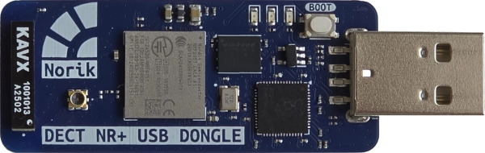

<!-- Copyright 2015-2026 Zephyr Project members and individual contributors. -->
<!-- SPDX-License-Identifier: Apache-2.0 -->
<!-- 中文翻译；编号、导航与译注为本地新增。 -->

<a id="dect_nr_plus_usb_dongle"></a>

# 第1章\_DECT NR+ USB适配器（Dongle）

原文：[官方页面](https://docs.zephyrproject.org/latest/boards/norik/dect_nr_plus_usb_dongle/doc/index.html)。读取日期：2026-10-16；来源摘要见[来源记录](../SOURCES.md)。

开发板概览（Board Overview）

<a id="id1"></a>

[](images/dect_nr_plus_usb_dongle.webp)

DECT NR+ USB适配器（Dongle）

名称（Name）：

`dect_nr_plus_usb_dongle`

厂商（Vendor）：

[Norik Systems](https://docs.zephyrproject.org/latest/boards/index.html#vendor=norik)

状态（Status）：

当前未积极维护（Not Actively Maintained）

架构（Architecture）：

[arm](https://docs.zephyrproject.org/latest/boards/index.html#arch=arm)

片上系统（SoC）：

[nrf9151](https://docs.zephyrproject.org/latest/boards/index.html#soc=nrf9151)

<a id="board-github-link"></a>

[浏览开发板源码（Browse Board Sources）](https://github.com/zephyrproject-rtos/zephyr/blob/main//boards/norik/dect_nr_plus_usb_dongle/doc/index.rst/../..)<a id="overview"></a>

## 概述（Overview）

Norik DECT NR+ USB Dongle是基于Nordic Semiconductor nRF9151系统级封装（SiP）的紧凑开发平台，用于评估和原型开发DECT NR+，也称DECT-2020 New Radio应用，可作为子节点（Child Node）或网关（Gateway）。

适配器直接插入USB-A端口，无需外部编程器或线缆。板载Raspberry Pi RP2040为nRF9151提供CMSIS-DAP调试探针及USB转串口桥接功能。

<a id="id3"></a>

<a id="id5"></a>

更多信息见[DECT NR+ USB Dongle产品页面](https://www.norik.com/dect-nr-usb-dongle/) [注1](#id2) 及数据手册 [注2](#id4)。（[DECT NR+ USB Dongle数据手册（Datasheet）](https://www.norik.com/wp-content/uploads/2025/04/Norik_DECT_NR_USB_Dongle_V1.1.pdf)）

<a id="hardware"></a>

## 硬件（Hardware）


- Nordic Semiconductor nRF9151系统级封装（SiP）


  - Arm Cortex-M33，最高运行频率64 MHz
  - 1 MB闪存及256 KB RAM
  - Arm TrustZone及Arm CryptoCell安全功能
- DECT NR+无线电，支持频段1、2、9及22
- 板载全向芯片天线（Omnidirectional Chip Antenna）
- Raspberry Pi RP2040接口MCU提供：


  - 通过SWD访问nRF9151的CMSIS-DAP调试功能
  - 连接nRF9151 UART的USB转串口桥
  - 接口MCU的USB设备固件升级（DFU）
- 用于供电、编程及通信的USB-A连接器
- 一个用户LED
- USB供电，工作供电电压4.75—5.25 V
- 工作温度范围−40至+85 °C
- 开发板尺寸53.35×21.59 mm

<a id="supported-features"></a>

### 支持的功能（Supported Features）

`dect_nr_plus_usb_dongle`开发板支持下表所列的硬件功能。

片上／板载（On-Chip / On-Board）

功能集成在片上系统（SoC）内／位于开发板上。

2 / 2

分别表示已启用／已禁用的实例数。点击数量标签，可查看开发板或SoC设备树源码（DTS）中该功能的第一个实例。

`vnd,foo`

与此功能匹配的设备树绑定兼容字符串（Compatible String）；点击链接可查看绑定文档。

<a id="dect_nr_plus_usb_dongle-hw-features"></a>

<a id="dect_nr_plus_usb_dongle-dect_nr_plus_usb_dongle/nrf9151-hw-features-section"></a>

#### `dect_nr_plus_usb_dongle/nrf9151`目标（Target）

<a id="dect_nr_plus_usb_dongle-dect_nr_plus_usb_dongle/nrf9151-hw-features-panel"></a>

<a id="dect_nr_plus_usb_dongle-dect_nr_plus_usb_dongle/nrf9151-hw-features-memory"></a>

该开发板目标的片上存储容量：88 KiB RAM、1 MiB Flash。

<a id="dect_nr_plus_usb_dongle-dect_nr_plus_usb_dongle/nrf9151-hw-features-table"></a>

<table>
<tr>
<th>类型（Type）</th>
<th>位置（Location）</th>
<th>说明（Description）</th>
<th>兼容字符串（Compatible）</th>
</tr>
<tr>
<td rowspan="1">中央处理器（CPU）</td>
<td>片上（On-Chip）</td>
<td>ARM Cortex-M33F处理器（CPU）（<a href="https://github.com/zephyrproject-rtos/zephyr/blob/main/dts/arm/nordic/nrf91.dtsi?plain=1#L16">已启用：1</a>）</td>
<td><a href="../cpu_arm_riscv_binding_reference/P023_arm_cortex-m33f.md#std-dtcompatible-arm-cortex-m33f"><code>arm,cortex-m33f</code></a></td>
</tr>
<tr>
<td rowspan="1">模数转换器（ADC）</td>
<td>片上（On-Chip）</td>
<td>Nordic Semiconductor nRF系列逐次逼近模数转换器（SAADC）节点（<a href="https://github.com/zephyrproject-rtos/zephyr/blob/main/dts/arm/nordic/nrf91_peripherals.dtsi?plain=1#L7">已禁用：1</a>）</td>
<td><a href="../hardware/P846_NordicNRF逐次逼近ADC绑定.md#dtbinding-nordic-nrf-saadc"><code>nordic,nrf-saadc</code></a></td>
</tr>
<tr>
<td rowspan="5">ARM 架构（ARM Architecture）</td>
<td>片上（On-Chip）</td>
<td>Nordic事件发生器单元（EGU / Event Generator Unit）（<a href="https://github.com/zephyrproject-rtos/zephyr/blob/main/dts/arm/nordic/nrf91_peripherals.dtsi?plain=1#L24">已启用：6</a>）</td>
<td><a href="../arm_timing_ethosu_control_binding_reference/P018_nordic_nrf-egu.md#std-dtcompatible-nordic-nrf-egu"><code>nordic,nrf-egu</code></a></td>
</tr>
<tr>
<td>片上（On-Chip）</td>
<td>Nordic密钥管理单元（KMU / Key Management Unit）（<a href="https://github.com/zephyrproject-rtos/zephyr/blob/main/dts/arm/nordic/nrf91_peripherals.dtsi?plain=1#L82">已启用：1</a>）</td>
<td><a href="../arm_timing_ethosu_control_binding_reference/P019_nordic_nrf-kmu.md#std-dtcompatible-nordic-nrf-kmu"><code>nordic,nrf-kmu</code></a></td>
</tr>
<tr>
<td>片上（On-Chip）</td>
<td>Nordic nRF系列控制访问端口（CTRL-AP / Control Access Port）（<a href="https://github.com/zephyrproject-rtos/zephyr/blob/main/dts/arm/nordic/nrf91.dtsi?plain=1#L81">已启用：1</a>）</td>
<td><a href="../arm_timing_ethosu_control_binding_reference/P016_nordic_nrf-ctrlapperi.md#std-dtcompatible-nordic-nrf-ctrlapperi"><code>nordic,nrf-ctrlapperi</code></a></td>
</tr>
<tr>
<td>片上（On-Chip）</td>
<td>Nordic系统保护单元（SPU / System Protection Unit）（<a href="https://github.com/zephyrproject-rtos/zephyr/blob/main/dts/arm/nordic/nrf91.dtsi?plain=1#L109">已启用：1</a>）</td>
<td><a href="../arm_nordic_nxp_control_binding_reference/P004_nordic_nrf-spu.md#std-dtcompatible-nordic-nrf-spu"><code>nordic,nrf-spu</code></a></td>
</tr>
<tr>
<td>片上（On-Chip）</td>
<td>Nordic用户信息配置寄存器（UICR / User Information Configuration Registers）（<a href="https://github.com/zephyrproject-rtos/zephyr/blob/main/dts/arm/nordic/nrf91.dtsi?plain=1#L123">已启用：1</a>）</td>
<td><a href="../arm_nordic_nxp_control_binding_reference/P007_nordic_nrf-uicr.md#std-dtcompatible-nordic-nrf-uicr"><code>nordic,nrf-uicr</code></a></td>
</tr>
<tr>
<td rowspan="1">音频（Audio）</td>
<td>片上（On-Chip）</td>
<td>Nordic脉冲密度调制接口（PDM / Pulse Density Modulation Interface）（<a href="https://github.com/zephyrproject-rtos/zephyr/blob/main/dts/arm/nordic/nrf91_peripherals.dtsi?plain=1#L89">已禁用：1</a>）</td>
<td><a href="../audio_pdm_codec_binding_reference/P012_nordic_nrf-pdm.md#std-dtcompatible-nordic-nrf-pdm"><code>nordic,nrf-pdm</code></a></td>
</tr>
<tr>
<td rowspan="3">时钟控制（Clock Control）</td>
<td>片上（On-Chip）</td>
<td>Nordic nRF时钟控制（Clock Control）节点（<a href="https://github.com/zephyrproject-rtos/zephyr/blob/main/dts/arm/nordic/nrf91_peripherals.dtsi?plain=1#L326">已启用：1</a>）</td>
<td><a href="../clock_sam_nordic_binding_reference/P015_nordic_nrf-clock.md#std-dtcompatible-nordic-nrf-clock"><code>nordic,nrf-clock</code></a></td>
</tr>
<tr>
<td>片上（On-Chip）</td>
<td>Nordic nRF高频时钟（HFCLK）控制节点（<a href="https://github.com/zephyrproject-rtos/zephyr/blob/main/dts/arm/nordic/nrf91_peripherals.dtsi?plain=1#L332">已启用：1</a>）</td>
<td><a href="../clock_sam_nordic_binding_reference/P009_nordic_nrf-clock-hfclk.md#std-dtcompatible-nordic-nrf-clock-hfclk"><code>nordic,nrf-clock-hfclk</code></a></td>
</tr>
<tr>
<td>片上（On-Chip）</td>
<td>Nordic nRF低频时钟（LFCLK）控制节点（<a href="https://github.com/zephyrproject-rtos/zephyr/blob/main/dts/arm/nordic/nrf91_peripherals.dtsi?plain=1#L337">已启用：1</a>）</td>
<td><a href="../clock_sam_nordic_binding_reference/P012_nordic_nrf-clock-lfclk.md#std-dtcompatible-nordic-nrf-clock-lfclk"><code>nordic,nrf-clock-lfclk</code></a></td>
</tr>
<tr>
<td rowspan="1">计数器（Counter）</td>
<td>片上（On-Chip）</td>
<td>Nordic nRF定时器（Timer）节点（<a href="https://github.com/zephyrproject-rtos/zephyr/blob/main/dts/arm/nordic/nrf91_peripherals.dtsi?plain=1#L376">已禁用：3</a>）</td>
<td><a href="../microchip_soc_counter_binding_reference/P017_nordic_nrf-timer.md#std-dtcompatible-nordic-nrf-timer"><code>nordic,nrf-timer</code></a></td>
</tr>
<tr>
<td rowspan="1">密码学加速器（Cryptographic Accelerator）</td>
<td>片上（On-Chip）</td>
<td>ARM TrustZone CryptoCell 310密码模块（<a href="https://github.com/zephyrproject-rtos/zephyr/blob/main/dts/arm/nordic/nrf91.dtsi?plain=1#L73">已禁用：1</a>）</td>
<td><a href="../crypto_aes_sha_ccm_binding_reference/P001_arm_cryptocell-310.md#std-dtcompatible-arm-cryptocell-310"><code>arm,cryptocell-310</code></a></td>
</tr>
<tr>
<td rowspan="1">闪存控制器（Flash Controller）</td>
<td>片上（On-Chip）</td>
<td>Nordic非易失性存储器控制器（NVMC / Non-Volatile Memory Controller）（<a href="https://github.com/zephyrproject-rtos/zephyr/blob/main/dts/arm/nordic/nrf91.dtsi?plain=1#L52">已启用：1</a>）</td>
<td><a href="../flash_nuvoton_nxp_renesas_binding_reference/P002_nordic_nrf91-flash-controller.md#std-dtcompatible-nordic-nrf91-flash-controller"><code>nordic,nrf91-flash-controller</code></a></td>
</tr>
<tr>
<td rowspan="2">通用输入输出与接插件（GPIO &amp; Headers）</td>
<td>片上（On-Chip）</td>
<td>NRF5通用输入输出（GPIO）（<a href="https://github.com/zephyrproject-rtos/zephyr/blob/main/dts/arm/nordic/nrf91_peripherals.dtsi?plain=1#L296">已启用：1</a>）</td>
<td><a href="../gpio_microchip_nordic_nuvoton_binding_reference/P016_nordic_nrf-gpio.md#std-dtcompatible-nordic-nrf-gpio"><code>nordic,nrf-gpio</code></a></td>
</tr>
<tr>
<td>片上（On-Chip）</td>
<td>NRF5 GPIO任务与事件（GPIOTE）（<a href="https://github.com/zephyrproject-rtos/zephyr/blob/main/dts/arm/nordic/nrf91.dtsi?plain=1#L92">已启用：1</a>；<a href="https://github.com/zephyrproject-rtos/zephyr/blob/main/dts/arm/nordic/nrf91.dtsi?plain=1#L101">已禁用：1</a>）</td>
<td><a href="../gpio_microchip_nordic_nuvoton_binding_reference/P017_nordic_nrf-gpiote.md#std-dtcompatible-nordic-nrf-gpiote"><code>nordic,nrf-gpiote</code></a></td>
</tr>
<tr>
<td rowspan="1">集成电路间总线（I2C）</td>
<td>片上（On-Chip）</td>
<td>Nordic nRF系列TWIM（带EasyDMA的TWI主机）（<a href="https://github.com/zephyrproject-rtos/zephyr/blob/main/dts/arm/nordic/nrf91_peripherals.dtsi?plain=1#L136">已禁用：4</a>）</td>
<td><a href="../i2c_infineon_ite_nordic_binding_reference/P016_nordic_nrf-twim.md#std-dtcompatible-nordic-nrf-twim"><code>nordic,nrf-twim</code></a></td>
</tr>
<tr>
<td rowspan="1">集成电路间音频总线（I2S）</td>
<td>片上（On-Chip）</td>
<td>Nordic芯片间音频接口（I2S / Inter-IC Sound Interface）（<a href="https://github.com/zephyrproject-rtos/zephyr/blob/main/dts/arm/nordic/nrf91_peripherals.dtsi?plain=1#L73">已禁用：1</a>）</td>
<td><a href="../i2s_binding_reference/P010_nordic_nrf-i2s.md#std-dtcompatible-nordic-nrf-i2s"><code>nordic,nrf-i2s</code></a></td>
</tr>
<tr>
<td rowspan="1">中断控制器（Interrupt Controller）</td>
<td>片上（On-Chip）</td>
<td>ARMv8-M嵌套向量中断控制器（NVIC / Nested Vectored Interrupt Controller）（<a href="https://github.com/zephyrproject-rtos/zephyr/blob/main/dts/arm/armv8-m.dtsi?plain=1#L13">已启用：1</a>）</td>
<td><a href="../arm_interrupt_timer_binding_reference/P003_ARMv8_M_NVIC.md#std-dtcompatible-arm-v8m-nvic"><code>arm,v8m-nvic</code></a></td>
</tr>
<tr>
<td rowspan="1">处理器间／进程间通信（IPC）</td>
<td>片上（On-Chip）</td>
<td>Nordic nRF系列处理器间通信（IPC / Interprocessor Communication）（<a href="https://github.com/zephyrproject-rtos/zephyr/blob/main/dts/arm/nordic/nrf91_peripherals.dtsi?plain=1#L66">已启用：1</a>）</td>
<td><a href="../intercore_reference/P102_NordicnRF处理器间通信绑定.md#dtbinding-nordic-nrf-ipc"><code>nordic,nrf-ipc</code></a></td>
</tr>
<tr>
<td rowspan="1">发光二极管（LED）</td>
<td>板载（On-Board）</td>
<td>一组由 GPIO 控制的 LED（GPIO-Controlled LEDs）（<a href="https://github.com/zephyrproject-rtos/zephyr/blob/main/boards/norik/dect_nr_plus_usb_dongle/dect_nr_plus_usb_dongle_common.dtsi?plain=1#L22">已启用：1</a>）</td>
<td><a href="../hardware/P564_GPIO指示灯绑定.md#dtbinding-gpio-leds"><code>gpio-leds</code></a></td>
</tr>
<tr>
<td rowspan="2">其他绑定（Miscellaneous）</td>
<td>片上（On-Chip）</td>
<td>Nordic分布式可编程外设互连控制器（DPPIC / Distributed Programmable Peripheral Interconnect Controller）（<a href="https://github.com/zephyrproject-rtos/zephyr/blob/main/dts/arm/nordic/nrf91_peripherals.dtsi?plain=1#L16">已启用：1</a>）</td>
<td><a href="../misc_adi_nordic_binding_reference/P017_nordic_nrf-dppic.md#std-dtcompatible-nordic-nrf-dppic"><code>nordic,nrf-dppic</code></a></td>
</tr>
<tr>
<td>片上（On-Chip）</td>
<td>Nordic工厂信息配置寄存器（FICR / Factory Information Configuration Registers）（<a href="https://github.com/zephyrproject-rtos/zephyr/blob/main/dts/arm/nordic/nrf91.dtsi?plain=1#L116">已启用：1</a>）</td>
<td><a href="../misc_adi_nordic_binding_reference/P018_nordic_nrf-ficr.md#std-dtcompatible-nordic-nrf-ficr"><code>nordic,nrf-ficr</code></a></td>
</tr>
<tr>
<td rowspan="1">内存管理单元／内存保护单元（MMU / MPU）</td>
<td>片上（On-Chip）</td>
<td>ARMv8-M存储器保护单元（MPU / Memory Protection Unit）（<a href="https://github.com/zephyrproject-rtos/zephyr/blob/main/dts/arm/nordic/nrf91.dtsi?plain=1#L23">已启用：1</a>）</td>
<td><a href="../memory_protection_binding_reference/P007_arm_armv8m-mpu.md#std-dtcompatible-arm-armv8m-mpu"><code>arm,armv8m-mpu</code></a></td>
</tr>
<tr>
<td rowspan="3">存储技术设备（MTD）</td>
<td>片上（On-Chip）</td>
<td>闪存（Flash）节点（<a href="https://github.com/zephyrproject-rtos/zephyr/blob/main/dts/arm/nordic/nrf91.dtsi?plain=1#L60">已启用：1</a>）</td>
<td><a href="../mtd_nxp_st_ti_partition_binding_reference/P013_soc-nv-flash.md#std-dtcompatible-soc-nv-flash"><code>soc-nv-flash</code></a></td>
</tr>
<tr>
<td>片上（On-Chip）</td>
<td>在Nordic片上系统（SoC）的ARM TrustZone-M布局中标记安全闪存分区（Secure Flash Partitions）。（<a href="https://github.com/zephyrproject-rtos/zephyr/blob/main/dts/vendor/nordic/nrf91xx_partition.dtsi?plain=1#L159">已启用：1</a>）</td>
<td><a href="../mtd_microchip_nordic_nxp_binding_reference/P014_nordic_tz-secure.md#std-dtcompatible-nordic-tz-secure"><code>nordic,tz-secure</code></a></td>
</tr>
<tr>
<td>片上（On-Chip）</td>
<td>在Nordic片上系统（SoC）的ARM TrustZone-M布局中标记非安全闪存分区（Non-secure Flash Partitions）。（<a href="https://github.com/zephyrproject-rtos/zephyr/blob/main/dts/vendor/nordic/nrf91xx_partition.dtsi?plain=1#L168">已启用：1</a>）</td>
<td><a href="../mtd_microchip_nordic_nxp_binding_reference/P013_nordic_tz-nonsecure.md#std-dtcompatible-nordic-tz-nonsecure"><code>nordic,tz-nonsecure</code></a></td>
</tr>
<tr>
<td rowspan="1">引脚控制（Pin Control）</td>
<td>片上（On-Chip）</td>
<td>Nordic nRF系列引脚控制器（Pin Controller）（<a href="https://github.com/zephyrproject-rtos/zephyr/blob/main/dts/vendor/nordic/nrf_common.dtsi?plain=1#L26">已启用：1</a>）</td>
<td><a href="../pinctrl_infineon_nordic_nxp_binding_reference/P009_nordic_nrf-pinctrl.md#std-dtcompatible-nordic-nrf-pinctrl"><code>nordic,nrf-pinctrl</code></a></td>
</tr>
<tr>
<td rowspan="2">电源管理（Power Management）</td>
<td>片上（On-Chip）</td>
<td>Nordic易失性存储器控制器（VMC / Volatile Memory Controller）（<a href="https://github.com/zephyrproject-rtos/zephyr/blob/main/dts/arm/nordic/nrf91_peripherals.dtsi?plain=1#L102">已启用：1</a>）</td>
<td><a href="../power_control_binding_reference/P010_nordic_nrf-vmc.md#std-dtcompatible-nordic-nrf-vmc"><code>nordic,nrf-vmc</code></a></td>
</tr>
<tr>
<td>片上（On-Chip）</td>
<td>Nordic nRF电源控制（Power Control）节点（<a href="https://github.com/zephyrproject-rtos/zephyr/blob/main/dts/arm/nordic/nrf91_peripherals.dtsi?plain=1#L343">已启用：1</a>）</td>
<td><a href="../power_control_binding_reference/P008_nordic_nrf-power.md#std-dtcompatible-nordic-nrf-power"><code>nordic,nrf-power</code></a></td>
</tr>
<tr>
<td rowspan="2">脉宽调制（PWM）</td>
<td>片上（On-Chip）</td>
<td>nRF脉宽调制（PWM）（<a href="https://github.com/zephyrproject-rtos/zephyr/blob/main/dts/arm/nordic/nrf91_peripherals.dtsi?plain=1#L264">已禁用：4</a>）</td>
<td><a href="../pwm_intel_microchip_nxp_binding_reference/P015_nordic_nrf-pwm.md#std-dtcompatible-nordic-nrf-pwm"><code>nordic,nrf-pwm</code></a></td>
</tr>
<tr>
<td>片上（On-Chip）</td>
<td>nRFx软件脉宽调制（S/W PWM）（<a href="https://github.com/zephyrproject-rtos/zephyr/blob/main/dts/vendor/nordic/nrf_common.dtsi?plain=1#L39">已禁用：1</a>）</td>
<td><a href="../pwm_intel_microchip_nxp_binding_reference/P016_nordic_nrf-sw-pwm.md#std-dtcompatible-nordic-nrf-sw-pwm"><code>nordic,nrf-sw-pwm</code></a></td>
</tr>
<tr>
<td rowspan="1">稳压器（Regulator）</td>
<td>片上（On-Chip）</td>
<td>nRF91X上的Nordic REGULATORS电压稳压器控制模块（Voltage Regulators Control Module）（<a href="https://github.com/zephyrproject-rtos/zephyr/blob/main/dts/arm/nordic/nrf91_peripherals.dtsi?plain=1#L96">已启用：1</a>）</td>
<td><a href="../hardware/P644_nRF91稳压器集合绑定.md#dtbinding-nordic-nrf91x-regulators"><code>nordic,nrf91x-regulators</code></a></td>
</tr>
<tr>
<td rowspan="1">保持存储器（Retained Memory）</td>
<td>片上（On-Chip）</td>
<td>Nordic通用保持寄存器（GPREGRET / General Purpose Register Retention）设备（<a href="https://github.com/zephyrproject-rtos/zephyr/blob/main/dts/arm/nordic/nrf91_peripherals.dtsi?plain=1#L352">已启用：2</a>）</td>
<td><a href="../hardware/P627_Nordic通用保留寄存器绑定.md#dtbinding-nordic-nrf-gpregret"><code>nordic,nrf-gpregret</code></a></td>
</tr>
<tr>
<td rowspan="1">实时时钟（RTC）</td>
<td>片上（On-Chip）</td>
<td>Nordic nRF实时时间计数器（RTC / Real-Time Counter）（<a href="https://github.com/zephyrproject-rtos/zephyr/blob/main/dts/arm/nordic/nrf91_peripherals.dtsi?plain=1#L306">已禁用：2</a>）</td>
<td><a href="../microchip_microcrystal_nxp_rtc_binding_reference/P010_nordic_nrf-rtc.md#std-dtcompatible-nordic-nrf-rtc"><code>nordic,nrf-rtc</code></a></td>
</tr>
<tr>
<td rowspan="1">串行控制器（Serial Controller）</td>
<td>片上（On-Chip）</td>
<td>Nordic nRF系列UARTE（带EasyDMA的UART）（<a href="https://github.com/zephyrproject-rtos/zephyr/blob/main/dts/arm/nordic/nrf91_peripherals.dtsi?plain=1#L108">已启用：1</a>；<a href="https://github.com/zephyrproject-rtos/zephyr/blob/main/dts/arm/nordic/nrf91_peripherals.dtsi?plain=1#L115">已禁用：3</a>）</td>
<td><a href="../uart_microchip_nordic_nxp_binding_reference/P004_nordic_nrf-uarte.md#std-dtcompatible-nordic-nrf-uarte"><code>nordic,nrf-uarte</code></a></td>
</tr>
<tr>
<td rowspan="1">串行外设接口（SPI）</td>
<td>片上（On-Chip）</td>
<td>Nordic nRF系列SPIM（带EasyDMA的SPI控制器）（<a href="https://github.com/zephyrproject-rtos/zephyr/blob/main/dts/arm/nordic/nrf91_peripherals.dtsi?plain=1#L200">已禁用：4</a>）</td>
<td><a href="../spi_microchip_nordic_nxp_binding_reference/P013_nordic_nrf-spim.md#std-dtcompatible-nordic-nrf-spim"><code>nordic,nrf-spim</code></a></td>
</tr>
<tr>
<td rowspan="1">静态随机存储器（SRAM）</td>
<td>片上（On-Chip）</td>
<td>通用片上静态随机存储器（SRAM）（<a href="https://github.com/zephyrproject-rtos/zephyr/blob/main/dts/arm/nordic/nrf91.dtsi?plain=1#L37">已启用：1</a>）</td>
<td><a href="../hardware/P567_内存映射SRAM绑定.md#dtbinding-mmio-sram"><code>mmio-sram</code></a></td>
</tr>
<tr>
<td rowspan="1">定时器（Timer）</td>
<td>片上（On-Chip）</td>
<td>ARMv8-M系统节拍（System Tick）（<a href="https://github.com/zephyrproject-rtos/zephyr/blob/main/dts/arm/armv8-m.dtsi?plain=1#L21">已禁用：1</a>）</td>
<td><a href="../arm_interrupt_timer_binding_reference/P007_ARMv8_M_SysTick.md#std-dtcompatible-arm-armv8m-systick"><code>arm,armv8m-systick</code></a></td>
</tr>
<tr>
<td rowspan="1">看门狗（Watchdog）</td>
<td>片上（On-Chip）</td>
<td>Nordic nRF系列看门狗定时器（WDT / Watchdog Timer）（<a href="https://github.com/zephyrproject-rtos/zephyr/blob/main/dts/arm/nordic/nrf91_peripherals.dtsi?plain=1#L369">已启用：1</a>）</td>
<td><a href="../nxp_nordic_nuvoton_watchdog_binding_reference/P002_nordic_nrf-wdt.md#std-dtcompatible-nordic-nrf-wdt"><code>nordic,nrf-wdt</code></a></td>
</tr>
</table>

<a id="dect_nr_plus_usb_dongle-dect_nr_plus_usb_dongle/nrf9151/ns-hw-features-section"></a>

#### `dect_nr_plus_usb_dongle/nrf9151/ns`目标（Target）

<a id="dect_nr_plus_usb_dongle-dect_nr_plus_usb_dongle/nrf9151/ns-hw-features-panel"></a>

<a id="dect_nr_plus_usb_dongle-dect_nr_plus_usb_dongle/nrf9151/ns-hw-features-memory"></a>

该开发板目标的片上存储容量：128 KiB RAM、1 MiB Flash。

<a id="dect_nr_plus_usb_dongle-dect_nr_plus_usb_dongle/nrf9151/ns-hw-features-table"></a>

<table>
<tr>
<th>类型（Type）</th>
<th>位置（Location）</th>
<th>说明（Description）</th>
<th>兼容字符串（Compatible）</th>
</tr>
<tr>
<td rowspan="1">中央处理器（CPU）</td>
<td>片上（On-Chip）</td>
<td>ARM Cortex-M33F处理器（CPU）（<a href="https://github.com/zephyrproject-rtos/zephyr/blob/main/dts/arm/nordic/nrf91_ns.dtsi?plain=1#L16">已启用：1</a>）</td>
<td><a href="../cpu_arm_riscv_binding_reference/P023_arm_cortex-m33f.md#std-dtcompatible-arm-cortex-m33f"><code>arm,cortex-m33f</code></a></td>
</tr>
<tr>
<td rowspan="1">模数转换器（ADC）</td>
<td>片上（On-Chip）</td>
<td>Nordic Semiconductor nRF系列逐次逼近模数转换器（SAADC）节点（<a href="https://github.com/zephyrproject-rtos/zephyr/blob/main/dts/arm/nordic/nrf91_peripherals.dtsi?plain=1#L7">已禁用：1</a>）</td>
<td><a href="../hardware/P846_NordicNRF逐次逼近ADC绑定.md#dtbinding-nordic-nrf-saadc"><code>nordic,nrf-saadc</code></a></td>
</tr>
<tr>
<td rowspan="2">ARM 架构（ARM Architecture）</td>
<td>片上（On-Chip）</td>
<td>Nordic事件发生器单元（EGU / Event Generator Unit）（<a href="https://github.com/zephyrproject-rtos/zephyr/blob/main/dts/arm/nordic/nrf91_peripherals.dtsi?plain=1#L24">已启用：6</a>）</td>
<td><a href="../arm_timing_ethosu_control_binding_reference/P018_nordic_nrf-egu.md#std-dtcompatible-nordic-nrf-egu"><code>nordic,nrf-egu</code></a></td>
</tr>
<tr>
<td>片上（On-Chip）</td>
<td>Nordic密钥管理单元（KMU / Key Management Unit）（<a href="https://github.com/zephyrproject-rtos/zephyr/blob/main/dts/arm/nordic/nrf91_peripherals.dtsi?plain=1#L82">已启用：1</a>）</td>
<td><a href="../arm_timing_ethosu_control_binding_reference/P019_nordic_nrf-kmu.md#std-dtcompatible-nordic-nrf-kmu"><code>nordic,nrf-kmu</code></a></td>
</tr>
<tr>
<td rowspan="1">音频（Audio）</td>
<td>片上（On-Chip）</td>
<td>Nordic脉冲密度调制接口（PDM / Pulse Density Modulation Interface）（<a href="https://github.com/zephyrproject-rtos/zephyr/blob/main/dts/arm/nordic/nrf91_peripherals.dtsi?plain=1#L89">已禁用：1</a>）</td>
<td><a href="../audio_pdm_codec_binding_reference/P012_nordic_nrf-pdm.md#std-dtcompatible-nordic-nrf-pdm"><code>nordic,nrf-pdm</code></a></td>
</tr>
<tr>
<td rowspan="3">时钟控制（Clock Control）</td>
<td>片上（On-Chip）</td>
<td>Nordic nRF时钟控制（Clock Control）节点（<a href="https://github.com/zephyrproject-rtos/zephyr/blob/main/dts/arm/nordic/nrf91_peripherals.dtsi?plain=1#L326">已启用：1</a>）</td>
<td><a href="../clock_sam_nordic_binding_reference/P015_nordic_nrf-clock.md#std-dtcompatible-nordic-nrf-clock"><code>nordic,nrf-clock</code></a></td>
</tr>
<tr>
<td>片上（On-Chip）</td>
<td>Nordic nRF高频时钟（HFCLK）控制节点（<a href="https://github.com/zephyrproject-rtos/zephyr/blob/main/dts/arm/nordic/nrf91_peripherals.dtsi?plain=1#L332">已启用：1</a>）</td>
<td><a href="../clock_sam_nordic_binding_reference/P009_nordic_nrf-clock-hfclk.md#std-dtcompatible-nordic-nrf-clock-hfclk"><code>nordic,nrf-clock-hfclk</code></a></td>
</tr>
<tr>
<td>片上（On-Chip）</td>
<td>Nordic nRF低频时钟（LFCLK）控制节点（<a href="https://github.com/zephyrproject-rtos/zephyr/blob/main/dts/arm/nordic/nrf91_peripherals.dtsi?plain=1#L337">已启用：1</a>）</td>
<td><a href="../clock_sam_nordic_binding_reference/P012_nordic_nrf-clock-lfclk.md#std-dtcompatible-nordic-nrf-clock-lfclk"><code>nordic,nrf-clock-lfclk</code></a></td>
</tr>
<tr>
<td rowspan="1">计数器（Counter）</td>
<td>片上（On-Chip）</td>
<td>Nordic nRF定时器（Timer）节点（<a href="https://github.com/zephyrproject-rtos/zephyr/blob/main/dts/arm/nordic/nrf91_peripherals.dtsi?plain=1#L376">已禁用：3</a>）</td>
<td><a href="../microchip_soc_counter_binding_reference/P017_nordic_nrf-timer.md#std-dtcompatible-nordic-nrf-timer"><code>nordic,nrf-timer</code></a></td>
</tr>
<tr>
<td rowspan="1">闪存控制器（Flash Controller）</td>
<td>片上（On-Chip）</td>
<td>Nordic非易失性存储器控制器（NVMC / Non-Volatile Memory Controller）（<a href="https://github.com/zephyrproject-rtos/zephyr/blob/main/dts/arm/nordic/nrf91_ns.dtsi?plain=1#L53">已启用：1</a>）</td>
<td><a href="../flash_nuvoton_nxp_renesas_binding_reference/P002_nordic_nrf91-flash-controller.md#std-dtcompatible-nordic-nrf91-flash-controller"><code>nordic,nrf91-flash-controller</code></a></td>
</tr>
<tr>
<td rowspan="2">通用输入输出与接插件（GPIO &amp; Headers）</td>
<td>片上（On-Chip）</td>
<td>NRF5通用输入输出（GPIO）（<a href="https://github.com/zephyrproject-rtos/zephyr/blob/main/dts/arm/nordic/nrf91_peripherals.dtsi?plain=1#L296">已启用：1</a>）</td>
<td><a href="../gpio_microchip_nordic_nuvoton_binding_reference/P016_nordic_nrf-gpio.md#std-dtcompatible-nordic-nrf-gpio"><code>nordic,nrf-gpio</code></a></td>
</tr>
<tr>
<td>片上（On-Chip）</td>
<td>NRF5 GPIO任务与事件（GPIOTE）（<a href="https://github.com/zephyrproject-rtos/zephyr/blob/main/dts/arm/nordic/nrf91_ns.dtsi?plain=1#L78">已启用：1</a>）</td>
<td><a href="../gpio_microchip_nordic_nuvoton_binding_reference/P017_nordic_nrf-gpiote.md#std-dtcompatible-nordic-nrf-gpiote"><code>nordic,nrf-gpiote</code></a></td>
</tr>
<tr>
<td rowspan="1">集成电路间总线（I2C）</td>
<td>片上（On-Chip）</td>
<td>Nordic nRF系列TWIM（带EasyDMA的TWI主机）（<a href="https://github.com/zephyrproject-rtos/zephyr/blob/main/dts/arm/nordic/nrf91_peripherals.dtsi?plain=1#L136">已禁用：4</a>）</td>
<td><a href="../i2c_infineon_ite_nordic_binding_reference/P016_nordic_nrf-twim.md#std-dtcompatible-nordic-nrf-twim"><code>nordic,nrf-twim</code></a></td>
</tr>
<tr>
<td rowspan="1">集成电路间音频总线（I2S）</td>
<td>片上（On-Chip）</td>
<td>Nordic芯片间音频接口（I2S / Inter-IC Sound Interface）（<a href="https://github.com/zephyrproject-rtos/zephyr/blob/main/dts/arm/nordic/nrf91_peripherals.dtsi?plain=1#L73">已禁用：1</a>）</td>
<td><a href="../i2s_binding_reference/P010_nordic_nrf-i2s.md#std-dtcompatible-nordic-nrf-i2s"><code>nordic,nrf-i2s</code></a></td>
</tr>
<tr>
<td rowspan="1">中断控制器（Interrupt Controller）</td>
<td>片上（On-Chip）</td>
<td>ARMv8-M嵌套向量中断控制器（NVIC / Nested Vectored Interrupt Controller）（<a href="https://github.com/zephyrproject-rtos/zephyr/blob/main/dts/arm/armv8-m.dtsi?plain=1#L13">已启用：1</a>）</td>
<td><a href="../arm_interrupt_timer_binding_reference/P003_ARMv8_M_NVIC.md#std-dtcompatible-arm-v8m-nvic"><code>arm,v8m-nvic</code></a></td>
</tr>
<tr>
<td rowspan="1">处理器间／进程间通信（IPC）</td>
<td>片上（On-Chip）</td>
<td>Nordic nRF系列处理器间通信（IPC / Interprocessor Communication）（<a href="https://github.com/zephyrproject-rtos/zephyr/blob/main/dts/arm/nordic/nrf91_peripherals.dtsi?plain=1#L66">已启用：1</a>）</td>
<td><a href="../intercore_reference/P102_NordicnRF处理器间通信绑定.md#dtbinding-nordic-nrf-ipc"><code>nordic,nrf-ipc</code></a></td>
</tr>
<tr>
<td rowspan="1">发光二极管（LED）</td>
<td>板载（On-Board）</td>
<td>一组由 GPIO 控制的 LED（GPIO-Controlled LEDs）（<a href="https://github.com/zephyrproject-rtos/zephyr/blob/main/boards/norik/dect_nr_plus_usb_dongle/dect_nr_plus_usb_dongle_common.dtsi?plain=1#L22">已启用：1</a>）</td>
<td><a href="../hardware/P564_GPIO指示灯绑定.md#dtbinding-gpio-leds"><code>gpio-leds</code></a></td>
</tr>
<tr>
<td rowspan="1">其他绑定（Miscellaneous）</td>
<td>片上（On-Chip）</td>
<td>Nordic分布式可编程外设互连控制器（DPPIC / Distributed Programmable Peripheral Interconnect Controller）（<a href="https://github.com/zephyrproject-rtos/zephyr/blob/main/dts/arm/nordic/nrf91_peripherals.dtsi?plain=1#L16">已启用：1</a>）</td>
<td><a href="../misc_adi_nordic_binding_reference/P017_nordic_nrf-dppic.md#std-dtcompatible-nordic-nrf-dppic"><code>nordic,nrf-dppic</code></a></td>
</tr>
<tr>
<td rowspan="1">内存管理单元／内存保护单元（MMU / MPU）</td>
<td>片上（On-Chip）</td>
<td>ARMv8-M存储器保护单元（MPU / Memory Protection Unit）（<a href="https://github.com/zephyrproject-rtos/zephyr/blob/main/dts/arm/nordic/nrf91_ns.dtsi?plain=1#L23">已启用：1</a>）</td>
<td><a href="../memory_protection_binding_reference/P007_arm_armv8m-mpu.md#std-dtcompatible-arm-armv8m-mpu"><code>arm,armv8m-mpu</code></a></td>
</tr>
<tr>
<td rowspan="3">存储技术设备（MTD）</td>
<td>片上（On-Chip）</td>
<td>闪存（Flash）节点（<a href="https://github.com/zephyrproject-rtos/zephyr/blob/main/dts/arm/nordic/nrf91_ns.dtsi?plain=1#L61">已启用：1</a>）</td>
<td><a href="../mtd_nxp_st_ti_partition_binding_reference/P013_soc-nv-flash.md#std-dtcompatible-soc-nv-flash"><code>soc-nv-flash</code></a></td>
</tr>
<tr>
<td>片上（On-Chip）</td>
<td>在Nordic片上系统（SoC）的ARM TrustZone-M布局中标记安全闪存分区（Secure Flash Partitions）。（<a href="https://github.com/zephyrproject-rtos/zephyr/blob/main/dts/vendor/nordic/nrf91xx_partition.dtsi?plain=1#L159">已启用：1</a>）</td>
<td><a href="../mtd_microchip_nordic_nxp_binding_reference/P014_nordic_tz-secure.md#std-dtcompatible-nordic-tz-secure"><code>nordic,tz-secure</code></a></td>
</tr>
<tr>
<td>片上（On-Chip）</td>
<td>在Nordic片上系统（SoC）的ARM TrustZone-M布局中标记非安全闪存分区（Non-secure Flash Partitions）。（<a href="https://github.com/zephyrproject-rtos/zephyr/blob/main/dts/vendor/nordic/nrf91xx_partition.dtsi?plain=1#L168">已启用：1</a>）</td>
<td><a href="../mtd_microchip_nordic_nxp_binding_reference/P013_nordic_tz-nonsecure.md#std-dtcompatible-nordic-tz-nonsecure"><code>nordic,tz-nonsecure</code></a></td>
</tr>
<tr>
<td rowspan="1">引脚控制（Pin Control）</td>
<td>片上（On-Chip）</td>
<td>Nordic nRF系列引脚控制器（Pin Controller）（<a href="https://github.com/zephyrproject-rtos/zephyr/blob/main/dts/vendor/nordic/nrf_common.dtsi?plain=1#L26">已启用：1</a>）</td>
<td><a href="../pinctrl_infineon_nordic_nxp_binding_reference/P009_nordic_nrf-pinctrl.md#std-dtcompatible-nordic-nrf-pinctrl"><code>nordic,nrf-pinctrl</code></a></td>
</tr>
<tr>
<td rowspan="2">电源管理（Power Management）</td>
<td>片上（On-Chip）</td>
<td>Nordic易失性存储器控制器（VMC / Volatile Memory Controller）（<a href="https://github.com/zephyrproject-rtos/zephyr/blob/main/dts/arm/nordic/nrf91_peripherals.dtsi?plain=1#L102">已启用：1</a>）</td>
<td><a href="../power_control_binding_reference/P010_nordic_nrf-vmc.md#std-dtcompatible-nordic-nrf-vmc"><code>nordic,nrf-vmc</code></a></td>
</tr>
<tr>
<td>片上（On-Chip）</td>
<td>Nordic nRF电源控制（Power Control）节点（<a href="https://github.com/zephyrproject-rtos/zephyr/blob/main/dts/arm/nordic/nrf91_peripherals.dtsi?plain=1#L343">已启用：1</a>）</td>
<td><a href="../power_control_binding_reference/P008_nordic_nrf-power.md#std-dtcompatible-nordic-nrf-power"><code>nordic,nrf-power</code></a></td>
</tr>
<tr>
<td rowspan="2">脉宽调制（PWM）</td>
<td>片上（On-Chip）</td>
<td>nRF脉宽调制（PWM）（<a href="https://github.com/zephyrproject-rtos/zephyr/blob/main/dts/arm/nordic/nrf91_peripherals.dtsi?plain=1#L264">已禁用：4</a>）</td>
<td><a href="../pwm_intel_microchip_nxp_binding_reference/P015_nordic_nrf-pwm.md#std-dtcompatible-nordic-nrf-pwm"><code>nordic,nrf-pwm</code></a></td>
</tr>
<tr>
<td>片上（On-Chip）</td>
<td>nRFx软件脉宽调制（S/W PWM）（<a href="https://github.com/zephyrproject-rtos/zephyr/blob/main/dts/vendor/nordic/nrf_common.dtsi?plain=1#L39">已禁用：1</a>）</td>
<td><a href="../pwm_intel_microchip_nxp_binding_reference/P016_nordic_nrf-sw-pwm.md#std-dtcompatible-nordic-nrf-sw-pwm"><code>nordic,nrf-sw-pwm</code></a></td>
</tr>
<tr>
<td rowspan="1">稳压器（Regulator）</td>
<td>片上（On-Chip）</td>
<td>nRF91X上的Nordic REGULATORS电压稳压器控制模块（Voltage Regulators Control Module）（<a href="https://github.com/zephyrproject-rtos/zephyr/blob/main/dts/arm/nordic/nrf91_peripherals.dtsi?plain=1#L96">已启用：1</a>）</td>
<td><a href="../hardware/P644_nRF91稳压器集合绑定.md#dtbinding-nordic-nrf91x-regulators"><code>nordic,nrf91x-regulators</code></a></td>
</tr>
<tr>
<td rowspan="1">保持存储器（Retained Memory）</td>
<td>片上（On-Chip）</td>
<td>Nordic通用保持寄存器（GPREGRET / General Purpose Register Retention）设备（<a href="https://github.com/zephyrproject-rtos/zephyr/blob/main/dts/arm/nordic/nrf91_peripherals.dtsi?plain=1#L352">已启用：2</a>）</td>
<td><a href="../hardware/P627_Nordic通用保留寄存器绑定.md#dtbinding-nordic-nrf-gpregret"><code>nordic,nrf-gpregret</code></a></td>
</tr>
<tr>
<td rowspan="1">实时时钟（RTC）</td>
<td>片上（On-Chip）</td>
<td>Nordic nRF实时时间计数器（RTC / Real-Time Counter）（<a href="https://github.com/zephyrproject-rtos/zephyr/blob/main/dts/arm/nordic/nrf91_peripherals.dtsi?plain=1#L306">已禁用：2</a>）</td>
<td><a href="../microchip_microcrystal_nxp_rtc_binding_reference/P010_nordic_nrf-rtc.md#std-dtcompatible-nordic-nrf-rtc"><code>nordic,nrf-rtc</code></a></td>
</tr>
<tr>
<td rowspan="1">串行控制器（Serial Controller）</td>
<td>片上（On-Chip）</td>
<td>Nordic nRF系列UARTE（带EasyDMA的UART）（<a href="https://github.com/zephyrproject-rtos/zephyr/blob/main/dts/arm/nordic/nrf91_peripherals.dtsi?plain=1#L108">已启用：1</a>；<a href="https://github.com/zephyrproject-rtos/zephyr/blob/main/dts/arm/nordic/nrf91_peripherals.dtsi?plain=1#L115">已禁用：3</a>）</td>
<td><a href="../uart_microchip_nordic_nxp_binding_reference/P004_nordic_nrf-uarte.md#std-dtcompatible-nordic-nrf-uarte"><code>nordic,nrf-uarte</code></a></td>
</tr>
<tr>
<td rowspan="1">串行外设接口（SPI）</td>
<td>片上（On-Chip）</td>
<td>Nordic nRF系列SPIM（带EasyDMA的SPI控制器）（<a href="https://github.com/zephyrproject-rtos/zephyr/blob/main/dts/arm/nordic/nrf91_peripherals.dtsi?plain=1#L200">已禁用：4</a>）</td>
<td><a href="../spi_microchip_nordic_nxp_binding_reference/P013_nordic_nrf-spim.md#std-dtcompatible-nordic-nrf-spim"><code>nordic,nrf-spim</code></a></td>
</tr>
<tr>
<td rowspan="1">静态随机存储器（SRAM）</td>
<td>片上（On-Chip）</td>
<td>通用片上静态随机存储器（SRAM）（<a href="https://github.com/zephyrproject-rtos/zephyr/blob/main/dts/arm/nordic/nrf91_ns.dtsi?plain=1#L38">已启用：1</a>）</td>
<td><a href="../hardware/P567_内存映射SRAM绑定.md#dtbinding-mmio-sram"><code>mmio-sram</code></a></td>
</tr>
<tr>
<td rowspan="1">定时器（Timer）</td>
<td>片上（On-Chip）</td>
<td>ARMv8-M系统节拍（System Tick）（<a href="https://github.com/zephyrproject-rtos/zephyr/blob/main/dts/arm/armv8-m.dtsi?plain=1#L21">已禁用：1</a>）</td>
<td><a href="../arm_interrupt_timer_binding_reference/P007_ARMv8_M_SysTick.md#std-dtcompatible-arm-armv8m-systick"><code>arm,armv8m-systick</code></a></td>
</tr>
<tr>
<td rowspan="1">看门狗（Watchdog）</td>
<td>片上（On-Chip）</td>
<td>Nordic nRF系列看门狗定时器（WDT / Watchdog Timer）（<a href="https://github.com/zephyrproject-rtos/zephyr/blob/main/dts/arm/nordic/nrf91_peripherals.dtsi?plain=1#L369">已启用：1</a>）</td>
<td><a href="../nxp_nordic_nuvoton_watchdog_binding_reference/P002_nordic_nrf-wdt.md#std-dtcompatible-nordic-nrf-wdt"><code>nordic,nrf-wdt</code></a></td>
</tr>
</table>

<a id="connections-and-ios"></a>

### 连接与输入输出（Connections and IOs）

<a id="led"></a>

#### 发光二极管（LED）


- LED0（绿色）= P0.20

<a id="uart"></a>

#### 通用异步收发器（UART）

nRF9151的uart0连接板载RP2040接口MCU，后者将其作为CDC ACM串口呈现给USB主机。它用作Zephyr控制台及Shell后端，串口配置115200波特率、8N1。


- UART0发送（TX）= P0.01
- UART0接收（RX）= P0.00

<a id="security"></a>

## 安全（Security）

nRF9151支持Arm TrustZone。默认的dect_nr_plus_usb_dongle/nrf9151目标构建单一安全镜像（Secure Image）；/ns变体构建非安全应用（Non-Secure Application），并与作为安全固件的Trusted Firmware-M（TF-M）配合运行。多数DECT NR+及调制解调器应用需要/ns变体，因为调制解调器固件及其安全服务只能由非安全固件通过TF-M访问。

<a id="programming-and-debugging"></a>

## 烧录与调试（Programming and Debugging）

`dect_nr_plus_usb_dongle`开发板支持下表所列的运行工具（Runners）及相关west命令。

<table>
<tr>
<th></th>
<th>烧录（flash）</th>
<th>调试（debug）</th>
<th>连接调试会话（attach）</th>
<th>实时传输（rtt）</th>
<th>复位（reset）</th>
<th>调试服务器（debugserver）</th>
</tr>
<tr>
<td><a href="https://docs.zephyrproject.org/latest/develop/flash_debug/host-tools.html#runner-pyocd">pyocd</a></td>
<td>✅（默认 / default）</td>
<td>✅（默认 / default）</td>
<td>✅</td>
<td>✅</td>
<td>✅</td>
<td>✅</td>
</tr>
</table>

DECT NR+ USB Dongle集成用作CMSIS-DAP调试探针的RP2040，无需外部调试器。插入USB-A端口后，即可通过板载探针对nRF9151编程和调试，并通过适配器呈现的串口访问控制台。

<a id="building-an-application"></a>

### 构建应用（Building an Application）

使用调制解调器及DECT NR+功能的应用必须针对非安全目标dect_nr_plus_usb_dongle/nrf9151/ns构建；不需要非安全执行的应用可使用安全目标dect_nr_plus_usb_dongle/nrf9151。

<a id="flashing"></a>

### 烧录（Flashing）

用[Blinky](../getting_started/P004_LED闪烁示例.md#blinky)示例确认Zephyr能在开发板上正常运行。构建及烧录命令如下：

```text
# From the root of the zephyr repository
west build -b dect_nr_plus_usb_dongle/nrf9151 samples/basic/blinky
west flash
```

以115200波特率打开适配器呈现的串口，例如Linux下的/dev/ttyACM0，即可连接控制台。

注意（Note）

按住BOOT按键插入适配器，会使RP2040接口MCU进入USB大容量存储UF2引导加载程序，用于更新接口固件本身。此操作不影响nRF9151应用。

<a id="debugging"></a>

### 调试（Debugging）

板载CMSIS-DAP探针也可用于调试。构建应用后，按以下方式启动调试会话：

```text
# From the root of the zephyr repository
west build -b dect_nr_plus_usb_dongle/nrf9151 samples/basic/blinky
west debug
```

<a id="references"></a>

## 参考资料（References）

<a id="id2"></a>

〔[1](#id3)〕 [https://www.norik.com/dect-nr-usb-dongle/](https://www.norik.com/dect-nr-usb-dongle/)

<a id="id4"></a>

〔[2](#id5)〕 [https://www.norik.com/wp-content/uploads/2025/04/Norik_DECT_NR_USB_Dongle_V1.1.pdf](https://www.norik.com/wp-content/uploads/2025/04/Norik_DECT_NR_USB_Dongle_V1.1.pdf)

## 译注

RP2040作为板载CMSIS-DAP和串口接口MCU；BOOT进入的是RP2040的UF2模式，用于更新接口固件，并非更新nRF9151应用。原文要求调制解调器及DECT NR+应用使用/ns目标，通过TF-M访问相关服务。

---

[返回大纲](大纲.md) · [全站翻译进度](../PROGRESS.md) · [下一章](P002_Norik_Systems.md)
