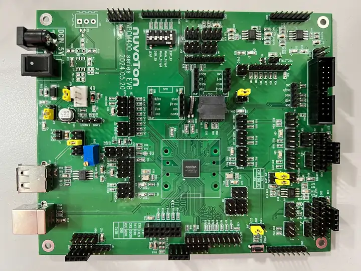

<!-- Copyright 2015-2026 Zephyr Project members and individual contributors. -->
<!-- SPDX-License-Identifier: Apache-2.0 -->
<!-- 中文翻译；编号、导航与译注为本地新增。 -->

<a id="npcm400_evb"></a>

# 第10章\_NPCM400_EVB

原文：[官方页面](https://docs.zephyrproject.org/latest/boards/nuvoton/npcm400_evb/doc/index.html)。读取日期：2026-10-16；来源摘要见[来源记录](../SOURCES.md)。

开发板概览（Board Overview）

<a id="id1"></a>

[](images/npcm400_evb.webp)

NPCM400_EVB

名称（Name）：

`npcm400_evb`

厂商（Vendor）：

[新唐科技（Nuvoton Technology Corporation）](https://docs.zephyrproject.org/latest/boards/index.html#vendor=nuvoton)

状态（Status）：

维护中（Maintained）

架构（Architecture）：

[arm](https://docs.zephyrproject.org/latest/boards/index.html#arch=arm)

片上系统（SoC）：

[npcm400](https://docs.zephyrproject.org/latest/boards/index.html#soc=npcm400)

<a id="board-github-link"></a>

[浏览开发板源码（Browse Board Sources）](https://github.com/zephyrproject-rtos/zephyr/blob/main//boards/nuvoton/npcm400_evb/doc/index.rst/../..)<a id="overview"></a>

## 概述（Overview）

NPCM400_EVB套件用于评估新唐NPCM4系列微控制器，需要配套NPCM400卫星管理控制器（SMC / Satellite Management Controller）。

<a id="hardware"></a>

## 硬件（Hardware）


- ARM Cortex-M4F处理器
- 内核时钟最高100 MHz
- 1 MB集成闪存
- 32 KB缓存，用于就地执行（XIP）及数据
- 768 KB RAM及64 KB启动ROM
- ADC与GPIO排针（Headers）
- UART0及UART1
- I2C/I3C
- 简化媒体独立接口（RMII）
- USB 2.0设备（Device）
- USB 1.1主机（Host）
- 支持安全启动（Secure Boot）

<a id="supported-features"></a>

### 支持的功能（Supported Features）

`npcm400_evb`开发板支持下表所列的硬件功能。

片上／板载（On-Chip / On-Board）

功能集成在片上系统（SoC）内／位于开发板上。

2 / 2

分别表示已启用／已禁用的实例数。点击数量标签，可查看开发板或SoC设备树源码（DTS）中该功能的第一个实例。

`vnd,foo`

与此功能匹配的设备树绑定兼容字符串（Compatible String）；点击链接可查看绑定文档。

<a id="npcm400_evb-hw-features"></a>

<a id="npcm400_evb-npcm400_evb/npcm400-hw-features-section"></a>

#### `npcm400_evb/npcm400`目标（Target）

<a id="npcm400_evb-npcm400_evb/npcm400-hw-features-panel"></a>

<a id="npcm400_evb-npcm400_evb/npcm400-hw-features-memory"></a>

该开发板目标的片上存储容量：764 KiB RAM、1 MiB Flash。

<a id="npcm400_evb-npcm400_evb/npcm400-hw-features-table"></a>

<table>
<tr>
<th>类型（Type）</th>
<th>位置（Location）</th>
<th>说明（Description）</th>
<th>兼容字符串（Compatible）</th>
</tr>
<tr>
<td rowspan="1">中央处理器（CPU）</td>
<td>片上（On-Chip）</td>
<td>ARM Cortex-M4 处理器（CPU）（<a href="https://github.com/zephyrproject-rtos/zephyr/blob/main/dts/arm/nuvoton/npcm/npcm.dtsi?plain=1#L18">已启用：1</a>）</td>
<td><a href="../cpu_arm_riscv_binding_reference/P024_arm_cortex-m4.md#std-dtcompatible-arm-cortex-m4"><code>arm,cortex-m4</code></a></td>
</tr>
<tr>
<td rowspan="1">时钟控制（Clock Control）</td>
<td>片上（On-Chip）</td>
<td>新唐NPCM电源及时钟控制器（PCC）节点（<a href="https://github.com/zephyrproject-rtos/zephyr/blob/main/dts/arm/nuvoton/npcm/npcm.dtsi?plain=1#L38">已启用：1</a>）</td>
<td><a href="../clock_nordic_nuvoton_nxp_binding_reference/P008_nuvoton_npcm-pcc.md#std-dtcompatible-nuvoton-npcm-pcc"><code>nuvoton,npcm-pcc</code></a></td>
</tr>
<tr>
<td rowspan="1">中断控制器（Interrupt Controller）</td>
<td>片上（On-Chip）</td>
<td>ARMv7-M 嵌套向量中断控制器（Nested Vectored Interrupt Controller，NVIC）（<a href="https://github.com/zephyrproject-rtos/zephyr/blob/main/dts/arm/armv7-m.dtsi?plain=1#L13">已启用：1</a>）</td>
<td><a href="../arm_interrupt_timer_binding_reference/P002_ARMv7_M_NVIC.md#std-dtcompatible-arm-v7m-nvic"><code>arm,v7m-nvic</code></a></td>
</tr>
<tr>
<td rowspan="1">静态随机存储器（SRAM）</td>
<td>片上（On-Chip）</td>
<td>通用片上静态随机存储器（SRAM）（<a href="https://github.com/zephyrproject-rtos/zephyr/blob/main/dts/arm/nuvoton/npcm400.dtsi?plain=1#L16">已启用：1</a>）</td>
<td><a href="../hardware/P567_内存映射SRAM绑定.md#dtbinding-mmio-sram"><code>mmio-sram</code></a></td>
</tr>
<tr>
<td rowspan="1">系统控制器（System Controller）</td>
<td>片上（On-Chip）</td>
<td>系统控制器寄存器读写（System Controller Registers R/W）（<a href="https://github.com/zephyrproject-rtos/zephyr/blob/main/dts/arm/nuvoton/npcm/npcm.dtsi?plain=1#L26">已启用：2</a>）</td>
<td><a href="../edac_syscon_binding_reference/P008_syscon.md#std-dtcompatible-syscon"><code>syscon</code></a></td>
</tr>
<tr>
<td rowspan="1">定时器（Timer）</td>
<td>片上（On-Chip）</td>
<td>ARMv7-M 系统节拍（System Tick）（<a href="https://github.com/zephyrproject-rtos/zephyr/blob/main/dts/arm/armv7-m.dtsi?plain=1#L21">已启用：1</a>）</td>
<td><a href="../arm_interrupt_timer_binding_reference/P006_ARMv7_M_SysTick.md#std-dtcompatible-arm-armv7m-systick"><code>arm,armv7m-systick</code></a></td>
</tr>
</table>

<a id="connections-and-ios"></a>

### 连接与输入输出（Connections and IOs）

原文说明，此板原理图由新唐提供。

<a id="serial-port"></a>

### 串口（Serial Port）

UART0配置为串行日志接口，默认115200、8N1。

<a id="programming-and-debugging"></a>

## 烧录与调试（Programming and Debugging）

`npcm400_evb`开发板支持下表所列的运行工具（Runners）及相关west命令。

<table>
<tr>
<th></th>
<th>烧录（flash）</th>
<th>调试（debug）</th>
<th>连接调试会话（attach）</th>
<th>实时传输（rtt）</th>
<th>复位（reset）</th>
<th>调试服务器（debugserver）</th>
</tr>
<tr>
<td><a href="https://docs.zephyrproject.org/latest/develop/flash_debug/host-tools.html#runner-jlink">jlink</a></td>
<td>✅（默认 / default）</td>
<td>✅（默认 / default）</td>
<td>✅</td>
<td>✅</td>
<td>✅</td>
<td>✅</td>
</tr>
</table>

此板提供Cortex ETM端口，可通过单一物理连接进行跟踪及调试，另有仅用于JTAG会话的插座。

<a id="flashing"></a>

### 烧录（Flashing）

安装正确排针后，此板支持JTAG。

通过JTAG烧录时，先安装编程器驱动。例如，SEGGER J-Link驱动位于[https://www.segger.com/downloads/jlink/](https://www.segger.com/downloads/jlink/)。

下面以[Hello World](../getting_started/P005_HelloWorld示例.md#hello_world)应用为例。

```text
# From the root of the zephyr repository
west build -b npcm400_evb samples/hello_world
west flash
```

打开串口终端，应看到以下消息：

```text
Hello World! npcm400_evb/npcm400
```

<a id="debugging"></a>

### 调试（Debugging）

使用J-Link通过JTAG／SWD连接

<a id="references"></a>

## 参考资料（References）

## 译注

硬件概述768 KB RAM与自动生成目标表764 KiB RAM分别保留；不把可用目标容量直接等同于物理总量。

---

[上一章](P009_NPCK3M8K_EVB.md) · [返回大纲](大纲.md) · [全站翻译进度](../PROGRESS.md) · [下一章](P011_NPCX4M8F_EVB.md)
