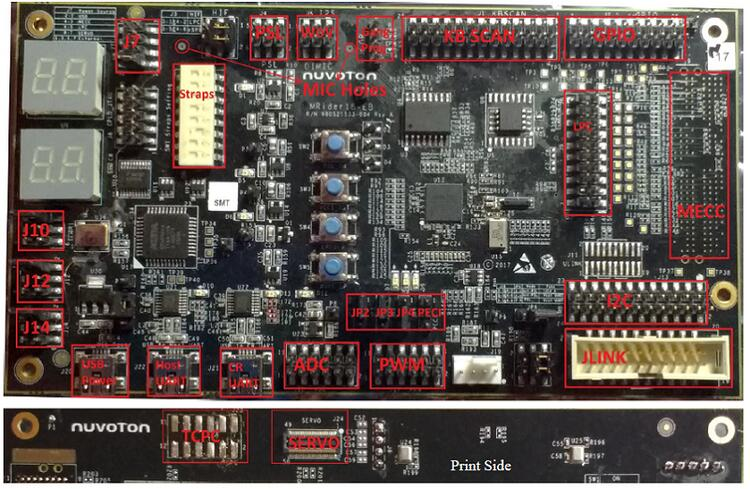

<!-- Copyright 2015-2026 Zephyr Project members and individual contributors. -->
<!-- SPDX-License-Identifier: Apache-2.0 -->
<!-- 中文翻译；编号、导航与译注为本地新增。 -->

<a id="npcx4m8f_evb"></a>

# 第11章\_NPCX4M8F_EVB

原文：[官方页面](https://docs.zephyrproject.org/latest/boards/nuvoton/npcx4m8f_evb/doc/index.html)。读取日期：2026-10-16；来源摘要见[来源记录](../SOURCES.md)。

开发板概览（Board Overview）

<a id="id1"></a>

[](images/npcx4m8f_evb.jpg)

NPCX4M8F_EVB

名称（Name）：

`npcx4m8f_evb`

厂商（Vendor）：

[新唐科技（Nuvoton Technology Corporation）](https://docs.zephyrproject.org/latest/boards/index.html#vendor=nuvoton)

状态（Status）：

维护中（Maintained）

架构（Architecture）：

[arm](https://docs.zephyrproject.org/latest/boards/index.html#arch=arm)

片上系统（SoC）：

[npcx4m8f](https://docs.zephyrproject.org/latest/boards/index.html#soc=npcx4m8f)

<a id="board-github-link"></a>

[浏览开发板源码（Browse Board Sources）](https://github.com/zephyrproject-rtos/zephyr/blob/main//boards/nuvoton/npcx4m8f_evb/doc/index.rst/../..)<a id="overview"></a>

## 概述（Overview）

NPCX4M8F_EVB套件用于评估新唐NPCX4系列微控制器；原文要求配套型号为NPCX498F。

<a id="hardware"></a>

## 硬件（Hardware）


- ARM Cortex-M4F处理器
- 512 KB RAM及64 KB启动ROM
- ADC与GPIO排针（Headers）
- UART0及UART1
- 风扇脉宽调制接口（FAN PWM）
- JTAG接口
- Intel模块化嵌入式控制器卡（MECC）排针

<a id="supported-features"></a>

### 支持的功能（Supported Features）

`npcx4m8f_evb`开发板支持下表所列的硬件功能。

片上／板载（On-Chip / On-Board）

功能集成在片上系统（SoC）内／位于开发板上。

2 / 2

分别表示已启用／已禁用的实例数。点击数量标签，可查看开发板或SoC设备树源码（DTS）中该功能的第一个实例。

`vnd,foo`

与此功能匹配的设备树绑定兼容字符串（Compatible String）；点击链接可查看绑定文档。

<a id="npcx4m8f_evb-hw-features"></a>

<a id="npcx4m8f_evb-npcx4m8f_evb/npcx4m8f-hw-features-section"></a>

#### `npcx4m8f_evb/npcx4m8f`目标（Target）

<a id="npcx4m8f_evb-npcx4m8f_evb/npcx4m8f-hw-features-panel"></a>

<a id="npcx4m8f_evb-npcx4m8f_evb/npcx4m8f-hw-features-memory"></a>

该开发板目标的片上存储容量：114 KiB RAM、384 KiB Flash。

<a id="npcx4m8f_evb-npcx4m8f_evb/npcx4m8f-hw-features-table"></a>

<table>
<tr>
<th>类型（Type）</th>
<th>位置（Location）</th>
<th>说明（Description）</th>
<th>兼容字符串（Compatible）</th>
</tr>
<tr>
<td rowspan="1">中央处理器（CPU）</td>
<td>片上（On-Chip）</td>
<td>ARM Cortex-M4F 处理器（CPU）（<a href="https://github.com/zephyrproject-rtos/zephyr/blob/main/dts/arm/nuvoton/npcx/npcx.dtsi?plain=1#L26">已启用：1</a>）</td>
<td><a href="../cpu_arm_riscv_binding_reference/P025_arm_cortex-m4f.md#std-dtcompatible-arm-cortex-m4f"><code>arm,cortex-m4f</code></a></td>
</tr>
<tr>
<td rowspan="1">模数转换器（ADC）</td>
<td>片上（On-Chip）</td>
<td>新唐NPCX ADC节点（<a href="https://github.com/zephyrproject-rtos/zephyr/blob/main/dts/arm/nuvoton/npcx/npcx.dtsi?plain=1#L340">已启用：1</a>；<a href="https://github.com/zephyrproject-rtos/zephyr/blob/main/dts/arm/nuvoton/npcx/npcx4.dtsi?plain=1#L414">已禁用：1</a>）</td>
<td><a href="../hardware/P892_NuvotonNPCX模数转换器绑定.md#dtbinding-nuvoton-npcx-adc"><code>nuvoton,npcx-adc</code></a></td>
</tr>
<tr>
<td rowspan="1">时钟控制（Clock Control）</td>
<td>片上（On-Chip）</td>
<td>新唐NPCX电源及时钟控制器（PCC）节点（<a href="https://github.com/zephyrproject-rtos/zephyr/blob/main/dts/arm/nuvoton/npcx/npcx.dtsi?plain=1#L67">已启用：1</a>）</td>
<td><a href="../clock_nordic_nuvoton_nxp_binding_reference/P009_nuvoton_npcx-pcc.md#std-dtcompatible-nuvoton-npcx-pcc"><code>nuvoton,npcx-pcc</code></a></td>
</tr>
<tr>
<td rowspan="1">计数器（Counter）</td>
<td>片上（On-Chip）</td>
<td>新唐NPCX变体的第2版NPCX-LCT节点（<a href="https://github.com/zephyrproject-rtos/zephyr/blob/main/dts/arm/nuvoton/npcx/npcx4.dtsi?plain=1#L583">已禁用：1</a>）</td>
<td><a href="../nxp_nuvoton_counter_binding_reference/P003_nuvoton_npcx-lct-v2.md#std-dtcompatible-nuvoton-npcx-lct-v2"><code>nuvoton,npcx-lct-v2</code></a></td>
</tr>
<tr>
<td rowspan="1">密码学加速器（Cryptographic Accelerator）</td>
<td>片上（On-Chip）</td>
<td>NPCX密码SHA加速器（Crypto SHA Accelerator）（<a href="https://github.com/zephyrproject-rtos/zephyr/blob/main/dts/arm/nuvoton/npcx/npcx4.dtsi?plain=1#L444">已禁用：1</a>）</td>
<td><a href="../crypto_secure_engine_st_ti_binding_reference/P002_nuvoton_npcx-sha.md#std-dtcompatible-nuvoton-npcx-sha"><code>nuvoton,npcx-sha</code></a></td>
</tr>
<tr>
<td rowspan="1">直接存储器访问（DMA）</td>
<td>片上（On-Chip）</td>
<td>新唐NPCX GDMA节点（<a href="https://github.com/zephyrproject-rtos/zephyr/blob/main/dts/arm/nuvoton/npcx/npcx.dtsi?plain=1#L489">已禁用：2</a>）</td>
<td><a href="../intel_microchip_dma_binding_reference/P017_nuvoton_npcx-gdma.md#std-dtcompatible-nuvoton-npcx-gdma"><code>nuvoton,npcx-gdma</code></a></td>
</tr>
<tr>
<td rowspan="5">增强型串行外设接口（ESPI）</td>
<td>片上（On-Chip）</td>
<td>新唐NPCX eSPI虚拟线（VW / Virtual Wire）映射子节点（<a href="https://github.com/zephyrproject-rtos/zephyr/blob/main/dts/arm/nuvoton/npcx/npcx-espi-vws-map.dtsi?plain=1#L33">已启用：1</a>）</td>
<td><a href="../espi_binding_reference/P010_nuvoton_npcx-espi-vw-conf.md#std-dtcompatible-nuvoton-npcx-espi-vw-conf"><code>nuvoton,npcx-espi-vw-conf</code></a></td>
</tr>
<tr>
<td>片上（On-Chip）</td>
<td>新唐NPCX eSPI节点（<a href="https://github.com/zephyrproject-rtos/zephyr/blob/main/dts/arm/nuvoton/npcx/npcx.dtsi?plain=1#L357">已启用：1</a>）</td>
<td><a href="../espi_binding_reference/P011_nuvoton_npcx-espi.md#std-dtcompatible-nuvoton-npcx-espi"><code>nuvoton,npcx-espi</code></a></td>
</tr>
<tr>
<td>片上（On-Chip）</td>
<td>新唐eSPI TAF控制器访问的目标闪存设备（<a href="https://github.com/zephyrproject-rtos/zephyr/blob/main/dts/arm/nuvoton/npcx/npcx4.dtsi?plain=1#L468">已禁用：1</a>）</td>
<td><a href="../espi_binding_reference/P009_nuvoton_npcx-espi-taf.md#std-dtcompatible-nuvoton-npcx-espi-taf"><code>nuvoton,npcx-espi-taf</code></a></td>
</tr>
<tr>
<td>片上（On-Chip）</td>
<td>新唐NPCX主机子模块（Host Sub-Modules）节点（<a href="https://github.com/zephyrproject-rtos/zephyr/blob/main/dts/arm/nuvoton/npcx/npcx.dtsi?plain=1#L373">已启用：1</a>）</td>
<td><a href="../espi_binding_reference/P012_nuvoton_npcx-host-sub.md#std-dtcompatible-nuvoton-npcx-host-sub"><code>nuvoton,npcx-host-sub</code></a></td>
</tr>
<tr>
<td>片上（On-Chip）</td>
<td>新唐NPCX主机UART I/O节点（<a href="https://github.com/zephyrproject-rtos/zephyr/blob/main/dts/arm/nuvoton/npcx/npcx.dtsi?plain=1#L511">已禁用：1</a>）</td>
<td><a href="../espi_binding_reference/P013_nuvoton_npcx-host-uart.md#std-dtcompatible-nuvoton-npcx-host-uart"><code>nuvoton,npcx-host-uart</code></a></td>
</tr>
<tr>
<td rowspan="2">闪存控制器（Flash Controller）</td>
<td>片上（On-Chip）</td>
<td>定义闪存接口单元（FIU）中NPCX四线SPI外设的属性（<a href="https://github.com/zephyrproject-rtos/zephyr/blob/main/dts/arm/nuvoton/npcx/npcx.dtsi?plain=1#L452">已启用：2</a>）</td>
<td><a href="../flash_nuvoton_nxp_renesas_binding_reference/P005_nuvoton_npcx-fiu-qspi.md#std-dtcompatible-nuvoton-npcx-fiu-qspi"><code>nuvoton,npcx-fiu-qspi</code></a></td>
</tr>
<tr>
<td>片上（On-Chip）</td>
<td>新唐闪存接口单元（FIU）访问的SPI NOR闪存设备（<a href="https://github.com/zephyrproject-rtos/zephyr/blob/main/dts/arm/nuvoton/npcx4m8f.dtsi?plain=1#L32">已启用：1</a>）</td>
<td><a href="../flash_nuvoton_nxp_renesas_binding_reference/P004_nuvoton_npcx-fiu-nor.md#std-dtcompatible-nuvoton-npcx-fiu-nor"><code>nuvoton,npcx-fiu-nor</code></a></td>
</tr>
<tr>
<td rowspan="1">通用输入输出与接插件（GPIO &amp; Headers）</td>
<td>片上（On-Chip）</td>
<td>新唐NPCX GPIO（<a href="https://github.com/zephyrproject-rtos/zephyr/blob/main/dts/arm/nuvoton/npcx/npcx.dtsi?plain=1#L124">已启用：16</a>）</td>
<td><a href="../gpio_microchip_nordic_nuvoton_binding_reference/P023_nuvoton_npcx-gpio.md#std-dtcompatible-nuvoton-npcx-gpio"><code>nuvoton,npcx-gpio</code></a></td>
</tr>
<tr>
<td rowspan="2">集成电路间总线（I2C）</td>
<td>片上（On-Chip）</td>
<td>新唐NPCX I2C控制器（<a href="https://github.com/zephyrproject-rtos/zephyr/blob/main/dts/arm/nuvoton/npcx/npcx4.dtsi?plain=1#L334">已启用：1</a>；<a href="https://github.com/zephyrproject-rtos/zephyr/blob/main/dts/arm/nuvoton/npcx/npcx4.dtsi?plain=1#L343">已禁用：7</a>）</td>
<td><a href="../i2c_infineon_ite_nordic_binding_reference/P018_nuvoton_npcx-i2c-ctrl.md#std-dtcompatible-nuvoton-npcx-i2c-ctrl"><code>nuvoton,npcx-i2c-ctrl</code></a></td>
</tr>
<tr>
<td>片上（On-Chip）</td>
<td>新唐NPCX I2C端口焊盘（Port Pads）（<a href="https://github.com/zephyrproject-rtos/zephyr/blob/main/dts/arm/nuvoton/npcx/npcx.dtsi?plain=1#L516">已启用：1</a>；<a href="https://github.com/zephyrproject-rtos/zephyr/blob/main/dts/arm/nuvoton/npcx/npcx.dtsi?plain=1#L525">已禁用：11</a>）</td>
<td><a href="../i2c_infineon_ite_nordic_binding_reference/P019_nuvoton_npcx-i2c-port.md#std-dtcompatible-nuvoton-npcx-i2c-port"><code>nuvoton,npcx-i2c-port</code></a></td>
</tr>
<tr>
<td rowspan="1">改进型集成电路间总线（I3C）</td>
<td>片上（On-Chip）</td>
<td>新唐I3C控制器（<a href="https://github.com/zephyrproject-rtos/zephyr/blob/main/dts/arm/nuvoton/npcx/npcx4.dtsi?plain=1#L482">已禁用：3</a>）</td>
<td><a href="../i3c_smbus_binding_reference/P006_nuvoton_npcx-i3c.md#std-dtcompatible-nuvoton-npcx-i3c"><code>nuvoton,npcx-i3c</code></a></td>
</tr>
<tr>
<td rowspan="1">输入（Input）</td>
<td>片上（On-Chip）</td>
<td>新唐NPCX键盘扫描控制器（Keyboard Scan Controller）（<a href="https://github.com/zephyrproject-rtos/zephyr/blob/main/dts/arm/nuvoton/npcx/npcx.dtsi?plain=1#L469">已启用：1</a>）</td>
<td><a href="../input_keyboard_optical_ctsu_binding_reference/P009_nuvoton_npcx-kbd.md#std-dtcompatible-nuvoton-npcx-kbd"><code>nuvoton,npcx-kbd</code></a></td>
</tr>
<tr>
<td rowspan="4">中断控制器（Interrupt Controller）</td>
<td>片上（On-Chip）</td>
<td>NPCX MIWU唤醒单元输入（WUI）映射子节点（<a href="https://github.com/zephyrproject-rtos/zephyr/blob/main/dts/arm/nuvoton/npcx/npcx-miwus-wui-map.dtsi?plain=1#L9">已启用：1</a>）</td>
<td><a href="../wakeup_interrupt_binding_reference/P009_nuvoton_npcx-miwu-wui-map.md#std-dtcompatible-nuvoton-npcx-miwu-wui-map"><code>nuvoton,npcx-miwu-wui-map</code></a></td>
</tr>
<tr>
<td>片上（On-Chip）</td>
<td>新唐NPCX多输入唤醒单元（MIWU）节点（<a href="https://github.com/zephyrproject-rtos/zephyr/blob/main/dts/arm/nuvoton/npcx/npcx.dtsi?plain=1#L103">已启用：3</a>；<a href="https://github.com/zephyrproject-rtos/zephyr/blob/main/dts/arm/nuvoton/npcx/npcx-miwus-wui-map.dtsi?plain=1#L618">已禁用：1</a>）</td>
<td><a href="../wakeup_interrupt_binding_reference/P010_nuvoton_npcx-miwu.md#std-dtcompatible-nuvoton-npcx-miwu"><code>nuvoton,npcx-miwu</code></a></td>
</tr>
<tr>
<td>片上（On-Chip）</td>
<td>NPCX MIWU分组中断（Group-interrupt）映射子节点（<a href="https://github.com/zephyrproject-rtos/zephyr/blob/main/dts/arm/nuvoton/npcx/npcx-miwus-int-map.dtsi?plain=1#L10">已启用：3</a>）</td>
<td><a href="../wakeup_interrupt_binding_reference/P008_nuvoton_npcx-miwu-int-map.md#std-dtcompatible-nuvoton-npcx-miwu-int-map"><code>nuvoton,npcx-miwu-int-map</code></a></td>
</tr>
<tr>
<td>片上（On-Chip）</td>
<td>ARMv7-M 嵌套向量中断控制器（Nested Vectored Interrupt Controller，NVIC）（<a href="https://github.com/zephyrproject-rtos/zephyr/blob/main/dts/arm/armv7-m.dtsi?plain=1#L13">已启用：1</a>）</td>
<td><a href="../arm_interrupt_timer_binding_reference/P002_ARMv7_M_NVIC.md#std-dtcompatible-arm-v7m-nvic"><code>arm,v7m-nvic</code></a></td>
</tr>
<tr>
<td rowspan="2">发光二极管（LED）</td>
<td>板载（On-Board）</td>
<td>一组由脉宽调制（PWM）控制的LED（<a href="https://github.com/zephyrproject-rtos/zephyr/blob/main/boards/nuvoton/npcx4m8f_evb/npcx4m8f_evb.dts?plain=1#L32">已启用：1</a>）</td>
<td><a href="../hardware/P565_PWM指示灯绑定.md#dtbinding-pwm-leds"><code>pwm-leds</code></a></td>
</tr>
<tr>
<td>板载（On-Board）</td>
<td>一组由 GPIO 控制的 LED（GPIO-Controlled LEDs）（<a href="https://github.com/zephyrproject-rtos/zephyr/blob/main/boards/nuvoton/npcx4m8f_evb/npcx4m8f_evb.dts?plain=1#L41">已启用：1</a>）</td>
<td><a href="../hardware/P564_GPIO指示灯绑定.md#dtbinding-gpio-leds"><code>gpio-leds</code></a></td>
</tr>
<tr>
<td rowspan="1">存储器控制器（Memory Controller）</td>
<td>片上（On-Chip）</td>
<td>新唐NPCX电池后备RAM（Battery Backed RAM）节点（<a href="https://github.com/zephyrproject-rtos/zephyr/blob/main/dts/arm/nuvoton/npcx/npcx4.dtsi?plain=1#L118">已启用：1</a>）</td>
<td><a href="../memory_controller_hyperbus_smc_binding_reference/P014_nuvoton_npcx-bbram.md#std-dtcompatible-nuvoton-npcx-bbram"><code>nuvoton,npcx-bbram</code></a></td>
</tr>
<tr>
<td rowspan="2">其他绑定（Miscellaneous）</td>
<td>片上（On-Chip）</td>
<td>新唐NPCX SoC标识（ID）（<a href="https://github.com/zephyrproject-rtos/zephyr/blob/main/dts/arm/nuvoton/npcx/npcx.dtsi?plain=1#L612">已启用：1</a>）</td>
<td><a href="../misc_adi_nordic_binding_reference/P023_nuvoton_npcx-soc-id.md#std-dtcompatible-nuvoton-npcx-soc-id"><code>nuvoton,npcx-soc-id</code></a></td>
</tr>
<tr>
<td>片上（On-Chip）</td>
<td>新唐NPCX引导程序（Booter）变体选项（<a href="https://github.com/zephyrproject-rtos/zephyr/blob/main/dts/arm/nuvoton/npcx/npcx.dtsi?plain=1#L617">已启用：1</a>）</td>
<td><a href="../misc_adi_nordic_binding_reference/P022_nuvoton_npcx-booter-variant.md#std-dtcompatible-nuvoton-npcx-booter-variant"><code>nuvoton,npcx-booter-variant</code></a></td>
</tr>
<tr>
<td rowspan="1">平台环境控制接口（PECI）</td>
<td>片上（On-Chip）</td>
<td>新唐NPCX PECI节点（<a href="https://github.com/zephyrproject-rtos/zephyr/blob/main/dts/arm/nuvoton/npcx/npcx.dtsi?plain=1#L459">已启用：1</a>）</td>
<td><a href="../lin_dali_mctp_sensor_bus_binding_reference/P005_nuvoton_npcx-peci.md#std-dtcompatible-nuvoton-npcx-peci"><code>nuvoton,npcx-peci</code></a></td>
</tr>
<tr>
<td rowspan="6">引脚控制（Pin Control）</td>
<td>片上（On-Chip）</td>
<td>新唐NPCX7引脚复用（Pin-Mux）配置：从NPCX GPIO到引脚复用控制器SCFG驱动实例的配置映射（<a href="https://github.com/zephyrproject-rtos/zephyr/blob/main/dts/arm/nuvoton/npcx/npcx-alts-map.dtsi?plain=1#L8">已启用：1</a>）</td>
<td><a href="../pinctrl_infineon_nordic_nxp_binding_reference/P012_nuvoton_npcx-pinctrl-conf.md#std-dtcompatible-nuvoton-npcx-pinctrl-conf"><code>nuvoton,npcx-pinctrl-conf</code></a></td>
</tr>
<tr>
<td>片上（On-Chip）</td>
<td>新唐NPCX7低电压电平检测配置：NPCX GPIO与低电压控制器LV_GPIO_CTL驱动实例之间的配置映射（<a href="https://github.com/zephyrproject-rtos/zephyr/blob/main/dts/arm/nuvoton/npcx/npcx-lvol-ctrl-map.dtsi?plain=1#L8">已启用：1</a>）</td>
<td><a href="../pinctrl_infineon_nordic_nxp_binding_reference/P011_nuvoton_npcx-lvolctrl-conf.md#std-dtcompatible-nuvoton-npcx-lvolctrl-conf"><code>nuvoton,npcx-lvolctrl-conf</code></a></td>
</tr>
<tr>
<td>片上（On-Chip）</td>
<td>新唐NPCX系统配置，包括引脚复用及1.8 V支持等（<a href="https://github.com/zephyrproject-rtos/zephyr/blob/main/dts/arm/nuvoton/npcx/npcx.dtsi?plain=1#L78">已启用：1</a>）</td>
<td><a href="../pinctrl_infineon_nordic_nxp_binding_reference/P016_nuvoton_npcx-scfg.md#std-dtcompatible-nuvoton-npcx-scfg"><code>nuvoton,npcx-scfg</code></a></td>
</tr>
<tr>
<td>片上（On-Chip）</td>
<td>新唐NPCX默认引脚配置（Default Pins Configurations）（<a href="https://github.com/zephyrproject-rtos/zephyr/blob/main/dts/arm/nuvoton/npcx/npcx.dtsi?plain=1#L33">已启用：1</a>）</td>
<td><a href="../pinctrl_infineon_nordic_nxp_binding_reference/P013_nuvoton_npcx-pinctrl-def.md#std-dtcompatible-nuvoton-npcx-pinctrl-def"><code>nuvoton,npcx-pinctrl-def</code></a></td>
</tr>
<tr>
<td>片上（On-Chip）</td>
<td>新唐引脚控制器是单例节点（Singleton Node），负责控制引脚功能选择及引脚属性（<a href="https://github.com/zephyrproject-rtos/zephyr/blob/main/dts/arm/nuvoton/npcx/npcx.dtsi?plain=1#L53">已启用：1</a>）</td>
<td><a href="../pinctrl_infineon_nordic_nxp_binding_reference/P015_nuvoton_npcx-pinctrl.md#std-dtcompatible-nuvoton-npcx-pinctrl"><code>nuvoton,npcx-pinctrl</code></a></td>
</tr>
<tr>
<td>片上（On-Chip）</td>
<td>新唐NPCX漏电I/O（Power Leakage IOs）（<a href="https://github.com/zephyrproject-rtos/zephyr/blob/main/dts/arm/nuvoton/npcx/npcx.dtsi?plain=1#L61">已启用：1</a>）</td>
<td><a href="../pinctrl_infineon_nordic_nxp_binding_reference/P010_nuvoton_npcx-leakage-io.md#std-dtcompatible-nuvoton-npcx-leakage-io"><code>nuvoton,npcx-leakage-io</code></a></td>
</tr>
<tr>
<td rowspan="2">电源管理（Power Management）</td>
<td>片上（On-Chip）</td>
<td>NPCX电源管理空闲状态（Idle State）（<a href="https://github.com/zephyrproject-rtos/zephyr/blob/main/dts/arm/nuvoton/npcx/npcx4.dtsi?plain=1#L41">已启用：1</a>）</td>
<td><a href="../power_control_binding_reference/P012_nuvoton_npcx-power-state.md#std-dtcompatible-nuvoton-npcx-power-state"><code>nuvoton,npcx-power-state</code></a></td>
</tr>
<tr>
<td>片上（On-Chip）</td>
<td>新唐NPCX电源开关逻辑（PSL / Power Switch Logic）控制节点（<a href="https://github.com/zephyrproject-rtos/zephyr/blob/main/dts/arm/nuvoton/npcx/npcx.dtsi?plain=1#L606">已禁用：1</a>）</td>
<td><a href="../power_control_binding_reference/P011_nuvoton_npcx-power-psl.md#std-dtcompatible-nuvoton-npcx-power-psl"><code>nuvoton,npcx-power-psl</code></a></td>
</tr>
<tr>
<td rowspan="2">PS/2 接口（PS/2）</td>
<td>片上（On-Chip）</td>
<td>新唐NPCX PS/2控制器节点（<a href="https://github.com/zephyrproject-rtos/zephyr/blob/main/dts/arm/nuvoton/npcx/npcx.dtsi?plain=1#L419">已启用：1</a>）</td>
<td><a href="../lin_dali_mctp_sensor_bus_binding_reference/P014_nuvoton_npcx-ps2-ctrl.md#std-dtcompatible-nuvoton-npcx-ps2-ctrl"><code>nuvoton,npcx-ps2-ctrl</code></a></td>
</tr>
<tr>
<td>片上（On-Chip）</td>
<td>新唐NPCX PS/2通道焊盘节点（<a href="https://github.com/zephyrproject-rtos/zephyr/blob/main/dts/arm/nuvoton/npcx/npcx.dtsi?plain=1#L426">已禁用：4</a>）</td>
<td><a href="../lin_dali_mctp_sensor_bus_binding_reference/P013_nuvoton_npcx-ps2-channel.md#std-dtcompatible-nuvoton-npcx-ps2-channel"><code>nuvoton,npcx-ps2-channel</code></a></td>
</tr>
<tr>
<td rowspan="1">脉宽调制（PWM）</td>
<td>片上（On-Chip）</td>
<td>新唐NPCX脉宽调制器（PWM）节点（<a href="https://github.com/zephyrproject-rtos/zephyr/blob/main/dts/arm/nuvoton/npcx/npcx.dtsi?plain=1#L322">已启用：1</a>；<a href="https://github.com/zephyrproject-rtos/zephyr/blob/main/dts/arm/nuvoton/npcx/npcx.dtsi?plain=1#L268">已禁用：7</a>）</td>
<td><a href="../pwm_intel_microchip_nxp_binding_reference/P017_nuvoton_npcx-pwm.md#std-dtcompatible-nuvoton-npcx-pwm"><code>nuvoton,npcx-pwm</code></a></td>
</tr>
<tr>
<td rowspan="1">复位控制器（Reset Controller）</td>
<td>片上（On-Chip）</td>
<td>NPCX复位控制器（Reset Controller）（<a href="https://github.com/zephyrproject-rtos/zephyr/blob/main/dts/arm/nuvoton/npcx/npcx4.dtsi?plain=1#L475">已禁用：1</a>）</td>
<td><a href="../reset_controller_binding_reference/P007_nuvoton_npcx-rst.md#std-dtcompatible-nuvoton-npcx-rst"><code>nuvoton,npcx-rst</code></a></td>
</tr>
<tr>
<td rowspan="1">串行控制器（Serial Controller）</td>
<td>片上（On-Chip）</td>
<td>新唐NPCX UART节点（<a href="https://github.com/zephyrproject-rtos/zephyr/blob/main/dts/arm/nuvoton/npcx/npcx4.dtsi?plain=1#L137">已启用：1</a>；<a href="https://github.com/zephyrproject-rtos/zephyr/blob/main/dts/arm/nuvoton/npcx/npcx4.dtsi?plain=1#L149">已禁用：3</a>）</td>
<td><a href="../uart_microchip_nordic_nxp_binding_reference/P007_nuvoton_npcx-uart.md#std-dtcompatible-nuvoton-npcx-uart"><code>nuvoton,npcx-uart</code></a></td>
</tr>
<tr>
<td rowspan="1">串行主机接口（SHI）</td>
<td>片上（On-Chip）</td>
<td>新唐NPCX串行主机接口（SHI / Serial Host Interface）（<a href="https://github.com/zephyrproject-rtos/zephyr/blob/main/dts/arm/nuvoton/npcx/npcx4.dtsi?plain=1#L451">已禁用：1</a>）</td>
<td><a href="../lin_dali_mctp_sensor_bus_binding_reference/P018_nuvoton_npcx-shi-enhanced.md#std-dtcompatible-nuvoton-npcx-shi-enhanced"><code>nuvoton,npcx-shi-enhanced</code></a></td>
</tr>
<tr>
<td rowspan="1">串行外设接口（SPI）</td>
<td>片上（On-Chip）</td>
<td>新唐NPCX SPI控制器（<a href="https://github.com/zephyrproject-rtos/zephyr/blob/main/dts/arm/nuvoton/npcx/npcx.dtsi?plain=1#L479">已禁用：1</a>）</td>
<td><a href="../spi_microchip_nordic_nxp_binding_reference/P015_nuvoton_npcx-spip.md#std-dtcompatible-nuvoton-npcx-spip"><code>nuvoton,npcx-spip</code></a></td>
</tr>
<tr>
<td rowspan="1">静态随机存储器（SRAM）</td>
<td>片上（On-Chip）</td>
<td>通用片上静态随机存储器（SRAM）（<a href="https://github.com/zephyrproject-rtos/zephyr/blob/main/dts/arm/nuvoton/npcx4m8f.dtsi?plain=1#L19">已启用：1</a>）</td>
<td><a href="../hardware/P567_内存映射SRAM绑定.md#dtbinding-mmio-sram"><code>mmio-sram</code></a></td>
</tr>
<tr>
<td rowspan="1">系统控制器（System Controller）</td>
<td>片上（On-Chip）</td>
<td>系统控制器寄存器读写（System Controller Registers R/W）（<a href="https://github.com/zephyrproject-rtos/zephyr/blob/main/dts/arm/nuvoton/npcx/npcx.dtsi?plain=1#L91">已启用：2</a>；<a href="https://github.com/zephyrproject-rtos/zephyr/blob/main/dts/arm/nuvoton/npcx/npcx4.dtsi?plain=1#L560">已禁用：1</a>）</td>
<td><a href="../edac_syscon_binding_reference/P008_syscon.md#std-dtcompatible-syscon"><code>syscon</code></a></td>
</tr>
<tr>
<td rowspan="1">转速计（Tachometer）</td>
<td>片上（On-Chip）</td>
<td>新唐NPCX转速计（Tachometer）（<a href="https://github.com/zephyrproject-rtos/zephyr/blob/main/dts/arm/nuvoton/npcx/npcx.dtsi?plain=1#L405">已启用：1</a>；<a href="https://github.com/zephyrproject-rtos/zephyr/blob/main/dts/arm/nuvoton/npcx/npcx.dtsi?plain=1#L412">已禁用：1</a>）</td>
<td><a href="../auxdisplay_iio_tach_binding_reference/P018_nuvoton_npcx-tach.md#std-dtcompatible-nuvoton-npcx-tach"><code>nuvoton,npcx-tach</code></a></td>
</tr>
<tr>
<td rowspan="2">定时器（Timer）</td>
<td>片上（On-Chip）</td>
<td>ARMv7-M 系统节拍（System Tick）（<a href="https://github.com/zephyrproject-rtos/zephyr/blob/main/dts/arm/armv7-m.dtsi?plain=1#L21">已启用：1</a>）</td>
<td><a href="../arm_interrupt_timer_binding_reference/P006_ARMv7_M_SysTick.md#std-dtcompatible-arm-armv7m-systick"><code>arm,armv7m-systick</code></a></td>
</tr>
<tr>
<td>片上（On-Chip）</td>
<td>新唐NPCX内部定时器（ITIM / Internal Timer）（<a href="https://github.com/zephyrproject-rtos/zephyr/blob/main/dts/arm/nuvoton/npcx/npcx4.dtsi?plain=1#L126">已启用：1</a>）</td>
<td><a href="../mcu_timer_binding_reference/P012_nuvoton_npcx-itim-timer.md#std-dtcompatible-nuvoton-npcx-itim-timer"><code>nuvoton,npcx-itim-timer</code></a></td>
</tr>
<tr>
<td rowspan="1">看门狗（Watchdog）</td>
<td>片上（On-Chip）</td>
<td>新唐NPCX TWD（<a href="https://github.com/zephyrproject-rtos/zephyr/blob/main/dts/arm/nuvoton/npcx/npcx.dtsi?plain=1#L351">已启用：1</a>）</td>
<td><a href="../nxp_nordic_nuvoton_watchdog_binding_reference/P003_nuvoton_npcx-watchdog.md#std-dtcompatible-nuvoton-npcx-watchdog"><code>nuvoton,npcx-watchdog</code></a></td>
</tr>
</table>

<a id="connections-and-ios"></a>

### 连接与输入输出（Connections and IOs）

原文说明，此板原理图由新唐提供。

<a id="system-clock"></a>

### 系统时钟（System Clock）

NPCX4M8F MCU使用120 MHz内部振荡器及片上PLL，最终生成15 MHz EC时钟。详见用户手册第4章的处理器时钟控制寄存器。

<a id="serial-port"></a>

### 串口（Serial Port）

UART1用于串行日志。

<a id="programming-and-debugging"></a>

## 烧录与调试（Programming and Debugging）

`npcx4m8f_evb`开发板支持下表所列的运行工具（Runners）及相关west命令。

<table>
<tr>
<th></th>
<th>烧录（flash）</th>
<th>调试（debug）</th>
<th>连接调试会话（attach）</th>
<th>实时传输（rtt）</th>
<th>调试服务器（debugserver）</th>
</tr>
<tr>
<td><a href="https://docs.zephyrproject.org/latest/develop/flash_debug/host-tools.html#runner-openocd">openocd</a></td>
<td>✅（默认 / default）</td>
<td>✅（默认 / default）</td>
<td>✅</td>
<td>✅</td>
<td>✅</td>
</tr>
</table>

此板提供Cortex ETM端口，可通过单一物理连接进行跟踪及调试，另有仅用于JTAG会话的插座。

<a id="flashing"></a>

### 烧录（Flashing）

安装正确排针后，此板支持JTAG及ChromiumOS Servo。

<a id="id3"></a>

使用Servo V2、μServo或Servo V4（CCD）烧录时，详情见[Chromium EC烧录文档](https://chromium.googlesource.com/chromiumos/platform/ec#Flashing-via-the-servo-debug-board) [注1](#id2)。

通过JTAG烧录时，先安装编程器驱动。例如，SEGGER J-Link驱动位于[https://www.segger.com/downloads/jlink/](https://www.segger.com/downloads/jlink/)。

Zephyr SDK 0.16.1所带OpenOCD不含NPCX4支持，因此原文要求从源码构建OpenOCD：

```text
sudo apt-get install libftdi-dev libusb-1.0.0-dev
git clone https://git.code.sf.net/p/openocd/code ~/openocd
cd ~/openocd
./bootstrap
./configure --enable-jlink --enable-ftdi
make clean
make
sudo make install
```

构建并烧录Blinky示例：

```text
west build -t clean && \
  west build -c -p auto -b npcx4m8f_evb samples/basic/blinky && \
  west flash --openocd /usr/local/bin/openocd
```

<a id="debugging"></a>

### 调试（Debugging）

使用J-Link通过JTAG／SWD连接

<a id="references"></a>

## 参考资料（References）

<a id="id2"></a>

〔[1](#id3)〕 [https://chromium.googlesource.com/chromiumos/platform/ec#Flashing-via-the-servo-debug-board](https://chromium.googlesource.com/chromiumos/platform/ec#Flashing-via-the-servo-debug-board)

## 译注

页面名称NPCX4M8F与配套器件NPCX498F按原文保留。Zephyr SDK 0.16.1内OpenOCD不支持NPCX4的说明是来源版本条件，按原文提供从源码构建步骤。

---

[上一章](P010_NPCM400_EVB.md) · [返回大纲](大纲.md) · [全站翻译进度](../PROGRESS.md) · [下一章](P012_NPCX7M6FB_EVB.md)
