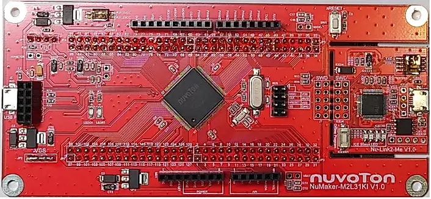

<!-- Copyright 2015-2026 Zephyr Project members and individual contributors. -->
<!-- SPDX-License-Identifier: Apache-2.0 -->
<!-- 中文翻译；编号、导航与译注为本地新增。 -->

<a id="numaker_m2l31ki"></a>

# 第16章\_NUMAKER M2L31KI

原文：[官方页面](https://docs.zephyrproject.org/latest/boards/nuvoton/numaker_m2l31ki/doc/index.html)。读取日期：2026-10-16；来源摘要见[来源记录](../SOURCES.md)。

开发板概览（Board Overview）

<a id="id1"></a>

[](images/m2l31ki.webp)

NUMAKER M2L31KI

名称（Name）：

`numaker_m2l31ki`

厂商（Vendor）：

[新唐科技（Nuvoton Technology Corporation）](https://docs.zephyrproject.org/latest/boards/index.html#vendor=nuvoton)

状态（Status）：

维护中（Maintained）

架构（Architecture）：

[arm](https://docs.zephyrproject.org/latest/boards/index.html#arch=arm)

片上系统（SoC）：

[m2l31xxx](https://docs.zephyrproject.org/latest/boards/index.html#soc=m2l31xxx)

<a id="board-github-link"></a>

[浏览开发板源码（Browse Board Sources）](https://github.com/zephyrproject-rtos/zephyr/blob/main//boards/nuvoton/numaker_m2l31ki/doc/index.rst/../..)<a id="overview"></a>

## 概述（Overview）

NuMaker M2L31KI是新唐专为物联网应用开发的平台，基于采用Arm Cortex-M23内核的NuMicro® M2L31系列MCU。

<a id="features"></a>

### 功能（Features）：


- 32位Arm Cortex®-M23 M2L31KIDAE MCU
- 内核时钟最高72 MHz
- 512 KB嵌入式双存储体闪存（Dual Bank Flash）及168 KB SRAM，存储器名称按原文保留
- USB 2.0全速（Full-Speed）OTG／设备
- USB 1.1主机（Host）
- 兼容Arduino UNO的接口
- 一个复位按键
- 两个LED，一个用于电源指示，另一个可由用户自定义
- 板载NU-Link2 ICE调试器／编程器，带SWD连接器

<a id="id3"></a>

更多开发板信息见NuMaker M2L31KI用户手册 [注1](#id2)。（[NuMaker M2L31KI用户手册（User Manual）](https://www.nuvoton.com/products/microcontrollers/arm-cortex-m23-mcus/m2l31-series/)）

<a id="supported-features"></a>

### 支持的功能（Supported Features）

`numaker_m2l31ki`开发板支持下表所列的硬件功能。

片上／板载（On-Chip / On-Board）

功能集成在片上系统（SoC）内／位于开发板上。

2 / 2

分别表示已启用／已禁用的实例数。点击数量标签，可查看开发板或SoC设备树源码（DTS）中该功能的第一个实例。

`vnd,foo`

与此功能匹配的设备树绑定兼容字符串（Compatible String）；点击链接可查看绑定文档。

<a id="numaker_m2l31ki-hw-features"></a>

<a id="numaker_m2l31ki-numaker_m2l31ki/m2l31xxx-hw-features-section"></a>

#### `numaker_m2l31ki/m2l31xxx`目标（Target）

<a id="numaker_m2l31ki-numaker_m2l31ki/m2l31xxx-hw-features-panel"></a>

<a id="numaker_m2l31ki-numaker_m2l31ki/m2l31xxx-hw-features-memory"></a>

该开发板目标的片上存储容量：168 KiB RAM、512 KiB Flash。

<a id="numaker_m2l31ki-numaker_m2l31ki/m2l31xxx-hw-features-table"></a>

<table>
<tr>
<th>类型（Type）</th>
<th>位置（Location）</th>
<th>说明（Description）</th>
<th>兼容字符串（Compatible）</th>
</tr>
<tr>
<td rowspan="1">中央处理器（CPU）</td>
<td>片上（On-Chip）</td>
<td>Arm Cortex-M23 CPU（<a href="https://github.com/zephyrproject-rtos/zephyr/blob/main/dts/arm/nuvoton/m2l31x.dtsi?plain=1#L29">已启用：1</a>）</td>
<td><a href="../cpu_arm_riscv_binding_reference/P020_arm_cortex-m23.md#std-dtcompatible-arm-cortex-m23"><code>arm,cortex-m23</code></a></td>
</tr>
<tr>
<td rowspan="1">模数转换器（ADC）</td>
<td>片上（On-Chip）</td>
<td>新唐NuMaker ADC控制器（<a href="https://github.com/zephyrproject-rtos/zephyr/blob/main/dts/arm/nuvoton/m2l31x.dtsi?plain=1#L318">已禁用：1</a>）</td>
<td><a href="../hardware/P893_NuvotonNuMaker模数转换器绑定.md#dtbinding-nuvoton-numaker-adc"><code>nuvoton,numaker-adc</code></a></td>
</tr>
<tr>
<td rowspan="1">控制器局域网（CAN）</td>
<td>片上（On-Chip）</td>
<td>新唐NuMaker CAN FD控制器，使用Bosch M_CAN IP（<a href="https://github.com/zephyrproject-rtos/zephyr/blob/main/dts/arm/nuvoton/m2l31x.dtsi?plain=1#L364">已禁用：2</a>）</td>
<td><a href="../can_adi_atmel_nxp_binding_reference/P015_nuvoton_numaker-canfd.md#std-dtcompatible-nuvoton-numaker-canfd"><code>nuvoton,numaker-canfd</code></a></td>
</tr>
<tr>
<td rowspan="3">时钟控制（Clock Control）</td>
<td>片上（On-Chip）</td>
<td>新唐NuMaker系统时钟控制器（SCC）（<a href="https://github.com/zephyrproject-rtos/zephyr/blob/main/dts/arm/nuvoton/m2l31x.dtsi?plain=1#L43">已启用：1</a>）</td>
<td><a href="../clock_nordic_nuvoton_nxp_binding_reference/P011_nuvoton_numaker-scc.md#std-dtcompatible-nuvoton-numaker-scc"><code>nuvoton,numaker-scc</code></a></td>
</tr>
<tr>
<td>片上（On-Chip）</td>
<td>新唐NuMaker外设时钟控制器（PCC）（<a href="https://github.com/zephyrproject-rtos/zephyr/blob/main/dts/arm/nuvoton/m2l31x.dtsi?plain=1#L54">已启用：1</a>）</td>
<td><a href="../clock_nordic_nuvoton_nxp_binding_reference/P010_nuvoton_numaker-pcc.md#std-dtcompatible-nuvoton-numaker-pcc"><code>nuvoton,numaker-pcc</code></a></td>
</tr>
<tr>
<td>片上（On-Chip）</td>
<td>通用固定频率时钟提供者（Fixed-Rate Clock Provider）（<a href="https://github.com/zephyrproject-rtos/zephyr/blob/main/dts/arm/nuvoton/m2l31x.dtsi?plain=1#L36">已启用：1</a>）</td>
<td><a href="../hardware/P566_固定时钟绑定.md#dtbinding-fixed-clock"><code>fixed-clock</code></a></td>
</tr>
<tr>
<td rowspan="1">闪存控制器（Flash Controller）</td>
<td>片上（On-Chip）</td>
<td>新唐NuMaker阻变随机存储器（RRAM）控制器（<a href="https://github.com/zephyrproject-rtos/zephyr/blob/main/dts/arm/nuvoton/m2l31x.dtsi?plain=1#L66">已启用：1</a>）</td>
<td><a href="../flash_nuvoton_nxp_renesas_binding_reference/P007_nuvoton_numaker-rmc.md#std-dtcompatible-nuvoton-numaker-rmc"><code>nuvoton,numaker-rmc</code></a></td>
</tr>
<tr>
<td rowspan="1">通用输入输出与接插件（GPIO &amp; Headers）</td>
<td>片上（On-Chip）</td>
<td>新唐NuMaker GPIO（<a href="https://github.com/zephyrproject-rtos/zephyr/blob/main/dts/arm/nuvoton/m2l31x.dtsi?plain=1#L186">已启用：1</a>；<a href="https://github.com/zephyrproject-rtos/zephyr/blob/main/dts/arm/nuvoton/m2l31x.dtsi?plain=1#L166">已禁用：5</a>）</td>
<td><a href="../gpio_microchip_nordic_nuvoton_binding_reference/P024_nuvoton_numaker-gpio.md#std-dtcompatible-nuvoton-numaker-gpio"><code>nuvoton,numaker-gpio</code></a></td>
</tr>
<tr>
<td rowspan="1">集成电路间总线（I2C）</td>
<td>片上（On-Chip）</td>
<td>新唐NuMaker I2C控制器（<a href="https://github.com/zephyrproject-rtos/zephyr/blob/main/dts/arm/nuvoton/m2l31x.dtsi?plain=1#L270">已禁用：4</a>）</td>
<td><a href="../i2c_infineon_ite_nordic_binding_reference/P020_nuvoton_numaker-i2c.md#std-dtcompatible-nuvoton-numaker-i2c"><code>nuvoton,numaker-i2c</code></a></td>
</tr>
<tr>
<td rowspan="1">中断控制器（Interrupt Controller）</td>
<td>片上（On-Chip）</td>
<td>ARMv8-M嵌套向量中断控制器（NVIC / Nested Vectored Interrupt Controller）（<a href="https://github.com/zephyrproject-rtos/zephyr/blob/main/dts/arm/armv8-m.dtsi?plain=1#L13">已启用：1</a>）</td>
<td><a href="../arm_interrupt_timer_binding_reference/P003_ARMv8_M_NVIC.md#std-dtcompatible-arm-v8m-nvic"><code>arm,v8m-nvic</code></a></td>
</tr>
<tr>
<td rowspan="1">发光二极管（LED）</td>
<td>板载（On-Board）</td>
<td>一组由 GPIO 控制的 LED（GPIO-Controlled LEDs）（<a href="https://github.com/zephyrproject-rtos/zephyr/blob/main/boards/nuvoton/numaker_m2l31ki/numaker_m2l31ki.dts?plain=1#L33">已启用：1</a>）</td>
<td><a href="../hardware/P564_GPIO指示灯绑定.md#dtbinding-gpio-leds"><code>gpio-leds</code></a></td>
</tr>
<tr>
<td rowspan="1">存储技术设备（MTD）</td>
<td>片上（On-Chip）</td>
<td>闪存（Flash）节点（<a href="https://github.com/zephyrproject-rtos/zephyr/blob/main/dts/arm/nuvoton/m2l31x.dtsi?plain=1#L72">已启用：1</a>）</td>
<td><a href="../mtd_nxp_st_ti_partition_binding_reference/P013_soc-nv-flash.md#std-dtcompatible-soc-nv-flash"><code>soc-nv-flash</code></a></td>
</tr>
<tr>
<td rowspan="1">引脚控制（Pin Control）</td>
<td>片上（On-Chip）</td>
<td>引脚控制器（Pin Controller）负责控制引脚功能选择及引脚属性（<a href="https://github.com/zephyrproject-rtos/zephyr/blob/main/dts/arm/nuvoton/m2l31x.dtsi?plain=1#L159">已启用：1</a>）</td>
<td><a href="../pinctrl_infineon_nordic_nxp_binding_reference/P017_nuvoton_numaker-pinctrl.md#std-dtcompatible-nuvoton-numaker-pinctrl"><code>nuvoton,numaker-pinctrl</code></a></td>
</tr>
<tr>
<td rowspan="1">PPC 架构（PPC Architecture）</td>
<td>片上（On-Chip）</td>
<td>新唐NuMaker USB Type-C电源路径控制器（Power Path Controller）（<a href="https://github.com/zephyrproject-rtos/zephyr/blob/main/dts/arm/nuvoton/m2l31x.dtsi?plain=1#L435">已禁用：1</a>）</td>
<td><a href="../power_state_wakeup_binding_reference/P004_nuvoton_numaker-ppc.md#std-dtcompatible-nuvoton-numaker-ppc"><code>nuvoton,numaker-ppc</code></a></td>
</tr>
<tr>
<td rowspan="1">脉宽调制（PWM）</td>
<td>片上（On-Chip）</td>
<td>新唐NuMaker PWM控制器（<a href="https://github.com/zephyrproject-rtos/zephyr/blob/main/dts/arm/nuvoton/m2l31x.dtsi?plain=1#L340">已禁用：2</a>）</td>
<td><a href="../pwm_intel_microchip_nxp_binding_reference/P018_nuvoton_numaker-pwm.md#std-dtcompatible-nuvoton-numaker-pwm"><code>nuvoton,numaker-pwm</code></a></td>
</tr>
<tr>
<td rowspan="1">复位控制器（Reset Controller）</td>
<td>片上（On-Chip）</td>
<td>新唐NuMaker复位（RESET）（<a href="https://github.com/zephyrproject-rtos/zephyr/blob/main/dts/arm/nuvoton/m2l31x.dtsi?plain=1#L60">已启用：1</a>）</td>
<td><a href="../reset_controller_binding_reference/P008_nuvoton_numaker-rst.md#std-dtcompatible-nuvoton-numaker-rst"><code>nuvoton,numaker-rst</code></a></td>
</tr>
<tr>
<td rowspan="1">实时时钟（RTC）</td>
<td>片上（On-Chip）</td>
<td>新唐NuMaker RTC控制器（<a href="https://github.com/zephyrproject-rtos/zephyr/blob/main/dts/arm/nuvoton/m2l31x.dtsi?plain=1#L331">已启用：1</a>）</td>
<td><a href="../microchip_microcrystal_nxp_rtc_binding_reference/P011_nuvoton_numaker-rtc.md#std-dtcompatible-nuvoton-numaker-rtc"><code>nuvoton,numaker-rtc</code></a></td>
</tr>
<tr>
<td rowspan="1">串行控制器（Serial Controller）</td>
<td>片上（On-Chip）</td>
<td>新唐NuMaker UART（<a href="https://github.com/zephyrproject-rtos/zephyr/blob/main/dts/arm/nuvoton/m2l31x.dtsi?plain=1#L79">已启用：1</a>；<a href="https://github.com/zephyrproject-rtos/zephyr/blob/main/dts/arm/nuvoton/m2l31x.dtsi?plain=1#L89">已禁用：7</a>）</td>
<td><a href="../uart_microchip_nordic_nxp_binding_reference/P008_nuvoton_numaker-uart.md#std-dtcompatible-nuvoton-numaker-uart"><code>nuvoton,numaker-uart</code></a></td>
</tr>
<tr>
<td rowspan="1">串行外设接口（SPI）</td>
<td>片上（On-Chip）</td>
<td>新唐NuMaker SPI控制器（<a href="https://github.com/zephyrproject-rtos/zephyr/blob/main/dts/arm/nuvoton/m2l31x.dtsi?plain=1#L226">已禁用：4</a>）</td>
<td><a href="../spi_microchip_nordic_nxp_binding_reference/P016_nuvoton_numaker-spi.md#std-dtcompatible-nuvoton-numaker-spi"><code>nuvoton,numaker-spi</code></a></td>
</tr>
<tr>
<td rowspan="1">静态随机存储器（SRAM）</td>
<td>片上（On-Chip）</td>
<td>通用片上静态随机存储器（SRAM）（<a href="https://github.com/zephyrproject-rtos/zephyr/blob/main/dts/arm/nuvoton/m2l31kid.dtsi?plain=1#L11">已启用：1</a>）</td>
<td><a href="../hardware/P567_内存映射SRAM绑定.md#dtbinding-mmio-sram"><code>mmio-sram</code></a></td>
</tr>
<tr>
<td rowspan="1">USB Type-C 端口控制器（USB Type-C Port Controller）</td>
<td>片上（On-Chip）</td>
<td>新唐NuMaker USB Type-C端口控制器（<a href="https://github.com/zephyrproject-rtos/zephyr/blob/main/dts/arm/nuvoton/m2l31x.dtsi?plain=1#L414">已禁用：1</a>）</td>
<td><a href="../usbc_tcpc_binding_reference/P001_nuvoton_numaker-tcpc.md#std-dtcompatible-nuvoton-numaker-tcpc"><code>nuvoton,numaker-tcpc</code></a></td>
</tr>
<tr>
<td rowspan="1">定时器（Timer）</td>
<td>片上（On-Chip）</td>
<td>ARMv8-M系统节拍（System Tick）（<a href="https://github.com/zephyrproject-rtos/zephyr/blob/main/dts/arm/armv8-m.dtsi?plain=1#L21">已启用：1</a>）</td>
<td><a href="../arm_interrupt_timer_binding_reference/P007_ARMv8_M_SysTick.md#std-dtcompatible-arm-armv8m-systick"><code>arm,armv8m-systick</code></a></td>
</tr>
<tr>
<td rowspan="1">通用串行总线（USB）</td>
<td>片上（On-Chip）</td>
<td>新唐NuMaker USB 1.1设备控制器（<a href="https://github.com/zephyrproject-rtos/zephyr/blob/main/dts/arm/nuvoton/m2l31x.dtsi?plain=1#L392">已启用：1</a>）</td>
<td><a href="../usb_soc_binding_reference/P005_nuvoton_numaker-usbd.md#std-dtcompatible-nuvoton-numaker-usbd"><code>nuvoton,numaker-usbd</code></a></td>
</tr>
<tr>
<td rowspan="1">USB Type-C 接口（USB Type-C）</td>
<td>片上（On-Chip）</td>
<td>新唐NuMaker USB Type-C VBUS控制器（<a href="https://github.com/zephyrproject-rtos/zephyr/blob/main/dts/arm/nuvoton/m2l31x.dtsi?plain=1#L430">已禁用：1</a>）</td>
<td><a href="../usbc_tcpc_binding_reference/P007_nuvoton_numaker-vbus.md#std-dtcompatible-nuvoton-numaker-vbus"><code>nuvoton,numaker-vbus</code></a></td>
</tr>
<tr>
<td rowspan="1">看门狗（Watchdog）</td>
<td>片上（On-Chip）</td>
<td>新唐NuMaker窗口看门狗定时器（Window Watchdog Timer）（<a href="https://github.com/zephyrproject-rtos/zephyr/blob/main/dts/arm/nuvoton/m2l31x.dtsi?plain=1#L406">已禁用：1</a>）</td>
<td><a href="../nxp_nordic_nuvoton_watchdog_binding_reference/P005_nuvoton_numaker-wwdt.md#std-dtcompatible-nuvoton-numaker-wwdt"><code>nuvoton,numaker-wwdt</code></a></td>
</tr>
</table>

板载12 MHz晶体支持器件运行于最高72 MHz。

<a id="id4"></a>

受支持外设详情见[M2L31技术参考手册（TRM）](https://www.nuvoton.com/products/microcontrollers/arm-cortex-m23-mcus/m2l31-series/)[注1](#id2)。

<a id="building-and-flashing"></a>

## 构建与烧录（Building and Flashing）

`numaker_m2l31ki`开发板支持下表所列的运行工具（Runners）及相关west命令。

<table>
<tr>
<th></th>
<th>烧录（flash）</th>
<th>调试（debug）</th>
<th>连接调试会话（attach）</th>
<th>实时传输（rtt）</th>
<th>调试服务器（debugserver）</th>
<th>复位（reset）</th>
</tr>
<tr>
<td><a href="https://docs.zephyrproject.org/latest/develop/flash_debug/host-tools.html#runner-openocd">openocd</a></td>
<td>✅</td>
<td>✅</td>
<td>✅</td>
<td>✅</td>
<td>✅</td>
<td></td>
</tr>
<tr>
<td><a href="https://docs.zephyrproject.org/latest/develop/flash_debug/host-tools.html#runner-pyocd">pyocd</a></td>
<td>✅（默认 / default）</td>
<td>✅（默认 / default）</td>
<td>✅</td>
<td>✅</td>
<td>✅</td>
<td>✅</td>
</tr>
</table>

<a id="flashing"></a>

### 烧录（Flashing）

下面以[Hello World](../getting_started/P005_HelloWorld示例.md#hello_world)应用为例。

板载Nu-Link2调试器可通过USB将UART0模拟为虚拟COM端口。启用时，将ISW1拨码开关第1—3位TXD、RXD、VOM设为ON。通过USB将NuMaker-M2L31KI连接主机，再运行串口终端程序，例如：

```text
$ minicom -D /dev/ttyACM0
```

```text
# From the root of the zephyr repository
west build -b numaker_m2l31ki samples/hello_world
west flash
```

<a id="debugging"></a>

### 调试（Debugging）

下面以[Hello World](../getting_started/P005_HelloWorld示例.md#hello_world)应用为例。

```text
# From the root of the zephyr repository
west build -b numaker_m2l31ki samples/hello_world
west debug
```

在调试器中单步执行应用。

<a id="vs-code-support"></a>

### VS Code支持（Support）

以下介绍通过VS Code进行开发的方式。

安装Nuvoton NuMicro Cortex-M Pack，并按该扩展包的入门指南操作。它为Visual Studio Code提供完整的新唐NuMicro Cortex-M微控制器开发工具。扩展地址：[https://marketplace.visualstudio.com/items?itemName=Nuvoton.nuvoton-numicro-cortex-m-pack](https://marketplace.visualstudio.com/items?itemName=Nuvoton.nuvoton-numicro-cortex-m-pack)

<a id="references"></a>

## 参考资料（References）

<a id="id2"></a>

〔1〕 ([1](#id3),[2](#id4)) [https://www.nuvoton.com/products/microcontrollers/arm-cortex-m23-mcus/m2l31-series/](https://www.nuvoton.com/products/microcontrollers/arm-cortex-m23-mcus/m2l31-series/)

## 译注

原文概述将存储器称为Dual Bank Flash，功能表则列RRAM控制器，按各自来源保留。

---

[上一章](P015_NUMAKER_M031KI.md) · [返回大纲](大纲.md) · [全站翻译进度](../PROGRESS.md) · [下一章](P017_NUMAKER_M3334KI.md)
