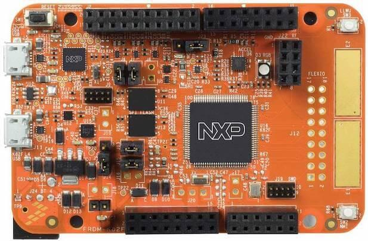

<!-- Copyright 2015-2026 Zephyr Project members and individual contributors. -->
<!-- SPDX-License-Identifier: Apache-2.0 -->
<!-- 中文翻译；编号、导航与译注为本地新增。 -->

<a id="frdm_k82f"></a>

# 第9章\_FRDM-K82F

原文：[官方页面](https://docs.zephyrproject.org/latest/boards/nxp/frdm_k82f/doc/index.html)。读取日期：2026-10-16；来源摘要见[来源记录](../SOURCES.md)。

开发板概览（Board Overview）

<a id="id1"></a>

[](images/frdm_k82f.jpg)

FRDM-K82F

名称（Name）：

`frdm_k82f`

厂商（Vendor）：

[恩智浦半导体（NXP Semiconductors）](https://docs.zephyrproject.org/latest/boards/index.html#vendor=nxp)

状态（Status）：

维护中（Maintained）

架构（Architecture）：

[arm](https://docs.zephyrproject.org/latest/boards/index.html#arch=arm)

片上系统（SoC）：

[mk82f25615](https://docs.zephyrproject.org/latest/boards/index.html#soc=mk82f25615)

<a id="board-github-link"></a>

[浏览开发板源码（Browse Board Sources）](https://github.com/zephyrproject-rtos/zephyr/blob/main//boards/nxp/frdm_k82f/doc/index.rst/../..)<a id="overview"></a>

## 概述（Overview）

FRDM-K82F是用于Kinetis K80、K81及K82 MCU的低成本开发平台。


- 外形及引脚布局兼容Arduino R3
- 外设支持快速原型开发，包括组成电子罗盘的六轴数字加速度计及磁力计、三色LED、两个用户按键、两个32 Mb QuadSPI外部闪存、FlexIO摄像头排针、触摸板，以及用于蓝牙和2.4 GHz无线扩展模块的排针
- OpenSDAv2.1是NXP开源硬件嵌入式串行调试适配器，运行开源引导加载程序，提供串行通信、闪存编程及运行控制调试选项

<a id="hardware"></a>

## 硬件（Hardware）


- MK82FN256VLL15 MCU：150 MHz，256 KB闪存，256 KB RAM，低功耗，无晶体USB，以及100引脚LQFP封装
- 双角色USB接口，使用Micro-B连接器
- RGB发光二极管（LED）
- FXOS8700CQ加速度计及磁力计
- 两个用户按键
- 两个32 Mb QSPI闪存
- 灵活供电方式：OpenSDAv2.1 USB、Kinetis K82 USB或外部电源
- 通过兼容Arduino R3的I/O连接器便捷访问MCU输入输出
- 可编程OpenSDAv2.1调试电路支持CMSIS-DAP接口软件，提供：


  - 大容量存储设备（MSD）闪存编程接口
  - 通过无需专用驱动的USB HID连接提供CMSIS-DAP调试接口，支持运行控制调试并兼容IDE工具
  - 虚拟串口接口（Virtual Serial Port Interface）
  - 开源CMSIS-DAP软件项目
- FlexIO排针

K82F SoC及FRDM-K82F更多信息：


- [K82F网站](https://www.nxp.com/products/processors-and-microcontrollers/arm-microcontrollers/general-purpose-mcus/k-series-cortex-m4/k8x-secure/kinetis-k82-150-mhz-hw-cryptographic-co-processor-quadspi-microcontrollers-mcus-based-on-arm-cortex-m4-core:K82_150)
- [K82F数据手册（Datasheet）](https://www.nxp.com/docs/en/data-sheet/K82P121M150SF5.pdf)
- [K82F参考手册（Reference Manual）](https://www.nxp.com/webapp/Download?colCode=K82P121M150SF5RM)
- [FRDM-K82F网站](https://www.nxp.com/design/development-boards/freedom-development-boards/mcu-boards/freedom-development-platform-for-kinetis-k82-k81-and-k80-mcus:FRDM-K82F)
- [FRDM-K82F用户指南（User Guide）](https://www.nxp.com/webapp/Download?colCode=FRDMK82FUG)
- [FRDM-K82F原理图（Schematics）](https://www.nxp.com/downloads/en/schematics/FRDM-K82F-SCH.pdf)

<a id="supported-features"></a>

### 支持的功能（Supported Features）

`frdm_k82f`开发板支持下表所列的硬件功能。

片上／板载（On-Chip / On-Board）

功能集成在片上系统（SoC）内／位于开发板上。

2 / 2

分别表示已启用／已禁用的实例数。点击数量标签，可查看开发板或SoC设备树源码（DTS）中该功能的第一个实例。

`vnd,foo`

与此功能匹配的设备树绑定兼容字符串（Compatible String）；点击链接可查看绑定文档。

<a id="frdm_k82f-hw-features"></a>

<a id="frdm_k82f-frdm_k82f/mk82f25615-hw-features-section"></a>

#### `frdm_k82f/mk82f25615`目标（Target）

<a id="frdm_k82f-frdm_k82f/mk82f25615-hw-features-panel"></a>

<a id="frdm_k82f-frdm_k82f/mk82f25615-hw-features-memory"></a>

该开发板目标的片上存储容量：192 KiB RAM、256 KiB Flash。

<a id="frdm_k82f-frdm_k82f/mk82f25615-hw-features-table"></a>

<table>
<tr>
<th>类型（Type）</th>
<th>位置（Location）</th>
<th>说明（Description）</th>
<th>兼容字符串（Compatible）</th>
</tr>
<tr>
<td rowspan="1">中央处理器（CPU）</td>
<td>片上（On-Chip）</td>
<td>ARM Cortex-M4F 处理器（CPU）（<a href="https://github.com/zephyrproject-rtos/zephyr/blob/main/dts/arm/nxp/kinetis/k8x/nxp_k8x.dtsi?plain=1#L28">已启用：1</a>）</td>
<td><a href="../cpu_arm_riscv_binding_reference/P025_arm_cortex-m4f.md#std-dtcompatible-arm-cortex-m4f"><code>arm,cortex-m4f</code></a></td>
</tr>
<tr>
<td rowspan="1">模数转换器（ADC）</td>
<td>片上（On-Chip）</td>
<td>Kinetis 16位模数转换器（ADC16）（<a href="https://github.com/zephyrproject-rtos/zephyr/blob/main/dts/arm/nxp/kinetis/k8x/nxp_k8x.dtsi?plain=1#L111">已启用：1</a>）</td>
<td><a href="../hardware/P850_NXPKinetisADC16绑定.md#dtbinding-nxp-kinetis-adc16"><code>nxp,kinetis-adc16</code></a></td>
</tr>
<tr>
<td rowspan="3">时钟控制（Clock Control）</td>
<td>片上（On-Chip）</td>
<td>Kinetis系统集成模块（SIM）IP节点（<a href="https://github.com/zephyrproject-rtos/zephyr/blob/main/dts/arm/nxp/kinetis/k8x/nxp_k8x.dtsi?plain=1#L53">已启用：1</a>）</td>
<td><a href="../clock_nxp_pico_realtek_renesas_binding_reference/P006_nxp_kinetis-sim.md#std-dtcompatible-nxp-kinetis-sim"><code>nxp,kinetis-sim</code></a></td>
</tr>
<tr>
<td>片上（On-Chip）</td>
<td>通用固定比例时钟提供器（Fixed Factor Clock Provider）（<a href="https://github.com/zephyrproject-rtos/zephyr/blob/main/dts/arm/nxp/kinetis/k8x/nxp_k8x.dtsi?plain=1#L58">已启用：4</a>）</td>
<td><a href="../timer_reference/P110_固定比例时钟绑定.md#dtbinding-fixed-factor-clock"><code>fixed-factor-clock</code></a></td>
</tr>
<tr>
<td>片上（On-Chip）</td>
<td>NXP Kinetis多用途时钟发生器（MCG）IP节点（<a href="https://github.com/zephyrproject-rtos/zephyr/blob/main/dts/arm/nxp/kinetis/k8x/nxp_k8x.dtsi?plain=1#L87">已启用：1</a>）</td>
<td><a href="../clock_nxp_pico_realtek_renesas_binding_reference/P003_nxp_kinetis-mcg.md#std-dtcompatible-nxp-kinetis-mcg"><code>nxp,kinetis-mcg</code></a></td>
</tr>
<tr>
<td rowspan="2">计数器（Counter）</td>
<td>片上（On-Chip）</td>
<td>NXP周期中断定时器（PIT / Periodic Interrupt Timer）（<a href="https://github.com/zephyrproject-rtos/zephyr/blob/main/dts/arm/nxp/kinetis/k8x/nxp_k8x.dtsi?plain=1#L395">已启用：1</a>）</td>
<td><a href="../nxp_nuvoton_counter_binding_reference/P017_nxp_pit.md#std-dtcompatible-nxp-pit"><code>nxp,pit</code></a></td>
</tr>
<tr>
<td>片上（On-Chip）</td>
<td>周期中断定时器节点的子节点，用于表示单个定时器通道（<a href="https://github.com/zephyrproject-rtos/zephyr/blob/main/dts/arm/nxp/kinetis/k8x/nxp_k8x.dtsi?plain=1#L404">已禁用：4</a>）</td>
<td><a href="../nxp_nuvoton_counter_binding_reference/P016_nxp_pit-channel.md#std-dtcompatible-nxp-pit-channel"><code>nxp,pit-channel</code></a></td>
</tr>
<tr>
<td rowspan="1">直接存储器访问（DMA）</td>
<td>片上（On-Chip）</td>
<td>NXP MCUX增强型DMA（EDMA）控制器（<a href="https://github.com/zephyrproject-rtos/zephyr/blob/main/dts/arm/nxp/kinetis/k8x/nxp_k8x.dtsi?plain=1#L433">已启用：1</a>）</td>
<td><a href="../nxp_realtek_renesas_dma_binding_reference/P004_nxp_mcux-edma.md#std-dtcompatible-nxp-mcux-edma"><code>nxp,mcux-edma</code></a></td>
</tr>
<tr>
<td rowspan="1">闪存控制器（Flash Controller）</td>
<td>片上（On-Chip）</td>
<td>NXP Kinetis闪存模块A（FTFA）（<a href="https://github.com/zephyrproject-rtos/zephyr/blob/main/dts/arm/nxp/kinetis/k8x/nxp_k8x.dtsi?plain=1#L99">已启用：1</a>）</td>
<td><a href="../flash_nuvoton_nxp_renesas_binding_reference/P014_nxp_kinetis-ftfa.md#std-dtcompatible-nxp-kinetis-ftfa"><code>nxp,kinetis-ftfa</code></a></td>
</tr>
<tr>
<td rowspan="2">通用输入输出与接插件（GPIO &amp; Headers）</td>
<td>片上（On-Chip）</td>
<td>Kinetis通用输入输出（GPIO）（<a href="https://github.com/zephyrproject-rtos/zephyr/blob/main/dts/arm/nxp/kinetis/k8x/nxp_k8x.dtsi?plain=1#L124">已启用：5</a>）</td>
<td><a href="../gpio_nxp_expanders_binding_reference/P002_nxp_kinetis-gpio.md#std-dtcompatible-nxp-kinetis-gpio"><code>nxp,kinetis-gpio</code></a></td>
</tr>
<tr>
<td>板载（On-Board）</td>
<td>引出到Arduino Uno R3排针（Headers）的GPIO引脚（<a href="https://github.com/zephyrproject-rtos/zephyr/blob/main/boards/nxp/frdm_k82f/frdm_k82f.dts?plain=1#L101">已启用：1</a>）</td>
<td><a href="../gpio_adi_headers_ambiq_binding_reference/P023_arduino-header-r3.md#std-dtcompatible-arduino-header-r3"><code>arduino-header-r3</code></a></td>
</tr>
<tr>
<td rowspan="1">硬件信息（Hardware Information）</td>
<td>片上（On-Chip）</td>
<td>NXP RCM获取复位原因标志（Reset Cause Flags）（<a href="https://github.com/zephyrproject-rtos/zephyr/blob/main/dts/arm/nxp/kinetis/k8x/nxp_k8x.dtsi?plain=1#L48">已启用：1</a>）</td>
<td><a href="../hwinfo_binding_reference/P012_nxp_rcm-hwinfo.md#std-dtcompatible-nxp-rcm-hwinfo"><code>nxp,rcm-hwinfo</code></a></td>
</tr>
<tr>
<td rowspan="1">集成电路间总线（I2C）</td>
<td>片上（On-Chip）</td>
<td>Kinetis I2C控制器（<a href="https://github.com/zephyrproject-rtos/zephyr/blob/main/dts/arm/nxp/kinetis/k8x/nxp_k8x.dtsi?plain=1#L174">已启用：2</a>；<a href="https://github.com/zephyrproject-rtos/zephyr/blob/main/dts/arm/nxp/kinetis/k8x/nxp_k8x.dtsi?plain=1#L185">已禁用：2</a>）</td>
<td><a href="../i2c_nxp_pico_renesas_binding_reference/P002_nxp_kinetis-i2c.md#std-dtcompatible-nxp-kinetis-i2c"><code>nxp,kinetis-i2c</code></a></td>
</tr>
<tr>
<td rowspan="1">输入（Input）</td>
<td>板载（On-Board）</td>
<td>一组绑定到 GPIO 的输入按键（GPIO-Bound Input Keys）（<a href="https://github.com/zephyrproject-rtos/zephyr/blob/main/boards/nxp/frdm_k82f/frdm_k82f.dts?plain=1#L85">已启用：1</a>）</td>
<td><a href="../hardware/P563_GPIO按键绑定.md#std-dtcompatible-gpio-keys"><code>gpio-keys</code></a></td>
</tr>
<tr>
<td rowspan="1">中断控制器（Interrupt Controller）</td>
<td>片上（On-Chip）</td>
<td>ARMv7-M 嵌套向量中断控制器（Nested Vectored Interrupt Controller，NVIC）（<a href="https://github.com/zephyrproject-rtos/zephyr/blob/main/dts/arm/armv7-m.dtsi?plain=1#L13">已启用：1</a>）</td>
<td><a href="../arm_interrupt_timer_binding_reference/P002_ARMv7_M_NVIC.md#std-dtcompatible-arm-v7m-nvic"><code>arm,v7m-nvic</code></a></td>
</tr>
<tr>
<td rowspan="2">发光二极管（LED）</td>
<td>板载（On-Board）</td>
<td>一组由 GPIO 控制的 LED（GPIO-Controlled LEDs）（<a href="https://github.com/zephyrproject-rtos/zephyr/blob/main/boards/nxp/frdm_k82f/frdm_k82f.dts?plain=1#L50">已启用：1</a>）</td>
<td><a href="../hardware/P564_GPIO指示灯绑定.md#dtbinding-gpio-leds"><code>gpio-leds</code></a></td>
</tr>
<tr>
<td>板载（On-Board）</td>
<td>一组由脉宽调制（PWM）控制的LED（<a href="https://github.com/zephyrproject-rtos/zephyr/blob/main/boards/nxp/frdm_k82f/frdm_k82f.dts?plain=1#L69">已启用：1</a>）</td>
<td><a href="../hardware/P565_PWM指示灯绑定.md#dtbinding-pwm-leds"><code>pwm-leds</code></a></td>
</tr>
<tr>
<td rowspan="1">内存管理单元／内存保护单元（MMU / MPU）</td>
<td>片上（On-Chip）</td>
<td>NXP系统内存保护单元（SYSMPU）（<a href="https://github.com/zephyrproject-rtos/zephyr/blob/main/dts/arm/nxp/kinetis/k8x/nxp_k8x.dtsi?plain=1#L42">已禁用：1</a>）</td>
<td><a href="../memory_protection_binding_reference/P008_nxp_sysmpu.md#std-dtcompatible-nxp-sysmpu"><code>nxp,sysmpu</code></a></td>
</tr>
<tr>
<td rowspan="2">存储技术设备（MTD）</td>
<td>片上（On-Chip）</td>
<td>闪存（Flash）节点（<a href="https://github.com/zephyrproject-rtos/zephyr/blob/main/dts/arm/nxp/kinetis/k8x/nxp_k8xfn256vxx15.dtsi?plain=1#L34">已启用：1</a>）</td>
<td><a href="../mtd_nxp_st_ti_partition_binding_reference/P013_soc-nv-flash.md#std-dtcompatible-soc-nv-flash"><code>soc-nv-flash</code></a></td>
</tr>
<tr>
<td>板载（On-Board）</td>
<td>这些属性用于支持Zephyr的<code>spi-nor</code>闪存驱动通过Zephyr SPI API，使用基于M25P80的标准命令集控制串行闪存（Serial Flash Memory）。（<a href="https://github.com/zephyrproject-rtos/zephyr/blob/main/boards/nxp/frdm_k82f/frdm_k82f.dts?plain=1#L241">已启用：1</a>）</td>
<td><a href="../mtd_microchip_nordic_nxp_binding_reference/P002_jedec_spi-nor.md#std-dtcompatible-jedec-spi-nor"><code>jedec,spi-nor</code></a></td>
</tr>
<tr>
<td rowspan="2">引脚控制（Pin Control）</td>
<td>片上（On-Chip）</td>
<td>NXP PORT引脚控制器（Pin Controller）（<a href="https://github.com/zephyrproject-rtos/zephyr/blob/main/dts/arm/nxp/kinetis/k8x/nxp_k8x.dtsi?plain=1#L268">已启用：5</a>）</td>
<td><a href="../pinctrl_nxp_pico_binding_reference/P017_nxp_port-pinmux.md#std-dtcompatible-nxp-port-pinmux"><code>nxp,port-pinmux</code></a></td>
</tr>
<tr>
<td>片上（On-Chip）</td>
<td>NXP PORT引脚控制器（Pin Controller）（<a href="https://github.com/zephyrproject-rtos/zephyr/blob/main/dts/arm/nxp/kinetis/k8x/nxp_k8x.dtsi?plain=1#L36">已启用：1</a>）</td>
<td><a href="../pinctrl_nxp_pico_binding_reference/P016_nxp_port-pinctrl.md#std-dtcompatible-nxp-port-pinctrl"><code>nxp,port-pinctrl</code></a></td>
</tr>
<tr>
<td rowspan="1">脉宽调制（PWM）</td>
<td>片上（On-Chip）</td>
<td>NXP FlexTimer模块（FTM）PWM控制器（<a href="https://github.com/zephyrproject-rtos/zephyr/blob/main/dts/arm/nxp/kinetis/k8x/nxp_k8x.dtsi?plain=1#L325">已启用：1</a>）</td>
<td><a href="../pwm_nxp_renesas_binding_reference/P004_nxp_ftm-pwm.md#std-dtcompatible-nxp-ftm-pwm"><code>nxp,ftm-pwm</code></a></td>
</tr>
<tr>
<td rowspan="1">随机数生成器（RNG）</td>
<td>片上（On-Chip）</td>
<td>Kinetis真随机数发生器（TRNG / True Random Number Generator）（<a href="https://github.com/zephyrproject-rtos/zephyr/blob/main/dts/arm/nxp/kinetis/k8x/nxp_k8x.dtsi?plain=1#L373">已启用：1</a>）</td>
<td><a href="../rng_binding_reference/P020_nxp_kinetis-trng.md#std-dtcompatible-nxp-kinetis-trng"><code>nxp,kinetis-trng</code></a></td>
</tr>
<tr>
<td rowspan="1">实时时钟（RTC）</td>
<td>片上（On-Chip）</td>
<td>NXP实时时钟（RTC / Real Time Clock）（<a href="https://github.com/zephyrproject-rtos/zephyr/blob/main/dts/arm/nxp/kinetis/k8x/nxp_k8x.dtsi?plain=1#L334">已启用：1</a>）</td>
<td><a href="../soc_rtc_binding_reference/P002_nxp_rtc.md#std-dtcompatible-nxp-rtc"><code>nxp,rtc</code></a></td>
</tr>
<tr>
<td rowspan="1">传感器（Sensors）</td>
<td>板载（On-Board）</td>
<td>FXOS8700六轴加速度计／磁力计传感器（<a href="https://github.com/zephyrproject-rtos/zephyr/blob/main/boards/nxp/frdm_k82f/frdm_k82f.dts?plain=1#L207">已启用：1</a>）</td>
<td><a href="../compatible_binding_reference/P052_nxp_fxos8700.md#std-dtcompatible-nxp-fxos8700"><code>nxp,fxos8700</code></a></td>
</tr>
<tr>
<td rowspan="1">串行控制器（Serial Controller）</td>
<td>片上（On-Chip）</td>
<td>NXP低功耗UART（LPUART）（<a href="https://github.com/zephyrproject-rtos/zephyr/blob/main/dts/arm/nxp/kinetis/k8x/nxp_k8x.dtsi?plain=1#L258">已启用：1</a>；<a href="https://github.com/zephyrproject-rtos/zephyr/blob/main/dts/arm/nxp/kinetis/k8x/nxp_k8x.dtsi?plain=1#L218">已禁用：4</a>）</td>
<td><a href="../uart_microchip_nordic_nxp_binding_reference/P017_nxp_lpuart.md#std-dtcompatible-nxp-lpuart"><code>nxp,lpuart</code></a></td>
</tr>
<tr>
<td rowspan="1">串行外设接口（SPI）</td>
<td>片上（On-Chip）</td>
<td>NXP DSPI控制器（<a href="https://github.com/zephyrproject-rtos/zephyr/blob/main/dts/arm/nxp/kinetis/k8x/nxp_k8x.dtsi?plain=1#L343">已启用：2</a>；<a href="https://github.com/zephyrproject-rtos/zephyr/blob/main/dts/arm/nxp/kinetis/k8x/nxp_k8x.dtsi?plain=1#L363">已禁用：1</a>）</td>
<td><a href="../spi_microchip_nordic_nxp_binding_reference/P018_nxp_dspi.md#std-dtcompatible-nxp-dspi"><code>nxp,dspi</code></a></td>
</tr>
<tr>
<td rowspan="1">静态随机存储器（SRAM）</td>
<td>片上（On-Chip）</td>
<td>通用片上静态随机存储器（SRAM）（<a href="https://github.com/zephyrproject-rtos/zephyr/blob/main/dts/arm/nxp/kinetis/k8x/nxp_k8xfn256vxx15.dtsi?plain=1#L27">已启用：1</a>）</td>
<td><a href="../hardware/P567_内存映射SRAM绑定.md#dtbinding-mmio-sram"><code>mmio-sram</code></a></td>
</tr>
<tr>
<td rowspan="2">定时器（Timer）</td>
<td>片上（On-Chip）</td>
<td>ARMv7-M 系统节拍（System Tick）（<a href="https://github.com/zephyrproject-rtos/zephyr/blob/main/dts/arm/armv7-m.dtsi?plain=1#L21">已启用：1</a>）</td>
<td><a href="../arm_interrupt_timer_binding_reference/P006_ARMv7_M_SysTick.md#std-dtcompatible-arm-armv7m-systick"><code>arm,armv7m-systick</code></a></td>
</tr>
<tr>
<td>片上（On-Chip）</td>
<td>NXP FlexTimer模块（FTM）（<a href="https://github.com/zephyrproject-rtos/zephyr/blob/main/dts/arm/nxp/kinetis/k8x/nxp_k8x.dtsi?plain=1#L298">已禁用：3</a>）</td>
<td><a href="../microchip_nordic_nxp_realtek_timer_binding_reference/P006_nxp_ftm.md#std-dtcompatible-nxp-ftm"><code>nxp,ftm</code></a></td>
</tr>
<tr>
<td rowspan="1">通用串行总线（USB）</td>
<td>片上（On-Chip）</td>
<td>设备模式下的NPX Kinetis USBFSOTG控制器，厂商缩写NPX按原文保留（<a href="https://github.com/zephyrproject-rtos/zephyr/blob/main/dts/arm/nxp/kinetis/k8x/nxp_k8x.dtsi?plain=1#L379">已启用：1</a>）</td>
<td><a href="../usb_soc_binding_reference/P007_nxp_kinetis-usbd.md#std-dtcompatible-nxp-kinetis-usbd"><code>nxp,kinetis-usbd</code></a></td>
</tr>
<tr>
<td rowspan="1">看门狗（Watchdog）</td>
<td>片上（On-Chip）</td>
<td>Kinetis看门狗（Watchdog）（<a href="https://github.com/zephyrproject-rtos/zephyr/blob/main/dts/arm/nxp/kinetis/k8x/nxp_k8x.dtsi?plain=1#L388">已启用：1</a>）</td>
<td><a href="../nxp_nordic_nuvoton_watchdog_binding_reference/P010_nxp_kinetis-wdog.md#std-dtcompatible-nxp-kinetis-wdog"><code>nxp,kinetis-wdog</code></a></td>
</tr>
</table>

注意（Note）

尚未支持的其他功能也可参考Kinetis K系列中功能更完整的[FRDM-K64F](P008_FRDM-K64F.md#frdm_k64f)。NXP优先为它提供Zephyr完整平台支持，因此frdm_k64f可能已有可复用到frdm_k82f的功能。

<a id="system-clock"></a>

### 系统时钟（System Clock）

K82F使用板载12 MHz外部振荡器及片上PLL，生成120 MHz系统时钟。

<a id="serial-port"></a>

### 串口（Serial Port）

K82F有5个UART，其中一个用于控制台，其余未使用。

<a id="usb"></a>

### 通用串行总线（USB）

K82F USB OTG控制器支持通过Micro-USB连接器J11提供设备及主机功能，但原文指出Zephyr当前仅支持设备功能。

<a id="programming-and-debugging"></a>

## 烧录与调试（Programming and Debugging）

`frdm_k82f`开发板支持下表所列的运行工具（Runners）及相关west命令。

<table>
<tr>
<th></th>
<th>烧录（flash）</th>
<th>调试（debug）</th>
<th>连接调试会话（attach）</th>
<th>实时传输（rtt）</th>
<th>调试服务器（debugserver）</th>
<th>复位（reset）</th>
</tr>
<tr>
<td><a href="https://docs.zephyrproject.org/latest/develop/flash_debug/host-tools.html#runner-jlink">jlink</a></td>
<td>✅</td>
<td>✅</td>
<td>✅</td>
<td>✅</td>
<td>✅</td>
<td>✅</td>
</tr>
<tr>
<td><a href="https://docs.zephyrproject.org/latest/develop/flash_debug/host-tools.html#runner-openocd">openocd</a></td>
<td>✅</td>
<td>✅</td>
<td>✅</td>
<td>✅</td>
<td>✅</td>
<td></td>
</tr>
<tr>
<td><a href="https://docs.zephyrproject.org/latest/develop/flash_debug/host-tools.html#runner-pyocd">pyocd</a></td>
<td>✅（默认 / default）</td>
<td>✅（默认 / default）</td>
<td>✅</td>
<td>✅</td>
<td>✅</td>
<td>✅</td>
</tr>
</table>

按通常方式构建并烧录应用，详见“构建应用”（[Building an Application](../application/P001_应用开发.md#build-an-application)）与“运行应用”（[Run an Application](https://docs.zephyrproject.org/latest/develop/application/index.html#application-run)）。

<a id="configuring-a-debug-probe"></a>

### 配置调试探针（Configuring a Debug Probe）

烧录及调试均使用调试探针，默认配置为OpenSDA DAPLink板载调试探针。（[OpenSDA DAPLink板载调试探针（Onboard Debug Probe）](https://docs.zephyrproject.org/latest/develop/flash_debug/probes.html#opensda-daplink-onboard-debug-probe)）

早期开发板的OpenSDA引导加载程序版本过旧，需要更新。按DAPLink引导加载程序更新（Bootloader Update）页面说明，从CMSIS-DAP引导加载程序升级到DAPLink。（[更新DAPLink引导加载程序（Bootloader）](https://os.mbed.com/blog/entry/DAPLink-bootloader-update/)）

<a id="option-1-opensda-daplink-onboard-debug-probe-recommended"></a>

#### 选项1：OpenSDA DAPLink板载调试探针，推荐（[OpenSDA DAPLink板载调试探针（Onboard Debug Probe）](https://docs.zephyrproject.org/latest/develop/flash_debug/probes.html#opensda-daplink-onboard-debug-probe)）

安装pyOCD调试主机工具，并确保工具位于搜索路径中。（[pyOCD调试主机工具（Debug Host Tools）](https://docs.zephyrproject.org/latest/develop/flash_debug/host-tools.html#pyocd-debug-host-tools)）

按OpenSDA DAPLink板载调试探针说明，写入[OpenSDA DAPLink FRDM-K82F固件](https://www.nxp.com/downloads/en/snippets-boot-code-headers-monitors/k20dx_frdmk82f_if_crc_legacy_0x8000.bin)。（[OpenSDA DAPLink板载调试探针（Onboard Debug Probe）](https://docs.zephyrproject.org/latest/develop/flash_debug/probes.html#opensda-daplink-onboard-debug-probe)）

<a id="option-2-opensda-jlink-onboard-debug-probe"></a>

#### 选项2：OpenSDA J-Link板载调试探针（[OpenSDA J-Link板载调试探针（Onboard Debug Probe）](https://docs.zephyrproject.org/latest/develop/flash_debug/probes.html#opensda-jlink-onboard-debug-probe)）

安装J-Link调试主机工具（Debug Host Tools），并确保工具位于搜索路径中。（[J-Link主机调试工具（Debug Host Tools）](https://docs.zephyrproject.org/latest/develop/flash_debug/host-tools.html#jlink-debug-host-tools)）

按OpenSDA J-Link板载调试探针说明，写入适用于[FRDM-K82F的OpenSDA J-Link固件](https://www.segger.com/downloads/jlink/OpenSDA_FRDM-K82F)。（[OpenSDA J-Link板载调试探针（Onboard Debug Probe）](https://docs.zephyrproject.org/latest/develop/flash_debug/probes.html#opensda-jlink-onboard-debug-probe)）

调用west build时添加-DBOARD_FLASH_RUNNER=jlink及-DBOARD_DEBUG_RUNNER=jlink，将运行工具改为J-Link。原文此处称默认工具为pyOCD，与前文默认LinkServer的说明不同：

```text
# From the root of the zephyr repository
west build -b frdm_k82f samples/hello_world -- -DBOARD_FLASH_RUNNER=jlink -DBOARD_DEBUG_RUNNER=jlink
```

<a id="configuring-a-console"></a>

### 配置控制台（Configuring a Console）

无论选择哪种调试探针，串行控制台都使用OpenSDA微控制器作为USB转串口适配器。

用USB线缆将PC连接J5。

在串口终端中使用以下设置，例如minicom或PuTTY：


- 速率（Speed）：115200波特率
- 数据位（Data）：8位
- 奇偶校验（Parity）：无（None）
- 停止位（Stop Bits）：1位

<a id="flashing"></a>

### 烧录（Flashing）

下面以[Hello World](../getting_started/P005_HelloWorld示例.md#hello_world)应用为例。

```text
# From the root of the zephyr repository
west build -b frdm_k82f samples/hello_world
west flash
```

打开串口终端，按SW1复位开发板，应显示以下消息：

```text
***** Booting Zephyr OS v1.14.0-xxx-gxxxxxxxxxxxx *****
Hello World! frdm_k82f
```

<a id="debugging"></a>

### 调试（Debugging）

下面以[Hello World](../getting_started/P005_HelloWorld示例.md#hello_world)应用为例。

```text
# From the root of the zephyr repository
west build -b frdm_k82f samples/hello_world
west debug
```

打开串口终端，在调试器中单步运行应用，应能在终端中看到以下消息：

```text
***** Booting Zephyr OS v1.14.0-xxx-gxxxxxxxxxxxx *****
Hello World! frdm_k82f
```

<a id="support-resources-for-zephyr"></a>

### Zephyr支持资源（Support Resources）


- [NXP开发板支持状态（Board Support Status）](https://github.com/nxp-zephyr/nxp-zsdk/blob/main/doc/releases/Board-Support-Status.md)
- [NXP Zephyr下游软件开发工具包（Downstream SDK）](https://github.com/nxp-zephyr/nxp-zsdk)
- [MCUXpresso for VS Code文档](https://mcuxpresso.nxp.com/mcux-vscode)及[Zephyr实验指南](https://mcuxpresso.nxp.com/mcux-vscode/latest/html/Training-Zephyr-Getting-Started.html)
- [NXP Zephyr知识中心（Knowledge Hub）](https://community.nxp.com/t5/Zephyr-Project-Knowledge-Base/Zephyr-Knowledge-Hub/ta-p/2008548)
- NXP Zephyr主页，包含培训资源（[NXP的Zephyr专题页面](https://nxp.com/zephyr)）
- [NXP Zephyr支持社区论坛（Support Community）](https://community.nxp.com/t5/Zephyr-Project/bd-p/Zephyr-Project)

## 译注

硬件清单的256 KB RAM与目标表的192 KiB分别保留；芯片最高150 MHz与当前120 MHz系统配置也分别说明。

## 原文外链核对

2026-10-16核对并重试以下原文外链时未能确认可访问性，保留原始目标，不将访问失败解释为原文内容有误。

- [2008548](https://community.nxp.com/t5/Zephyr-Project-Knowledge-Base/Zephyr-Knowledge-Hub/ta-p/2008548)：HTTP Error 403: Forbidden。
- [Zephyr-Project](https://community.nxp.com/t5/Zephyr-Project/bd-p/Zephyr-Project)：HTTP Error 403: Forbidden。
- [Training-Zephyr-Getting-Started.html](https://mcuxpresso.nxp.com/mcux-vscode/latest/html/Training-Zephyr-Getting-Started.html)：HTTP Error 404: Not Found。
- [zephyr](https://nxp.com/zephyr)：HTTP Error 404: Not Found。
- [freedom-development-platform-for-kinetis-k82-k81-and-k80-mcus:FRDM-K82F](https://www.nxp.com/design/development-boards/freedom-development-boards/mcu-boards/freedom-development-platform-for-kinetis-k82-k81-and-k80-mcus:FRDM-K82F)：HTTP Error 404: Not Found。
- [K82P121M150SF5.pdf](https://www.nxp.com/docs/en/data-sheet/K82P121M150SF5.pdf)：HTTP Error 404: Not Found。
- [FRDM-K82F-SCH.pdf](https://www.nxp.com/downloads/en/schematics/FRDM-K82F-SCH.pdf)：HTTP Error 404: Not Found。
- [k20dx_frdmk82f_if_crc_legacy_0x8000.bin](https://www.nxp.com/downloads/en/snippets-boot-code-headers-monitors/k20dx_frdmk82f_if_crc_legacy_0x8000.bin)：HTTP Error 404: Not Found。
- [kinetis-k82-150-mhz-hw-cryptographic-co-processor-quadspi-microcontrollers-mcus-based-on-arm-cortex-m4-core:K82_150](https://www.nxp.com/products/processors-and-microcontrollers/arm-microcontrollers/general-purpose-mcus/k-series-cortex-m4/k8x-secure/kinetis-k82-150-mhz-hw-cryptographic-co-processor-quadspi-microcontrollers-mcus-based-on-arm-cortex-m4-core:K82_150)：HTTP Error 404: Not Found。
- [Download?colCode=FRDMK82FUG](https://www.nxp.com/webapp/Download?colCode=FRDMK82FUG)：HTTP Error 404: Not Found。
- [Download?colCode=K82P121M150SF5RM](https://www.nxp.com/webapp/Download?colCode=K82P121M150SF5RM)：HTTP Error 404: Not Found。

---

[上一章](P008_FRDM-K64F.md) · [返回大纲](大纲.md) · [全站翻译进度](../PROGRESS.md) · [下一章](P010_FRDM-KE15Z.md)
