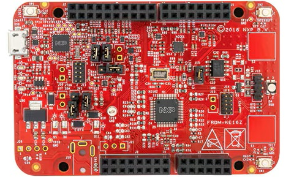

<!-- Copyright 2015-2026 Zephyr Project members and individual contributors. -->
<!-- SPDX-License-Identifier: Apache-2.0 -->
<!-- 中文翻译；编号、导航与译注为本地新增。 -->

<a id="frdm_ke16z"></a>

# 第11章\_FRDM-KE16Z

原文：[官方页面](https://docs.zephyrproject.org/latest/boards/nxp/frdm_ke16z/doc/index.html)。读取日期：2026-10-16；来源摘要见[来源记录](../SOURCES.md)。

开发板概览（Board Overview）

<a id="id1"></a>

[](images/frdm_ke16z.jpg)

FRDM-KE16Z

名称（Name）：

`frdm_ke16z`

厂商（Vendor）：

[恩智浦半导体（NXP Semiconductors）](https://docs.zephyrproject.org/latest/boards/index.html#vendor=nxp)

状态（Status）：

维护中（Maintained）

架构（Architecture）：

[arm](https://docs.zephyrproject.org/latest/boards/index.html#arch=arm)

片上系统（SoC）：

[mke16z4](https://docs.zephyrproject.org/latest/boards/index.html#soc=mke16z4)

<a id="board-github-link"></a>

[浏览开发板源码（Browse Board Sources）](https://github.com/zephyrproject-rtos/zephyr/blob/main//boards/nxp/frdm_ke16z/doc/index.rst/../..)<a id="overview"></a>

## 概述（Overview）

FRDM-KE16Z是用于NXP Kinetis KE1xZ 32位MCU平台的开发板，带最多25通道的触摸感应接口（TSI），便于灵活实现触摸按键，并提供串行通信、闪存编程及运行控制调试。

<a id="hardware"></a>

## 硬件（Hardware）


- MKE16Z64VLF4 MCU，最高48 MHz，64 KB闪存及8 KB RAM
- OpenSDA调试电路，带虚拟串口
- 自电容模式（Self-capacitive Mode）的触摸电极
- 兼容FRDM-TOUCH、FRDM-MC-LVBLDC及Arduino®开发板
- 用户组件包含复位、RGB LED及两个用户按键
- 六轴FXOS8700CQ数字加速度计及磁力计

KE1xZ SoC及FRDM-KE16Z更多信息见以下NXP参考资料：


- [KE1XZ SoC网站](https://www.nxp.com/products/processors-and-microcontrollers/arm-microcontrollers/general-purpose-mcus/ke-series-arm-cortex-m4-m0-plus/ke1xz-arm-cortex-m0-plus-5v-main-stream-mcu-with-nxp-touch-and-can-control:KE1xZ)
- [FRDM-KE16Z数据手册（Datasheet）](https://www.nxp.com/docs/en/data-sheet/KE1xZP48M48SF0.pdf)
- [FRDM-KE16Z参考手册（Reference Manual）](https://www.nxp.com/docs/en/reference-manual/KE1xZP48M48SF0RM.pdf)
- [FRDM-KE16Z网站](https://www.nxp.com/design/design-center/development-boards-and-designs/general-purpose-mcus/freedom-development-platform-for-kinetis-ke1xmcus:FRDM-KE16Z)
- [FRDM-KE16Z用户指南（User Guide）](https://www.nxp.com/document/guide/get-started-with-the-frdm-ke16z:NGS-FRDM-KE16Z)
- [FRDM-KE16Z原理图（Schematics）](https://www.nxp.com/downloads/en/schematics/FRDM-KE16ZSCH.zip)

<a id="supported-features"></a>

### 支持的功能（Supported Features）

`frdm_ke16z`开发板支持下表所列的硬件功能。

片上／板载（On-Chip / On-Board）

功能集成在片上系统（SoC）内／位于开发板上。

2 / 2

分别表示已启用／已禁用的实例数。点击数量标签，可查看开发板或SoC设备树源码（DTS）中该功能的第一个实例。

`vnd,foo`

与此功能匹配的设备树绑定兼容字符串（Compatible String）；点击链接可查看绑定文档。

<a id="frdm_ke16z-hw-features"></a>

<a id="frdm_ke16z-frdm_ke16z/mke16z4-hw-features-section"></a>

#### `frdm_ke16z/mke16z4`目标（Target）

<a id="frdm_ke16z-frdm_ke16z/mke16z4-hw-features-panel"></a>

<a id="frdm_ke16z-frdm_ke16z/mke16z4-hw-features-memory"></a>

该开发板目标的片上存储容量：6 KiB RAM、64 KiB Flash。

<a id="frdm_ke16z-frdm_ke16z/mke16z4-hw-features-table"></a>

<table>
<tr>
<th>类型（Type）</th>
<th>位置（Location）</th>
<th>说明（Description）</th>
<th>兼容字符串（Compatible）</th>
</tr>
<tr>
<td rowspan="1">中央处理器（CPU）</td>
<td>片上（On-Chip）</td>
<td>ARM Cortex-M0+处理器（CPU）（<a href="https://github.com/zephyrproject-rtos/zephyr/blob/main/dts/arm/nxp/kinetis/ke1xz/nxp_ke1xz.dtsi?plain=1#L25">已启用：1</a>）</td>
<td><a href="../cpu_arm_riscv_binding_reference/P017_arm_cortex-m0+.md#std-dtcompatible-arm-cortex-m0"><code>arm,cortex-m0+</code></a></td>
</tr>
<tr>
<td rowspan="1">模数转换器（ADC）</td>
<td>片上（On-Chip）</td>
<td>NXP 12位模数转换器（ADC12）（<a href="https://github.com/zephyrproject-rtos/zephyr/blob/main/dts/arm/nxp/kinetis/ke1xz/nxp_ke1xz.dtsi?plain=1#L180">已禁用：1</a>）</td>
<td><a href="../hardware/P847_NXPADC12模数转换器绑定.md#dtbinding-nxp-adc12"><code>nxp,adc12</code></a></td>
</tr>
<tr>
<td rowspan="4">时钟控制（Clock Control）</td>
<td>片上（On-Chip）</td>
<td>NXP Kinetis系统时钟发生器（SCG）IP节点（<a href="https://github.com/zephyrproject-rtos/zephyr/blob/main/dts/arm/nxp/kinetis/ke1xz/nxp_ke1xz.dtsi?plain=1#L84">已启用：1</a>）</td>
<td><a href="../clock_nxp_pico_realtek_renesas_binding_reference/P005_nxp_kinetis-scg.md#std-dtcompatible-nxp-kinetis-scg"><code>nxp,kinetis-scg</code></a></td>
</tr>
<tr>
<td>片上（On-Chip）</td>
<td>通用固定频率时钟提供者（Fixed-Rate Clock Provider）（<a href="https://github.com/zephyrproject-rtos/zephyr/blob/main/dts/arm/nxp/kinetis/ke1xz/nxp_ke1xz.dtsi?plain=1#L96">已启用：4</a>；<a href="https://github.com/zephyrproject-rtos/zephyr/blob/main/dts/arm/nxp/kinetis/ke1xz/nxp_ke1xz.dtsi?plain=1#L90">已禁用：1</a>）</td>
<td><a href="../hardware/P566_固定时钟绑定.md#dtbinding-fixed-clock"><code>fixed-clock</code></a></td>
</tr>
<tr>
<td>片上（On-Chip）</td>
<td>通用固定比例时钟提供器（Fixed Factor Clock Provider）（<a href="https://github.com/zephyrproject-rtos/zephyr/blob/main/dts/arm/nxp/kinetis/ke1xz/nxp_ke1xz.dtsi?plain=1#L114">已启用：6</a>）</td>
<td><a href="../timer_reference/P110_固定比例时钟绑定.md#dtbinding-fixed-factor-clock"><code>fixed-factor-clock</code></a></td>
</tr>
<tr>
<td>片上（On-Chip）</td>
<td>NXP Kinetis外设时钟控制器（PCC）IP节点（<a href="https://github.com/zephyrproject-rtos/zephyr/blob/main/dts/arm/nxp/kinetis/ke1xz/nxp_ke1xz.dtsi?plain=1#L157">已启用：1</a>）</td>
<td><a href="../clock_nxp_pico_realtek_renesas_binding_reference/P004_nxp_kinetis-pcc.md#std-dtcompatible-nxp-kinetis-pcc"><code>nxp,kinetis-pcc</code></a></td>
</tr>
<tr>
<td rowspan="1">比较器（Comparator）</td>
<td>片上（On-Chip）</td>
<td>NXP Kinetis模拟比较器（ACMP / Analog Comparator）（<a href="https://github.com/zephyrproject-rtos/zephyr/blob/main/dts/arm/nxp/kinetis/ke1xz/nxp_ke1xz.dtsi?plain=1#L498">已禁用：1</a>）</td>
<td><a href="../hardware/P745_NXPKinetis模拟比较器绑定.md#dtbinding-nxp-kinetis-acmp"><code>nxp,kinetis-acmp</code></a></td>
</tr>
<tr>
<td rowspan="5">计数器（Counter）</td>
<td>片上（On-Chip）</td>
<td>NXP低功耗定时器（LPTMR）（<a href="https://github.com/zephyrproject-rtos/zephyr/blob/main/dts/arm/nxp/kinetis/ke1xz/nxp_ke1xz.dtsi?plain=1#L223">已启用：1</a>）</td>
<td><a href="../nxp_nuvoton_counter_binding_reference/P013_nxp_lptmr.md#std-dtcompatible-nxp-lptmr"><code>nxp,lptmr</code></a></td>
</tr>
<tr>
<td>片上（On-Chip）</td>
<td>NXP低功耗周期中断定时器（LPIT）（<a href="https://github.com/zephyrproject-rtos/zephyr/blob/main/dts/arm/nxp/kinetis/ke1xz/nxp_ke1xz.dtsi?plain=1#L393">已禁用：1</a>）</td>
<td><a href="../nxp_nuvoton_counter_binding_reference/P012_nxp_lpit.md#std-dtcompatible-nxp-lpit"><code>nxp,lpit</code></a></td>
</tr>
<tr>
<td>片上（On-Chip）</td>
<td>低功耗周期中断定时器节点的子节点，表示一个独立定时器通道（<a href="https://github.com/zephyrproject-rtos/zephyr/blob/main/dts/arm/nxp/kinetis/ke1xz/nxp_ke1xz.dtsi?plain=1#L404">已禁用：4</a>）</td>
<td><a href="../nxp_nuvoton_counter_binding_reference/P011_nxp_lpit-channel.md#std-dtcompatible-nxp-lpit-channel"><code>nxp,lpit-channel</code></a></td>
</tr>
<tr>
<td>片上（On-Chip）</td>
<td>NXP周期中断定时器（PIT / Periodic Interrupt Timer）（<a href="https://github.com/zephyrproject-rtos/zephyr/blob/main/dts/arm/nxp/kinetis/ke1xz/nxp_ke1xz.dtsi?plain=1#L552">已禁用：1</a>）</td>
<td><a href="../nxp_nuvoton_counter_binding_reference/P017_nxp_pit.md#std-dtcompatible-nxp-pit"><code>nxp,pit</code></a></td>
</tr>
<tr>
<td>片上（On-Chip）</td>
<td>周期中断定时器节点的子节点，用于表示单个定时器通道（<a href="https://github.com/zephyrproject-rtos/zephyr/blob/main/dts/arm/nxp/kinetis/ke1xz/nxp_ke1xz.dtsi?plain=1#L562">已禁用：4</a>）</td>
<td><a href="../nxp_nuvoton_counter_binding_reference/P016_nxp_pit-channel.md#std-dtcompatible-nxp-pit-channel"><code>nxp,pit-channel</code></a></td>
</tr>
<tr>
<td rowspan="1">循环冗余校验（CRC）</td>
<td>片上（On-Chip）</td>
<td>NXP循环冗余校验（CRC）设备（<a href="https://github.com/zephyrproject-rtos/zephyr/blob/main/dts/arm/nxp/kinetis/ke1xz/nxp_ke1xz.dtsi?plain=1#L605">已启用：1</a>）</td>
<td><a href="../crc_clock_monitor_binding_reference/P006_nxp_crc.md#std-dtcompatible-nxp-crc"><code>nxp,crc</code></a></td>
</tr>
<tr>
<td rowspan="1">闪存控制器（Flash Controller）</td>
<td>片上（On-Chip）</td>
<td>NXP Kinetis闪存模块A（FTFA）（<a href="https://github.com/zephyrproject-rtos/zephyr/blob/main/dts/arm/nxp/kinetis/ke1xz/nxp_ke1xz64.dtsi?plain=1#L41">已启用：1</a>）</td>
<td><a href="../flash_nuvoton_nxp_renesas_binding_reference/P014_nxp_kinetis-ftfa.md#std-dtcompatible-nxp-kinetis-ftfa"><code>nxp,kinetis-ftfa</code></a></td>
</tr>
<tr>
<td rowspan="2">通用输入输出与接插件（GPIO &amp; Headers）</td>
<td>片上（On-Chip）</td>
<td>共享中断的一组GPIO（<a href="https://github.com/zephyrproject-rtos/zephyr/blob/main/dts/arm/nxp/kinetis/ke1xz/nxp_ke1xz.dtsi?plain=1#L285">已启用：2</a>）</td>
<td><a href="../gpio_microchip_nordic_nuvoton_binding_reference/P027_nxp_gpio-cluster.md#std-dtcompatible-nxp-gpio-cluster"><code>nxp,gpio-cluster</code></a></td>
</tr>
<tr>
<td>片上（On-Chip）</td>
<td>Kinetis通用输入输出（GPIO）（<a href="https://github.com/zephyrproject-rtos/zephyr/blob/main/dts/arm/nxp/kinetis/ke1xz/nxp_ke1xz.dtsi?plain=1#L338">已启用：2</a>；<a href="https://github.com/zephyrproject-rtos/zephyr/blob/main/dts/arm/nxp/kinetis/ke1xz/nxp_ke1xz.dtsi?plain=1#L293">已禁用：8</a>）</td>
<td><a href="../gpio_nxp_expanders_binding_reference/P002_nxp_kinetis-gpio.md#std-dtcompatible-nxp-kinetis-gpio"><code>nxp,kinetis-gpio</code></a></td>
</tr>
<tr>
<td rowspan="1">硬件信息（Hardware Information）</td>
<td>片上（On-Chip）</td>
<td>NXP RCM获取复位原因标志（Reset Cause Flags）（<a href="https://github.com/zephyrproject-rtos/zephyr/blob/main/dts/arm/nxp/kinetis/ke1xz/nxp_ke1xz.dtsi?plain=1#L600">已启用：1</a>）</td>
<td><a href="../hwinfo_binding_reference/P012_nxp_rcm-hwinfo.md#std-dtcompatible-nxp-rcm-hwinfo"><code>nxp,rcm-hwinfo</code></a></td>
</tr>
<tr>
<td rowspan="1">集成电路间总线（I2C）</td>
<td>片上（On-Chip）</td>
<td>NXP低功耗I2C（LPI2C）控制器（<a href="https://github.com/zephyrproject-rtos/zephyr/blob/main/dts/arm/nxp/kinetis/ke1xz/nxp_ke1xz.dtsi?plain=1#L467">已禁用：1</a>）</td>
<td><a href="../i2c_nxp_pico_renesas_binding_reference/P005_nxp_lpi2c.md#std-dtcompatible-nxp-lpi2c"><code>nxp,lpi2c</code></a></td>
</tr>
<tr>
<td rowspan="1">输入（Input）</td>
<td>板载（On-Board）</td>
<td>一组绑定到 GPIO 的输入按键（GPIO-Bound Input Keys）（<a href="https://github.com/zephyrproject-rtos/zephyr/blob/main/boards/nxp/frdm_ke16z/frdm_ke16z.dts?plain=1#L52">已启用：1</a>）</td>
<td><a href="../hardware/P563_GPIO按键绑定.md#std-dtcompatible-gpio-keys"><code>gpio-keys</code></a></td>
</tr>
<tr>
<td rowspan="1">中断控制器（Interrupt Controller）</td>
<td>片上（On-Chip）</td>
<td>ARMv6-M嵌套向量中断控制器（NVIC / Nested Vectored Interrupt Controller）（<a href="https://github.com/zephyrproject-rtos/zephyr/blob/main/dts/arm/armv6-m.dtsi?plain=1#L13">已启用：1</a>）</td>
<td><a href="../arm_interrupt_timer_binding_reference/P001_ARMv6_M_NVIC.md#std-dtcompatible-arm-v6m-nvic"><code>arm,v6m-nvic</code></a></td>
</tr>
<tr>
<td rowspan="1">发光二极管（LED）</td>
<td>板载（On-Board）</td>
<td>一组由 GPIO 控制的 LED（GPIO-Controlled LEDs）（<a href="https://github.com/zephyrproject-rtos/zephyr/blob/main/boards/nxp/frdm_ke16z/frdm_ke16z.dts?plain=1#L33">已启用：1</a>）</td>
<td><a href="../hardware/P564_GPIO指示灯绑定.md#dtbinding-gpio-leds"><code>gpio-leds</code></a></td>
</tr>
<tr>
<td rowspan="1">存储技术设备（MTD）</td>
<td>片上（On-Chip）</td>
<td>闪存（Flash）节点（<a href="https://github.com/zephyrproject-rtos/zephyr/blob/main/dts/arm/nxp/kinetis/ke1xz/nxp_ke1xz64.dtsi?plain=1#L49">已启用：1</a>）</td>
<td><a href="../mtd_nxp_st_ti_partition_binding_reference/P013_soc-nv-flash.md#std-dtcompatible-soc-nv-flash"><code>soc-nv-flash</code></a></td>
</tr>
<tr>
<td rowspan="2">引脚控制（Pin Control）</td>
<td>片上（On-Chip）</td>
<td>NXP PORT引脚控制器（Pin Controller）（<a href="https://github.com/zephyrproject-rtos/zephyr/blob/main/dts/arm/nxp/kinetis/ke1xz/nxp_ke1xz.dtsi?plain=1#L234">已启用：5</a>）</td>
<td><a href="../pinctrl_nxp_pico_binding_reference/P017_nxp_port-pinmux.md#std-dtcompatible-nxp-port-pinmux"><code>nxp,port-pinmux</code></a></td>
</tr>
<tr>
<td>片上（On-Chip）</td>
<td>NXP PORT引脚控制器（Pin Controller）（<a href="https://github.com/zephyrproject-rtos/zephyr/blob/main/dts/arm/nxp/kinetis/ke1xz/nxp_ke1xz.dtsi?plain=1#L79">已启用：1</a>）</td>
<td><a href="../pinctrl_nxp_pico_binding_reference/P016_nxp_port-pinctrl.md#std-dtcompatible-nxp-port-pinctrl"><code>nxp,port-pinctrl</code></a></td>
</tr>
<tr>
<td rowspan="1">电源管理（Power Management）</td>
<td>片上（On-Chip）</td>
<td>NXP系统模式控制器（SMC / System Mode Controller）（<a href="https://github.com/zephyrproject-rtos/zephyr/blob/main/dts/arm/nxp/kinetis/ke1xz/nxp_ke1xz.dtsi?plain=1#L595">已启用：1</a>）</td>
<td><a href="../power_control_binding_reference/P020_nxp_smc.md#std-dtcompatible-nxp-smc"><code>nxp,smc</code></a></td>
</tr>
<tr>
<td rowspan="1">脉宽调制（PWM）</td>
<td>片上（On-Chip）</td>
<td>Kinetis PWT PWM捕获（Capture）（<a href="https://github.com/zephyrproject-rtos/zephyr/blob/main/dts/arm/nxp/kinetis/ke1xz/nxp_ke1xz.dtsi?plain=1#L456">已禁用：1</a>）</td>
<td><a href="../pwm_nxp_renesas_binding_reference/P007_nxp_kinetis-pwt.md#std-dtcompatible-nxp-kinetis-pwt"><code>nxp,kinetis-pwt</code></a></td>
</tr>
<tr>
<td rowspan="1">实时时钟（RTC）</td>
<td>片上（On-Chip）</td>
<td>NXP实时时钟（RTC / Real Time Clock）（<a href="https://github.com/zephyrproject-rtos/zephyr/blob/main/dts/arm/nxp/kinetis/ke1xz/nxp_ke1xz.dtsi?plain=1#L489">已禁用：1</a>）</td>
<td><a href="../soc_rtc_binding_reference/P002_nxp_rtc.md#std-dtcompatible-nxp-rtc"><code>nxp,rtc</code></a></td>
</tr>
<tr>
<td rowspan="1">串行控制器（Serial Controller）</td>
<td>片上（On-Chip）</td>
<td>NXP低功耗UART（LPUART）（<a href="https://github.com/zephyrproject-rtos/zephyr/blob/main/dts/arm/nxp/kinetis/ke1xz/nxp_ke1xz.dtsi?plain=1#L199">已启用：1</a>；<a href="https://github.com/zephyrproject-rtos/zephyr/blob/main/dts/arm/nxp/kinetis/ke1xz/nxp_ke1xz.dtsi?plain=1#L207">已禁用：2</a>）</td>
<td><a href="../uart_microchip_nordic_nxp_binding_reference/P017_nxp_lpuart.md#std-dtcompatible-nxp-lpuart"><code>nxp,lpuart</code></a></td>
</tr>
<tr>
<td rowspan="1">串行外设接口（SPI）</td>
<td>片上（On-Chip）</td>
<td>NXP低功耗SPI（LPSPI）控制器（<a href="https://github.com/zephyrproject-rtos/zephyr/blob/main/dts/arm/nxp/kinetis/ke1xz/nxp_ke1xz.dtsi?plain=1#L506">已禁用：1</a>）</td>
<td><a href="../spi_flexspi_nxp_renesas_binding_reference/P004_nxp_lpspi.md#std-dtcompatible-nxp-lpspi"><code>nxp,lpspi</code></a></td>
</tr>
<tr>
<td rowspan="2">定时器（Timer）</td>
<td>片上（On-Chip）</td>
<td>ARMv6-M系统节拍（System Tick）（<a href="https://github.com/zephyrproject-rtos/zephyr/blob/main/dts/arm/armv6-m.dtsi?plain=1#L21">已启用：1</a>）</td>
<td><a href="../arm_interrupt_timer_binding_reference/P005_ARMv6_M_SysTick.md#std-dtcompatible-arm-armv6m-systick"><code>arm,armv6m-systick</code></a></td>
</tr>
<tr>
<td>片上（On-Chip）</td>
<td>NXP FlexTimer模块（FTM）（<a href="https://github.com/zephyrproject-rtos/zephyr/blob/main/dts/arm/nxp/kinetis/ke1xz/nxp_ke1xz.dtsi?plain=1#L429">已禁用：2</a>）</td>
<td><a href="../microchip_nordic_nxp_realtek_timer_binding_reference/P006_nxp_ftm.md#std-dtcompatible-nxp-ftm"><code>nxp,ftm</code></a></td>
</tr>
<tr>
<td rowspan="2">看门狗（Watchdog）</td>
<td>片上（On-Chip）</td>
<td>NXP外部看门狗监测器（External Watchdog Monitor）（<a href="https://github.com/zephyrproject-rtos/zephyr/blob/main/dts/arm/nxp/kinetis/ke1xz/nxp_ke1xz.dtsi?plain=1#L191">已禁用：1</a>）</td>
<td><a href="../nxp_nordic_nuvoton_watchdog_binding_reference/P007_nxp_ewm.md#std-dtcompatible-nxp-ewm"><code>nxp,ewm</code></a></td>
</tr>
<tr>
<td>片上（On-Chip）</td>
<td>NXP看门狗（WDOG32）（<a href="https://github.com/zephyrproject-rtos/zephyr/blob/main/dts/arm/nxp/kinetis/ke1xz/nxp_ke1xz.dtsi?plain=1#L274">已禁用：1</a>）</td>
<td><a href="../nxp_nordic_nuvoton_watchdog_binding_reference/P014_nxp_wdog32.md#std-dtcompatible-nxp-wdog32"><code>nxp,wdog32</code></a></td>
</tr>
</table>

<a id="system-clock"></a>

### 系统时钟（System Clock）

KE16 SoC使用快速内部RC振荡器（FIRC），配置为48 MHz。

<a id="serial-port"></a>

### 串口（Serial Port）

KE16有3个UART，其中UART0的PTB1、PTB0用于控制台。

<a id="programming-and-debugging"></a>

## 烧录与调试（Programming and Debugging）

`frdm_ke16z`开发板支持下表所列的运行工具（Runners）及相关west命令。

<table>
<tr>
<th></th>
<th>烧录（flash）</th>
<th>调试（debug）</th>
<th>连接调试会话（attach）</th>
<th>实时传输（rtt）</th>
<th>复位（reset）</th>
<th>调试服务器（debugserver）</th>
</tr>
<tr>
<td><a href="https://docs.zephyrproject.org/latest/develop/flash_debug/host-tools.html#runner-jlink">jlink</a></td>
<td>✅</td>
<td>✅</td>
<td>✅</td>
<td>✅</td>
<td>✅</td>
<td>✅</td>
</tr>
<tr>
<td><a href="https://docs.zephyrproject.org/latest/develop/flash_debug/host-tools.html#runner-linkserver">linkserver</a></td>
<td>✅（默认 / default）</td>
<td>✅（默认 / default）</td>
<td>✅</td>
<td></td>
<td></td>
<td>✅</td>
</tr>
</table>

按通常方式构建并烧录应用，详见“构建应用”（[Building an Application](../application/P001_应用开发.md#build-an-application)）与“运行应用”（[Run an Application](https://docs.zephyrproject.org/latest/develop/application/index.html#application-run)）。

<a id="configuring-a-debug-probe"></a>

### 配置调试探针（Configuring a Debug Probe）

烧录及调试均使用调试探针，此板默认配置为LinkServer。

早期开发板的OpenSDA引导加载程序版本过旧，需要更新。按DAPLink引导加载程序更新（Bootloader Update）页面说明，从CMSIS-DAP引导加载程序升级到DAPLink。（[更新DAPLink引导加载程序（Bootloader）](https://os.mbed.com/blog/entry/DAPLink-bootloader-update/)）

<a id="option-1-linkserver"></a>

#### 选项1：LinkServer

安装LinkServer调试主机工具并加入搜索路径。LinkServer兼容板载调试器默认提供的CMSIS-DAP固件。（[LinkServer调试主机工具（Debug Host Tools）](https://docs.zephyrproject.org/latest/develop/flash_debug/host-tools.html#linkserver-debug-host-tools)）

此板默认使用LinkServer，west flash及west debug将调用linkserver运行工具。

<a id="option-2-opensda-jlink-onboard-debug-probe"></a>

#### 选项2：OpenSDA J-Link板载调试探针（[OpenSDA J-Link板载调试探针（Onboard Debug Probe）](https://docs.zephyrproject.org/latest/develop/flash_debug/probes.html#opensda-jlink-onboard-debug-probe)）

安装J-Link调试主机工具（Debug Host Tools），并确保工具位于搜索路径中。（[J-Link主机调试工具（Debug Host Tools）](https://docs.zephyrproject.org/latest/develop/flash_debug/host-tools.html#jlink-debug-host-tools)）

向west传递-r jlink以使用jlink运行工具。

```text
west flash -r jlink
```

<a id="configuring-a-console"></a>

### 配置控制台（Configuring a Console）

无论选择哪种调试探针，串行控制台都使用OpenSDA微控制器作为USB转串口适配器。

用USB线缆将PC连接J6。

在串口终端中使用以下设置，例如minicom或PuTTY：


- 速率（Speed）：115200波特率
- 数据位（Data）：8位
- 奇偶校验（Parity）：无（None）
- 停止位（Stop Bits）：1位

<a id="flashing"></a>

### 烧录（Flashing）

下面以[Hello World](../getting_started/P005_HelloWorld示例.md#hello_world)应用为例。

```text
# From the root of the zephyr repository
west build -b frdm_ke16z samples/hello_world
west flash
```

打开串口终端，按SW1复位开发板，应显示以下消息：

```text
*** Booting Zephyr OS build v3.6.0-3478-gb923667860b1 ***
Hello World! frdm_ke16z/mke16z4
```

<a id="debugging"></a>

### 调试（Debugging）

下面以[Hello World](../getting_started/P005_HelloWorld示例.md#hello_world)应用为例。

```text
# From the root of the zephyr repository
west build -b frdm_ke16z samples/hello_world
west debug
```

打开串口终端，在调试器中单步运行应用，应能在终端中看到以下消息：

```text
***** Booting Zephyr OS v3.6.0-xxx-gxxxxxxxxxxxx *****
Hello World! frdm_ke16z
```

<a id="support-resources-for-zephyr"></a>

### Zephyr支持资源（Support Resources）


- [NXP开发板支持状态（Board Support Status）](https://github.com/nxp-zephyr/nxp-zsdk/blob/main/doc/releases/Board-Support-Status.md)
- [NXP Zephyr下游软件开发工具包（Downstream SDK）](https://github.com/nxp-zephyr/nxp-zsdk)
- [MCUXpresso for VS Code文档](https://mcuxpresso.nxp.com/mcux-vscode)及[Zephyr实验指南](https://mcuxpresso.nxp.com/mcux-vscode/latest/html/Training-Zephyr-Getting-Started.html)
- [NXP Zephyr知识中心（Knowledge Hub）](https://community.nxp.com/t5/Zephyr-Project-Knowledge-Base/Zephyr-Knowledge-Hub/ta-p/2008548)
- NXP Zephyr主页，包含培训资源（[NXP的Zephyr专题页面](https://nxp.com/zephyr)）
- [NXP Zephyr支持社区论坛（Support Community）](https://community.nxp.com/t5/Zephyr-Project/bd-p/Zephyr-Project)

## 译注

硬件8 KB SRAM与目标表6 KiB分别保留，默认系统时钟为FIRC的48 MHz。

## 原文外链核对

2026-10-16核对并重试以下原文外链时未能确认可访问性，保留原始目标，不将访问失败解释为原文内容有误。

- [2008548](https://community.nxp.com/t5/Zephyr-Project-Knowledge-Base/Zephyr-Knowledge-Hub/ta-p/2008548)：HTTP Error 403: Forbidden。
- [Zephyr-Project](https://community.nxp.com/t5/Zephyr-Project/bd-p/Zephyr-Project)：HTTP Error 403: Forbidden。
- [Training-Zephyr-Getting-Started.html](https://mcuxpresso.nxp.com/mcux-vscode/latest/html/Training-Zephyr-Getting-Started.html)：HTTP Error 404: Not Found。
- [zephyr](https://nxp.com/zephyr)：HTTP Error 404: Not Found。
- [freedom-development-platform-for-kinetis-ke1xmcus:FRDM-KE16Z](https://www.nxp.com/design/design-center/development-boards-and-designs/general-purpose-mcus/freedom-development-platform-for-kinetis-ke1xmcus:FRDM-KE16Z)：HTTP Error 404: Not Found。
- [KE1xZP48M48SF0.pdf](https://www.nxp.com/docs/en/data-sheet/KE1xZP48M48SF0.pdf)：HTTP Error 404: Not Found。
- [KE1xZP48M48SF0RM.pdf](https://www.nxp.com/docs/en/reference-manual/KE1xZP48M48SF0RM.pdf)：HTTP Error 404: Not Found。
- [get-started-with-the-frdm-ke16z:NGS-FRDM-KE16Z](https://www.nxp.com/document/guide/get-started-with-the-frdm-ke16z:NGS-FRDM-KE16Z)：HTTP Error 404: Not Found。
- [FRDM-KE16ZSCH.zip](https://www.nxp.com/downloads/en/schematics/FRDM-KE16ZSCH.zip)：HTTP Error 404: Not Found。
- [ke1xz-arm-cortex-m0-plus-5v-main-stream-mcu-with-nxp-touch-and-can-control:KE1xZ](https://www.nxp.com/products/processors-and-microcontrollers/arm-microcontrollers/general-purpose-mcus/ke-series-arm-cortex-m4-m0-plus/ke1xz-arm-cortex-m0-plus-5v-main-stream-mcu-with-nxp-touch-and-can-control:KE1xZ)：HTTP Error 404: Not Found。

---

[上一章](P010_FRDM-KE15Z.md) · [返回大纲](大纲.md) · [全站翻译进度](../PROGRESS.md) · [下一章](P012_FRDM-KE17Z.md)
