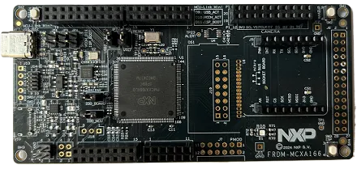

<!-- Copyright 2015-2026 Zephyr Project members and individual contributors. -->
<!-- SPDX-License-Identifier: Apache-2.0 -->
<!-- 中文翻译；编号、导航与译注为本地新增。 -->

<a id="frdm_mcxa346"></a>

# 第6章\_FRDM-MCXA346

原文：[官方页面](https://docs.zephyrproject.org/latest/boards/nxp/frdm_mcxaxx6/doc/frdm_mcxa346.html)。读取日期：2026-10-16；来源摘要见[来源记录](../SOURCES.md)。

开发板概览（Board Overview）

<a id="id2"></a>

[](images/frdm_mcxa346.webp)

FRDM-MCXA346

名称（Name）：

`frdm_mcxa346`

厂商（Vendor）：

[恩智浦半导体（NXP Semiconductors）](https://docs.zephyrproject.org/latest/boards/index.html#vendor=nxp)

状态（Status）：

维护中（Maintained）

架构（Architecture）：

[arm](https://docs.zephyrproject.org/latest/boards/index.html#arch=arm)

片上系统（SoC）：

[mcxa346](https://docs.zephyrproject.org/latest/boards/index.html#soc=mcxa346)

<a id="board-github-link"></a>

[浏览开发板源码（Browse Board Sources）](https://github.com/zephyrproject-rtos/zephyr/blob/main//boards/nxp/frdm_mcxaxx6/doc/frdm_mcxa346.rst/../..)<a id="overview"></a>

## 概述（Overview）

FRDM-MCXA346是紧凑、可扩展的开发板，原文介绍其用于MCX A27X微控制器的快速原型开发。它提供工业标准排针，便于访问MCU I/O，并集成开放标准串行接口及板载MCU-Link调试器。MCX A系列是高性能、低功耗微控制器，具备数学加速单元（MAU）、SmartDMA及较高的性能效率。

<a id="hardware"></a>

## 硬件（Hardware）


- MCX-A346 Arm Cortex-M33微控制器，运行频率180 MHz
- 1 MB双存储体片内闪存
- 256 KB RAM
- 1路支持FD的FlexCAN、1个RGB LED及3个开关按键
- 支持CMSIS-DAP的板载MCU-Link调试器
- Arduino排针、SmartDMA／摄像头排针及mikroBUS

MCX-A346 SoC及FRDM-MCXA346开发板的更多信息见以下资料：


- [MCX-A346 SoC网站](https://www.nxp.com/products/MCX-A345-A346)
- [MCX-A346 数据手册（Datasheet）](https://www.nxp.com/docs/en/data-sheet/MCXAP144M240F60.pdf)
- [MCX-A346 参考手册（Reference Manual）](https://www.nxp.com/docs/en/reference-manual/MCXAP144M240F60RM.pdf)
- [FRDM-MCXA346 网站](https://www.nxp.com/design/design-center/development-boards-and-designs/FRDM-MCXA346)
- [FRDM-MCXA346 用户指南（User Guide）](https://www.nxp.com/document/guide/getting-started-with-frdm-mcxa346:GS-FRDM-MCXA346)
- [FRDM-MCXA346 开发板用户手册（Board User Manual）](https://www.nxp.com/docs/en/user-manual/UM12348.pdf)
- [FRDM-MCXA346 原理图（Schematics）](https://www.nxp.com/webapp/Download?colCode=FRDM-MCXA346-DESIGN-FILES)

<a id="supported-features"></a>

### 支持的功能（Supported Features）

`frdm_mcxa346`开发板支持下表所列的硬件功能。

片上／板载（On-Chip / On-Board）

功能集成在片上系统（SoC）内／位于开发板上。

2 / 2

分别表示已启用／已禁用的实例数。点击数量标签，可查看开发板或SoC设备树源码（DTS）中该功能的第一个实例。

`vnd,foo`

与此功能匹配的设备树绑定兼容字符串（Compatible String）；点击链接可查看绑定文档。

<a id="frdm_mcxa346-hw-features"></a>

<a id="frdm_mcxa346-frdm_mcxa346/mcxa346-hw-features-section"></a>

#### `frdm_mcxa346/mcxa346`目标（Target）

<a id="frdm_mcxa346-frdm_mcxa346/mcxa346-hw-features-panel"></a>

<a id="frdm_mcxa346-frdm_mcxa346/mcxa346-hw-features-memory"></a>

该开发板目标的片上存储容量：240 KiB RAM、1 MiB Flash。

<a id="frdm_mcxa346-frdm_mcxa346/mcxa346-hw-features-table"></a>

<table>
<tr>
<th>类型（Type）</th>
<th>位置（Location）</th>
<th>说明（Description）</th>
<th>兼容字符串（Compatible）</th>
</tr>
<tr>
<td rowspan="1">中央处理器（CPU）</td>
<td>片上（On-Chip）</td>
<td>ARM Cortex-M33F处理器（CPU）（<a href="https://github.com/zephyrproject-rtos/zephyr/blob/main/dts/arm/nxp/mcx/mcxa/nxp_mcxaxx6_common.dtsi?plain=1#L22">已启用：1</a>）</td>
<td><a href="../cpu_arm_riscv_binding_reference/P023_arm_cortex-m33f.md#std-dtcompatible-arm-cortex-m33f"><code>arm,cortex-m33f</code></a></td>
</tr>
<tr>
<td rowspan="1">模数转换器（ADC）</td>
<td>片上（On-Chip）</td>
<td>LPC低功耗模数转换器（LPADC）（<a href="https://github.com/zephyrproject-rtos/zephyr/blob/main/dts/arm/nxp/mcx/mcxa/nxp_mcxaxx6_common.dtsi?plain=1#L485">已启用：2</a>；<a href="https://github.com/zephyrproject-rtos/zephyr/blob/main/dts/arm/nxp/mcx/mcxa/nxp_mcxaxx6_common.dtsi?plain=1#L532">已禁用：2</a>）</td>
<td><a href="../hardware/P851_NXPLPC低功耗ADC绑定.md#dtbinding-nxp-lpc-lpadc"><code>nxp,lpc-lpadc</code></a></td>
</tr>
<tr>
<td rowspan="1">辅助显示器（Auxiliary Display）</td>
<td>片上（On-Chip）</td>
<td>作为段式辅助显示器使用的NXP MCUX段式LCD（SLCD）控制器（<a href="https://github.com/zephyrproject-rtos/zephyr/blob/main/dts/arm/nxp/mcx/mcxa/nxp_mcxaxx6_common.dtsi?plain=1#L731">已禁用：1</a>）</td>
<td><a href="../auxdisplay_iio_tach_binding_reference/P005_nxp_slcd.md#std-dtcompatible-nxp-slcd"><code>nxp,slcd</code></a></td>
</tr>
<tr>
<td rowspan="1">控制器局域网（CAN）</td>
<td>片上（On-Chip）</td>
<td>NXP FlexCAN CAN FD控制器（<a href="https://github.com/zephyrproject-rtos/zephyr/blob/main/dts/arm/nxp/mcx/mcxa/nxp_mcxaxx6_common.dtsi?plain=1#L776">已启用：1</a>）</td>
<td><a href="../can_adi_atmel_nxp_binding_reference/P016_nxp_flexcan-fd.md#std-dtcompatible-nxp-flexcan-fd"><code>nxp,flexcan-fd</code></a></td>
</tr>
<tr>
<td rowspan="1">时钟控制（Clock Control）</td>
<td>片上（On-Chip）</td>
<td>LPC SYSCON及CLKCTL IP节点（<a href="https://github.com/zephyrproject-rtos/zephyr/blob/main/dts/arm/nxp/mcx/mcxa/nxp_mcxaxx6_common.dtsi?plain=1#L101">已启用：1</a>）</td>
<td><a href="../clock_nxp_pico_realtek_renesas_binding_reference/P007_nxp_lpc-syscon.md#std-dtcompatible-nxp-lpc-syscon"><code>nxp,lpc-syscon</code></a></td>
</tr>
<tr>
<td rowspan="1">时钟监测（Clock Monitor）</td>
<td>片上（On-Chip）</td>
<td>NXP频率测量（FREQME）模块（<a href="https://github.com/zephyrproject-rtos/zephyr/blob/main/dts/arm/nxp/mcx/mcxa/nxp_mcxaxx6_common.dtsi?plain=1#L207">已禁用：1</a>）</td>
<td><a href="../crc_clock_monitor_binding_reference/P004_nxp_freqme.md#std-dtcompatible-nxp-freqme"><code>nxp,freqme</code></a></td>
</tr>
<tr>
<td rowspan="1">比较器（Comparator）</td>
<td>片上（On-Chip）</td>
<td>NXP低功耗比较器（LPCMP）（<a href="https://github.com/zephyrproject-rtos/zephyr/blob/main/dts/arm/nxp/mcx/mcxa/nxp_mcxaxx6_common.dtsi?plain=1#L566">已禁用：3</a>）</td>
<td><a href="../hardware/P747_NXP低功耗比较器绑定.md#dtbinding-nxp-lpcmp"><code>nxp,lpcmp</code></a></td>
</tr>
<tr>
<td rowspan="3">计数器（Counter）</td>
<td>片上（On-Chip）</td>
<td>NXP低功耗定时器（LPTMR）（<a href="https://github.com/zephyrproject-rtos/zephyr/blob/main/dts/arm/nxp/mcx/mcxa/nxp_mcxaxx6_common.dtsi?plain=1#L327">已启用：1</a>）</td>
<td><a href="../nxp_nuvoton_counter_binding_reference/P013_nxp_lptmr.md#std-dtcompatible-nxp-lptmr"><code>nxp,lptmr</code></a></td>
</tr>
<tr>
<td>片上（On-Chip）</td>
<td>NXP MCUX标准定时器／计数器（Standard Timer/Counter）（<a href="https://github.com/zephyrproject-rtos/zephyr/blob/main/dts/arm/nxp/mcx/mcxa/nxp_mcxaxx6_common.dtsi?plain=1#L358">已启用：1</a>；<a href="https://github.com/zephyrproject-rtos/zephyr/blob/main/dts/arm/nxp/mcx/mcxa/nxp_mcxaxx6_common.dtsi?plain=1#L370">已禁用：4</a>）</td>
<td><a href="../nxp_nuvoton_counter_binding_reference/P009_nxp_lpc-ctimer.md#std-dtcompatible-nxp-lpc-ctimer"><code>nxp,lpc-ctimer</code></a></td>
</tr>
<tr>
<td>片上（On-Chip）</td>
<td>NXP唤醒定时器（Wake Timer）（<a href="https://github.com/zephyrproject-rtos/zephyr/blob/main/dts/arm/nxp/mcx/mcxa/nxp_mcxaxx6_common.dtsi?plain=1#L698">已启用：1</a>）</td>
<td><a href="../renesas_realtek_counter_binding_reference/P005_nxp_wake-timer.md#std-dtcompatible-nxp-wake-timer"><code>nxp,wake-timer</code></a></td>
</tr>
<tr>
<td rowspan="1">循环冗余校验（CRC）</td>
<td>片上（On-Chip）</td>
<td>NXP循环冗余校验（CRC）设备（<a href="https://github.com/zephyrproject-rtos/zephyr/blob/main/dts/arm/nxp/mcx/mcxa/nxp_mcxaxx6_common.dtsi?plain=1#L831">已启用：1</a>）</td>
<td><a href="../crc_clock_monitor_binding_reference/P006_nxp_crc.md#std-dtcompatible-nxp-crc"><code>nxp,crc</code></a></td>
</tr>
<tr>
<td rowspan="1">数模转换器（DAC）</td>
<td>片上（On-Chip）</td>
<td>NXP MCUX低功耗数模转换器（LPDAC）（<a href="https://github.com/zephyrproject-rtos/zephyr/blob/main/dts/arm/nxp/mcx/mcxa/nxp_mcxaxx6_common.dtsi?plain=1#L418">已启用：1</a>）</td>
<td><a href="../hardware/P770_NXP低功耗数模转换器绑定.md#dtbinding-nxp-lpdac"><code>nxp,lpdac</code></a></td>
</tr>
<tr>
<td rowspan="2">直接存储器访问（DMA）</td>
<td>片上（On-Chip）</td>
<td>NXP MCUX增强型DMA（EDMA）控制器（<a href="https://github.com/zephyrproject-rtos/zephyr/blob/main/dts/arm/nxp/mcx/mcxa/nxp_mcxaxx6_common.dtsi?plain=1#L458">已启用：1</a>）</td>
<td><a href="../nxp_realtek_renesas_dma_binding_reference/P004_nxp_mcux-edma.md#std-dtcompatible-nxp-mcux-edma"><code>nxp,mcux-edma</code></a></td>
</tr>
<tr>
<td>片上（On-Chip）</td>
<td>NXP SmartDMA控制器（<a href="https://github.com/zephyrproject-rtos/zephyr/blob/main/dts/arm/nxp/mcx/mcxa/nxp_mcxaxx6_common.dtsi?plain=1#L722">已禁用：1</a>）</td>
<td><a href="../nxp_realtek_renesas_dma_binding_reference/P007_nxp_smartdma.md#std-dtcompatible-nxp-smartdma"><code>nxp,smartdma</code></a></td>
</tr>
<tr>
<td rowspan="2">错误检测与纠正（EDAC）</td>
<td>片上（On-Chip）</td>
<td>NXP错误注入模块（Error Injection Module）（<a href="https://github.com/zephyrproject-rtos/zephyr/blob/main/dts/arm/nxp/mcx/mcxa/nxp_mcxaxx6_common.dtsi?plain=1#L806">已启用：1</a>）</td>
<td><a href="../edac_syscon_binding_reference/P002_nxp_eim.md#std-dtcompatible-nxp-eim"><code>nxp,eim</code></a></td>
</tr>
<tr>
<td>片上（On-Chip）</td>
<td>NXP错误报告模块（Error Reporting Module）（<a href="https://github.com/zephyrproject-rtos/zephyr/blob/main/dts/arm/nxp/mcx/mcxa/nxp_mcxaxx6_common.dtsi?plain=1#L822">已启用：1</a>）</td>
<td><a href="../edac_syscon_binding_reference/P003_nxp_erm.md#std-dtcompatible-nxp-erm"><code>nxp,erm</code></a></td>
</tr>
<tr>
<td rowspan="1">闪存控制器（Flash Controller）</td>
<td>片上（On-Chip）</td>
<td>NXP MSF1闪存模块（FMU）（<a href="https://github.com/zephyrproject-rtos/zephyr/blob/main/dts/arm/nxp/mcx/mcxa/nxp_mcxaxx6_common.dtsi?plain=1#L433">已启用：1</a>）</td>
<td><a href="../flash_nuvoton_nxp_renesas_binding_reference/P018_nxp_msf1.md#std-dtcompatible-nxp-msf1"><code>nxp,msf1</code></a></td>
</tr>
<tr>
<td rowspan="3">通用输入输出与接插件（GPIO &amp; Headers）</td>
<td>片上（On-Chip）</td>
<td>Kinetis通用输入输出（GPIO）（<a href="https://github.com/zephyrproject-rtos/zephyr/blob/main/dts/arm/nxp/mcx/mcxa/nxp_mcxaxx6_common.dtsi?plain=1#L157">已启用：5</a>）</td>
<td><a href="../gpio_nxp_expanders_binding_reference/P002_nxp_kinetis-gpio.md#std-dtcompatible-nxp-kinetis-gpio"><code>nxp,kinetis-gpio</code></a></td>
</tr>
<tr>
<td>板载（On-Board）</td>
<td>引出到Arduino Uno R3排针（Headers）的GPIO引脚（<a href="https://github.com/zephyrproject-rtos/zephyr/blob/main/boards/nxp/frdm_mcxaxx6/board_common.dtsi?plain=1#L76">已启用：1</a>）</td>
<td><a href="../gpio_adi_headers_ambiq_binding_reference/P023_arduino-header-r3.md#std-dtcompatible-arduino-header-r3"><code>arduino-header-r3</code></a></td>
</tr>
<tr>
<td>板载（On-Board）</td>
<td>NXP LCD 8080接口上引出的GPIO引脚，例如LCD-PAR-035面板使用的引脚（<a href="https://github.com/zephyrproject-rtos/zephyr/blob/main/boards/nxp/frdm_mcxaxx6/board_common.dtsi?plain=1#L105">已启用：1</a>）</td>
<td><a href="../gpio_nxp_expanders_binding_reference/P003_nxp_lcd-8080.md#std-dtcompatible-nxp-lcd-8080"><code>nxp,lcd-8080</code></a></td>
</tr>
<tr>
<td rowspan="1">硬件信息（Hardware Information）</td>
<td>片上（On-Chip）</td>
<td>NXP LPC 128位唯一标识符（Unique Identifier）（<a href="https://github.com/zephyrproject-rtos/zephyr/blob/main/dts/arm/nxp/mcx/mcxa/nxp_mcxaxx6_common.dtsi?plain=1#L452">已启用：1</a>）</td>
<td><a href="../hwinfo_binding_reference/P009_nxp_lpc-uid.md#std-dtcompatible-nxp-lpc-uid"><code>nxp,lpc-uid</code></a></td>
</tr>
<tr>
<td rowspan="1">集成电路间总线（I2C）</td>
<td>片上（On-Chip）</td>
<td>NXP低功耗I2C（LPI2C）控制器（<a href="https://github.com/zephyrproject-rtos/zephyr/blob/main/dts/arm/nxp/mcx/mcxa/nxp_mcxaxx6_common.dtsi?plain=1#L633">已启用：2</a>；<a href="https://github.com/zephyrproject-rtos/zephyr/blob/main/dts/arm/nxp/mcx/mcxa/nxp_mcxaxx6_common.dtsi?plain=1#L622">已禁用：2</a>）</td>
<td><a href="../i2c_nxp_pico_renesas_binding_reference/P005_nxp_lpi2c.md#std-dtcompatible-nxp-lpi2c"><code>nxp,lpi2c</code></a></td>
</tr>
<tr>
<td rowspan="1">输入（Input）</td>
<td>板载（On-Board）</td>
<td>一组绑定到 GPIO 的输入按键（GPIO-Bound Input Keys）（<a href="https://github.com/zephyrproject-rtos/zephyr/blob/main/boards/nxp/frdm_mcxaxx6/board_common.dtsi?plain=1#L58">已启用：1</a>）</td>
<td><a href="../hardware/P563_GPIO按键绑定.md#std-dtcompatible-gpio-keys"><code>gpio-keys</code></a></td>
</tr>
<tr>
<td rowspan="1">中断控制器（Interrupt Controller）</td>
<td>片上（On-Chip）</td>
<td>ARMv8-M嵌套向量中断控制器（NVIC / Nested Vectored Interrupt Controller）（<a href="https://github.com/zephyrproject-rtos/zephyr/blob/main/dts/arm/armv8-m.dtsi?plain=1#L13">已启用：1</a>）</td>
<td><a href="../arm_interrupt_timer_binding_reference/P003_ARMv8_M_NVIC.md#std-dtcompatible-arm-v8m-nvic"><code>arm,v8m-nvic</code></a></td>
</tr>
<tr>
<td rowspan="1">发光二极管（LED）</td>
<td>板载（On-Board）</td>
<td>一组由 GPIO 控制的 LED（GPIO-Controlled LEDs）（<a href="https://github.com/zephyrproject-rtos/zephyr/blob/main/boards/nxp/frdm_mcxaxx6/board_common.dtsi?plain=1#L39">已启用：1</a>）</td>
<td><a href="../hardware/P564_GPIO指示灯绑定.md#dtbinding-gpio-leds"><code>gpio-leds</code></a></td>
</tr>
<tr>
<td rowspan="1">存储技术设备（MTD）</td>
<td>片上（On-Chip）</td>
<td>闪存（Flash）节点（<a href="https://github.com/zephyrproject-rtos/zephyr/blob/main/dts/arm/nxp/mcx/mcxa/nxp_mcxaxx6_common.dtsi?plain=1#L442">已启用：1</a>）</td>
<td><a href="../mtd_nxp_st_ti_partition_binding_reference/P013_soc-nv-flash.md#std-dtcompatible-soc-nv-flash"><code>soc-nv-flash</code></a></td>
</tr>
<tr>
<td rowspan="1">多路复用器（MUX）</td>
<td>片上（On-Chip）</td>
<td>NXP输入复用器（INPUTMUX）外设绑定（<a href="https://github.com/zephyrproject-rtos/zephyr/blob/main/dts/arm/nxp/mcx/mcxa/nxp_mcxaxx6_common.dtsi?plain=1#L839">已启用：1</a>）</td>
<td><a href="../mux_w1_binding_reference/P004_nxp_inputmux.md#std-dtcompatible-nxp-inputmux"><code>nxp,inputmux</code></a></td>
</tr>
<tr>
<td rowspan="1">运算放大器（OPAMP）</td>
<td>片上（On-Chip）</td>
<td>NXP高压摆率运算放大器（opamp_fast / Fast Slew Rate Operational Amplifier）（<a href="https://github.com/zephyrproject-rtos/zephyr/blob/main/dts/arm/nxp/mcx/mcxa/nxp_mcxaxx6_common.dtsi?plain=1#L590">已启用：2</a>；<a href="https://github.com/zephyrproject-rtos/zephyr/blob/main/dts/arm/nxp/mcx/mcxa/nxp_mcxaxx6_common.dtsi?plain=1#L606">已禁用：2</a>）</td>
<td><a href="../hardware/P731_NXP高速运算放大器绑定.md#dtbinding-nxp-opamp-fast"><code>nxp,opamp-fast</code></a></td>
</tr>
<tr>
<td rowspan="2">引脚控制（Pin Control）</td>
<td>片上（On-Chip）</td>
<td>NXP PORT引脚控制器（Pin Controller）（<a href="https://github.com/zephyrproject-rtos/zephyr/blob/main/dts/arm/nxp/mcx/mcxa/nxp_mcxaxx6_common.dtsi?plain=1#L122">已启用：5</a>）</td>
<td><a href="../pinctrl_nxp_pico_binding_reference/P017_nxp_port-pinmux.md#std-dtcompatible-nxp-port-pinmux"><code>nxp,port-pinmux</code></a></td>
</tr>
<tr>
<td>片上（On-Chip）</td>
<td>NXP PORT引脚控制器（Pin Controller）（<a href="https://github.com/zephyrproject-rtos/zephyr/blob/main/dts/arm/nxp/mcx/mcxa/nxp_mcxaxx6_common.dtsi?plain=1#L95">已启用：1</a>）</td>
<td><a href="../pinctrl_nxp_pico_binding_reference/P016_nxp_port-pinctrl.md#std-dtcompatible-nxp-port-pinctrl"><code>nxp,port-pinctrl</code></a></td>
</tr>
<tr>
<td rowspan="3">电源管理（Power Management）</td>
<td>片上（On-Chip）</td>
<td>NXP系统电源控制器（SPC）（<a href="https://github.com/zephyrproject-rtos/zephyr/blob/main/dts/arm/nxp/mcx/mcxa/nxp_mcxaxx6_common.dtsi?plain=1#L747">已启用：1</a>）</td>
<td><a href="../stm32_soc_power_binding_reference/P001_nxp_spc.md#std-dtcompatible-nxp-spc"><code>nxp,spc</code></a></td>
</tr>
<tr>
<td>片上（On-Chip）</td>
<td>NXP内核模式控制器（CMC）（<a href="https://github.com/zephyrproject-rtos/zephyr/blob/main/dts/arm/nxp/mcx/mcxa/nxp_mcxaxx6_common.dtsi?plain=1#L765">已启用：1</a>）</td>
<td><a href="../power_control_binding_reference/P014_nxp_cmc.md#std-dtcompatible-nxp-cmc"><code>nxp,cmc</code></a></td>
</tr>
<tr>
<td>片上（On-Chip）</td>
<td>NXP智能电源开关（VBAT）（<a href="https://github.com/zephyrproject-rtos/zephyr/blob/main/dts/arm/nxp/mcx/mcxa/nxp_mcxaxx6_common.dtsi?plain=1#L771">已启用：1</a>）</td>
<td><a href="../stm32_soc_power_binding_reference/P002_nxp_vbat.md#std-dtcompatible-nxp-vbat"><code>nxp,vbat</code></a></td>
</tr>
<tr>
<td rowspan="1">电源域（Power Domain）</td>
<td>片上（On-Chip）</td>
<td>此电源域在进入及退出指定电源状态（Power State）时开启或关闭设备（<a href="https://github.com/zephyrproject-rtos/zephyr/blob/main/dts/arm/nxp/mcx/mcxa/nxp_mcxaxx6_common.dtsi?plain=1#L88">已启用：1</a>）</td>
<td><a href="../power_domain_binding_reference/P007_power-domain-soc-state-change.md#std-dtcompatible-power-domain-soc-state-change"><code>power-domain-soc-state-change</code></a></td>
</tr>
<tr>
<td rowspan="2">脉宽调制（PWM）</td>
<td>片上（On-Chip）</td>
<td>包含mcux-pwm子模块的NXP eFLEX PWM模块（<a href="https://github.com/zephyrproject-rtos/zephyr/blob/main/dts/arm/nxp/mcx/mcxa/nxp_mcxaxx6_common.dtsi?plain=1#L864">已启用：2</a>）</td>
<td><a href="../pwm_nxp_renesas_binding_reference/P003_nxp_flexpwm.md#std-dtcompatible-nxp-flexpwm"><code>nxp,flexpwm</code></a></td>
</tr>
<tr>
<td>片上（On-Chip）</td>
<td>NXP MCUX脉宽调制（PWM）（<a href="https://github.com/zephyrproject-rtos/zephyr/blob/main/dts/arm/nxp/mcx/mcxa/nxp_mcxaxx6_common.dtsi?plain=1#L870">已启用：1</a>；<a href="https://github.com/zephyrproject-rtos/zephyr/blob/main/dts/arm/nxp/mcx/mcxa/nxp_mcxaxx6_common.dtsi?plain=1#L881">已禁用：5</a>）</td>
<td><a href="../pwm_nxp_renesas_binding_reference/P005_nxp_imx-pwm.md#std-dtcompatible-nxp-imx-pwm"><code>nxp,imx-pwm</code></a></td>
</tr>
<tr>
<td rowspan="1">稳压器（Regulator）</td>
<td>片上（On-Chip）</td>
<td>NXP SPC带缓冲的带隙基准输出（Buffered Bandgap Output）（<a href="https://github.com/zephyrproject-rtos/zephyr/blob/main/dts/arm/nxp/mcx/mcxa/nxp_mcxaxx6_common.dtsi?plain=1#L753">已启用：1</a>）</td>
<td><a href="../hardware/P651_NXP带隙缓冲器绑定.md#dtbinding-nxp-spc-bandgap-buffer"><code>nxp,spc-bandgap-buffer</code></a></td>
</tr>
<tr>
<td rowspan="1">复位控制器（Reset Controller）</td>
<td>片上（On-Chip）</td>
<td>NXP MRCC外设复位控制器（<a href="https://github.com/zephyrproject-rtos/zephyr/blob/main/dts/arm/nxp/mcx/mcxa/nxp_mcxaxx6_common.dtsi?plain=1#L106">已启用：1</a>）</td>
<td><a href="../reset_controller_binding_reference/P010_nxp_mrcc-reset.md#std-dtcompatible-nxp-mrcc-reset"><code>nxp,mrcc-reset</code></a></td>
</tr>
<tr>
<td rowspan="1">实时时钟（RTC）</td>
<td>片上（On-Chip）</td>
<td>NXP实时时钟（RTC / Real Time Clock）（<a href="https://github.com/zephyrproject-rtos/zephyr/blob/main/dts/arm/nxp/mcx/mcxa/nxp_mcxaxx6_common.dtsi?plain=1#L340">已启用：1</a>）</td>
<td><a href="../soc_rtc_binding_reference/P002_nxp_rtc.md#std-dtcompatible-nxp-rtc"><code>nxp,rtc</code></a></td>
</tr>
<tr>
<td rowspan="2">传感器（Sensors）</td>
<td>片上（On-Chip）</td>
<td>NXP LPADC_TEMP40温度传感器（<a href="https://github.com/zephyrproject-rtos/zephyr/blob/main/dts/arm/nxp/mcx/mcxa/nxp_mcxaxx6_common.dtsi?plain=1#L510">已禁用：1</a>）</td>
<td><a href="../sensor_nxp_qdec_optical_binding_reference/P005_nxp_lpadc-temp40.md#std-dtcompatible-nxp-lpadc-temp40"><code>nxp,lpadc-temp40</code></a></td>
</tr>
<tr>
<td>片上（On-Chip）</td>
<td>NXP MCUX增强型正交解码器（EQDC）（<a href="https://github.com/zephyrproject-rtos/zephyr/blob/main/dts/arm/nxp/mcx/mcxa/nxp_mcxaxx6_common.dtsi?plain=1#L846">已禁用：2</a>）</td>
<td><a href="../sensor_nxp_qdec_optical_binding_reference/P006_nxp_mcux-eqdc.md#std-dtcompatible-nxp-mcux-eqdc"><code>nxp,mcux-eqdc</code></a></td>
</tr>
<tr>
<td rowspan="1">串行控制器（Serial Controller）</td>
<td>片上（On-Chip）</td>
<td>NXP低功耗UART（LPUART）（<a href="https://github.com/zephyrproject-rtos/zephyr/blob/main/dts/arm/nxp/mcx/mcxa/nxp_mcxaxx6_common.dtsi?plain=1#L294">已启用：1</a>；<a href="https://github.com/zephyrproject-rtos/zephyr/blob/main/dts/arm/nxp/mcx/mcxa/nxp_mcxaxx6_common.dtsi?plain=1#L272">已禁用：4</a>）</td>
<td><a href="../uart_microchip_nordic_nxp_binding_reference/P017_nxp_lpuart.md#std-dtcompatible-nxp-lpuart"><code>nxp,lpuart</code></a></td>
</tr>
<tr>
<td rowspan="1">串行外设接口（SPI）</td>
<td>片上（On-Chip）</td>
<td>NXP低功耗SPI（LPSPI）控制器（<a href="https://github.com/zephyrproject-rtos/zephyr/blob/main/dts/arm/nxp/mcx/mcxa/nxp_mcxaxx6_common.dtsi?plain=1#L666">已启用：1</a>；<a href="https://github.com/zephyrproject-rtos/zephyr/blob/main/dts/arm/nxp/mcx/mcxa/nxp_mcxaxx6_common.dtsi?plain=1#L678">已禁用：1</a>）</td>
<td><a href="../spi_flexspi_nxp_renesas_binding_reference/P004_nxp_lpspi.md#std-dtcompatible-nxp-lpspi"><code>nxp,lpspi</code></a></td>
</tr>
<tr>
<td rowspan="1">静态随机存储器（SRAM）</td>
<td>片上（On-Chip）</td>
<td>通用片上静态随机存储器（SRAM）（<a href="https://github.com/zephyrproject-rtos/zephyr/blob/main/dts/arm/nxp/mcx/mcxa/nxp_mcxaxx6_common.dtsi?plain=1#L112">已启用：2</a>）</td>
<td><a href="../hardware/P567_内存映射SRAM绑定.md#dtbinding-mmio-sram"><code>mmio-sram</code></a></td>
</tr>
<tr>
<td rowspan="2">定时器（Timer）</td>
<td>片上（On-Chip）</td>
<td>ARMv8-M系统节拍（System Tick）（<a href="https://github.com/zephyrproject-rtos/zephyr/blob/main/dts/arm/armv8-m.dtsi?plain=1#L21">已启用：1</a>）</td>
<td><a href="../arm_interrupt_timer_binding_reference/P007_ARMv8_M_SysTick.md#std-dtcompatible-arm-armv8m-systick"><code>arm,armv8m-systick</code></a></td>
</tr>
<tr>
<td>片上（On-Chip）</td>
<td>i.MX RT5xx／6xx上的NXP操作系统定时器（OS Timer）（<a href="https://github.com/zephyrproject-rtos/zephyr/blob/main/dts/arm/nxp/mcx/mcxa/nxp_mcxaxx6_common.dtsi?plain=1#L690">已禁用：1</a>）</td>
<td><a href="../microchip_nordic_nxp_realtek_timer_binding_reference/P008_nxp_os-timer.md#std-dtcompatible-nxp-os-timer"><code>nxp,os-timer</code></a></td>
</tr>
<tr>
<td rowspan="1">看门狗（Watchdog）</td>
<td>片上（On-Chip）</td>
<td>LPC窗口看门狗定时器（Windowed Watchdog Timer）（<a href="https://github.com/zephyrproject-rtos/zephyr/blob/main/dts/arm/nxp/mcx/mcxa/nxp_mcxaxx6_common.dtsi?plain=1#L705">已启用：1</a>）</td>
<td><a href="../nxp_nordic_nuvoton_watchdog_binding_reference/P011_nxp_lpc-wwdt.md#std-dtcompatible-nxp-lpc-wwdt"><code>nxp,lpc-wwdt</code></a></td>
</tr>
<tr>
<td rowspan="1">唤醒控制器（Wakeup Controller）</td>
<td>片上（On-Chip）</td>
<td>作为唤醒控制器（WUC）的NXP唤醒单元（WUU）（<a href="https://github.com/zephyrproject-rtos/zephyr/blob/main/dts/arm/nxp/mcx/mcxa/nxp_mcxaxx6_common.dtsi?plain=1#L758">已启用：1</a>）</td>
<td><a href="../power_state_wakeup_binding_reference/P008_nxp_wuc-wuu.md#std-dtcompatible-nxp-wuc-wuu"><code>nxp,wuc-wuu</code></a></td>
</tr>
</table>

<a id="connections-and-ios"></a>

### 连接与输入输出（Connections and IOs）

MCX-A346 SoC有6个GPIO控制器，可通过引脚复用（Pinmux）寄存器配置引脚功能。

<table>
<tr>
<th>名称（Name）</th>
<th>功能（Function）</th>
<th>用途（Usage）</th>
</tr>
<tr>
<td>PIO2_3</td>
<td>通用异步收发器（UART）</td>
<td>UART接收（RX）</td>
</tr>
<tr>
<td>PIO2_2</td>
<td>通用异步收发器（UART）</td>
<td>UART发送（TX）</td>
</tr>
</table>

<a id="system-clock"></a>

### 系统时钟（System Clock）

MCX-A346 SoC配置为使用180 MHz自由运行振荡器（FRO）作为系统时钟源。

<a id="serial-port"></a>

### 串口（Serial Port）

FRDM-MCXA346 SoC有6路低功耗UART（LPUART）串行通信接口，LPUART2配置为控制台UART。

<a id="programming-and-debugging"></a>

## 烧录与调试（Programming and Debugging）

按通常方式构建并烧录应用，详见“构建应用”（[Building an Application](../application/P001_应用开发.md#build-an-application)）与“运行应用”（[Run an Application](https://docs.zephyrproject.org/latest/develop/application/index.html#application-run)）。

<a id="configuring-a-debug-probe"></a>

### 配置调试探针（Configuring a Debug Probe）

烧录和调试均使用调试探针，默认配置为MCU-Link CMSIS-DAP板载调试探针。

<a id="using-linkserver"></a>

#### 使用LinkServer

默认运行工具为LinkServer，支持出厂MCU-Link固件。只有板载调试电路固件被更换时，才需按MCU-Link CMSIS-DAP板载调试探针说明重新写入默认固件；写入前短接JP4，进入ISP模式。（[板载MCU-Link CMSIS-DAP调试探针（Onboard Debug Probe）](https://docs.zephyrproject.org/latest/develop/flash_debug/probes.html#mcu-link-cmsis-onboard-debug-probe)）

<a id="using-j-link"></a>

#### 使用J-Link

有两种方案。第一种按MCU-Link J-Link板载调试探针说明，将板载调试电路更新为Segger J-Link固件；写入前短接JP4，进入ISP模式。第二种将外部J-Link调试探针连接到10引脚SWD连接器J14，并短接JP6。两种方案都需给west传入-r jlink，选择J-Link运行工具。（[MCU-Link J-Link板载调试探针（Onboard Debug Probe）](https://docs.zephyrproject.org/latest/develop/flash_debug/probes.html#mcu-link-jlink-onboard-debug-probe)；[J-Link外部调试探针（External Debug Probe）](https://docs.zephyrproject.org/latest/develop/flash_debug/probes.html#jlink-external-debug-probe)）

```text
west flash -r jlink
```

<a id="configuring-a-console"></a>

### 配置控制台（Configuring a Console）

用USB线缆将PC连接到J15，在所选串口终端（如minicom、PuTTY）中使用以下设置：


- 速率（Speed）：115200波特率
- 数据位（Data）：8位
- 奇偶校验（Parity）：无（None）
- 停止位（Stop Bits）：1位

<a id="id1"></a>

### 烧录与调试（Programming and Debugging）

`frdm_mcxa346`开发板支持下表所列的运行工具（Runners）及相关west命令。

<table>
<tr>
<th></th>
<th>烧录（flash）</th>
<th>调试（debug）</th>
<th>连接调试会话（attach）</th>
<th>实时传输（rtt）</th>
<th>复位（reset）</th>
<th>调试服务器（debugserver）</th>
</tr>
<tr>
<td><a href="https://docs.zephyrproject.org/latest/develop/flash_debug/host-tools.html#runner-jlink">jlink</a></td>
<td>✅</td>
<td>✅</td>
<td>✅</td>
<td>✅</td>
<td>✅</td>
<td>✅</td>
</tr>
<tr>
<td><a href="https://docs.zephyrproject.org/latest/develop/flash_debug/host-tools.html#runner-linkserver">linkserver</a></td>
<td>✅（默认 / default）</td>
<td>✅（默认 / default）</td>
<td>✅</td>
<td></td>
<td></td>
<td>✅</td>
</tr>
<tr>
<td><a href="https://docs.zephyrproject.org/latest/develop/flash_debug/host-tools.html#runner-pyocd">pyocd</a></td>
<td>✅</td>
<td>✅</td>
<td>✅</td>
<td>✅</td>
<td>✅</td>
<td>✅</td>
</tr>
</table>

<a id="flashing"></a>

### 烧录（Flashing）

下面以[Hello World](../getting_started/P005_HelloWorld示例.md#hello_world)应用为例。

```text
# From the root of the zephyr repository
west build -b frdm_mcxa346 samples/hello_world
west flash
```

打开串口终端，复位开发板（按下RESET按键），应能在终端中看到以下消息：

```text
*** Booting Zephyr OS build v3.6.0-4478-ge6c3a42f5f52 ***
Hello World! frdm_mcxa346/mcxa346
```

<a id="debugging"></a>

### 调试（Debugging）

下面以[Hello World](../getting_started/P005_HelloWorld示例.md#hello_world)应用为例。

```text
# From the root of the zephyr repository
west build -b frdm_mcxa346/mcxa346 samples/hello_world
west debug
```

打开串口终端，在调试器中单步运行应用，应能在终端中看到以下消息：

```text
*** Booting Zephyr OS build v3.6.0-4478-ge6c3a42f5f52 ***
Hello World! frdm_mcxa346/mcxa346
```

<a id="troubleshooting"></a>

### 故障排查（Troubleshooting）

<a id="using-segger-systemview-and-rtt"></a>

#### 使用Segger SystemView及RTT

此SoC使用SEGGER SystemView或实时传输（RTT）时，必须在SystemView或RTT Viewer中手动设置RTT控制块地址。该地址为_SEGGER_RTT符号的位置，可通过调试器或链接器输出的zephyr.map文件查找。

必须手动指定控制块地址，是因为此SoC支持带纠错码（ECC）的RAM。当ECC已启用、待搜索RAM区域尚未初始化为已知值时，SEGGER工具若在ECC RAM中搜索控制块，将引发故障（Fault）。

<a id="support-resources-for-zephyr"></a>

### Zephyr支持资源（Support Resources）


- [NXP开发板支持状态（Board Support Status）](https://github.com/nxp-zephyr/nxp-zsdk/blob/main/doc/releases/Board-Support-Status.md)
- [NXP Zephyr下游软件开发工具包（Downstream SDK）](https://github.com/nxp-zephyr/nxp-zsdk)
- [MCUXpresso for VS Code文档](https://mcuxpresso.nxp.com/mcux-vscode)及[Zephyr实验指南](https://mcuxpresso.nxp.com/mcux-vscode/latest/html/Training-Zephyr-Getting-Started.html)
- [NXP Zephyr知识中心（Knowledge Hub）](https://community.nxp.com/t5/Zephyr-Project-Knowledge-Base/Zephyr-Knowledge-Hub/ta-p/2008548)
- NXP Zephyr主页，包含培训资源（[NXP的Zephyr专题页面](https://nxp.com/zephyr)）
- [NXP Zephyr支持社区论坛（Support Community）](https://community.nxp.com/t5/Zephyr-Project/bd-p/Zephyr-Project)

## 译注

原文概述将适用器件系列写为MCX A27X，页面和目标名称为MCXA346，保留两者。

## 原文外链核对

2026-10-16核对并重试以下原文外链时未能确认可访问性，保留原始目标，不将访问失败解释为原文内容有误。

- [2008548](https://community.nxp.com/t5/Zephyr-Project-Knowledge-Base/Zephyr-Knowledge-Hub/ta-p/2008548)：HTTP Error 403: Forbidden。
- [Zephyr-Project](https://community.nxp.com/t5/Zephyr-Project/bd-p/Zephyr-Project)：HTTP Error 403: Forbidden。
- [Training-Zephyr-Getting-Started.html](https://mcuxpresso.nxp.com/mcux-vscode/latest/html/Training-Zephyr-Getting-Started.html)：HTTP Error 404: Not Found。
- [zephyr](https://nxp.com/zephyr)：HTTP Error 404: Not Found。
- [FRDM-MCXA346](https://www.nxp.com/design/design-center/development-boards-and-designs/FRDM-MCXA346)：HTTP Error 404: Not Found。
- [MCXAP144M240F60.pdf](https://www.nxp.com/docs/en/data-sheet/MCXAP144M240F60.pdf)：HTTP Error 404: Not Found。
- [MCXAP144M240F60RM.pdf](https://www.nxp.com/docs/en/reference-manual/MCXAP144M240F60RM.pdf)：HTTP Error 404: Not Found。
- [UM12348.pdf](https://www.nxp.com/docs/en/user-manual/UM12348.pdf)：HTTP Error 404: Not Found。
- [getting-started-with-frdm-mcxa346:GS-FRDM-MCXA346](https://www.nxp.com/document/guide/getting-started-with-frdm-mcxa346:GS-FRDM-MCXA346)：HTTP Error 404: Not Found。
- [MCX-A345-A346](https://www.nxp.com/products/MCX-A345-A346)：HTTP Error 404: Not Found。
- [Download?colCode=FRDM-MCXA346-DESIGN-FILES](https://www.nxp.com/webapp/Download?colCode=FRDM-MCXA346-DESIGN-FILES)：HTTP Error 404: Not Found。

---

[上一章](P005_FRDM-MCXA266.md) · [返回大纲](大纲.md) · [全站翻译进度](../PROGRESS.md) · [下一章](P007_FRDM-MCXA366.md)
