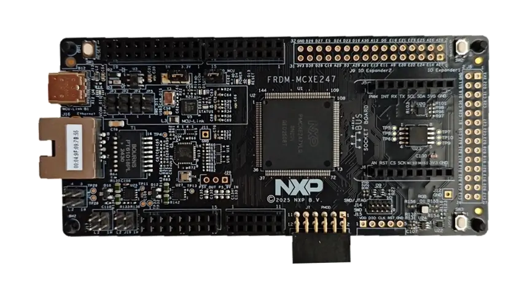

<!-- Copyright 2015-2026 Zephyr Project members and individual contributors. -->
<!-- SPDX-License-Identifier: Apache-2.0 -->
<!-- 中文翻译；编号、导航与译注为本地新增。 -->

<a id="frdm_mcxe247"></a>

# 第10章\_FRDM-MCXE247

原文：[官方页面](https://docs.zephyrproject.org/latest/boards/nxp/frdm_mcxe247/doc/index.html)。读取日期：2026-10-16；来源摘要见[来源记录](../SOURCES.md)。

开发板概览（Board Overview）

<a id="id1"></a>

[](images/frdm_mcxe247.webp)

FRDM-MCXE247

名称（Name）：

`frdm_mcxe247`

厂商（Vendor）：

[恩智浦半导体（NXP Semiconductors）](https://docs.zephyrproject.org/latest/boards/index.html#vendor=nxp)

状态（Status）：

维护中（Maintained）

架构（Architecture）：

[arm](https://docs.zephyrproject.org/latest/boards/index.html#arch=arm)

片上系统（SoC）：

[mcxe247](https://docs.zephyrproject.org/latest/boards/index.html#soc=mcxe247)

<a id="board-github-link"></a>

[浏览开发板源码（Browse Board Sources）](https://github.com/zephyrproject-rtos/zephyr/blob/main//boards/nxp/frdm_mcxe247/doc/index.rst/../..)<a id="overview"></a>

## 概述（Overview）

FRDM-MCXE247是紧凑、可扩展的开发板，用于MCX E245／246／247微控制器的快速原型开发。工业标准排针便于访问MCU I/O，板上集成开放标准串行接口、外部闪存及MCU-Link调试器。

<a id="hardware"></a>

## 硬件（Hardware）


- MCXE247VLQ，Arm Cortex-M4F 32位处理器（CPU）
- 高速运行（HSRUN）模式下最高支持112 MHz
- 144引脚LQFP封装
- 2 MB片内闪存
- 64 kB FlexNVM，用于数据闪存及EEPROM仿真
- 256 kB SRAM
- 4 kB FlexRAM，可用作SRAM或EEPROM仿真
- 2路ADC、1路比较器（CMP）及触发复用器（TRGMUX）
- 2路LPI2C、3路LPSPI、1路FlexIO、3路LPUART、2路SAI、QSPI、3路FlexCAN及支持IEEE 1588的100 Mbit/s以太网MAC
- 8路FlexTimer、内部及外部看门狗（WDOG）、1路低功耗周期中断定时器（LPIT）、1路低功耗定时器（LPTMR）、2路可编程延迟模块（PDB）及实时时钟（RTC）
- NMH1000磁性开关（Magnetic Switch）
- FXLS8974CF加速度计（Accelerometer）
- RGB用户LED
- 支持CMSIS-DAP的板载MCU-Link调试器
- Arduino排针、mikroBUS及Pmod

MCXE247 SoC及FRDM-MCXE247开发板的更多信息见以下资料：


- [MCX E24x Series Microcontrollers 网站](https://www.nxp.com/products/MCX-E24X)
- [FRDM-MCXE247 网站](https://www.nxp.com/design/design-center/development-boards-and-designs/FRDM-MCXE247)
- [FRDM-MCXE247 快速参考指南（Quick Reference Guide）](https://www.nxp.com/docs/en/quick-reference-guide/MCXE247QSG.pdf)
- [FRDM-MCXE247 快速入门（Getting Started）](https://www.nxp.com/document/guide/getting-started-with-the-frdm-mcxe247-board:GS-FRDM-MCXE247)

<a id="supported-features"></a>

### 支持的功能（Supported Features）

`frdm_mcxe247`开发板支持下表所列的硬件功能。

片上／板载（On-Chip / On-Board）

功能集成在片上系统（SoC）内／位于开发板上。

2 / 2

分别表示已启用／已禁用的实例数。点击数量标签，可查看开发板或SoC设备树源码（DTS）中该功能的第一个实例。

`vnd,foo`

与此功能匹配的设备树绑定兼容字符串（Compatible String）；点击链接可查看绑定文档。

<a id="frdm_mcxe247-hw-features"></a>

<a id="frdm_mcxe247-frdm_mcxe247@default/mcxe247-hw-features-section"></a>

#### `frdm_mcxe247@default/mcxe247`目标（Target）

<a id="frdm_mcxe247-frdm_mcxe247@default/mcxe247-hw-features-panel"></a>

<a id="frdm_mcxe247-frdm_mcxe247@default/mcxe247-hw-features-memory"></a>

该开发板目标的片上存储容量：128 KiB RAM、1536 KiB Flash。

<a id="frdm_mcxe247-frdm_mcxe247@default/mcxe247-hw-features-table"></a>

<table>
<tr>
<th>类型（Type）</th>
<th>位置（Location）</th>
<th>说明（Description）</th>
<th>兼容字符串（Compatible）</th>
</tr>
<tr>
<td rowspan="1">中央处理器（CPU）</td>
<td>片上（On-Chip）</td>
<td>ARM Cortex-M4F 处理器（CPU）（<a href="https://github.com/zephyrproject-rtos/zephyr/blob/main/dts/arm/nxp/mcx/mcxe/nxp_mcxe24x_common.dtsi?plain=1#L28">已启用：1</a>）</td>
<td><a href="../cpu_arm_riscv_binding_reference/P025_arm_cortex-m4f.md#std-dtcompatible-arm-cortex-m4f"><code>arm,cortex-m4f</code></a></td>
</tr>
<tr>
<td rowspan="1">模数转换器（ADC）</td>
<td>片上（On-Chip）</td>
<td>NXP 12位模数转换器（ADC12）（<a href="https://github.com/zephyrproject-rtos/zephyr/blob/main/dts/arm/nxp/mcx/mcxe/nxp_mcxe24x_common.dtsi?plain=1#L234">已启用：1</a>；<a href="https://github.com/zephyrproject-rtos/zephyr/blob/main/dts/arm/nxp/mcx/mcxe/nxp_mcxe24x_common.dtsi?plain=1#L245">已禁用：1</a>）</td>
<td><a href="../hardware/P847_NXPADC12模数转换器绑定.md#dtbinding-nxp-adc12"><code>nxp,adc12</code></a></td>
</tr>
<tr>
<td rowspan="1">控制器局域网（CAN）</td>
<td>片上（On-Chip）</td>
<td>NXP FlexCAN CAN FD控制器（<a href="https://github.com/zephyrproject-rtos/zephyr/blob/main/dts/arm/nxp/mcx/mcxe/nxp_mcxe24x_common.dtsi?plain=1#L329">已启用：1</a>；<a href="https://github.com/zephyrproject-rtos/zephyr/blob/main/dts/arm/nxp/mcx/mcxe/nxp_mcxe24x_common.dtsi?plain=1#L342">已禁用：2</a>）</td>
<td><a href="../can_adi_atmel_nxp_binding_reference/P016_nxp_flexcan-fd.md#std-dtcompatible-nxp-flexcan-fd"><code>nxp,flexcan-fd</code></a></td>
</tr>
<tr>
<td rowspan="4">时钟控制（Clock Control）</td>
<td>片上（On-Chip）</td>
<td>NXP Kinetis系统时钟发生器（SCG）IP节点（<a href="https://github.com/zephyrproject-rtos/zephyr/blob/main/dts/arm/nxp/mcx/mcxe/nxp_mcxe24x_common.dtsi?plain=1#L84">已启用：1</a>）</td>
<td><a href="../clock_nxp_pico_realtek_renesas_binding_reference/P005_nxp_kinetis-scg.md#std-dtcompatible-nxp-kinetis-scg"><code>nxp,kinetis-scg</code></a></td>
</tr>
<tr>
<td>片上（On-Chip）</td>
<td>通用固定频率时钟提供者（Fixed-Rate Clock Provider）（<a href="https://github.com/zephyrproject-rtos/zephyr/blob/main/dts/arm/nxp/mcx/mcxe/nxp_mcxe24x_common.dtsi?plain=1#L90">已启用：4</a>）</td>
<td><a href="../hardware/P566_固定时钟绑定.md#dtbinding-fixed-clock"><code>fixed-clock</code></a></td>
</tr>
<tr>
<td>片上（On-Chip）</td>
<td>通用固定比例时钟提供器（Fixed Factor Clock Provider）（<a href="https://github.com/zephyrproject-rtos/zephyr/blob/main/dts/arm/nxp/mcx/mcxe/nxp_mcxe24x_common.dtsi?plain=1#L96">已启用：13</a>）</td>
<td><a href="../timer_reference/P110_固定比例时钟绑定.md#dtbinding-fixed-factor-clock"><code>fixed-factor-clock</code></a></td>
</tr>
<tr>
<td>片上（On-Chip）</td>
<td>NXP Kinetis外设时钟控制器（PCC）IP节点（<a href="https://github.com/zephyrproject-rtos/zephyr/blob/main/dts/arm/nxp/mcx/mcxe/nxp_mcxe24x_common.dtsi?plain=1#L202">已启用：1</a>）</td>
<td><a href="../clock_nxp_pico_realtek_renesas_binding_reference/P004_nxp_kinetis-pcc.md#std-dtcompatible-nxp-kinetis-pcc"><code>nxp,kinetis-pcc</code></a></td>
</tr>
<tr>
<td rowspan="1">比较器（Comparator）</td>
<td>片上（On-Chip）</td>
<td>NXP Kinetis模拟比较器（ACMP / Analog Comparator）（<a href="https://github.com/zephyrproject-rtos/zephyr/blob/main/dts/arm/nxp/mcx/mcxe/nxp_mcxe24x_common.dtsi?plain=1#L256">已启用：1</a>）</td>
<td><a href="../hardware/P745_NXPKinetis模拟比较器绑定.md#dtbinding-nxp-kinetis-acmp"><code>nxp,kinetis-acmp</code></a></td>
</tr>
<tr>
<td rowspan="3">计数器（Counter）</td>
<td>片上（On-Chip）</td>
<td>NXP低功耗周期中断定时器（LPIT）（<a href="https://github.com/zephyrproject-rtos/zephyr/blob/main/dts/arm/nxp/mcx/mcxe/nxp_mcxe24x_common.dtsi?plain=1#L374">已启用：1</a>）</td>
<td><a href="../nxp_nuvoton_counter_binding_reference/P012_nxp_lpit.md#std-dtcompatible-nxp-lpit"><code>nxp,lpit</code></a></td>
</tr>
<tr>
<td>片上（On-Chip）</td>
<td>低功耗周期中断定时器节点的子节点，表示一个独立定时器通道（<a href="https://github.com/zephyrproject-rtos/zephyr/blob/main/dts/arm/nxp/mcx/mcxe/nxp_mcxe24x_common.dtsi?plain=1#L386">已启用：4</a>）</td>
<td><a href="../nxp_nuvoton_counter_binding_reference/P011_nxp_lpit-channel.md#std-dtcompatible-nxp-lpit-channel"><code>nxp,lpit-channel</code></a></td>
</tr>
<tr>
<td>片上（On-Chip）</td>
<td>NXP低功耗定时器（LPTMR）（<a href="https://github.com/zephyrproject-rtos/zephyr/blob/main/dts/arm/nxp/mcx/mcxe/nxp_mcxe24x_common.dtsi?plain=1#L602">已禁用：1</a>）</td>
<td><a href="../nxp_nuvoton_counter_binding_reference/P013_nxp_lptmr.md#std-dtcompatible-nxp-lptmr"><code>nxp,lptmr</code></a></td>
</tr>
<tr>
<td rowspan="1">循环冗余校验（CRC）</td>
<td>片上（On-Chip）</td>
<td>NXP循环冗余校验（CRC）设备（<a href="https://github.com/zephyrproject-rtos/zephyr/blob/main/dts/arm/nxp/mcx/mcxe/nxp_mcxe24x_common.dtsi?plain=1#L751">已启用：1</a>）</td>
<td><a href="../crc_clock_monitor_binding_reference/P006_nxp_crc.md#std-dtcompatible-nxp-crc"><code>nxp,crc</code></a></td>
</tr>
<tr>
<td rowspan="1">直接存储器访问（DMA）</td>
<td>片上（On-Chip）</td>
<td>NXP MCUX增强型DMA（EDMA）控制器（<a href="https://github.com/zephyrproject-rtos/zephyr/blob/main/dts/arm/nxp/mcx/mcxe/nxp_mcxe24x_common.dtsi?plain=1#L218">已启用：1</a>）</td>
<td><a href="../nxp_realtek_renesas_dma_binding_reference/P004_nxp_mcux-edma.md#std-dtcompatible-nxp-mcux-edma"><code>nxp,mcux-edma</code></a></td>
</tr>
<tr>
<td rowspan="2">错误检测与纠正（EDAC）</td>
<td>片上（On-Chip）</td>
<td>NXP错误报告模块（Error Reporting Module）（<a href="https://github.com/zephyrproject-rtos/zephyr/blob/main/dts/arm/nxp/mcx/mcxe/nxp_mcxe24x_common.dtsi?plain=1#L264">已启用：1</a>）</td>
<td><a href="../edac_syscon_binding_reference/P003_nxp_erm.md#std-dtcompatible-nxp-erm"><code>nxp,erm</code></a></td>
</tr>
<tr>
<td>片上（On-Chip）</td>
<td>NXP错误注入模块（Error Injection Module）（<a href="https://github.com/zephyrproject-rtos/zephyr/blob/main/dts/arm/nxp/mcx/mcxe/nxp_mcxe24x_common.dtsi?plain=1#L272">已启用：1</a>）</td>
<td><a href="../edac_syscon_binding_reference/P002_nxp_eim.md#std-dtcompatible-nxp-eim"><code>nxp,eim</code></a></td>
</tr>
<tr>
<td rowspan="4">以太网（Ethernet）</td>
<td>片上（On-Chip）</td>
<td>NXP ENET以太网IP模块（<a href="https://github.com/zephyrproject-rtos/zephyr/blob/main/dts/arm/nxp/mcx/mcxe/nxp_mcxe24x_common.dtsi?plain=1#L290">已启用：1</a>）</td>
<td><a href="../ethernet_nxp_phy_binding_reference/P004_nxp_enet.md#std-dtcompatible-nxp-enet"><code>nxp,enet</code></a></td>
</tr>
<tr>
<td>片上（On-Chip）</td>
<td>NXP ENET MAC／二层（L2）设备（<a href="https://github.com/zephyrproject-rtos/zephyr/blob/main/dts/arm/nxp/mcx/mcxe/nxp_mcxe24x_common.dtsi?plain=1#L295">已禁用：1</a>）</td>
<td><a href="../ethernet_nxp_phy_binding_reference/P001_nxp_enet-mac.md#std-dtcompatible-nxp-enet-mac"><code>nxp,enet-mac</code></a></td>
</tr>
<tr>
<td>片上（On-Chip）</td>
<td>NXP ENET管理数据输入输出（MDIO）功能（<a href="https://github.com/zephyrproject-rtos/zephyr/blob/main/dts/arm/nxp/mcx/mcxe/nxp_mcxe24x_common.dtsi?plain=1#L305">已禁用：1</a>）</td>
<td><a href="../ethernet_mdio_microchip_binding_reference/P002_nxp_enet-mdio.md#std-dtcompatible-nxp-enet-mdio"><code>nxp,enet-mdio</code></a></td>
</tr>
<tr>
<td>片上（On-Chip）</td>
<td>NXP ENET精确时间协议（PTP / Precision Time Protocol）时钟（<a href="https://github.com/zephyrproject-rtos/zephyr/blob/main/dts/arm/nxp/mcx/mcxe/nxp_mcxe24x_common.dtsi?plain=1#L312">已禁用：1</a>）</td>
<td><a href="../ethernet_nxp_phy_binding_reference/P002_nxp_enet-ptp-clock.md#std-dtcompatible-nxp-enet-ptp-clock"><code>nxp,enet-ptp-clock</code></a></td>
</tr>
<tr>
<td rowspan="1">闪存控制器（Flash Controller）</td>
<td>片上（On-Chip）</td>
<td>NXP Kinetis闪存模块C（FTFC）（<a href="https://github.com/zephyrproject-rtos/zephyr/blob/main/dts/arm/nxp/mcx/mcxe/nxp_mcxe24x_common.dtsi?plain=1#L208">已启用：1</a>）</td>
<td><a href="../flash_nuvoton_nxp_renesas_binding_reference/P015_nxp_kinetis-ftfc.md#std-dtcompatible-nxp-kinetis-ftfc"><code>nxp,kinetis-ftfc</code></a></td>
</tr>
<tr>
<td rowspan="2">通用输入输出与接插件（GPIO &amp; Headers）</td>
<td>片上（On-Chip）</td>
<td>Kinetis通用输入输出（GPIO）（<a href="https://github.com/zephyrproject-rtos/zephyr/blob/main/dts/arm/nxp/mcx/mcxe/nxp_mcxe24x_common.dtsi?plain=1#L492">已启用：5</a>）</td>
<td><a href="../gpio_nxp_expanders_binding_reference/P002_nxp_kinetis-gpio.md#std-dtcompatible-nxp-kinetis-gpio"><code>nxp,kinetis-gpio</code></a></td>
</tr>
<tr>
<td>板载（On-Board）</td>
<td>引出到Arduino Uno R3排针（Headers）的GPIO引脚（<a href="https://github.com/zephyrproject-rtos/zephyr/blob/main/boards/nxp/frdm_mcxe247/frdm_mcxe247.dts?plain=1#L73">已启用：1</a>）</td>
<td><a href="../gpio_adi_headers_ambiq_binding_reference/P023_arduino-header-r3.md#std-dtcompatible-arduino-header-r3"><code>arduino-header-r3</code></a></td>
</tr>
<tr>
<td rowspan="2">硬件信息（Hardware Information）</td>
<td>片上（On-Chip）</td>
<td>NXP RCM获取复位原因标志（Reset Cause Flags）（<a href="https://github.com/zephyrproject-rtos/zephyr/blob/main/dts/arm/nxp/mcx/mcxe/nxp_mcxe24x_common.dtsi?plain=1#L689">已启用：1</a>）</td>
<td><a href="../hwinfo_binding_reference/P012_nxp_rcm-hwinfo.md#std-dtcompatible-nxp-rcm-hwinfo"><code>nxp,rcm-hwinfo</code></a></td>
</tr>
<tr>
<td>片上（On-Chip）</td>
<td>NXP SIM 128位唯一标识符（Unique Identifier）（<a href="https://github.com/zephyrproject-rtos/zephyr/blob/main/dts/arm/nxp/mcx/mcxe/nxp_mcxe24x_common.dtsi?plain=1#L758">已启用：1</a>）</td>
<td><a href="../hwinfo_binding_reference/P014_nxp_sim-uuid.md#std-dtcompatible-nxp-sim-uuid"><code>nxp,sim-uuid</code></a></td>
</tr>
<tr>
<td rowspan="1">集成电路间总线（I2C）</td>
<td>片上（On-Chip）</td>
<td>NXP低功耗I2C（LPI2C）控制器（<a href="https://github.com/zephyrproject-rtos/zephyr/blob/main/dts/arm/nxp/mcx/mcxe/nxp_mcxe24x_common.dtsi?plain=1#L542">已启用：2</a>）</td>
<td><a href="../i2c_nxp_pico_renesas_binding_reference/P005_nxp_lpi2c.md#std-dtcompatible-nxp-lpi2c"><code>nxp,lpi2c</code></a></td>
</tr>
<tr>
<td rowspan="1">集成电路间音频总线（I2S）</td>
<td>片上（On-Chip）</td>
<td>NXP MCUX串行音频接口（SAI）I2S控制器（<a href="https://github.com/zephyrproject-rtos/zephyr/blob/main/dts/arm/nxp/mcx/mcxe/nxp_mcxe24x_common.dtsi?plain=1#L710">已禁用：2</a>）</td>
<td><a href="../i2s_binding_reference/P013_nxp_mcux-i2s.md#std-dtcompatible-nxp-mcux-i2s"><code>nxp,mcux-i2s</code></a></td>
</tr>
<tr>
<td rowspan="1">输入（Input）</td>
<td>板载（On-Board）</td>
<td>一组绑定到 GPIO 的输入按键（GPIO-Bound Input Keys）（<a href="https://github.com/zephyrproject-rtos/zephyr/blob/main/boards/nxp/frdm_mcxe247/frdm_mcxe247.dts?plain=1#L57">已启用：1</a>）</td>
<td><a href="../hardware/P563_GPIO按键绑定.md#std-dtcompatible-gpio-keys"><code>gpio-keys</code></a></td>
</tr>
<tr>
<td rowspan="1">中断控制器（Interrupt Controller）</td>
<td>片上（On-Chip）</td>
<td>ARMv7-M 嵌套向量中断控制器（Nested Vectored Interrupt Controller，NVIC）（<a href="https://github.com/zephyrproject-rtos/zephyr/blob/main/dts/arm/armv7-m.dtsi?plain=1#L13">已启用：1</a>）</td>
<td><a href="../arm_interrupt_timer_binding_reference/P002_ARMv7_M_NVIC.md#std-dtcompatible-arm-v7m-nvic"><code>arm,v7m-nvic</code></a></td>
</tr>
<tr>
<td rowspan="1">发光二极管（LED）</td>
<td>板载（On-Board）</td>
<td>一组由 GPIO 控制的 LED（GPIO-Controlled LEDs）（<a href="https://github.com/zephyrproject-rtos/zephyr/blob/main/boards/nxp/frdm_mcxe247/frdm_mcxe247.dts?plain=1#L38">已启用：1</a>）</td>
<td><a href="../hardware/P564_GPIO指示灯绑定.md#dtbinding-gpio-leds"><code>gpio-leds</code></a></td>
</tr>
<tr>
<td rowspan="1">其他绑定（Miscellaneous）</td>
<td>片上（On-Chip）</td>
<td>NXP FlexIO控制器（<a href="https://github.com/zephyrproject-rtos/zephyr/blob/main/dts/arm/nxp/mcx/mcxe/nxp_mcxe24x_common.dtsi?plain=1#L366">已禁用：1</a>）</td>
<td><a href="../misc_adi_nordic_binding_reference/P024_nxp_flexio.md#std-dtcompatible-nxp-flexio"><code>nxp,flexio</code></a></td>
</tr>
<tr>
<td rowspan="1">内存管理单元／内存保护单元（MMU / MPU）</td>
<td>片上（On-Chip）</td>
<td>NXP系统内存保护单元（SYSMPU）（<a href="https://github.com/zephyrproject-rtos/zephyr/blob/main/dts/arm/nxp/mcx/mcxe/nxp_mcxe24x_common.dtsi?plain=1#L643">已启用：1</a>）</td>
<td><a href="../memory_protection_binding_reference/P008_nxp_sysmpu.md#std-dtcompatible-nxp-sysmpu"><code>nxp,sysmpu</code></a></td>
</tr>
<tr>
<td rowspan="1">多位串行外设接口（Multi-Bit SPI）</td>
<td>片上（On-Chip）</td>
<td>具有多比特SPI（MSPI）接口的NXP QSPI控制器（<a href="https://github.com/zephyrproject-rtos/zephyr/blob/main/dts/arm/nxp/mcx/mcxe/nxp_mcxe24x_common.dtsi?plain=1#L763">已禁用：1</a>）</td>
<td><a href="../mspi_binding_reference/P008_nxp_qspi.md#std-dtcompatible-nxp-qspi"><code>nxp,qspi</code></a></td>
</tr>
<tr>
<td rowspan="2">存储技术设备（MTD）</td>
<td>片上（On-Chip）</td>
<td>闪存（Flash）节点（<a href="https://github.com/zephyrproject-rtos/zephyr/blob/main/dts/arm/nxp/mcx/mcxe/nxp_mcxe247.dtsi?plain=1#L42">已启用：1</a>）</td>
<td><a href="../mtd_nxp_st_ti_partition_binding_reference/P013_soc-nv-flash.md#std-dtcompatible-soc-nv-flash"><code>soc-nv-flash</code></a></td>
</tr>
<tr>
<td>板载（On-Board）</td>
<td>MSPI总线上的通用NOR闪存（<a href="https://github.com/zephyrproject-rtos/zephyr/blob/main/boards/nxp/frdm_mcxe247/frdm_mcxe247.dts?plain=1#L297">已禁用：1</a>）</td>
<td><a href="../mtd_atmel_bouffalo_binding_reference/P024_jedec_nor-mspi.md#std-dtcompatible-jedec-nor"><code>jedec,nor</code></a></td>
</tr>
<tr>
<td rowspan="1">多路复用器（MUX）</td>
<td>片上（On-Chip）</td>
<td>NXP TRGMUX外设封装器（Peripheral Wrapper）（<a href="https://github.com/zephyrproject-rtos/zephyr/blob/main/dts/arm/nxp/mcx/mcxe/nxp_mcxe24x_common.dtsi?plain=1#L76">已禁用：1</a>）</td>
<td><a href="../mux_w1_binding_reference/P005_nxp_trgmux.md#std-dtcompatible-nxp-trgmux"><code>nxp,trgmux</code></a></td>
</tr>
<tr>
<td rowspan="2">引脚控制（Pin Control）</td>
<td>片上（On-Chip）</td>
<td>NXP PORT引脚控制器（Pin Controller）（<a href="https://github.com/zephyrproject-rtos/zephyr/blob/main/dts/arm/nxp/mcx/mcxe/nxp_mcxe24x_common.dtsi?plain=1#L659">已启用：5</a>）</td>
<td><a href="../pinctrl_nxp_pico_binding_reference/P017_nxp_port-pinmux.md#std-dtcompatible-nxp-port-pinmux"><code>nxp,port-pinmux</code></a></td>
</tr>
<tr>
<td>片上（On-Chip）</td>
<td>NXP PORT引脚控制器（Pin Controller）（<a href="https://github.com/zephyrproject-rtos/zephyr/blob/main/dts/arm/nxp/mcx/mcxe/nxp_mcxe24x_common.dtsi?plain=1#L70">已启用：1</a>）</td>
<td><a href="../pinctrl_nxp_pico_binding_reference/P016_nxp_port-pinctrl.md#std-dtcompatible-nxp-port-pinctrl"><code>nxp,port-pinctrl</code></a></td>
</tr>
<tr>
<td rowspan="1">实时时钟（RTC）</td>
<td>片上（On-Chip）</td>
<td>NXP实时时钟（RTC / Real Time Clock）（<a href="https://github.com/zephyrproject-rtos/zephyr/blob/main/dts/arm/nxp/mcx/mcxe/nxp_mcxe24x_common.dtsi?plain=1#L694">已启用：1</a>）</td>
<td><a href="../soc_rtc_binding_reference/P002_nxp_rtc.md#std-dtcompatible-nxp-rtc"><code>nxp,rtc</code></a></td>
</tr>
<tr>
<td rowspan="1">传感器（Sensors）</td>
<td>板载（On-Board）</td>
<td>FXLS8974三轴加速度传感器（<a href="https://github.com/zephyrproject-rtos/zephyr/blob/main/boards/nxp/frdm_mcxe247/frdm_mcxe247.dts?plain=1#L243">已启用：1</a>）</td>
<td><a href="../compatible_binding_reference/P051_nxp_fxls8974.md#std-dtcompatible-nxp-fxls8974"><code>nxp,fxls8974</code></a></td>
</tr>
<tr>
<td rowspan="1">串行控制器（Serial Controller）</td>
<td>片上（On-Chip）</td>
<td>NXP低功耗UART（LPUART）（<a href="https://github.com/zephyrproject-rtos/zephyr/blob/main/dts/arm/nxp/mcx/mcxe/nxp_mcxe24x_common.dtsi?plain=1#L623">已启用：2</a>；<a href="https://github.com/zephyrproject-rtos/zephyr/blob/main/dts/arm/nxp/mcx/mcxe/nxp_mcxe24x_common.dtsi?plain=1#L613">已禁用：1</a>）</td>
<td><a href="../uart_microchip_nordic_nxp_binding_reference/P017_nxp_lpuart.md#std-dtcompatible-nxp-lpuart"><code>nxp,lpuart</code></a></td>
</tr>
<tr>
<td rowspan="1">串行外设接口（SPI）</td>
<td>片上（On-Chip）</td>
<td>NXP低功耗SPI（LPSPI）控制器（<a href="https://github.com/zephyrproject-rtos/zephyr/blob/main/dts/arm/nxp/mcx/mcxe/nxp_mcxe24x_common.dtsi?plain=1#L578">已启用：1</a>；<a href="https://github.com/zephyrproject-rtos/zephyr/blob/main/dts/arm/nxp/mcx/mcxe/nxp_mcxe24x_common.dtsi?plain=1#L566">已禁用：2</a>）</td>
<td><a href="../spi_flexspi_nxp_renesas_binding_reference/P004_nxp_lpspi.md#std-dtcompatible-nxp-lpspi"><code>nxp,lpspi</code></a></td>
</tr>
<tr>
<td rowspan="1">静态随机存储器（SRAM）</td>
<td>片上（On-Chip）</td>
<td>通用片上静态随机存储器（SRAM）（<a href="https://github.com/zephyrproject-rtos/zephyr/blob/main/dts/arm/nxp/mcx/mcxe/nxp_mcxe247.dtsi?plain=1#L17">已启用：1</a>）</td>
<td><a href="../hardware/P567_内存映射SRAM绑定.md#dtbinding-mmio-sram"><code>mmio-sram</code></a></td>
</tr>
<tr>
<td rowspan="2">定时器（Timer）</td>
<td>片上（On-Chip）</td>
<td>ARMv7-M 系统节拍（System Tick）（<a href="https://github.com/zephyrproject-rtos/zephyr/blob/main/dts/arm/armv7-m.dtsi?plain=1#L21">已启用：1</a>）</td>
<td><a href="../arm_interrupt_timer_binding_reference/P006_ARMv7_M_SysTick.md#std-dtcompatible-arm-armv7m-systick"><code>arm,armv7m-systick</code></a></td>
</tr>
<tr>
<td>片上（On-Chip）</td>
<td>NXP FlexTimer模块（FTM）（<a href="https://github.com/zephyrproject-rtos/zephyr/blob/main/dts/arm/nxp/mcx/mcxe/nxp_mcxe24x_common.dtsi?plain=1#L411">已启用：1</a>；<a href="https://github.com/zephyrproject-rtos/zephyr/blob/main/dts/arm/nxp/mcx/mcxe/nxp_mcxe24x_common.dtsi?plain=1#L422">已禁用：7</a>）</td>
<td><a href="../microchip_nordic_nxp_realtek_timer_binding_reference/P006_nxp_ftm.md#std-dtcompatible-nxp-ftm"><code>nxp,ftm</code></a></td>
</tr>
<tr>
<td rowspan="2">看门狗（Watchdog）</td>
<td>片上（On-Chip）</td>
<td>NXP外部看门狗监测器（External Watchdog Monitor）（<a href="https://github.com/zephyrproject-rtos/zephyr/blob/main/dts/arm/nxp/mcx/mcxe/nxp_mcxe24x_common.dtsi?plain=1#L321">已禁用：1</a>）</td>
<td><a href="../nxp_nordic_nuvoton_watchdog_binding_reference/P007_nxp_ewm.md#std-dtcompatible-nxp-ewm"><code>nxp,ewm</code></a></td>
</tr>
<tr>
<td>片上（On-Chip）</td>
<td>NXP看门狗（WDOG32）（<a href="https://github.com/zephyrproject-rtos/zephyr/blob/main/dts/arm/nxp/mcx/mcxe/nxp_mcxe24x_common.dtsi?plain=1#L740">已启用：1</a>）</td>
<td><a href="../nxp_nordic_nuvoton_watchdog_binding_reference/P014_nxp_wdog32.md#std-dtcompatible-nxp-wdog32"><code>nxp,wdog32</code></a></td>
</tr>
</table>

<a id="frdm_mcxe247-frdm_mcxe247@w25q64/mcxe247-hw-features-section"></a>

#### `frdm_mcxe247@w25q64/mcxe247`目标（Target）

<a id="frdm_mcxe247-frdm_mcxe247@w25q64/mcxe247-hw-features-panel"></a>

<a id="frdm_mcxe247-frdm_mcxe247@w25q64/mcxe247-hw-features-memory"></a>

该开发板目标的片上存储容量：128 KiB RAM、1536 KiB Flash。

<a id="frdm_mcxe247-frdm_mcxe247@w25q64/mcxe247-hw-features-table"></a>

<table>
<tr>
<th>类型（Type）</th>
<th>位置（Location）</th>
<th>说明（Description）</th>
<th>兼容字符串（Compatible）</th>
</tr>
<tr>
<td rowspan="1">中央处理器（CPU）</td>
<td>片上（On-Chip）</td>
<td>ARM Cortex-M4F 处理器（CPU）（<a href="https://github.com/zephyrproject-rtos/zephyr/blob/main/dts/arm/nxp/mcx/mcxe/nxp_mcxe24x_common.dtsi?plain=1#L28">已启用：1</a>）</td>
<td><a href="../cpu_arm_riscv_binding_reference/P025_arm_cortex-m4f.md#std-dtcompatible-arm-cortex-m4f"><code>arm,cortex-m4f</code></a></td>
</tr>
<tr>
<td rowspan="1">模数转换器（ADC）</td>
<td>片上（On-Chip）</td>
<td>NXP 12位模数转换器（ADC12）（<a href="https://github.com/zephyrproject-rtos/zephyr/blob/main/dts/arm/nxp/mcx/mcxe/nxp_mcxe24x_common.dtsi?plain=1#L234">已启用：1</a>；<a href="https://github.com/zephyrproject-rtos/zephyr/blob/main/dts/arm/nxp/mcx/mcxe/nxp_mcxe24x_common.dtsi?plain=1#L245">已禁用：1</a>）</td>
<td><a href="../hardware/P847_NXPADC12模数转换器绑定.md#dtbinding-nxp-adc12"><code>nxp,adc12</code></a></td>
</tr>
<tr>
<td rowspan="1">控制器局域网（CAN）</td>
<td>片上（On-Chip）</td>
<td>NXP FlexCAN CAN FD控制器（<a href="https://github.com/zephyrproject-rtos/zephyr/blob/main/dts/arm/nxp/mcx/mcxe/nxp_mcxe24x_common.dtsi?plain=1#L329">已启用：1</a>；<a href="https://github.com/zephyrproject-rtos/zephyr/blob/main/dts/arm/nxp/mcx/mcxe/nxp_mcxe24x_common.dtsi?plain=1#L342">已禁用：2</a>）</td>
<td><a href="../can_adi_atmel_nxp_binding_reference/P016_nxp_flexcan-fd.md#std-dtcompatible-nxp-flexcan-fd"><code>nxp,flexcan-fd</code></a></td>
</tr>
<tr>
<td rowspan="4">时钟控制（Clock Control）</td>
<td>片上（On-Chip）</td>
<td>NXP Kinetis系统时钟发生器（SCG）IP节点（<a href="https://github.com/zephyrproject-rtos/zephyr/blob/main/dts/arm/nxp/mcx/mcxe/nxp_mcxe24x_common.dtsi?plain=1#L84">已启用：1</a>）</td>
<td><a href="../clock_nxp_pico_realtek_renesas_binding_reference/P005_nxp_kinetis-scg.md#std-dtcompatible-nxp-kinetis-scg"><code>nxp,kinetis-scg</code></a></td>
</tr>
<tr>
<td>片上（On-Chip）</td>
<td>通用固定频率时钟提供者（Fixed-Rate Clock Provider）（<a href="https://github.com/zephyrproject-rtos/zephyr/blob/main/dts/arm/nxp/mcx/mcxe/nxp_mcxe24x_common.dtsi?plain=1#L90">已启用：4</a>）</td>
<td><a href="../hardware/P566_固定时钟绑定.md#dtbinding-fixed-clock"><code>fixed-clock</code></a></td>
</tr>
<tr>
<td>片上（On-Chip）</td>
<td>通用固定比例时钟提供器（Fixed Factor Clock Provider）（<a href="https://github.com/zephyrproject-rtos/zephyr/blob/main/dts/arm/nxp/mcx/mcxe/nxp_mcxe24x_common.dtsi?plain=1#L96">已启用：13</a>）</td>
<td><a href="../timer_reference/P110_固定比例时钟绑定.md#dtbinding-fixed-factor-clock"><code>fixed-factor-clock</code></a></td>
</tr>
<tr>
<td>片上（On-Chip）</td>
<td>NXP Kinetis外设时钟控制器（PCC）IP节点（<a href="https://github.com/zephyrproject-rtos/zephyr/blob/main/dts/arm/nxp/mcx/mcxe/nxp_mcxe24x_common.dtsi?plain=1#L202">已启用：1</a>）</td>
<td><a href="../clock_nxp_pico_realtek_renesas_binding_reference/P004_nxp_kinetis-pcc.md#std-dtcompatible-nxp-kinetis-pcc"><code>nxp,kinetis-pcc</code></a></td>
</tr>
<tr>
<td rowspan="1">比较器（Comparator）</td>
<td>片上（On-Chip）</td>
<td>NXP Kinetis模拟比较器（ACMP / Analog Comparator）（<a href="https://github.com/zephyrproject-rtos/zephyr/blob/main/dts/arm/nxp/mcx/mcxe/nxp_mcxe24x_common.dtsi?plain=1#L256">已启用：1</a>）</td>
<td><a href="../hardware/P745_NXPKinetis模拟比较器绑定.md#dtbinding-nxp-kinetis-acmp"><code>nxp,kinetis-acmp</code></a></td>
</tr>
<tr>
<td rowspan="3">计数器（Counter）</td>
<td>片上（On-Chip）</td>
<td>NXP低功耗周期中断定时器（LPIT）（<a href="https://github.com/zephyrproject-rtos/zephyr/blob/main/dts/arm/nxp/mcx/mcxe/nxp_mcxe24x_common.dtsi?plain=1#L374">已启用：1</a>）</td>
<td><a href="../nxp_nuvoton_counter_binding_reference/P012_nxp_lpit.md#std-dtcompatible-nxp-lpit"><code>nxp,lpit</code></a></td>
</tr>
<tr>
<td>片上（On-Chip）</td>
<td>低功耗周期中断定时器节点的子节点，表示一个独立定时器通道（<a href="https://github.com/zephyrproject-rtos/zephyr/blob/main/dts/arm/nxp/mcx/mcxe/nxp_mcxe24x_common.dtsi?plain=1#L386">已启用：4</a>）</td>
<td><a href="../nxp_nuvoton_counter_binding_reference/P011_nxp_lpit-channel.md#std-dtcompatible-nxp-lpit-channel"><code>nxp,lpit-channel</code></a></td>
</tr>
<tr>
<td>片上（On-Chip）</td>
<td>NXP低功耗定时器（LPTMR）（<a href="https://github.com/zephyrproject-rtos/zephyr/blob/main/dts/arm/nxp/mcx/mcxe/nxp_mcxe24x_common.dtsi?plain=1#L602">已禁用：1</a>）</td>
<td><a href="../nxp_nuvoton_counter_binding_reference/P013_nxp_lptmr.md#std-dtcompatible-nxp-lptmr"><code>nxp,lptmr</code></a></td>
</tr>
<tr>
<td rowspan="1">循环冗余校验（CRC）</td>
<td>片上（On-Chip）</td>
<td>NXP循环冗余校验（CRC）设备（<a href="https://github.com/zephyrproject-rtos/zephyr/blob/main/dts/arm/nxp/mcx/mcxe/nxp_mcxe24x_common.dtsi?plain=1#L751">已启用：1</a>）</td>
<td><a href="../crc_clock_monitor_binding_reference/P006_nxp_crc.md#std-dtcompatible-nxp-crc"><code>nxp,crc</code></a></td>
</tr>
<tr>
<td rowspan="1">直接存储器访问（DMA）</td>
<td>片上（On-Chip）</td>
<td>NXP MCUX增强型DMA（EDMA）控制器（<a href="https://github.com/zephyrproject-rtos/zephyr/blob/main/dts/arm/nxp/mcx/mcxe/nxp_mcxe24x_common.dtsi?plain=1#L218">已启用：1</a>）</td>
<td><a href="../nxp_realtek_renesas_dma_binding_reference/P004_nxp_mcux-edma.md#std-dtcompatible-nxp-mcux-edma"><code>nxp,mcux-edma</code></a></td>
</tr>
<tr>
<td rowspan="2">错误检测与纠正（EDAC）</td>
<td>片上（On-Chip）</td>
<td>NXP错误报告模块（Error Reporting Module）（<a href="https://github.com/zephyrproject-rtos/zephyr/blob/main/dts/arm/nxp/mcx/mcxe/nxp_mcxe24x_common.dtsi?plain=1#L264">已启用：1</a>）</td>
<td><a href="../edac_syscon_binding_reference/P003_nxp_erm.md#std-dtcompatible-nxp-erm"><code>nxp,erm</code></a></td>
</tr>
<tr>
<td>片上（On-Chip）</td>
<td>NXP错误注入模块（Error Injection Module）（<a href="https://github.com/zephyrproject-rtos/zephyr/blob/main/dts/arm/nxp/mcx/mcxe/nxp_mcxe24x_common.dtsi?plain=1#L272">已启用：1</a>）</td>
<td><a href="../edac_syscon_binding_reference/P002_nxp_eim.md#std-dtcompatible-nxp-eim"><code>nxp,eim</code></a></td>
</tr>
<tr>
<td rowspan="4">以太网（Ethernet）</td>
<td>片上（On-Chip）</td>
<td>NXP ENET以太网IP模块（<a href="https://github.com/zephyrproject-rtos/zephyr/blob/main/dts/arm/nxp/mcx/mcxe/nxp_mcxe24x_common.dtsi?plain=1#L290">已启用：1</a>）</td>
<td><a href="../ethernet_nxp_phy_binding_reference/P004_nxp_enet.md#std-dtcompatible-nxp-enet"><code>nxp,enet</code></a></td>
</tr>
<tr>
<td>片上（On-Chip）</td>
<td>NXP ENET MAC／二层（L2）设备（<a href="https://github.com/zephyrproject-rtos/zephyr/blob/main/dts/arm/nxp/mcx/mcxe/nxp_mcxe24x_common.dtsi?plain=1#L295">已禁用：1</a>）</td>
<td><a href="../ethernet_nxp_phy_binding_reference/P001_nxp_enet-mac.md#std-dtcompatible-nxp-enet-mac"><code>nxp,enet-mac</code></a></td>
</tr>
<tr>
<td>片上（On-Chip）</td>
<td>NXP ENET管理数据输入输出（MDIO）功能（<a href="https://github.com/zephyrproject-rtos/zephyr/blob/main/dts/arm/nxp/mcx/mcxe/nxp_mcxe24x_common.dtsi?plain=1#L305">已禁用：1</a>）</td>
<td><a href="../ethernet_mdio_microchip_binding_reference/P002_nxp_enet-mdio.md#std-dtcompatible-nxp-enet-mdio"><code>nxp,enet-mdio</code></a></td>
</tr>
<tr>
<td>片上（On-Chip）</td>
<td>NXP ENET精确时间协议（PTP / Precision Time Protocol）时钟（<a href="https://github.com/zephyrproject-rtos/zephyr/blob/main/dts/arm/nxp/mcx/mcxe/nxp_mcxe24x_common.dtsi?plain=1#L312">已禁用：1</a>）</td>
<td><a href="../ethernet_nxp_phy_binding_reference/P002_nxp_enet-ptp-clock.md#std-dtcompatible-nxp-enet-ptp-clock"><code>nxp,enet-ptp-clock</code></a></td>
</tr>
<tr>
<td rowspan="1">闪存控制器（Flash Controller）</td>
<td>片上（On-Chip）</td>
<td>NXP Kinetis闪存模块C（FTFC）（<a href="https://github.com/zephyrproject-rtos/zephyr/blob/main/dts/arm/nxp/mcx/mcxe/nxp_mcxe24x_common.dtsi?plain=1#L208">已启用：1</a>）</td>
<td><a href="../flash_nuvoton_nxp_renesas_binding_reference/P015_nxp_kinetis-ftfc.md#std-dtcompatible-nxp-kinetis-ftfc"><code>nxp,kinetis-ftfc</code></a></td>
</tr>
<tr>
<td rowspan="2">通用输入输出与接插件（GPIO &amp; Headers）</td>
<td>片上（On-Chip）</td>
<td>Kinetis通用输入输出（GPIO）（<a href="https://github.com/zephyrproject-rtos/zephyr/blob/main/dts/arm/nxp/mcx/mcxe/nxp_mcxe24x_common.dtsi?plain=1#L492">已启用：5</a>）</td>
<td><a href="../gpio_nxp_expanders_binding_reference/P002_nxp_kinetis-gpio.md#std-dtcompatible-nxp-kinetis-gpio"><code>nxp,kinetis-gpio</code></a></td>
</tr>
<tr>
<td>板载（On-Board）</td>
<td>引出到Arduino Uno R3排针（Headers）的GPIO引脚（<a href="https://github.com/zephyrproject-rtos/zephyr/blob/main/boards/nxp/frdm_mcxe247/frdm_mcxe247.dts?plain=1#L73">已启用：1</a>）</td>
<td><a href="../gpio_adi_headers_ambiq_binding_reference/P023_arduino-header-r3.md#std-dtcompatible-arduino-header-r3"><code>arduino-header-r3</code></a></td>
</tr>
<tr>
<td rowspan="2">硬件信息（Hardware Information）</td>
<td>片上（On-Chip）</td>
<td>NXP RCM获取复位原因标志（Reset Cause Flags）（<a href="https://github.com/zephyrproject-rtos/zephyr/blob/main/dts/arm/nxp/mcx/mcxe/nxp_mcxe24x_common.dtsi?plain=1#L689">已启用：1</a>）</td>
<td><a href="../hwinfo_binding_reference/P012_nxp_rcm-hwinfo.md#std-dtcompatible-nxp-rcm-hwinfo"><code>nxp,rcm-hwinfo</code></a></td>
</tr>
<tr>
<td>片上（On-Chip）</td>
<td>NXP SIM 128位唯一标识符（Unique Identifier）（<a href="https://github.com/zephyrproject-rtos/zephyr/blob/main/dts/arm/nxp/mcx/mcxe/nxp_mcxe24x_common.dtsi?plain=1#L758">已启用：1</a>）</td>
<td><a href="../hwinfo_binding_reference/P014_nxp_sim-uuid.md#std-dtcompatible-nxp-sim-uuid"><code>nxp,sim-uuid</code></a></td>
</tr>
<tr>
<td rowspan="1">集成电路间总线（I2C）</td>
<td>片上（On-Chip）</td>
<td>NXP低功耗I2C（LPI2C）控制器（<a href="https://github.com/zephyrproject-rtos/zephyr/blob/main/dts/arm/nxp/mcx/mcxe/nxp_mcxe24x_common.dtsi?plain=1#L542">已启用：2</a>）</td>
<td><a href="../i2c_nxp_pico_renesas_binding_reference/P005_nxp_lpi2c.md#std-dtcompatible-nxp-lpi2c"><code>nxp,lpi2c</code></a></td>
</tr>
<tr>
<td rowspan="1">集成电路间音频总线（I2S）</td>
<td>片上（On-Chip）</td>
<td>NXP MCUX串行音频接口（SAI）I2S控制器（<a href="https://github.com/zephyrproject-rtos/zephyr/blob/main/dts/arm/nxp/mcx/mcxe/nxp_mcxe24x_common.dtsi?plain=1#L710">已禁用：2</a>）</td>
<td><a href="../i2s_binding_reference/P013_nxp_mcux-i2s.md#std-dtcompatible-nxp-mcux-i2s"><code>nxp,mcux-i2s</code></a></td>
</tr>
<tr>
<td rowspan="1">输入（Input）</td>
<td>板载（On-Board）</td>
<td>一组绑定到 GPIO 的输入按键（GPIO-Bound Input Keys）（<a href="https://github.com/zephyrproject-rtos/zephyr/blob/main/boards/nxp/frdm_mcxe247/frdm_mcxe247.dts?plain=1#L57">已启用：1</a>）</td>
<td><a href="../hardware/P563_GPIO按键绑定.md#std-dtcompatible-gpio-keys"><code>gpio-keys</code></a></td>
</tr>
<tr>
<td rowspan="1">中断控制器（Interrupt Controller）</td>
<td>片上（On-Chip）</td>
<td>ARMv7-M 嵌套向量中断控制器（Nested Vectored Interrupt Controller，NVIC）（<a href="https://github.com/zephyrproject-rtos/zephyr/blob/main/dts/arm/armv7-m.dtsi?plain=1#L13">已启用：1</a>）</td>
<td><a href="../arm_interrupt_timer_binding_reference/P002_ARMv7_M_NVIC.md#std-dtcompatible-arm-v7m-nvic"><code>arm,v7m-nvic</code></a></td>
</tr>
<tr>
<td rowspan="1">发光二极管（LED）</td>
<td>板载（On-Board）</td>
<td>一组由 GPIO 控制的 LED（GPIO-Controlled LEDs）（<a href="https://github.com/zephyrproject-rtos/zephyr/blob/main/boards/nxp/frdm_mcxe247/frdm_mcxe247.dts?plain=1#L38">已启用：1</a>）</td>
<td><a href="../hardware/P564_GPIO指示灯绑定.md#dtbinding-gpio-leds"><code>gpio-leds</code></a></td>
</tr>
<tr>
<td rowspan="1">其他绑定（Miscellaneous）</td>
<td>片上（On-Chip）</td>
<td>NXP FlexIO控制器（<a href="https://github.com/zephyrproject-rtos/zephyr/blob/main/dts/arm/nxp/mcx/mcxe/nxp_mcxe24x_common.dtsi?plain=1#L366">已禁用：1</a>）</td>
<td><a href="../misc_adi_nordic_binding_reference/P024_nxp_flexio.md#std-dtcompatible-nxp-flexio"><code>nxp,flexio</code></a></td>
</tr>
<tr>
<td rowspan="1">内存管理单元／内存保护单元（MMU / MPU）</td>
<td>片上（On-Chip）</td>
<td>NXP系统内存保护单元（SYSMPU）（<a href="https://github.com/zephyrproject-rtos/zephyr/blob/main/dts/arm/nxp/mcx/mcxe/nxp_mcxe24x_common.dtsi?plain=1#L643">已启用：1</a>）</td>
<td><a href="../memory_protection_binding_reference/P008_nxp_sysmpu.md#std-dtcompatible-nxp-sysmpu"><code>nxp,sysmpu</code></a></td>
</tr>
<tr>
<td rowspan="1">多位串行外设接口（Multi-Bit SPI）</td>
<td>片上（On-Chip）</td>
<td>具有多比特SPI（MSPI）接口的NXP QSPI控制器（<a href="https://github.com/zephyrproject-rtos/zephyr/blob/main/dts/arm/nxp/mcx/mcxe/nxp_mcxe24x_common.dtsi?plain=1#L763">已启用：1</a>）</td>
<td><a href="../mspi_binding_reference/P008_nxp_qspi.md#std-dtcompatible-nxp-qspi"><code>nxp,qspi</code></a></td>
</tr>
<tr>
<td rowspan="2">存储技术设备（MTD）</td>
<td>片上（On-Chip）</td>
<td>闪存（Flash）节点（<a href="https://github.com/zephyrproject-rtos/zephyr/blob/main/dts/arm/nxp/mcx/mcxe/nxp_mcxe247.dtsi?plain=1#L42">已启用：1</a>）</td>
<td><a href="../mtd_nxp_st_ti_partition_binding_reference/P013_soc-nv-flash.md#std-dtcompatible-soc-nv-flash"><code>soc-nv-flash</code></a></td>
</tr>
<tr>
<td>板载（On-Board）</td>
<td>MSPI总线上的通用NOR闪存（<a href="https://github.com/zephyrproject-rtos/zephyr/blob/main/boards/nxp/frdm_mcxe247/frdm_mcxe247.dts?plain=1#L297">已启用：1</a>）</td>
<td><a href="../mtd_atmel_bouffalo_binding_reference/P024_jedec_nor-mspi.md#std-dtcompatible-jedec-nor"><code>jedec,nor</code></a></td>
</tr>
<tr>
<td rowspan="1">多路复用器（MUX）</td>
<td>片上（On-Chip）</td>
<td>NXP TRGMUX外设封装器（Peripheral Wrapper）（<a href="https://github.com/zephyrproject-rtos/zephyr/blob/main/dts/arm/nxp/mcx/mcxe/nxp_mcxe24x_common.dtsi?plain=1#L76">已禁用：1</a>）</td>
<td><a href="../mux_w1_binding_reference/P005_nxp_trgmux.md#std-dtcompatible-nxp-trgmux"><code>nxp,trgmux</code></a></td>
</tr>
<tr>
<td rowspan="2">引脚控制（Pin Control）</td>
<td>片上（On-Chip）</td>
<td>NXP PORT引脚控制器（Pin Controller）（<a href="https://github.com/zephyrproject-rtos/zephyr/blob/main/dts/arm/nxp/mcx/mcxe/nxp_mcxe24x_common.dtsi?plain=1#L659">已启用：5</a>）</td>
<td><a href="../pinctrl_nxp_pico_binding_reference/P017_nxp_port-pinmux.md#std-dtcompatible-nxp-port-pinmux"><code>nxp,port-pinmux</code></a></td>
</tr>
<tr>
<td>片上（On-Chip）</td>
<td>NXP PORT引脚控制器（Pin Controller）（<a href="https://github.com/zephyrproject-rtos/zephyr/blob/main/dts/arm/nxp/mcx/mcxe/nxp_mcxe24x_common.dtsi?plain=1#L70">已启用：1</a>）</td>
<td><a href="../pinctrl_nxp_pico_binding_reference/P016_nxp_port-pinctrl.md#std-dtcompatible-nxp-port-pinctrl"><code>nxp,port-pinctrl</code></a></td>
</tr>
<tr>
<td rowspan="1">实时时钟（RTC）</td>
<td>片上（On-Chip）</td>
<td>NXP实时时钟（RTC / Real Time Clock）（<a href="https://github.com/zephyrproject-rtos/zephyr/blob/main/dts/arm/nxp/mcx/mcxe/nxp_mcxe24x_common.dtsi?plain=1#L694">已启用：1</a>）</td>
<td><a href="../soc_rtc_binding_reference/P002_nxp_rtc.md#std-dtcompatible-nxp-rtc"><code>nxp,rtc</code></a></td>
</tr>
<tr>
<td rowspan="1">传感器（Sensors）</td>
<td>板载（On-Board）</td>
<td>FXLS8974三轴加速度传感器（<a href="https://github.com/zephyrproject-rtos/zephyr/blob/main/boards/nxp/frdm_mcxe247/frdm_mcxe247.dts?plain=1#L243">已启用：1</a>）</td>
<td><a href="../compatible_binding_reference/P051_nxp_fxls8974.md#std-dtcompatible-nxp-fxls8974"><code>nxp,fxls8974</code></a></td>
</tr>
<tr>
<td rowspan="1">串行控制器（Serial Controller）</td>
<td>片上（On-Chip）</td>
<td>NXP低功耗UART（LPUART）（<a href="https://github.com/zephyrproject-rtos/zephyr/blob/main/dts/arm/nxp/mcx/mcxe/nxp_mcxe24x_common.dtsi?plain=1#L623">已启用：2</a>；<a href="https://github.com/zephyrproject-rtos/zephyr/blob/main/dts/arm/nxp/mcx/mcxe/nxp_mcxe24x_common.dtsi?plain=1#L613">已禁用：1</a>）</td>
<td><a href="../uart_microchip_nordic_nxp_binding_reference/P017_nxp_lpuart.md#std-dtcompatible-nxp-lpuart"><code>nxp,lpuart</code></a></td>
</tr>
<tr>
<td rowspan="1">串行外设接口（SPI）</td>
<td>片上（On-Chip）</td>
<td>NXP低功耗SPI（LPSPI）控制器（<a href="https://github.com/zephyrproject-rtos/zephyr/blob/main/dts/arm/nxp/mcx/mcxe/nxp_mcxe24x_common.dtsi?plain=1#L578">已启用：1</a>；<a href="https://github.com/zephyrproject-rtos/zephyr/blob/main/dts/arm/nxp/mcx/mcxe/nxp_mcxe24x_common.dtsi?plain=1#L566">已禁用：2</a>）</td>
<td><a href="../spi_flexspi_nxp_renesas_binding_reference/P004_nxp_lpspi.md#std-dtcompatible-nxp-lpspi"><code>nxp,lpspi</code></a></td>
</tr>
<tr>
<td rowspan="1">静态随机存储器（SRAM）</td>
<td>片上（On-Chip）</td>
<td>通用片上静态随机存储器（SRAM）（<a href="https://github.com/zephyrproject-rtos/zephyr/blob/main/dts/arm/nxp/mcx/mcxe/nxp_mcxe247.dtsi?plain=1#L17">已启用：1</a>）</td>
<td><a href="../hardware/P567_内存映射SRAM绑定.md#dtbinding-mmio-sram"><code>mmio-sram</code></a></td>
</tr>
<tr>
<td rowspan="2">定时器（Timer）</td>
<td>片上（On-Chip）</td>
<td>ARMv7-M 系统节拍（System Tick）（<a href="https://github.com/zephyrproject-rtos/zephyr/blob/main/dts/arm/armv7-m.dtsi?plain=1#L21">已启用：1</a>）</td>
<td><a href="../arm_interrupt_timer_binding_reference/P006_ARMv7_M_SysTick.md#std-dtcompatible-arm-armv7m-systick"><code>arm,armv7m-systick</code></a></td>
</tr>
<tr>
<td>片上（On-Chip）</td>
<td>NXP FlexTimer模块（FTM）（<a href="https://github.com/zephyrproject-rtos/zephyr/blob/main/dts/arm/nxp/mcx/mcxe/nxp_mcxe24x_common.dtsi?plain=1#L411">已启用：1</a>；<a href="https://github.com/zephyrproject-rtos/zephyr/blob/main/dts/arm/nxp/mcx/mcxe/nxp_mcxe24x_common.dtsi?plain=1#L422">已禁用：7</a>）</td>
<td><a href="../microchip_nordic_nxp_realtek_timer_binding_reference/P006_nxp_ftm.md#std-dtcompatible-nxp-ftm"><code>nxp,ftm</code></a></td>
</tr>
<tr>
<td rowspan="2">看门狗（Watchdog）</td>
<td>片上（On-Chip）</td>
<td>NXP外部看门狗监测器（External Watchdog Monitor）（<a href="https://github.com/zephyrproject-rtos/zephyr/blob/main/dts/arm/nxp/mcx/mcxe/nxp_mcxe24x_common.dtsi?plain=1#L321">已禁用：1</a>）</td>
<td><a href="../nxp_nordic_nuvoton_watchdog_binding_reference/P007_nxp_ewm.md#std-dtcompatible-nxp-ewm"><code>nxp,ewm</code></a></td>
</tr>
<tr>
<td>片上（On-Chip）</td>
<td>NXP看门狗（WDOG32）（<a href="https://github.com/zephyrproject-rtos/zephyr/blob/main/dts/arm/nxp/mcx/mcxe/nxp_mcxe24x_common.dtsi?plain=1#L740">已启用：1</a>）</td>
<td><a href="../nxp_nordic_nuvoton_watchdog_binding_reference/P014_nxp_wdog32.md#std-dtcompatible-nxp-wdog32"><code>nxp,wdog32</code></a></td>
</tr>
</table>

<a id="connections-and-ios"></a>

### 连接与输入输出（Connections and IOs）

MCX E247 SoC有5对引脚复用／GPIO控制器：PORTA／GPIOA、PORTB／GPIOB、PORTC／GPIOC、PORTD／GPIOD及PORTE／GPIOE。

<table>
<tr>
<th>名称（Name）</th>
<th>功能（Function）</th>
<th>用途（Usage）</th>
</tr>
<tr>
<td>PTC13</td>
<td>通用输入输出（GPIO）</td>
<td>红色LED（Red LED）</td>
</tr>
<tr>
<td>PTB11</td>
<td>通用输入输出（GPIO）</td>
<td>绿色LED（Green LED）</td>
</tr>
<tr>
<td>PTC12</td>
<td>通用输入输出（GPIO）</td>
<td>蓝色LED（Blue LED）</td>
</tr>
<tr>
<td>PTD17</td>
<td>LPUART2_RX</td>
<td>UART控制台（UART Console）</td>
</tr>
<tr>
<td>PTE12</td>
<td>LPUART2_TX</td>
<td>UART控制台（UART Console）</td>
</tr>
<tr>
<td>PTA5</td>
<td>复位（RESET）</td>
<td>复位按键（RESET）SW1</td>
</tr>
<tr>
<td>PTA9</td>
<td>通用输入输出（GPIO）</td>
<td>用户按键SW2</td>
</tr>
<tr>
<td>PTC10</td>
<td>通用输入输出（GPIO）</td>
<td>用户按键SW3</td>
</tr>
<tr>
<td><code>PTA2</code></td>
<td>I2C0_SDA</td>
<td>I2C传感器</td>
</tr>
<tr>
<td>PTA3</td>
<td>I2C0_SCL</td>
<td>I2C传感器</td>
</tr>
<tr>
<td>PTA0</td>
<td>ADC0</td>
<td>ADC0通道0</td>
</tr>
<tr>
<td>PTA1</td>
<td>ADC0</td>
<td>ADC0通道1</td>
</tr>
<tr>
<td>PTA0</td>
<td>CMP0</td>
<td>CMP0输入0（IN 0）</td>
</tr>
<tr>
<td>PTE5</td>
<td>FLEXCAN0</td>
<td>CAN0发送（TX）</td>
</tr>
<tr>
<td>PTE4</td>
<td>FLEXCAN0</td>
<td>CAN0接收（RX）</td>
</tr>
</table>

<a id="system-clock"></a>

### 系统时钟（System Clock）

MCXE247 SoC配置为使用80 MHz系统锁相环（SPLL），在RUN模式下作为系统时钟源。

<a id="serial-port"></a>

### 串口（Serial Port）

MCX E247的LPUART2用于控制台。

<a id="programming-and-debugging"></a>

## 烧录与调试（Programming and Debugging）

`frdm_mcxe247`开发板支持下表所列的运行工具（Runners）及相关west命令。

<table>
<tr>
<th></th>
<th>烧录（flash）</th>
<th>调试（debug）</th>
<th>连接调试会话（attach）</th>
<th>实时传输（rtt）</th>
<th>复位（reset）</th>
<th>调试服务器（debugserver）</th>
</tr>
<tr>
<td><a href="https://docs.zephyrproject.org/latest/develop/flash_debug/host-tools.html#runner-jlink">jlink</a></td>
<td>✅</td>
<td>✅</td>
<td>✅</td>
<td>✅</td>
<td>✅</td>
<td>✅</td>
</tr>
<tr>
<td><a href="https://docs.zephyrproject.org/latest/develop/flash_debug/host-tools.html#runner-linkserver">linkserver</a></td>
<td>✅（默认 / default）</td>
<td>✅（默认 / default）</td>
<td>✅</td>
<td></td>
<td></td>
<td>✅</td>
</tr>
</table>

按通常方式构建并烧录应用，详见“构建应用”（[Building an Application](../application/P001_应用开发.md#build-an-application)）与“运行应用”（[Run an Application](https://docs.zephyrproject.org/latest/develop/application/index.html#application-run)）。

<a id="configuring-a-debug-probe"></a>

### 配置调试探针（Configuring a Debug Probe）

烧录和调试均使用调试探针，默认配置为MCU-Link CMSIS-DAP板载调试探针。

<a id="using-linkserver"></a>

#### 使用LinkServer

默认运行工具为LinkServer，支持出厂MCU-Link固件。只有板载调试电路固件被更换时，才需按MCU-Link CMSIS-DAP板载调试探针说明重新写入默认固件；写入前短接JP2，进入DFU模式。（[板载MCU-Link CMSIS-DAP调试探针（Onboard Debug Probe）](https://docs.zephyrproject.org/latest/develop/flash_debug/probes.html#mcu-link-cmsis-onboard-debug-probe)）

<a id="using-j-link"></a>

#### 使用J-Link

有两种方案。第一种按MCU-Link J-Link板载调试探针说明，将板载调试电路更新为Segger J-Link固件；写入前短接JP2，进入DFU模式。第二种将外部J-Link调试探针连接到10引脚SWD连接器J10。两种方案都需给west传入-r jlink，选择J-Link运行工具。（[MCU-Link J-Link板载调试探针（Onboard Debug Probe）](https://docs.zephyrproject.org/latest/develop/flash_debug/probes.html#mcu-link-jlink-onboard-debug-probe)；[J-Link外部调试探针（External Debug Probe）](https://docs.zephyrproject.org/latest/develop/flash_debug/probes.html#jlink-external-debug-probe)）

```text
west flash -r jlink
```

<a id="configuring-a-console"></a>

### 配置控制台（Configuring a Console）

用USB线缆将PC连接到J13，在所选串口终端（如minicom、PuTTY）中使用以下设置：


- 速率（Speed）：115200波特率
- 数据位（Data）：8位
- 奇偶校验（Parity）：无（None）
- 停止位（Stop Bits）：1位

<a id="flashing"></a>

### 烧录（Flashing）

下面以[Hello World](../getting_started/P005_HelloWorld示例.md#hello_world)应用为例。

```text
# From the root of the zephyr repository
west build -b frdm_mcxe247 samples/hello_world
west flash
```

打开串口终端，按SW1复位开发板，应显示以下消息：

```text
*** Booting Zephyr OS build v4.1.0-5194-ge7d44ce91cb3 ***
Hello World! frdm_mcxe247/mcxe247
```

<a id="debugging"></a>

### 调试（Debugging）

下面以[Hello World](../getting_started/P005_HelloWorld示例.md#hello_world)应用为例。

```text
# From the root of the zephyr repository
west build -b frdm_mcxe247 samples/hello_world
west debug
```

打开串口终端，在调试器中单步运行应用，应能在终端中看到以下消息：

```text
*** Booting Zephyr OS build v4.1.0-5194-ge7d44ce91cb3 ***
Hello World! frdm_mcxe247/mcxe247
```

<a id="qspi-flash"></a>

## 四线SPI闪存（QSPI Flash）

FRDM-MCXE247板载Winbond W25Q64、64 Mbit QSPI NOR闪存。默认未连接QSPI数据和时钟信号，因此默认板卡目标停用w25q64节点，而w25q64板卡修订版本启用该节点。

注意（Note）

使用板载QSPI闪存前，需要焊接R120、R122、R124、R126、R129及R130，并移除R164和R165。

完成硬件返工后，为frdm_mcxe247@w25q64修订版本构建MSPI闪存示例samples/drivers/mspi/mspi_flash，测试该闪存：

```text
# From the root of the zephyr repository
west build -b frdm_mcxe247@w25q64 samples/drivers/mspi/mspi_flash
west flash
```

<a id="support-resources-for-zephyr"></a>

### Zephyr支持资源（Support Resources）


- [NXP开发板支持状态（Board Support Status）](https://github.com/nxp-zephyr/nxp-zsdk/blob/main/doc/releases/Board-Support-Status.md)
- [NXP Zephyr下游软件开发工具包（Downstream SDK）](https://github.com/nxp-zephyr/nxp-zsdk)
- [MCUXpresso for VS Code文档](https://mcuxpresso.nxp.com/mcux-vscode)及[Zephyr实验指南](https://mcuxpresso.nxp.com/mcux-vscode/latest/html/Training-Zephyr-Getting-Started.html)
- [NXP Zephyr知识中心（Knowledge Hub）](https://community.nxp.com/t5/Zephyr-Project-Knowledge-Base/Zephyr-Knowledge-Hub/ta-p/2008548)
- NXP Zephyr主页，包含培训资源（[NXP的Zephyr专题页面](https://nxp.com/zephyr)）
- [NXP Zephyr支持社区论坛（Support Community）](https://community.nxp.com/t5/Zephyr-Project/bd-p/Zephyr-Project)

## 译注

最高112 MHz HSRUN能力与当前80 MHz RUN配置分别保留；物理存储总量与目标可用容量分开列出。QSPI闪存需先改装电阻，再选择@w25q64修订版本，不能仅改构建目标。

## 原文外链核对

2026-10-16核对并重试以下原文外链时未能确认可访问性，保留原始目标，不将访问失败解释为原文内容有误。

- [2008548](https://community.nxp.com/t5/Zephyr-Project-Knowledge-Base/Zephyr-Knowledge-Hub/ta-p/2008548)：HTTP Error 403: Forbidden。
- [Zephyr-Project](https://community.nxp.com/t5/Zephyr-Project/bd-p/Zephyr-Project)：HTTP Error 403: Forbidden。
- [Training-Zephyr-Getting-Started.html](https://mcuxpresso.nxp.com/mcux-vscode/latest/html/Training-Zephyr-Getting-Started.html)：HTTP Error 404: Not Found。
- [zephyr](https://nxp.com/zephyr)：HTTP Error 404: Not Found。
- [FRDM-MCXE247](https://www.nxp.com/design/design-center/development-boards-and-designs/FRDM-MCXE247)：HTTP Error 404: Not Found。
- [MCXE247QSG.pdf](https://www.nxp.com/docs/en/quick-reference-guide/MCXE247QSG.pdf)：HTTP Error 404: Not Found。
- [getting-started-with-the-frdm-mcxe247-board:GS-FRDM-MCXE247](https://www.nxp.com/document/guide/getting-started-with-the-frdm-mcxe247-board:GS-FRDM-MCXE247)：HTTP Error 404: Not Found。
- [MCX-E24X](https://www.nxp.com/products/MCX-E24X)：HTTP Error 404: Not Found。

---

[上一章](P009_FRDM-MCXC444.md) · [返回大纲](大纲.md) · [全站翻译进度](../PROGRESS.md) · [下一章](P011_FRDM-MCXE31B.md)
