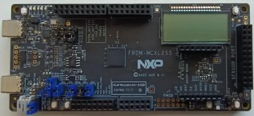

<!-- Copyright 2015-2026 Zephyr Project members and individual contributors. -->
<!-- SPDX-License-Identifier: Apache-2.0 -->
<!-- 中文翻译；编号、导航与译注为本地新增。 -->

<a id="frdm_mcxl255"></a>

# 第12章\_FRDM-MCXL255

原文：[官方页面](https://docs.zephyrproject.org/latest/boards/nxp/frdm_mcxl255/doc/index.html)。读取日期：2026-10-16；来源摘要见[来源记录](../SOURCES.md)。

开发板概览（Board Overview）

<a id="id1"></a>

[](images/frdm_mcxl255.webp)

FRDM-MCXL255

名称（Name）：

`frdm_mcxl255`

厂商（Vendor）：

[恩智浦半导体（NXP Semiconductors）](https://docs.zephyrproject.org/latest/boards/index.html#vendor=nxp)

状态（Status）：

维护中（Maintained）

架构（Architecture）：

[arm](https://docs.zephyrproject.org/latest/boards/index.html#arch=arm)

片上系统（SoC）：

[mcxl255](https://docs.zephyrproject.org/latest/boards/index.html#soc=mcxl255)

<a id="board-github-link"></a>

[浏览开发板源码（Browse Board Sources）](https://github.com/zephyrproject-rtos/zephyr/blob/main//boards/nxp/frdm_mcxl255/doc/index.rst/../..)<a id="overview"></a>

## 概述（Overview）

FRDM-MCXL255是紧凑、可扩展的开发板，用于MCX L25x微控制器的快速原型开发。工业标准排针便于访问MCU I/O，板上集成开放标准串行接口、外部闪存及MCU-Link调试器。MCX L系列采用自适应动态电压控制（ADVC），优化低频运行功耗。与传统低功耗MCU相比，其专用超低功耗感知域（ULP Sense Domain）能在主核保持深度低功耗模式（Deep Power Mode）时运行低功耗外设，避免触发事件唤醒主核，使数据采集维持极低功耗。

<a id="hardware"></a>

## 硬件（Hardware）


- NXP MCX L255微控制器（MCU）
- 支持CMSIS-DAP的板载MCU-Link调试器
- Arduino排针、mikroBUS、Pmod及传感器端口

<a id="main-domain"></a>

### 主域（Main Domain）


- 96 MHz Cortex-M33，带浮点单元（FPU）、内存保护单元（MPU）、单指令多数据（SIMD）及TrustZone，支持8个安全属性单元（SAU）区域
- 512 KB双存储体片内闪存；原文的on chip Flash重复出现
- 128 KB RAM
- 定时器：3个32位定时器、微滴答定时器（Micro Tick Timer）、窗口看门狗（Windowed WDT）及操作系统事件定时器（OS Event Timer）
- 接口：2路LPUART、2路LPI2C及2路LPSPI
- 安全模块：公钥密码引擎（PKC）、随机数发生器（RNG）、SHA512、AES-256、受保护闪存区域（PFR）及2个代码看门狗（Code Watchdog）
- 模拟外设：16位ADC及模拟比较器

<a id="always-on-domain"></a>

### 常开域（Always-on Domain）


- 10 MHz Cortex-M0+处理器
- 32 KB RAM
- 接口：1路LPUART及1路LPI2C
- 模拟外设：16位ADC、模拟比较器及温度传感器
- 定时器：实时时钟（RTC）及低功耗定时器（LP Timers）
- 段式LCD及键盘（Keypad）

MCX-L255 SoC及FRDM-MCXL255开发板的更多信息见以下资料：


- [MCX L Series 网站](https://www.nxp.com/products/processors-and-microcontrollers/arm-microcontrollers/general-purpose-mcus/mcx-arm-cortex-m/mcx-l-series-microcontrollers:MCX-L-SERIES)
- [MCX L系列产品简介（Fact Sheet）](https://www.nxp.com/docs/en/fact-sheet/MCXLFS.pdf)

<a id="supported-features"></a>

### 支持的功能（Supported Features）

`frdm_mcxl255`开发板支持下表所列的硬件功能。

片上／板载（On-Chip / On-Board）

功能集成在片上系统（SoC）内／位于开发板上。

2 / 2

分别表示已启用／已禁用的实例数。点击数量标签，可查看开发板或SoC设备树源码（DTS）中该功能的第一个实例。

`vnd,foo`

与此功能匹配的设备树绑定兼容字符串（Compatible String）；点击链接可查看绑定文档。

<a id="frdm_mcxl255-hw-features"></a>

<a id="frdm_mcxl255-frdm_mcxl255/mcxl255/cpu0-hw-features-section"></a>

#### `frdm_mcxl255/mcxl255/cpu0`目标（Target）

<a id="frdm_mcxl255-frdm_mcxl255/mcxl255/cpu0-hw-features-panel"></a>

<a id="frdm_mcxl255-frdm_mcxl255/mcxl255/cpu0-hw-features-memory"></a>

该开发板目标的片上存储容量：120 KiB RAM、512 KiB Flash。

<a id="frdm_mcxl255-frdm_mcxl255/mcxl255/cpu0-hw-features-table"></a>

<table>
<tr>
<th>类型（Type）</th>
<th>位置（Location）</th>
<th>说明（Description）</th>
<th>兼容字符串（Compatible）</th>
</tr>
<tr>
<td rowspan="1">中央处理器（CPU）</td>
<td>片上（On-Chip）</td>
<td>ARM Cortex-M33F处理器（CPU）（<a href="https://github.com/zephyrproject-rtos/zephyr/blob/main/dts/arm/nxp/mcx/mcxl/nxp_mcxl.dtsi?plain=1#L21">已启用：1</a>）</td>
<td><a href="../cpu_arm_riscv_binding_reference/P023_arm_cortex-m33f.md#std-dtcompatible-arm-cortex-m33f"><code>arm,cortex-m33f</code></a></td>
</tr>
<tr>
<td rowspan="2">模数转换器（ADC）</td>
<td>片上（On-Chip）</td>
<td>LPC低功耗模数转换器（LPADC）（<a href="https://github.com/zephyrproject-rtos/zephyr/blob/main/dts/arm/nxp/mcx/mcxl/nxp_mcxl255_cm33.dtsi?plain=1#L118">已启用：1</a>）</td>
<td><a href="../hardware/P851_NXPLPC低功耗ADC绑定.md#dtbinding-nxp-lpc-lpadc"><code>nxp,lpc-lpadc</code></a></td>
</tr>
<tr>
<td>片上（On-Chip）</td>
<td>NXP常开低功耗模数转换器（AON_LPADC）（<a href="https://github.com/zephyrproject-rtos/zephyr/blob/main/dts/arm/nxp/mcx/mcxl/nxp_mcxl255_cm33.dtsi?plain=1#L79">已启用：1</a>）</td>
<td><a href="../hardware/P848_NXPAON低功耗ADC绑定.md#dtbinding-nxp-aon-lpadc"><code>nxp,aon-lpadc</code></a></td>
</tr>
<tr>
<td rowspan="2">时钟控制（Clock Control）</td>
<td>片上（On-Chip）</td>
<td>LPC SYSCON及CLKCTL IP节点（<a href="https://github.com/zephyrproject-rtos/zephyr/blob/main/dts/arm/nxp/mcx/mcxl/nxp_mcxl.dtsi?plain=1#L72">已启用：1</a>）</td>
<td><a href="../clock_nxp_pico_realtek_renesas_binding_reference/P007_nxp_lpc-syscon.md#std-dtcompatible-nxp-lpc-syscon"><code>nxp,lpc-syscon</code></a></td>
</tr>
<tr>
<td>片上（On-Chip）</td>
<td>通用固定频率时钟提供者（Fixed-Rate Clock Provider）（<a href="https://github.com/zephyrproject-rtos/zephyr/blob/main/dts/arm/nxp/mcx/mcxl/nxp_mcxl.dtsi?plain=1#L303">已启用：7</a>；<a href="https://github.com/zephyrproject-rtos/zephyr/blob/main/dts/arm/nxp/mcx/mcxl/nxp_mcxl_aon.dtsi?plain=1#L20">已禁用：1</a>）</td>
<td><a href="../hardware/P566_固定时钟绑定.md#dtbinding-fixed-clock"><code>fixed-clock</code></a></td>
</tr>
<tr>
<td rowspan="1">时钟监测（Clock Monitor）</td>
<td>片上（On-Chip）</td>
<td>NXP频率测量（FREQME）模块（<a href="https://github.com/zephyrproject-rtos/zephyr/blob/main/dts/arm/nxp/mcx/mcxl/nxp_mcxl.dtsi?plain=1#L91">已启用：1</a>）</td>
<td><a href="../crc_clock_monitor_binding_reference/P004_nxp_freqme.md#std-dtcompatible-nxp-freqme"><code>nxp,freqme</code></a></td>
</tr>
<tr>
<td rowspan="1">比较器（Comparator）</td>
<td>片上（On-Chip）</td>
<td>NXP低功耗模拟比较器（LPACMP）（<a href="https://github.com/zephyrproject-rtos/zephyr/blob/main/dts/arm/nxp/mcx/mcxl/nxp_mcxl_aon.dtsi?plain=1#L75">已禁用：1</a>）</td>
<td><a href="../hardware/P746_NXP低功耗模拟比较器绑定.md#dtbinding-nxp-lpacmp"><code>nxp,lpacmp</code></a></td>
</tr>
<tr>
<td rowspan="4">计数器（Counter）</td>
<td>片上（On-Chip）</td>
<td>NXP MCUX标准定时器／计数器（Standard Timer/Counter）（<a href="https://github.com/zephyrproject-rtos/zephyr/blob/main/dts/arm/nxp/mcx/mcxl/nxp_mcxl255_cm33.dtsi?plain=1#L134">已启用：1</a>；<a href="https://github.com/zephyrproject-rtos/zephyr/blob/main/dts/arm/nxp/mcx/mcxl/nxp_mcxl255_cm33.dtsi?plain=1#L146">已禁用：2</a>）</td>
<td><a href="../nxp_nuvoton_counter_binding_reference/P009_nxp_lpc-ctimer.md#std-dtcompatible-nxp-lpc-ctimer"><code>nxp,lpc-ctimer</code></a></td>
</tr>
<tr>
<td>片上（On-Chip）</td>
<td>NXP MCUX四通道定时器（QTMR / Quad Timer）（<a href="https://github.com/zephyrproject-rtos/zephyr/blob/main/dts/arm/nxp/mcx/mcxl/nxp_mcxl_aon.dtsi?plain=1#L105">已禁用：2</a>）</td>
<td><a href="../nxp_nuvoton_counter_binding_reference/P005_nxp_imx-qtmr.md#std-dtcompatible-nxp-imx-qtmr"><code>nxp,imx-qtmr</code></a></td>
</tr>
<tr>
<td>片上（On-Chip）</td>
<td>NXP MCUX四通道定时器通道（Quad Timer Channel）（<a href="https://github.com/zephyrproject-rtos/zephyr/blob/main/dts/arm/nxp/mcx/mcxl/nxp_mcxl_aon.dtsi?plain=1#L112">已禁用：8</a>）</td>
<td><a href="../nxp_nuvoton_counter_binding_reference/P007_nxp_imx-tmr.md#std-dtcompatible-nxp-imx-tmr"><code>nxp,imx-tmr</code></a></td>
</tr>
<tr>
<td>片上（On-Chip）</td>
<td>NXP低功耗定时器（LPTMR）（<a href="https://github.com/zephyrproject-rtos/zephyr/blob/main/dts/arm/nxp/mcx/mcxl/nxp_mcxl_aon.dtsi?plain=1#L180">已启用：1</a>）</td>
<td><a href="../nxp_nuvoton_counter_binding_reference/P013_nxp_lptmr.md#std-dtcompatible-nxp-lptmr"><code>nxp,lptmr</code></a></td>
</tr>
<tr>
<td rowspan="1">循环冗余校验（CRC）</td>
<td>片上（On-Chip）</td>
<td>NXP循环冗余校验（CRC）设备（<a href="https://github.com/zephyrproject-rtos/zephyr/blob/main/dts/arm/nxp/mcx/mcxl/nxp_mcxl.dtsi?plain=1#L288">已启用：1</a>）</td>
<td><a href="../crc_clock_monitor_binding_reference/P006_nxp_crc.md#std-dtcompatible-nxp-crc"><code>nxp,crc</code></a></td>
</tr>
<tr>
<td rowspan="1">直接存储器访问（DMA）</td>
<td>片上（On-Chip）</td>
<td>NXP MCUX增强型DMA（EDMA）控制器（<a href="https://github.com/zephyrproject-rtos/zephyr/blob/main/dts/arm/nxp/mcx/mcxl/nxp_mcxl.dtsi?plain=1#L242">已启用：1</a>；<a href="https://github.com/zephyrproject-rtos/zephyr/blob/main/dts/arm/nxp/mcx/mcxl/nxp_mcxl.dtsi?plain=1#L254">已禁用：1</a>）</td>
<td><a href="../nxp_realtek_renesas_dma_binding_reference/P004_nxp_mcux-edma.md#std-dtcompatible-nxp-mcux-edma"><code>nxp,mcux-edma</code></a></td>
</tr>
<tr>
<td rowspan="1">闪存控制器（Flash Controller）</td>
<td>片上（On-Chip）</td>
<td>NXP MSF1闪存模块（FMU）（<a href="https://github.com/zephyrproject-rtos/zephyr/blob/main/dts/arm/nxp/mcx/mcxl/nxp_mcxl.dtsi?plain=1#L158">已禁用：1</a>）</td>
<td><a href="../flash_nuvoton_nxp_renesas_binding_reference/P018_nxp_msf1.md#std-dtcompatible-nxp-msf1"><code>nxp,msf1</code></a></td>
</tr>
<tr>
<td rowspan="1">通用输入输出与接插件（GPIO &amp; Headers）</td>
<td>片上（On-Chip）</td>
<td>Kinetis通用输入输出（GPIO）（<a href="https://github.com/zephyrproject-rtos/zephyr/blob/main/dts/arm/nxp/mcx/mcxl/nxp_mcxl.dtsi?plain=1#L190">已启用：4</a>）</td>
<td><a href="../gpio_nxp_expanders_binding_reference/P002_nxp_kinetis-gpio.md#std-dtcompatible-nxp-kinetis-gpio"><code>nxp,kinetis-gpio</code></a></td>
</tr>
<tr>
<td rowspan="1">硬件信息（Hardware Information）</td>
<td>片上（On-Chip）</td>
<td>NXP LPC 128位唯一标识符（Unique Identifier）（<a href="https://github.com/zephyrproject-rtos/zephyr/blob/main/dts/arm/nxp/mcx/mcxl/nxp_mcxl.dtsi?plain=1#L166">已启用：1</a>）</td>
<td><a href="../hwinfo_binding_reference/P009_nxp_lpc-uid.md#std-dtcompatible-nxp-lpc-uid"><code>nxp,lpc-uid</code></a></td>
</tr>
<tr>
<td rowspan="1">集成电路间总线（I2C）</td>
<td>片上（On-Chip）</td>
<td>NXP低功耗I2C（LPI2C）控制器（<a href="https://github.com/zephyrproject-rtos/zephyr/blob/main/dts/arm/nxp/mcx/mcxl/nxp_mcxl255_cm33.dtsi?plain=1#L55">已启用：3</a>）</td>
<td><a href="../i2c_nxp_pico_renesas_binding_reference/P005_nxp_lpi2c.md#std-dtcompatible-nxp-lpi2c"><code>nxp,lpi2c</code></a></td>
</tr>
<tr>
<td rowspan="2">输入（Input）</td>
<td>片上（On-Chip）</td>
<td>NXP KPP控制器（<a href="https://github.com/zephyrproject-rtos/zephyr/blob/main/dts/arm/nxp/mcx/mcxl/nxp_mcxl_aon.dtsi?plain=1#L201">已启用：1</a>）</td>
<td><a href="../input_keyboard_optical_ctsu_binding_reference/P010_nxp_mcux-kpp.md#std-dtcompatible-nxp-mcux-kpp"><code>nxp,mcux-kpp</code></a></td>
</tr>
<tr>
<td>板载（On-Board）</td>
<td>一组绑定到 GPIO 的输入按键（GPIO-Bound Input Keys）（<a href="https://github.com/zephyrproject-rtos/zephyr/blob/main/boards/nxp/frdm_mcxl255/frdm_mcxl255-common.dtsi?plain=1#L8">已启用：1</a>）</td>
<td><a href="../hardware/P563_GPIO按键绑定.md#std-dtcompatible-gpio-keys"><code>gpio-keys</code></a></td>
</tr>
<tr>
<td rowspan="1">中断控制器（Interrupt Controller）</td>
<td>片上（On-Chip）</td>
<td>ARMv8-M嵌套向量中断控制器（NVIC / Nested Vectored Interrupt Controller）（<a href="https://github.com/zephyrproject-rtos/zephyr/blob/main/dts/arm/armv8-m.dtsi?plain=1#L13">已启用：1</a>）</td>
<td><a href="../arm_interrupt_timer_binding_reference/P003_ARMv8_M_NVIC.md#std-dtcompatible-arm-v8m-nvic"><code>arm,v8m-nvic</code></a></td>
</tr>
<tr>
<td rowspan="1">发光二极管（LED）</td>
<td>板载（On-Board）</td>
<td>一组由 GPIO 控制的 LED（GPIO-Controlled LEDs）（<a href="https://github.com/zephyrproject-rtos/zephyr/blob/main/boards/nxp/frdm_mcxl255/frdm_mcxl255_mcxl255_cpu0.dtsi?plain=1#L40">已启用：1</a>）</td>
<td><a href="../hardware/P564_GPIO指示灯绑定.md#dtbinding-gpio-leds"><code>gpio-leds</code></a></td>
</tr>
<tr>
<td rowspan="1">邮箱（Mailbox）</td>
<td>片上（On-Chip）</td>
<td>用作Zephyr邮箱（MBOX）的NXP i.MX消息单元（<a href="https://github.com/zephyrproject-rtos/zephyr/blob/main/dts/arm/nxp/mcx/mcxl/nxp_mcxl.dtsi?plain=1#L279">已启用：1</a>；<a href="https://github.com/zephyrproject-rtos/zephyr/blob/main/dts/arm/nxp/mcx/mcxl/nxp_mcxl_aon.dtsi?plain=1#L90">已禁用：1</a>）</td>
<td><a href="../intercore_reference/P047_NXPiMX消息单元邮箱绑定.md#dtbinding-nxp-mbox-imx-mu"><code>nxp,mbox-imx-mu</code></a></td>
</tr>
<tr>
<td rowspan="1">内存管理单元／内存保护单元（MMU / MPU）</td>
<td>片上（On-Chip）</td>
<td>ARMv8-M存储器保护单元（MPU / Memory Protection Unit）（<a href="https://github.com/zephyrproject-rtos/zephyr/blob/main/dts/arm/nxp/mcx/mcxl/nxp_mcxl.dtsi?plain=1#L27">已启用：1</a>）</td>
<td><a href="../memory_protection_binding_reference/P007_arm_armv8m-mpu.md#std-dtcompatible-arm-armv8m-mpu"><code>arm,armv8m-mpu</code></a></td>
</tr>
<tr>
<td rowspan="1">存储技术设备（MTD）</td>
<td>片上（On-Chip）</td>
<td>闪存（Flash）节点（<a href="https://github.com/zephyrproject-rtos/zephyr/blob/main/dts/arm/nxp/mcx/mcxl/nxp_mcxl255_cm33.dtsi?plain=1#L90">已启用：1</a>）</td>
<td><a href="../mtd_nxp_st_ti_partition_binding_reference/P013_soc-nv-flash.md#std-dtcompatible-soc-nv-flash"><code>soc-nv-flash</code></a></td>
</tr>
<tr>
<td rowspan="1">多路复用器（MUX）</td>
<td>片上（On-Chip）</td>
<td>NXP输入复用器（INPUTMUX）外设绑定（<a href="https://github.com/zephyrproject-rtos/zephyr/blob/main/dts/arm/nxp/mcx/mcxl/nxp_mcxl.dtsi?plain=1#L83">已启用：1</a>）</td>
<td><a href="../mux_w1_binding_reference/P004_nxp_inputmux.md#std-dtcompatible-nxp-inputmux"><code>nxp,inputmux</code></a></td>
</tr>
<tr>
<td rowspan="2">引脚控制（Pin Control）</td>
<td>片上（On-Chip）</td>
<td>NXP PORT引脚控制器（Pin Controller）（<a href="https://github.com/zephyrproject-rtos/zephyr/blob/main/dts/arm/nxp/mcx/mcxl/nxp_mcxl.dtsi?plain=1#L172">已启用：4</a>）</td>
<td><a href="../pinctrl_nxp_pico_binding_reference/P017_nxp_port-pinmux.md#std-dtcompatible-nxp-port-pinmux"><code>nxp,port-pinmux</code></a></td>
</tr>
<tr>
<td>片上（On-Chip）</td>
<td>NXP PORT引脚控制器（Pin Controller）（<a href="https://github.com/zephyrproject-rtos/zephyr/blob/main/dts/arm/nxp/mcx/mcxl/nxp_mcxl.dtsi?plain=1#L39">已启用：1</a>）</td>
<td><a href="../pinctrl_nxp_pico_binding_reference/P016_nxp_port-pinctrl.md#std-dtcompatible-nxp-port-pinctrl"><code>nxp,port-pinctrl</code></a></td>
</tr>
<tr>
<td rowspan="1">电源管理（Power Management）</td>
<td>片上（On-Chip）</td>
<td>NXP内核模式控制器（CMC）（<a href="https://github.com/zephyrproject-rtos/zephyr/blob/main/dts/arm/nxp/mcx/mcxl/nxp_mcxl.dtsi?plain=1#L266">已启用：1</a>）</td>
<td><a href="../power_control_binding_reference/P014_nxp_cmc.md#std-dtcompatible-nxp-cmc"><code>nxp,cmc</code></a></td>
</tr>
<tr>
<td rowspan="1">复位控制器（Reset Controller）</td>
<td>片上（On-Chip）</td>
<td>NXP MRCC外设复位控制器（<a href="https://github.com/zephyrproject-rtos/zephyr/blob/main/dts/arm/nxp/mcx/mcxl/nxp_mcxl.dtsi?plain=1#L77">已启用：1</a>）</td>
<td><a href="../reset_controller_binding_reference/P010_nxp_mrcc-reset.md#std-dtcompatible-nxp-mrcc-reset"><code>nxp,mrcc-reset</code></a></td>
</tr>
<tr>
<td rowspan="1">实时时钟（RTC）</td>
<td>片上（On-Chip）</td>
<td>NXP RTC模拟模块（Analog Module）（<a href="https://github.com/zephyrproject-rtos/zephyr/blob/main/dts/arm/nxp/mcx/mcxl/nxp_mcxl_aon.dtsi?plain=1#L81">已启用：1</a>）</td>
<td><a href="../microchip_microcrystal_nxp_rtc_binding_reference/P018_nxp_rtc-analog.md#std-dtcompatible-nxp-rtc-analog"><code>nxp,rtc-analog</code></a></td>
</tr>
<tr>
<td rowspan="1">串行控制器（Serial Controller）</td>
<td>片上（On-Chip）</td>
<td>NXP低功耗UART（LPUART）（<a href="https://github.com/zephyrproject-rtos/zephyr/blob/main/dts/arm/nxp/mcx/mcxl/nxp_mcxl.dtsi?plain=1#L220">已启用：2</a>；<a href="https://github.com/zephyrproject-rtos/zephyr/blob/main/dts/arm/nxp/mcx/mcxl/nxp_mcxl_aon.dtsi?plain=1#L61">已禁用：1</a>）</td>
<td><a href="../uart_microchip_nordic_nxp_binding_reference/P017_nxp_lpuart.md#std-dtcompatible-nxp-lpuart"><code>nxp,lpuart</code></a></td>
</tr>
<tr>
<td rowspan="1">串行外设接口（SPI）</td>
<td>片上（On-Chip）</td>
<td>NXP低功耗SPI（LPSPI）控制器（<a href="https://github.com/zephyrproject-rtos/zephyr/blob/main/dts/arm/nxp/mcx/mcxl/nxp_mcxl255_cm33.dtsi?plain=1#L31">已启用：2</a>）</td>
<td><a href="../spi_flexspi_nxp_renesas_binding_reference/P004_nxp_lpspi.md#std-dtcompatible-nxp-lpspi"><code>nxp,lpspi</code></a></td>
</tr>
<tr>
<td rowspan="1">静态随机存储器（SRAM）</td>
<td>片上（On-Chip）</td>
<td>通用片上静态随机存储器（SRAM）（<a href="https://github.com/zephyrproject-rtos/zephyr/blob/main/dts/arm/nxp/mcx/mcxl/nxp_mcxl.dtsi?plain=1#L56">已启用：1</a>）</td>
<td><a href="../hardware/P567_内存映射SRAM绑定.md#dtbinding-mmio-sram"><code>mmio-sram</code></a></td>
</tr>
<tr>
<td rowspan="2">定时器（Timer）</td>
<td>片上（On-Chip）</td>
<td>i.MX RT5xx／6xx上的NXP操作系统定时器（OS Timer）（<a href="https://github.com/zephyrproject-rtos/zephyr/blob/main/dts/arm/nxp/mcx/mcxl/nxp_mcxl.dtsi?plain=1#L296">已禁用：1</a>）</td>
<td><a href="../microchip_nordic_nxp_realtek_timer_binding_reference/P008_nxp_os-timer.md#std-dtcompatible-nxp-os-timer"><code>nxp,os-timer</code></a></td>
</tr>
<tr>
<td>片上（On-Chip）</td>
<td>ARMv8-M系统节拍（System Tick）（<a href="https://github.com/zephyrproject-rtos/zephyr/blob/main/dts/arm/armv8-m.dtsi?plain=1#L21">已启用：1</a>）</td>
<td><a href="../arm_interrupt_timer_binding_reference/P007_ARMv8_M_SysTick.md#std-dtcompatible-arm-armv8m-systick"><code>arm,armv8m-systick</code></a></td>
</tr>
<tr>
<td rowspan="1">看门狗（Watchdog）</td>
<td>片上（On-Chip）</td>
<td>LPC窗口看门狗定时器（Windowed Watchdog Timer）（<a href="https://github.com/zephyrproject-rtos/zephyr/blob/main/dts/arm/nxp/mcx/mcxl/nxp_mcxl255_cm33.dtsi?plain=1#L107">已启用：1</a>）</td>
<td><a href="../nxp_nordic_nuvoton_watchdog_binding_reference/P011_nxp_lpc-wwdt.md#std-dtcompatible-nxp-lpc-wwdt"><code>nxp,lpc-wwdt</code></a></td>
</tr>
<tr>
<td rowspan="1">唤醒控制器（Wakeup Controller）</td>
<td>片上（On-Chip）</td>
<td>作为唤醒控制器（WUC）的NXP唤醒单元（WUU）（<a href="https://github.com/zephyrproject-rtos/zephyr/blob/main/dts/arm/nxp/mcx/mcxl/nxp_mcxl.dtsi?plain=1#L272">已启用：1</a>）</td>
<td><a href="../power_state_wakeup_binding_reference/P008_nxp_wuc-wuu.md#std-dtcompatible-nxp-wuc-wuu"><code>nxp,wuc-wuu</code></a></td>
</tr>
</table>

<a id="frdm_mcxl255-frdm_mcxl255/mcxl255/cpu1-hw-features-section"></a>

#### `frdm_mcxl255/mcxl255/cpu1`目标（Target）

<a id="frdm_mcxl255-frdm_mcxl255/mcxl255/cpu1-hw-features-panel"></a>

<a id="frdm_mcxl255-frdm_mcxl255/mcxl255/cpu1-hw-features-memory"></a>

该开发板目标的片上存储容量：32 KiB RAM、N/A Flash。

<a id="frdm_mcxl255-frdm_mcxl255/mcxl255/cpu1-hw-features-table"></a>

<table>
<tr>
<th>类型（Type）</th>
<th>位置（Location）</th>
<th>说明（Description）</th>
<th>兼容字符串（Compatible）</th>
</tr>
<tr>
<td rowspan="1">中央处理器（CPU）</td>
<td>片上（On-Chip）</td>
<td>ARM Cortex-M0+处理器（CPU）（<a href="https://github.com/zephyrproject-rtos/zephyr/blob/main/dts/arm/nxp/mcx/mcxl/nxp_mcxl255_cm0.dtsi?plain=1#L15">已启用：1</a>）</td>
<td><a href="../cpu_arm_riscv_binding_reference/P017_arm_cortex-m0+.md#std-dtcompatible-arm-cortex-m0"><code>arm,cortex-m0+</code></a></td>
</tr>
<tr>
<td rowspan="1">时钟控制（Clock Control）</td>
<td>片上（On-Chip）</td>
<td>通用固定频率时钟提供者（Fixed-Rate Clock Provider）（<a href="https://github.com/zephyrproject-rtos/zephyr/blob/main/dts/arm/nxp/mcx/mcxl/nxp_mcxl_aon.dtsi?plain=1#L14">已启用：6</a>；<a href="https://github.com/zephyrproject-rtos/zephyr/blob/main/dts/arm/nxp/mcx/mcxl/nxp_mcxl_aon.dtsi?plain=1#L20">已禁用：1</a>）</td>
<td><a href="../hardware/P566_固定时钟绑定.md#dtbinding-fixed-clock"><code>fixed-clock</code></a></td>
</tr>
<tr>
<td rowspan="1">比较器（Comparator）</td>
<td>片上（On-Chip）</td>
<td>NXP低功耗模拟比较器（LPACMP）（<a href="https://github.com/zephyrproject-rtos/zephyr/blob/main/dts/arm/nxp/mcx/mcxl/nxp_mcxl_aon.dtsi?plain=1#L75">已禁用：1</a>）</td>
<td><a href="../hardware/P746_NXP低功耗模拟比较器绑定.md#dtbinding-nxp-lpacmp"><code>nxp,lpacmp</code></a></td>
</tr>
<tr>
<td rowspan="3">计数器（Counter）</td>
<td>片上（On-Chip）</td>
<td>NXP MCUX四通道定时器（QTMR / Quad Timer）（<a href="https://github.com/zephyrproject-rtos/zephyr/blob/main/dts/arm/nxp/mcx/mcxl/nxp_mcxl_aon.dtsi?plain=1#L105">已禁用：2</a>）</td>
<td><a href="../nxp_nuvoton_counter_binding_reference/P005_nxp_imx-qtmr.md#std-dtcompatible-nxp-imx-qtmr"><code>nxp,imx-qtmr</code></a></td>
</tr>
<tr>
<td>片上（On-Chip）</td>
<td>NXP MCUX四通道定时器通道（Quad Timer Channel）（<a href="https://github.com/zephyrproject-rtos/zephyr/blob/main/dts/arm/nxp/mcx/mcxl/nxp_mcxl_aon.dtsi?plain=1#L112">已禁用：8</a>）</td>
<td><a href="../nxp_nuvoton_counter_binding_reference/P007_nxp_imx-tmr.md#std-dtcompatible-nxp-imx-tmr"><code>nxp,imx-tmr</code></a></td>
</tr>
<tr>
<td>片上（On-Chip）</td>
<td>NXP低功耗定时器（LPTMR）（<a href="https://github.com/zephyrproject-rtos/zephyr/blob/main/dts/arm/nxp/mcx/mcxl/nxp_mcxl_aon.dtsi?plain=1#L180">已启用：1</a>）</td>
<td><a href="../nxp_nuvoton_counter_binding_reference/P013_nxp_lptmr.md#std-dtcompatible-nxp-lptmr"><code>nxp,lptmr</code></a></td>
</tr>
<tr>
<td rowspan="1">通用输入输出与接插件（GPIO &amp; Headers）</td>
<td>片上（On-Chip）</td>
<td>Kinetis通用输入输出（GPIO）（<a href="https://github.com/zephyrproject-rtos/zephyr/blob/main/dts/arm/nxp/mcx/mcxl/nxp_mcxl_aon.dtsi?plain=1#L51">已启用：1</a>）</td>
<td><a href="../gpio_nxp_expanders_binding_reference/P002_nxp_kinetis-gpio.md#std-dtcompatible-nxp-kinetis-gpio"><code>nxp,kinetis-gpio</code></a></td>
</tr>
<tr>
<td rowspan="1">集成电路间总线（I2C）</td>
<td>片上（On-Chip）</td>
<td>NXP低功耗I2C（LPI2C）控制器（<a href="https://github.com/zephyrproject-rtos/zephyr/blob/main/dts/arm/nxp/mcx/mcxl/nxp_mcxl_aon.dtsi?plain=1#L169">已启用：1</a>）</td>
<td><a href="../i2c_nxp_pico_renesas_binding_reference/P005_nxp_lpi2c.md#std-dtcompatible-nxp-lpi2c"><code>nxp,lpi2c</code></a></td>
</tr>
<tr>
<td rowspan="2">输入（Input）</td>
<td>片上（On-Chip）</td>
<td>NXP KPP控制器（<a href="https://github.com/zephyrproject-rtos/zephyr/blob/main/dts/arm/nxp/mcx/mcxl/nxp_mcxl_aon.dtsi?plain=1#L201">已启用：1</a>）</td>
<td><a href="../input_keyboard_optical_ctsu_binding_reference/P010_nxp_mcux-kpp.md#std-dtcompatible-nxp-mcux-kpp"><code>nxp,mcux-kpp</code></a></td>
</tr>
<tr>
<td>板载（On-Board）</td>
<td>一组绑定到 GPIO 的输入按键（GPIO-Bound Input Keys）（<a href="https://github.com/zephyrproject-rtos/zephyr/blob/main/boards/nxp/frdm_mcxl255/frdm_mcxl255-common.dtsi?plain=1#L8">已启用：1</a>）</td>
<td><a href="../hardware/P563_GPIO按键绑定.md#std-dtcompatible-gpio-keys"><code>gpio-keys</code></a></td>
</tr>
<tr>
<td rowspan="1">中断控制器（Interrupt Controller）</td>
<td>片上（On-Chip）</td>
<td>ARMv6-M嵌套向量中断控制器（NVIC / Nested Vectored Interrupt Controller）（<a href="https://github.com/zephyrproject-rtos/zephyr/blob/main/dts/arm/armv6-m.dtsi?plain=1#L13">已启用：1</a>）</td>
<td><a href="../arm_interrupt_timer_binding_reference/P001_ARMv6_M_NVIC.md#std-dtcompatible-arm-v6m-nvic"><code>arm,v6m-nvic</code></a></td>
</tr>
<tr>
<td rowspan="1">邮箱（Mailbox）</td>
<td>片上（On-Chip）</td>
<td>用作Zephyr邮箱（MBOX）的NXP i.MX消息单元（<a href="https://github.com/zephyrproject-rtos/zephyr/blob/main/dts/arm/nxp/mcx/mcxl/nxp_mcxl_aon.dtsi?plain=1#L90">已启用：1</a>）</td>
<td><a href="../intercore_reference/P047_NXPiMX消息单元邮箱绑定.md#dtbinding-nxp-mbox-imx-mu"><code>nxp,mbox-imx-mu</code></a></td>
</tr>
<tr>
<td rowspan="2">引脚控制（Pin Control）</td>
<td>片上（On-Chip）</td>
<td>NXP PORT引脚控制器（Pin Controller）（<a href="https://github.com/zephyrproject-rtos/zephyr/blob/main/dts/arm/nxp/mcx/mcxl/nxp_mcxl_aon.dtsi?plain=1#L45">已启用：1</a>）</td>
<td><a href="../pinctrl_nxp_pico_binding_reference/P017_nxp_port-pinmux.md#std-dtcompatible-nxp-port-pinmux"><code>nxp,port-pinmux</code></a></td>
</tr>
<tr>
<td>片上（On-Chip）</td>
<td>NXP PORT引脚控制器（Pin Controller）（<a href="https://github.com/zephyrproject-rtos/zephyr/blob/main/dts/arm/nxp/mcx/mcxl/nxp_mcxl255_cm0.dtsi?plain=1#L35">已启用：1</a>）</td>
<td><a href="../pinctrl_nxp_pico_binding_reference/P016_nxp_port-pinctrl.md#std-dtcompatible-nxp-port-pinctrl"><code>nxp,port-pinctrl</code></a></td>
</tr>
<tr>
<td rowspan="1">实时时钟（RTC）</td>
<td>片上（On-Chip）</td>
<td>NXP RTC模拟模块（Analog Module）（<a href="https://github.com/zephyrproject-rtos/zephyr/blob/main/dts/arm/nxp/mcx/mcxl/nxp_mcxl_aon.dtsi?plain=1#L81">已启用：1</a>）</td>
<td><a href="../microchip_microcrystal_nxp_rtc_binding_reference/P018_nxp_rtc-analog.md#std-dtcompatible-nxp-rtc-analog"><code>nxp,rtc-analog</code></a></td>
</tr>
<tr>
<td rowspan="1">串行控制器（Serial Controller）</td>
<td>片上（On-Chip）</td>
<td>NXP低功耗UART（LPUART）（<a href="https://github.com/zephyrproject-rtos/zephyr/blob/main/dts/arm/nxp/mcx/mcxl/nxp_mcxl_aon.dtsi?plain=1#L61">已启用：1</a>）</td>
<td><a href="../uart_microchip_nordic_nxp_binding_reference/P017_nxp_lpuart.md#std-dtcompatible-nxp-lpuart"><code>nxp,lpuart</code></a></td>
</tr>
<tr>
<td rowspan="1">定时器（Timer）</td>
<td>片上（On-Chip）</td>
<td>ARMv6-M系统节拍（System Tick）（<a href="https://github.com/zephyrproject-rtos/zephyr/blob/main/dts/arm/armv6-m.dtsi?plain=1#L21">已启用：1</a>）</td>
<td><a href="../arm_interrupt_timer_binding_reference/P005_ARMv6_M_SysTick.md#std-dtcompatible-arm-armv6m-systick"><code>arm,armv6m-systick</code></a></td>
</tr>
</table>

<a id="targets-available"></a>

### 可用构建目标（Targets Available）

默认配置仅启用第一个核。CPU0是唯一无需调试器即可独立运行的目标，并负责初始化CPU1。也支持单独构建CPU1，但它只有在调试器启动该核后，才能独立运行。

<a id="connections-and-ios"></a>

### 连接与输入输出（Connections and IOs）

MCX-L255 SoC有4个GPIO控制器，可通过引脚复用（Pinmux）寄存器配置引脚功能。

<table>
<tr>
<th>名称（Name）</th>
<th>功能（Function）</th>
<th>用途（Usage）</th>
</tr>
<tr>
<td>P2_10</td>
<td>通用异步收发器（UART）</td>
<td>CPU0 UART接收（RX）</td>
</tr>
<tr>
<td>P2_11</td>
<td>通用异步收发器（UART）</td>
<td>CPU0 UART发送（TX）</td>
</tr>
<tr>
<td>P0_7</td>
<td>通用异步收发器（UART）</td>
<td>CPU1 UART接收（RX）</td>
</tr>
<tr>
<td>P0_6</td>
<td>通用异步收发器（UART）</td>
<td>CPU1 UART发送（TX）</td>
</tr>
</table>

<a id="system-clock"></a>

### 系统时钟（System Clock）

MCX-L255 SoC为CPU0配置96 MHz FRO 96M（FIRC）作为系统时钟源；CPU1配置为使用FRO10M（LPIRC）。

<a id="serial-port"></a>

### 串口（Serial Port）

FRDM-MCXL255 SoC有3路LPUART接口，默认控制台使用LPUART0。

<a id="programming-and-debugging"></a>

## 烧录与调试（Programming and Debugging）

`frdm_mcxl255`开发板支持下表所列的运行工具（Runners）及相关west命令。

<table>
<tr>
<th></th>
<th>烧录（flash）</th>
<th>调试（debug）</th>
<th>连接调试会话（attach）</th>
<th>实时传输（rtt）</th>
<th>复位（reset）</th>
<th>调试服务器（debugserver）</th>
</tr>
<tr>
<td><a href="https://docs.zephyrproject.org/latest/develop/flash_debug/host-tools.html#runner-jlink">jlink</a></td>
<td>✅</td>
<td>✅</td>
<td>✅</td>
<td>✅</td>
<td>✅</td>
<td>✅</td>
</tr>
<tr>
<td><a href="https://docs.zephyrproject.org/latest/develop/flash_debug/host-tools.html#runner-linkserver">linkserver</a></td>
<td>✅（默认 / default）</td>
<td>✅（默认 / default）</td>
<td>✅</td>
<td></td>
<td></td>
<td>✅</td>
</tr>
</table>

按通常方式构建并烧录应用，详见“构建应用”（[Building an Application](../application/P001_应用开发.md#build-an-application)）与“运行应用”（[Run an Application](https://docs.zephyrproject.org/latest/develop/application/index.html#application-run)）。

<a id="configuring-a-debug-probe"></a>

### 配置调试探针（Configuring a Debug Probe）

烧录和调试均使用调试探针，默认配置为MCU-Link CMSIS-DAP板载调试探针。

<a id="using-linkserver"></a>

#### 使用LinkServer

默认运行工具为LinkServer，支持出厂MCU-Link固件。只有板载调试电路固件被更换时，才需按MCU-Link CMSIS-DAP板载调试探针说明重新写入默认固件。进入ISP模式的方法是上电或复位期间按住SW3，然后松开；原文在该步骤前还混有“short jumper”字样，未给出跳线编号。（[板载MCU-Link CMSIS-DAP调试探针（Onboard Debug Probe）](https://docs.zephyrproject.org/latest/develop/flash_debug/probes.html#mcu-link-cmsis-onboard-debug-probe)）

<a id="using-j-link"></a>

#### 使用J-Link

有两种方案。第一种按MCU-Link J-Link板载调试探针说明，将板载调试电路更新为Segger J-Link固件。写入前需进入ISP模式：上电或复位期间按住SW3，随后松开。（[MCU-Link J-Link板载调试探针（Onboard Debug Probe）](https://docs.zephyrproject.org/latest/develop/flash_debug/probes.html#mcu-link-jlink-onboard-debug-probe)）

第二种方案将外部J-Link调试探针连接到10引脚SWD连接器J17。两种方案都需给west传入-r jlink，选择J-Link运行工具。（[J-Link外部调试探针（External Debug Probe）](https://docs.zephyrproject.org/latest/develop/flash_debug/probes.html#jlink-external-debug-probe)）

```text
west flash -r jlink
```

<a id="configuring-a-console"></a>

### 配置控制台（Configuring a Console）

用USB线缆将PC连接到J16，在所选串口终端（如minicom、PuTTY）中使用以下设置：


- 速率（Speed）：115200波特率
- 数据位（Data）：8位
- 奇偶校验（Parity）：无（None）
- 停止位（Stop Bits）：1位

<a id="flashing"></a>

### 烧录（Flashing）

下面以[Hello World](../getting_started/P005_HelloWorld示例.md#hello_world)应用为例。

```text
# From the root of the zephyr repository
west build -b frdm_mcxl255/mcxl255/cpu0 samples/hello_world
west flash
```

打开串口终端，复位开发板（按下RESET按键），应能在终端中看到以下消息：

```text
*** Booting Zephyr OS build v4.3.0-2208-gcf34f44c1e18 ***
Hello World! frdm_mcxl255/mcxl255/cpu0
```

<a id="debugging"></a>

### 调试（Debugging）

下面以[Hello World](../getting_started/P005_HelloWorld示例.md#hello_world)应用为例。

```text
# From the root of the zephyr repository
west build -b frdm_mcxl255/mcxl255/cpu0 samples/hello_world
west debug
```

打开串口终端，在调试器中单步运行应用，应能在终端中看到以下消息：

```text
*** Booting Zephyr OS build v4.3.0-2208-gcf34f44c1e18 ***
Hello World! frdm_mcxl255/mcxl255/cpu0
```

## 译注

CPU0负责CPU1初始化；CPU1独立构建仍需调试器启动。原文ISP步骤混入short jumper字样，但实际描述为上电或复位时按住SW3，未列跳线编号。

## 原文外链核对

2026-10-16核对并重试以下原文外链时未能确认可访问性，保留原始目标，不将访问失败解释为原文内容有误。

- [MCXLFS.pdf](https://www.nxp.com/docs/en/fact-sheet/MCXLFS.pdf)：HTTP Error 404: Not Found。
- [mcx-l-series-microcontrollers:MCX-L-SERIES](https://www.nxp.com/products/processors-and-microcontrollers/arm-microcontrollers/general-purpose-mcus/mcx-arm-cortex-m/mcx-l-series-microcontrollers:MCX-L-SERIES)：HTTP Error 404: Not Found。

---

[上一章](P011_FRDM-MCXE31B.md) · [返回大纲](大纲.md) · [全站翻译进度](../PROGRESS.md) · [下一章](P013_FRDM-MCXN236.md)
