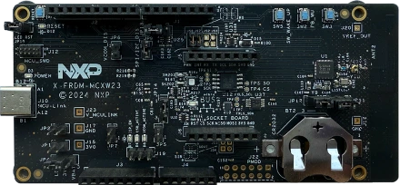

<!-- Copyright 2015-2026 Zephyr Project members and individual contributors. -->
<!-- SPDX-License-Identifier: Apache-2.0 -->
<!-- 中文翻译；编号、导航与译注为本地新增。 -->

<a id="frdm_mcxw23"></a>

# 第15章\_FRDM-MCXW23

原文：[官方页面](https://docs.zephyrproject.org/latest/boards/nxp/frdm_mcxw23/doc/index.html)。读取日期：2026-10-16；来源摘要见[来源记录](../SOURCES.md)。

开发板概览（Board Overview）

<a id="id1"></a>

[](images/frdm_mcxw23.webp)

FRDM-MCXW23

名称（Name）：

`frdm_mcxw23`

厂商（Vendor）：

[恩智浦半导体（NXP Semiconductors）](https://docs.zephyrproject.org/latest/boards/index.html#vendor=nxp)

状态（Status）：

维护中（Maintained）

架构（Architecture）：

[arm](https://docs.zephyrproject.org/latest/boards/index.html#arch=arm)

片上系统（SoC）：

[mcxw236](https://docs.zephyrproject.org/latest/boards/index.html#soc=mcxw236)

<a id="board-github-link"></a>

[浏览开发板源码（Browse Board Sources）](https://github.com/zephyrproject-rtos/zephyr/blob/main//boards/nxp/frdm_mcxw23/doc/index.rst/../..)<a id="overview"></a>

## 概述（Overview）

FRDM-MCXW23是紧凑、可扩展的开发板，采用支持低功耗蓝牙（Bluetooth LE）5.3的MCX W23无线MCU。它适合为便携医疗、家电及自动化、资产跟踪等应用开发电池供电的小型设备原型。板载加速度计、温度传感器、数据闪存及LED，可由3 V纽扣电池通过集成降压DC-DC供电，也可使用USB总线电源，便于评估MCX W23并快速制作原型。

<a id="hardware"></a>

## 硬件（Hardware）


- MCXW23 Arm Cortex-M33微控制器，最高32 MHz
- 片上1 MB闪存及128 KB SRAM
- 40引脚薄型四方扁平无引脚封装（HVQFN）
- 支持CMSIS-DAP的板载MCU-Link调试器
- 三色LED
- 复位、ISP、唤醒及用户按键，便于测试软件功能
- NXP FXLS8974CFR3加速度计
- P3T1755温度传感器
- 64 Mbit、8 MB板载NOR闪存
- Arduino排针、mikroBUS及Pmod

MCXW236 SoC及FRDM-MCXW23开发板的更多信息见以下资料：


- [MCXW23 SoC网站](https://www.nxp.com/products/MCX-W23)
- [MCXW23 数据手册（Datasheet）](https://www.nxp.com/docs/en/data-sheet/MCXW23.pdf)
- [MCXW23 参考手册（Reference Manual）](https://www.nxp.com/webapp/Download?colCode=MCXW23RM)
- [FRDM-MCXW23 网站](https://www.nxp.com/design/design-center/development-boards-and-designs/FRDM-MCXW23)
- [FRDM-MCXW23 用户手册（User Manual）](https://www.nxp.com/webapp/Download?colCode=UM12359)
- [FRDM-MCXW23开发板设计文件（Design Files）](https://www.nxp.com/downloads/en/design-support/FRDM-MCXW23-Design-Files.zip)

<a id="supported-features"></a>

### 支持的功能（Supported Features）

`frdm_mcxw23`开发板支持下表所列的硬件功能。

片上／板载（On-Chip / On-Board）

功能集成在片上系统（SoC）内／位于开发板上。

2 / 2

分别表示已启用／已禁用的实例数。点击数量标签，可查看开发板或SoC设备树源码（DTS）中该功能的第一个实例。

`vnd,foo`

与此功能匹配的设备树绑定兼容字符串（Compatible String）；点击链接可查看绑定文档。

<a id="frdm_mcxw23-hw-features"></a>

<a id="frdm_mcxw23-frdm_mcxw23/mcxw236-hw-features-section"></a>

#### `frdm_mcxw23/mcxw236`目标（Target）

<a id="frdm_mcxw23-frdm_mcxw23/mcxw236-hw-features-panel"></a>

<a id="frdm_mcxw23-frdm_mcxw23/mcxw236-hw-features-memory"></a>

该开发板目标的片上存储容量：112 KiB RAM、1016 KiB Flash。

<a id="frdm_mcxw23-frdm_mcxw23/mcxw236-hw-features-table"></a>

<table>
<tr>
<th>类型（Type）</th>
<th>位置（Location）</th>
<th>说明（Description）</th>
<th>兼容字符串（Compatible）</th>
</tr>
<tr>
<td rowspan="1">中央处理器（CPU）</td>
<td>片上（On-Chip）</td>
<td>ARM Cortex-M33F处理器（CPU）（<a href="https://github.com/zephyrproject-rtos/zephyr/blob/main/dts/arm/nxp/mcx/mcxw/nxp_mcxw23x_common.dtsi?plain=1#L31">已启用：1</a>）</td>
<td><a href="../cpu_arm_riscv_binding_reference/P023_arm_cortex-m33f.md#std-dtcompatible-arm-cortex-m33f"><code>arm,cortex-m33f</code></a></td>
</tr>
<tr>
<td rowspan="1">ARM 架构（ARM Architecture）</td>
<td>片上（On-Chip）</td>
<td>NXP NBU中断信息（<a href="https://github.com/zephyrproject-rtos/zephyr/blob/main/dts/arm/nxp/mcx/mcxw/nxp_mcxw23x_common.dtsi?plain=1#L363">已启用：1</a>）</td>
<td><a href="../arm_nordic_nxp_control_binding_reference/P017_nxp_nbu.md#std-dtcompatible-nxp-nbu"><code>nxp,nbu</code></a></td>
</tr>
<tr>
<td rowspan="1">蓝牙（Bluetooth）</td>
<td>片上（On-Chip）</td>
<td>NXP低功耗蓝牙主机控制器接口（BLE HCI）信息（<a href="https://github.com/zephyrproject-rtos/zephyr/blob/main/dts/arm/nxp/mcx/mcxw/nxp_mcxw23x_common.dtsi?plain=1#L359">已启用：1</a>）</td>
<td><a href="../bluetooth_vendor_hci_binding_reference/P009_nxp_hci-ble.md#std-dtcompatible-nxp-hci-ble"><code>nxp,hci-ble</code></a></td>
</tr>
<tr>
<td rowspan="2">时钟控制（Clock Control）</td>
<td>片上（On-Chip）</td>
<td>LPC SYSCON及CLKCTL IP节点（<a href="https://github.com/zephyrproject-rtos/zephyr/blob/main/dts/arm/nxp/mcx/mcxw/nxp_mcxw23x_common.dtsi?plain=1#L122">已启用：1</a>）</td>
<td><a href="../clock_nxp_pico_realtek_renesas_binding_reference/P007_nxp_lpc-syscon.md#std-dtcompatible-nxp-lpc-syscon"><code>nxp,lpc-syscon</code></a></td>
</tr>
<tr>
<td>片上（On-Chip）</td>
<td>通用固定频率时钟提供者（Fixed-Rate Clock Provider）（<a href="https://github.com/zephyrproject-rtos/zephyr/blob/main/dts/arm/nxp/mcx/mcxw/nxp_mcxw23x_common.dtsi?plain=1#L80">已启用：2</a>）</td>
<td><a href="../hardware/P566_固定时钟绑定.md#dtbinding-fixed-clock"><code>fixed-clock</code></a></td>
</tr>
<tr>
<td rowspan="4">计数器（Counter）</td>
<td>片上（On-Chip）</td>
<td>使用NXP LPC RTC高分辨率计数器（High Resolution Counter）的驱动（<a href="https://github.com/zephyrproject-rtos/zephyr/blob/main/dts/arm/nxp/mcx/mcxw/nxp_mcxw23x_common.dtsi?plain=1#L186">已禁用：1</a>）</td>
<td><a href="../nxp_nuvoton_counter_binding_reference/P010_nxp_lpc-rtc-highres.md#std-dtcompatible-nxp-lpc-rtc-highres"><code>nxp,lpc-rtc-highres</code></a></td>
</tr>
<tr>
<td>片上（On-Chip）</td>
<td>NXP MCUX标准定时器／计数器（Standard Timer/Counter）（<a href="https://github.com/zephyrproject-rtos/zephyr/blob/main/dts/arm/nxp/mcx/mcxw/nxp_mcxw23x_common.dtsi?plain=1#L199">已启用：5</a>）</td>
<td><a href="../nxp_nuvoton_counter_binding_reference/P009_nxp_lpc-ctimer.md#std-dtcompatible-nxp-lpc-ctimer"><code>nxp,lpc-ctimer</code></a></td>
</tr>
<tr>
<td>片上（On-Chip）</td>
<td>NXP多速率定时器（Multirate Timer）（<a href="https://github.com/zephyrproject-rtos/zephyr/blob/main/dts/arm/nxp/mcx/mcxw/nxp_mcxw23x_common.dtsi?plain=1#L372">已启用：1</a>）</td>
<td><a href="../nxp_nuvoton_counter_binding_reference/P015_nxp_mrt.md#std-dtcompatible-nxp-mrt"><code>nxp,mrt</code></a></td>
</tr>
<tr>
<td>片上（On-Chip）</td>
<td>NXP多速率定时器通道（<a href="https://github.com/zephyrproject-rtos/zephyr/blob/main/dts/arm/nxp/mcx/mcxw/nxp_mcxw23x_common.dtsi?plain=1#L384">已启用：1</a>；<a href="https://github.com/zephyrproject-rtos/zephyr/blob/main/dts/arm/nxp/mcx/mcxw/nxp_mcxw23x_common.dtsi?plain=1#L390">已禁用：3</a>）</td>
<td><a href="../nxp_nuvoton_counter_binding_reference/P014_nxp_mrt-channel.md#std-dtcompatible-nxp-mrt-channel"><code>nxp,mrt-channel</code></a></td>
</tr>
<tr>
<td rowspan="1">循环冗余校验（CRC）</td>
<td>片上（On-Chip）</td>
<td>NXP LPC循环冗余校验（CRC）设备（<a href="https://github.com/zephyrproject-rtos/zephyr/blob/main/dts/arm/nxp/mcx/mcxw/nxp_mcxw23x_common.dtsi?plain=1#L192">已启用：1</a>）</td>
<td><a href="../crc_clock_monitor_binding_reference/P007_nxp_lpc-crc.md#std-dtcompatible-nxp-lpc-crc"><code>nxp,lpc-crc</code></a></td>
</tr>
<tr>
<td rowspan="1">直接存储器访问（DMA）</td>
<td>片上（On-Chip）</td>
<td>NXP LPC直接存储器访问（DMA）控制器（<a href="https://github.com/zephyrproject-rtos/zephyr/blob/main/dts/arm/nxp/mcx/mcxw/nxp_mcxw23x_common.dtsi?plain=1#L328">已启用：2</a>）</td>
<td><a href="../nxp_realtek_renesas_dma_binding_reference/P003_nxp_lpc-dma.md#std-dtcompatible-nxp-lpc-dma"><code>nxp,lpc-dma</code></a></td>
</tr>
<tr>
<td rowspan="1">闪存控制器（Flash Controller）</td>
<td>片上（On-Chip）</td>
<td>用于lpc55xxx系列、但不包括lpc553x的NXP在应用编程（IAP / In-Application Programming）闪存控制器（<a href="https://github.com/zephyrproject-rtos/zephyr/blob/main/dts/arm/nxp/mcx/mcxw/nxp_mcxw236_ns.dtsi?plain=1#L17">已启用：1</a>）</td>
<td><a href="../flash_nuvoton_nxp_renesas_binding_reference/P011_nxp_iap-fmc55.md#std-dtcompatible-nxp-iap-fmc55"><code>nxp,iap-fmc55</code></a></td>
</tr>
<tr>
<td rowspan="4">通用输入输出与接插件（GPIO &amp; Headers）</td>
<td>片上（On-Chip）</td>
<td>LPC通用输入输出（GPIO）（<a href="https://github.com/zephyrproject-rtos/zephyr/blob/main/dts/arm/nxp/mcx/mcxw/nxp_mcxw23x_common.dtsi?plain=1#L153">已启用：1</a>）</td>
<td><a href="../gpio_nxp_expanders_binding_reference/P006_nxp_lpc-gpio.md#std-dtcompatible-nxp-lpc-gpio"><code>nxp,lpc-gpio</code></a></td>
</tr>
<tr>
<td>片上（On-Chip）</td>
<td>LPC GPIO端口设备（<a href="https://github.com/zephyrproject-rtos/zephyr/blob/main/dts/arm/nxp/mcx/mcxw/nxp_mcxw23x_common.dtsi?plain=1#L159">已启用：1</a>）</td>
<td><a href="../gpio_nxp_expanders_binding_reference/P005_nxp_lpc-gpio-port.md#std-dtcompatible-nxp-lpc-gpio-port"><code>nxp,lpc-gpio-port</code></a></td>
</tr>
<tr>
<td>板载（On-Board）</td>
<td>通过Mikro BUS排针引出的GPIO引脚（<a href="https://github.com/zephyrproject-rtos/zephyr/blob/main/boards/nxp/frdm_mcxw23/frdm_mcxw23_common.dtsi?plain=1#L81">已启用：1</a>）</td>
<td><a href="../gpio_microchip_nordic_nuvoton_binding_reference/P006_mikro-bus.md#std-dtcompatible-mikro-bus"><code>mikro-bus</code></a></td>
</tr>
<tr>
<td>板载（On-Board）</td>
<td>引出到Arduino Uno R3排针（Headers）的GPIO引脚（<a href="https://github.com/zephyrproject-rtos/zephyr/blob/main/boards/nxp/frdm_mcxw23/frdm_mcxw23_common.dtsi?plain=1#L100">已启用：1</a>）</td>
<td><a href="../gpio_adi_headers_ambiq_binding_reference/P023_arduino-header-r3.md#std-dtcompatible-arduino-header-r3"><code>arduino-header-r3</code></a></td>
</tr>
<tr>
<td rowspan="1">硬件信息（Hardware Information）</td>
<td>片上（On-Chip）</td>
<td>NXP LPC 128位唯一标识符（Unique Identifier）（<a href="https://github.com/zephyrproject-rtos/zephyr/blob/main/dts/arm/nxp/mcx/mcxw/nxp_mcxw23x_common.dtsi?plain=1#L449">已启用：1</a>）</td>
<td><a href="../hwinfo_binding_reference/P009_nxp_lpc-uid.md#std-dtcompatible-nxp-lpc-uid"><code>nxp,lpc-uid</code></a></td>
</tr>
<tr>
<td rowspan="1">集成电路间总线（I2C）</td>
<td>片上（On-Chip）</td>
<td>LPC I2C控制器（<a href="https://github.com/zephyrproject-rtos/zephyr/blob/main/dts/arm/nxp/mcx/mcxw/nxp_mcxw23x_common.dtsi?plain=1#L295">已启用：1</a>）</td>
<td><a href="../i2c_nxp_pico_renesas_binding_reference/P003_nxp_lpc-i2c.md#std-dtcompatible-nxp-lpc-i2c"><code>nxp,lpc-i2c</code></a></td>
</tr>
<tr>
<td rowspan="1">输入（Input）</td>
<td>板载（On-Board）</td>
<td>一组绑定到 GPIO 的输入按键（GPIO-Bound Input Keys）（<a href="https://github.com/zephyrproject-rtos/zephyr/blob/main/boards/nxp/frdm_mcxw23/frdm_mcxw23_common.dtsi?plain=1#L59">已启用：1</a>）</td>
<td><a href="../hardware/P563_GPIO按键绑定.md#std-dtcompatible-gpio-keys"><code>gpio-keys</code></a></td>
</tr>
<tr>
<td rowspan="3">中断控制器（Interrupt Controller）</td>
<td>片上（On-Chip）</td>
<td>NXP分组GPIO输入中断（GINT / Grouped GPIO Input Interrupt）控制器（<a href="https://github.com/zephyrproject-rtos/zephyr/blob/main/dts/arm/nxp/mcx/mcxw/nxp_mcxw23x_common.dtsi?plain=1#L145">已启用：1</a>）</td>
<td><a href="../nxp_interrupt_binding_reference/P001_nxp_gint.md#std-dtcompatible-nxp-gint"><code>nxp,gint</code></a></td>
</tr>
<tr>
<td>片上（On-Chip）</td>
<td>NXP引脚中断及模式匹配引擎（PINT）（<a href="https://github.com/zephyrproject-rtos/zephyr/blob/main/dts/arm/nxp/mcx/mcxw/nxp_mcxw23x_common.dtsi?plain=1#L168">已启用：1</a>）</td>
<td><a href="../nxp_interrupt_binding_reference/P004_nxp_pint.md#std-dtcompatible-nxp-pint"><code>nxp,pint</code></a></td>
</tr>
<tr>
<td>片上（On-Chip）</td>
<td>ARMv8-M嵌套向量中断控制器（NVIC / Nested Vectored Interrupt Controller）（<a href="https://github.com/zephyrproject-rtos/zephyr/blob/main/dts/arm/armv8-m.dtsi?plain=1#L13">已启用：1</a>）</td>
<td><a href="../arm_interrupt_timer_binding_reference/P003_ARMv8_M_NVIC.md#std-dtcompatible-arm-v8m-nvic"><code>arm,v8m-nvic</code></a></td>
</tr>
<tr>
<td rowspan="1">发光二极管（LED）</td>
<td>板载（On-Board）</td>
<td>一组由 GPIO 控制的 LED（GPIO-Controlled LEDs）（<a href="https://github.com/zephyrproject-rtos/zephyr/blob/main/boards/nxp/frdm_mcxw23/frdm_mcxw23_common.dtsi?plain=1#L40">已启用：1</a>）</td>
<td><a href="../hardware/P564_GPIO指示灯绑定.md#dtbinding-gpio-leds"><code>gpio-leds</code></a></td>
</tr>
<tr>
<td rowspan="1">内存管理单元／内存保护单元（MMU / MPU）</td>
<td>片上（On-Chip）</td>
<td>ARMv8-M存储器保护单元（MPU / Memory Protection Unit）（<a href="https://github.com/zephyrproject-rtos/zephyr/blob/main/dts/arm/nxp/mcx/mcxw/nxp_mcxw23x_common.dtsi?plain=1#L39">已启用：1</a>）</td>
<td><a href="../memory_protection_binding_reference/P007_arm_armv8m-mpu.md#std-dtcompatible-arm-armv8m-mpu"><code>arm,armv8m-mpu</code></a></td>
</tr>
<tr>
<td rowspan="1">存储技术设备（MTD）</td>
<td>片上（On-Chip）</td>
<td>闪存（Flash）节点（<a href="https://github.com/zephyrproject-rtos/zephyr/blob/main/dts/arm/nxp/mcx/mcxw/nxp_mcxw23x_common.dtsi?plain=1#L433">已启用：2</a>；<a href="https://github.com/zephyrproject-rtos/zephyr/blob/main/dts/arm/nxp/mcx/mcxw/nxp_mcxw23x_common.dtsi?plain=1#L443">已禁用：1</a>）</td>
<td><a href="../mtd_nxp_st_ti_partition_binding_reference/P013_soc-nv-flash.md#std-dtcompatible-soc-nv-flash"><code>soc-nv-flash</code></a></td>
</tr>
<tr>
<td rowspan="2">引脚控制（Pin Control）</td>
<td>片上（On-Chip）</td>
<td>LPC I/O引脚配置（IOCON）（<a href="https://github.com/zephyrproject-rtos/zephyr/blob/main/dts/arm/nxp/mcx/mcxw/nxp_mcxw23x_common.dtsi?plain=1#L133">已启用：1</a>）</td>
<td><a href="../pinctrl_nxp_pico_binding_reference/P007_nxp_lpc-iocon.md#std-dtcompatible-nxp-lpc-iocon"><code>nxp,lpc-iocon</code></a></td>
</tr>
<tr>
<td>片上（On-Chip）</td>
<td>LPC引脚控制（Pinctrl）节点（<a href="https://github.com/zephyrproject-rtos/zephyr/blob/main/dts/arm/nxp/mcx/mcxw/nxp_mcxw23x_common.dtsi?plain=1#L140">已启用：1</a>）</td>
<td><a href="../pinctrl_nxp_pico_binding_reference/P005_nxp_lpc-iocon-pinctrl.md#std-dtcompatible-nxp-lpc-iocon-pinctrl"><code>nxp,lpc-iocon-pinctrl</code></a></td>
</tr>
<tr>
<td rowspan="1">电源域（Power Domain）</td>
<td>片上（On-Chip）</td>
<td>此电源域在进入及退出指定电源状态（Power State）时开启或关闭设备（<a href="https://github.com/zephyrproject-rtos/zephyr/blob/main/dts/arm/nxp/mcx/mcxw/nxp_mcxw23x_common.dtsi?plain=1#L74">已启用：1</a>）</td>
<td><a href="../power_domain_binding_reference/P007_power-domain-soc-state-change.md#std-dtcompatible-power-domain-soc-state-change"><code>power-domain-soc-state-change</code></a></td>
</tr>
<tr>
<td rowspan="1">脉宽调制（PWM）</td>
<td>片上（On-Chip）</td>
<td>NXP状态可配置定时器（SCTimer）脉宽调制（PWM）（<a href="https://github.com/zephyrproject-rtos/zephyr/blob/main/dts/arm/nxp/mcx/mcxw/nxp_mcxw23x_common.dtsi?plain=1#L264">已启用：1</a>）</td>
<td><a href="../pwm_nxp_renesas_binding_reference/P012_nxp_sctimer-pwm.md#std-dtcompatible-nxp-sctimer-pwm"><code>nxp,sctimer-pwm</code></a></td>
</tr>
<tr>
<td rowspan="1">复位控制器（Reset Controller）</td>
<td>片上（On-Chip）</td>
<td>LPC SYSCON外设复位控制器（<a href="https://github.com/zephyrproject-rtos/zephyr/blob/main/dts/arm/nxp/mcx/mcxw/nxp_mcxw23x_common.dtsi?plain=1#L127">已启用：1</a>）</td>
<td><a href="../reset_controller_binding_reference/P009_nxp_lpc-syscon-reset.md#std-dtcompatible-nxp-lpc-syscon-reset"><code>nxp,lpc-syscon-reset</code></a></td>
</tr>
<tr>
<td rowspan="1">随机数生成器（RNG）</td>
<td>片上（On-Chip）</td>
<td>Kinetis真随机数发生器（TRNG / True Random Number Generator）（<a href="https://github.com/zephyrproject-rtos/zephyr/blob/main/dts/arm/nxp/mcx/mcxw/nxp_mcxw23x_common.dtsi?plain=1#L321">已启用：1</a>）</td>
<td><a href="../rng_binding_reference/P020_nxp_kinetis-trng.md#std-dtcompatible-nxp-kinetis-trng"><code>nxp,kinetis-trng</code></a></td>
</tr>
<tr>
<td rowspan="1">实时时钟（RTC）</td>
<td>片上（On-Chip）</td>
<td>NXP LPC实时时钟（RTC）（<a href="https://github.com/zephyrproject-rtos/zephyr/blob/main/dts/arm/nxp/mcx/mcxw/nxp_mcxw23x_common.dtsi?plain=1#L180">已启用：1</a>）</td>
<td><a href="../microchip_microcrystal_nxp_rtc_binding_reference/P013_nxp_lpc-rtc.md#std-dtcompatible-nxp-lpc-rtc"><code>nxp,lpc-rtc</code></a></td>
</tr>
<tr>
<td rowspan="1">传感器（Sensors）</td>
<td>板载（On-Board）</td>
<td>FXLS8974三轴加速度传感器（<a href="https://github.com/zephyrproject-rtos/zephyr/blob/main/boards/nxp/frdm_mcxw23/frdm_mcxw23_common.dtsi?plain=1#L150">已启用：1</a>）</td>
<td><a href="../compatible_binding_reference/P051_nxp_fxls8974.md#std-dtcompatible-nxp-fxls8974"><code>nxp,fxls8974</code></a></td>
</tr>
<tr>
<td rowspan="1">串行控制器（Serial Controller）</td>
<td>片上（On-Chip）</td>
<td>LPC通用同步异步收发器（USART）（<a href="https://github.com/zephyrproject-rtos/zephyr/blob/main/dts/arm/nxp/mcx/mcxw/nxp_mcxw23x_common.dtsi?plain=1#L283">已启用：1</a>）</td>
<td><a href="../uart_microchip_nordic_nxp_binding_reference/P014_nxp_lpc-usart.md#std-dtcompatible-nxp-lpc-usart"><code>nxp,lpc-usart</code></a></td>
</tr>
<tr>
<td rowspan="1">串行外设接口（SPI）</td>
<td>片上（On-Chip）</td>
<td>NXP LPC串行外设接口（SPI）控制器（<a href="https://github.com/zephyrproject-rtos/zephyr/blob/main/dts/arm/nxp/mcx/mcxw/nxp_mcxw23x_common.dtsi?plain=1#L308">已启用：1</a>）</td>
<td><a href="../spi_flexspi_nxp_renesas_binding_reference/P003_nxp_lpc-spi.md#std-dtcompatible-nxp-lpc-spi"><code>nxp,lpc-spi</code></a></td>
</tr>
<tr>
<td rowspan="2">定时器（Timer）</td>
<td>片上（On-Chip）</td>
<td>i.MX RT5xx／6xx上的NXP操作系统定时器（OS Timer）（<a href="https://github.com/zephyrproject-rtos/zephyr/blob/main/dts/arm/nxp/mcx/mcxw/nxp_mcxw23x_common.dtsi?plain=1#L275">已启用：1</a>）</td>
<td><a href="../microchip_nordic_nxp_realtek_timer_binding_reference/P008_nxp_os-timer.md#std-dtcompatible-nxp-os-timer"><code>nxp,os-timer</code></a></td>
</tr>
<tr>
<td>片上（On-Chip）</td>
<td>ARMv8-M系统节拍（System Tick）（<a href="https://github.com/zephyrproject-rtos/zephyr/blob/main/dts/arm/armv8-m.dtsi?plain=1#L21">已启用：1</a>）</td>
<td><a href="../arm_interrupt_timer_binding_reference/P007_ARMv8_M_SysTick.md#std-dtcompatible-arm-armv8m-systick"><code>arm,armv8m-systick</code></a></td>
</tr>
<tr>
<td rowspan="1">看门狗（Watchdog）</td>
<td>片上（On-Chip）</td>
<td>LPC窗口看门狗定时器（Windowed Watchdog Timer）（<a href="https://github.com/zephyrproject-rtos/zephyr/blob/main/dts/arm/nxp/mcx/mcxw/nxp_mcxw23x_common.dtsi?plain=1#L350">已启用：1</a>）</td>
<td><a href="../nxp_nordic_nuvoton_watchdog_binding_reference/P011_nxp_lpc-wwdt.md#std-dtcompatible-nxp-lpc-wwdt"><code>nxp,lpc-wwdt</code></a></td>
</tr>
</table>

<a id="connections-and-ios"></a>

### 连接与输入输出（Connections and IOs）

MCXW23 SoC提供IOCON寄存器，用于配置引脚功能。

<table>
<tr>
<th>名称（Name）</th>
<th>功能（Function）</th>
<th>用途（Usage）</th>
</tr>
<tr>
<td>PIO0_20</td>
<td>通用输入输出（GPIO）</td>
<td>ISP按键SW3</td>
</tr>
<tr>
<td>PIO0_6</td>
<td>串行外设接口（SPI）</td>
<td>SPI主机输出从机输入（MOSI）</td>
</tr>
<tr>
<td>PIO0_2</td>
<td>通用同步异步收发器（USART）</td>
<td>USART接收（RX）</td>
</tr>
<tr>
<td>PIO0_3</td>
<td>通用同步异步收发器（USART）</td>
<td>USART发送（TX）</td>
</tr>
<tr>
<td>PIO0_5</td>
<td>串行外设接口（SPI）</td>
<td>SPI从设备选择0（SSEL0）</td>
</tr>
<tr>
<td>PIO0_8</td>
<td>串行外设接口（SPI）</td>
<td>SPI从设备选择1（SSEL1）</td>
</tr>
<tr>
<td>PIO0_10</td>
<td>串行外设接口（SPI）</td>
<td>SPI串行时钟（SCK）</td>
</tr>
<tr>
<td>PIO0_7</td>
<td>串行外设接口（SPI）</td>
<td>SPI主机输入从机输出（MISO）</td>
</tr>
<tr>
<td>PIO0_1</td>
<td>通用输入输出（GPIO）</td>
<td>红色LED（RED LED）</td>
</tr>
<tr>
<td>PIO0_4</td>
<td>通用输入输出（GPIO）</td>
<td>BLUE_LED</td>
</tr>
<tr>
<td>PIO0_0</td>
<td>通用输入输出（GPIO）</td>
<td>绿色LED（GREEN LED）</td>
</tr>
<tr>
<td>PIO0_19</td>
<td>通用输入输出（GPIO）</td>
<td>用户LED（USER LED）</td>
</tr>
<tr>
<td>PIO0_18</td>
<td>通用输入输出（GPIO）</td>
<td>用户按键（USR）SW2</td>
</tr>
<tr>
<td>PIO0_21</td>
<td>通用输入输出（GPIO）</td>
<td>唤醒按键（Wakeup）SW5</td>
</tr>
<tr>
<td>PIO0_14</td>
<td>集成电路间总线（I2C）</td>
<td>I2C串行时钟（SCL）</td>
</tr>
<tr>
<td>PIO0_13</td>
<td>集成电路间总线（I2C）</td>
<td>I2C串行数据（SDA）</td>
</tr>
<tr>
<td>PIO0_15</td>
<td>通用输入输出（GPIO）</td>
<td>FXLS8974CFR3中断1（INT1）</td>
</tr>
<tr>
<td>PIO0_16</td>
<td>通用输入输出（GPIO）</td>
<td>FXLS8974CFR3中断2（INT2）</td>
</tr>
<tr>
<td>PIO0_16</td>
<td>通用输入输出（GPIO）</td>
<td>P3T1755中断2（INT2）</td>
</tr>
</table>

<a id="system-clock"></a>

### 系统时钟（System Clock）

MCXW23 SoC配置为使用32 MHz自由运行振荡器（FRO）作为系统时钟源。

<a id="serial-port"></a>

### 串口（Serial Port）

MCXW23 SoC有3路FLEXCOMM串行通信接口：一路配置为控制台USART，一路配置为I2C，另一路配置为SPI。

<a id="fetch-binary-blobs"></a>

## 获取二进制文件（Fetch Binary Blobs）

为支持蓝牙，frdm_mcxw23需要下载控制器库二进制组件（Controller Library Blobs），可执行以下命令：

```text
west blobs fetch hal_nxp -l "mcxw23"
```

注意（Note）

-l选项接收Python正则表达式，与每个二进制组件的路径匹配。传入“mcxw23”只下载此板需要的组件；省略该选项，即执行west blobs fetch hal_nxp，则下载全部NXP二进制组件。

<a id="programming-and-debugging"></a>

## 烧录与调试（Programming and Debugging）

`frdm_mcxw23`开发板支持下表所列的运行工具（Runners）及相关west命令。

<table>
<tr>
<th></th>
<th>烧录（flash）</th>
<th>调试（debug）</th>
<th>连接调试会话（attach）</th>
<th>实时传输（rtt）</th>
<th>复位（reset）</th>
<th>调试服务器（debugserver）</th>
</tr>
<tr>
<td><a href="https://docs.zephyrproject.org/latest/develop/flash_debug/host-tools.html#runner-jlink">jlink</a></td>
<td>✅</td>
<td>✅</td>
<td>✅</td>
<td>✅</td>
<td>✅</td>
<td>✅</td>
</tr>
<tr>
<td><a href="https://docs.zephyrproject.org/latest/develop/flash_debug/host-tools.html#runner-linkserver">linkserver</a></td>
<td>✅（默认 / default）</td>
<td>✅（默认 / default）</td>
<td>✅</td>
<td></td>
<td></td>
<td>✅</td>
</tr>
<tr>
<td><a href="https://docs.zephyrproject.org/latest/develop/flash_debug/host-tools.html#runner-pyocd">pyocd</a></td>
<td>✅</td>
<td>✅</td>
<td>✅</td>
<td>✅</td>
<td>✅</td>
<td>✅</td>
</tr>
</table>

按通常方式构建并烧录应用，详见“构建应用”（[Building an Application](../application/P001_应用开发.md#build-an-application)）与“运行应用”（[Run an Application](https://docs.zephyrproject.org/latest/develop/application/index.html#application-run)）。

<a id="configuring-a-debug-probe"></a>

### 配置调试探针（Configuring a Debug Probe）

烧录和调试均使用调试探针，默认配置为MCU-Link CMSIS-DAP板载调试探针。

<a id="using-linkserver"></a>

#### 使用LinkServer

默认运行工具为LinkServer，支持出厂MCU-Link固件。只有板载调试电路固件被更换时，才需按MCU-Link CMSIS-DAP板载调试探针说明重新写入默认固件；写入前短接JP5，进入设备固件升级（DFU）模式。（[板载MCU-Link CMSIS-DAP调试探针（Onboard Debug Probe）](https://docs.zephyrproject.org/latest/develop/flash_debug/probes.html#mcu-link-cmsis-onboard-debug-probe)）

<a id="using-j-link"></a>

#### 使用J-Link

有两种方案。第一种按MCU-Link J-Link板载调试探针说明，将板载调试电路更新为Segger J-Link固件；写入前短接JP5，进入DFU模式。第二种将外部J-Link调试探针连接到10引脚SWD连接器J12，并短接JP7。两种方案都需给west传入-r jlink，选择J-Link运行工具。（[MCU-Link J-Link板载调试探针（Onboard Debug Probe）](https://docs.zephyrproject.org/latest/develop/flash_debug/probes.html#mcu-link-jlink-onboard-debug-probe)；[J-Link外部调试探针（External Debug Probe）](https://docs.zephyrproject.org/latest/develop/flash_debug/probes.html#jlink-external-debug-probe)）

```text
west flash -r jlink
```

<a id="configuring-a-console"></a>

### 配置控制台（Configuring a Console）

用USB线缆将PC连接到J10，在所选串口终端（如minicom、PuTTY）中使用以下设置：


- 速率（Speed）：115200波特率
- 数据位（Data）：8位
- 奇偶校验（Parity）：无（None）
- 停止位（Stop Bits）：1位

<a id="flashing"></a>

### 烧录（Flashing）

下面以[Hello World](../getting_started/P005_HelloWorld示例.md#hello_world)应用为例。

```text
# From the root of the zephyr repository
west build -b frdm_mcxw23 samples/hello_world
west flash
```

打开串口终端，复位开发板（按下RESET按键），应能在终端中看到以下消息：

```text
*** Booting Zephyr OS build v4.2.0-2105-g48f2ffda26de ***
Hello World! frdm_mcxw23/mcxw236
```

<a id="debugging"></a>

### 调试（Debugging）

下面以[Hello World](../getting_started/P005_HelloWorld示例.md#hello_world)应用为例。

```text
# From the root of the zephyr repository
west build -b frdm_mcxw23 samples/hello_world
west debug
```

打开串口终端，在调试器中单步运行应用，应能在终端中看到以下消息：

```text
*** Booting Zephyr OS build v4.2.0-2105-g48f2ffda26de ***
Hello World! frdm_mcxw23/mcxw236
```

<a id="power-management"></a>

### 电源管理（Power Management）

通过[CONFIG_PM](https://docs.zephyrproject.org/latest/kconfig.html#CONFIG_PM)启用电源管理后，使用OSTIMER作为操作系统节拍定时器（OS Tick Timer）。

限制：待机（Standby）模式下，Wakeup引脚不能作为唤醒源。

<a id="bluetooth"></a>

### 蓝牙（Bluetooth）

<a id="dynamic-ble-tx-power-configuration"></a>

#### 动态配置BLE发送功率（Dynamic BLE TX Power Configuration）

MCXW23支持动态配置BLE发送功率。但存在一个已知限制：改变发送功率后，必须重新启动广播（Advertising），新功率设置才会生效。

<a id="support-resources-for-zephyr"></a>

### Zephyr支持资源（Support Resources）


- [NXP开发板支持状态（Board Support Status）](https://github.com/nxp-zephyr/nxp-zsdk/blob/main/doc/releases/Board-Support-Status.md)
- [NXP Zephyr下游软件开发工具包（Downstream SDK）](https://github.com/nxp-zephyr/nxp-zsdk)
- [MCUXpresso for VS Code文档](https://mcuxpresso.nxp.com/mcux-vscode)及[Zephyr实验指南](https://mcuxpresso.nxp.com/mcux-vscode/latest/html/Training-Zephyr-Getting-Started.html)
- [NXP Zephyr知识中心（Knowledge Hub）](https://community.nxp.com/t5/Zephyr-Project-Knowledge-Base/Zephyr-Knowledge-Hub/ta-p/2008548)
- NXP Zephyr主页，包含培训资源（[NXP的Zephyr专题页面](https://nxp.com/zephyr)）
- [NXP Zephyr支持社区论坛（Support Community）](https://community.nxp.com/t5/Zephyr-Project/bd-p/Zephyr-Project)

## 译注

控制器库下载可用-l按路径筛选。启用CONFIG_PM时使用OSTIMER；Standby下Wakeup引脚不能唤醒。改变BLE发送功率后必须重新启动广播。

## 原文外链核对

2026-10-16核对并重试以下原文外链时未能确认可访问性，保留原始目标，不将访问失败解释为原文内容有误。

- [2008548](https://community.nxp.com/t5/Zephyr-Project-Knowledge-Base/Zephyr-Knowledge-Hub/ta-p/2008548)：HTTP Error 403: Forbidden。
- [Zephyr-Project](https://community.nxp.com/t5/Zephyr-Project/bd-p/Zephyr-Project)：HTTP Error 403: Forbidden。
- [Training-Zephyr-Getting-Started.html](https://mcuxpresso.nxp.com/mcux-vscode/latest/html/Training-Zephyr-Getting-Started.html)：HTTP Error 404: Not Found。
- [zephyr](https://nxp.com/zephyr)：HTTP Error 404: Not Found。
- [FRDM-MCXW23](https://www.nxp.com/design/design-center/development-boards-and-designs/FRDM-MCXW23)：HTTP Error 404: Not Found。
- [MCXW23.pdf](https://www.nxp.com/docs/en/data-sheet/MCXW23.pdf)：HTTP Error 404: Not Found。
- [FRDM-MCXW23-Design-Files.zip](https://www.nxp.com/downloads/en/design-support/FRDM-MCXW23-Design-Files.zip)：HTTP Error 404: Not Found。
- [MCX-W23](https://www.nxp.com/products/MCX-W23)：HTTP Error 404: Not Found。
- [Download?colCode=MCXW23RM](https://www.nxp.com/webapp/Download?colCode=MCXW23RM)：HTTP Error 404: Not Found。
- [Download?colCode=UM12359](https://www.nxp.com/webapp/Download?colCode=UM12359)：HTTP Error 404: Not Found。

---

[上一章](P014_FRDM-MCXN947.md) · [返回大纲](大纲.md) · [全站翻译进度](../PROGRESS.md) · [下一章](P016_FRDM-MCXW70.md)
