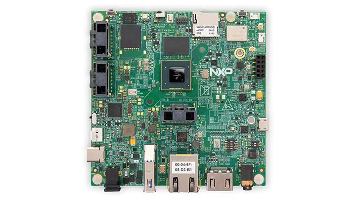

<!-- Copyright 2015-2026 Zephyr Project members and individual contributors. -->
<!-- SPDX-License-Identifier: Apache-2.0 -->
<!-- 中文翻译；编号、导航与译注为本地新增。 -->

<a id="imx8mq_evk"></a>

# 第4章\_MIMX8MQ EVK

原文：[官方页面](https://docs.zephyrproject.org/latest/boards/nxp/imx8mq_evk/doc/index.html)。读取日期：2026-10-16；来源摘要见[来源记录](../SOURCES.md)。

开发板概览（Board Overview）

<a id="id1"></a>

[](images/mimx8mq_evk.jpg)

MIMX8MQ EVK

名称（Name）：

`imx8mq_evk`

厂商（Vendor）：

[恩智浦半导体（NXP Semiconductors）](https://docs.zephyrproject.org/latest/boards/index.html#vendor=nxp)

状态（Status）：

维护中（Maintained）

架构（Architecture）：

[arm](https://docs.zephyrproject.org/latest/boards/index.html#arch=arm)

片上系统（SoC）：

[mimx8mq6](https://docs.zephyrproject.org/latest/boards/index.html#soc=mimx8mq6)

<a id="board-github-link"></a>

[浏览开发板源码（Browse Board Sources）](https://github.com/zephyrproject-rtos/zephyr/blob/main//boards/nxp/imx8mq_evk/doc/index.rst/../..)<a id="overview"></a>

## 概述（Overview）

i.MX8MQ EVK基于NXP i.MX8MQ应用处理器，由四核Cortex-A53集群及单个Cortex-M4核组成。Zephyr OS移植于Cortex-M4核。


- 开发板特性（Board Features）：


  - RAM：3 GB LPDDR4
  - 存储（Storage）：


    - 16 GB eMMC 5.0
    - 32 MB QSPI NOR闪存
    - microSD卡插槽（Socket）
  - 无线（Wireless）：


    - Wi-Fi：2.4／5 GHz，IEEE 802.11a/b/g/n/ac
    - 蓝牙（Bluetooth）v4.1
  - 通用串行总线（USB）：


    - USB OTG：1个Type-C接口
    - USB主机（Host）：1个Type-A接口
  - 以太网（Ethernet）
  - PCI-E M.2
  - 发光二极管（LED）：


    - 1个电源状态LED
    - 1个UART LED
  - 调试（Debug）


    - 10引脚JTAG连接器
    - Micro-USB用于UART调试，提供分别用于A53和M4的两个COM端口

开发板更多信息见[NXP网站](https://www.nxp.com/design/development-boards/i-mx-evaluation-and-development-boards/evaluation-kit-for-the-i-mx-8m-applications-processor:MCIMX8M-EVK)。

<a id="supported-features"></a>

### 支持的功能（Supported Features）

`imx8mq_evk`开发板支持下表所列的硬件功能。

片上／板载（On-Chip / On-Board）

功能集成在片上系统（SoC）内／位于开发板上。

2 / 2

分别表示已启用／已禁用的实例数。点击数量标签，可查看开发板或SoC设备树源码（DTS）中该功能的第一个实例。

`vnd,foo`

与此功能匹配的设备树绑定兼容字符串（Compatible String）；点击链接可查看绑定文档。

<a id="imx8mq_evk-hw-features"></a>

<a id="imx8mq_evk-imx8mq_evk/mimx8mq6/m4-hw-features-section"></a>

#### `imx8mq_evk/mimx8mq6/m4`目标（Target）

<a id="imx8mq_evk-imx8mq_evk/mimx8mq6/m4-hw-features-panel"></a>

<a id="imx8mq_evk-imx8mq_evk/mimx8mq6/m4-hw-features-memory"></a>

该开发板目标的片上存储容量：128 KiB RAM、128 KiB Flash。

<a id="imx8mq_evk-imx8mq_evk/mimx8mq6/m4-hw-features-table"></a>

<table>
<tr>
<th>类型（Type）</th>
<th>位置（Location）</th>
<th>说明（Description）</th>
<th>兼容字符串（Compatible）</th>
</tr>
<tr>
<td rowspan="1">中央处理器（CPU）</td>
<td>片上（On-Chip）</td>
<td>ARM Cortex-M4 处理器（CPU）（<a href="https://github.com/zephyrproject-rtos/zephyr/blob/main/dts/arm/nxp/imx/nxp_imx8m_m4.dtsi?plain=1#L19">已启用：1</a>）</td>
<td><a href="../cpu_arm_riscv_binding_reference/P024_arm_cortex-m4.md#std-dtcompatible-arm-cortex-m4"><code>arm,cortex-m4</code></a></td>
</tr>
<tr>
<td rowspan="2">ARM 架构（ARM Architecture）</td>
<td>片上（On-Chip）</td>
<td>i.MX指令紧耦合存储器（ITCM / Instruction Tightly Coupled Memory）（<a href="https://github.com/zephyrproject-rtos/zephyr/blob/main/dts/arm/nxp/imx/nxp_imx8m_m4.dtsi?plain=1#L27">已启用：1</a>）</td>
<td><a href="../arm_nordic_nxp_control_binding_reference/P014_nxp_imx-itcm.md#std-dtcompatible-nxp-imx-itcm"><code>nxp,imx-itcm</code></a></td>
</tr>
<tr>
<td>片上（On-Chip）</td>
<td>i.MX数据紧耦合存储器（DTCM / Data Tightly Coupled Memory）（<a href="https://github.com/zephyrproject-rtos/zephyr/blob/main/dts/arm/nxp/imx/nxp_imx8m_m4.dtsi?plain=1#L32">已启用：1</a>）</td>
<td><a href="../arm_nordic_nxp_control_binding_reference/P012_nxp_imx-dtcm.md#std-dtcompatible-nxp-imx-dtcm"><code>nxp,imx-dtcm</code></a></td>
</tr>
<tr>
<td rowspan="1">时钟控制（Clock Control）</td>
<td>片上（On-Chip）</td>
<td>i.MX时钟控制模块（CCM / Clock Controller Module）IP节点（<a href="https://github.com/zephyrproject-rtos/zephyr/blob/main/dts/arm/nxp/imx/nxp_imx8m_m4.dtsi?plain=1#L133">已启用：1</a>）</td>
<td><a href="../clock_nordic_nuvoton_nxp_binding_reference/P021_nxp_imx-ccm.md#std-dtcompatible-nxp-imx-ccm"><code>nxp,imx-ccm</code></a></td>
</tr>
<tr>
<td rowspan="1">通用输入输出与接插件（GPIO &amp; Headers）</td>
<td>片上（On-Chip）</td>
<td>i.MX通用输入输出（GPIO）（<a href="https://github.com/zephyrproject-rtos/zephyr/blob/main/dts/arm/nxp/imx/nxp_imx8m_m4.dtsi?plain=1#L59">已禁用：5</a>）</td>
<td><a href="../gpio_microchip_nordic_nuvoton_binding_reference/P030_nxp_imx-gpio.md#std-dtcompatible-nxp-imx-gpio"><code>nxp,imx-gpio</code></a></td>
</tr>
<tr>
<td rowspan="1">中断控制器（Interrupt Controller）</td>
<td>片上（On-Chip）</td>
<td>ARMv7-M 嵌套向量中断控制器（Nested Vectored Interrupt Controller，NVIC）（<a href="https://github.com/zephyrproject-rtos/zephyr/blob/main/dts/arm/armv7-m.dtsi?plain=1#L13">已启用：1</a>）</td>
<td><a href="../arm_interrupt_timer_binding_reference/P002_ARMv7_M_NVIC.md#std-dtcompatible-arm-v7m-nvic"><code>arm,v7m-nvic</code></a></td>
</tr>
<tr>
<td rowspan="1">处理器间消息（IPM）</td>
<td>片上（On-Chip）</td>
<td>i.MX消息单元（Messaging Unit）（<a href="https://github.com/zephyrproject-rtos/zephyr/blob/main/dts/arm/nxp/imx/nxp_imx8m_m4.dtsi?plain=1#L201">已禁用：1</a>）</td>
<td><a href="../intercore_reference/P072_NXPiMX消息单元绑定.md#dtbinding-nxp-imx-mu"><code>nxp,imx-mu</code></a></td>
</tr>
<tr>
<td rowspan="2">引脚控制（Pin Control）</td>
<td>片上（On-Chip）</td>
<td>这个兼容性绑定（Compatible Binding）应应用于设备的<code>iomuxc</code>设备树源文件（DTS）节点。（<a href="https://github.com/zephyrproject-rtos/zephyr/blob/main/dts/arm/nxp/imx/nxp_imx8m_m4.dtsi?plain=1#L122">已启用：1</a>）</td>
<td><a href="../pinctrl_infineon_nordic_nxp_binding_reference/P023_nxp_imx-iomuxc.md#std-dtcompatible-nxp-imx-iomuxc"><code>nxp,imx-iomuxc</code></a></td>
</tr>
<tr>
<td>片上（On-Chip）</td>
<td>MCUX片上系统（SoC）的设备树（Devicetree）为该节点设置了<code>pinctrl</code>节点标签。（<a href="https://github.com/zephyrproject-rtos/zephyr/blob/main/dts/arm/nxp/imx/nxp_imx8m_m4.dtsi?plain=1#L127">已启用：1</a>）</td>
<td><a href="../pinctrl_nxp_pico_binding_reference/P001_nxp_imx8m-pinctrl.md#std-dtcompatible-nxp-imx8m-pinctrl"><code>nxp,imx8m-pinctrl</code></a></td>
</tr>
<tr>
<td rowspan="1">串行控制器（Serial Controller）</td>
<td>片上（On-Chip）</td>
<td>此绑定（Binding）提供NXP i.MX IUART的基本描述（<a href="https://github.com/zephyrproject-rtos/zephyr/blob/main/dts/arm/nxp/imx/nxp_imx8m_m4.dtsi?plain=1#L177">已启用：1</a>；<a href="https://github.com/zephyrproject-rtos/zephyr/blob/main/dts/arm/nxp/imx/nxp_imx8m_m4.dtsi?plain=1#L169">已禁用：3</a>）</td>
<td><a href="../uart_microchip_nordic_nxp_binding_reference/P010_nxp_imx-iuart.md#std-dtcompatible-nxp-imx-iuart"><code>nxp,imx-iuart</code></a></td>
</tr>
<tr>
<td rowspan="1">串行外设接口（SPI）</td>
<td>片上（On-Chip）</td>
<td>NXP i.MX增强型可配置串行外设接口（ECSPI）控制器（<a href="https://github.com/zephyrproject-rtos/zephyr/blob/main/dts/arm/nxp/imx/nxp_imx8m_m4.dtsi?plain=1#L139">已禁用：3</a>）</td>
<td><a href="../spi_microchip_nordic_nxp_binding_reference/P020_nxp_imx-ecspi.md#std-dtcompatible-nxp-imx-ecspi"><code>nxp,imx-ecspi</code></a></td>
</tr>
<tr>
<td rowspan="1">定时器（Timer）</td>
<td>片上（On-Chip）</td>
<td>ARMv7-M 系统节拍（System Tick）（<a href="https://github.com/zephyrproject-rtos/zephyr/blob/main/dts/arm/armv7-m.dtsi?plain=1#L21">已启用：1</a>）</td>
<td><a href="../arm_interrupt_timer_binding_reference/P006_ARMv7_M_SysTick.md#std-dtcompatible-arm-armv7m-systick"><code>arm,armv7m-systick</code></a></td>
</tr>
</table>

<a id="connections-and-ios"></a>

### 连接与输入输出（Connections and IOs）

MIMX8MQ EVK已使用以下引脚复用（Pinmux）控制器配置测试。

<table>
<tr>
<th>开发板名称（Board Name）</th>
<th>SoC名称（SoC Name）</th>
<th>用途（Usage）</th>
</tr>
<tr>
<td>UART2接收数据（RXD）</td>
<td>UART2_TXD</td>
<td>UART控制台（UART Console）</td>
</tr>
<tr>
<td>UART2发送数据（TXD）</td>
<td>UART2_RXD</td>
<td>UART控制台（UART Console）</td>
</tr>
</table>

<a id="system-clock"></a>

### 系统时钟（System Clock）

M4核配置为以266 MHz运行。

<a id="serial-port"></a>

### 串口（Serial Port）

i.MX8MQ SoC有4路UART，UART_2配置为控制台，其余未使用或测试。

<a id="programming-and-debugging"></a>

## 烧录与调试（Programming and Debugging）

`imx8mq_evk`开发板支持下表所列的运行工具（Runners）及相关west命令。

<table>
<tr>
<th></th>
<th>烧录（flash）</th>
<th>调试（debug）</th>
<th>连接调试会话（attach）</th>
<th>实时传输（rtt）</th>
<th>复位（reset）</th>
<th>调试服务器（debugserver）</th>
</tr>
<tr>
<td><a href="https://docs.zephyrproject.org/latest/develop/flash_debug/host-tools.html#runner-jlink">jlink</a></td>
<td>✅（默认 / default）</td>
<td>✅（默认 / default）</td>
<td>✅</td>
<td>✅</td>
<td>✅</td>
<td>✅</td>
</tr>
</table>

MIMX8MQ EVK没有供M4使用的QSPI闪存，M4需要由A53启动。A53负责把M4应用二进制加载到RAM、使M4保持复位、设置M4程序计数器（PC）及栈指针（SP），再解除M4复位。这些步骤既可在引导加载程序阶段执行，也可在Linux启动后执行。

M4最多可使用3种RAM，A53与M4的内存映射如下：

<table>
<tr>
<th>区域（Region）</th>
<th>Cortex-A53</th>
<th>Cortex-M4（系统总线 / System Bus）</th>
<th>Cortex-M4（代码总线 / Code Bus）</th>
<th>大小（Size）</th>
</tr>
<tr>
<td>片上RAM（OCRAM）</td>
<td>0x00900000-0x0091FFFF</td>
<td>0x20200000-0x2021FFFF</td>
<td>0x00900000-0x0091FFFF</td>
<td>128KB</td>
</tr>
<tr>
<td>高地址紧耦合存储器（TCMU）</td>
<td>0x00800000-0x0081FFFF</td>
<td>0x20000000-0x2001FFFF</td>
<td></td>
<td>128KB</td>
</tr>
<tr>
<td>低地址紧耦合存储器（TCML）</td>
<td>0x007E0000-0x007FFFFF</td>
<td></td>
<td>0x1FFE0000-0x1FFFFFFF</td>
<td>128KB</td>
</tr>
<tr>
<td>OCRAM_S</td>
<td>0x00180000-0x00187FFF</td>
<td>0x20180000-0x20187FFF</td>
<td>0x00180000-0x00187FFF</td>
<td>32KB</td>
</tr>
</table>

内存映射的更多信息见《[i.MX 8M应用处理器参考手册](https://www.nxp.com/webapp/Download?colCode=IMX8MDQLQRM)》（Applications Processor Reference Manual）第2.1.2及2.1.3节。

编译时需要选择使用哪种RAM。在[boards/nxp/imx8mq_evk/imx8mq_evk_mimx8mq6_m4.dts](https://github.com/zephyrproject-rtos/zephyr/blob/main/boards/nxp/imx8mq_evk/imx8mq_evk_mimx8mq6_m4.dts)中配置zephyr,flash（CONFIG_XIP=y时）及zephyr,sram属性，可用配置如下：

```text
"zephyr,flash"
- &tcml_code
- &ocram_code
- &ocram_s_code

"zephyr,sram"
- &tcmu_sys
- &ocram_sys
- &ocram_s_sys
```

通过A53上的U-Boot加载并运行M4 Zephyr镜像。

<a id="tab-0-RnJvbSBhbiBTRCBjYXJk"></a>

<a id="tab-0-RnJvbSBzZXJpYWw="></a>

<a id="panel-0-RnJvbSBhbiBTRCBjYXJk"></a>

**从SD卡加载**

将编译的zephyr.bin复制到SD卡第一个FAT分区，插入开发板，上电后在提示符处停止U-Boot执行。

使用以下命令将M4二进制加载到所需存储器并启动：

```text
fatload mmc 0:1 0x40480000 zephyr.bin
cp.b 0x40480000 0x7e0000 0x8000
bootaux 0x7e0000
```

<a id="panel-0-RnJvbSBzZXJpYWw="></a>

**通过串口加载**

此流程要求已安装screen和lrzsz。

启动screen，给开发板上电，在提示符处停止U-Boot执行：

```text
screen <tty-device> 115200
```

以偏移7e0000启动loadx：

```text
loadx 7e0000 115200
```

先按Ctrl-a，再按冒号键（:），输入以下内容，通过sx发送编译得到的zephyr.bin：

```text
exec !! sx </full/path/to/zephyr.bin>
```

开始执行：

```text
bootaux 0x7e0000
```

<a id="debugging"></a>

### 调试（Debugging）

用外部J-Link JTAG调试器连接MIMX8MQ EVK的J401调试连接器与PC，即可按常规方式调试应用。

下面以[Hello World](../getting_started/P005_HelloWorld示例.md#hello_world)应用为例。

```text
# From the root of the zephyr repository
west build -b imx8mq_evk/mimx8mq6/m4 samples/hello_world
west debug
```

打开串口终端，在调试器中单步运行应用，应能在终端中看到以下消息：

```text
***** Booting Zephyr OS build zephyr-v2.6.99-30942-g6ee70bd22058 *****
Hello World! imx8mq_evk
```

<a id="support-resources-for-zephyr"></a>

### Zephyr支持资源（Support Resources）


- [NXP开发板支持状态（Board Support Status）](https://github.com/nxp-zephyr/nxp-zsdk/blob/main/doc/releases/Board-Support-Status.md)
- [NXP Zephyr下游软件开发工具包（Downstream SDK）](https://github.com/nxp-zephyr/nxp-zsdk)
- [MCUXpresso for VS Code文档](https://mcuxpresso.nxp.com/mcux-vscode)及[Zephyr实验指南](https://mcuxpresso.nxp.com/mcux-vscode/latest/html/Training-Zephyr-Getting-Started.html)
- [NXP Zephyr知识中心（Knowledge Hub）](https://community.nxp.com/t5/Zephyr-Project-Knowledge-Base/Zephyr-Knowledge-Hub/ta-p/2008548)
- NXP Zephyr主页，包含培训资源（[NXP的Zephyr专题页面](https://nxp.com/zephyr)）
- [NXP Zephyr支持社区论坛（Support Community）](https://community.nxp.com/t5/Zephyr-Project/bd-p/Zephyr-Project)

## 译注

M4由A53加载及启动；screen和lrzsz为串口传输前提，连接器为J401。

## 原文外链核对

2026-10-16核对并重试以下原文外链时未能确认可访问性，保留原始目标，不将访问失败解释为原文内容有误。

- [2008548](https://community.nxp.com/t5/Zephyr-Project-Knowledge-Base/Zephyr-Knowledge-Hub/ta-p/2008548)：HTTP Error 403: Forbidden。
- [Zephyr-Project](https://community.nxp.com/t5/Zephyr-Project/bd-p/Zephyr-Project)：HTTP Error 403: Forbidden。
- [Training-Zephyr-Getting-Started.html](https://mcuxpresso.nxp.com/mcux-vscode/latest/html/Training-Zephyr-Getting-Started.html)：HTTP Error 404: Not Found。
- [zephyr](https://nxp.com/zephyr)：HTTP Error 404: Not Found。
- [evaluation-kit-for-the-i-mx-8m-applications-processor:MCIMX8M-EVK](https://www.nxp.com/design/development-boards/i-mx-evaluation-and-development-boards/evaluation-kit-for-the-i-mx-8m-applications-processor:MCIMX8M-EVK)：HTTP Error 404: Not Found。
- [Download?colCode=IMX8MDQLQRM](https://www.nxp.com/webapp/Download?colCode=IMX8MDQLQRM)：HTTP Error 404: Not Found。

---

[上一章](P003_i.MX8MP_EVK.md) · [返回大纲](大纲.md) · [全站翻译进度](../PROGRESS.md) · [下一章](P005_i.MX91_EVK.md)
