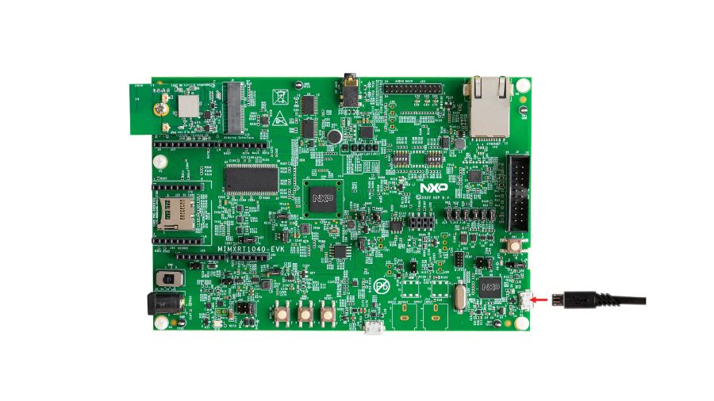

<!-- Copyright 2015-2026 Zephyr Project members and individual contributors. -->
<!-- SPDX-License-Identifier: Apache-2.0 -->
<!-- 中文翻译；编号、导航与译注为本地新增。 -->

<a id="mimxrt1040_evk"></a>

# 第5章\_MIMXRT1040-EVK

原文：[官方页面](https://docs.zephyrproject.org/latest/boards/nxp/mimxrt1040_evk/doc/index.html)。读取日期：2026-10-16；来源摘要见[来源记录](../SOURCES.md)。

开发板概览（Board Overview）

<a id="id1"></a>

[](images/mimxrt1040_evk.jpg)

MIMXRT1040-EVK

名称（Name）：

`mimxrt1040_evk`

厂商（Vendor）：

[恩智浦半导体（NXP Semiconductors）](https://docs.zephyrproject.org/latest/boards/index.html#vendor=nxp)

状态（Status）：

维护中（Maintained）

架构（Architecture）：

[arm](https://docs.zephyrproject.org/latest/boards/index.html#arch=arm)

片上系统（SoC）：

[mimxrt1042](https://docs.zephyrproject.org/latest/boards/index.html#soc=mimxrt1042)

<a id="board-github-link"></a>

[浏览开发板源码（Browse Board Sources）](https://github.com/zephyrproject-rtos/zephyr/blob/main//boards/nxp/mimxrt1040_evk/doc/index.rst/../..)<a id="overview"></a>

## 概述（Overview）

i.MX RT1040跨界MCU通过新封装及扩展至125 °C的温度范围增加设计灵活性。除紧凑的9×9 mm封装外，还提供支持双层PCB设计的11×11 mm封装，采用600 MHz Arm Cortex-M7核。

<a id="hardware"></a>

## 硬件（Hardware）


- MIMXRT1042XJM5B微控制器，600 MHz、512 KB紧耦合存储器（TCM）
- 存储器（Memory）


  - 256 Mbit SDRAM，Winbond W9825G6KH
  - 64 Mbit QSPI闪存，Winbond W25Q64JVSSIQ
- 显示（Display）


  - LCD连接器
  - 触摸连接器
- 以太网（Ethernet）


  - 10/100 Mbit/s以太网物理层收发器（Ethernet PHY）
- 通用串行总线（USB）


  - USB 2.0 OTG连接器
- 音频（Audio）


  - 3.5 mm立体声耳机插孔
  - 板载麦克风
- 电源（Power）


  - 5 V直流电源插孔（DC Jack）
- 调试（Debug）


  - 20引脚JTAG连接器
  - 使用DAPLink的OpenSDA
- 扩展端口（Expansion Port）


  - Arduino接口（Interface）
- CAN总线连接器

MIMXRT1040 SoC及MIMXRT1040-EVK开发板的更多信息见以下资料：


- [i.MX RT1040 网站](https://www.nxp.com/products/processors-and-microcontrollers/arm-microcontrollers/i-mx-rt-crossover-mcus/i-mx-rt1040-crossover-mcu-with-arm-cortex-m7-core:i.MX-RT1040)
- [i.MX RT1040 数据手册（Datasheet）](https://www.nxp.com/docs/en/data-sheet/IMXRT1040CEC.pdf)
- [i.MX RT1040 参考手册（Reference Manual）](https://www.nxp.com/webapp/Download?colCode=IMXRT1040RM)
- [MIMXRT1040-EVK 网站](https://www.nxp.com/design/development-boards/i-mx-evaluation-and-development-boards/i-mx-rt1040-evaluation-kit:MIMXRT1040-EVK)
- [MIMXRT1040-EVK 用户指南（User Guide）](https://www.nxp.com/webapp/Download?colCode=MIMXRT1040-EVKUM)
- [MIMXRT1040-EVK 设计文件（Design Files）](https://www.nxp.com/webapp/Download?colCode=MIMXRT1040-EVK-DESIGNFILES)

<a id="external-memory"></a>

### 外部存储器（External Memory）

此平台具有以下外部存储器：

<table>
<tr>
<th>器件（Device）</th>
<th>控制器（Controller）</th>
<th>状态（Status）</th>
</tr>
<tr>
<td>W9825G6KH</td>
<td>智能外部存储器控制器（SEMC）</td>
<td>通过设备配置数据块（DCD / Device Configuration Data Block）启用，该数据块在启动时设置智能外部存储器控制器（SEMC）。</td>
</tr>
<tr>
<td>W25Q64JVSSIQ</td>
<td>FLEXSPI</td>
<td>通过闪存配置块在启动时设置FlexSPI，仅支持就地执行（XIP）。</td>
</tr>
</table>

<a id="supported-features"></a>

### 支持的功能（Supported Features）

`mimxrt1040_evk`开发板支持下表所列的硬件功能。

片上／板载（On-Chip / On-Board）

功能集成在片上系统（SoC）内／位于开发板上。

2 / 2

分别表示已启用／已禁用的实例数。点击数量标签，可查看开发板或SoC设备树源码（DTS）中该功能的第一个实例。

`vnd,foo`

与此功能匹配的设备树绑定兼容字符串（Compatible String）；点击链接可查看绑定文档。

<a id="mimxrt1040_evk-hw-features"></a>

<a id="mimxrt1040_evk-mimxrt1040_evk/mimxrt1042-hw-features-section"></a>

#### `mimxrt1040_evk/mimxrt1042`目标（Target）

<a id="mimxrt1040_evk-mimxrt1040_evk/mimxrt1042-hw-features-panel"></a>

<a id="mimxrt1040_evk-mimxrt1040_evk/mimxrt1042-hw-features-memory"></a>

该开发板目标的片上存储容量：32 MiB RAM、64 MiB Flash。

<a id="mimxrt1040_evk-mimxrt1040_evk/mimxrt1042-hw-features-table"></a>

<table>
<tr>
<th>类型（Type）</th>
<th>位置（Location）</th>
<th>说明（Description）</th>
<th>兼容字符串（Compatible）</th>
</tr>
<tr>
<td rowspan="1">中央处理器（CPU）</td>
<td>片上（On-Chip）</td>
<td>ARM Cortex-M7处理器（CPU）（<a href="https://github.com/zephyrproject-rtos/zephyr/blob/main/dts/arm/nxp/imxrt/imxrt10xx/nxp_rt10xx.dtsi?plain=1#L30">已启用：1</a>）</td>
<td><a href="../cpu_cortex_xtensa_binding_reference/P005_arm_cortex-m7.md#std-dtcompatible-arm-cortex-m7"><code>arm,cortex-m7</code></a></td>
</tr>
<tr>
<td rowspan="1">模数转换器（ADC）</td>
<td>片上（On-Chip）</td>
<td>NXP MCUA 12B1MSPS逐次逼近模数转换器（SAR ADC），MCUA拼写沿用原文（<a href="https://github.com/zephyrproject-rtos/zephyr/blob/main/dts/arm/nxp/imxrt/imxrt10xx/nxp_rt10xx.dtsi?plain=1#L631">已启用：1</a>；<a href="https://github.com/zephyrproject-rtos/zephyr/blob/main/dts/arm/nxp/imxrt/imxrt10xx/nxp_rt10xx.dtsi?plain=1#L641">已禁用：1</a>）</td>
<td><a href="../hardware/P852_NXPMCUX12位逐次逼近ADC绑定.md#dtbinding-nxp-mcux-12b1msps-sar"><code>nxp,mcux-12b1msps-sar</code></a></td>
</tr>
<tr>
<td rowspan="1">ARM 架构（ARM Architecture）</td>
<td>片上（On-Chip）</td>
<td>NXP MCUX交叉开关（XBAR / Crossbar Switch）（<a href="https://github.com/zephyrproject-rtos/zephyr/blob/main/dts/arm/nxp/imxrt/imxrt10xx/nxp_rt10xx.dtsi?plain=1#L1169">已禁用：3</a>）</td>
<td><a href="../arm_nordic_nxp_control_binding_reference/P016_nxp_mcux-xbar.md#std-dtcompatible-nxp-mcux-xbar"><code>nxp,mcux-xbar</code></a></td>
</tr>
<tr>
<td rowspan="2">控制器局域网（CAN）</td>
<td>片上（On-Chip）</td>
<td>NXP FlexCAN控制器（<a href="https://github.com/zephyrproject-rtos/zephyr/blob/main/dts/arm/nxp/imxrt/imxrt10xx/nxp_rt10xx.dtsi?plain=1#L978">已禁用：2</a>）</td>
<td><a href="../can_adi_atmel_nxp_binding_reference/P017_nxp_flexcan.md#std-dtcompatible-nxp-flexcan"><code>nxp,flexcan</code></a></td>
</tr>
<tr>
<td>片上（On-Chip）</td>
<td>NXP FlexCAN CAN FD控制器（<a href="https://github.com/zephyrproject-rtos/zephyr/blob/main/dts/arm/nxp/imxrt/imxrt10xx/nxp_rt10xx.dtsi?plain=1#L998">已禁用：1</a>）</td>
<td><a href="../can_adi_atmel_nxp_binding_reference/P016_nxp_flexcan-fd.md#std-dtcompatible-nxp-flexcan-fd"><code>nxp,flexcan-fd</code></a></td>
</tr>
<tr>
<td rowspan="5">时钟控制（Clock Control）</td>
<td>片上（On-Chip）</td>
<td>i.MX时钟控制模块（CCM / Clock Controller Module）IP节点（<a href="https://github.com/zephyrproject-rtos/zephyr/blob/main/dts/arm/nxp/imxrt/imxrt10xx/nxp_rt10xx.dtsi?plain=1#L311">已启用：1</a>）</td>
<td><a href="../clock_nordic_nuvoton_nxp_binding_reference/P021_nxp_imx-ccm.md#std-dtcompatible-nxp-imx-ccm"><code>nxp,imx-ccm</code></a></td>
</tr>
<tr>
<td>片上（On-Chip）</td>
<td>通用固定比例时钟提供器（Fixed Factor Clock Provider）（<a href="https://github.com/zephyrproject-rtos/zephyr/blob/main/dts/arm/nxp/imxrt/imxrt10xx/nxp_rt10xx.dtsi?plain=1#L317">已启用：3</a>）</td>
<td><a href="../timer_reference/P110_固定比例时钟绑定.md#dtbinding-fixed-factor-clock"><code>fixed-factor-clock</code></a></td>
</tr>
<tr>
<td>片上（On-Chip）</td>
<td>i.MX CCM分数锁相环（Fractional PLL）（<a href="https://github.com/zephyrproject-rtos/zephyr/blob/main/dts/arm/nxp/imxrt/imxrt10xx/nxp_rt10xx.dtsi?plain=1#L335">已启用：1</a>）</td>
<td><a href="../clock_nordic_nuvoton_nxp_binding_reference/P017_nxp_imx-ccm-fnpll.md#std-dtcompatible-nxp-imx-ccm-fnpll"><code>nxp,imx-ccm-fnpll</code></a></td>
</tr>
<tr>
<td>片上（On-Chip）</td>
<td>i.MX模拟时钟控制模块（ANATOP / Analog Clock Controller Module）IP节点（<a href="https://github.com/zephyrproject-rtos/zephyr/blob/main/dts/arm/nxp/imxrt/imxrt10xx/nxp_rt10xx.dtsi?plain=1#L1022">已启用：1</a>）</td>
<td><a href="../clock_nordic_nuvoton_nxp_binding_reference/P016_nxp_imx-anatop.md#std-dtcompatible-nxp-imx-anatop"><code>nxp,imx-anatop</code></a></td>
</tr>
<tr>
<td>片上（On-Chip）</td>
<td>通用固定频率时钟提供者（Fixed-Rate Clock Provider）（<a href="https://github.com/zephyrproject-rtos/zephyr/blob/main/dts/arm/nxp/imxrt/imxrt10xx/nxp_rt10xx.dtsi?plain=1#L75">已启用：4</a>）</td>
<td><a href="../hardware/P566_固定时钟绑定.md#dtbinding-fixed-clock"><code>fixed-clock</code></a></td>
</tr>
<tr>
<td rowspan="6">计数器（Counter）</td>
<td>片上（On-Chip）</td>
<td>NXP MCUX通用定时器（GPT / General-Purpose Timer）（<a href="https://github.com/zephyrproject-rtos/zephyr/blob/main/dts/arm/nxp/imxrt/imxrt10xx/nxp_rt10xx.dtsi?plain=1#L176">已启用：1</a>）</td>
<td><a href="../nxp_nuvoton_counter_binding_reference/P004_nxp_imx-gpt.md#std-dtcompatible-nxp-imx-gpt"><code>nxp,imx-gpt</code></a></td>
</tr>
<tr>
<td>片上（On-Chip）</td>
<td>NXP MCUX四通道定时器（QTMR / Quad Timer）（<a href="https://github.com/zephyrproject-rtos/zephyr/blob/main/dts/arm/nxp/imxrt/imxrt10xx/nxp_rt10xx.dtsi?plain=1#L187">已启用：4</a>）</td>
<td><a href="../nxp_nuvoton_counter_binding_reference/P005_nxp_imx-qtmr.md#std-dtcompatible-nxp-imx-qtmr"><code>nxp,imx-qtmr</code></a></td>
</tr>
<tr>
<td>片上（On-Chip）</td>
<td>NXP MCUX四通道定时器通道（Quad Timer Channel）（<a href="https://github.com/zephyrproject-rtos/zephyr/blob/main/dts/arm/nxp/imxrt/imxrt10xx/nxp_rt10xx.dtsi?plain=1#L193">已禁用：16</a>）</td>
<td><a href="../nxp_nuvoton_counter_binding_reference/P007_nxp_imx-tmr.md#std-dtcompatible-nxp-imx-tmr"><code>nxp,imx-tmr</code></a></td>
</tr>
<tr>
<td>片上（On-Chip）</td>
<td>NXP SNVS低功耗／高功耗域实时时钟计数器（LP/HP Realtime Counter）（<a href="https://github.com/zephyrproject-rtos/zephyr/blob/main/dts/arm/nxp/imxrt/imxrt10xx/nxp_rt10xx.dtsi?plain=1#L351">已启用：1</a>）</td>
<td><a href="../nxp_nuvoton_counter_binding_reference/P006_nxp_imx-snvs-rtc.md#std-dtcompatible-nxp-imx-snvs-rtc"><code>nxp,imx-snvs-rtc</code></a></td>
</tr>
<tr>
<td>片上（On-Chip）</td>
<td>NXP周期中断定时器（PIT / Periodic Interrupt Timer）（<a href="https://github.com/zephyrproject-rtos/zephyr/blob/main/dts/arm/nxp/imxrt/imxrt10xx/nxp_rt10xx.dtsi?plain=1#L1210">已禁用：1</a>）</td>
<td><a href="../nxp_nuvoton_counter_binding_reference/P017_nxp_pit.md#std-dtcompatible-nxp-pit"><code>nxp,pit</code></a></td>
</tr>
<tr>
<td>片上（On-Chip）</td>
<td>周期中断定时器节点的子节点，用于表示单个定时器通道（<a href="https://github.com/zephyrproject-rtos/zephyr/blob/main/dts/arm/nxp/imxrt/imxrt10xx/nxp_rt10xx.dtsi?plain=1#L1220">已禁用：4</a>）</td>
<td><a href="../nxp_nuvoton_counter_binding_reference/P016_nxp_pit-channel.md#std-dtcompatible-nxp-pit-channel"><code>nxp,pit-channel</code></a></td>
</tr>
<tr>
<td rowspan="1">密码学加速器（Cryptographic Accelerator）</td>
<td>片上（On-Chip）</td>
<td>NXP数据协处理器（DCP / Data Co-Processor）密码加速器（<a href="https://github.com/zephyrproject-rtos/zephyr/blob/main/dts/arm/nxp/imxrt/imxrt10xx/nxp_rt10xx.dtsi?plain=1#L1197">已启用：1</a>）</td>
<td><a href="../crypto_secure_engine_st_ti_binding_reference/P004_nxp_mcux-dcp.md#std-dtcompatible-nxp-mcux-dcp"><code>nxp,mcux-dcp</code></a></td>
</tr>
<tr>
<td rowspan="1">调试（Debug）</td>
<td>片上（On-Chip）</td>
<td>ARMv7仪器化跟踪宏单元（ITM / Instrumentation Trace Macrocell）（<a href="https://github.com/zephyrproject-rtos/zephyr/blob/main/dts/arm/nxp/imxrt/imxrt10xx/nxp_rt10xx.dtsi?plain=1#L44">已启用：1</a>）</td>
<td><a href="../debug_binding_reference/P001_ARMv7M_ITM调试绑定.md#std-dtcompatible-arm-armv7m-itm"><code>arm,armv7m-itm</code></a></td>
</tr>
<tr>
<td rowspan="1">显示（Display）</td>
<td>片上（On-Chip）</td>
<td>NXP i.MX增强型LCD接口（eLCDIF / Enhanced LCD Interface）控制器（<a href="https://github.com/zephyrproject-rtos/zephyr/blob/main/dts/arm/nxp/imxrt/imxrt10xx/nxp_rt10xx.dtsi?plain=1#L495">已禁用：1</a>）</td>
<td><a href="../display_ilitek_matrix_nxp_binding_reference/P018_nxp_imx-elcdif.md#std-dtcompatible-nxp-imx-elcdif"><code>nxp,imx-elcdif</code></a></td>
</tr>
<tr>
<td rowspan="2">直接存储器访问（DMA）</td>
<td>片上（On-Chip）</td>
<td>NXP MCUX增强型DMA（EDMA）控制器（<a href="https://github.com/zephyrproject-rtos/zephyr/blob/main/dts/arm/nxp/imxrt/imxrt10xx/nxp_rt10xx.dtsi?plain=1#L958">已启用：1</a>）</td>
<td><a href="../nxp_realtek_renesas_dma_binding_reference/P004_nxp_mcux-edma.md#std-dtcompatible-nxp-mcux-edma"><code>nxp,mcux-edma</code></a></td>
</tr>
<tr>
<td>片上（On-Chip）</td>
<td>NXP PXP二维DMA引擎（2D DMA Engine）（<a href="https://github.com/zephyrproject-rtos/zephyr/blob/main/dts/arm/nxp/imxrt/imxrt10xx/nxp_rt10xx.dtsi?plain=1#L1035">已禁用：1</a>）</td>
<td><a href="../nxp_realtek_renesas_dma_binding_reference/P005_nxp_pxp.md#std-dtcompatible-nxp-pxp"><code>nxp,pxp</code></a></td>
</tr>
<tr>
<td rowspan="5">以太网（Ethernet）</td>
<td>片上（On-Chip）</td>
<td>NXP ENET以太网IP模块（<a href="https://github.com/zephyrproject-rtos/zephyr/blob/main/dts/arm/nxp/imxrt/imxrt10xx/nxp_rt10xx.dtsi?plain=1#L835">已启用：1</a>）</td>
<td><a href="../ethernet_nxp_phy_binding_reference/P004_nxp_enet.md#std-dtcompatible-nxp-enet"><code>nxp,enet</code></a></td>
</tr>
<tr>
<td>片上（On-Chip）</td>
<td>NXP ENET MAC／二层（L2）设备（<a href="https://github.com/zephyrproject-rtos/zephyr/blob/main/dts/arm/nxp/imxrt/imxrt10xx/nxp_rt10xx.dtsi?plain=1#L840">已启用：1</a>）</td>
<td><a href="../ethernet_nxp_phy_binding_reference/P001_nxp_enet-mac.md#std-dtcompatible-nxp-enet-mac"><code>nxp,enet-mac</code></a></td>
</tr>
<tr>
<td>片上（On-Chip）</td>
<td>NXP ENET管理数据输入输出（MDIO）功能（<a href="https://github.com/zephyrproject-rtos/zephyr/blob/main/dts/arm/nxp/imxrt/imxrt10xx/nxp_rt10xx.dtsi?plain=1#L849">已启用：1</a>）</td>
<td><a href="../ethernet_mdio_microchip_binding_reference/P002_nxp_enet-mdio.md#std-dtcompatible-nxp-enet-mdio"><code>nxp,enet-mdio</code></a></td>
</tr>
<tr>
<td>板载（On-Board）</td>
<td>Microchip KSZ8081以太网PHY设备（<a href="https://github.com/zephyrproject-rtos/zephyr/blob/main/boards/nxp/mimxrt1040_evk/mimxrt1040_evk.dts?plain=1#L211">已启用：1</a>）</td>
<td><a href="../ethernet_phy_renesas_rockchip_binding_reference/P001_microchip_ksz8081.md#std-dtcompatible-microchip-ksz8081"><code>microchip,ksz8081</code></a></td>
</tr>
<tr>
<td>片上（On-Chip）</td>
<td>NXP ENET精确时间协议（PTP / Precision Time Protocol）时钟（<a href="https://github.com/zephyrproject-rtos/zephyr/blob/main/dts/arm/nxp/imxrt/imxrt10xx/nxp_rt10xx.dtsi?plain=1#L856">已启用：1</a>）</td>
<td><a href="../ethernet_nxp_phy_binding_reference/P002_nxp_enet-ptp-clock.md#std-dtcompatible-nxp-enet-ptp-clock"><code>nxp,enet-ptp-clock</code></a></td>
</tr>
<tr>
<td rowspan="4">通用输入输出与接插件（GPIO &amp; Headers）</td>
<td>片上（On-Chip）</td>
<td>i.MX通用输入输出（GPIO）（<a href="https://github.com/zephyrproject-rtos/zephyr/blob/main/dts/arm/nxp/imxrt/imxrt10xx/nxp_rt10xx.dtsi?plain=1#L368">已启用：9</a>）</td>
<td><a href="../gpio_microchip_nordic_nuvoton_binding_reference/P030_nxp_imx-gpio.md#std-dtcompatible-nxp-imx-gpio"><code>nxp,imx-gpio</code></a></td>
</tr>
<tr>
<td>板载（On-Board）</td>
<td>NXP LCD接口引出的GPIO引脚（<a href="https://github.com/zephyrproject-rtos/zephyr/blob/main/boards/nxp/mimxrt1040_evk/mimxrt1040_evk.dts?plain=1#L50">已启用：1</a>）</td>
<td><a href="../gpio_nxp_expanders_binding_reference/P008_nxp_parallel-lcd-connector.md#std-dtcompatible-nxp-parallel-lcd-connector"><code>nxp,parallel-lcd-connector</code></a></td>
</tr>
<tr>
<td>板载（On-Board）</td>
<td>NXP LCD触摸控制器接口引出的GPIO引脚（<a href="https://github.com/zephyrproject-rtos/zephyr/blob/main/boards/nxp/mimxrt1040_evk/mimxrt1040_evk.dts?plain=1#L63">已启用：1</a>）</td>
<td><a href="../gpio_microchip_nordic_nuvoton_binding_reference/P028_nxp_i2c-tsc-fpc.md#std-dtcompatible-nxp-i2c-tsc-fpc"><code>nxp,i2c-tsc-fpc</code></a></td>
</tr>
<tr>
<td>板载（On-Board）</td>
<td>引出到Arduino Uno R3排针（Headers）的GPIO引脚（<a href="https://github.com/zephyrproject-rtos/zephyr/blob/main/boards/nxp/mimxrt1040_evk/mimxrt1040_evk.dts?plain=1#L91">已启用：1</a>）</td>
<td><a href="../gpio_adi_headers_ambiq_binding_reference/P023_arduino-header-r3.md#std-dtcompatible-arduino-header-r3"><code>arduino-header-r3</code></a></td>
</tr>
<tr>
<td rowspan="1">集成电路间总线（I2C）</td>
<td>片上（On-Chip）</td>
<td>NXP低功耗I2C（LPI2C）控制器（<a href="https://github.com/zephyrproject-rtos/zephyr/blob/main/dts/arm/nxp/imxrt/imxrt10xx/nxp_rt10xx.dtsi?plain=1#L440">已启用：2</a>；<a href="https://github.com/zephyrproject-rtos/zephyr/blob/main/dts/arm/nxp/imxrt/imxrt10xx/nxp_rt10xx.dtsi?plain=1#L451">已禁用：2</a>）</td>
<td><a href="../i2c_nxp_pico_renesas_binding_reference/P005_nxp_lpi2c.md#std-dtcompatible-nxp-lpi2c"><code>nxp,lpi2c</code></a></td>
</tr>
<tr>
<td rowspan="1">集成电路间音频总线（I2S）</td>
<td>片上（On-Chip）</td>
<td>NXP MCUX串行音频接口（SAI）I2S控制器（<a href="https://github.com/zephyrproject-rtos/zephyr/blob/main/dts/arm/nxp/imxrt/imxrt10xx/nxp_rt10xx.dtsi?plain=1#L1043">已禁用：3</a>）</td>
<td><a href="../i2s_binding_reference/P013_nxp_mcux-i2s.md#std-dtcompatible-nxp-mcux-i2s"><code>nxp,mcux-i2s</code></a></td>
</tr>
<tr>
<td rowspan="1">输入（Input）</td>
<td>板载（On-Board）</td>
<td>一组绑定到 GPIO 的输入按键（GPIO-Bound Input Keys）（<a href="https://github.com/zephyrproject-rtos/zephyr/blob/main/boards/nxp/mimxrt1040_evk/mimxrt1040_evk.dts?plain=1#L81">已启用：1</a>）</td>
<td><a href="../hardware/P563_GPIO按键绑定.md#std-dtcompatible-gpio-keys"><code>gpio-keys</code></a></td>
</tr>
<tr>
<td rowspan="1">中断控制器（Interrupt Controller）</td>
<td>片上（On-Chip）</td>
<td>ARMv7-M 嵌套向量中断控制器（Nested Vectored Interrupt Controller，NVIC）（<a href="https://github.com/zephyrproject-rtos/zephyr/blob/main/dts/arm/armv7-m.dtsi?plain=1#L13">已启用：1</a>）</td>
<td><a href="../arm_interrupt_timer_binding_reference/P002_ARMv7_M_NVIC.md#std-dtcompatible-arm-v7m-nvic"><code>arm,v7m-nvic</code></a></td>
</tr>
<tr>
<td rowspan="1">发光二极管（LED）</td>
<td>板载（On-Board）</td>
<td>一组由 GPIO 控制的 LED（GPIO-Controlled LEDs）（<a href="https://github.com/zephyrproject-rtos/zephyr/blob/main/boards/nxp/mimxrt1040_evk/mimxrt1040_evk.dts?plain=1#L72">已启用：1</a>）</td>
<td><a href="../hardware/P564_GPIO指示灯绑定.md#dtbinding-gpio-leds"><code>gpio-leds</code></a></td>
</tr>
<tr>
<td rowspan="3">存储器控制器（Memory Controller）</td>
<td>片上（On-Chip）</td>
<td>NXP FlexRAM片上RAM控制器（<a href="https://github.com/zephyrproject-rtos/zephyr/blob/main/dts/arm/nxp/imxrt/imxrt10xx/nxp_rt10xx.dtsi?plain=1#L101">已启用：1</a>）</td>
<td><a href="../memory_controller_hyperbus_smc_binding_reference/P015_nxp_flexram.md#std-dtcompatible-nxp-flexram"><code>nxp,flexram</code></a></td>
</tr>
<tr>
<td>片上（On-Chip）</td>
<td>NXP智能外部存储器控制器（SEMC / Smart External Memory Controller）（<a href="https://github.com/zephyrproject-rtos/zephyr/blob/main/dts/arm/nxp/imxrt/imxrt10xx/nxp_rt10xx.dtsi?plain=1#L160">已启用：1</a>）</td>
<td><a href="../memory_controller_hyperbus_smc_binding_reference/P016_nxp_imx-semc.md#std-dtcompatible-nxp-imx-semc"><code>nxp,imx-semc</code></a></td>
</tr>
<tr>
<td>片上（On-Chip）</td>
<td>NXP i.MX SNVS低功耗通用寄存器，用作电池后备RAM（Battery-Backed RAM）（<a href="https://github.com/zephyrproject-rtos/zephyr/blob/main/dts/arm/nxp/imxrt/imxrt10xx/nxp_rt10xx.dtsi?plain=1#L363">已启用：1</a>）</td>
<td><a href="../memory_controller_sdram_psram_binding_reference/P001_nxp_imx-snvs-gpr.md#std-dtcompatible-nxp-imx-snvs-gpr"><code>nxp,imx-snvs-gpr</code></a></td>
</tr>
<tr>
<td rowspan="1">其他绑定（Miscellaneous）</td>
<td>片上（On-Chip）</td>
<td>NXP FlexIO控制器（<a href="https://github.com/zephyrproject-rtos/zephyr/blob/main/dts/arm/nxp/imxrt/imxrt10xx/nxp_rt10xx.dtsi?plain=1#L1245">已禁用：3</a>）</td>
<td><a href="../misc_adi_nordic_binding_reference/P024_nxp_flexio.md#std-dtcompatible-nxp-flexio"><code>nxp,flexio</code></a></td>
</tr>
<tr>
<td rowspan="1">内存管理单元／内存保护单元（MMU / MPU）</td>
<td>片上（On-Chip）</td>
<td>ARMv7-M存储器保护单元（MPU / Memory Protection Unit）（<a href="https://github.com/zephyrproject-rtos/zephyr/blob/main/dts/arm/nxp/imxrt/imxrt10xx/nxp_rt10xx.dtsi?plain=1#L39">已启用：1</a>）</td>
<td><a href="../memory_protection_binding_reference/P005_arm_armv7m-mpu.md#std-dtcompatible-arm-armv7m-mpu"><code>arm,armv7m-mpu</code></a></td>
</tr>
<tr>
<td rowspan="2">存储技术设备（MTD）</td>
<td>板载（On-Board）</td>
<td>NXP FlexSPI NOR闪存（<a href="https://github.com/zephyrproject-rtos/zephyr/blob/main/boards/nxp/mimxrt1040_evk/mimxrt1040_evk.dts?plain=1#L126">已启用：1</a>）</td>
<td><a href="../mtd_microchip_nordic_nxp_binding_reference/P023_nxp_imx-flexspi-nor.md#std-dtcompatible-nxp-imx-flexspi-nor"><code>nxp,imx-flexspi-nor</code></a></td>
</tr>
<tr>
<td>板载（On-Board）</td>
<td>闪存（Flash）节点（<a href="https://github.com/zephyrproject-rtos/zephyr/blob/main/boards/nxp/mimxrt1040_evk/mimxrt1040_evk.dts?plain=1#L138">已启用：1</a>）</td>
<td><a href="../mtd_nxp_st_ti_partition_binding_reference/P013_soc-nv-flash.md#std-dtcompatible-soc-nv-flash"><code>soc-nv-flash</code></a></td>
</tr>
<tr>
<td rowspan="1">一次性可编程存储器（OTP Memory）</td>
<td>片上（On-Chip）</td>
<td>NXP片上一次性可编程存储器（OCOTP）（<a href="https://github.com/zephyrproject-rtos/zephyr/blob/main/dts/arm/nxp/imxrt/imxrt10xx/nxp_rt10xx.dtsi?plain=1#L1253">已禁用：1</a>）</td>
<td><a href="../otp_binding_reference/P004_nxp_ocotp.md#std-dtcompatible-nxp-ocotp"><code>nxp,ocotp</code></a></td>
</tr>
<tr>
<td rowspan="3">引脚控制（Pin Control）</td>
<td>片上（On-Chip）</td>
<td>这个兼容性绑定（Compatible Binding）应应用于设备的<code>iomuxc</code>设备树源文件（DTS）节点。（<a href="https://github.com/zephyrproject-rtos/zephyr/blob/main/dts/arm/nxp/imxrt/imxrt10xx/nxp_rt10xx.dtsi?plain=1#L484">已启用：1</a>）</td>
<td><a href="../pinctrl_infineon_nordic_nxp_binding_reference/P023_nxp_imx-iomuxc.md#std-dtcompatible-nxp-imx-iomuxc"><code>nxp,imx-iomuxc</code></a></td>
</tr>
<tr>
<td>片上（On-Chip）</td>
<td>该节点在MCUX RT SoC设备树中设置了pinctrl节点标签（<a href="https://github.com/zephyrproject-rtos/zephyr/blob/main/dts/arm/nxp/imxrt/imxrt10xx/nxp_rt10xx.dtsi?plain=1#L489">已启用：1</a>）</td>
<td><a href="../pinctrl_nxp_pico_binding_reference/P012_nxp_mcux-rt-pinctrl.md#std-dtcompatible-nxp-mcux-rt-pinctrl"><code>nxp,mcux-rt-pinctrl</code></a></td>
</tr>
<tr>
<td>片上（On-Chip）</td>
<td>i.MX I/O复用控制器（IOMUXC）（<a href="https://github.com/zephyrproject-rtos/zephyr/blob/main/dts/arm/nxp/imxrt/imxrt10xx/nxp_rt10xx.dtsi?plain=1#L1029">已启用：1</a>）</td>
<td><a href="../pinctrl_infineon_nordic_nxp_binding_reference/P021_nxp_imx-gpr.md#std-dtcompatible-nxp-imx-gpr"><code>nxp,imx-gpr</code></a></td>
</tr>
<tr>
<td rowspan="2">脉宽调制（PWM）</td>
<td>片上（On-Chip）</td>
<td>包含mcux-pwm子模块的NXP eFLEX PWM模块（<a href="https://github.com/zephyrproject-rtos/zephyr/blob/main/dts/arm/nxp/imxrt/imxrt10xx/nxp_rt10xx.dtsi?plain=1#L651">已启用：4</a>）</td>
<td><a href="../pwm_nxp_renesas_binding_reference/P003_nxp_flexpwm.md#std-dtcompatible-nxp-flexpwm"><code>nxp,flexpwm</code></a></td>
</tr>
<tr>
<td>片上（On-Chip）</td>
<td>NXP MCUX脉宽调制（PWM）（<a href="https://github.com/zephyrproject-rtos/zephyr/blob/main/dts/arm/nxp/imxrt/imxrt10xx/nxp_rt10xx.dtsi?plain=1#L686">已启用：1</a>；<a href="https://github.com/zephyrproject-rtos/zephyr/blob/main/dts/arm/nxp/imxrt/imxrt10xx/nxp_rt10xx.dtsi?plain=1#L656">已禁用：15</a>）</td>
<td><a href="../pwm_nxp_renesas_binding_reference/P005_nxp_imx-pwm.md#std-dtcompatible-nxp-imx-pwm"><code>nxp,imx-pwm</code></a></td>
</tr>
<tr>
<td rowspan="1">随机数生成器（RNG）</td>
<td>片上（On-Chip）</td>
<td>Kinetis真随机数发生器（TRNG / True Random Number Generator）（<a href="https://github.com/zephyrproject-rtos/zephyr/blob/main/dts/arm/nxp/imxrt/imxrt10xx/nxp_rt10xx.dtsi?plain=1#L870">已启用：1</a>）</td>
<td><a href="../rng_binding_reference/P020_nxp_kinetis-trng.md#std-dtcompatible-nxp-kinetis-trng"><code>nxp,kinetis-trng</code></a></td>
</tr>
<tr>
<td rowspan="1">SD 主机控制器（SDHC）</td>
<td>片上（On-Chip）</td>
<td>NXP i.MX USDHC控制器（<a href="https://github.com/zephyrproject-rtos/zephyr/blob/main/dts/arm/nxp/imxrt/imxrt10xx/nxp_rt10xx.dtsi?plain=1#L927">已禁用：2</a>）</td>
<td><a href="../sdhc_binding_reference/P014_nxp_imx-usdhc.md#std-dtcompatible-nxp-imx-usdhc"><code>nxp,imx-usdhc</code></a></td>
</tr>
<tr>
<td rowspan="3">传感器（Sensors）</td>
<td>板载（On-Board）</td>
<td>FXLS8974三轴加速度传感器（<a href="https://github.com/zephyrproject-rtos/zephyr/blob/main/boards/nxp/mimxrt1040_evk/mimxrt1040_evk.dts?plain=1#L272">已启用：1</a>）</td>
<td><a href="../compatible_binding_reference/P051_nxp_fxls8974.md#std-dtcompatible-nxp-fxls8974"><code>nxp,fxls8974</code></a></td>
</tr>
<tr>
<td>片上（On-Chip）</td>
<td>NXP MCUX正交解码器（QDEC）（<a href="https://github.com/zephyrproject-rtos/zephyr/blob/main/dts/arm/nxp/imxrt/imxrt10xx/nxp_rt10xx.dtsi?plain=1#L1141">已禁用：4</a>）</td>
<td><a href="../sensor_nxp_qdec_optical_binding_reference/P008_nxp_mcux-qdec.md#std-dtcompatible-nxp-mcux-qdec"><code>nxp,mcux-qdec</code></a></td>
</tr>
<tr>
<td>片上（On-Chip）</td>
<td>NXP片上温度监视器（On-Die Temperature Monitor）（<a href="https://github.com/zephyrproject-rtos/zephyr/blob/main/dts/arm/nxp/imxrt/imxrt10xx/nxp_rt10xx.dtsi?plain=1#L1204">已禁用：1</a>）</td>
<td><a href="../sensor_nxp_qdec_optical_binding_reference/P013_nxp_tempmon.md#std-dtcompatible-nxp-tempmon"><code>nxp,tempmon</code></a></td>
</tr>
<tr>
<td rowspan="1">串行控制器（Serial Controller）</td>
<td>片上（On-Chip）</td>
<td>NXP低功耗UART（LPUART）（<a href="https://github.com/zephyrproject-rtos/zephyr/blob/main/dts/arm/nxp/imxrt/imxrt10xx/nxp_rt10xx.dtsi?plain=1#L551">已启用：1</a>；<a href="https://github.com/zephyrproject-rtos/zephyr/blob/main/dts/arm/nxp/imxrt/imxrt10xx/nxp_rt10xx.dtsi?plain=1#L561">已禁用：7</a>）</td>
<td><a href="../uart_microchip_nordic_nxp_binding_reference/P017_nxp_lpuart.md#std-dtcompatible-nxp-lpuart"><code>nxp,lpuart</code></a></td>
</tr>
<tr>
<td rowspan="2">串行外设接口（SPI）</td>
<td>片上（On-Chip）</td>
<td>NXP FlexSPI控制器（<a href="https://github.com/zephyrproject-rtos/zephyr/blob/main/dts/arm/nxp/imxrt/imxrt10xx/nxp_rt10xx.dtsi?plain=1#L132">已启用：1</a>；<a href="https://github.com/zephyrproject-rtos/zephyr/blob/main/dts/arm/nxp/imxrt/imxrt10xx/nxp_rt10xx.dtsi?plain=1#L146">已禁用：1</a>）</td>
<td><a href="../spi_flexspi_nxp_renesas_binding_reference/P001_nxp_imx-flexspi.md#std-dtcompatible-nxp-imx-flexspi"><code>nxp,imx-flexspi</code></a></td>
</tr>
<tr>
<td>片上（On-Chip）</td>
<td>NXP低功耗SPI（LPSPI）控制器（<a href="https://github.com/zephyrproject-rtos/zephyr/blob/main/dts/arm/nxp/imxrt/imxrt10xx/nxp_rt10xx.dtsi?plain=1#L503">已启用：1</a>；<a href="https://github.com/zephyrproject-rtos/zephyr/blob/main/dts/arm/nxp/imxrt/imxrt10xx/nxp_rt10xx.dtsi?plain=1#L515">已禁用：2</a>）</td>
<td><a href="../spi_flexspi_nxp_renesas_binding_reference/P004_nxp_lpspi.md#std-dtcompatible-nxp-lpspi"><code>nxp,lpspi</code></a></td>
</tr>
<tr>
<td rowspan="2">定时器（Timer）</td>
<td>片上（On-Chip）</td>
<td>ARMv7-M 系统节拍（System Tick）（<a href="https://github.com/zephyrproject-rtos/zephyr/blob/main/dts/arm/armv7-m.dtsi?plain=1#L21">已启用：1</a>）</td>
<td><a href="../arm_interrupt_timer_binding_reference/P006_ARMv7_M_SysTick.md#std-dtcompatible-arm-armv7m-systick"><code>arm,armv7m-systick</code></a></td>
</tr>
<tr>
<td>片上（On-Chip）</td>
<td>NXP MCUX通用硬件定时器（GPT / General-Purpose HW Timer）（<a href="https://github.com/zephyrproject-rtos/zephyr/blob/main/dts/arm/nxp/imxrt/imxrt10xx/nxp_rt10xx.dtsi?plain=1#L169">已启用：1</a>）</td>
<td><a href="../microchip_nordic_nxp_realtek_timer_binding_reference/P007_nxp_gpt-hw-timer.md#std-dtcompatible-nxp-gpt-hw-timer"><code>nxp,gpt-hw-timer</code></a></td>
</tr>
<tr>
<td rowspan="3">通用串行总线（USB）</td>
<td>片上（On-Chip）</td>
<td>NXP EHCI USB设备模式（Device Mode）（<a href="https://github.com/zephyrproject-rtos/zephyr/blob/main/dts/arm/nxp/imxrt/imxrt10xx/nxp_rt10xx.dtsi?plain=1#L877">已禁用：1</a>）</td>
<td><a href="../usb_soc_binding_reference/P006_nxp_ehci.md#std-dtcompatible-nxp-ehci"><code>nxp,ehci</code></a></td>
</tr>
<tr>
<td>片上（On-Chip）</td>
<td>NXP EHCI USB主机控制器（Host Controller）（<a href="https://github.com/zephyrproject-rtos/zephyr/blob/main/dts/arm/nxp/imxrt/imxrt10xx/nxp_rt10xx.dtsi?plain=1#L897">已禁用：2</a>）</td>
<td><a href="../usb_soc_binding_reference/P009_nxp_uhc-ehci.md#std-dtcompatible-nxp-uhc-ehci"><code>nxp,uhc-ehci</code></a></td>
</tr>
<tr>
<td>片上（On-Chip）</td>
<td>NXP USB高速物理层（High Speed PHY）（<a href="https://github.com/zephyrproject-rtos/zephyr/blob/main/dts/arm/nxp/imxrt/imxrt10xx/nxp_rt10xx.dtsi?plain=1#L915">已禁用：2</a>）</td>
<td><a href="../usb_soc_binding_reference/P013_nxp_usbphy.md#std-dtcompatible-nxp-usbphy"><code>nxp,usbphy</code></a></td>
</tr>
<tr>
<td rowspan="1">看门狗（Watchdog）</td>
<td>片上（On-Chip）</td>
<td>i.MX RT看门狗（Watchdog）（<a href="https://github.com/zephyrproject-rtos/zephyr/blob/main/dts/arm/nxp/imxrt/imxrt10xx/nxp_rt10xx.dtsi?plain=1#L1008">已禁用：2</a>）</td>
<td><a href="../nxp_nordic_nuvoton_watchdog_binding_reference/P009_nxp_imx-wdog.md#std-dtcompatible-nxp-imx-wdog"><code>nxp,imx-wdog</code></a></td>
</tr>
</table>

注意（Note）

尚未支持的其他功能可参考[MIMXRT1064-EVK](P009_MIMXRT1064-EVK.md#mimxrt1064_evk)，它是NXP i.MX RT10xx系列功能覆盖更广的开发板。NXP优先在该板落实Zephyr完整平台支持，因此该板可能已有可复用于mimxrt1040_evk的额外功能。

<a id="shields-for-supported-features"></a>

### 支持相应功能的扩展板（Shields）

上表部分功能使用Zephyr扩展板测试，以下扩展板已在此板上测试：


- NXP RK043FN02H-CT及RK043FN66HS-CTG并行显示屏：支持显示接口（Display）。（[NXP RK043FN02H-CT并行显示屏](https://docs.zephyrproject.org/latest/boards/shields/rk043fn02h_ct/doc/index.html#rk043fn02h-ct)；[NXP RK043FN66HS-CTG并行显示屏](https://docs.zephyrproject.org/latest/boards/shields/rk043fn66hs_ctg/doc/index.html#rk043fn66hs-ctg)）
- [NXP M.2 Wi-Fi与蓝牙扩展板](https://docs.zephyrproject.org/latest/boards/shields/nxp_m2_wifi_bt/doc/index.html#nxp-m2-wifi-bt)（Shield）：原文说明已用Rev C版本测试，可连接具有BT HCI UART及Wi-Fi SDIO接口的M.2模块。扩展板绑定相应NXP HCI或SDIO驱动，为IW416／IW612／IW610 SoC加载固件并完成其他设置。

使用[NXP M.2 Wi-Fi与蓝牙扩展板](https://docs.zephyrproject.org/latest/boards/shields/nxp_m2_wifi_bt/doc/index.html#nxp-m2-wifi-bt)需要以下硬件返工：


- 在R96及R93焊接0 Ω电阻。
- 移除R497、R498、R456及R457。

由于引脚冲突，无法支持蓝牙模块的脉冲编码调制（PCM）接口。

<a id="connections-and-ios"></a>

### 连接与输入输出（Connections and IOs）

MIMXRT1040 SoC有5对引脚复用／GPIO控制器。

<table>
<tr>
<th>名称（Name）</th>
<th>功能（Function）</th>
<th>用途（Usage）</th>
</tr>
<tr>
<td>GPIO_AD_B0_12</td>
<td>LPUART1_TX</td>
<td>UART控制台（UART Console）</td>
</tr>
<tr>
<td>GPIO_AD_B0_13</td>
<td>LPUART1_RX</td>
<td>UART控制台（UART Console）</td>
</tr>
<tr>
<td>唤醒（WAKEUP）</td>
<td>通用输入输出（GPIO）</td>
<td>SW0</td>
</tr>
<tr>
<td>GPIO_AD_B0_08</td>
<td>通用输入输出（GPIO）</td>
<td>用户指示灯LD1</td>
</tr>
<tr>
<td>GPIO_AD_B0_10</td>
<td>FLEXPWM1 PWM3A</td>
<td>PWM输出</td>
</tr>
<tr>
<td>GPIO_AD_B0_14</td>
<td>ADC0输入3（IN3）</td>
<td>ADC0输入</td>
</tr>
<tr>
<td>GPIO_AD_B0_15</td>
<td>ADC0输入4（IN4）</td>
<td>ADC0输入</td>
</tr>
<tr>
<td>GPIO_SD_B0_02</td>
<td>LPSPI1_SDO</td>
<td>SPI输出</td>
</tr>
<tr>
<td>GPIO_SD_B0_03</td>
<td>LPSPI1_SDI</td>
<td>SPI输入</td>
</tr>
<tr>
<td>GPIO_SD_B0_00</td>
<td>LPSPI1_SCK</td>
<td>SPI时钟</td>
</tr>
<tr>
<td>GPIO_SD_B0_00</td>
<td>LPSPI1_SCK</td>
<td>SPI时钟</td>
</tr>
<tr>
<td>GPIO_AD_B1_00</td>
<td>LPI2C1_SCL</td>
<td>I2C时钟</td>
</tr>
<tr>
<td>GPIO_AD_B1_01</td>
<td>LPI2C1_SDA</td>
<td>I2C数据</td>
</tr>
<tr>
<td>GPIO_AD_B1_06</td>
<td>LPUART3_TX</td>
<td>M.2蓝牙主机控制器接口（BT HCI）</td>
</tr>
<tr>
<td>GPIO_AD_B1_07</td>
<td>LPUART3_RX</td>
<td>M.2蓝牙主机控制器接口（BT HCI）</td>
</tr>
<tr>
<td>GPIO_AD_B1_04</td>
<td>LPUART3_CTS_b</td>
<td>M.2蓝牙主机控制器接口（BT HCI）</td>
</tr>
<tr>
<td>GPIO_AD_B1_05</td>
<td>LPUART3_RTS_b</td>
<td>M.2蓝牙主机控制器接口（BT HCI）</td>
</tr>
</table>

注意（Note）

使用此板SPI外设前，需要在R350、R346及R360焊接0 Ω电阻。

<a id="system-clock"></a>

### 系统时钟（System Clock）

MIMXRT1040 SoC配置为使用SysTick作为系统时钟源，原文列出的运行频率为600 MHz。

启用电源管理后，板上的32 kHz低频振荡器将作为通用定时器（GPT）的时钟源，用于生成系统时钟。这有助于进入更低功耗状态，但会降低时间分辨率。

<a id="serial-port"></a>

### 串口（Serial Port）

MIMXRT1040 SoC有8路UART，LPUART1配置为控制台，LPUART3用于BT HCI，其余未使用。

<a id="fetch-binary-blobs"></a>

### 获取二进制文件（Fetch Binary Blobs）

开发板的蓝牙／Wi-Fi模块需要一些二进制文件（Binary Blobs），执行以下命令获取：

```text
west blobs fetch hal_nxp
```

注意（Note）

当前仅支持蓝牙功能。

<a id="programming-and-debugging"></a>

## 烧录与调试（Programming and Debugging）

`mimxrt1040_evk`开发板支持下表所列的运行工具（Runners）及相关west命令。

<table>
<tr>
<th></th>
<th>烧录（flash）</th>
<th>调试（debug）</th>
<th>连接调试会话（attach）</th>
<th>实时传输（rtt）</th>
<th>复位（reset）</th>
<th>调试服务器（debugserver）</th>
</tr>
<tr>
<td><a href="https://docs.zephyrproject.org/latest/develop/flash_debug/host-tools.html#runner-jlink">jlink</a></td>
<td>✅（默认 / default）</td>
<td>✅（默认 / default）</td>
<td>✅</td>
<td>✅</td>
<td>✅</td>
<td>✅</td>
</tr>
<tr>
<td><a href="https://docs.zephyrproject.org/latest/develop/flash_debug/host-tools.html#runner-linkserver">linkserver</a></td>
<td>✅</td>
<td>✅</td>
<td>✅</td>
<td></td>
<td></td>
<td>✅</td>
</tr>
<tr>
<td><a href="https://docs.zephyrproject.org/latest/develop/flash_debug/host-tools.html#runner-pyocd">pyocd</a></td>
<td>✅</td>
<td>✅</td>
<td>✅</td>
<td>✅</td>
<td>✅</td>
<td>✅</td>
</tr>
</table>

此板支持3种调试主机工具。先安装所选工具，再按“配置调试探针”（[Configuring a Debug Probe](#configuring-a-debug-probe)）说明配置开发板。


- J-Link调试主机工具，默认，NXP提供支持（[J-Link主机调试工具（Debug Host Tools）](https://docs.zephyrproject.org/latest/develop/flash_debug/host-tools.html#jlink-debug-host-tools)）
- LinkServer调试主机工具，NXP提供支持（[LinkServer调试主机工具（Debug Host Tools）](https://docs.zephyrproject.org/latest/develop/flash_debug/host-tools.html#linkserver-debug-host-tools)）
- pyOCD调试主机工具，NXP不提供支持（[pyOCD调试主机工具（Debug Host Tools）](https://docs.zephyrproject.org/latest/develop/flash_debug/host-tools.html#pyocd-debug-host-tools)）

主机工具及开发板配置完成后，即可按常规方式构建及烧录应用，详情见“构建应用”（[Building an Application](../application/P001_应用开发.md#build-an-application)）及“运行应用”（[Run an Application](https://docs.zephyrproject.org/latest/develop/application/index.html#application-run)）。

<a id="configuring-a-debug-probe"></a>

### 配置调试探针（Configuring a Debug Probe）

RT1040的SWD隔离跳线为J9／J10，DFU模式跳线为J12，20引脚JTAG／SWD排针为J2。

烧录及调试都使用调试探针。此板提供板载LPC-Link2探针，其默认固件为LPC-Link2 DAPLink。（[LPC-Link2板载调试探针](https://docs.zephyrproject.org/latest/develop/flash_debug/probes.html#lpc-link2-onboard-debug-probe)；[LPC-Link2 DAPLink板载调试探针](https://docs.zephyrproject.org/latest/develop/flash_debug/probes.html#lpclink2-daplink-onboard-debug-probe)）

根据安装的主机工具，按以下说明配置调试探针：


- J-Link调试主机工具：[LPC-Link2探针使用J-Link](#using-j-link-with-lpc-link2-probe)（[J-Link主机调试工具（Debug Host Tools）](https://docs.zephyrproject.org/latest/develop/flash_debug/host-tools.html#jlink-debug-host-tools)）
- LinkServer调试主机工具：[LPC-Link2探针使用CMSIS-DAP](#using-cmsis-dap-with-lpc-link2-probe)（[LinkServer调试主机工具（Debug Host Tools）](https://docs.zephyrproject.org/latest/develop/flash_debug/host-tools.html#linkserver-debug-host-tools)）
- pyOCD调试主机工具：[LPC-Link2探针使用CMSIS-DAP](#using-cmsis-dap-with-lpc-link2-probe)（[pyOCD调试主机工具（Debug Host Tools）](https://docs.zephyrproject.org/latest/develop/flash_debug/host-tools.html#pyocd-debug-host-tools)）

<a id="using-cmsis-dap-with-lpc-link2-probe"></a>

#### LPC-Link2探针使用CMSIS-DAP


1. 按[LPC-Link2 CMSIS-DAP板载调试探针](https://docs.zephyrproject.org/latest/develop/flash_debug/probes.html#lpclink2-cmsis-onboard-debug-probe)说明，重新写入此板的默认调试固件。
2. 确保安装SWD隔离跳线。

<a id="using-j-link-with-lpc-link2-probe"></a>

#### LPC-Link2探针使用J-Link

有两种方案：将板载调试电路更新为Segger J-Link固件，或将外部J-Link调试探针接到EVK。（[J-Link外部调试探针（External Debug Probe）](https://docs.zephyrproject.org/latest/develop/flash_debug/probes.html#jlink-external-debug-probe)）

更新板载调试电路的步骤如下：


1. 将EVK电源切换为调试USB以外的来源，因为J-Link固件不会通过调试USB为EVK供电。
2. 按LPC-Link2 J-Link板载调试探针说明，重新写入此板的默认调试固件。（[LPC-Link2 J-Link板载调试探针（Onboard Debug Probe）](../debugging/P003_调试探针.md#lpclink2-jlink-onboard-debug-probe)）
3. 确保安装SWD隔离跳线。

使用外部J-Link时，先移除SWD隔离跳线，再连接外部JTAG／SWD排针。

<a id="configuring-a-console"></a>

### 配置控制台（Configuring a Console）

无论选用何种调试探针，串口控制台均使用OpenSDA作为USB转串口适配器。确认J11和J13已短接，出厂默认短接，以便将UART信号接至OpenSDA。

用USB线缆将PC连接J1。

在串口终端中使用以下设置，例如minicom或PuTTY：


- 速率（Speed）：115200波特率
- 数据位（Data）：8位
- 奇偶校验（Parity）：无（None）
- 停止位（Stop Bits）：1位

<a id="flashing"></a>

### 烧录（Flashing）

下面以[Hello World](../getting_started/P005_HelloWorld示例.md#hello_world)应用为例。

```text
# From the root of the zephyr repository
west build -b mimxrt1040_evk samples/hello_world
west flash
```

打开串口终端，按SW1复位开发板，应显示以下消息：

```text
***** Booting Zephyr OS Booting Zephyr OS build v3.3.0-rc3-66 *****
Hello World! mimxrt1040_evk
```

<a id="debugging"></a>

### 调试（Debugging）

下面以[Hello World](../getting_started/P005_HelloWorld示例.md#hello_world)应用为例。

```text
# From the root of the zephyr repository
west build -b mimxrt1040_evk samples/hello_world
west debug
```

打开串口终端，在调试器中单步运行应用，应能在终端中看到以下消息：

```text
***** Booting Zephyr OS Booting Zephyr OS build v3.3.0-rc3-66 *****
Hello World! mimxrt1040_evk
```

<a id="troubleshooting"></a>

### 故障排查（Troubleshooting）

<a id="user-led-d8"></a>

#### 用户LED D8（USER_LED D8）

MIMXRT1040-EVK出厂时M.2连接器装有无线模块，且J80短接。这会与USER_LED D8冲突，使LED无法熄灭。Blinky等使用该LED的示例及应用需要移除J80。

<a id="boot-header"></a>

#### 启动头（Boot Header）

若调试探针出现以下连接错误，可能是QSPI中的启动头无效或损坏；该启动头由[CONFIG_NXP_IMXRT_BOOT_HEADER](https://docs.zephyrproject.org/latest/kconfig.html#CONFIG_NXP_IMXRT_BOOT_HEADER)配置。

```text
Remote debugging using :2331
Remote communication error.  Target disconnected.: Connection reset by peer.
"monitor" command not supported by this target.
"monitor" command not supported by this target.
You can't do that when your target is `exec'
(gdb) Could not connect to target.
Please check power, connection and settings.
```

可按以下步骤擦除并重新编程QSPI来恢复：


1. 将SW4拨码设为OFF-OFF-OFF-ON，进入ROM引导加载程序。
2. 按SW1复位。
3. 使用已知可工作的Zephyr应用，再次运行west debug或west flash。
4. 将SW4拨码设为OFF-OFF-ON-OFF，从QSPI启动。
5. 按SW1复位。

<a id="bluetooth-module"></a>

#### 蓝牙模块（Bluetooth Module）

若调试器出现以下连接错误，请参阅下一节。

<a id="wifi-module"></a>

#### Wi-Fi模块

若调试器出现以下连接错误，可能是M.2 Wi-Fi模块干扰了调试信号。

```text
Remote debugging using :2331
Remote communication error.  Target disconnected.: Connection reset by peer.
"monitor" command not supported by this target.
"monitor" command not supported by this target.
You can't do that when your target is `exec'
(gdb) Could not connect to target.
Please check power, connection and settings.
```

可在烧录或调试时拔下M.2 Wi-Fi模块，或者移除J80，以解决此问题。

<a id="support-resources-for-zephyr"></a>

### Zephyr支持资源（Support Resources）


- [NXP开发板支持状态（Board Support Status）](https://github.com/nxp-zephyr/nxp-zsdk/blob/main/doc/releases/Board-Support-Status.md)
- [NXP Zephyr下游软件开发工具包（Downstream SDK）](https://github.com/nxp-zephyr/nxp-zsdk)
- [MCUXpresso for VS Code文档](https://mcuxpresso.nxp.com/mcux-vscode)及[Zephyr实验指南](https://mcuxpresso.nxp.com/mcux-vscode/latest/html/Training-Zephyr-Getting-Started.html)
- [NXP Zephyr知识中心（Knowledge Hub）](https://community.nxp.com/t5/Zephyr-Project-Knowledge-Base/Zephyr-Knowledge-Hub/ta-p/2008548)
- NXP Zephyr主页，包含培训资源（[NXP的Zephyr专题页面](https://nxp.com/zephyr)）
- [NXP Zephyr支持社区论坛（Support Community）](https://community.nxp.com/t5/Zephyr-Project/bd-p/Zephyr-Project)

## 译注

NXP M.2扩展板需改装指定电阻，蓝牙PCM因引脚冲突不支持。原文对Wi-Fi扩展能力与当前仅支持蓝牙的表述分别保留。J80短接既影响D8熄灭，也可能干扰调试信号；SPI另需R350／R346／R360。

## 原文外链核对

2026-10-16核对并重试以下原文外链时未能确认可访问性，保留原始目标，不将访问失败解释为原文内容有误。

- [2008548](https://community.nxp.com/t5/Zephyr-Project-Knowledge-Base/Zephyr-Knowledge-Hub/ta-p/2008548)：HTTP Error 403: Forbidden。
- [Zephyr-Project](https://community.nxp.com/t5/Zephyr-Project/bd-p/Zephyr-Project)：HTTP Error 403: Forbidden。
- [Training-Zephyr-Getting-Started.html](https://mcuxpresso.nxp.com/mcux-vscode/latest/html/Training-Zephyr-Getting-Started.html)：HTTP Error 404: Not Found。
- [zephyr](https://nxp.com/zephyr)：HTTP Error 404: Not Found。
- [i-mx-rt1040-evaluation-kit:MIMXRT1040-EVK](https://www.nxp.com/design/development-boards/i-mx-evaluation-and-development-boards/i-mx-rt1040-evaluation-kit:MIMXRT1040-EVK)：HTTP Error 404: Not Found。
- [IMXRT1040CEC.pdf](https://www.nxp.com/docs/en/data-sheet/IMXRT1040CEC.pdf)：HTTP Error 404: Not Found。
- [i-mx-rt1040-crossover-mcu-with-arm-cortex-m7-core:i.MX-RT1040](https://www.nxp.com/products/processors-and-microcontrollers/arm-microcontrollers/i-mx-rt-crossover-mcus/i-mx-rt1040-crossover-mcu-with-arm-cortex-m7-core:i.MX-RT1040)：HTTP Error 404: Not Found。
- [Download?colCode=IMXRT1040RM](https://www.nxp.com/webapp/Download?colCode=IMXRT1040RM)：HTTP Error 404: Not Found。
- [Download?colCode=MIMXRT1040-EVK-DESIGNFILES](https://www.nxp.com/webapp/Download?colCode=MIMXRT1040-EVK-DESIGNFILES)：HTTP Error 404: Not Found。
- [Download?colCode=MIMXRT1040-EVKUM](https://www.nxp.com/webapp/Download?colCode=MIMXRT1040-EVKUM)：HTTP Error 404: Not Found。

---

[上一章](P004_MIMXRT1024-EVK.md) · [返回大纲](大纲.md) · [全站翻译进度](../PROGRESS.md) · [下一章](P006_MIMXRT1050-EVK.md)
