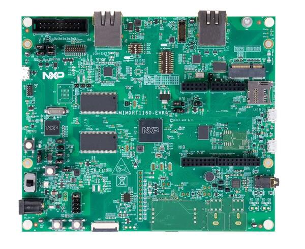

<!-- Copyright 2015-2026 Zephyr Project members and individual contributors. -->
<!-- SPDX-License-Identifier: Apache-2.0 -->
<!-- 中文翻译；编号、导航与译注为本地新增。 -->

<a id="mimxrt1160_evk"></a>

# 第1章\_MIMXRT1160-EVK

原文：[官方页面](https://docs.zephyrproject.org/latest/boards/nxp/mimxrt1160_evk/doc/index.html)。读取日期：2026-10-16；来源摘要见[来源记录](../SOURCES.md)。

开发板概览（Board Overview）

<a id="id1"></a>

[](images/mimxrt1160_evk.jpg)

MIMXRT1160-EVK

名称（Name）：

`mimxrt1160_evk`

厂商（Vendor）：

[恩智浦半导体（NXP Semiconductors）](https://docs.zephyrproject.org/latest/boards/index.html#vendor=nxp)

状态（Status）：

维护中（Maintained）

架构（Architecture）：

[arm](https://docs.zephyrproject.org/latest/boards/index.html#arch=arm)

片上系统（SoC）：

[mimxrt1166](https://docs.zephyrproject.org/latest/boards/index.html#soc=mimxrt1166)

<a id="board-github-link"></a>

[浏览开发板源码（Browse Board Sources）](https://github.com/zephyrproject-rtos/zephyr/blob/main//boards/nxp/mimxrt1160_evk/doc/index.rst/../..)<a id="overview"></a>

## 概述（Overview）

双核i.MX RT1160的Cortex-M7运行于600 MHz，Cortex-M4运行于240 MHz。此MCU支持宽温度范围，面向消费、工业及汽车市场并具备相应资质。

<a id="hardware"></a>

## 硬件（Hardware）


- MIMXRT1166DVM6A微控制器（MCU）


  - 600 MHz Cortex-M7及240 MHz Cortex-M4
  - 2 MB SRAM，其中Cortex-M7具有512 KB紧耦合存储器（TCM），Cortex-M4具有256 KB TCM
- 存储器（Memory）


  - 512 Mbit同步动态RAM（SDRAM）
  - 128 Mbit QSPI闪存
  - 512 Mbit八线闪存（Octal Flash）
  - SD卡TF插槽
- 显示（Display）


  - MIPI LCD连接器
- 以太网（Ethernet）


  - 10/100 Mbit/s以太网物理层收发器（Ethernet PHY）
  - 10/100/1000 Mbit/s以太网物理层（PHY）
- 通用串行总线（USB）


  - USB 2.0 OTG连接器
  - USB 2.0主机连接器
- 音频（Audio）


  - 3.5 mm立体声耳机插孔
  - 板载麦克风
  - 左右声道扬声器输出连接器
- 电源（Power）


  - 5 V直流电源插孔（DC Jack）
- 调试（Debug）


  - 20引脚JTAG连接器
  - 使用DAPLink的OpenSDA
- 传感器（Sensor）


  - MIPI摄像头传感器连接器
- 扩展端口（Expansion Port）


  - Arduino接口（Interface）
- CAN总线连接器

MIMXRT1160 SoC及MIMXRT1160-EVK开发板的更多信息见以下资料：


- [i.MX RT1160 网站](https://www.nxp.com/products/processors-and-microcontrollers/arm-microcontrollers/i-mx-rt-crossover-mcus/i-mx-rt1160-crossover-mcu-family-high-performance-mcu-with-arm-cortex-m7-and-cortex-m4-cores:i.MX-RT1160)
- [i.MX RT1160 数据手册（Datasheet）](https://www.nxp.com/docs/en/data-sheet/IMXRT1160CEC.pdf)
- [i.MX RT1160 参考手册（Reference Manual）](https://www.nxp.com/webapp/Download?colCode=IMXRT1160RM)
- [MIMXRT1160-EVK 网站](https://www.nxp.com/design/development-boards/i-mx-evaluation-and-development-boards/i-mx-rt1160-evaluation-kit:MIMXRT1160-EVK)
- [MIMXRT1160-EVK 开发板硬件用户指南（Board Hardware User’s Guide）](https://www.nxp.com/webapp/Download?colCode=UM11617)

<a id="external-memory"></a>

### 外部存储器（External Memory）

此平台具有以下外部存储器：

<table>
<tr>
<th>器件（Device）</th>
<th>控制器（Controller）</th>
<th>状态（Status）</th>
</tr>
<tr>
<td>W9825G6KH</td>
<td>智能外部存储器控制器（SEMC）</td>
<td>通过设备配置数据块（DCD / Device Configuration Data Block）启用，该数据块在启动时设置智能外部存储器控制器（SEMC）。</td>
</tr>
<tr>
<td>IS25WP128</td>
<td>FLEXSPI</td>
<td>通过闪存配置块（Flash Configuration Block）启用，该配置块在启动时设置FlexSPI。</td>
</tr>
</table>

<a id="supported-features"></a>

### 支持的功能（Supported Features）

`mimxrt1160_evk`开发板支持下表所列的硬件功能。

片上／板载（On-Chip / On-Board）

功能集成在片上系统（SoC）内／位于开发板上。

2 / 2

分别表示已启用／已禁用的实例数。点击数量标签，可查看开发板或SoC设备树源码（DTS）中该功能的第一个实例。

`vnd,foo`

与此功能匹配的设备树绑定兼容字符串（Compatible String）；点击链接可查看绑定文档。

<a id="mimxrt1160_evk-hw-features"></a>

<a id="mimxrt1160_evk-mimxrt1160_evk/mimxrt1166/cm4-hw-features-section"></a>

#### `mimxrt1160_evk/mimxrt1166/cm4`目标（Target）

<a id="mimxrt1160_evk-mimxrt1160_evk/mimxrt1166/cm4-hw-features-panel"></a>

<a id="mimxrt1160_evk-mimxrt1160_evk/mimxrt1166/cm4-hw-features-memory"></a>

该开发板目标的片上存储容量：128 KiB RAM、128 KiB Flash。

<a id="mimxrt1160_evk-mimxrt1160_evk/mimxrt1166/cm4-hw-features-table"></a>

<table>
<tr>
<th>类型（Type）</th>
<th>位置（Location）</th>
<th>说明（Description）</th>
<th>兼容字符串（Compatible）</th>
</tr>
<tr>
<td rowspan="1">中央处理器（CPU）</td>
<td>片上（On-Chip）</td>
<td>ARM Cortex-M4F 处理器（CPU）（<a href="https://github.com/zephyrproject-rtos/zephyr/blob/main/dts/arm/nxp/imxrt/imxrt11xx/nxp_rt11xx_cm4.dtsi?plain=1#L11">已启用：1</a>）</td>
<td><a href="../cpu_arm_riscv_binding_reference/P025_arm_cortex-m4f.md#std-dtcompatible-arm-cortex-m4f"><code>arm,cortex-m4f</code></a></td>
</tr>
<tr>
<td rowspan="1">模数转换器（ADC）</td>
<td>片上（On-Chip）</td>
<td>LPC低功耗模数转换器（LPADC）（<a href="https://github.com/zephyrproject-rtos/zephyr/blob/main/dts/arm/nxp/imxrt/imxrt11xx/nxp_rt11xx.dtsi?plain=1#L1013">已禁用：2</a>）</td>
<td><a href="../hardware/P851_NXPLPC低功耗ADC绑定.md#dtbinding-nxp-lpc-lpadc"><code>nxp,lpc-lpadc</code></a></td>
</tr>
<tr>
<td rowspan="1">ARM 架构（ARM Architecture）</td>
<td>片上（On-Chip）</td>
<td>NXP MCUX交叉开关（XBAR / Crossbar Switch）（<a href="https://github.com/zephyrproject-rtos/zephyr/blob/main/dts/arm/nxp/imxrt/imxrt11xx/nxp_rt11xx.dtsi?plain=1#L1337">已禁用：3</a>）</td>
<td><a href="../arm_nordic_nxp_control_binding_reference/P016_nxp_mcux-xbar.md#std-dtcompatible-nxp-mcux-xbar"><code>nxp,mcux-xbar</code></a></td>
</tr>
<tr>
<td rowspan="1">音频（Audio）</td>
<td>片上（On-Chip）</td>
<td>NXP脉冲密度调制麦克风接口（PDM / MICFIL）（<a href="https://github.com/zephyrproject-rtos/zephyr/blob/main/dts/arm/nxp/imxrt/imxrt11xx/nxp_rt11xx.dtsi?plain=1#L1223">已禁用：1</a>）</td>
<td><a href="../audio_pdm_codec_binding_reference/P014_nxp_micfil.md#std-dtcompatible-nxp-micfil"><code>nxp,micfil</code></a></td>
</tr>
<tr>
<td rowspan="1">控制器局域网（CAN）</td>
<td>片上（On-Chip）</td>
<td>NXP FlexCAN CAN FD控制器（<a href="https://github.com/zephyrproject-rtos/zephyr/blob/main/dts/arm/nxp/imxrt/imxrt11xx/nxp_rt11xx.dtsi?plain=1#L948">已禁用：3</a>）</td>
<td><a href="../can_adi_atmel_nxp_binding_reference/P016_nxp_flexcan-fd.md#std-dtcompatible-nxp-flexcan-fd"><code>nxp,flexcan-fd</code></a></td>
</tr>
<tr>
<td rowspan="4">时钟控制（Clock Control）</td>
<td>片上（On-Chip）</td>
<td>i.MX第2版时钟控制模块（CCM）IP节点（<a href="https://github.com/zephyrproject-rtos/zephyr/blob/main/dts/arm/nxp/imxrt/imxrt11xx/nxp_rt11xx.dtsi?plain=1#L205">已启用：1</a>）</td>
<td><a href="../clock_nordic_nuvoton_nxp_binding_reference/P018_nxp_imx-ccm-rev2.md#std-dtcompatible-nxp-imx-ccm-rev2"><code>nxp,imx-ccm-rev2</code></a></td>
</tr>
<tr>
<td>片上（On-Chip）</td>
<td>i.MX RT11xx ARM PLL时钟提供者（Clock Provider）（<a href="https://github.com/zephyrproject-rtos/zephyr/blob/main/dts/arm/nxp/imxrt/imxrt11xx/nxp_rt11xx.dtsi?plain=1#L217">已启用：1</a>）</td>
<td><a href="../clock_nxp_pico_realtek_renesas_binding_reference/P001_nxp_imxrt11xx-arm-pll.md#std-dtcompatible-nxp-imxrt11xx-arm-pll"><code>nxp,imxrt11xx-arm-pll</code></a></td>
</tr>
<tr>
<td>片上（On-Chip）</td>
<td>i.MX模拟时钟控制模块（ANATOP / Analog Clock Controller Module）IP节点（<a href="https://github.com/zephyrproject-rtos/zephyr/blob/main/dts/arm/nxp/imxrt/imxrt11xx/nxp_rt11xx.dtsi?plain=1#L1071">已启用：1</a>）</td>
<td><a href="../clock_nordic_nuvoton_nxp_binding_reference/P016_nxp_imx-anatop.md#std-dtcompatible-nxp-imx-anatop"><code>nxp,imx-anatop</code></a></td>
</tr>
<tr>
<td>片上（On-Chip）</td>
<td>通用固定频率时钟提供者（Fixed-Rate Clock Provider）（<a href="https://github.com/zephyrproject-rtos/zephyr/blob/main/dts/arm/nxp/imxrt/imxrt11xx/nxp_rt11xx.dtsi?plain=1#L53">已启用：1</a>）</td>
<td><a href="../hardware/P566_固定时钟绑定.md#dtbinding-fixed-clock"><code>fixed-clock</code></a></td>
</tr>
<tr>
<td rowspan="1">比较器（Comparator）</td>
<td>片上（On-Chip）</td>
<td>NXP Kinetis模拟比较器（ACMP / Analog Comparator）（<a href="https://github.com/zephyrproject-rtos/zephyr/blob/main/dts/arm/nxp/imxrt/imxrt11xx/nxp_rt11xx.dtsi?plain=1#L1043">已禁用：4</a>）</td>
<td><a href="../hardware/P745_NXPKinetis模拟比较器绑定.md#dtbinding-nxp-kinetis-acmp"><code>nxp,kinetis-acmp</code></a></td>
</tr>
<tr>
<td rowspan="3">计数器（Counter）</td>
<td>片上（On-Chip）</td>
<td>NXP MCUX通用定时器（GPT / General-Purpose Timer）（<a href="https://github.com/zephyrproject-rtos/zephyr/blob/main/dts/arm/nxp/imxrt/imxrt11xx/nxp_rt11xx.dtsi?plain=1#L118">已启用：5</a>）</td>
<td><a href="../nxp_nuvoton_counter_binding_reference/P004_nxp_imx-gpt.md#std-dtcompatible-nxp-imx-gpt"><code>nxp,imx-gpt</code></a></td>
</tr>
<tr>
<td>片上（On-Chip）</td>
<td>NXP周期中断定时器（PIT / Periodic Interrupt Timer）（<a href="https://github.com/zephyrproject-rtos/zephyr/blob/main/dts/arm/nxp/imxrt/imxrt11xx/nxp_rt11xx.dtsi?plain=1#L1365">已禁用：2</a>）</td>
<td><a href="../nxp_nuvoton_counter_binding_reference/P017_nxp_pit.md#std-dtcompatible-nxp-pit"><code>nxp,pit</code></a></td>
</tr>
<tr>
<td>片上（On-Chip）</td>
<td>周期中断定时器节点的子节点，用于表示单个定时器通道（<a href="https://github.com/zephyrproject-rtos/zephyr/blob/main/dts/arm/nxp/imxrt/imxrt11xx/nxp_rt11xx.dtsi?plain=1#L1375">已禁用：8</a>）</td>
<td><a href="../nxp_nuvoton_counter_binding_reference/P016_nxp_pit-channel.md#std-dtcompatible-nxp-pit-channel"><code>nxp,pit-channel</code></a></td>
</tr>
<tr>
<td rowspan="1">数模转换器（DAC）</td>
<td>片上（On-Chip）</td>
<td>NXP MCUX 12位数模转换器（DAC12）（<a href="https://github.com/zephyrproject-rtos/zephyr/blob/main/dts/arm/nxp/imxrt/imxrt11xx/nxp_rt11xx.dtsi?plain=1#L69">已禁用：1</a>）</td>
<td><a href="../hardware/P765_NXPDAC12数模转换器绑定.md#dtbinding-nxp-dac12"><code>nxp,dac12</code></a></td>
</tr>
<tr>
<td rowspan="2">显示（Display）</td>
<td>片上（On-Chip）</td>
<td>NXP i.MX增强型LCD接口（eLCDIF / Enhanced LCD Interface）控制器（<a href="https://github.com/zephyrproject-rtos/zephyr/blob/main/dts/arm/nxp/imxrt/imxrt11xx/nxp_rt11xx.dtsi?plain=1#L399">已禁用：1</a>）</td>
<td><a href="../display_ilitek_matrix_nxp_binding_reference/P018_nxp_imx-elcdif.md#std-dtcompatible-nxp-imx-elcdif"><code>nxp,imx-elcdif</code></a></td>
</tr>
<tr>
<td>片上（On-Chip）</td>
<td>NXP i.MX第2版LCD接口（LCDIFV2）控制器（<a href="https://github.com/zephyrproject-rtos/zephyr/blob/main/dts/arm/nxp/imxrt/imxrt11xx/nxp_rt11xx.dtsi?plain=1#L407">已禁用：1</a>）</td>
<td><a href="../display_ilitek_matrix_nxp_binding_reference/P019_nxp_imx-lcdifv2.md#std-dtcompatible-nxp-imx-lcdifv2"><code>nxp,imx-lcdifv2</code></a></td>
</tr>
<tr>
<td rowspan="2">直接存储器访问（DMA）</td>
<td>片上（On-Chip）</td>
<td>NXP MCUX增强型DMA（EDMA）控制器（<a href="https://github.com/zephyrproject-rtos/zephyr/blob/main/dts/arm/nxp/imxrt/imxrt11xx/nxp_rt11xx.dtsi?plain=1#L1098">已启用：1</a>；<a href="https://github.com/zephyrproject-rtos/zephyr/blob/main/dts/arm/nxp/imxrt/imxrt11xx/nxp_rt11xx.dtsi?plain=1#L1078">已禁用：1</a>）</td>
<td><a href="../nxp_realtek_renesas_dma_binding_reference/P004_nxp_mcux-edma.md#std-dtcompatible-nxp-mcux-edma"><code>nxp,mcux-edma</code></a></td>
</tr>
<tr>
<td>片上（On-Chip）</td>
<td>NXP PXP二维DMA引擎（2D DMA Engine）（<a href="https://github.com/zephyrproject-rtos/zephyr/blob/main/dts/arm/nxp/imxrt/imxrt11xx/nxp_rt11xx.dtsi?plain=1#L1117">已禁用：1</a>）</td>
<td><a href="../nxp_realtek_renesas_dma_binding_reference/P005_nxp_pxp.md#std-dtcompatible-nxp-pxp"><code>nxp,pxp</code></a></td>
</tr>
<tr>
<td rowspan="5">以太网（Ethernet）</td>
<td>片上（On-Chip）</td>
<td>NXP ENET以太网IP模块（<a href="https://github.com/zephyrproject-rtos/zephyr/blob/main/dts/arm/nxp/imxrt/imxrt11xx/nxp_rt11xx.dtsi?plain=1#L794">已启用：1</a>；<a href="https://github.com/zephyrproject-rtos/zephyr/blob/main/dts/arm/nxp/imxrt/imxrt11xx/nxp_rt11xx.dtsi?plain=1#L823">已禁用：1</a>）</td>
<td><a href="../ethernet_nxp_phy_binding_reference/P004_nxp_enet.md#std-dtcompatible-nxp-enet"><code>nxp,enet</code></a></td>
</tr>
<tr>
<td>片上（On-Chip）</td>
<td>NXP ENET MAC／二层（L2）设备（<a href="https://github.com/zephyrproject-rtos/zephyr/blob/main/dts/arm/nxp/imxrt/imxrt11xx/nxp_rt11xx.dtsi?plain=1#L799">已启用：1</a>；<a href="https://github.com/zephyrproject-rtos/zephyr/blob/main/dts/arm/nxp/imxrt/imxrt11xx/nxp_rt11xx.dtsi?plain=1#L829">已禁用：1</a>）</td>
<td><a href="../ethernet_nxp_phy_binding_reference/P001_nxp_enet-mac.md#std-dtcompatible-nxp-enet-mac"><code>nxp,enet-mac</code></a></td>
</tr>
<tr>
<td>片上（On-Chip）</td>
<td>NXP ENET管理数据输入输出（MDIO）功能（<a href="https://github.com/zephyrproject-rtos/zephyr/blob/main/dts/arm/nxp/imxrt/imxrt11xx/nxp_rt11xx.dtsi?plain=1#L808">已启用：1</a>；<a href="https://github.com/zephyrproject-rtos/zephyr/blob/main/dts/arm/nxp/imxrt/imxrt11xx/nxp_rt11xx.dtsi?plain=1#L838">已禁用：1</a>）</td>
<td><a href="../ethernet_mdio_microchip_binding_reference/P002_nxp_enet-mdio.md#std-dtcompatible-nxp-enet-mdio"><code>nxp,enet-mdio</code></a></td>
</tr>
<tr>
<td>板载（On-Board）</td>
<td>Microchip KSZ8081以太网PHY设备（<a href="https://github.com/zephyrproject-rtos/zephyr/blob/main/boards/nxp/mimxrt1160_evk/mimxrt1160_evk.dtsi?plain=1#L183">已启用：1</a>）</td>
<td><a href="../ethernet_phy_renesas_rockchip_binding_reference/P001_microchip_ksz8081.md#std-dtcompatible-microchip-ksz8081"><code>microchip,ksz8081</code></a></td>
</tr>
<tr>
<td>片上（On-Chip）</td>
<td>NXP ENET精确时间协议（PTP / Precision Time Protocol）时钟（<a href="https://github.com/zephyrproject-rtos/zephyr/blob/main/dts/arm/nxp/imxrt/imxrt11xx/nxp_rt11xx.dtsi?plain=1#L815">已启用：1</a>；<a href="https://github.com/zephyrproject-rtos/zephyr/blob/main/dts/arm/nxp/imxrt/imxrt11xx/nxp_rt11xx.dtsi?plain=1#L845">已禁用：1</a>）</td>
<td><a href="../ethernet_nxp_phy_binding_reference/P002_nxp_enet-ptp-clock.md#std-dtcompatible-nxp-enet-ptp-clock"><code>nxp,enet-ptp-clock</code></a></td>
</tr>
<tr>
<td rowspan="1">通用输入输出与接插件（GPIO &amp; Headers）</td>
<td>片上（On-Chip）</td>
<td>i.MX通用输入输出（GPIO）（<a href="https://github.com/zephyrproject-rtos/zephyr/blob/main/dts/arm/nxp/imxrt/imxrt11xx/nxp_rt11xx.dtsi?plain=1#L223">已启用：13</a>）</td>
<td><a href="../gpio_microchip_nordic_nuvoton_binding_reference/P030_nxp_imx-gpio.md#std-dtcompatible-nxp-imx-gpio"><code>nxp,imx-gpio</code></a></td>
</tr>
<tr>
<td rowspan="1">硬件信息（Hardware Information）</td>
<td>片上（On-Chip）</td>
<td>NXP SRC第2版复位原因标志读取（<a href="https://github.com/zephyrproject-rtos/zephyr/blob/main/dts/arm/nxp/imxrt/imxrt11xx/nxp_rt11xx.dtsi?plain=1#L1303">已启用：1</a>）</td>
<td><a href="../hwinfo_binding_reference/P007_nxp_imx-src-rev2.md#std-dtcompatible-nxp-imx-src-rev2"><code>nxp,imx-src-rev2</code></a></td>
</tr>
<tr>
<td rowspan="1">集成电路间总线（I2C）</td>
<td>片上（On-Chip）</td>
<td>NXP低功耗I2C（LPI2C）控制器（<a href="https://github.com/zephyrproject-rtos/zephyr/blob/main/dts/arm/nxp/imxrt/imxrt11xx/nxp_rt11xx.dtsi?plain=1#L310">已启用：2</a>；<a href="https://github.com/zephyrproject-rtos/zephyr/blob/main/dts/arm/nxp/imxrt/imxrt11xx/nxp_rt11xx.dtsi?plain=1#L321">已禁用：4</a>）</td>
<td><a href="../i2c_nxp_pico_renesas_binding_reference/P005_nxp_lpi2c.md#std-dtcompatible-nxp-lpi2c"><code>nxp,lpi2c</code></a></td>
</tr>
<tr>
<td rowspan="1">集成电路间音频总线（I2S）</td>
<td>片上（On-Chip）</td>
<td>NXP MCUX串行音频接口（SAI）I2S控制器（<a href="https://github.com/zephyrproject-rtos/zephyr/blob/main/dts/arm/nxp/imxrt/imxrt11xx/nxp_rt11xx.dtsi?plain=1#L1131">已禁用：4</a>）</td>
<td><a href="../i2s_binding_reference/P013_nxp_mcux-i2s.md#std-dtcompatible-nxp-mcux-i2s"><code>nxp,mcux-i2s</code></a></td>
</tr>
<tr>
<td rowspan="1">输入（Input）</td>
<td>板载（On-Board）</td>
<td>一组绑定到 GPIO 的输入按键（GPIO-Bound Input Keys）（<a href="https://github.com/zephyrproject-rtos/zephyr/blob/main/boards/nxp/mimxrt1160_evk/mimxrt1160_evk.dtsi?plain=1#L30">已启用：1</a>）</td>
<td><a href="../hardware/P563_GPIO按键绑定.md#std-dtcompatible-gpio-keys"><code>gpio-keys</code></a></td>
</tr>
<tr>
<td rowspan="1">中断控制器（Interrupt Controller）</td>
<td>片上（On-Chip）</td>
<td>ARMv7-M 嵌套向量中断控制器（Nested Vectored Interrupt Controller，NVIC）（<a href="https://github.com/zephyrproject-rtos/zephyr/blob/main/dts/arm/armv7-m.dtsi?plain=1#L13">已启用：1</a>）</td>
<td><a href="../arm_interrupt_timer_binding_reference/P002_ARMv7_M_NVIC.md#std-dtcompatible-arm-v7m-nvic"><code>arm,v7m-nvic</code></a></td>
</tr>
<tr>
<td rowspan="1">处理器间消息（IPM）</td>
<td>片上（On-Chip）</td>
<td>i.MX消息单元（Messaging Unit）（<a href="https://github.com/zephyrproject-rtos/zephyr/blob/main/dts/arm/nxp/imxrt/imxrt11xx/nxp_rt11xx_cm4.dtsi?plain=1#L72">已启用：1</a>）</td>
<td><a href="../intercore_reference/P072_NXPiMX消息单元绑定.md#dtbinding-nxp-imx-mu"><code>nxp,imx-mu</code></a></td>
</tr>
<tr>
<td rowspan="2">发光二极管（LED）</td>
<td>板载（On-Board）</td>
<td>一组由 GPIO 控制的 LED（GPIO-Controlled LEDs）（<a href="https://github.com/zephyrproject-rtos/zephyr/blob/main/boards/nxp/mimxrt1160_evk/mimxrt1160_evk.dtsi?plain=1#L21">已启用：1</a>）</td>
<td><a href="../hardware/P564_GPIO指示灯绑定.md#dtbinding-gpio-leds"><code>gpio-leds</code></a></td>
</tr>
<tr>
<td>板载（On-Board）</td>
<td>一组由脉宽调制（PWM）控制的LED（<a href="https://github.com/zephyrproject-rtos/zephyr/blob/main/boards/nxp/mimxrt1160_evk/mimxrt1160_evk.dtsi?plain=1#L40">已启用：1</a>）</td>
<td><a href="../hardware/P565_PWM指示灯绑定.md#dtbinding-pwm-leds"><code>pwm-leds</code></a></td>
</tr>
<tr>
<td rowspan="1">存储器控制器（Memory Controller）</td>
<td>片上（On-Chip）</td>
<td>NXP智能外部存储器控制器（SEMC / Smart External Memory Controller）（<a href="https://github.com/zephyrproject-rtos/zephyr/blob/main/dts/arm/nxp/imxrt/imxrt11xx/nxp_rt11xx.dtsi?plain=1#L102">已启用：1</a>）</td>
<td><a href="../memory_controller_hyperbus_smc_binding_reference/P016_nxp_imx-semc.md#std-dtcompatible-nxp-imx-semc"><code>nxp,imx-semc</code></a></td>
</tr>
<tr>
<td rowspan="1">MIPI 显示串行接口（MIPI-DSI）</td>
<td>片上（On-Chip）</td>
<td>NXP MCUX MIPI显示串行接口（DSI）（<a href="https://github.com/zephyrproject-rtos/zephyr/blob/main/dts/arm/nxp/imxrt/imxrt11xx/nxp_rt11xx.dtsi?plain=1#L414">已禁用：1</a>）</td>
<td><a href="../mipi_dbi_dsi_binding_reference/P013_nxp_imx-mipi-dsi.md#std-dtcompatible-nxp-imx-mipi-dsi"><code>nxp,imx-mipi-dsi</code></a></td>
</tr>
<tr>
<td rowspan="1">其他绑定（Miscellaneous）</td>
<td>片上（On-Chip）</td>
<td>NXP FlexIO控制器（<a href="https://github.com/zephyrproject-rtos/zephyr/blob/main/dts/arm/nxp/imxrt/imxrt11xx/nxp_rt11xx.dtsi?plain=1#L778">已禁用：2</a>）</td>
<td><a href="../misc_adi_nordic_binding_reference/P024_nxp_flexio.md#std-dtcompatible-nxp-flexio"><code>nxp,flexio</code></a></td>
</tr>
<tr>
<td rowspan="1">内存管理单元／内存保护单元（MMU / MPU）</td>
<td>片上（On-Chip）</td>
<td>ARMv7-M存储器保护单元（MPU / Memory Protection Unit）（<a href="https://github.com/zephyrproject-rtos/zephyr/blob/main/dts/arm/nxp/imxrt/imxrt11xx/nxp_rt11xx_cm4.dtsi?plain=1#L20">已启用：1</a>）</td>
<td><a href="../memory_protection_binding_reference/P005_arm_armv7m-mpu.md#std-dtcompatible-arm-armv7m-mpu"><code>arm,armv7m-mpu</code></a></td>
</tr>
<tr>
<td rowspan="2">存储技术设备（MTD）</td>
<td>板载（On-Board）</td>
<td>NXP FlexSPI NOR闪存（<a href="https://github.com/zephyrproject-rtos/zephyr/blob/main/boards/nxp/mimxrt1160_evk/mimxrt1160_evk.dtsi?plain=1#L100">已启用：1</a>）</td>
<td><a href="../mtd_microchip_nordic_nxp_binding_reference/P023_nxp_imx-flexspi-nor.md#std-dtcompatible-nxp-imx-flexspi-nor"><code>nxp,imx-flexspi-nor</code></a></td>
</tr>
<tr>
<td>板载（On-Board）</td>
<td>闪存（Flash）节点（<a href="https://github.com/zephyrproject-rtos/zephyr/blob/main/boards/nxp/mimxrt1160_evk/mimxrt1160_evk.dtsi?plain=1#L112">已启用：1</a>）</td>
<td><a href="../mtd_nxp_st_ti_partition_binding_reference/P013_soc-nv-flash.md#std-dtcompatible-soc-nv-flash"><code>soc-nv-flash</code></a></td>
</tr>
<tr>
<td rowspan="4">引脚控制（Pin Control）</td>
<td>片上（On-Chip）</td>
<td>这个兼容性绑定（Compatible Binding）应应用于设备的<code>iomuxc</code>设备树源文件（DTS）节点。（<a href="https://github.com/zephyrproject-rtos/zephyr/blob/main/dts/arm/nxp/imxrt/imxrt11xx/nxp_rt11xx.dtsi?plain=1#L376">已启用：1</a>）</td>
<td><a href="../pinctrl_infineon_nordic_nxp_binding_reference/P023_nxp_imx-iomuxc.md#std-dtcompatible-nxp-imx-iomuxc"><code>nxp,imx-iomuxc</code></a></td>
</tr>
<tr>
<td>片上（On-Chip）</td>
<td>该节点在MCUX RT SoC设备树中设置了pinctrl节点标签（<a href="https://github.com/zephyrproject-rtos/zephyr/blob/main/dts/arm/nxp/imxrt/imxrt11xx/nxp_rt11xx.dtsi?plain=1#L381">已启用：1</a>）</td>
<td><a href="../pinctrl_nxp_pico_binding_reference/P013_nxp_mcux-rt11xx-pinctrl.md#std-dtcompatible-nxp-mcux-rt11xx-pinctrl"><code>nxp,mcux-rt11xx-pinctrl</code></a></td>
</tr>
<tr>
<td>片上（On-Chip）</td>
<td>该节点在MCUX RT SoC设备树中设置了pinctrl节点标签（<a href="https://github.com/zephyrproject-rtos/zephyr/blob/main/dts/arm/nxp/imxrt/imxrt11xx/nxp_rt11xx.dtsi?plain=1#L387">已禁用：1</a>）</td>
<td><a href="../pinctrl_nxp_pico_binding_reference/P012_nxp_mcux-rt-pinctrl.md#std-dtcompatible-nxp-mcux-rt-pinctrl"><code>nxp,mcux-rt-pinctrl</code></a></td>
</tr>
<tr>
<td>片上（On-Chip）</td>
<td>i.MX I/O复用控制器（IOMUXC）（<a href="https://github.com/zephyrproject-rtos/zephyr/blob/main/dts/arm/nxp/imxrt/imxrt11xx/nxp_rt11xx.dtsi?plain=1#L393">已启用：2</a>）</td>
<td><a href="../pinctrl_infineon_nordic_nxp_binding_reference/P021_nxp_imx-gpr.md#std-dtcompatible-nxp-imx-gpr"><code>nxp,imx-gpr</code></a></td>
</tr>
<tr>
<td rowspan="3">脉宽调制（PWM）</td>
<td>片上（On-Chip）</td>
<td>NXP四路定时器（QTMR）脉宽调制（PWM）（<a href="https://github.com/zephyrproject-rtos/zephyr/blob/main/dts/arm/nxp/imxrt/imxrt11xx/nxp_rt11xx.dtsi?plain=1#L173">已禁用：4</a>）</td>
<td><a href="../pwm_nxp_renesas_binding_reference/P010_nxp_qtmr-pwm.md#std-dtcompatible-nxp-qtmr-pwm"><code>nxp,qtmr-pwm</code></a></td>
</tr>
<tr>
<td>片上（On-Chip）</td>
<td>包含mcux-pwm子模块的NXP eFLEX PWM模块（<a href="https://github.com/zephyrproject-rtos/zephyr/blob/main/dts/arm/nxp/imxrt/imxrt11xx/nxp_rt11xx.dtsi?plain=1#L594">已启用：4</a>）</td>
<td><a href="../pwm_nxp_renesas_binding_reference/P003_nxp_flexpwm.md#std-dtcompatible-nxp-flexpwm"><code>nxp,flexpwm</code></a></td>
</tr>
<tr>
<td>片上（On-Chip）</td>
<td>NXP MCUX脉宽调制（PWM）（<a href="https://github.com/zephyrproject-rtos/zephyr/blob/main/dts/arm/nxp/imxrt/imxrt11xx/nxp_rt11xx.dtsi?plain=1#L619">已启用：1</a>；<a href="https://github.com/zephyrproject-rtos/zephyr/blob/main/dts/arm/nxp/imxrt/imxrt11xx/nxp_rt11xx.dtsi?plain=1#L599">已禁用：15</a>）</td>
<td><a href="../pwm_nxp_renesas_binding_reference/P005_nxp_imx-pwm.md#std-dtcompatible-nxp-imx-pwm"><code>nxp,imx-pwm</code></a></td>
</tr>
<tr>
<td rowspan="1">SD 主机控制器（SDHC）</td>
<td>片上（On-Chip）</td>
<td>NXP i.MX USDHC控制器（<a href="https://github.com/zephyrproject-rtos/zephyr/blob/main/dts/arm/nxp/imxrt/imxrt11xx/nxp_rt11xx.dtsi?plain=1#L885">已禁用：2</a>）</td>
<td><a href="../sdhc_binding_reference/P014_nxp_imx-usdhc.md#std-dtcompatible-nxp-imx-usdhc"><code>nxp,imx-usdhc</code></a></td>
</tr>
<tr>
<td rowspan="2">传感器（Sensors）</td>
<td>板载（On-Board）</td>
<td>FXOS8700六轴加速度计／磁力计传感器（<a href="https://github.com/zephyrproject-rtos/zephyr/blob/main/boards/nxp/mimxrt1160_evk/mimxrt1160_evk.dtsi?plain=1#L79">已启用：1</a>）</td>
<td><a href="../compatible_binding_reference/P052_nxp_fxos8700.md#std-dtcompatible-nxp-fxos8700"><code>nxp,fxos8700</code></a></td>
</tr>
<tr>
<td>片上（On-Chip）</td>
<td>NXP MCUX正交解码器（QDEC）（<a href="https://github.com/zephyrproject-rtos/zephyr/blob/main/dts/arm/nxp/imxrt/imxrt11xx/nxp_rt11xx.dtsi?plain=1#L1309">已禁用：4</a>）</td>
<td><a href="../sensor_nxp_qdec_optical_binding_reference/P008_nxp_mcux-qdec.md#std-dtcompatible-nxp-mcux-qdec"><code>nxp,mcux-qdec</code></a></td>
</tr>
<tr>
<td rowspan="1">串行控制器（Serial Controller）</td>
<td>片上（On-Chip）</td>
<td>NXP低功耗UART（LPUART）（<a href="https://github.com/zephyrproject-rtos/zephyr/blob/main/dts/arm/nxp/imxrt/imxrt11xx/nxp_rt11xx.dtsi?plain=1#L498">已启用：1</a>；<a href="https://github.com/zephyrproject-rtos/zephyr/blob/main/dts/arm/nxp/imxrt/imxrt11xx/nxp_rt11xx.dtsi?plain=1#L506">已禁用：11</a>）</td>
<td><a href="../uart_microchip_nordic_nxp_binding_reference/P017_nxp_lpuart.md#std-dtcompatible-nxp-lpuart"><code>nxp,lpuart</code></a></td>
</tr>
<tr>
<td rowspan="2">串行外设接口（SPI）</td>
<td>片上（On-Chip）</td>
<td>NXP FlexSPI控制器（<a href="https://github.com/zephyrproject-rtos/zephyr/blob/main/dts/arm/nxp/imxrt/imxrt11xx/nxp_rt11xx.dtsi?plain=1#L78">已启用：1</a>；<a href="https://github.com/zephyrproject-rtos/zephyr/blob/main/dts/arm/nxp/imxrt/imxrt11xx/nxp_rt11xx.dtsi?plain=1#L90">已禁用：1</a>）</td>
<td><a href="../spi_flexspi_nxp_renesas_binding_reference/P001_nxp_imx-flexspi.md#std-dtcompatible-nxp-imx-flexspi"><code>nxp,imx-flexspi</code></a></td>
</tr>
<tr>
<td>片上（On-Chip）</td>
<td>NXP低功耗SPI（LPSPI）控制器（<a href="https://github.com/zephyrproject-rtos/zephyr/blob/main/dts/arm/nxp/imxrt/imxrt11xx/nxp_rt11xx.dtsi?plain=1#L426">已禁用：6</a>）</td>
<td><a href="../spi_flexspi_nxp_renesas_binding_reference/P004_nxp_lpspi.md#std-dtcompatible-nxp-lpspi"><code>nxp,lpspi</code></a></td>
</tr>
<tr>
<td rowspan="1">静态随机存储器（SRAM）</td>
<td>片上（On-Chip）</td>
<td>通用片上静态随机存储器（SRAM）（<a href="https://github.com/zephyrproject-rtos/zephyr/blob/main/dts/arm/nxp/imxrt/imxrt11xx/nxp_rt11xx.dtsi?plain=1#L1007">已启用：2</a>）</td>
<td><a href="../hardware/P567_内存映射SRAM绑定.md#dtbinding-mmio-sram"><code>mmio-sram</code></a></td>
</tr>
<tr>
<td rowspan="2">定时器（Timer）</td>
<td>片上（On-Chip）</td>
<td>ARMv7-M 系统节拍（System Tick）（<a href="https://github.com/zephyrproject-rtos/zephyr/blob/main/dts/arm/armv7-m.dtsi?plain=1#L21">已启用：1</a>）</td>
<td><a href="../arm_interrupt_timer_binding_reference/P006_ARMv7_M_SysTick.md#std-dtcompatible-arm-armv7m-systick"><code>arm,armv7m-systick</code></a></td>
</tr>
<tr>
<td>片上（On-Chip）</td>
<td>NXP MCUX通用硬件定时器（GPT / General-Purpose HW Timer）（<a href="https://github.com/zephyrproject-rtos/zephyr/blob/main/dts/arm/nxp/imxrt/imxrt11xx/nxp_rt11xx.dtsi?plain=1#L111">已启用：1</a>）</td>
<td><a href="../microchip_nordic_nxp_realtek_timer_binding_reference/P007_nxp_gpt-hw-timer.md#std-dtcompatible-nxp-gpt-hw-timer"><code>nxp,gpt-hw-timer</code></a></td>
</tr>
<tr>
<td rowspan="2">通用串行总线（USB）</td>
<td>片上（On-Chip）</td>
<td>NXP EHCI USB设备模式（Device Mode）（<a href="https://github.com/zephyrproject-rtos/zephyr/blob/main/dts/arm/nxp/imxrt/imxrt11xx/nxp_rt11xx.dtsi?plain=1#L853">已禁用：2</a>）</td>
<td><a href="../usb_soc_binding_reference/P006_nxp_ehci.md#std-dtcompatible-nxp-ehci"><code>nxp,ehci</code></a></td>
</tr>
<tr>
<td>片上（On-Chip）</td>
<td>NXP USB高速物理层（High Speed PHY）（<a href="https://github.com/zephyrproject-rtos/zephyr/blob/main/dts/arm/nxp/imxrt/imxrt11xx/nxp_rt11xx.dtsi?plain=1#L873">已禁用：2</a>）</td>
<td><a href="../usb_soc_binding_reference/P013_nxp_usbphy.md#std-dtcompatible-nxp-usbphy"><code>nxp,usbphy</code></a></td>
</tr>
<tr>
<td rowspan="2">视频（Video）</td>
<td>片上（On-Chip）</td>
<td>NXP MCUX CMOS传感器接口（Sensor Interface）（<a href="https://github.com/zephyrproject-rtos/zephyr/blob/main/dts/arm/nxp/imxrt/imxrt11xx/nxp_rt11xx.dtsi?plain=1#L909">已禁用：1</a>）</td>
<td><a href="../video_camera_endpoint_binding_reference/P008_nxp_imx-csi.md#std-dtcompatible-nxp-imx-csi"><code>nxp,imx-csi</code></a></td>
</tr>
<tr>
<td>片上（On-Chip）</td>
<td>NXP MIPI CSI-2接收接口（Rx）（<a href="https://github.com/zephyrproject-rtos/zephyr/blob/main/dts/arm/nxp/imxrt/imxrt11xx/nxp_rt11xx.dtsi?plain=1#L922">已禁用：1</a>）</td>
<td><a href="../video_camera_endpoint_binding_reference/P010_nxp_mipi-csi2rx.md#std-dtcompatible-nxp-mipi-csi2rx"><code>nxp,mipi-csi2rx</code></a></td>
</tr>
<tr>
<td rowspan="2">看门狗（Watchdog）</td>
<td>片上（On-Chip）</td>
<td>NXP外部看门狗监测器（External Watchdog Monitor）（<a href="https://github.com/zephyrproject-rtos/zephyr/blob/main/dts/arm/nxp/imxrt/imxrt11xx/nxp_rt11xx.dtsi?plain=1#L60">已禁用：1</a>）</td>
<td><a href="../nxp_nordic_nuvoton_watchdog_binding_reference/P007_nxp_ewm.md#std-dtcompatible-nxp-ewm"><code>nxp,ewm</code></a></td>
</tr>
<tr>
<td>片上（On-Chip）</td>
<td>i.MX RT看门狗（Watchdog）（<a href="https://github.com/zephyrproject-rtos/zephyr/blob/main/dts/arm/nxp/imxrt/imxrt11xx/nxp_rt11xx.dtsi?plain=1#L984">已禁用：1</a>）</td>
<td><a href="../nxp_nordic_nuvoton_watchdog_binding_reference/P009_nxp_imx-wdog.md#std-dtcompatible-nxp-imx-wdog"><code>nxp,imx-wdog</code></a></td>
</tr>
</table>

<a id="mimxrt1160_evk-mimxrt1160_evk/mimxrt1166/cm7-hw-features-section"></a>

#### `mimxrt1160_evk/mimxrt1166/cm7`目标（Target）

<a id="mimxrt1160_evk-mimxrt1160_evk/mimxrt1166/cm7-hw-features-panel"></a>

<a id="mimxrt1160_evk-mimxrt1160_evk/mimxrt1166/cm7-hw-features-memory"></a>

该开发板目标的片上存储容量：64 MiB RAM、16 MiB Flash。

<a id="mimxrt1160_evk-mimxrt1160_evk/mimxrt1166/cm7-hw-features-table"></a>

<table>
<tr>
<th>类型（Type）</th>
<th>位置（Location）</th>
<th>说明（Description）</th>
<th>兼容字符串（Compatible）</th>
</tr>
<tr>
<td rowspan="1">中央处理器（CPU）</td>
<td>片上（On-Chip）</td>
<td>ARM Cortex-M7处理器（CPU）（<a href="https://github.com/zephyrproject-rtos/zephyr/blob/main/dts/arm/nxp/imxrt/imxrt11xx/nxp_rt11xx_cm7.dtsi?plain=1#L16">已启用：1</a>）</td>
<td><a href="../cpu_cortex_xtensa_binding_reference/P005_arm_cortex-m7.md#std-dtcompatible-arm-cortex-m7"><code>arm,cortex-m7</code></a></td>
</tr>
<tr>
<td rowspan="1">模数转换器（ADC）</td>
<td>片上（On-Chip）</td>
<td>LPC低功耗模数转换器（LPADC）（<a href="https://github.com/zephyrproject-rtos/zephyr/blob/main/dts/arm/nxp/imxrt/imxrt11xx/nxp_rt11xx.dtsi?plain=1#L1013">已启用：1</a>；<a href="https://github.com/zephyrproject-rtos/zephyr/blob/main/dts/arm/nxp/imxrt/imxrt11xx/nxp_rt11xx.dtsi?plain=1#L1027">已禁用：1</a>）</td>
<td><a href="../hardware/P851_NXPLPC低功耗ADC绑定.md#dtbinding-nxp-lpc-lpadc"><code>nxp,lpc-lpadc</code></a></td>
</tr>
<tr>
<td rowspan="1">ARM 架构（ARM Architecture）</td>
<td>片上（On-Chip）</td>
<td>NXP MCUX交叉开关（XBAR / Crossbar Switch）（<a href="https://github.com/zephyrproject-rtos/zephyr/blob/main/dts/arm/nxp/imxrt/imxrt11xx/nxp_rt11xx.dtsi?plain=1#L1337">已禁用：3</a>）</td>
<td><a href="../arm_nordic_nxp_control_binding_reference/P016_nxp_mcux-xbar.md#std-dtcompatible-nxp-mcux-xbar"><code>nxp,mcux-xbar</code></a></td>
</tr>
<tr>
<td rowspan="1">音频（Audio）</td>
<td>片上（On-Chip）</td>
<td>NXP脉冲密度调制麦克风接口（PDM / MICFIL）（<a href="https://github.com/zephyrproject-rtos/zephyr/blob/main/dts/arm/nxp/imxrt/imxrt11xx/nxp_rt11xx.dtsi?plain=1#L1223">已禁用：1</a>）</td>
<td><a href="../audio_pdm_codec_binding_reference/P014_nxp_micfil.md#std-dtcompatible-nxp-micfil"><code>nxp,micfil</code></a></td>
</tr>
<tr>
<td rowspan="1">控制器局域网（CAN）</td>
<td>片上（On-Chip）</td>
<td>NXP FlexCAN CAN FD控制器（<a href="https://github.com/zephyrproject-rtos/zephyr/blob/main/dts/arm/nxp/imxrt/imxrt11xx/nxp_rt11xx.dtsi?plain=1#L972">已启用：1</a>；<a href="https://github.com/zephyrproject-rtos/zephyr/blob/main/dts/arm/nxp/imxrt/imxrt11xx/nxp_rt11xx.dtsi?plain=1#L948">已禁用：2</a>）</td>
<td><a href="../can_adi_atmel_nxp_binding_reference/P016_nxp_flexcan-fd.md#std-dtcompatible-nxp-flexcan-fd"><code>nxp,flexcan-fd</code></a></td>
</tr>
<tr>
<td rowspan="4">时钟控制（Clock Control）</td>
<td>片上（On-Chip）</td>
<td>i.MX第2版时钟控制模块（CCM）IP节点（<a href="https://github.com/zephyrproject-rtos/zephyr/blob/main/dts/arm/nxp/imxrt/imxrt11xx/nxp_rt11xx.dtsi?plain=1#L205">已启用：1</a>）</td>
<td><a href="../clock_nordic_nuvoton_nxp_binding_reference/P018_nxp_imx-ccm-rev2.md#std-dtcompatible-nxp-imx-ccm-rev2"><code>nxp,imx-ccm-rev2</code></a></td>
</tr>
<tr>
<td>片上（On-Chip）</td>
<td>i.MX RT11xx ARM PLL时钟提供者（Clock Provider）（<a href="https://github.com/zephyrproject-rtos/zephyr/blob/main/dts/arm/nxp/imxrt/imxrt11xx/nxp_rt11xx.dtsi?plain=1#L217">已启用：1</a>）</td>
<td><a href="../clock_nxp_pico_realtek_renesas_binding_reference/P001_nxp_imxrt11xx-arm-pll.md#std-dtcompatible-nxp-imxrt11xx-arm-pll"><code>nxp,imxrt11xx-arm-pll</code></a></td>
</tr>
<tr>
<td>片上（On-Chip）</td>
<td>i.MX模拟时钟控制模块（ANATOP / Analog Clock Controller Module）IP节点（<a href="https://github.com/zephyrproject-rtos/zephyr/blob/main/dts/arm/nxp/imxrt/imxrt11xx/nxp_rt11xx.dtsi?plain=1#L1071">已启用：1</a>）</td>
<td><a href="../clock_nordic_nuvoton_nxp_binding_reference/P016_nxp_imx-anatop.md#std-dtcompatible-nxp-imx-anatop"><code>nxp,imx-anatop</code></a></td>
</tr>
<tr>
<td>片上（On-Chip）</td>
<td>通用固定频率时钟提供者（Fixed-Rate Clock Provider）（<a href="https://github.com/zephyrproject-rtos/zephyr/blob/main/dts/arm/nxp/imxrt/imxrt11xx/nxp_rt11xx.dtsi?plain=1#L53">已启用：1</a>）</td>
<td><a href="../hardware/P566_固定时钟绑定.md#dtbinding-fixed-clock"><code>fixed-clock</code></a></td>
</tr>
<tr>
<td rowspan="1">比较器（Comparator）</td>
<td>片上（On-Chip）</td>
<td>NXP Kinetis模拟比较器（ACMP / Analog Comparator）（<a href="https://github.com/zephyrproject-rtos/zephyr/blob/main/dts/arm/nxp/imxrt/imxrt11xx/nxp_rt11xx.dtsi?plain=1#L1043">已禁用：4</a>）</td>
<td><a href="../hardware/P745_NXPKinetis模拟比较器绑定.md#dtbinding-nxp-kinetis-acmp"><code>nxp,kinetis-acmp</code></a></td>
</tr>
<tr>
<td rowspan="3">计数器（Counter）</td>
<td>片上（On-Chip）</td>
<td>NXP MCUX通用定时器（GPT / General-Purpose Timer）（<a href="https://github.com/zephyrproject-rtos/zephyr/blob/main/dts/arm/nxp/imxrt/imxrt11xx/nxp_rt11xx.dtsi?plain=1#L118">已启用：5</a>）</td>
<td><a href="../nxp_nuvoton_counter_binding_reference/P004_nxp_imx-gpt.md#std-dtcompatible-nxp-imx-gpt"><code>nxp,imx-gpt</code></a></td>
</tr>
<tr>
<td>片上（On-Chip）</td>
<td>NXP周期中断定时器（PIT / Periodic Interrupt Timer）（<a href="https://github.com/zephyrproject-rtos/zephyr/blob/main/dts/arm/nxp/imxrt/imxrt11xx/nxp_rt11xx.dtsi?plain=1#L1365">已启用：2</a>）</td>
<td><a href="../nxp_nuvoton_counter_binding_reference/P017_nxp_pit.md#std-dtcompatible-nxp-pit"><code>nxp,pit</code></a></td>
</tr>
<tr>
<td>片上（On-Chip）</td>
<td>周期中断定时器节点的子节点，用于表示单个定时器通道（<a href="https://github.com/zephyrproject-rtos/zephyr/blob/main/dts/arm/nxp/imxrt/imxrt11xx/nxp_rt11xx.dtsi?plain=1#L1375">已禁用：8</a>）</td>
<td><a href="../nxp_nuvoton_counter_binding_reference/P016_nxp_pit-channel.md#std-dtcompatible-nxp-pit-channel"><code>nxp,pit-channel</code></a></td>
</tr>
<tr>
<td rowspan="1">数模转换器（DAC）</td>
<td>片上（On-Chip）</td>
<td>NXP MCUX 12位数模转换器（DAC12）（<a href="https://github.com/zephyrproject-rtos/zephyr/blob/main/dts/arm/nxp/imxrt/imxrt11xx/nxp_rt11xx.dtsi?plain=1#L69">已禁用：1</a>）</td>
<td><a href="../hardware/P765_NXPDAC12数模转换器绑定.md#dtbinding-nxp-dac12"><code>nxp,dac12</code></a></td>
</tr>
<tr>
<td rowspan="2">显示（Display）</td>
<td>片上（On-Chip）</td>
<td>NXP i.MX增强型LCD接口（eLCDIF / Enhanced LCD Interface）控制器（<a href="https://github.com/zephyrproject-rtos/zephyr/blob/main/dts/arm/nxp/imxrt/imxrt11xx/nxp_rt11xx.dtsi?plain=1#L399">已禁用：1</a>）</td>
<td><a href="../display_ilitek_matrix_nxp_binding_reference/P018_nxp_imx-elcdif.md#std-dtcompatible-nxp-imx-elcdif"><code>nxp,imx-elcdif</code></a></td>
</tr>
<tr>
<td>片上（On-Chip）</td>
<td>NXP i.MX第2版LCD接口（LCDIFV2）控制器（<a href="https://github.com/zephyrproject-rtos/zephyr/blob/main/dts/arm/nxp/imxrt/imxrt11xx/nxp_rt11xx.dtsi?plain=1#L407">已禁用：1</a>）</td>
<td><a href="../display_ilitek_matrix_nxp_binding_reference/P019_nxp_imx-lcdifv2.md#std-dtcompatible-nxp-imx-lcdifv2"><code>nxp,imx-lcdifv2</code></a></td>
</tr>
<tr>
<td rowspan="2">直接存储器访问（DMA）</td>
<td>片上（On-Chip）</td>
<td>NXP MCUX增强型DMA（EDMA）控制器（<a href="https://github.com/zephyrproject-rtos/zephyr/blob/main/dts/arm/nxp/imxrt/imxrt11xx/nxp_rt11xx.dtsi?plain=1#L1078">已启用：1</a>；<a href="https://github.com/zephyrproject-rtos/zephyr/blob/main/dts/arm/nxp/imxrt/imxrt11xx/nxp_rt11xx.dtsi?plain=1#L1098">已禁用：1</a>）</td>
<td><a href="../nxp_realtek_renesas_dma_binding_reference/P004_nxp_mcux-edma.md#std-dtcompatible-nxp-mcux-edma"><code>nxp,mcux-edma</code></a></td>
</tr>
<tr>
<td>片上（On-Chip）</td>
<td>NXP PXP二维DMA引擎（2D DMA Engine）（<a href="https://github.com/zephyrproject-rtos/zephyr/blob/main/dts/arm/nxp/imxrt/imxrt11xx/nxp_rt11xx.dtsi?plain=1#L1117">已禁用：1</a>）</td>
<td><a href="../nxp_realtek_renesas_dma_binding_reference/P005_nxp_pxp.md#std-dtcompatible-nxp-pxp"><code>nxp,pxp</code></a></td>
</tr>
<tr>
<td rowspan="5">以太网（Ethernet）</td>
<td>片上（On-Chip）</td>
<td>NXP ENET以太网IP模块（<a href="https://github.com/zephyrproject-rtos/zephyr/blob/main/dts/arm/nxp/imxrt/imxrt11xx/nxp_rt11xx.dtsi?plain=1#L794">已启用：1</a>；<a href="https://github.com/zephyrproject-rtos/zephyr/blob/main/dts/arm/nxp/imxrt/imxrt11xx/nxp_rt11xx.dtsi?plain=1#L823">已禁用：1</a>）</td>
<td><a href="../ethernet_nxp_phy_binding_reference/P004_nxp_enet.md#std-dtcompatible-nxp-enet"><code>nxp,enet</code></a></td>
</tr>
<tr>
<td>片上（On-Chip）</td>
<td>NXP ENET MAC／二层（L2）设备（<a href="https://github.com/zephyrproject-rtos/zephyr/blob/main/dts/arm/nxp/imxrt/imxrt11xx/nxp_rt11xx.dtsi?plain=1#L799">已启用：1</a>；<a href="https://github.com/zephyrproject-rtos/zephyr/blob/main/dts/arm/nxp/imxrt/imxrt11xx/nxp_rt11xx.dtsi?plain=1#L829">已禁用：1</a>）</td>
<td><a href="../ethernet_nxp_phy_binding_reference/P001_nxp_enet-mac.md#std-dtcompatible-nxp-enet-mac"><code>nxp,enet-mac</code></a></td>
</tr>
<tr>
<td>片上（On-Chip）</td>
<td>NXP ENET管理数据输入输出（MDIO）功能（<a href="https://github.com/zephyrproject-rtos/zephyr/blob/main/dts/arm/nxp/imxrt/imxrt11xx/nxp_rt11xx.dtsi?plain=1#L808">已启用：1</a>；<a href="https://github.com/zephyrproject-rtos/zephyr/blob/main/dts/arm/nxp/imxrt/imxrt11xx/nxp_rt11xx.dtsi?plain=1#L838">已禁用：1</a>）</td>
<td><a href="../ethernet_mdio_microchip_binding_reference/P002_nxp_enet-mdio.md#std-dtcompatible-nxp-enet-mdio"><code>nxp,enet-mdio</code></a></td>
</tr>
<tr>
<td>板载（On-Board）</td>
<td>Microchip KSZ8081以太网PHY设备（<a href="https://github.com/zephyrproject-rtos/zephyr/blob/main/boards/nxp/mimxrt1160_evk/mimxrt1160_evk.dtsi?plain=1#L183">已启用：1</a>）</td>
<td><a href="../ethernet_phy_renesas_rockchip_binding_reference/P001_microchip_ksz8081.md#std-dtcompatible-microchip-ksz8081"><code>microchip,ksz8081</code></a></td>
</tr>
<tr>
<td>片上（On-Chip）</td>
<td>NXP ENET精确时间协议（PTP / Precision Time Protocol）时钟（<a href="https://github.com/zephyrproject-rtos/zephyr/blob/main/dts/arm/nxp/imxrt/imxrt11xx/nxp_rt11xx.dtsi?plain=1#L815">已启用：1</a>；<a href="https://github.com/zephyrproject-rtos/zephyr/blob/main/dts/arm/nxp/imxrt/imxrt11xx/nxp_rt11xx.dtsi?plain=1#L845">已禁用：1</a>）</td>
<td><a href="../ethernet_nxp_phy_binding_reference/P002_nxp_enet-ptp-clock.md#std-dtcompatible-nxp-enet-ptp-clock"><code>nxp,enet-ptp-clock</code></a></td>
</tr>
<tr>
<td rowspan="2">通用输入输出与接插件（GPIO &amp; Headers）</td>
<td>片上（On-Chip）</td>
<td>i.MX通用输入输出（GPIO）（<a href="https://github.com/zephyrproject-rtos/zephyr/blob/main/dts/arm/nxp/imxrt/imxrt11xx/nxp_rt11xx.dtsi?plain=1#L223">已启用：15</a>）</td>
<td><a href="../gpio_microchip_nordic_nuvoton_binding_reference/P030_nxp_imx-gpio.md#std-dtcompatible-nxp-imx-gpio"><code>nxp,imx-gpio</code></a></td>
</tr>
<tr>
<td>板载（On-Board）</td>
<td>NXP 44引脚板对板（BTB）摄像头连接器引出的GPIO引脚（<a href="https://github.com/zephyrproject-rtos/zephyr/blob/main/boards/nxp/mimxrt1160_evk/mimxrt1160_evk_mimxrt1166_cm7.dts?plain=1#L47">已启用：1</a>）</td>
<td><a href="../gpio_microchip_nordic_nuvoton_binding_reference/P026_nxp_cam-44pins-connector.md#std-dtcompatible-nxp-cam-44pins-connector"><code>nxp,cam-44pins-connector</code></a></td>
</tr>
<tr>
<td rowspan="1">硬件信息（Hardware Information）</td>
<td>片上（On-Chip）</td>
<td>NXP SRC第2版复位原因标志读取（<a href="https://github.com/zephyrproject-rtos/zephyr/blob/main/dts/arm/nxp/imxrt/imxrt11xx/nxp_rt11xx.dtsi?plain=1#L1303">已启用：1</a>）</td>
<td><a href="../hwinfo_binding_reference/P007_nxp_imx-src-rev2.md#std-dtcompatible-nxp-imx-src-rev2"><code>nxp,imx-src-rev2</code></a></td>
</tr>
<tr>
<td rowspan="1">集成电路间总线（I2C）</td>
<td>片上（On-Chip）</td>
<td>NXP低功耗I2C（LPI2C）控制器（<a href="https://github.com/zephyrproject-rtos/zephyr/blob/main/dts/arm/nxp/imxrt/imxrt11xx/nxp_rt11xx.dtsi?plain=1#L310">已启用：2</a>；<a href="https://github.com/zephyrproject-rtos/zephyr/blob/main/dts/arm/nxp/imxrt/imxrt11xx/nxp_rt11xx.dtsi?plain=1#L321">已禁用：4</a>）</td>
<td><a href="../i2c_nxp_pico_renesas_binding_reference/P005_nxp_lpi2c.md#std-dtcompatible-nxp-lpi2c"><code>nxp,lpi2c</code></a></td>
</tr>
<tr>
<td rowspan="1">集成电路间音频总线（I2S）</td>
<td>片上（On-Chip）</td>
<td>NXP MCUX串行音频接口（SAI）I2S控制器（<a href="https://github.com/zephyrproject-rtos/zephyr/blob/main/dts/arm/nxp/imxrt/imxrt11xx/nxp_rt11xx.dtsi?plain=1#L1131">已禁用：4</a>）</td>
<td><a href="../i2s_binding_reference/P013_nxp_mcux-i2s.md#std-dtcompatible-nxp-mcux-i2s"><code>nxp,mcux-i2s</code></a></td>
</tr>
<tr>
<td rowspan="1">输入（Input）</td>
<td>板载（On-Board）</td>
<td>一组绑定到 GPIO 的输入按键（GPIO-Bound Input Keys）（<a href="https://github.com/zephyrproject-rtos/zephyr/blob/main/boards/nxp/mimxrt1160_evk/mimxrt1160_evk.dtsi?plain=1#L30">已启用：1</a>）</td>
<td><a href="../hardware/P563_GPIO按键绑定.md#std-dtcompatible-gpio-keys"><code>gpio-keys</code></a></td>
</tr>
<tr>
<td rowspan="1">中断控制器（Interrupt Controller）</td>
<td>片上（On-Chip）</td>
<td>ARMv7-M 嵌套向量中断控制器（Nested Vectored Interrupt Controller，NVIC）（<a href="https://github.com/zephyrproject-rtos/zephyr/blob/main/dts/arm/armv7-m.dtsi?plain=1#L13">已启用：1</a>）</td>
<td><a href="../arm_interrupt_timer_binding_reference/P002_ARMv7_M_NVIC.md#std-dtcompatible-arm-v7m-nvic"><code>arm,v7m-nvic</code></a></td>
</tr>
<tr>
<td rowspan="1">处理器间消息（IPM）</td>
<td>片上（On-Chip）</td>
<td>i.MX消息单元（Messaging Unit）（<a href="https://github.com/zephyrproject-rtos/zephyr/blob/main/dts/arm/nxp/imxrt/imxrt11xx/nxp_rt11xx_cm7.dtsi?plain=1#L129">已启用：1</a>）</td>
<td><a href="../intercore_reference/P072_NXPiMX消息单元绑定.md#dtbinding-nxp-imx-mu"><code>nxp,imx-mu</code></a></td>
</tr>
<tr>
<td rowspan="2">发光二极管（LED）</td>
<td>板载（On-Board）</td>
<td>一组由 GPIO 控制的 LED（GPIO-Controlled LEDs）（<a href="https://github.com/zephyrproject-rtos/zephyr/blob/main/boards/nxp/mimxrt1160_evk/mimxrt1160_evk.dtsi?plain=1#L21">已启用：1</a>）</td>
<td><a href="../hardware/P564_GPIO指示灯绑定.md#dtbinding-gpio-leds"><code>gpio-leds</code></a></td>
</tr>
<tr>
<td>板载（On-Board）</td>
<td>一组由脉宽调制（PWM）控制的LED（<a href="https://github.com/zephyrproject-rtos/zephyr/blob/main/boards/nxp/mimxrt1160_evk/mimxrt1160_evk.dtsi?plain=1#L40">已启用：1</a>）</td>
<td><a href="../hardware/P565_PWM指示灯绑定.md#dtbinding-pwm-leds"><code>pwm-leds</code></a></td>
</tr>
<tr>
<td rowspan="2">存储器控制器（Memory Controller）</td>
<td>片上（On-Chip）</td>
<td>NXP智能外部存储器控制器（SEMC / Smart External Memory Controller）（<a href="https://github.com/zephyrproject-rtos/zephyr/blob/main/dts/arm/nxp/imxrt/imxrt11xx/nxp_rt11xx.dtsi?plain=1#L102">已启用：1</a>）</td>
<td><a href="../memory_controller_hyperbus_smc_binding_reference/P016_nxp_imx-semc.md#std-dtcompatible-nxp-imx-semc"><code>nxp,imx-semc</code></a></td>
</tr>
<tr>
<td>片上（On-Chip）</td>
<td>NXP FlexRAM片上RAM控制器（<a href="https://github.com/zephyrproject-rtos/zephyr/blob/main/dts/arm/nxp/imxrt/imxrt11xx/nxp_rt11xx_cm7.dtsi?plain=1#L66">已启用：1</a>）</td>
<td><a href="../memory_controller_hyperbus_smc_binding_reference/P015_nxp_flexram.md#std-dtcompatible-nxp-flexram"><code>nxp,flexram</code></a></td>
</tr>
<tr>
<td rowspan="1">MIPI 显示串行接口（MIPI-DSI）</td>
<td>片上（On-Chip）</td>
<td>NXP MCUX MIPI显示串行接口（DSI）（<a href="https://github.com/zephyrproject-rtos/zephyr/blob/main/dts/arm/nxp/imxrt/imxrt11xx/nxp_rt11xx.dtsi?plain=1#L414">已禁用：1</a>）</td>
<td><a href="../mipi_dbi_dsi_binding_reference/P013_nxp_imx-mipi-dsi.md#std-dtcompatible-nxp-imx-mipi-dsi"><code>nxp,imx-mipi-dsi</code></a></td>
</tr>
<tr>
<td rowspan="1">其他绑定（Miscellaneous）</td>
<td>片上（On-Chip）</td>
<td>NXP FlexIO控制器（<a href="https://github.com/zephyrproject-rtos/zephyr/blob/main/dts/arm/nxp/imxrt/imxrt11xx/nxp_rt11xx.dtsi?plain=1#L778">已禁用：2</a>）</td>
<td><a href="../misc_adi_nordic_binding_reference/P024_nxp_flexio.md#std-dtcompatible-nxp-flexio"><code>nxp,flexio</code></a></td>
</tr>
<tr>
<td rowspan="1">内存管理单元／内存保护单元（MMU / MPU）</td>
<td>片上（On-Chip）</td>
<td>ARMv7-M存储器保护单元（MPU / Memory Protection Unit）（<a href="https://github.com/zephyrproject-rtos/zephyr/blob/main/dts/arm/nxp/imxrt/imxrt11xx/nxp_rt11xx_cm7.dtsi?plain=1#L25">已启用：1</a>）</td>
<td><a href="../memory_protection_binding_reference/P005_arm_armv7m-mpu.md#std-dtcompatible-arm-armv7m-mpu"><code>arm,armv7m-mpu</code></a></td>
</tr>
<tr>
<td rowspan="2">存储技术设备（MTD）</td>
<td>板载（On-Board）</td>
<td>NXP FlexSPI NOR闪存（<a href="https://github.com/zephyrproject-rtos/zephyr/blob/main/boards/nxp/mimxrt1160_evk/mimxrt1160_evk.dtsi?plain=1#L100">已启用：1</a>）</td>
<td><a href="../mtd_microchip_nordic_nxp_binding_reference/P023_nxp_imx-flexspi-nor.md#std-dtcompatible-nxp-imx-flexspi-nor"><code>nxp,imx-flexspi-nor</code></a></td>
</tr>
<tr>
<td>板载（On-Board）</td>
<td>闪存（Flash）节点（<a href="https://github.com/zephyrproject-rtos/zephyr/blob/main/boards/nxp/mimxrt1160_evk/mimxrt1160_evk.dtsi?plain=1#L112">已启用：1</a>）</td>
<td><a href="../mtd_nxp_st_ti_partition_binding_reference/P013_soc-nv-flash.md#std-dtcompatible-soc-nv-flash"><code>soc-nv-flash</code></a></td>
</tr>
<tr>
<td rowspan="4">引脚控制（Pin Control）</td>
<td>片上（On-Chip）</td>
<td>这个兼容性绑定（Compatible Binding）应应用于设备的<code>iomuxc</code>设备树源文件（DTS）节点。（<a href="https://github.com/zephyrproject-rtos/zephyr/blob/main/dts/arm/nxp/imxrt/imxrt11xx/nxp_rt11xx.dtsi?plain=1#L376">已启用：1</a>）</td>
<td><a href="../pinctrl_infineon_nordic_nxp_binding_reference/P023_nxp_imx-iomuxc.md#std-dtcompatible-nxp-imx-iomuxc"><code>nxp,imx-iomuxc</code></a></td>
</tr>
<tr>
<td>片上（On-Chip）</td>
<td>该节点在MCUX RT SoC设备树中设置了pinctrl节点标签（<a href="https://github.com/zephyrproject-rtos/zephyr/blob/main/dts/arm/nxp/imxrt/imxrt11xx/nxp_rt11xx.dtsi?plain=1#L381">已启用：1</a>）</td>
<td><a href="../pinctrl_nxp_pico_binding_reference/P013_nxp_mcux-rt11xx-pinctrl.md#std-dtcompatible-nxp-mcux-rt11xx-pinctrl"><code>nxp,mcux-rt11xx-pinctrl</code></a></td>
</tr>
<tr>
<td>片上（On-Chip）</td>
<td>该节点在MCUX RT SoC设备树中设置了pinctrl节点标签（<a href="https://github.com/zephyrproject-rtos/zephyr/blob/main/dts/arm/nxp/imxrt/imxrt11xx/nxp_rt11xx.dtsi?plain=1#L387">已禁用：1</a>）</td>
<td><a href="../pinctrl_nxp_pico_binding_reference/P012_nxp_mcux-rt-pinctrl.md#std-dtcompatible-nxp-mcux-rt-pinctrl"><code>nxp,mcux-rt-pinctrl</code></a></td>
</tr>
<tr>
<td>片上（On-Chip）</td>
<td>i.MX I/O复用控制器（IOMUXC）（<a href="https://github.com/zephyrproject-rtos/zephyr/blob/main/dts/arm/nxp/imxrt/imxrt11xx/nxp_rt11xx.dtsi?plain=1#L393">已启用：2</a>）</td>
<td><a href="../pinctrl_infineon_nordic_nxp_binding_reference/P021_nxp_imx-gpr.md#std-dtcompatible-nxp-imx-gpr"><code>nxp,imx-gpr</code></a></td>
</tr>
<tr>
<td rowspan="3">脉宽调制（PWM）</td>
<td>片上（On-Chip）</td>
<td>NXP四路定时器（QTMR）脉宽调制（PWM）（<a href="https://github.com/zephyrproject-rtos/zephyr/blob/main/dts/arm/nxp/imxrt/imxrt11xx/nxp_rt11xx.dtsi?plain=1#L173">已禁用：4</a>）</td>
<td><a href="../pwm_nxp_renesas_binding_reference/P010_nxp_qtmr-pwm.md#std-dtcompatible-nxp-qtmr-pwm"><code>nxp,qtmr-pwm</code></a></td>
</tr>
<tr>
<td>片上（On-Chip）</td>
<td>包含mcux-pwm子模块的NXP eFLEX PWM模块（<a href="https://github.com/zephyrproject-rtos/zephyr/blob/main/dts/arm/nxp/imxrt/imxrt11xx/nxp_rt11xx.dtsi?plain=1#L594">已启用：4</a>）</td>
<td><a href="../pwm_nxp_renesas_binding_reference/P003_nxp_flexpwm.md#std-dtcompatible-nxp-flexpwm"><code>nxp,flexpwm</code></a></td>
</tr>
<tr>
<td>片上（On-Chip）</td>
<td>NXP MCUX脉宽调制（PWM）（<a href="https://github.com/zephyrproject-rtos/zephyr/blob/main/dts/arm/nxp/imxrt/imxrt11xx/nxp_rt11xx.dtsi?plain=1#L619">已启用：1</a>；<a href="https://github.com/zephyrproject-rtos/zephyr/blob/main/dts/arm/nxp/imxrt/imxrt11xx/nxp_rt11xx.dtsi?plain=1#L599">已禁用：15</a>）</td>
<td><a href="../pwm_nxp_renesas_binding_reference/P005_nxp_imx-pwm.md#std-dtcompatible-nxp-imx-pwm"><code>nxp,imx-pwm</code></a></td>
</tr>
<tr>
<td rowspan="1">随机数生成器（RNG）</td>
<td>片上（On-Chip）</td>
<td>i.MX密码加速与保障模块（CAAM / Cryptographic Acceleration and Assurance Module）（<a href="https://github.com/zephyrproject-rtos/zephyr/blob/main/dts/arm/nxp/imxrt/imxrt11xx/nxp_rt11xx_cm7.dtsi?plain=1#L56">已启用：1</a>）</td>
<td><a href="../rng_binding_reference/P018_nxp_imx-caam.md#std-dtcompatible-nxp-imx-caam"><code>nxp,imx-caam</code></a></td>
</tr>
<tr>
<td rowspan="1">SD 主机控制器（SDHC）</td>
<td>片上（On-Chip）</td>
<td>NXP i.MX USDHC控制器（<a href="https://github.com/zephyrproject-rtos/zephyr/blob/main/dts/arm/nxp/imxrt/imxrt11xx/nxp_rt11xx.dtsi?plain=1#L885">已禁用：2</a>）</td>
<td><a href="../sdhc_binding_reference/P014_nxp_imx-usdhc.md#std-dtcompatible-nxp-imx-usdhc"><code>nxp,imx-usdhc</code></a></td>
</tr>
<tr>
<td rowspan="2">传感器（Sensors）</td>
<td>板载（On-Board）</td>
<td>FXOS8700六轴加速度计／磁力计传感器（<a href="https://github.com/zephyrproject-rtos/zephyr/blob/main/boards/nxp/mimxrt1160_evk/mimxrt1160_evk.dtsi?plain=1#L79">已启用：1</a>）</td>
<td><a href="../compatible_binding_reference/P052_nxp_fxos8700.md#std-dtcompatible-nxp-fxos8700"><code>nxp,fxos8700</code></a></td>
</tr>
<tr>
<td>片上（On-Chip）</td>
<td>NXP MCUX正交解码器（QDEC）（<a href="https://github.com/zephyrproject-rtos/zephyr/blob/main/dts/arm/nxp/imxrt/imxrt11xx/nxp_rt11xx.dtsi?plain=1#L1309">已禁用：4</a>）</td>
<td><a href="../sensor_nxp_qdec_optical_binding_reference/P008_nxp_mcux-qdec.md#std-dtcompatible-nxp-mcux-qdec"><code>nxp,mcux-qdec</code></a></td>
</tr>
<tr>
<td rowspan="1">串行控制器（Serial Controller）</td>
<td>片上（On-Chip）</td>
<td>NXP低功耗UART（LPUART）（<a href="https://github.com/zephyrproject-rtos/zephyr/blob/main/dts/arm/nxp/imxrt/imxrt11xx/nxp_rt11xx.dtsi?plain=1#L498">已启用：1</a>；<a href="https://github.com/zephyrproject-rtos/zephyr/blob/main/dts/arm/nxp/imxrt/imxrt11xx/nxp_rt11xx.dtsi?plain=1#L506">已禁用：11</a>）</td>
<td><a href="../uart_microchip_nordic_nxp_binding_reference/P017_nxp_lpuart.md#std-dtcompatible-nxp-lpuart"><code>nxp,lpuart</code></a></td>
</tr>
<tr>
<td rowspan="2">串行外设接口（SPI）</td>
<td>片上（On-Chip）</td>
<td>NXP FlexSPI控制器（<a href="https://github.com/zephyrproject-rtos/zephyr/blob/main/dts/arm/nxp/imxrt/imxrt11xx/nxp_rt11xx.dtsi?plain=1#L78">已启用：1</a>；<a href="https://github.com/zephyrproject-rtos/zephyr/blob/main/dts/arm/nxp/imxrt/imxrt11xx/nxp_rt11xx.dtsi?plain=1#L90">已禁用：1</a>）</td>
<td><a href="../spi_flexspi_nxp_renesas_binding_reference/P001_nxp_imx-flexspi.md#std-dtcompatible-nxp-imx-flexspi"><code>nxp,imx-flexspi</code></a></td>
</tr>
<tr>
<td>片上（On-Chip）</td>
<td>NXP低功耗SPI（LPSPI）控制器（<a href="https://github.com/zephyrproject-rtos/zephyr/blob/main/dts/arm/nxp/imxrt/imxrt11xx/nxp_rt11xx.dtsi?plain=1#L426">已启用：1</a>；<a href="https://github.com/zephyrproject-rtos/zephyr/blob/main/dts/arm/nxp/imxrt/imxrt11xx/nxp_rt11xx.dtsi?plain=1#L438">已禁用：5</a>）</td>
<td><a href="../spi_flexspi_nxp_renesas_binding_reference/P004_nxp_lpspi.md#std-dtcompatible-nxp-lpspi"><code>nxp,lpspi</code></a></td>
</tr>
<tr>
<td rowspan="1">静态随机存储器（SRAM）</td>
<td>片上（On-Chip）</td>
<td>通用片上静态随机存储器（SRAM）（<a href="https://github.com/zephyrproject-rtos/zephyr/blob/main/dts/arm/nxp/imxrt/imxrt11xx/nxp_rt11xx.dtsi?plain=1#L1007">已启用：1</a>）</td>
<td><a href="../hardware/P567_内存映射SRAM绑定.md#dtbinding-mmio-sram"><code>mmio-sram</code></a></td>
</tr>
<tr>
<td rowspan="2">定时器（Timer）</td>
<td>片上（On-Chip）</td>
<td>ARMv7-M 系统节拍（System Tick）（<a href="https://github.com/zephyrproject-rtos/zephyr/blob/main/dts/arm/armv7-m.dtsi?plain=1#L21">已启用：1</a>）</td>
<td><a href="../arm_interrupt_timer_binding_reference/P006_ARMv7_M_SysTick.md#std-dtcompatible-arm-armv7m-systick"><code>arm,armv7m-systick</code></a></td>
</tr>
<tr>
<td>片上（On-Chip）</td>
<td>NXP MCUX通用硬件定时器（GPT / General-Purpose HW Timer）（<a href="https://github.com/zephyrproject-rtos/zephyr/blob/main/dts/arm/nxp/imxrt/imxrt11xx/nxp_rt11xx.dtsi?plain=1#L111">已启用：1</a>）</td>
<td><a href="../microchip_nordic_nxp_realtek_timer_binding_reference/P007_nxp_gpt-hw-timer.md#std-dtcompatible-nxp-gpt-hw-timer"><code>nxp,gpt-hw-timer</code></a></td>
</tr>
<tr>
<td rowspan="2">通用串行总线（USB）</td>
<td>片上（On-Chip）</td>
<td>NXP EHCI USB设备模式（Device Mode）（<a href="https://github.com/zephyrproject-rtos/zephyr/blob/main/dts/arm/nxp/imxrt/imxrt11xx/nxp_rt11xx.dtsi?plain=1#L853">已启用：1</a>；<a href="https://github.com/zephyrproject-rtos/zephyr/blob/main/dts/arm/nxp/imxrt/imxrt11xx/nxp_rt11xx.dtsi?plain=1#L863">已禁用：1</a>）</td>
<td><a href="../usb_soc_binding_reference/P006_nxp_ehci.md#std-dtcompatible-nxp-ehci"><code>nxp,ehci</code></a></td>
</tr>
<tr>
<td>片上（On-Chip）</td>
<td>NXP USB高速物理层（High Speed PHY）（<a href="https://github.com/zephyrproject-rtos/zephyr/blob/main/dts/arm/nxp/imxrt/imxrt11xx/nxp_rt11xx.dtsi?plain=1#L873">已启用：1</a>；<a href="https://github.com/zephyrproject-rtos/zephyr/blob/main/dts/arm/nxp/imxrt/imxrt11xx/nxp_rt11xx.dtsi?plain=1#L879">已禁用：1</a>）</td>
<td><a href="../usb_soc_binding_reference/P013_nxp_usbphy.md#std-dtcompatible-nxp-usbphy"><code>nxp,usbphy</code></a></td>
</tr>
<tr>
<td rowspan="2">视频（Video）</td>
<td>片上（On-Chip）</td>
<td>NXP MCUX CMOS传感器接口（Sensor Interface）（<a href="https://github.com/zephyrproject-rtos/zephyr/blob/main/dts/arm/nxp/imxrt/imxrt11xx/nxp_rt11xx.dtsi?plain=1#L909">已禁用：1</a>）</td>
<td><a href="../video_camera_endpoint_binding_reference/P008_nxp_imx-csi.md#std-dtcompatible-nxp-imx-csi"><code>nxp,imx-csi</code></a></td>
</tr>
<tr>
<td>片上（On-Chip）</td>
<td>NXP MIPI CSI-2接收接口（Rx）（<a href="https://github.com/zephyrproject-rtos/zephyr/blob/main/dts/arm/nxp/imxrt/imxrt11xx/nxp_rt11xx.dtsi?plain=1#L922">已禁用：1</a>）</td>
<td><a href="../video_camera_endpoint_binding_reference/P010_nxp_mipi-csi2rx.md#std-dtcompatible-nxp-mipi-csi2rx"><code>nxp,mipi-csi2rx</code></a></td>
</tr>
<tr>
<td rowspan="2">看门狗（Watchdog）</td>
<td>片上（On-Chip）</td>
<td>NXP外部看门狗监测器（External Watchdog Monitor）（<a href="https://github.com/zephyrproject-rtos/zephyr/blob/main/dts/arm/nxp/imxrt/imxrt11xx/nxp_rt11xx.dtsi?plain=1#L60">已禁用：1</a>）</td>
<td><a href="../nxp_nordic_nuvoton_watchdog_binding_reference/P007_nxp_ewm.md#std-dtcompatible-nxp-ewm"><code>nxp,ewm</code></a></td>
</tr>
<tr>
<td>片上（On-Chip）</td>
<td>i.MX RT看门狗（Watchdog）（<a href="https://github.com/zephyrproject-rtos/zephyr/blob/main/dts/arm/nxp/imxrt/imxrt11xx/nxp_rt11xx.dtsi?plain=1#L984">已启用：1</a>）</td>
<td><a href="../nxp_nordic_nuvoton_watchdog_binding_reference/P009_nxp_imx-wdog.md#std-dtcompatible-nxp-imx-wdog"><code>nxp,imx-wdog</code></a></td>
</tr>
</table>

注意（Note）

尚未支持的其他功能可参考[MIMXRT1170-EVK](P002_MIMXRT1170-EVK.md#mimxrt1170_evk)，它是NXP i.MX RT11xx系列功能覆盖更广的开发板（Superset Board）。NXP优先在该板落实Zephyr完整平台支持（Full Platform Support），因此该板可能已有可复用于mimxrt1160_evk的额外功能：

<a id="shields-for-supported-features"></a>

### 支持相应功能的扩展板（Shields）

上表部分功能使用Zephyr扩展板测试，以下扩展板已在此板上测试：


- NXP RK055HDMIPI4M、RK055HDMIPI4MA0及G1120B0MIPI显示屏：支持MIPI-DSI显示接口。（[NXP RK055HDMIPI4M MIPI显示屏](https://docs.zephyrproject.org/latest/boards/shields/rk055hdmipi4m/doc/index.html#rk055hdmipi4m)；[NXP RK055HDMIPI4MA0 MIPI显示屏](https://docs.zephyrproject.org/latest/boards/shields/rk055hdmipi4ma0/doc/index.html#rk055hdmipi4ma0)；[NXP G1120B0MIPI MIPI显示屏](https://docs.zephyrproject.org/latest/boards/shields/g1120b0mipi/doc/index.html#g1120b0mipi)）
- [NXP BTB-44 OV5640摄像头模块](https://docs.zephyrproject.org/latest/boards/shields/nxp_btb44_ov5640/doc/index.html#nxp-btb44-ov5640)：支持MIPI-CSI视频／摄像头接口。

<a id="connections-and-i-os"></a>

### 连接与I/O（Connections and I/Os）

MIMXRT1160 SoC有6对引脚复用／GPIO控制器。

<table>
<tr>
<th>名称（Name）</th>
<th>功能（Function）</th>
<th>用途（Usage）</th>
</tr>
<tr>
<td>唤醒（WAKEUP）</td>
<td>通用输入输出（GPIO）</td>
<td>SW7</td>
</tr>
<tr>
<td>GPIO_AD_04</td>
<td>通用输入输出（GPIO）</td>
<td>发光二极管（LED）</td>
</tr>
<tr>
<td>GPIO_AD_24</td>
<td>LPUART1_TX</td>
<td>UART控制台（UART Console）</td>
</tr>
<tr>
<td>GPIO_AD_25</td>
<td>LPUART1_RX</td>
<td>UART控制台（UART Console）</td>
</tr>
<tr>
<td>GPIO_LPSR_00</td>
<td>CAN3_TX</td>
<td>flexcan</td>
</tr>
<tr>
<td>GPIO_LPSR_01</td>
<td>CAN3_RX</td>
<td>flexcan</td>
</tr>
<tr>
<td>GPIO_AD_29</td>
<td>SPI1_CS0</td>
<td>串行外设接口（spi）</td>
</tr>
<tr>
<td>GPIO_AD_28</td>
<td>SPI1_CLK</td>
<td>串行外设接口（spi）</td>
</tr>
<tr>
<td>GPIO_AD_30</td>
<td>SPI1_SDO</td>
<td>串行外设接口（spi）</td>
</tr>
<tr>
<td>GPIO_AD_31</td>
<td>SPI1_SDI</td>
<td>串行外设接口（spi）</td>
</tr>
<tr>
<td>GPIO_AD_08</td>
<td>LPI2C1_SCL</td>
<td>集成电路间总线（i2c）</td>
</tr>
<tr>
<td>GPIO_AD_09</td>
<td>LPI2C1_SDA</td>
<td>集成电路间总线（i2c）</td>
</tr>
<tr>
<td>GPIO_LPSR_05</td>
<td>LPI2C5_SCL</td>
<td>集成电路间总线（i2c）</td>
</tr>
<tr>
<td>GPIO_LPSR_04</td>
<td>LPI2C5_SDA</td>
<td>集成电路间总线（i2c）</td>
</tr>
<tr>
<td>GPIO_AD_04</td>
<td>FLEXPWM1_PWM2</td>
<td>pwm</td>
</tr>
</table>

<a id="dual-core-samples"></a>

## 双核示例（Dual Core Samples）

<table>
<tr>
<th>内核（Core）</th>
<th>启动地址（Boot Address）</th>
<th>备注（Comment）</th>
</tr>
<tr>
<td>Cortex-M7</td>
<td>0x30000000[630K]</td>
<td>主核（Primary Core）</td>
</tr>
<tr>
<td>Cortex-M4</td>
<td>0x20020000[96k]</td>
<td>从片上RAM（OCRAM）启动</td>
</tr>
</table>

<table>
<tr>
<th>存储器（Memory）</th>
<th>地址[容量]（Address[Size]）</th>
<th>备注（Comment）</th>
</tr>
<tr>
<td>flexspi1</td>
<td>0x30000000[16M]</td>
<td>Cortex-M7闪存</td>
</tr>
<tr>
<td>sdram0</td>
<td>0x80030000[64M]</td>
<td>Cortex-M7 RAM</td>
</tr>
<tr>
<td><code>ocram</code></td>
<td>0x20020000[512K]</td>
<td>Cortex-M4“闪存”区域，原文带引号</td>
</tr>
<tr>
<td>sram1</td>
<td>0x20000000[128K]</td>
<td>Cortex-M4 RAM</td>
</tr>
<tr>
<td>ocram2</td>
<td>0x200C0000[512K]</td>
<td>邮箱／共享内存（Mailbox / Shared Memory）</td>
</tr>
</table>

只有ocram2的前16 KB设有适合共享内存使用的MPU区域属性。

<a id="system-clock"></a>

### 系统时钟（System Clock）

MIMXRT1160配置为使用SysTick作为系统时钟源，原文列出的频率为600 MHz；面向M4核时也使用SysTick，频率为240 MHz。

启用电源管理后，板上的32 kHz低频振荡器将作为通用定时器（GPT）的时钟源，用于生成系统时钟。这有助于进入更低功耗状态，但会降低时间分辨率。

<a id="serial-port"></a>

### 串口（Serial Port）

MIMXRT1160 SoC有12路UART，一路配置为控制台，其余未使用。

<a id="programming-and-debugging"></a>

## 烧录与调试（Programming and Debugging）

`mimxrt1160_evk`开发板支持下表所列的运行工具（Runners）及相关west命令。

<table>
<tr>
<th></th>
<th>烧录（flash）</th>
<th>调试（debug）</th>
<th>连接调试会话（attach）</th>
<th>实时传输（rtt）</th>
<th>复位（reset）</th>
<th>调试服务器（debugserver）</th>
</tr>
<tr>
<td><a href="https://docs.zephyrproject.org/latest/develop/flash_debug/host-tools.html#runner-jlink">jlink</a></td>
<td>✅</td>
<td>✅</td>
<td>✅</td>
<td>✅</td>
<td>✅</td>
<td>✅</td>
</tr>
<tr>
<td><a href="https://docs.zephyrproject.org/latest/develop/flash_debug/host-tools.html#runner-linkserver">linkserver</a></td>
<td>✅（默认 / default）</td>
<td>✅（默认 / default）</td>
<td>✅</td>
<td></td>
<td></td>
<td>✅</td>
</tr>
<tr>
<td><a href="https://docs.zephyrproject.org/latest/develop/flash_debug/host-tools.html#runner-pyocd">pyocd</a></td>
<td>✅</td>
<td>✅</td>
<td>✅</td>
<td>✅</td>
<td>✅</td>
<td>✅</td>
</tr>
</table>

按通常方式构建并烧录应用，详见“构建应用”（[Building an Application](../application/P001_应用开发.md#build-an-application)）与“运行应用”（[Run an Application](https://docs.zephyrproject.org/latest/develop/application/index.html#application-run)）。

<a id="building-a-dual-core-image"></a>

### 构建双核镜像（Dual-core Image）

双核示例将M4镜像从闪存加载到共享OCRAM区域，再由M7把M4启动地址设为该区域。原文说明，目前只有OpenAMP示例启用双核构建。烧录时必须先写M4镜像，使其进入闪存，再写M7镜像；OpenAMP Sysbuild示例通过设置镜像顺序自动完成。

单核构建中，目标为mimxrt1160_evk/mimxrt1166/cm4时可正常调试次级核。双核构建时，应先让次级核进入循环，再附加调试器；更多信息见[AN13264](https://www.nxp.com/docs/en/application-note/AN13264.pdf)第4.2.3节。

<a id="launching-images-targeting-m4-core"></a>

### 启动面向M4核的镜像

面向M4构建时，M7必须先运行代码，把M4镜像复制到OCRAM并启动M4。使用Sysbuild构建M4目标时，会为M7构建并烧录最小启动器（Launcher）镜像，负责加载和启动M4。因此，开发可独立运行的M4应用时，建议按以下方式使用Sysbuild：

```text
# From the root of the zephyr repository
west build -b mimxrt1160_evk/mimxrt1166/cm4 --sysbuild samples/hello_world
west flash
```

如需关闭此行为，可在构建时设置-DSB_CONFIG_SECOND_CORE_MCUX_LAUNCHER=n。

<a id="configuring-a-debug-probe"></a>

### 配置调试探针（Configuring a Debug Probe）

烧录及调试都使用调试探针。板载OpenSDA DAPLink支持LinkServer运行工具，也可重新写入J-Link固件。（[OpenSDA DAPLink板载调试探针（Onboard Debug Probe）](https://docs.zephyrproject.org/latest/develop/flash_debug/probes.html#opensda-daplink-onboard-debug-probe)）

<a id="using-linkserver"></a>

#### 使用LinkServer

安装LinkServer调试主机工具并加入搜索路径。LinkServer兼容板载调试器默认提供的CMSIS-DAP固件。（[LinkServer调试主机工具（Debug Host Tools）](https://docs.zephyrproject.org/latest/develop/flash_debug/host-tools.html#linkserver-debug-host-tools)）

<a id="using-j-link"></a>

#### 使用J-Link

安装J-Link调试主机工具（Debug Host Tools），并确保工具位于搜索路径中。（[J-Link主机调试工具（Debug Host Tools）](https://docs.zephyrproject.org/latest/develop/flash_debug/host-tools.html#jlink-debug-host-tools)）

可将板载调试电路更新为Segger J-Link固件，也可将外部J-Link探针连接EVK。详情见“[MIMXRT1160-EVK或MIMXRT1170-EVK使用J-Link](https://community.nxp.com/t5/i-MX-RT-Knowledge-Base/Using-J-Link-with-MIMXRT1160-EVK-or-MIMXRT1170-EVK/ta-p/1529760)”。（[J-Link外部调试探针（External Debug Probe）](https://docs.zephyrproject.org/latest/develop/flash_debug/probes.html#jlink-external-debug-probe)）

给west传入-r jlink，选择J-Link运行工具。

```text
west flash -r jlink
```

<a id="configuring-a-console"></a>

### 配置控制台（Configuring a Console）

无论选用何种调试探针，串口控制台均使用OpenSDA作为USB转串口适配器。确认J5和J8已短接，出厂默认短接，以便将UART信号接至OpenSDA。

用USB线缆将PC连接J11。

在串口终端中使用以下设置，例如minicom或PuTTY：


- 速率（Speed）：115200波特率
- 数据位（Data）：8位
- 奇偶校验（Parity）：无（None）
- 停止位（Stop Bits）：1位

<a id="flashing"></a>

### 烧录（Flashing）

下面以[Hello World](../getting_started/P005_HelloWorld示例.md#hello_world)应用为例。

上电前确认SW1设为0001b。

```text
# From the root of the zephyr repository
west build -b mimxrt1160_evk/mimxrt1166/cm7 samples/hello_world
west flash
```

给开发板断电，将SW1改为0010b，再上电并打开串口终端。按SW4复位后，终端应显示以下消息：

```text
***** Booting Zephyr OS v2.6.0-xxxx-xxxxxxxxxxxxx *****
Hello World! mimxrt1160_evk
```

<a id="debugging"></a>

### 调试（Debugging）

下面以[Hello World](../getting_started/P005_HelloWorld示例.md#hello_world)应用为例。

```text
# From the root of the zephyr repository
west build -b mimxrt1160_evk/mimxrt1166/cm7 samples/hello_world
west debug
```

打开串口终端，在调试器中单步运行应用，应能在终端中看到以下消息：

```text
***** Booting Zephyr OS v2.4.0-xxxx-xxxxxxxxxxxxx *****
Hello World! mimxrt1160_evk
```

<a id="support-resources-for-zephyr"></a>

### Zephyr支持资源（Support Resources）


- [NXP开发板支持状态（Board Support Status）](https://github.com/nxp-zephyr/nxp-zsdk/blob/main/doc/releases/Board-Support-Status.md)
- [NXP Zephyr下游软件开发工具包（Downstream SDK）](https://github.com/nxp-zephyr/nxp-zsdk)
- [MCUXpresso for VS Code文档](https://mcuxpresso.nxp.com/mcux-vscode)及[Zephyr实验指南](https://mcuxpresso.nxp.com/mcux-vscode/latest/html/Training-Zephyr-Getting-Started.html)
- [NXP Zephyr知识中心（Knowledge Hub）](https://community.nxp.com/t5/Zephyr-Project-Knowledge-Base/Zephyr-Knowledge-Hub/ta-p/2008548)
- NXP Zephyr主页，包含培训资源（[NXP的Zephyr专题页面](https://nxp.com/zephyr)）
- [NXP Zephyr支持社区论坛（Support Community）](https://community.nxp.com/t5/Zephyr-Project/bd-p/Zephyr-Project)

## 译注

双核烧录先M4后M7，Sysbuild自动设置顺序；M4独立应用仍需M7启动器。共享OCRAM仅前16 KB具有合适MPU属性，不能把整段都当作共享区。

## 原文外链核对

2026-10-16核对并重试以下原文外链时未能确认可访问性，保留原始目标，不将访问失败解释为原文内容有误。

- [2008548](https://community.nxp.com/t5/Zephyr-Project-Knowledge-Base/Zephyr-Knowledge-Hub/ta-p/2008548)：HTTP Error 403: Forbidden。
- [Zephyr-Project](https://community.nxp.com/t5/Zephyr-Project/bd-p/Zephyr-Project)：HTTP Error 403: Forbidden。
- [1529760](https://community.nxp.com/t5/i-MX-RT-Knowledge-Base/Using-J-Link-with-MIMXRT1160-EVK-or-MIMXRT1170-EVK/ta-p/1529760)：HTTP Error 403: Forbidden。
- [Training-Zephyr-Getting-Started.html](https://mcuxpresso.nxp.com/mcux-vscode/latest/html/Training-Zephyr-Getting-Started.html)：HTTP Error 404: Not Found。
- [zephyr](https://nxp.com/zephyr)：HTTP Error 404: Not Found。
- [i-mx-rt1160-evaluation-kit:MIMXRT1160-EVK](https://www.nxp.com/design/development-boards/i-mx-evaluation-and-development-boards/i-mx-rt1160-evaluation-kit:MIMXRT1160-EVK)：HTTP Error 404: Not Found。
- [AN13264.pdf](https://www.nxp.com/docs/en/application-note/AN13264.pdf)：HTTP Error 404: Not Found。
- [IMXRT1160CEC.pdf](https://www.nxp.com/docs/en/data-sheet/IMXRT1160CEC.pdf)：HTTP Error 404: Not Found。
- [i-mx-rt1160-crossover-mcu-family-high-performance-mcu-with-arm-cortex-m7-and-cortex-m4-cores:i.MX-RT1160](https://www.nxp.com/products/processors-and-microcontrollers/arm-microcontrollers/i-mx-rt-crossover-mcus/i-mx-rt1160-crossover-mcu-family-high-performance-mcu-with-arm-cortex-m7-and-cortex-m4-cores:i.MX-RT1160)：HTTP Error 404: Not Found。
- [Download?colCode=IMXRT1160RM](https://www.nxp.com/webapp/Download?colCode=IMXRT1160RM)：HTTP Error 404: Not Found。
- [Download?colCode=UM11617](https://www.nxp.com/webapp/Download?colCode=UM11617)：HTTP Error 404: Not Found。

---

[返回大纲](大纲.md) · [全站翻译进度](../PROGRESS.md) · [下一章](P002_MIMXRT1170-EVK.md)
