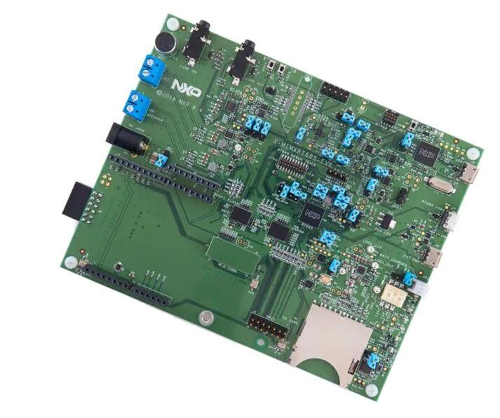

<!-- Copyright 2015-2026 Zephyr Project members and individual contributors. -->
<!-- SPDX-License-Identifier: Apache-2.0 -->
<!-- 中文翻译；编号、导航与译注为本地新增。 -->

<a id="mimxrt685_evk"></a>

# 第7章\_MIMXRT685-EVK

原文：[官方页面](https://docs.zephyrproject.org/latest/boards/nxp/mimxrt685_evk/doc/index.html)。读取日期：2026-10-16；来源摘要见[来源记录](../SOURCES.md)。

开发板概览（Board Overview）

<a id="id1"></a>

[](images/mimxrt685_evk.jpg)

MIMXRT685-EVK

名称（Name）：

`mimxrt685_evk`

厂商（Vendor）：

[恩智浦半导体（NXP Semiconductors）](https://docs.zephyrproject.org/latest/boards/index.html#vendor=nxp)

状态（Status）：

维护中（Maintained）

架构（Architecture）：

[arm](https://docs.zephyrproject.org/latest/boards/index.html#arch=arm)、[xtensa](https://docs.zephyrproject.org/latest/boards/index.html#arch=xtensa)

片上系统（SoC）：

[mimxrt685s](https://docs.zephyrproject.org/latest/boards/index.html#soc=mimxrt685s)

<a id="board-github-link"></a>

[浏览开发板源码（Browse Board Sources）](https://github.com/zephyrproject-rtos/zephyr/blob/main//boards/nxp/mimxrt685_evk/doc/index.rst/../..)<a id="overview"></a>

## 概述（Overview）

i.MX RT600跨界MCU系列面向32位沉浸式音频播放及语音用户界面应用，将高性能Cadence Tensilica HiFi 4音频DSP与新一代Cortex-M33结合，以兼顾安全及功耗的嵌入式处理器支持语音辅助终端节点。

i.MX RT600提供最高4.5 MB片上SRAM，以及多个访问片外闪存的高带宽接口，包括带即时解密引擎的八线／四线SPI接口。

<a id="hardware"></a>

## 硬件（Hardware）


- MIMXRT685SFVKB Cortex-M33处理器，300 MHz、128 KB TCM，带Cadence Xtensa HiFi 4 DSP；存储描述按原文保留
- 板载高速USB Link2调试探针，采用CMSIS-DAP协议，仅支持Cortex-M33调试
- 高速USB端口，使用Micro-A/B连接器，支持主机或设备功能
- 通过板载调试探针，将i.MX RT685目标的UART、I2C及SPI端口桥接到USB
- 512 MB Macronix八线SPI闪存，1.8 V；容量单位按原文保留
- 4.5 MB AP Memory PSRAM，容量及存储类型按原文保留
- 全尺寸SD卡槽，支持SDIO
- NXP PCA9420UK电源管理芯片（PMIC）
- 用户LED
- 复位及用户按键
- Arduino及Pmod／主机扩展连接器
- NXP FXOS8700CQ加速度计
- 立体声音频编解码器，带线路输入／输出及驻极体麦克风（Electret Microphone）
- 立体声NXP TFA9894数字放大器，可选外部+5 V电源驱动更高性能扬声器
- 通过12引脚排针最多支持8个板外数字麦克风
- 两个板载数字麦克风（DMIC）

MIMXRT685 SoC及MIMXRT685-EVK开发板的更多信息见以下资料：


- [i.MX RT685 网站](https://www.nxp.com/products/processors-and-microcontrollers/arm-microcontrollers/i-mx-rt-crossover-mcus/i-mx-rt600-crossover-mcu-with-arm-cortex-m33-and-dsp-cores:i.MX-RT600)
- [i.MX RT685 数据手册（Datasheet）](https://www.nxp.com/docs/en/data-sheet/RT600.pdf)
- [i.MX RT685 参考手册（Reference Manual）](https://www.nxp.com/webapp/Download?colCode=UM11147)
- [MIMXRT685-EVK 网站](https://www.nxp.com/design/development-boards/i-mx-evaluation-and-development-boards/i-mx-rt600-evaluation-kit:MIMXRT685-EVK)
- [MIMXRT685-EVK用户指南（User Guide）](https://www.nxp.com/webapp/Download?colCode=UM11159)
- [MIMXRT685-EVK原理图（Schematics）](https://www.nxp.com/downloads/en/design-support/RT685-DESIGNFILES.zip)

<a id="supported-features"></a>

### 支持的功能（Supported Features）

NXP将MIMXRT685-EVK视为i.MX RT6xx系列功能覆盖更广的开发板，并优先在此板落实Zephyr完整平台支持及新功能，以服务整个RT6xx系列。另一块相似开发板[MIMXRT595-EVK](P005_MIMXRT595-EVK.md#mimxrt595_evk)可能已有可复用于mimxrt685_evk的额外功能。

`mimxrt685_evk`开发板支持下表所列的硬件功能。

片上／板载（On-Chip / On-Board）

功能集成在片上系统（SoC）内／位于开发板上。

2 / 2

分别表示已启用／已禁用的实例数。点击数量标签，可查看开发板或SoC设备树源码（DTS）中该功能的第一个实例。

`vnd,foo`

与此功能匹配的设备树绑定兼容字符串（Compatible String）；点击链接可查看绑定文档。

<a id="mimxrt685_evk-hw-features"></a>

<a id="mimxrt685_evk-mimxrt685_evk/mimxrt685s/cm33-hw-features-section"></a>

#### `mimxrt685_evk/mimxrt685s/cm33`目标（Target）

<a id="mimxrt685_evk-mimxrt685_evk/mimxrt685s/cm33-hw-features-panel"></a>

<a id="mimxrt685_evk-mimxrt685_evk/mimxrt685s/cm33-hw-features-memory"></a>

该开发板目标的片上存储容量：3 MiB RAM、64 MiB Flash。

<a id="mimxrt685_evk-mimxrt685_evk/mimxrt685s/cm33-hw-features-table"></a>

<table>
<tr>
<th>类型（Type）</th>
<th>位置（Location）</th>
<th>说明（Description）</th>
<th>兼容字符串（Compatible）</th>
</tr>
<tr>
<td rowspan="1">中央处理器（CPU）</td>
<td>片上（On-Chip）</td>
<td>ARM Cortex-M33F处理器（CPU）（<a href="https://github.com/zephyrproject-rtos/zephyr/blob/main/dts/arm/nxp/imxrt/imxrt6xx/nxp_rt6xx_common.dtsi?plain=1#L28">已启用：1</a>）</td>
<td><a href="../cpu_arm_riscv_binding_reference/P023_arm_cortex-m33f.md#std-dtcompatible-arm-cortex-m33f"><code>arm,cortex-m33f</code></a></td>
</tr>
<tr>
<td rowspan="1">模数转换器（ADC）</td>
<td>片上（On-Chip）</td>
<td>LPC低功耗模数转换器（LPADC）（<a href="https://github.com/zephyrproject-rtos/zephyr/blob/main/dts/arm/nxp/imxrt/imxrt6xx/nxp_rt6xx_common.dtsi?plain=1#L589">已启用：1</a>）</td>
<td><a href="../hardware/P851_NXPLPC低功耗ADC绑定.md#dtbinding-nxp-lpc-lpadc"><code>nxp,lpc-lpadc</code></a></td>
</tr>
<tr>
<td rowspan="1">ARM 架构（ARM Architecture）</td>
<td>片上（On-Chip）</td>
<td>LPC Flexcomm节点（<a href="https://github.com/zephyrproject-rtos/zephyr/blob/main/dts/arm/nxp/imxrt/imxrt6xx/nxp_rt6xx_common.dtsi?plain=1#L366">已禁用：2</a>）</td>
<td><a href="../arm_nordic_nxp_control_binding_reference/P015_nxp_lpc-flexcomm.md#std-dtcompatible-nxp-lpc-flexcomm"><code>nxp,lpc-flexcomm</code></a></td>
</tr>
<tr>
<td rowspan="2">音频（Audio）</td>
<td>片上（On-Chip）</td>
<td>NXP数字麦克风接口（DMIC）（<a href="https://github.com/zephyrproject-rtos/zephyr/blob/main/dts/arm/nxp/imxrt/imxrt6xx/nxp_rt6xx_common.dtsi?plain=1#L444">已启用：1</a>）</td>
<td><a href="../audio_pdm_codec_binding_reference/P013_nxp_dmic.md#std-dtcompatible-nxp-dmic"><code>nxp,dmic</code></a></td>
</tr>
<tr>
<td>板载（On-Board）</td>
<td>WM8904音频编解码器（Audio Codec）（<a href="https://github.com/zephyrproject-rtos/zephyr/blob/main/boards/nxp/mimxrt685_evk/mimxrt685_evk_mimxrt685s_cm33.dts?plain=1#L439">已启用：1</a>）</td>
<td><a href="../audio_stm32_ti_wolfson_binding_reference/P011_wolfson_wm8904.md#std-dtcompatible-wolfson-wm8904"><code>wolfson,wm8904</code></a></td>
</tr>
<tr>
<td rowspan="1">时钟控制（Clock Control）</td>
<td>片上（On-Chip）</td>
<td>LPC SYSCON及CLKCTL IP节点（<a href="https://github.com/zephyrproject-rtos/zephyr/blob/main/dts/arm/nxp/imxrt/imxrt6xx/nxp_rt6xx_common.dtsi?plain=1#L138">已启用：2</a>）</td>
<td><a href="../clock_nxp_pico_realtek_renesas_binding_reference/P007_nxp_lpc-syscon.md#std-dtcompatible-nxp-lpc-syscon"><code>nxp,lpc-syscon</code></a></td>
</tr>
<tr>
<td rowspan="1">时钟监测（Clock Monitor）</td>
<td>片上（On-Chip）</td>
<td>NXP BASIC频率测量（FREQME / fmeas）模块（<a href="https://github.com/zephyrproject-rtos/zephyr/blob/main/dts/arm/nxp/imxrt/imxrt6xx/nxp_rt6xx_common.dtsi?plain=1#L178">已禁用：1</a>）</td>
<td><a href="../crc_clock_monitor_binding_reference/P003_nxp_fmeas.md#std-dtcompatible-nxp-fmeas"><code>nxp,fmeas</code></a></td>
</tr>
<tr>
<td rowspan="1">比较器（Comparator）</td>
<td>片上（On-Chip）</td>
<td>NXP Kinetis模拟比较器（ACMP / Analog Comparator）（<a href="https://github.com/zephyrproject-rtos/zephyr/blob/main/dts/arm/nxp/imxrt/imxrt6xx/nxp_rt6xx_common.dtsi?plain=1#L581">已禁用：1</a>）</td>
<td><a href="../hardware/P745_NXPKinetis模拟比较器绑定.md#dtbinding-nxp-kinetis-acmp"><code>nxp,kinetis-acmp</code></a></td>
</tr>
<tr>
<td rowspan="4">计数器（Counter）</td>
<td>片上（On-Chip）</td>
<td>使用NXP LPC RTC高分辨率计数器（High Resolution Counter）的驱动（<a href="https://github.com/zephyrproject-rtos/zephyr/blob/main/dts/arm/nxp/imxrt/imxrt6xx/nxp_rt6xx_common.dtsi?plain=1#L516">已禁用：1</a>）</td>
<td><a href="../nxp_nuvoton_counter_binding_reference/P010_nxp_lpc-rtc-highres.md#std-dtcompatible-nxp-lpc-rtc-highres"><code>nxp,lpc-rtc-highres</code></a></td>
</tr>
<tr>
<td>片上（On-Chip）</td>
<td>NXP MCUX标准定时器／计数器（Standard Timer/Counter）（<a href="https://github.com/zephyrproject-rtos/zephyr/blob/main/dts/arm/nxp/imxrt/imxrt6xx/nxp_rt6xx_common.dtsi?plain=1#L605">已启用：5</a>）</td>
<td><a href="../nxp_nuvoton_counter_binding_reference/P009_nxp_lpc-ctimer.md#std-dtcompatible-nxp-lpc-ctimer"><code>nxp,lpc-ctimer</code></a></td>
</tr>
<tr>
<td>片上（On-Chip）</td>
<td>NXP多速率定时器（Multirate Timer）（<a href="https://github.com/zephyrproject-rtos/zephyr/blob/main/dts/arm/nxp/imxrt/imxrt6xx/nxp_rt6xx_common.dtsi?plain=1#L678">已启用：1</a>）</td>
<td><a href="../nxp_nuvoton_counter_binding_reference/P015_nxp_mrt.md#std-dtcompatible-nxp-mrt"><code>nxp,mrt</code></a></td>
</tr>
<tr>
<td>片上（On-Chip）</td>
<td>NXP多速率定时器通道（<a href="https://github.com/zephyrproject-rtos/zephyr/blob/main/dts/arm/nxp/imxrt/imxrt6xx/nxp_rt6xx_common.dtsi?plain=1#L689">已禁用：4</a>）</td>
<td><a href="../nxp_nuvoton_counter_binding_reference/P014_nxp_mrt-channel.md#std-dtcompatible-nxp-mrt-channel"><code>nxp,mrt-channel</code></a></td>
</tr>
<tr>
<td rowspan="1">循环冗余校验（CRC）</td>
<td>片上（On-Chip）</td>
<td>NXP LPC循环冗余校验（CRC）设备（<a href="https://github.com/zephyrproject-rtos/zephyr/blob/main/dts/arm/nxp/imxrt/imxrt6xx/nxp_rt6xx_common.dtsi?plain=1#L341">已启用：1</a>）</td>
<td><a href="../crc_clock_monitor_binding_reference/P007_nxp_lpc-crc.md#std-dtcompatible-nxp-lpc-crc"><code>nxp,lpc-crc</code></a></td>
</tr>
<tr>
<td rowspan="1">直接存储器访问（DMA）</td>
<td>片上（On-Chip）</td>
<td>NXP LPC直接存储器访问（DMA）控制器（<a href="https://github.com/zephyrproject-rtos/zephyr/blob/main/dts/arm/nxp/imxrt/imxrt6xx/nxp_rt6xx_common.dtsi?plain=1#L426">已启用：1</a>；<a href="https://github.com/zephyrproject-rtos/zephyr/blob/main/dts/arm/nxp/imxrt/imxrt6xx/nxp_rt6xx_common.dtsi?plain=1#L435">已禁用：1</a>）</td>
<td><a href="../nxp_realtek_renesas_dma_binding_reference/P003_nxp_lpc-dma.md#std-dtcompatible-nxp-lpc-dma"><code>nxp,lpc-dma</code></a></td>
</tr>
<tr>
<td rowspan="1">数字信号处理（DSP）</td>
<td>片上（On-Chip）</td>
<td>NXP PowerQuad数字信号处理（DSP）协处理器（<a href="https://github.com/zephyrproject-rtos/zephyr/blob/main/dts/arm/nxp/imxrt/imxrt6xx/nxp_rt6xx_common.dtsi?plain=1#L727">已禁用：1</a>）</td>
<td><a href="../sound_haptic_binding_reference/P004_nxp_powerquad.md#std-dtcompatible-nxp-powerquad"><code>nxp,powerquad</code></a></td>
</tr>
<tr>
<td rowspan="3">通用输入输出与接插件（GPIO &amp; Headers）</td>
<td>片上（On-Chip）</td>
<td>LPC通用输入输出（GPIO）（<a href="https://github.com/zephyrproject-rtos/zephyr/blob/main/dts/arm/nxp/imxrt/imxrt6xx/nxp_rt6xx_common.dtsi?plain=1#L242">已启用：1</a>）</td>
<td><a href="../gpio_nxp_expanders_binding_reference/P006_nxp_lpc-gpio.md#std-dtcompatible-nxp-lpc-gpio"><code>nxp,lpc-gpio</code></a></td>
</tr>
<tr>
<td>片上（On-Chip）</td>
<td>LPC GPIO端口设备（<a href="https://github.com/zephyrproject-rtos/zephyr/blob/main/dts/arm/nxp/imxrt/imxrt6xx/nxp_rt6xx_common.dtsi?plain=1#L248">已启用：6</a>）</td>
<td><a href="../gpio_nxp_expanders_binding_reference/P005_nxp_lpc-gpio-port.md#std-dtcompatible-nxp-lpc-gpio-port"><code>nxp,lpc-gpio-port</code></a></td>
</tr>
<tr>
<td>板载（On-Board）</td>
<td>引出到Arduino Uno R3排针（Headers）的GPIO引脚（<a href="https://github.com/zephyrproject-rtos/zephyr/blob/main/boards/nxp/mimxrt685_evk/mimxrt685_evk_mimxrt685s_cm33.dts?plain=1#L110">已启用：1</a>）</td>
<td><a href="../gpio_adi_headers_ambiq_binding_reference/P023_arduino-header-r3.md#std-dtcompatible-arduino-header-r3"><code>arduino-header-r3</code></a></td>
</tr>
<tr>
<td rowspan="1">硬件信息（Hardware Information）</td>
<td>片上（On-Chip）</td>
<td>NXP LPC 128位唯一标识符（Unique Identifier）（<a href="https://github.com/zephyrproject-rtos/zephyr/blob/main/dts/arm/nxp/imxrt/imxrt6xx/nxp_rt6xx_common.dtsi?plain=1#L237">已启用：1</a>）</td>
<td><a href="../hwinfo_binding_reference/P009_nxp_lpc-uid.md#std-dtcompatible-nxp-lpc-uid"><code>nxp,lpc-uid</code></a></td>
</tr>
<tr>
<td rowspan="1">集成电路间总线（I2C）</td>
<td>片上（On-Chip）</td>
<td>LPC I2C控制器（<a href="https://github.com/zephyrproject-rtos/zephyr/blob/main/dts/arm/nxp/imxrt/imxrt6xx/nxp_rt6xx_common.dtsi?plain=1#L323">已启用：2</a>）</td>
<td><a href="../i2c_nxp_pico_renesas_binding_reference/P003_nxp_lpc-i2c.md#std-dtcompatible-nxp-lpc-i2c"><code>nxp,lpc-i2c</code></a></td>
</tr>
<tr>
<td rowspan="1">集成电路间音频总线（I2S）</td>
<td>片上（On-Chip）</td>
<td>LPC I2S音频总线节点（<a href="https://github.com/zephyrproject-rtos/zephyr/blob/main/dts/arm/nxp/imxrt/imxrt6xx/nxp_rt6xx_common.dtsi?plain=1#L314">已启用：2</a>）</td>
<td><a href="../i2s_binding_reference/P012_nxp_lpc-i2s.md#std-dtcompatible-nxp-lpc-i2s"><code>nxp,lpc-i2s</code></a></td>
</tr>
<tr>
<td rowspan="1">改进型集成电路间总线（I3C）</td>
<td>片上（On-Chip）</td>
<td>NXP MCUX I3C控制器（<a href="https://github.com/zephyrproject-rtos/zephyr/blob/main/dts/arm/nxp/imxrt/imxrt6xx/nxp_rt6xx_common.dtsi?plain=1#L665">已启用：1</a>）</td>
<td><a href="../i3c_smbus_binding_reference/P007_nxp_mcux-i3c.md#std-dtcompatible-nxp-mcux-i3c"><code>nxp,mcux-i3c</code></a></td>
</tr>
<tr>
<td rowspan="1">输入（Input）</td>
<td>板载（On-Board）</td>
<td>一组绑定到 GPIO 的输入按键（GPIO-Bound Input Keys）（<a href="https://github.com/zephyrproject-rtos/zephyr/blob/main/boards/nxp/mimxrt685_evk/mimxrt685_evk_mimxrt685s_cm33.dts?plain=1#L53">已启用：1</a>）</td>
<td><a href="../hardware/P563_GPIO按键绑定.md#std-dtcompatible-gpio-keys"><code>gpio-keys</code></a></td>
</tr>
<tr>
<td rowspan="2">中断控制器（Interrupt Controller）</td>
<td>片上（On-Chip）</td>
<td>NXP引脚中断及模式匹配引擎（PINT）（<a href="https://github.com/zephyrproject-rtos/zephyr/blob/main/dts/arm/nxp/imxrt/imxrt6xx/nxp_rt6xx_common.dtsi?plain=1#L293">已启用：1</a>）</td>
<td><a href="../nxp_interrupt_binding_reference/P004_nxp_pint.md#std-dtcompatible-nxp-pint"><code>nxp,pint</code></a></td>
</tr>
<tr>
<td>片上（On-Chip）</td>
<td>ARMv8-M嵌套向量中断控制器（NVIC / Nested Vectored Interrupt Controller）（<a href="https://github.com/zephyrproject-rtos/zephyr/blob/main/dts/arm/armv8-m.dtsi?plain=1#L13">已启用：1</a>）</td>
<td><a href="../arm_interrupt_timer_binding_reference/P003_ARMv8_M_NVIC.md#std-dtcompatible-arm-v8m-nvic"><code>arm,v8m-nvic</code></a></td>
</tr>
<tr>
<td rowspan="2">发光二极管（LED）</td>
<td>板载（On-Board）</td>
<td>一组由 GPIO 控制的 LED（GPIO-Controlled LEDs）（<a href="https://github.com/zephyrproject-rtos/zephyr/blob/main/boards/nxp/mimxrt685_evk/mimxrt685_evk_mimxrt685s_cm33.dts?plain=1#L69">已启用：1</a>）</td>
<td><a href="../hardware/P564_GPIO指示灯绑定.md#dtbinding-gpio-leds"><code>gpio-leds</code></a></td>
</tr>
<tr>
<td>板载（On-Board）</td>
<td>一组由脉宽调制（PWM）控制的LED（<a href="https://github.com/zephyrproject-rtos/zephyr/blob/main/boards/nxp/mimxrt685_evk/mimxrt685_evk_mimxrt685s_cm33.dts?plain=1#L88">已启用：1</a>）</td>
<td><a href="../hardware/P565_PWM指示灯绑定.md#dtbinding-pwm-leds"><code>pwm-leds</code></a></td>
</tr>
<tr>
<td rowspan="1">邮箱（Mailbox）</td>
<td>片上（On-Chip）</td>
<td>用作Zephyr邮箱（MBOX）的NXP i.MX消息单元（<a href="https://github.com/zephyrproject-rtos/zephyr/blob/main/dts/arm/nxp/imxrt/imxrt6xx/nxp_rt6xx_common.dtsi?plain=1#L714">已启用：1</a>）</td>
<td><a href="../intercore_reference/P047_NXPiMX消息单元邮箱绑定.md#dtbinding-nxp-mbox-imx-mu"><code>nxp,mbox-imx-mu</code></a></td>
</tr>
<tr>
<td rowspan="1">其他绑定（Miscellaneous）</td>
<td>片上（On-Chip）</td>
<td>NXP i.MX RTxxx DSP控制驱动，适用于i.MX RT600 HiFi 4 DSP（<a href="https://github.com/zephyrproject-rtos/zephyr/blob/main/dts/arm/nxp/imxrt/imxrt6xx/nxp_rt6xx_common.dtsi?plain=1#L57">已禁用：1</a>）</td>
<td><a href="../misc_nxp_renesas_zephyr_binding_reference/P004_nxp_rt600-dsp-ctrl.md#std-dtcompatible-nxp-rt600-dsp-ctrl"><code>nxp,rt600-dsp-ctrl</code></a></td>
</tr>
<tr>
<td rowspan="1">内存管理单元／内存保护单元（MMU / MPU）</td>
<td>片上（On-Chip）</td>
<td>ARMv8-M存储器保护单元（MPU / Memory Protection Unit）（<a href="https://github.com/zephyrproject-rtos/zephyr/blob/main/dts/arm/nxp/imxrt/imxrt6xx/nxp_rt6xx_common.dtsi?plain=1#L36">已启用：1</a>）</td>
<td><a href="../memory_protection_binding_reference/P007_arm_armv8m-mpu.md#std-dtcompatible-arm-armv8m-mpu"><code>arm,armv8m-mpu</code></a></td>
</tr>
<tr>
<td rowspan="2">存储技术设备（MTD）</td>
<td>板载（On-Board）</td>
<td>NXP FlexSPI MX25UM51345G闪存（<a href="https://github.com/zephyrproject-rtos/zephyr/blob/main/boards/nxp/mimxrt685_evk/mimxrt685_evk_mimxrt685s_cm33.dts?plain=1#L271">已启用：1</a>）</td>
<td><a href="../mtd_microchip_nordic_nxp_binding_reference/P021_nxp_imx-flexspi-mx25um51345g.md#std-dtcompatible-nxp-imx-flexspi-mx25um51345g"><code>nxp,imx-flexspi-mx25um51345g</code></a></td>
</tr>
<tr>
<td>板载（On-Board）</td>
<td>闪存（Flash）节点（<a href="https://github.com/zephyrproject-rtos/zephyr/blob/main/boards/nxp/mimxrt685_evk/mimxrt685_evk_mimxrt685s_cm33.dts?plain=1#L284">已启用：1</a>）</td>
<td><a href="../mtd_nxp_st_ti_partition_binding_reference/P013_soc-nv-flash.md#std-dtcompatible-soc-nv-flash"><code>soc-nv-flash</code></a></td>
</tr>
<tr>
<td rowspan="1">多路复用器（MUX）</td>
<td>片上（On-Chip）</td>
<td>NXP输入复用器（INPUTMUX）外设绑定（<a href="https://github.com/zephyrproject-rtos/zephyr/blob/main/dts/arm/nxp/imxrt/imxrt6xx/nxp_rt6xx_common.dtsi?plain=1#L170">已禁用：1</a>）</td>
<td><a href="../mux_w1_binding_reference/P004_nxp_inputmux.md#std-dtcompatible-nxp-inputmux"><code>nxp,inputmux</code></a></td>
</tr>
<tr>
<td rowspan="2">引脚控制（Pin Control）</td>
<td>片上（On-Chip）</td>
<td>LPC I/O引脚配置（IOCON）（<a href="https://github.com/zephyrproject-rtos/zephyr/blob/main/dts/arm/nxp/imxrt/imxrt6xx/nxp_rt6xx_common.dtsi?plain=1#L154">已启用：1</a>）</td>
<td><a href="../pinctrl_nxp_pico_binding_reference/P007_nxp_lpc-iocon.md#std-dtcompatible-nxp-lpc-iocon"><code>nxp,lpc-iocon</code></a></td>
</tr>
<tr>
<td>片上（On-Chip）</td>
<td>RT600／RT500引脚控制器（Pin Controller）（<a href="https://github.com/zephyrproject-rtos/zephyr/blob/main/dts/arm/nxp/imxrt/imxrt6xx/nxp_rt6xx_common.dtsi?plain=1#L158">已启用：1</a>）</td>
<td><a href="../pinctrl_nxp_pico_binding_reference/P018_nxp_rt-iocon-pinctrl.md#std-dtcompatible-nxp-rt-iocon-pinctrl"><code>nxp,rt-iocon-pinctrl</code></a></td>
</tr>
<tr>
<td rowspan="1">脉宽调制（PWM）</td>
<td>片上（On-Chip）</td>
<td>NXP状态可配置定时器（SCTimer）脉宽调制（PWM）（<a href="https://github.com/zephyrproject-rtos/zephyr/blob/main/dts/arm/nxp/imxrt/imxrt6xx/nxp_rt6xx_common.dtsi?plain=1#L529">已启用：1</a>）</td>
<td><a href="../pwm_nxp_renesas_binding_reference/P012_nxp_sctimer-pwm.md#std-dtcompatible-nxp-sctimer-pwm"><code>nxp,sctimer-pwm</code></a></td>
</tr>
<tr>
<td rowspan="1">稳压器（Regulator）</td>
<td>板载（On-Board）</td>
<td>NXP PCA9420电源管理芯片（PMIC）（<a href="https://github.com/zephyrproject-rtos/zephyr/blob/main/boards/nxp/mimxrt685_evk/mimxrt685_evk_mimxrt685s_cm33.dts?plain=1#L243">已启用：1</a>）</td>
<td><a href="../hardware/P668_PCA9420稳压器绑定.md#dtbinding-nxp-pca9420"><code>nxp,pca9420</code></a></td>
</tr>
<tr>
<td rowspan="1">复位控制器（Reset Controller）</td>
<td>片上（On-Chip）</td>
<td>NXP RSTCTL外设复位控制器（<a href="https://github.com/zephyrproject-rtos/zephyr/blob/main/dts/arm/nxp/imxrt/imxrt6xx/nxp_rt6xx_common.dtsi?plain=1#L225">已启用：2</a>）</td>
<td><a href="../reset_controller_binding_reference/P011_nxp_rstctl.md#std-dtcompatible-nxp-rstctl"><code>nxp,rstctl</code></a></td>
</tr>
<tr>
<td rowspan="1">随机数生成器（RNG）</td>
<td>片上（On-Chip）</td>
<td>Kinetis真随机数发生器（TRNG / True Random Number Generator）（<a href="https://github.com/zephyrproject-rtos/zephyr/blob/main/dts/arm/nxp/imxrt/imxrt6xx/nxp_rt6xx_common.dtsi?plain=1#L522">已启用：1</a>）</td>
<td><a href="../rng_binding_reference/P020_nxp_kinetis-trng.md#std-dtcompatible-nxp-kinetis-trng"><code>nxp,kinetis-trng</code></a></td>
</tr>
<tr>
<td rowspan="1">实时时钟（RTC）</td>
<td>片上（On-Chip）</td>
<td>NXP LPC实时时钟（RTC）（<a href="https://github.com/zephyrproject-rtos/zephyr/blob/main/dts/arm/nxp/imxrt/imxrt6xx/nxp_rt6xx_common.dtsi?plain=1#L510">已启用：1</a>）</td>
<td><a href="../microchip_microcrystal_nxp_rtc_binding_reference/P013_nxp_lpc-rtc.md#std-dtcompatible-nxp-lpc-rtc"><code>nxp,lpc-rtc</code></a></td>
</tr>
<tr>
<td rowspan="1">SD 主机控制器（SDHC）</td>
<td>片上（On-Chip）</td>
<td>NXP i.MX USDHC控制器（<a href="https://github.com/zephyrproject-rtos/zephyr/blob/main/dts/arm/nxp/imxrt/imxrt6xx/nxp_rt6xx_common.dtsi?plain=1#L557">已启用：1</a>；<a href="https://github.com/zephyrproject-rtos/zephyr/blob/main/dts/arm/nxp/imxrt/imxrt6xx/nxp_rt6xx_common.dtsi?plain=1#L569">已禁用：1</a>）</td>
<td><a href="../sdhc_binding_reference/P014_nxp_imx-usdhc.md#std-dtcompatible-nxp-imx-usdhc"><code>nxp,imx-usdhc</code></a></td>
</tr>
<tr>
<td rowspan="1">传感器（Sensors）</td>
<td>板载（On-Board）</td>
<td>FXOS8700六轴加速度计／磁力计传感器（<a href="https://github.com/zephyrproject-rtos/zephyr/blob/main/boards/nxp/mimxrt685_evk/mimxrt685_evk_mimxrt685s_cm33.dts?plain=1#L180">已启用：1</a>）</td>
<td><a href="../compatible_binding_reference/P052_nxp_fxos8700.md#std-dtcompatible-nxp-fxos8700"><code>nxp,fxos8700</code></a></td>
</tr>
<tr>
<td rowspan="1">串行控制器（Serial Controller）</td>
<td>片上（On-Chip）</td>
<td>LPC通用同步异步收发器（USART）（<a href="https://github.com/zephyrproject-rtos/zephyr/blob/main/dts/arm/nxp/imxrt/imxrt6xx/nxp_rt6xx_common.dtsi?plain=1#L305">已启用：2</a>）</td>
<td><a href="../uart_microchip_nordic_nxp_binding_reference/P014_nxp_lpc-usart.md#std-dtcompatible-nxp-lpc-usart"><code>nxp,lpc-usart</code></a></td>
</tr>
<tr>
<td rowspan="2">串行外设接口（SPI）</td>
<td>片上（On-Chip）</td>
<td>NXP FlexSPI控制器（<a href="https://github.com/zephyrproject-rtos/zephyr/blob/main/dts/arm/nxp/imxrt/imxrt6xx/nxp_rt6xx_common.dtsi?plain=1#L133">已启用：1</a>）</td>
<td><a href="../spi_flexspi_nxp_renesas_binding_reference/P001_nxp_imx-flexspi.md#std-dtcompatible-nxp-imx-flexspi"><code>nxp,imx-flexspi</code></a></td>
</tr>
<tr>
<td>片上（On-Chip）</td>
<td>NXP LPC串行外设接口（SPI）控制器（<a href="https://github.com/zephyrproject-rtos/zephyr/blob/main/dts/arm/nxp/imxrt/imxrt6xx/nxp_rt6xx_common.dtsi?plain=1#L357">已启用：1</a>；<a href="https://github.com/zephyrproject-rtos/zephyr/blob/main/dts/arm/nxp/imxrt/imxrt6xx/nxp_rt6xx_common.dtsi?plain=1#L407">已禁用：1</a>）</td>
<td><a href="../spi_flexspi_nxp_renesas_binding_reference/P003_nxp_lpc-spi.md#std-dtcompatible-nxp-lpc-spi"><code>nxp,lpc-spi</code></a></td>
</tr>
<tr>
<td rowspan="1">静态随机存储器（SRAM）</td>
<td>片上（On-Chip）</td>
<td>通用片上静态随机存储器（SRAM）（<a href="https://github.com/zephyrproject-rtos/zephyr/blob/main/dts/arm/nxp/imxrt/imxrt6xx/nxp_rt6xx_common.dtsi?plain=1#L96">已启用：2</a>）</td>
<td><a href="../hardware/P567_内存映射SRAM绑定.md#dtbinding-mmio-sram"><code>mmio-sram</code></a></td>
</tr>
<tr>
<td rowspan="2">定时器（Timer）</td>
<td>片上（On-Chip）</td>
<td>i.MX RT5xx／6xx上的NXP操作系统定时器（OS Timer）（<a href="https://github.com/zephyrproject-rtos/zephyr/blob/main/dts/arm/nxp/imxrt/imxrt6xx/nxp_rt6xx_common.dtsi?plain=1#L502">已启用：1</a>）</td>
<td><a href="../microchip_nordic_nxp_realtek_timer_binding_reference/P008_nxp_os-timer.md#std-dtcompatible-nxp-os-timer"><code>nxp,os-timer</code></a></td>
</tr>
<tr>
<td>片上（On-Chip）</td>
<td>ARMv8-M系统节拍（System Tick）（<a href="https://github.com/zephyrproject-rtos/zephyr/blob/main/dts/arm/armv8-m.dtsi?plain=1#L21">已禁用：1</a>）</td>
<td><a href="../arm_interrupt_timer_binding_reference/P007_ARMv8_M_SysTick.md#std-dtcompatible-arm-armv8m-systick"><code>arm,armv8m-systick</code></a></td>
</tr>
<tr>
<td rowspan="2">通用串行总线（USB）</td>
<td>片上（On-Chip）</td>
<td>NXP LPCIP3511 USB设备模式（<a href="https://github.com/zephyrproject-rtos/zephyr/blob/main/dts/arm/nxp/imxrt/imxrt6xx/nxp_rt6xx_common.dtsi?plain=1#L393">已启用：1</a>）</td>
<td><a href="../usb_soc_binding_reference/P008_nxp_lpcip3511.md#std-dtcompatible-nxp-lpcip3511"><code>nxp,lpcip3511</code></a></td>
</tr>
<tr>
<td>片上（On-Chip）</td>
<td>NXP USB高速物理层（High Speed PHY）（<a href="https://github.com/zephyrproject-rtos/zephyr/blob/main/dts/arm/nxp/imxrt/imxrt6xx/nxp_rt6xx_common.dtsi?plain=1#L401">已启用：1</a>）</td>
<td><a href="../usb_soc_binding_reference/P013_nxp_usbphy.md#std-dtcompatible-nxp-usbphy"><code>nxp,usbphy</code></a></td>
</tr>
<tr>
<td rowspan="1">看门狗（Watchdog）</td>
<td>片上（On-Chip）</td>
<td>LPC窗口看门狗定时器（Windowed Watchdog Timer）（<a href="https://github.com/zephyrproject-rtos/zephyr/blob/main/dts/arm/nxp/imxrt/imxrt6xx/nxp_rt6xx_common.dtsi?plain=1#L539">已启用：1</a>；<a href="https://github.com/zephyrproject-rtos/zephyr/blob/main/dts/arm/nxp/imxrt/imxrt6xx/nxp_rt6xx_common.dtsi?plain=1#L548">已禁用：1</a>）</td>
<td><a href="../nxp_nordic_nuvoton_watchdog_binding_reference/P011_nxp_lpc-wwdt.md#std-dtcompatible-nxp-lpc-wwdt"><code>nxp,lpc-wwdt</code></a></td>
</tr>
</table>

<a id="connections-and-ios"></a>

### 连接与输入输出（Connections and IOs）

MIMXRT685 SoC提供IOCON寄存器，用于配置引脚功能。

<table>
<tr>
<th>名称（Name）</th>
<th>功能（Function）</th>
<th>用途（Usage）</th>
</tr>
<tr>
<td>PIO0_2</td>
<td>通用同步异步收发器（USART）</td>
<td>USART接收（RX）</td>
</tr>
<tr>
<td>PIO0_1</td>
<td>通用同步异步收发器（USART）</td>
<td>USART发送（TX）</td>
</tr>
<tr>
<td>PIO0_14</td>
<td>通用输入输出（GPIO）</td>
<td>绿色LED（GREEN LED）</td>
</tr>
<tr>
<td>PIO1_1</td>
<td>通用输入输出（GPIO）</td>
<td>SW0</td>
</tr>
<tr>
<td>PIO0_17</td>
<td>集成电路间总线（I2C）</td>
<td>I2C串行数据（SDA）</td>
</tr>
<tr>
<td>PIO0_18</td>
<td>集成电路间总线（I2C）</td>
<td>I2C串行时钟（SCL）</td>
</tr>
<tr>
<td>PIO1_5</td>
<td>通用输入输出（GPIO）</td>
<td>FXOS8700触发（TRIGGER）</td>
</tr>
<tr>
<td>PIO1_5</td>
<td>串行外设接口（SPI）</td>
<td>SPI主机输出从机输入（MOSI）</td>
</tr>
<tr>
<td>PIO1_4</td>
<td>串行外设接口（SPI）</td>
<td>SPI主机输入从机输出（MISO）</td>
</tr>
<tr>
<td>PIO1_3</td>
<td>串行外设接口（SPI）</td>
<td>SPI串行时钟（SCK）</td>
</tr>
<tr>
<td>PIO1_6</td>
<td>串行外设接口（SPI）</td>
<td>SPI从设备选择（SSEL）</td>
</tr>
<tr>
<td>PIO0_23</td>
<td>集成电路间音频总线（I2S）</td>
<td>I2S数据输出（DATAOUT）</td>
</tr>
<tr>
<td>PIO0_22</td>
<td>集成电路间音频总线（I2S）</td>
<td>I2S发送字选择（TX WS）</td>
</tr>
<tr>
<td>PIO0_21</td>
<td>集成电路间音频总线（I2S）</td>
<td>I2S发送串行时钟（TX SCK）</td>
</tr>
<tr>
<td>PIO0_9</td>
<td>集成电路间音频总线（I2S）</td>
<td>I2S数据输入（DATAIN）</td>
</tr>
<tr>
<td>PIO0_29</td>
<td>通用同步异步收发器（USART）</td>
<td>USART发送（TX）</td>
</tr>
<tr>
<td>PIO0_30</td>
<td>通用同步异步收发器（USART）</td>
<td>USART接收（RX）</td>
</tr>
<tr>
<td>PIO1_11</td>
<td>FLEXSPI0B_DATA0</td>
<td>八线SPI（OctalSPI）闪存</td>
</tr>
<tr>
<td>PIO1_12</td>
<td>FLEXSPI0B_DATA1</td>
<td>八线SPI（OctalSPI）闪存</td>
</tr>
<tr>
<td>PIO1_13</td>
<td>FLEXSPI0B_DATA2</td>
<td>八线SPI（OctalSPI）闪存</td>
</tr>
<tr>
<td>PIO1_14</td>
<td>FLEXSPI0B_DATA3</td>
<td>八线SPI（OctalSPI）闪存</td>
</tr>
<tr>
<td>PIO1_29</td>
<td>FLEXSPI0B_SCLK</td>
<td>八线SPI（OctalSPI）闪存</td>
</tr>
<tr>
<td>PIO2_12</td>
<td>PIO2_12</td>
<td>八线SPI（OctalSPI）闪存</td>
</tr>
<tr>
<td>PIO2_17</td>
<td>FLEXSPI0B_DATA4</td>
<td>八线SPI（OctalSPI）闪存</td>
</tr>
<tr>
<td>PIO2_18</td>
<td>FLEXSPI0B_DATA5</td>
<td>八线SPI（OctalSPI）闪存</td>
</tr>
<tr>
<td>PIO2_19</td>
<td>FLEXSPI0B_SS0_N</td>
<td>八线SPI（OctalSPI）闪存</td>
</tr>
<tr>
<td>PIO2_22</td>
<td>FLEXSPI0B_DATA6</td>
<td>八线SPI（OctalSPI）闪存</td>
</tr>
<tr>
<td>PIO2_23</td>
<td>FLEXSPI0B_DATA7</td>
<td>八线SPI（OctalSPI）闪存</td>
</tr>
<tr>
<td>PIO0_27</td>
<td>SCT0_OUT7</td>
<td>脉宽调制（PWM）</td>
</tr>
<tr>
<td>PIO1_30</td>
<td>SD0_CLK</td>
<td>SD卡</td>
</tr>
<tr>
<td>PIO1_31</td>
<td>SD0_CMD</td>
<td>SD卡</td>
</tr>
<tr>
<td>PIO2_0</td>
<td>SD0_D0</td>
<td>SD卡</td>
</tr>
<tr>
<td>PIO2_1</td>
<td>SD0_D1</td>
<td>SD卡</td>
</tr>
<tr>
<td>PIO2_2</td>
<td>SD0_D2</td>
<td>SD卡</td>
</tr>
<tr>
<td>PIO2_3</td>
<td>SD0_D3</td>
<td>SD卡</td>
</tr>
<tr>
<td>PIO2_4</td>
<td>SD0_WR_PRT</td>
<td>SD卡</td>
</tr>
<tr>
<td>PIO2_9</td>
<td>SD0_CD</td>
<td>SD卡</td>
</tr>
<tr>
<td>PIO2_10</td>
<td>SD0_RST</td>
<td>SD卡</td>
</tr>
</table>

<a id="system-clock"></a>

### 系统时钟（System Clock）

MIMXRT685 EVK配置为使用操作系统事件定时器（OS Event Timer）作为系统时钟源。

<a id="serial-port"></a>

### 串口（Serial Port）

MIMXRT685 SoC有8路FLEXCOMM串行通信接口，一路配置为控制台USART，其余未使用。

<a id="programming-and-debugging"></a>

## 烧录与调试（Programming and Debugging）

`mimxrt685_evk`开发板支持下表所列的运行工具（Runners）及相关west命令。

<table>
<tr>
<th></th>
<th>烧录（flash）</th>
<th>调试（debug）</th>
<th>连接调试会话（attach）</th>
<th>实时传输（rtt）</th>
<th>复位（reset）</th>
<th>调试服务器（debugserver）</th>
</tr>
<tr>
<td><a href="https://docs.zephyrproject.org/latest/develop/flash_debug/host-tools.html#runner-jlink">jlink</a></td>
<td>✅</td>
<td>✅</td>
<td>✅</td>
<td>✅</td>
<td>✅</td>
<td>✅</td>
</tr>
<tr>
<td><a href="https://docs.zephyrproject.org/latest/develop/flash_debug/host-tools.html#runner-linkserver">linkserver</a></td>
<td>✅（默认 / default）</td>
<td>✅（默认 / default）</td>
<td>✅</td>
<td></td>
<td></td>
<td>✅</td>
</tr>
</table>

按通常方式构建并烧录应用，详见“构建应用”（[Building an Application](../application/P001_应用开发.md#build-an-application)）与“运行应用”（[Run an Application](https://docs.zephyrproject.org/latest/develop/application/index.html#application-run)）。

<a id="configuring-a-debug-probe"></a>

### 配置调试探针（Configuring a Debug Probe）

烧录及调试都使用调试探针，此板默认使用LPC-Link2。

<a id="tab-0-TGlua1NlcnZlciBDTVNJUy1EQVA="></a>

<a id="tab-0-TFBDTGluazIgSkxpbmsgT25ib2FyZA=="></a>

<a id="tab-0-SkxpbmsgRXh0ZXJuYWw="></a>

<a id="panel-0-TGlua1NlcnZlciBDTVNJUy1EQVA="></a>

**LinkServer CMSIS-DAP**


1. 安装LinkServer调试主机工具并加入搜索路径。LinkServer兼容板载调试器默认提供的CMSIS-DAP固件。（[LinkServer调试主机工具（Debug Host Tools）](https://docs.zephyrproject.org/latest/develop/flash_debug/host-tools.html#linkserver-debug-host-tools)）
2. 确认已安装JP17、JP18及JP19。

此板默认运行工具为LinkServer。

```text
west flash
west debug
```

<a id="panel-0-TFBDTGluazIgSkxpbmsgT25ib2FyZA=="></a>

**板载LPC-Link2 J-Link**


1. 安装J-Link调试主机工具（Debug Host Tools），并确保工具位于搜索路径中。（[J-Link主机调试工具（Debug Host Tools）](https://docs.zephyrproject.org/latest/develop/flash_debug/host-tools.html#jlink-debug-host-tools)）
2. 为把SWD信号连接到板载调试电路，需安装JP17、JP18及JP19，原文说明这些跳线默认安装。
3. 按LPC-Link2 J-Link板载调试探针说明写入J-Link固件，并确保使用此板的最新固件。（[LPC-Link2 J-Link板载调试探针（Onboard Debug Probe）](../debugging/P003_调试探针.md#lpclink2-jlink-onboard-debug-probe)）

```text
west flash -r jlink
west debug -r jlink
```

<a id="panel-0-SkxpbmsgRXh0ZXJuYWw="></a>

**外部J-Link**


1. 安装J-Link调试主机工具（Debug Host Tools），并确保工具位于搜索路径中。（[J-Link主机调试工具（Debug Host Tools）](https://docs.zephyrproject.org/latest/develop/flash_debug/host-tools.html#jlink-debug-host-tools)）
2. 为从板载调试电路断开SWD信号，移除J17、J18及J19。原文此处写J，前文写JP，均保留；这些跳线原文说明默认安装。
3. 将J-Link探针连接到J2的10引脚排针。

更多信息见“外部J-Link调试探针”（[J-Link External Debug Probe](https://docs.zephyrproject.org/latest/develop/flash_debug/probes.html#jlink-external-debug-probe)）。

```text
west flash -r jlink
west debug -r jlink
```

<a id="configuring-a-console"></a>

### 配置控制台（Configuring a Console）

用USB线缆将PC连接到J16，在所选串口终端（如minicom、PuTTY）中使用以下设置：


- 速率（Speed）：115200波特率
- 数据位（Data）：8位
- 奇偶校验（Parity）：无（None）
- 停止位（Stop Bits）：1位

<a id="flashing"></a>

### 烧录（Flashing）

下面以[Hello World](../getting_started/P005_HelloWorld示例.md#hello_world)应用为例，默认使用LinkServer调试主机工具。（[LinkServer调试主机工具（Debug Host Tools）](https://docs.zephyrproject.org/latest/develop/flash_debug/host-tools.html#linkserver-debug-host-tools)）

```text
# From the root of the zephyr repository
west build -b mimxrt685_evk/mimxrt685s/cm33 samples/hello_world
west flash
```

打开串口终端，复位开发板（按下RESET按键），应能在终端中看到以下消息：

```text
***** Booting Zephyr OS v1.14.0 *****
Hello World! mimxrt685_evk
```

<a id="debugging"></a>

### 调试（Debugging）

下面以[Hello World](../getting_started/P005_HelloWorld示例.md#hello_world)应用为例，默认使用LinkServer调试主机工具。（[LinkServer调试主机工具（Debug Host Tools）](https://docs.zephyrproject.org/latest/develop/flash_debug/host-tools.html#linkserver-debug-host-tools)）

```text
# From the root of the zephyr repository
west build -b mimxrt685_evk/mimxrt685s/cm33 samples/hello_world
west debug
```

打开串口终端，在调试器中单步运行应用，应能在终端中看到以下消息：

```text
***** Booting Zephyr OS zephyr-v2.3.0 *****
Hello World! mimxrt685_evk
```

<a id="troubleshooting"></a>

### 故障排查（Troubleshooting）

若调试探针出现以下连接错误，可能是闪存中的镜像干扰了调试连接。

```text
Remote debugging using :2331
Remote communication error.  Target disconnected.: Connection reset by peer.
"monitor" command not supported by this target.
"monitor" command not supported by this target.
You can't do that when your target is `exec'
(gdb) Could not connect to target.
Please check power, connection and settings.
```

可按以下步骤擦除并重新编程闪存来恢复：


1. 将SW5拨码设为ON-ON-ON，阻止从闪存启动。
2. 按SW3复位。
3. 使用已知可工作的Zephyr应用，例如Hello World，再次运行west debug或west flash。
4. 将SW5拨码设为ON-OFF-ON，从闪存启动。
5. 按SW3复位。

<a id="hifi-4-dsp-core"></a>

### HiFi 4 DSP核

i.MX RT685中的Cadence HiFi 4 DSP核已获支持，可配合专有Xtensa工具链及Zephyr SDK提供的xtensa-nxp_rt600_adsp_zephyr-elf GCC工具链使用。原文将专有工具链旧版称为xcc、新版称为xt-lang；后文实际配置值为xt-clang，分别保留。

构建工程的步骤如下：


- 设置工具链环境（Toolchain Environment）


  - Zephyr SDK中的GCC工具链无需特殊配置。
  - 使用专有Xtensa工具链时，按实际安装版本设置XTENSA_CORE、XTENSA_TOOLCHAIN_PATH及TOOLCHAIN_VER；ZEPHYR_TOOLCHAIN_VARIANT取xcc或xt-clang。
- 使用以下命令构建工程：

  ```text
  # From the root of the zephyr repository
  west build -b mimxrt685_evk/mimxrt685s/hifi4 samples/hello_world
  ```

可使用J-Link GDB服务器，连接专有Xtensa的xt-gdb或Zephyr SDK的gdb直接调试。也可通过xt-ocd守护进程联合调试HiFi 4及CM33，详情见《[RT600双核通信与调试](https://www.nxp.com/docs/en/application-note/AN12789.pdf)》（RT600 Dual-Core Communication and Debugging）。

HiFi 4作为次级核，需要显式初始化才能工作。RT685 CM33域中的nxp_rtxxx_adsp_ctrl驱动负责此工作，初始化时配置电源域及时钟；完成后即可附加调试器。用于非对称多处理（AMP）系统时，该驱动还负责加载代码及运行控制。

<a id="support-resources-for-zephyr"></a>

### Zephyr支持资源（Support Resources）


- [NXP开发板支持状态（Board Support Status）](https://github.com/nxp-zephyr/nxp-zsdk/blob/main/doc/releases/Board-Support-Status.md)
- [NXP Zephyr下游软件开发工具包（Downstream SDK）](https://github.com/nxp-zephyr/nxp-zsdk)
- [MCUXpresso for VS Code文档](https://mcuxpresso.nxp.com/mcux-vscode)及[Zephyr实验指南](https://mcuxpresso.nxp.com/mcux-vscode/latest/html/Training-Zephyr-Getting-Started.html)
- [NXP Zephyr知识中心（Knowledge Hub）](https://community.nxp.com/t5/Zephyr-Project-Knowledge-Base/Zephyr-Knowledge-Hub/ta-p/2008548)
- NXP Zephyr主页，包含培训资源（[NXP的Zephyr专题页面](https://nxp.com/zephyr)）
- [NXP Zephyr支持社区论坛（Support Community）](https://community.nxp.com/t5/Zephyr-Project/bd-p/Zephyr-Project)

## 译注

硬件清单的512 MB八线闪存、4.5 MB PSRAM及128 KB TCM按原文保留，不以其他页面参数替换。专有工具链描述中xt-lang与配置值xt-clang不同，已标注。HiFi 4初始化、加载及运行由CM33侧控制驱动负责。

## 原文外链核对

2026-10-16核对并重试以下原文外链时未能确认可访问性，保留原始目标，不将访问失败解释为原文内容有误。

- [2008548](https://community.nxp.com/t5/Zephyr-Project-Knowledge-Base/Zephyr-Knowledge-Hub/ta-p/2008548)：HTTP Error 403: Forbidden。
- [Zephyr-Project](https://community.nxp.com/t5/Zephyr-Project/bd-p/Zephyr-Project)：HTTP Error 403: Forbidden。
- [Training-Zephyr-Getting-Started.html](https://mcuxpresso.nxp.com/mcux-vscode/latest/html/Training-Zephyr-Getting-Started.html)：HTTP Error 404: Not Found。
- [zephyr](https://nxp.com/zephyr)：HTTP Error 404: Not Found。
- [i-mx-rt600-evaluation-kit:MIMXRT685-EVK](https://www.nxp.com/design/development-boards/i-mx-evaluation-and-development-boards/i-mx-rt600-evaluation-kit:MIMXRT685-EVK)：HTTP Error 404: Not Found。
- [AN12789.pdf](https://www.nxp.com/docs/en/application-note/AN12789.pdf)：HTTP Error 404: Not Found。
- [RT600.pdf](https://www.nxp.com/docs/en/data-sheet/RT600.pdf)：HTTP Error 404: Not Found。
- [RT685-DESIGNFILES.zip](https://www.nxp.com/downloads/en/design-support/RT685-DESIGNFILES.zip)：HTTP Error 404: Not Found。
- [i-mx-rt600-crossover-mcu-with-arm-cortex-m33-and-dsp-cores:i.MX-RT600](https://www.nxp.com/products/processors-and-microcontrollers/arm-microcontrollers/i-mx-rt-crossover-mcus/i-mx-rt600-crossover-mcu-with-arm-cortex-m33-and-dsp-cores:i.MX-RT600)：HTTP Error 404: Not Found。
- [Download?colCode=UM11147](https://www.nxp.com/webapp/Download?colCode=UM11147)：HTTP Error 404: Not Found。
- [Download?colCode=UM11159](https://www.nxp.com/webapp/Download?colCode=UM11159)：HTTP Error 404: Not Found。

---

[上一章](P006_MIMXRT685-AUD-EVK.md) · [返回大纲](大纲.md) · [全站翻译进度](../PROGRESS.md) · [下一章](P008_MIMXRT700-EVK.md)
